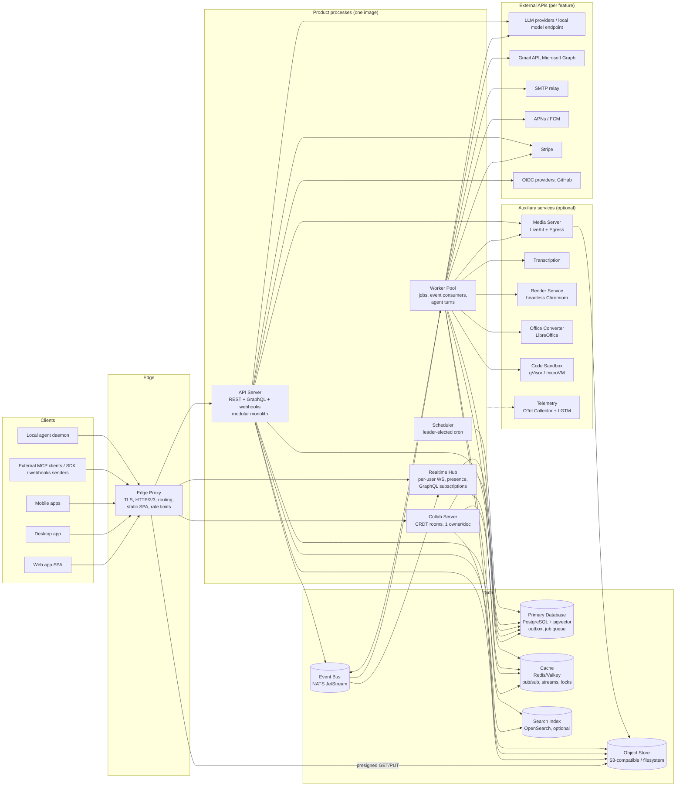
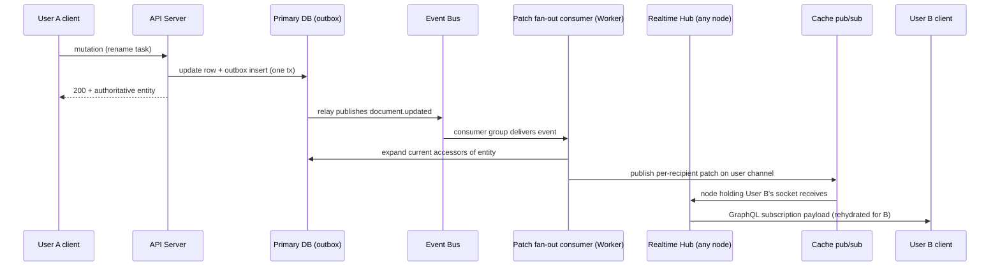
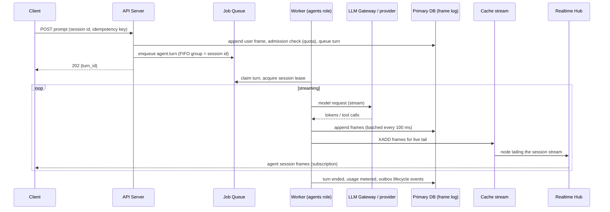
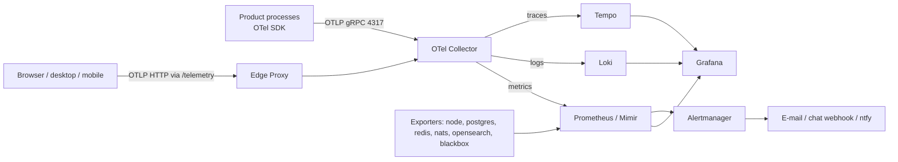

# Functional and Technical Specification: Unified Team Workspace (clean-room re-implementation)

| Field | Value |
|---|---|
| Version | 0.1 (draft) |
| Date | 2026-10-28 |
| Status | Draft for review |
| Companion | prd.md |
| Deployment target | One or several Linux VPSs; no AWS or Cloudflare dependency |

## Contents

- [1. Introduction](#1-introduction)
- [2. Glossary and conventions](#2-glossary-and-conventions)
- [3. Architecture overview and VPS deployment topology](#3-architecture-overview-and-vps-deployment-topology)
- [4. Platform components and AWS/Cloudflare replacement mapping](#4-platform-components-and-awscloudflare-replacement-mapping)
- [5. Configuration, secrets and operations: backup, restore, upgrades, migrations, scaling](#5-configuration-secrets-and-operations-backup-restore-upgrades-migrations-scaling)
- [6. Identity, authentication and sessions](#6-identity-authentication-and-sessions)
- [7. Authorization, sharing and access requests](#7-authorization-sharing-and-access-requests)
- [8. Core data model and entity catalog](#8-core-data-model-and-entity-catalog)
- [9. Properties, tags and system properties](#9-properties-tags-and-system-properties)
- [10. Unified list and query engine: filters, sorting, grouping, saved views, favorites, frecency](#10-unified-list-and-query-engine-filters-sorting-grouping-saved-views-favorites-frecency)
- [11. Mentions, references, activity log and work feed](#11-mentions-references-activity-log-and-work-feed)
- [12. Notifications, Home inbox, digests and reminders](#12-notifications-home-inbox-digests-and-reminders)
- [13. Realtime delivery and domain events](#13-realtime-delivery-and-domain-events)
- [14. Background jobs, queues and schedules](#14-background-jobs-queues-and-schedules)
- [15. API surface: GraphQL, REST, WebSocket, outgoing webhooks, public SDK, API keys, rate limits](#15-api-surface-graphql-rest-websocket-outgoing-webhooks-public-sdk-api-keys-rate-limits)
- [16. Channels and messaging](#16-channels-and-messaging)
- [17. Tasks, projects and importers](#17-tasks-projects-and-importers)
- [18. Calls, recording, transcription and dictation](#18-calls-recording-transcription-and-dictation)
- [19. GitHub integration and pull request review](#19-github-integration-and-pull-request-review)
- [20. Email](#20-email)
- [21. Calendar, scheduling and booking pages](#21-calendar-scheduling-and-booking-pages)
- [22. Contacts and CRM](#22-contacts-and-crm)
- [23. External messaging: WhatsApp linked devices](#23-external-messaging-whatsapp-linked-devices)
- [24. Documents and real-time collaborative editing](#24-documents-and-real-time-collaborative-editing)
- [25. Files, Drive, uploads, trash and retention](#25-files-drive-uploads-trash-and-retention)
- [26. File viewers and editors](#26-file-viewers-and-editors)
- [27. Canvas](#27-canvas)
- [28. Databases, spreadsheets and forms](#28-databases-spreadsheets-and-forms)
- [29. Search, command menu indexing, link unfurling and snippets](#29-search-command-menu-indexing-link-unfurling-and-snippets)
- [30. AI chat, agents and agent runtimes](#30-ai-chat-agents-and-agent-runtimes)
- [31. Memory, routines, skills and automations](#31-memory-routines-skills-and-automations)
- [32. MCP server and client, bots, incoming and outgoing webhooks, integrations catalog](#32-mcp-server-and-client-bots-incoming-and-outgoing-webhooks-integrations-catalog)
- [33. Plans, billing, quotas and usage metering](#33-plans-billing-quotas-and-usage-metering)
- [34. Frontend architecture, application shell and design system](#34-frontend-architecture-application-shell-and-design-system)
- [35. Keyboard model and shortcut reference](#35-keyboard-model-and-shortcut-reference)
- [36. Surface-by-surface UI specification](#36-surface-by-surface-ui-specification)
- [37. Mobile and desktop apps, offline and local cache](#37-mobile-and-desktop-apps-offline-and-local-cache)
- [38. Observability, security, privacy and compliance](#38-observability-security-privacy-and-compliance)
- [39. Non-functional requirements and acceptance testing](#39-non-functional-requirements-and-acceptance-testing)
- [Appendix A. Discrepancies and open questions](#appendix-a-discrepancies-and-open-questions)

## 1. Introduction

### 1.1 Purpose

This document specifies a unified team workspace ("the Product"). It combines email, team chat, tasks and projects, collaborative documents, canvas, file storage, databases, spreadsheets, forms, calendar and booking pages, CRM, calls with recording and transcription, pull-request review, search, and AI agents with shared memory. Every item in the workspace can be @-mentioned from any other item, and those links are stored as a bidirectional graph.

The specification describes required behaviour, data shapes, interfaces and user experience. It does not describe any existing implementation. Engineers who have never seen the reference product's source code must be able to build an equivalent system from this document and the companion PRD alone.

### 1.2 Goals of the re-implementation

- **Functional parity.** Every user-visible capability of the reference product is in scope. Gaps between the reference's marketing and its implementation are specified as target behaviour and marked as such.
- **UX parity.** The application shell, navigation model, keyboard model, list conventions, entity pages and per-surface behaviour match the reference closely enough that an existing user is immediately at home. Section 34 to section 37 carry this requirement.
- **VPS hosting.** The whole system runs on one virtual private server, or a few, using open-source infrastructure. No component may require Amazon Web Services or Cloudflare. Section 3 to section 5 and section 4's replacement mapping carry this requirement.
- **Operational simplicity.** One install command brings up a working instance. Optional subsystems such as calls, AI, transcription and full-text search degrade gracefully when they are not configured.

### 1.3 Non-goals

- Reproducing the reference product's source code, internal architecture, database schema, prompts, brand, logo, marketing copy or documentation text.
- Binary or wire compatibility with the reference product's private APIs. Public standards (OAuth 2.0, OIDC, MCP, ACP, WebSocket, GraphQL, IMAP/SMTP, Gmail API, Microsoft Graph, Google Calendar API) are used where interoperability needs them.
- Native mobile app store distribution under the reference product's identity.

### 1.4 Clean-room process

This specification is the only channel between the people who studied the reference product and the people who will build the new one.

- **[NFR-019]** Implementers MUST NOT read the reference product's source code, schema, infrastructure definitions or internal documentation.
- **[NFR-020]** Questions from implementers MUST go to the specification team in writing. Answers MUST be added to this document as behaviour descriptions, never as code or copied text.
- **[NFR-021]** The project SHOULD keep a log of each specification revision and each question and answer, to evidence independent creation.
- **[NFR-022]** UI labels of a few words (menu items, button text, tab names) are reproduced where they are needed for UX parity. Visual design values are given as specifications of look and feel. Implementers MUST create their own icons, illustrations, logo and brand.
- **[NFR-023]** The project SHOULD get legal review before release. The reference is published under a strong copyleft licence, and a close visual match can raise trade-dress questions. See the PRD's risk register.

### 1.5 How to read this document

- Requirement keywords MUST, SHOULD and MAY follow RFC 2119.
- Each requirement has a stable identifier such as `[MAIL-012]`. The prefix names the area and the number is unique within it.
- "Maturity: experimental" marks behaviour that exists in the reference only behind a feature flag or without real-world verification. Build it, but it may ship later.
- "Maturity: advertised; specified here as target behaviour" marks behaviour the reference promotes but does not fully implement.
- Field names, endpoint paths and event names in this document are recommendations. Implementers MAY rename them consistently.
- Numbers such as timeouts, limits and retention periods are defaults. Unless a requirement says otherwise, they SHOULD be operator-configurable.

### 1.6 Document map

| Part | Sections |
|---|---|
| Platform | 3 Architecture and deployment, 4 Component mapping, 5 Operations, 13 Realtime and events, 14 Jobs and schedules, 38 Observability and security |
| Identity and API | 6 Authentication, 15 API surface, 33 Plans and billing |
| Core model | 7 Authorization and sharing, 8 Data model, 9 Properties, 10 Lists and views, 11 Mentions and activity, 12 Notifications |
| Communication | 16 Channels, 17 Tasks and projects, 18 Calls, 19 GitHub, 20 Email, 21 Calendar and booking, 22 CRM, 23 WhatsApp |
| Content | 24 Documents, 25 Files, 26 Viewers, 27 Canvas, 28 Databases, sheets and forms, 29 Search and unfurl |
| AI | 30 Agents, 31 Memory and routines, 32 MCP, bots and integrations |
| Client | 34 Shell and design system, 35 Keyboard, 36 Surfaces, 37 Mobile, desktop and offline |
| Quality | 39 Non-functional requirements and acceptance testing, Appendix A Discrepancies |

## 2. Glossary and conventions

### 2.1 Glossary

| Term | Meaning |
|---|---|
| Workspace (team) | The tenant boundary. A group of members who share channels, items, memory and billing. In the reference each user belongs to at most one team. |
| Member roles | Owner, Admin, Member. Guests are people outside the workspace who were given access to specific items. |
| Entity (item) | Any addressable object: document, task, channel, message, email thread, contact, company, calendar event, call, pull request, form, database, row, sheet, canvas, file, folder, project, chat session and so on. Every entity has a kind and a globally unique id. |
| Block | A product area with its own surface, such as Email, Chat, Tasks, Docs, Canvas, Calendar, CRM, Calls or Agents. |
| Mention (@link) | An inline reference from rich text to a user or an entity. It creates a stored reference edge and, in channels, can grant access. |
| References (backlinks) | The list of places that mention an entity. |
| Split | One of several side-by-side panes in the desktop window. Each split has its own navigation history. |
| Unified list engine | The query layer of section 10. It queries many entity kinds through one filter, sort and group model and powers Home, lists, boards and saved views. |
| Signal / Noise | A two-way triage of incoming items. Signal holds important items and Noise holds the rest. Email has its own stricter Signal rule. |
| Work feed | The server-side Home inbox. It merges notifications with the user's own recent work and groups related items. |
| Discussion | A message thread attached to a non-channel entity such as a document, task, CRM record or call. It uses the same message store as channels. |
| Project | A user-facing project that groups tasks and other items around a goal. It is different from a Drive folder. |
| Folder | A Drive container for files and documents. Permissions inherit down the folder tree. |
| Property | A typed attribute on an entity: system-defined (Status, Priority, Assignees and so on), user-defined, team-defined or database-column. |
| Tag | A coloured label that can be attached to many entity kinds. |
| Saved view | A stored combination of filter, sort, grouping and display settings. It can be personal, team or shared. |
| Frecency | A score that combines how often and how recently a user opened an entity. Used for ranking. |
| Collab document | A document whose content is a CRDT and is edited in real time by several peers, people or AI agents. |
| Peer | One replica that takes part in a CRDT session: a browser tab, a native app, a server-side AI editor or an import job. |
| Agent | An AI actor that can hold conversations, call tools, edit documents as a peer, be assigned tasks and be @-mentioned. It is a first-class user of the system. |
| The Assistant | The built-in default agent, @-mentionable by a configurable handle. |
| Agent session | One conversation or run of an agent, with a durable event log. |
| Runtime | The execution engine behind an agent: the in-process default agent, the sandboxed coding agent, third-party cloud coding agents, or the local agent daemon. |
| Routine | A scheduled or event-triggered agent run. |
| Skill | A packaged set of instructions an agent can load on demand. |
| Memory | Markdown text the system keeps about a user, and as target behaviour about a team, and gives to agents as context. |
| Tool | A typed operation an agent can call, for example "create task" or "search". The same tools are exposed over the public MCP server. |
| MCP | Model Context Protocol. Used both as a server (external AI clients act in the Product) and as a client (the Product's agents call external tools). |
| Connected account | A mail, calendar or other provider account linked to a user for data access. It is separate from the login identity. |
| Inbox (mail) | One connected mailbox. A user may connect several. Shared and delegated inboxes are visible to more than one member. |
| Booking page | A public scheduling page where outside people book time with one or more hosts. |
| Outbox | A database table written in the same transaction as a state change. A relay then publishes it to the Event Bus. |
| Object Store, Job Queue, Event Bus, Cache, Search Index, Collab Server, Realtime Hub, Worker Pool, Scheduler, Mailer, Push Gateway, Media Server, LLM Gateway, Code Sandbox, Render Service, Office Converter | Abstract platform components. See section 4 for the concrete software behind each. |

### 2.2 Identifier and data conventions

- **[DATA-021]** Every entity id MUST be a UUID. New ids SHOULD be UUIDv7, which sort by creation time. Clients MAY create ids for optimistic creation, and the server MUST accept a client id once and reject reuse for a different entity.
- **[DATA-022]** All timestamps MUST be stored in UTC with at least millisecond precision and serialized as RFC 3339 strings.
- **[DATA-023]** Rich text MUST use one canonical serialized form, markdown extended with custom tags (section 24). It is used for documents, task descriptions, messages, comments and AI output, so that mentions and embeds behave the same everywhere.
- **[DATA-024]** Deletion is soft by default. A deleted entity moves to trash with a deletion timestamp and is purged after the retention period (default 30 days) unless restored.
- **[DATA-025]** Money values MUST be stored as integer minor units plus an ISO 4217 currency code.
- **[DATA-026]** Text MUST be UTF-8. User-facing sorting and search MUST be Unicode-aware, using ICU collation and analysis.

### 2.3 Environments

| Environment | Purpose |
|---|---|
| Local | One developer machine using the same container set as the small VPS profile, with a local mail catcher in place of SMTP. |
| Staging | A VPS deployment that mirrors production topology, used for release candidates. |
| Production | Any operator's deployment, from a single VPS to the multi-node "Scale" profile. |

## 3. Architecture overview and VPS deployment topology

This section defines the runtime architecture of the Product and how it is deployed on one VPS or a small group of VPSs. The headline requirement for sections 3, 4, 5, 13, 14 and 38 is: **the same functionality as the reference product, hostable on commodity Linux VPSs, with no dependency on AWS, Cloudflare or any other hyperscaler-specific managed service.** Every managed service the reference relied on is replaced by an abstract platform component (see the component table in the style guide), and section 4 maps each one to self-hostable software.

### 3.1 Design goals and constraints

- **[ARCH-001]** The system MUST run end to end on Linux x86_64 or arm64 hosts using only open-source or self-hostable components plus the external third-party APIs that a given feature inherently needs (for example the Gmail API for Gmail sync, APNs/FCM for mobile push, an LLM provider for AI).
- **[ARCH-002]** The system MUST NOT require any of: managed container hosting, serverless functions, managed queues or topics, managed Kafka, managed key-value NoSQL, managed Redis, a CDN, managed search, managed email sending, managed mobile push, managed secrets or KMS, edge workers, edge databases, edge browsers, managed WebRTC, managed sandboxes, or an APM SaaS.
- **[ARCH-003]** All backend processes MUST be built from **one codebase** and shipped as **one container image** (plus a small number of third-party images such as PostgreSQL). Each process type is selected by an entrypoint argument (for example `product api`, `product worker --queues=...`). This keeps versions in lockstep and makes a single-host install simple.
- **[ARCH-004]** The API Server MUST be a **modular monolith**: one process hosting all HTTP REST, GraphQL and webhook-receiver modules. Modules communicate through in-process interfaces, own their tables, and never read another module's tables directly. Any module MAY later be extracted to its own process without changing its public interface.
- **[ARCH-005]** The following MUST be separate process types because they have different state, scaling or isolation needs: Collab Server (stateful, one owner per document), Realtime Hub (long-lived WebSockets), Worker Pool (background jobs), Scheduler (single active leader). On the Solo profile they MAY run as roles inside one "all-in-one" process (see 3.6.1) to save memory.
- **[ARCH-006]** Every stateful dependency MUST sit behind an internal port (interface) with at least one self-hosted adapter, so that installs can substitute alternatives (for example the Job Queue adapter can be PostgreSQL or NATS JetStream).
- **[ARCH-007]** Optional components (Search Index, Media Server, Transcription, LLM Gateway providers, Code Sandbox, Render Service, Office Converter, Analytics, Billing, Push Gateway) MUST be individually switchable off. The Product MUST start and remain functional with any subset of them disabled, degrading as specified in 4.25.
- **[ARCH-008]** The system MUST support both a **single-organisation self-host** (billing off, plan limits configurable) and a **multi-tenant SaaS on VPS** (billing on). Tenancy is a data concern (team/workspace scoping, section 7 and 8), not a deployment concern: one deployment serves many teams.
- **[ARCH-009]** The browser, desktop and mobile clients MUST reach the backend through a **single public origin** by default (for example `https://work.example.com`), with path-based routing at the Edge Proxy. Separate hostnames are required only for: isolated user-content origins (3.9), call media/TURN, agent preview origins, and the optional public MCP host.

### 3.2 Logical architecture



Notes on the diagram:
- The Job Queue is drawn inside the Primary Database because the default adapter is PostgreSQL-backed (section 14). With the NATS adapter it lives in the Event Bus server.
- Agent turns run in the Worker Pool (role `agents`), not in the API Server, so that a long model call never holds an HTTP worker and so that agent workloads can be isolated and scaled separately.
- The Realtime Hub reads the database only for authorization rechecks and subscription rehydration; it never writes domain data.

### 3.3 Process types

| Process type | Entrypoint (suggested) | State | Responsibilities | Default replicas |
|---|---|---|---|---|
| API Server | `product api` | Stateless | REST `/api/v1/*`, GraphQL queries and mutations, inbound webhooks (OAuth callbacks, Gmail push, Microsoft Graph notifications, Stripe, GitHub, media server, signed booking pages), presigned upload/download issuance, public MCP endpoint, OAuth 2.1 authorization server for MCP clients, unfurl and image proxy endpoints, internal endpoints for other processes | 1 (Solo/Team), 2+ (Scale) |
| Realtime Hub | `product realtime` | Soft state (connections) | Per-user WebSocket push protocol (13.2-13.8), GraphQL subscriptions over WebSocket (13.9), presence, live viewers, last-online tracking, per-entity stream subscriptions | 1 (Solo/Team), 2+ (Scale) |
| Collab Server | `product collab` | Stateful (in-memory CRDT rooms) | CRDT document and surface rooms, WebSocket sync protocol, snapshotting, op-log persistence, room HTTP control API (section 24), exactly-one-owner leases | 1 (Solo/Team), 2+ (Scale, sticky) |
| Worker Pool | `product worker --roles=<list>` | Stateless | Job Queue consumers (14.7), Event Bus consumers (13.15), outbox relay (13.14), agent turn execution, imports, sync engines for email/calendar | 1 (Solo), 2 (Team: `default` and `agents,imports`), 3+ (Scale) |
| Scheduler | `product scheduler` | Stateless (leader-elected) | Evaluates cron schedules (14.6) and enqueues jobs; exactly one active leader | 1 active (+1 standby in Scale) |
| Migrator | `product migrate` | One-shot | Applies forward-only database migrations, search index templates, bucket setup; exits 0 on success | Run per deploy |
| Admin CLI | `product admin <cmd>` | One-shot | Operational commands (5.14) | On demand |
| Media helper | `product transcriber` | Stateless | Joins calls as a bot to transcribe live audio (optional; section 18) | 0 or 1 |

Third-party processes: Edge Proxy (Caddy), PostgreSQL, Redis/Valkey, NATS JetStream, Object Store (Garage or SeaweedFS, or none with the filesystem driver), OpenSearch, LiveKit server and LiveKit Egress, Chromium render pool, LibreOffice converter, sandbox runtime, OpenTelemetry Collector, Grafana, Loki, Tempo, Prometheus or Mimir, Alertmanager.

- **[ARCH-010]** Worker roles MUST be selectable per process (`--roles=default,email,search,media,agents,imports,maintenance`) so that heavy roles (agent turns, imports, media processing) can be isolated onto separate replicas or hosts without code changes. A process with no `--roles` argument MUST consume every role.
- **[ARCH-011]** Every process MUST expose `/healthz`, `/readyz` and `/metrics` on an internal-only admin port (5.9), handle SIGTERM with a graceful drain (default 30 s; Collab Server 60 s; agent and import workers up to 120 s with checkpointing), and log structured JSON to stdout.

### 3.4 Internal communication rules

| Path | Mechanism | Rules |
|---|---|---|
| Module to module inside the API Server | In-process interface call | Synchronous; shares the caller's transaction only when both modules agree to (for example entity creation + outbox write). |
| API Server or Worker to Collab Server | Internal HTTP (`/internal/collab/*`) | Authenticated with a short-lived internal service token (38.10.9); routed to the document's current owner (24 and 4.17). |
| Any process to Realtime Hub | Publish to Cache pub/sub channel, or internal HTTP `POST /internal/rt/send` | Fire-and-forget with delivery receipt available via HTTP; timeout 5 s; never blocks a user request on delivery. |
| Domain change propagation | Transactional outbox, relayed to the Event Bus (13.14) | All cross-module side effects (search indexing, activity, notifications, webhooks, realtime list patches, agent triggers) MUST be driven by events, not by synchronous calls. |
| Deferred or retried work | Job Queue (14.1) | At-least-once; handlers idempotent. |
| Agent turn streaming | Durable frame log in Primary Database + Cache stream for live tail (13.8) | Frames are written before they are published. |
| Collab frames via Realtime Hub (optional multiplexing) | Realtime Hub forwards binary frames to the document owner | (Maturity: experimental). Default is a direct WebSocket from client to Collab Server. |

- **[ARCH-012]** No process other than the Migrator MAY change the database schema. All processes connect to the Primary Database with role-specific database users (38.10.9).
- **[ARCH-013]** Internal HTTP calls MUST propagate W3C `traceparent` and the acting principal, use a per-call timeout (default 10 s; Collab control calls 5 s), and retry only idempotent operations, at most 2 times with jittered backoff.

### 3.5 Request flows

#### 3.5.1 Page load (web)

1. Browser requests `https://<app-host>/` or any `/app/*` route. The Edge Proxy serves `index.html` from the static bundle with `Cache-Control: no-store` and the security headers of 38.10.3.
2. Hashed assets (`/assets/*`) are served with `Cache-Control: public, max-age=31536000, immutable`, Brotli or gzip precompressed.
3. The SPA boots, loads its local cache (section 37), calls `GET /api/v1/session` (cookie auth) to learn the viewer, and if needed refreshes the session token (section 6).
4. The SPA opens one WebSocket to the Realtime Hub (`wss://<app-host>/rt`) and one GraphQL subscription socket (`wss://<app-host>/graphql/ws`; MAY be the same socket if the client multiplexes, see 13.9).
5. The SPA issues GraphQL queries for the visible lists (section 10) and renders cached data first, then reconciles.

#### 3.5.2 API call (REST or GraphQL)

1. Edge Proxy terminates TLS, applies per-IP rate limits (38.10.8), adds `X-Request-Id` and forwards to an API Server replica (round-robin, health-checked).
2. The API Server authenticates the credential (session cookie, bearer token, API key, bot token or local-agent-daemon token; exactly one, otherwise 400) and resolves a principal (section 6).
3. The owning module authorizes the action against current access (section 7), runs the use case in one database transaction, and writes any domain events to the outbox in the same transaction.
4. The response returns. Reads that tolerate lag MAY use the read replica (Scale profile); reads immediately following a write by the same user MUST use the primary.
5. The outbox relay publishes the events (13.14); downstream consumers update search, activity, notifications, realtime and webhooks.

#### 3.5.3 Live update



Ephemeral updates (typing indicators, call ringing, presence) skip the outbox and the Event Bus: the API Server publishes directly to the recipients' Cache channels.

#### 3.5.4 Document edit (collaborative)

1. Client asks the API Server for a collab token for document D (`POST /api/v1/documents/{id}/collab-token`); the API checks access and returns a signed token (TTL 1 h) carrying document id, user id and access level.
2. Client opens `wss://<app-host>/collab/d/{id}?token=...`. The Edge Proxy routes by document id hash to a Collab Server node (Scale profile). If that node does not own D, it forwards the connection to the owner found in the ownership registry, or acquires ownership if no live owner exists (4.17).
3. The owner loads D (latest snapshot + op-log tail) if not in memory, sends the initial sync, then applies updates one at a time: import, validate, append to op log, persist, acknowledge, broadcast.
4. Debounced (default 2 s after last edit, at most every 30 s), the owner calls the API Server's internal "content changed" endpoint with the editor list; that emits `document.content_changed`, which feeds search indexing, activity sessionization and notifications.
5. Every 5 s of activity, or every 500 ops, the owner compacts the op log into a new snapshot. After 60 s with no connections the room is evicted from memory and the lease released.

#### 3.5.5 File upload

1. Client computes SHA-256 and calls `POST /api/v1/files` (or the document-create endpoint) with name, size, type and hash.
2. API Server checks quota and access, creates the metadata row in state `pending_upload`, and returns a presigned PUT URL (TTL 15 min) for the Object Store, or an upload URL on the Product's own file endpoint when the filesystem driver is used.
3. Client PUTs the bytes directly to the Object Store (through the Edge Proxy path `/files/` or a dedicated files host).
4. Client calls `POST /api/v1/files/{id}/complete`. The API verifies the object exists (HEAD, size and optional checksum match), moves the row to `uploaded`, and enqueues the finalize job in the same transaction.
5. Workers run finalize (type detection, legacy format upgrade, markdown initialization), text extraction, Office-to-PDF conversion, thumbnail generation and search indexing as independent jobs (14.7.1). Progress is pushed over the Realtime Hub.
6. A reconciliation sweep (every 5 min) finds `pending_upload` rows whose object exists but `complete` was never called (client crashed) and finalizes them; rows still missing their object after 24 h are deleted. This replaces reliance on storage event notifications (4.10).

#### 3.5.6 Inbound email push (Gmail)

1. The provider's push service POSTs to `https://<app-host>/api/v1/hooks/gmail/push` with a signed JWT. The API verifies issuer, audience and expiry against the provider's published keys.
2. The API resolves the mailbox by address, enqueues an `email.inbox_sync` job with FIFO group key = mailbox id and dedup key = mailbox id + history id, and returns 202 within 1 s.
3. A worker (role `email`) acquires the per-mailbox rate gate (14.8), fetches history since the stored cursor, writes messages and threads in one transaction per batch, advances the cursor, and writes outbox events (`email.message_received`, etc.).
4. Consumers index the message, update Signal/Noise, create notifications (push, in-app), populate CRM contacts, update the contact graph, and push a realtime patch to the inbox list.
5. For installs without a public inbound endpoint, a pull-mode adapter MAY poll the provider's subscription instead (section 20). Microsoft Graph change notifications follow the same pattern with validation-token echo.

#### 3.5.7 AI turn



- Tool calls run inside the worker with the acting user's permissions; code-mode programs and coding agents run in the Code Sandbox (section 30).
- If the worker dies mid-turn, the session lease expires (default 60 s); the turn is marked interrupted and is never automatically replayed (prompts and tool calls are not idempotent). The client sees an "interrupted" frame.

### 3.6 Deployment profiles

Three reference profiles are specified. Sizes are planning defaults for NVMe-backed VPSs with dedicated or high-share vCPUs; operators SHOULD validate with the load tests of section 39.

| Item | Solo/Small | Team | Scale |
|---|---|---|---|
| Hosts | 1 VPS | 1 VPS | 3-6 VPSs |
| Size | 4 vCPU / 16 GB RAM / 200 GB NVMe | 8-16 vCPU / 32-64 GB RAM / 500 GB-1 TB NVMe | See 3.6.3 |
| Target load (planning) | up to 25 active users, 10 concurrent editors, 25 connected mailboxes | up to 250 active users, 100 concurrent editors, 250 mailboxes, 10 concurrent calls | 250-2,500 active users |
| Orchestration | Docker Compose | Docker Compose | Docker Compose per host with Ansible (or Nomad / k3s) |
| Search Index | Off (PostgreSQL full-text fallback) or OpenSearch with 1 GB heap | OpenSearch single node, 4-8 GB heap | Dedicated search node |
| Event Bus | NATS JetStream (256 MB memory limit) or PostgreSQL log mode (13.19) | NATS JetStream | NATS JetStream, 3-node cluster optional |
| Object Store | Filesystem driver or single-node Garage | Single-node Garage or SeaweedFS | Garage 3-node (one per zone/host) or SeaweedFS with replication |
| Media Server | Off by default | On (LiveKit + Egress) | Dedicated media node |
| Code Sandbox | Off by default | On, gVisor runtime, max 4 concurrent sandboxes | Dedicated sandbox node |
| Render Service / Office Converter | On-demand containers, 1 slot each | Pools of 2 each | Pools on app nodes |
| Telemetry | Single `otel-lgtm` all-in-one container, 7-day retention | Separate Grafana/Loki/Tempo/Prometheus, 14-day retention | Dedicated or external observability host, 30-day retention |
| Backups | pgBackRest to off-host S3-compatible bucket or second VPS | Same, plus Object Store replication | Same, plus streaming replica |

#### 3.6.1 Solo/Small: single VPS, everything in Compose

- **[ARCH-020]** The Solo profile MUST run with one `docker compose up` on a 4 vCPU / 16 GB / 200 GB VPS. It MAY use the `all-in-one` entrypoint (`product all --roles=api,realtime,collab,worker,scheduler`) that hosts all Product roles in one process with separate thread pools.
- **[ARCH-021]** Optional components default to off in Solo: Search Index (PostgreSQL FTS fallback), Media Server, Transcription, Code Sandbox, Analytics, Billing. AI is on only if an LLM provider key or local endpoint is configured.

Memory budget (Solo, 16 GB):

| Component | Budget |
|---|---|
| PostgreSQL (`shared_buffers` 3 GB, `effective_cache_size` 8 GB, `work_mem` 16 MB, `max_connections` 150) | 4 GB resident |
| Product all-in-one process | 2-3 GB |
| Redis/Valkey (`maxmemory` 512 MB, `noeviction` for streams DB, see 5.2) | 0.6 GB |
| NATS JetStream | 0.3 GB |
| Garage (or none) | 0.3 GB |
| Caddy | 0.1 GB |
| OTel all-in-one (Grafana, Loki, Tempo, Prometheus) | 1.5 GB |
| Render Service / Office Converter (on demand, 1 slot each) | 1.5 GB peak |
| OS, page cache headroom | remainder |

Disk (Solo, 200 GB): PostgreSQL data 40 GB, WAL 10 GB, Object Store 100 GB, telemetry 15 GB, images and logs 15 GB, free headroom 20 GB. Alert at 80% full (38.6).

#### 3.6.2 Team: single larger VPS, all components

- **[ARCH-022]** The Team profile MUST run every component, including Search Index, Media Server with Egress, Transcription (self-hosted model on CPU, or hosted API), Code Sandbox, Render Service and Office Converter, on one 8-16 vCPU / 32-64 GB host.
- Process layout: 1 API Server, 1 Realtime Hub, 1 Collab Server, 2 Worker processes (`default,email,search,media,maintenance` and `agents,imports`), 1 Scheduler.
- Suggested memory (32 GB): PostgreSQL 8 GB, OpenSearch 6 GB (4 GB heap), Product processes 6 GB, Redis 1 GB, LiveKit + Egress 3 GB, Chromium and LibreOffice pools 3 GB, sandboxes 4 GB (4 x 1 GB), telemetry 2 GB. A 64 GB host doubles PostgreSQL and sandbox budgets.
- CPU note: a self-hosted Whisper-family transcriber on CPU needs roughly 2 vCPU per concurrent call for near-real-time small/base models; Team installs SHOULD use a hosted transcription API or a GPU host for more than 3 concurrent transcribed calls.

#### 3.6.3 Scale: 3-6 VPSs

| Node | Size (suggested) | Runs |
|---|---|---|
| `edge-app-1`, `edge-app-2` | 8 vCPU / 16-32 GB / 100 GB | Caddy, API Server, Realtime Hub, Collab Server, Worker (`default,email,search,maintenance`), Scheduler (leader election picks one), Render and Converter pools |
| `db-1` (primary) | 8-16 vCPU / 64 GB / 1-2 TB NVMe | PostgreSQL primary, pgBackRest repository client, Redis primary, NATS (1 of 3 if clustered) |
| `db-2` (replica) | 8 vCPU / 32-64 GB / 1-2 TB NVMe | PostgreSQL streaming replica (read replica + failover target), Redis replica, NATS (2 of 3) |
| `search-1` | 8 vCPU / 32 GB / 500 GB NVMe | OpenSearch, Garage or SeaweedFS node, NATS (3 of 3) |
| `media-1` (optional) | 8 vCPU / 16 GB, 1 Gbit/s+ unmetered or high transfer allowance | LiveKit server, LiveKit Egress, TURN, transcriber |
| `work-1` (optional) | 8-16 vCPU / 32-64 GB | Worker (`agents,imports,media`), Code Sandbox runtime |

- **[ARCH-030]** App nodes MUST be stateless except for the Collab Server's in-memory rooms, so that any app node can be replaced. Ingress MUST reach app nodes via either (a) DNS with multiple A/AAAA records plus health-checked Caddy on each node, or (b) a floating IP / provider load balancer in front of the Caddy instances. A provider load balancer is acceptable because it is a commodity L4 feature, not a cloud-specific managed service; the design MUST also work with option (a).
- **[ARCH-031]** Collab Server routing MUST be sticky by document id: the Edge Proxy SHOULD hash the document id path segment to choose an upstream (consistent hashing so that adding a node moves about 1/N of rooms), and the Collab Server MUST in all cases enforce exactly one owner per document through the lease registry (4.17). Edge stickiness is an optimisation; the lease is the correctness guarantee.
- **[ARCH-032]** Realtime Hub connections need no stickiness: cross-node delivery uses Cache pub/sub (13.6).
- **[ARCH-033]** PostgreSQL failover in the Scale profile MAY be manual (documented promotion runbook, target RTO 30 min) or automated with Patroni (requires a 3-member consensus store such as etcd; out of default scope). Applications MUST reconnect automatically after a primary change by resolving a stable DNS name or virtual IP.
- **[ARCH-034]** The Scheduler MUST run on at least two nodes in the Scale profile with leader election (14.5), so that losing one node does not stop schedules.

### 3.7 Network, ports and routing

#### 3.7.1 Public (internet-facing) ports

| Port | Protocol | Host | Purpose | Profile |
|---|---|---|---|---|
| 80 | TCP | Edge | ACME HTTP-01 challenges and redirect to HTTPS | All |
| 443 | TCP | Edge | HTTPS, HTTP/2, WebSockets | All |
| 443 | UDP | Edge | HTTP/3 (QUIC) | All (optional) |
| 7881 | TCP | Media | WebRTC over TCP fallback | When calls on |
| 3478 | UDP | Media | TURN/STUN | When calls on |
| 5349 | TCP | Media | TURN over TLS (or 443 on a dedicated TURN hostname) | When calls on |
| 50000-60000 | UDP | Media | WebRTC media (range configurable; size to ~2 ports per participant track) | When calls on |
| 2222 | TCP | Edge | SSH reverse tunnels for agent preview sharing (section 30); MAY be disabled | Optional |
| 22 | TCP | All | Operator SSH; MUST be restricted to an allowlist or a VPN/WireGuard interface | All |

#### 3.7.2 Internal ports (private network or Docker network only)

| Service | Port | Notes |
|---|---|---|
| API Server | 8080 HTTP, 9100 admin | Admin port serves `/healthz`, `/readyz`, `/metrics` |
| Realtime Hub | 8081 HTTP/WS, 9101 admin | |
| Collab Server | 8082 HTTP/WS, 9102 admin | Plus 8092 for node-to-node forwarding |
| Worker Pool | 9103 admin | No public listener |
| Scheduler | 9104 admin | |
| PostgreSQL | 5432 | Optional PgBouncer on 6432 |
| Redis/Valkey | 6379 | Password and ACL users required |
| NATS | 4222 client, 6222 cluster, 8222 monitoring | Token or NKey auth required |
| Garage | 3900 S3 API, 3901 RPC, 3903 admin | S3 API reachable by the Edge Proxy for presigned URLs |
| OpenSearch | 9200 | Security plugin with basic auth, or private network only plus auth at app level |
| LiveKit | 7880 API/WS | Proxied through the Edge Proxy at `/rtc` or exposed on the media host |
| Render Service | 9222 (CDP) | Never exposed |
| Office Converter | 2004 (HTTP wrapper) | Never exposed |
| OTel Collector | 4317 gRPC, 4318 HTTP | Browser telemetry reaches 4318 only through the Edge Proxy path in 38.7 |
| Grafana | 3000 | Exposed only via VPN or behind SSO at `/ops/grafana` if desired |

- **[ARCH-040]** All internal services MUST bind to a private interface (Docker network, WireGuard mesh, or provider private network). Multi-host profiles MUST encrypt node-to-node traffic either with a WireGuard mesh (recommended) or with TLS on every internal protocol.

#### 3.7.3 Edge Proxy routing (single origin)

The Product chooses one convention: **path prefixes are preserved** and every Product router mounts under its full path.

| Path | Upstream | Notes |
|---|---|---|
| `/` , `/app/*`, other SPA routes | Static bundle | `try_files {path} /index.html`; `index.html` is `no-store` |
| `/assets/*` | Static bundle | Immutable, 1 year |
| `/api/v1/*` | API Server | REST; request body limit 25 MB default (uploads go to Object Store) |
| `/graphql` | API Server | Queries and mutations; GraphiQL disabled in production unless an operator flag enables it for admins |
| `/graphql/ws` | Realtime Hub | WebSocket subscriptions |
| `/rt` | Realtime Hub | Per-user push WebSocket |
| `/collab/*` | Collab Server | WebSocket + HTTP control; sticky by document id |
| `/files/*` | Object Store S3 endpoint (presigned) or API file endpoint | Path-style bucket addressing |
| `/media/*` | Image variant endpoint on API Server | Resized and transcoded image variants (26) |
| `/mcp`, `/.well-known/oauth-*` | API Server | Public MCP and its OAuth metadata (section 32); MAY also be served on a dedicated host |
| `/hooks/*` | API Server | Inbound third-party webhooks (alias of `/api/v1/hooks/*`) |
| `/rtc/*` | LiveKit | When the media server shares the main host |
| `/telemetry/v1/*` | OTel Collector HTTP receiver | Browser traces and logs, rate limited (38.7) |
| `/book/*` | Static bundle (public booking pages) | Separate COOP header (38.10.3) |
| `/ops/*` | Grafana and admin UIs | Disabled by default; requires operator SSO or VPN |

- **[ARCH-041]** The Edge Proxy MUST set an idle timeout of at least 3,600 s for WebSocket and server-sent-event routes, MUST pass `X-Forwarded-For`, `X-Forwarded-Proto` and `X-Request-Id`, and MUST strip any client-supplied value of those headers before setting them.

### 3.8 DNS records

Example zone for an install at `example.com`:

| Record | Type | Value | Required | Purpose |
|---|---|---|---|---|
| `work.example.com` | A/AAAA | Edge IP(s) | Yes | Single app origin (UI, API, WebSockets, collab) |
| `files.work-content.example.net` | A/AAAA or CNAME | Edge IP(s) | Recommended | Isolated user-content origin for downloads and previews of untrusted files (38.10.3); use a different registrable domain from the app |
| `*.preview.work-content.example.net` | A/AAAA (wildcard) | Edge IP | If agent previews on | Per-session preview origins (section 30); needs a DNS-01 wildcard certificate |
| `mcp.example.com` | A/AAAA | Edge IP | Optional | Dedicated public MCP host |
| `rtc.example.com` | A/AAAA | Media IP | If calls on | LiveKit signalling (WSS) |
| `turn.example.com` | A/AAAA | Media IP | If calls on | TURN/STUN |
| `example.com` | TXT (SPF) | `v=spf1 include:<relay> -all` | If sending mail | Outbound transactional mail |
| `<selector>._domainkey.example.com` | TXT | DKIM public key | If sending mail | DKIM signing by the relay |
| `_dmarc.example.com` | TXT | `v=DMARC1; p=quarantine; rua=mailto:...` | If sending mail | DMARC |
| `bounce.example.com` | MX + TXT (SPF) | Relay's bounce host | Recommended | Return-path domain for bounce processing (4.13) |
| `example.com` | CAA | `0 issue "letsencrypt.org"` | Recommended | Restrict certificate issuance |
| `_acme-challenge.*` | TXT | Managed by Caddy DNS plugin | For wildcard certs | DNS-01 challenge |

- **[ARCH-050]** The app origin and the user-content origin MUST be different registrable domains (not merely subdomains) so that cookies and same-site protections do not cover untrusted content.

### 3.9 TLS

- **[ARCH-060]** The Edge Proxy MUST obtain and renew certificates automatically via ACME (HTTP-01 or TLS-ALPN-01 for single names; DNS-01 for wildcards). Renewal MUST begin at least 30 days before expiry, and a failed renewal MUST raise an alert (38.6).
- **[ARCH-061]** TLS 1.2 is the minimum and TLS 1.3 is preferred. HSTS `max-age=31536000; includeSubDomains` MUST be sent on the app origin once the operator confirms all subdomains are HTTPS.
- **[ARCH-062]** Operators MAY bring their own certificates (file paths in config) for installs that cannot use ACME (air-gapped, internal CA).
- **[ARCH-063]** The media server MUST have a valid certificate for its WSS signalling and TURN-TLS host; browsers refuse WebRTC signalling over untrusted TLS.

### 3.10 Firewall and network policy

- **[ARCH-070]** Hosts MUST default-deny inbound traffic and allow only the public ports of 3.7.1 that the enabled components need. Operator SSH MUST be key-only and restricted by source IP or VPN.
- **[ARCH-071]** Outbound traffic from Product processes SHOULD be allowed only to: configured third-party API hosts, the SMTP relay, APNs/FCM, LLM endpoints, OIDC providers, and arbitrary HTTPS for the unfurl and image-proxy fetchers (which apply the SSRF rules of 38.10.5).
- **[ARCH-072]** Code Sandbox containers MUST have no direct outbound network access. All sandbox egress MUST go through the Product's egress proxy (section 30), which injects credentials and enforces an allowlist.
- **[ARCH-073]** Docker's default behaviour of publishing ports through the host firewall MUST be accounted for: internal services MUST NOT use `ports:` mappings except for the Edge Proxy and media server, or MUST bind to `127.0.0.1`.

### 3.11 Open questions

- Should the Solo profile ship with the `all-in-one` process as the default, or with separate containers that are simpler to reason about but cost ~1 GB more RAM? This spec allows both; pick one default for the installer.
- The reference used a symmetric session-token secret shared by every service. This spec moves to asymmetric signing with a published key set (38.10.9); section 6 must confirm the token format.
- The reference served each backend service under its own path prefix with inconsistent prefix stripping between environments. This spec standardises on `/api/v1/*` with preserved prefixes; existing client URL constants must be regenerated accordingly.
- Agent preview sharing over SSH reverse tunnels needs a public TCP port (2222). Decide whether to keep SSH tunnels or replace them with an HTTPS tunnel client that needs no extra port.
- Planning user counts per profile are estimates, not measurements from the reference; section 39 load tests should calibrate them.

## 4. Platform components and AWS/Cloudflare replacement mapping

The reference product ran on a hyperscaler (managed containers, functions, queues, topics, Kafka, key-value store, Redis, object storage, CDN, search, email sending, push, secrets, KMS) plus an edge platform (workers with per-object actors, edge SQL, edge KV and blob storage, edge headless browser, edge rate limiter, edge AI models), plus several SaaS vendors (managed WebRTC with hosted speech inference, managed sandboxes, an external secrets SaaS, an APM SaaS, product analytics). This section maps every one of them to a self-hostable replacement, states the semantics the replacement must preserve, and gives acceptance tests. Each acceptance test MUST be automated in the integration test suite (section 39) and run against the Solo profile in CI.

### 4.1 Mapping summary

| Reference dependency (generic) | Abstract component | Default replacement | Alternatives |
|---|---|---|---|
| Managed container hosting, application load balancer, autoscaling | Edge Proxy + Product processes | Docker Compose + Caddy | Podman, Nomad, k3s; HAProxy/Traefik/nginx |
| Serverless functions (queue-, schedule- and storage-triggered) | Worker Pool | Product worker roles | none needed |
| Managed message queue (standard, FIFO, DLQ, delay) | Job Queue | PostgreSQL table with `SKIP LOCKED` | NATS JetStream work queues |
| Pub/sub notification topics (fan-out, alerts) | Event Bus / Job Queue / Alertmanager | In-process fan-out to N job queues; Alertmanager for alerts | NATS subjects |
| Scheduled event rules (cron, rate) | Scheduler | Product scheduler with PostgreSQL advisory-lock leader election | systemd timers or supercronic invoking `product admin enqueue` |
| Managed Kafka | Event Bus | NATS JetStream | Redpanda or Apache Kafka (KRaft); PostgreSQL log mode for Solo |
| Key-value NoSQL tables | Primary Database | PostgreSQL tables | Cache with TTL for purely ephemeral rows |
| Managed Redis / in-memory DB | Cache | Valkey 8 or Redis 7.2 | KeyDB, Dragonfly |
| Object storage + event notifications + lifecycle | Object Store | Garage or SeaweedFS; filesystem driver | Any S3-compatible service the operator already runs |
| CDN with signed URLs; edge image resizing | Edge Proxy + Object Store presigning + image variant endpoint | Caddy + presigned GET + Product image service | imgproxy |
| Managed search | Search Index | OpenSearch single node | Meilisearch (reduced features), PostgreSQL FTS fallback |
| Managed email sending, bounce/complaint notifications | Mailer | SMTP relay (self-run Postfix with DKIM, or any hosted SMTP) | Provider HTTP API adapters |
| Mobile push service with platform endpoints | Push Gateway | Direct APNs HTTP/2 and FCM HTTP v1 clients | Gorush |
| Secrets manager; external secrets SaaS | Configuration (secrets) | Mounted secret files rendered from sops/age | OpenBao/Vault KV, Infisical |
| KMS customer master keys with encryption context | Keyring (in Product) | Local envelope encryption with master keys from secrets | OpenBao/Vault Transit |
| Edge workers + per-document actors + edge SQL/KV/blob | Collab Server | Product collab process with lease-based ownership, PostgreSQL + Object Store persistence | none |
| Edge headless browser | Render Service | Chromium in a container pool | Playwright server |
| Managed WebRTC + hosted speech inference | Media Server + Transcription | LiveKit OSS + LiveKit Egress + Product transcriber | Hosted STT API |
| Managed code sandbox provider | Code Sandbox | Containers under gVisor | Firecracker microVMs (e.g. via a microVM runner), Kata Containers |
| APM / log SaaS | Telemetry | OpenTelemetry Collector + Grafana LGTM | Any OTLP backend |
| Managed relational DB with replica | Primary Database | Self-managed PostgreSQL 16+ with pgvector, pgBackRest | Patroni for automated failover |
| Product analytics / flags SaaS, ads conversion APIs | Analytics (optional) | Built-in flags table; analytics off | Self-hosted PostHog |
| Edge rate limiter, web application firewall | Edge Proxy + Cache | Caddy rate limiting + app-level limiters | CrowdSec bouncer, fail2ban |
| Edge-hosted small AI models (classifiers, extractors) | LLM Gateway | Route to a configured small model on any provider or a local OpenAI-compatible endpoint | Disable the feature |
| Managed DNS + certificate manager | Edge Proxy | ACME via Caddy | Any DNS provider with a Caddy DNS plugin |

### 4.2 Managed container hosting and load balancing

| Aspect | Specification |
|---|---|
| Replaces | Managed container service running ~15 HTTP services and ~5 workers, a shared public L7 load balancer with path rules, autoscaling, deployment circuit breaker |
| Default | One Docker Compose project per host; Caddy as Edge Proxy; `restart: unless-stopped`; Compose health checks |
| Semantics to preserve | Path-based routing; WebSocket upgrade; idle timeout >= 3,600 s; health-checked upstreams; zero-downtime rolling restart; graceful drain on SIGTERM |

- **[INFRA-001]** Caddy upstream blocks MUST use active health checks against `/readyz` (interval 5 s, 2 failures to mark down) and passive checks (fail on 502/503/504).
- **[INFRA-002]** Rolling restarts MUST be achievable on a single host by running two replicas of the API Server and Realtime Hub during the deploy window (start new, wait ready, stop old). A single-replica install accepts up to ~10 s of 502 responses on the API during restart; clients retry idempotent requests.
- **[INFRA-003]** A failed deploy (new replica never becomes ready within 120 s) MUST leave the old replica serving and exit the deploy script non-zero (the replacement for the reference's circuit-breaker rollback).

Acceptance tests:
- AT-4.2.1: A WebSocket held open for 65 minutes through the Edge Proxy is not closed by the proxy.
- AT-4.2.2: During `deploy.sh` with two API replicas, a client issuing 20 req/s sees zero 5xx responses.
- AT-4.2.3: A replica that fails `/readyz` is removed from rotation within 15 s.

### 4.3 Serverless functions

| Aspect | Specification |
|---|---|
| Replaces | ~20 short handlers triggered by queues, schedules, object-created events and notification topics (upload finalize, text extraction, archive unzip, search upload hook, chat deletion, trash purge, retention trigger and handler, scheduled-email sweep, mail watch refresh, orphaned attachment cleanup, bounce suppression, notification retention, link cleanup, bulk upload trigger and handler, recording preview, image optimizer, access-log scanner, task launcher) and an HTML route function |
| Default | Handlers become job types in the Worker Pool (section 14); HTTP-shaped functions become API Server routes |
| Semantics to preserve | Batch size 1; per-invocation timeout (default 30 s, configurable per job type up to 15 min); retry then dead-letter; idempotent handlers; per-handler concurrency limit |

- **[INFRA-010]** Each former function MUST map to exactly one job type with its own retry policy and dead-letter destination. The function's timeout becomes the job's visibility timeout; a handler exceeding it without heartbeating is considered failed.
- **[INFRA-011]** Former storage-event triggers MUST be replaced by explicit enqueue at upload completion plus a reconciliation sweep (4.10), not by bucket notifications.
- **[INFRA-012]** The reference's access-log scanner that alerted on one specific cloud principal is cloud-specific and is NOT carried over; its intent (detecting unexpected direct reads of stored files) is covered by Object Store access logging and the audit log (38.9).

Acceptance tests:
- AT-4.3.1: For each former function, a fixture event enqueued twice results in exactly one observable side effect.
- AT-4.3.2: A handler that panics on every attempt lands in the dead-letter queue after the configured attempts and raises the DLQ alert.

### 4.4 Managed message queue

| Aspect | Specification |
|---|---|
| Replaces | ~30 standard and FIFO queues with dead-letter queues, delay, visibility timeout and long polling |
| Default | PostgreSQL-backed Job Queue (section 14) |
| Alternative | NATS JetStream work-queue streams (`AckWait` = visibility timeout, `MaxDeliver` = attempts, advisory-driven DLQ stream, `Nats-Msg-Id` dedup) |
| Semantics to preserve | At-least-once delivery; visibility timeout default 30 s and extension up to 15 min per heartbeat (unbounded total with heartbeats); max attempts then DLQ (default 5; per queue 2-100); DLQ retention 14 days with alerting; FIFO per group key with deduplication id; content dedup window 5 min; delayed delivery of at least 15 min and arbitrary future `run_at`; long-poll latency < 1 s from enqueue to claim when workers are idle |

- **[INFRA-020]** The Job Queue adapter interface MUST support: `enqueue(queue, payload, {run_at?, delay?, group_key?, dedup_key?, priority?, max_attempts?})`, `claim(queues, n, visibility)`, `heartbeat(job, extend_by)`, `complete(job)`, `fail(job, error, retry_at?)`, `dead_letter(job)`, `redrive(dlq_job)`.
- **[INFRA-021]** FIFO semantics: at most one job per `group_key` is in flight at once; jobs with the same group key are claimed in enqueue order; a failing head job blocks its group until it succeeds or is dead-lettered (other groups proceed).
- **[INFRA-022]** Deduplication: a second enqueue with the same `(queue, dedup_key)` within the dedup window (default 5 min; webhooks use 24 h) MUST be a no-op that returns the existing job id.
- **[INFRA-023]** Enqueue MUST be possible inside a caller's database transaction (PostgreSQL adapter) so that a job exists if and only if the business change committed. The NATS adapter MUST achieve the same through the outbox (13.14).

Acceptance tests:
- AT-4.4.1 (at-least-once): kill a worker mid-job; the job is re-claimed after the visibility timeout and completes.
- AT-4.4.2 (extension): a 20-minute job that heartbeats every 60 s is never claimed twice.
- AT-4.4.3 (DLQ): a job failing 5 times moves to the DLQ; `redrive` re-runs it.
- AT-4.4.4 (FIFO): 100 jobs in group G enqueued in order are processed in order; jobs in group H interleave freely.
- AT-4.4.5 (delay): a job with delay 15 min is not claimable before 15 min and is claimed within 2 s after.
- AT-4.4.6 (dedup): two enqueues with the same dedup key within 5 min produce one execution.
- AT-4.4.7 (transactional): an enqueue inside a rolled-back transaction produces no job.

### 4.5 Pub/sub notification topics

| Aspect | Specification |
|---|---|
| Replaces | Topics fanning a message to several queues (push-delivery requests, email bounce and complaint feeds, operational alerts) |
| Default | Domain fan-out uses the Event Bus (consumer groups, 13.15); internal fan-out to several job queues is done by the publisher enqueuing one job per subscriber queue in one transaction; operational alerts go to Alertmanager |
| Semantics to preserve | Every subscriber receives every message at least once; subscribers fail independently |

- **[INFRA-030]** Alerts that the reference sent to an e-mail topic (dead-letter growth, queue age, access anomalies) MUST be Prometheus alert rules routed by Alertmanager to e-mail, a chat webhook, or ntfy.

Acceptance tests:
- AT-4.5.1: With two subscriber queues, failure of one subscriber's handler does not prevent or duplicate delivery to the other.

### 4.6 Scheduled event rules

| Aspect | Specification |
|---|---|
| Replaces | Rate and cron rules that invoked functions or put static payloads on queues (every 1 min, 5 min, 1 h, 4 h, 8 h, daily, daily at 08:00 UTC) |
| Default | Scheduler process (14.5) |
| Semantics to preserve | Exactly one enqueue per tick across all replicas; UTC cron; static payloads; missed ticks tolerated because every scheduled job is a sweep that looks for due work |

Acceptance tests:
- AT-4.6.1: With 3 Scheduler replicas for 10 minutes, a 1-minute schedule enqueues exactly 10 jobs.
- AT-4.6.2: Killing the leader causes a standby to take over within 30 s; no tick is enqueued twice.

### 4.7 Managed Kafka (Event Bus)

| Aspect | Specification |
|---|---|
| Replaces | Managed Kafka cluster, ~23 topics, 6 partitions, replication 3, 7-day retention, IAM auth |
| Default | NATS JetStream: one stream per topic, subjects `evt.<topic>.<partition-key-hash-bucket>`, file storage, `max_age` 7 days, replicas 1 (single node) or 3 (cluster) |
| Alternatives | Redpanda or Apache Kafka KRaft single node (closest semantic match; heavier); PostgreSQL log mode (13.19) for Solo |
| Semantics to preserve | Ordered delivery per entity key; consumer groups with durable committed positions; **broadcast consumers** where every replica receives every event (used for instance-local delivery); 7-day replay; trace-context headers; message size up to 1 MB |

- **[INFRA-040]** Ordering per key MUST be preserved: the adapter MUST hash the event key to one of N ordered sub-streams (default N = 16) and each consumer group MUST process each sub-stream sequentially (one in-flight message per sub-stream per group, or per-key serialization within a worker).
- **[INFRA-041]** Consumer groups MUST be implemented as durable pull consumers with explicit ack, `AckWait` 30 s, `MaxDeliver` 10, after which the event is copied to a per-group dead-letter stream and an alert fires.
- **[INFRA-042]** Broadcast consumers MUST be implemented as ephemeral (non-durable) consumers created by each process replica with deliver policy "new", so every replica sees every event from the time it starts.
- **[INFRA-043]** The Event Bus MUST NOT be a system of record. Every event is reproducible from the outbox (retained 7 days, 13.14) or from database state via a backfill job.

Acceptance tests:
- AT-4.7.1: 10,000 events across 100 keys arrive at a 3-replica consumer group with per-key order intact and each event processed once (allowing redelivery after injected crashes, deduplicated by event id).
- AT-4.7.2: Two Realtime Hub replicas each receive 100% of events on a broadcast consumer.
- AT-4.7.3: After a consumer is stopped for 1 hour and restarted, it resumes from its committed position with no loss.
- AT-4.7.4: Replay of the last 24 h for a named consumer group via `product admin events replay` succeeds.

### 4.8 Key-value NoSQL store

| Aspect | Specification |
|---|---|
| Replaces | Tables for: WebSocket connection registry (entity to connection to instance, 60 s staleness, reverse index), bulk-upload request and per-file status (with reverse index by document), attachment metadata keyed by file id, search backfill job tracking, a legacy document-version mapping |
| Default | PostgreSQL tables (connection registry in Cache, see below) |
| Semantics to preserve | Conditional writes (use `INSERT ... ON CONFLICT` and row versions), secondary indexes, TTL expiry |

- **[INFRA-050]** The connection registry MUST live in the Cache, not PostgreSQL: keys `rt:conn:<connection_id>` (hash: user id, node id, opened_at) and `rt:user:<user_id>` (set of connection ids) with 90 s TTL refreshed by heartbeats.
- **[INFRA-051]** Bulk-upload and attachment metadata MUST be PostgreSQL tables with indexes on both the request id and the document id; expired rows are deleted by housekeeping (14.7.12).

Acceptance tests:
- AT-4.8.1: A Realtime Hub node killed with `SIGKILL` has its connection entries disappear from the registry within 90 s.

### 4.9 Managed Redis

| Aspect | Specification |
|---|---|
| Replaces | One shared in-memory database and several per-service Redis clusters |
| Default | One Valkey (or Redis 7.2) instance with AOF `everysec`, two logical databases: `0` volatile (rate limits, caches, presence, pub/sub, locks; `allkeys-lru` permitted) and `1` durable-ish (streams, OAuth state, one-time codes; `noeviction`). Because eviction policy is instance-wide, Team and Scale profiles SHOULD run two instances (`cache-volatile`, `cache-streams`). |
| Semantics to preserve | Pub/sub (best effort); Streams with consumer groups and `XAUTOCLAIM`; atomic Lua scripts for sliding-window limits; sets and counters; key TTLs |

- **[INFRA-060]** Nothing in the Cache MAY be the only copy of business data. Loss of the Cache MUST cause at most: users re-entering a one-time login code, dropped typing/presence state, reset rate-limit windows, and live agent streams falling back to reading the durable frame log.
- **[INFRA-061]** Content-hash reference counts (used for deduplicated file parts, section 25) MUST be stored in PostgreSQL, not in the Cache, so that garbage collection is safe after Cache loss. (The reference kept them in Redis; this spec deliberately changes that.)

Acceptance tests:
- AT-4.9.1: `FLUSHALL` on the Cache during a test run causes no data loss and all clients recover within 30 s.

### 4.10 Object storage with event notifications

| Aspect | Specification |
|---|---|
| Replaces | ~12 buckets (documents, Office upload staging, attachments and image variants, bulk-upload staging, call recordings, agent change patches, pull-request patches, preview assets, email attachments, sync snapshots), versioning, lifecycle rules, CORS, transfer acceleration, cross-bucket replication, object-created notifications |
| Default | **Garage** (AGPLv3, lightweight, geo-distributed replication) or **SeaweedFS** (Apache 2.0, also offers a filer and higher throughput). A **filesystem driver** stores objects under a data directory and serves presigned URLs through the API Server. |
| Semantics to preserve | Presigned PUT and GET with expiry; path-style addressing; browser-reachable presigned URLs (public endpoint differs from internal endpoint); CORS; multipart upload with abort after 7 days; prefix lifecycle expiry (temporary files 1 day); per-version retention for documents (noncurrent versions 30 days) |

- **[INFRA-070]** The Product MUST use a single bucket per install (default name `product-data`) with key prefixes per purpose (`docs/`, `parts/`, `files/`, `variants/`, `uploads/staging/`, `recordings/`, `agent-patches/`, `pr-patches/`, `previews/`, `mail-attachments/`, `collab-snapshots/`, `exports/`, `tmp/`). Multiple buckets are permitted by config.
- **[INFRA-071]** The Product MUST NOT depend on storage event notifications. Upload completion is signalled by the client (`complete` call) and backed by the reconciliation sweep (3.5.5). Writes by trusted processes (media egress recordings, conversions) MUST enqueue their follow-up job explicitly; for recordings written by the media server, the media server's "egress ended" webhook triggers the job.
- **[INFRA-072]** Versioning MUST be implemented by the Product (immutable keys per version, `docs/<owner>/<document>/<version>`) rather than relying on bucket versioning, because Garage does not support S3 versioning. Lifecycle rules for `tmp/` (1 day) and abandoned multipart uploads (7 days) MUST be enforced by a housekeeping job (14.7.12) when the store lacks lifecycle support.
- **[INFRA-073]** Presigned URL host rewriting: the Product MUST sign URLs for the configured public endpoint (for example `https://work.example.com/files`) while making internal calls to the internal endpoint; signatures MUST be computed for the public host.
- **[INFRA-074]** MinIO community edition note: MinIO is AGPLv3 and, during 2025, its maintainers removed most administrative features from the community web console and stopped publishing community binaries and container images, steering users to the commercial edition. Installs MAY use MinIO if the operator accepts that status, but the Product's default and test matrix MUST be Garage, SeaweedFS and the filesystem driver.
- **[INFRA-075]** Off-site replication replaces cross-bucket replication: see 5.6.

Acceptance tests:
- AT-4.10.1: A browser upload via presigned PUT through the Edge Proxy succeeds; the same URL is rejected after 15 min.
- AT-4.10.2: A presigned GET expires after its TTL (default 5 min for downloads, 1 h for media playback) and returns 403 after expiry.
- AT-4.10.3: A client that uploads but never calls `complete` has its file finalized by the sweep within 10 min.
- AT-4.10.4: The full upload, finalize, preview and download suite passes against Garage, SeaweedFS and the filesystem driver.
- AT-4.10.5: A multipart upload abandoned for 7 days is aborted and its parts reclaimed.

### 4.11 CDN with signed URLs and edge image resizing

| Aspect | Specification |
|---|---|
| Replaces | CDN distributions for the web app, attachments and images, signed-URL document downloads (key-pair signing), signed email-attachment downloads, an on-the-fly image optimizer (resize and transcode on first request, cache the variant) |
| Default | Caddy serves the SPA and proxies `/files/*` to the Object Store; signed downloads use Object Store presigned GETs, or HMAC-signed Product URLs (`/api/v1/blobs/{key}?exp=&sig=`) with the filesystem driver; image variants served by `/media/{file_id}/{variant}` on the API Server |
| Semantics to preserve | Signed URL expiry; immutable caching of hashed assets; image variant rules: formats AVIF/WebP/JPEG/PNG, max dimension 4096 px, never upscale, cache the generated variant in the Object Store (`variants/`), on transform failure serve and cache the original |

- **[INFRA-080]** Download URLs for files of untrusted type MUST be served from the user-content origin (3.8) with `Content-Disposition: attachment` unless the type is on the inline-safe list (images except SVG, PDF when opened by the built-in viewer, audio, video).
- **[INFRA-081]** Operators MAY put any CDN in front of the Edge Proxy; the Product MUST work without one.

Acceptance tests:
- AT-4.11.1: Requesting a 1080 px AVIF variant twice produces exactly one transform and one stored variant.
- AT-4.11.2: An HMAC-signed URL with a modified `exp` is rejected.

### 4.12 Managed search

| Aspect | Specification |
|---|---|
| Replaces | Managed OpenSearch domain (3 data + 3 master nodes) with ICU analysis, ~9 indices with aliases |
| Default | OpenSearch (Apache 2.0) single node with the ICU analysis plugin, heap 50% of container memory up to 31 GB |
| Fallback | PostgreSQL full-text search (`tsvector` with `simple` and language configs, `pg_trgm` for names) when the Search Index is disabled |
| Semantics to preserve | Index aliases with alias-swap reindex; parent/child chunk documents; query-time permission filtering by id lists; unified cross-entity search sorted by recency or relevance |

- **[INFRA-090]** The Search Index MUST be rebuildable from the Primary Database and Object Store at any time (`product admin search reindex --all`), so it is never backed up as a system of record.
- **[INFRA-091]** With the Search Index disabled, the search API (section 29) MUST still return results for names and titles of every entity kind and full text of documents, messages and emails (first 1 MB of extracted text per item), with documented relevance and language limitations.

Acceptance tests:
- AT-4.12.1: Dropping all indices then running reindex restores search results for a seeded corpus.
- AT-4.12.2: The search test suite passes in PostgreSQL-fallback mode for name and phrase queries.

### 4.13 Managed email sending and bounce handling

| Aspect | Specification |
|---|---|
| Replaces | Managed transactional email (login codes, invites, notification digests) with bounce and complaint notifications feeding a suppression list |
| Default | SMTP submission (port 587 STARTTLS or 465 TLS, with authentication) to an operator-chosen relay |
| Semantics to preserve | Suppression list check before every send; bounce and complaint ingestion; DKIM-aligned From domain |

- **[INFRA-100]** The Mailer MUST refuse plaintext SMTP without TLS unless explicitly configured for a local relay on a private network.
- **[INFRA-101]** Bounce ingestion MUST support at least: (a) a VERP-style return path `bounce+<token>@bounce.<domain>` processed by an inbound mailbox poller (IMAP) that parses DSNs, and (b) relay-provider webhooks (`POST /api/v1/hooks/mail-events/{provider}`) with signature verification. Hard bounces and complaints add the address to the suppression list.
- **[INFRA-102]** This Mailer is for the Product's own transactional mail only. Users' own email is sent through their connected provider (section 20).

Acceptance tests:
- AT-4.13.1: A login code e-mail reaches a test SMTP sink with valid DKIM headers (when the relay signs).
- AT-4.13.2: A synthetic DSN for address X results in X being suppressed; the next invite to X is not sent and is logged.

### 4.14 Mobile push service

| Aspect | Specification |
|---|---|
| Replaces | Managed mobile push with platform applications for iOS alerts, iOS VoIP and Android, and per-device platform endpoints |
| Default | Direct APNs HTTP/2 with token-based (.p8) auth and FCM HTTP v1 with a service account |
| Semantics to preserve | Device token registry per user and device type (`ios`, `android`, `ios_voip`); sandbox vs production APNs per device build; disable tokens on `Unregistered`/`BadDeviceToken`/`UNREGISTERED`; collapse ids per notification kind; VoIP pushes for call ringing; per-send timeout 15 s |

- **[INFRA-110]** Self-hosted installs MUST be able to supply their own APNs key and FCM credentials and their own app bundle ids (white-labelled mobile builds). If the operator uses the vendor's published mobile apps, push requires the vendor's relay or credentials; this MUST be a documented option, off by default.

Acceptance tests:
- AT-4.14.1: Against APNs and FCM mock servers, a call ring sends a VoIP push to iOS VoIP tokens and a high-priority data message to Android.
- AT-4.14.2: An `Unregistered` response disables the token and it is not used again.

### 4.15 Secrets manager and external secrets SaaS

| Aspect | Specification |
|---|---|
| Replaces | A cloud secrets manager plus an external secrets SaaS that synced one JSON blob per service into the container environment, and secret-name indirection resolved at runtime |
| Default | Secrets supplied as files (`/run/secrets/<name>`) or `<KEY>_FILE` environment variables, rendered from a sops-encrypted file (age recipients) kept in the operator's configuration repository |
| Alternatives | OpenBao or Vault KV (agent sidecar rendering files), Infisical, plain environment variables for development |
| Semantics to preserve | Secrets never baked into images; fail-fast when a required secret is missing; rotation without code changes |

Acceptance tests:
- AT-4.15.1: Starting a process with a missing required secret exits non-zero with a message naming the missing key (and not its value).

### 4.16 KMS (envelope encryption with encryption context)

| Aspect | Specification |
|---|---|
| Replaces | Several customer master keys used to encrypt user-supplied third-party API keys, coding-agent OAuth state, Microsoft OAuth refresh tokens and messaging-device keys, each bound to an encryption context (user or account id) |
| Default | Product **Keyring**: AES-256-GCM data keys wrapped by a master key (KEK) loaded from a secret file; one KEK per purpose (`oauth_tokens`, `user_api_keys`, `agent_credentials`, `messaging_device_keys`, `mcp_credentials`, `webhook_secrets`) |
| Alternative | OpenBao/Vault Transit (`encrypt`/`decrypt` with `context` derived keys) |
| Semantics to preserve | Envelope format `{version, kek_id, wrapped_dek, nonce, ciphertext}`; Additional Authenticated Data = purpose + owner id (+ row id where applicable) so that decrypting with another owner's context fails; KEK rotation by re-wrapping DEKs; zeroization of plaintext in memory; redaction in logs |

- **[INFRA-120]** Decrypt MUST fail if the supplied context differs from the context used at encryption, even by one character.
- **[INFRA-121]** KEK rotation: the Keyring MUST hold an ordered list of KEKs; new encryptions use the newest; `product admin keyring rewrap --purpose=X` re-wraps all DEKs to the newest KEK in batches of 500, after which old KEKs can be retired.
- **[INFRA-122]** Loss of KEKs makes the encrypted credentials unrecoverable; 5.6 requires an offline KEK backup separate from database backups.

Acceptance tests:
- AT-4.16.1: Ciphertext encrypted for user A fails to decrypt with user B's context.
- AT-4.16.2: After rotation and rewrap, every stored credential decrypts with only the new KEK present.

### 4.17 Edge workers with per-document actors and edge SQL (Collab Server)

| Aspect | Specification |
|---|---|
| Replaces | An edge-hosted sync service with one single-threaded actor per document or surface, actor-local SQLite storage for snapshot and op log, alarm-driven snapshotting and keep-alive, an edge SQL database for peer-to-user mapping and per-node "last editor" attribution, optional edge KV and blob snapshot backends, and a router that multiplexed sync frames over the app WebSocket |
| Default | Collab Server process (section 24 defines the sync protocol); persistence in PostgreSQL (`collab_snapshots`, `collab_ops`, `collab_peers`, `collab_node_authors`) with snapshots larger than 1 MB stored in the Object Store under `collab-snapshots/` |
| Semantics to preserve | **Exactly one owner per document** at any time; mutations serialized per document; update acknowledged only after durable persistence; catch-up by version vector; periodic snapshot compaction; idle eviction (60 s with no peers) and transparent rehydration; timers per room; token verification; HTTP control API (state, update with compare-and-set, initialize-once, exists, metadata, snapshot, copy/fork at version, delete, active peers, last-editor lookup) |

- **[INFRA-130]** Ownership MUST be enforced by a lease in the Cache or PostgreSQL: key `collab:owner:<doc_id>` = `{node_id, epoch}` with TTL 15 s, renewed every 5 s. A node MUST NOT accept writes for a document unless it holds the lease, and MUST include the lease epoch as a fencing token on every op-log insert (insert rejected if a higher epoch exists for that document).
- **[INFRA-131]** A node receiving a connection for a document owned elsewhere MUST proxy the WebSocket to the owner's node-to-node port, or respond with a redirect hint the client follows; it MUST NOT open a second authority.
- **[INFRA-132]** On owner crash, the lease expires within 15 s, the next connection acquires it with epoch+1, and the new owner rebuilds state from the last snapshot plus op log. Clients reconnect and catch up by version vector; no acknowledged update may be lost.
- **[INFRA-133]** Room timers (snapshot every 5 s while dirty, flush of attribution batches, keep-alive) MUST run inside the owning process; no external alarm service is needed.
- **[INFRA-134]** The control API MUST be reachable by other Product processes via `/internal/collab/d/{id}/*` on any Collab node, which forwards to the owner (or acquires ownership).

Acceptance tests:
- AT-4.17.1 (single owner): two Collab nodes receiving simultaneous connections for the same new document result in exactly one lease holder; all edits from both clients converge.
- AT-4.17.2 (durability): kill the owner (`SIGKILL`) immediately after an ACK; after failover the acknowledged update is present.
- AT-4.17.3 (fencing): a paused old owner that resumes after losing its lease cannot persist an op.
- AT-4.17.4 (eviction): a room with no peers for 60 s is evicted, and a later connect restores identical state.
- AT-4.17.5 (CAS): two `update` control calls with the same expected revision: one applies, the other returns 409.

### 4.18 Edge headless browser (Render Service)

| Aspect | Specification |
|---|---|
| Replaces | Edge-hosted headless browser used to render canvases to images for AI tools, plus any page-to-PDF needs |
| Default | Chromium (headless) in a dedicated container pool, accessed via the Chrome DevTools Protocol from workers; pool size 1-4 |
| Semantics to preserve | Render a canvas scene or HTML page to PNG/PDF within 10 s; isolation between renders (fresh browser context per job); no network access except to the Product's internal render page |

- **[INFRA-140]** The render container MUST run with no outbound network except to the API Server's internal render-assets endpoint, a read-only filesystem, 1 GB memory limit per instance, and a per-render timeout of 15 s.

Acceptance tests:
- AT-4.18.1: Rendering a seeded canvas produces a PNG matching the golden image within the agreed pixel tolerance.

### 4.19 Managed WebRTC with hosted inference (Media Server and Transcription)

| Aspect | Specification |
|---|---|
| Replaces | A hosted WebRTC SFU service, its recording egress to object storage, and its hosted agent runtime running a speech-to-text model with voice-activity detection and speaker clustering |
| Default | LiveKit server (Apache 2.0) with built-in TURN, LiveKit Egress (room-composite MP4 to the Object Store via S3 API), and the Product transcriber process (LiveKit Agents framework or equivalent) using a pluggable STT backend: self-hosted Whisper-family model (for example faster-whisper) or a hosted streaming STT API |
| Semantics to preserve | Room tokens (6 h TTL); webhooks for room and egress events signed with the API secret; recording upload to `recordings/` then preview frame job; live transcript segments posted to the Product with speaker attribution; diarization by voice embedding clustering (cosine distance threshold 0.30, minimum 1 s of speech per segment) |

- **[INFRA-150]** Egress MUST write recordings using a dedicated Object Store access key scoped to the `recordings/` prefix only.
- **[INFRA-151]** The transcriber MUST authenticate to the Product with an internal service token and MUST be optional: with no transcriber, calls record (if enabled) but produce no transcript, and the call summary is skipped.

Acceptance tests:
- AT-4.19.1: A two-party test call with recording on produces an MP4 in `recordings/`, a preview JPEG, and (with transcriber on) at least one transcript segment per speaker for a scripted audio fixture.
- AT-4.19.2: Media works from a client behind a UDP-blocking network via TURN-TLS.

### 4.20 Managed sandbox provider (Code Sandbox)

| Aspect | Specification |
|---|---|
| Replaces | A managed sandbox SaaS (prebuilt snapshot images, API to create/exec/destroy) used for coding agents, plus local Docker-socket sibling containers in development |
| Default | Containers run under gVisor (`runsc`) via a small sandbox runner component that exposes create/exec/stream/destroy over an internal API; images prebuilt with common toolchains |
| Alternative | Firecracker microVMs or Kata Containers for stronger isolation |
| Semantics to preserve | Per-session sandbox with size classes (default small = 2 vCPU / 4 GB / 20 GB disk, large = 4 vCPU / 8 GB / 40 GB); idle stop after 15 min, destroy after 24 h idle; no direct network; egress only through the Product egress proxy with short-lived per-session tokens; preview port sharing via the preview gateway |

- **[INFRA-160]** The Product processes MUST NOT mount the host Docker socket. Only the sandbox runner talks to the container runtime, on a dedicated host or with a rootless runtime.
- **[INFRA-161]** Code-mode program execution (short scripts against the Product SDK, section 30) MUST run in a lighter isolate (for example a Deno or QuickJS process with no filesystem or subprocess permissions, memory 256 MB, wall-clock 60 s), not in a full sandbox. Concurrency default 8 running + 16 queued per worker process.

Acceptance tests:
- AT-4.20.1: A sandbox cannot reach `169.254.169.254`, the Docker network, or the internet directly; it can reach allowlisted git hosts only through the egress proxy.
- AT-4.20.2: A fork bomb in a sandbox is contained by its pid and CPU limits and does not affect the host.

### 4.21 APM SaaS (Telemetry)

| Aspect | Specification |
|---|---|
| Replaces | An APM/logging SaaS with sidecar agents and log routers, monitors, synthetics and database monitoring; a browser telemetry proxy at the edge |
| Default | OpenTelemetry SDKs in all processes, OpenTelemetry Collector, Grafana + Loki (logs) + Tempo (traces) + Prometheus or Mimir (metrics) + Alertmanager; blackbox exporter for synthetics; postgres_exporter for database metrics |
| Semantics to preserve | Trace propagation end to end (browser to API to events to jobs); JSON logs correlated by trace id; alerts on queue age, DLQ depth, error rate, saturation |

See section 38 for requirements. Acceptance test AT-4.21.1: a single user action produces one trace spanning the browser span, API request, outbox relay, event consumer and the job it enqueued.

### 4.22 Managed relational database

| Aspect | Specification |
|---|---|
| Replaces | Managed PostgreSQL (primary, multi-zone standby, read replica, automated backups, performance insights) for the application, plus a second managed PostgreSQL for the identity provider |
| Default | One self-managed PostgreSQL 16+ cluster (PostgreSQL 17 recommended) with extensions `vector`, `pg_trgm`, `btree_gin`, `btree_gist`, `pgcrypto`, `pg_stat_statements`; separate databases `product` and (if an external IdP is used) `idp`; pgBackRest for backups; optional streaming replica |
| Semantics to preserve | Read-replica routing for lag-tolerant reads; non-pooled sessions for `LISTEN/NOTIFY` and session advisory locks; migrations before deploy |

Acceptance tests:
- AT-4.22.1: Full migration set applies to an empty PostgreSQL 16 and 17 database; all extensions present.
- AT-4.22.2: Point-in-time restore to a timestamp 1 minute before a destructive test delete recovers the deleted rows (5.7).

### 4.23 Product analytics and feature-flag SaaS

| Aspect | Specification |
|---|---|
| Replaces | Product analytics SaaS (browser events via a first-party proxy, server events, feature flags), marketing conversion APIs, a marketing-email audience sync |
| Default | Analytics **off**. Feature flags from a built-in `feature_flags` table (key, enabled, rollout percent, team and user allowlists) editable by instance admins and readable by clients via `GET /api/v1/flags` |
| Alternative | Self-hosted PostHog via the analytics adapter |
| Semantics to preserve | Flags never grant authorization; flag evaluation fails closed to the flag's declared default; analytics never receive message content, document content, email addresses or tokens |

- **[INFRA-170]** Marketing conversion APIs and marketing-audience sync from the reference MUST NOT be implemented in the self-hosted build, or MUST be behind explicit opt-in configuration for the vendor's own SaaS deployment.

### 4.24 Edge rate limiting, firewall and hosted edge AI models

- **[INFRA-180]** Rate limiting that the reference did at the edge (for example 300 requests per 10 s per IP on the telemetry proxy) MUST be implemented in Caddy (rate-limit module) or in the API Server's Cache-backed limiter (38.10.8). Operators MAY add CrowdSec or fail2ban.
- **[INFRA-181]** The reference called small edge-hosted models for yes/no decisions and typed extraction (command-menu intent classification, routine conditions, automatic Chat/Code routing). These MUST be routed through the LLM Gateway to a configurable "fast" model on any provider or a local OpenAI-compatible endpoint. When none is configured, the dependent features MUST fall back: intent classification defaults to search, routine conditions evaluate to "true" with a warning on the routine, automatic routing defaults to Chat.

### 4.25 Optional components and graceful degradation

| Component absent or disabled | Behaviour | UI |
|---|---|---|
| Search Index | PostgreSQL FTS fallback (4.12); ranking and stemming reduced; chunk-level highlights unavailable | No visible change except a "basic search" note in admin settings |
| Event Bus | PostgreSQL log mode (13.19); same semantics at lower throughput | None |
| Object Store service | Filesystem driver under the data directory | None |
| Media Server | Calls, meetings, call links and recordings disabled; call history from imports still viewable | Call buttons hidden; "Calls are not enabled on this server" in places that deep-link to calls |
| Transcription | Calls and recordings work; no transcripts, no AI call summaries | Transcript tab shows "Transcription not enabled" |
| LLM Gateway (no provider) | All AI features hidden: Assistant, agents, AI editing, memory, routines, summaries, AI suggestions, dictation (dictation needs an STT backend) | AI entry points removed from composer, command menu, Home; settings show "AI not configured" |
| Embeddings provider | Duplicate-task detection and semantic features off; keyword search unaffected | None |
| Code Sandbox | Coding agents that need a sandbox, code execution tools and preview sharing disabled; local agent daemon runtimes still work | Coding agent options hidden or shown disabled with reason |
| Render Service | Canvas render tool for AI unavailable; PDF export of pages falls back to client-side printing | AI canvas render tool omitted |
| Office Converter | Legacy Office formats not upgraded; DOCX-to-PDF previews unavailable (native DOCX viewer still works); search indexes DOCX text via direct XML extraction | "Preview unavailable" for legacy formats with Download |
| Push Gateway | No mobile push; in-app and e-mail digest only | Mobile settings show push unavailable |
| Mailer | Login codes cannot be e-mailed: installs MUST then configure an OIDC login or the admin "magic link print" CLI; invites become copyable links; digests off | Invite dialog shows link to copy |
| Analytics | Off | None |
| Billing | Single-org mode: all users get the configured plan; usage still metered for limits | Billing pages hidden |
| Google / Microsoft OAuth apps | Email and calendar connections for that provider hidden | Provider option hidden in Add inbox |
| Third-party connection broker (for agent tool connections and some importers) | Only native MCP connections and file-based importers available | Connector catalog limited to native entries |

- **[INFRA-190]** Feature visibility MUST be driven by a server capability document `GET /api/v1/capabilities` (booleans per capability plus reason codes) computed at startup and refreshed when config changes. Clients MUST hide or disable features based on it, never by guessing.
- **[INFRA-191]** A disabled component MUST NOT cause startup failure or background error loops; jobs that require it MUST be skipped with a single warning log per hour.

### 4.26 Licensing notes for recommended components

| Component | License (as of writing) | Note |
|---|---|---|
| Caddy | Apache 2.0 | Rate-limit and DNS plugins are separate modules built with xcaddy |
| PostgreSQL, pgvector | PostgreSQL License | |
| pgBackRest | MIT | |
| Valkey | BSD-3 | Redis 7.4+ moved to source-available licenses (with an AGPL option from Redis 8); Valkey avoids the question |
| NATS Server | Apache 2.0 | |
| Redpanda | Business Source License (community edition) | Acceptable for self-hosting but not open source; Apache Kafka is the open alternative |
| Garage | AGPLv3 | Unmodified use as a separate service imposes no obligations on the Product |
| SeaweedFS | Apache 2.0 | |
| MinIO | AGPLv3 | Community edition feature and distribution changes (4.10) |
| OpenSearch | Apache 2.0 | |
| Meilisearch | MIT (community) | Some features enterprise-only |
| LiveKit server, Egress, Agents | Apache 2.0 | Hosted inference of the managed service is not included; provide STT separately |
| Grafana, Loki, Tempo, Mimir | AGPLv3 | Prometheus and Alertmanager are Apache 2.0 |
| OpenTelemetry Collector | Apache 2.0 | |
| gVisor | Apache 2.0 | |
| Chromium | BSD-style | |
| LibreOffice | MPL 2.0 | |
| PostHog | MIT (core) | Self-hosted "hobby" deployment is not intended for large scale |
| OpenBao | MPL 2.0 | Vault moved to BSL |

### 4.27 Open questions

- Event Bus default: NATS JetStream is lighter, but Redpanda/Kafka match the reference's partition semantics exactly. This spec picks NATS with key-hashed sub-streams; confirm the ordering adapter design under load.
- Garage lacks S3 object versioning and lifecycle rules, so this spec moves versioning and expiry into the Product. Confirm that no feature needs bucket-level version history.
- The reference stored content-hash reference counts only in Redis; this spec moves them to PostgreSQL (4.9). Confirm acceptable write amplification for DOCX part saves.
- Mobile push for operators who use published (non-white-labelled) mobile apps needs a vendor relay; decide whether a relay protocol is in scope.
- Should Meilisearch be a supported alternative Search Index, given it lacks parent/child joins (chunk search would need flattening)?

## 5. Configuration, secrets and operations: backup, restore, upgrades, migrations, scaling

### 5.1 Configuration model

- **[OPS-001]** All processes MUST load one typed configuration structure, validated once at startup. Unknown keys MUST produce a warning; missing required keys, malformed values or inconsistent combinations MUST abort startup with a non-zero exit and a message that names each offending key (never its secret value).
- **[OPS-002]** Sources, in increasing precedence: built-in defaults, a configuration file (`/etc/product/product.toml`, path overridable by `PRODUCT_CONFIG`), environment variables, secret files. Environment variables map to keys by upper-casing and replacing `.` with `__` under the prefix `PRODUCT__` (for example `database.url` = `PRODUCT__DATABASE__URL`). Any key MAY be given as a file by appending `_FILE` to the environment variable (`PRODUCT__DATABASE__URL_FILE=/run/secrets/db_url`).
- **[OPS-003]** Each process type validates only the subset it uses (a worker without the `email` role does not require Google OAuth settings), but `product admin config check` MUST validate the complete configuration for all enabled components.
- **[OPS-004]** `product admin config show` MUST print the effective configuration with every secret replaced by `<redacted:sha256-prefix>` so operators can compare values across hosts without revealing them.
- **[OPS-005]** Configuration changes require a process restart; the only hot-reloadable settings are log level, feature flags (stored in the database), and rate-limit thresholds.
- **[OPS-006]** There is no environment enum that silently defaults to production behaviour. `deployment.mode` (`production` | `staging` | `development`) is required; `development` enables local conveniences (for example returning login codes in responses) and MUST refuse to start if `server.public_url` is not a loopback or `.localhost`/`.test` host.

### 5.2 Configuration groups and key settings

Keys are the Product's own; defaults shown are for production.

| Group | Key | Type | Default | Notes |
|---|---|---|---|---|
| deployment | `deployment.mode` | enum | (required) | `production`, `staging`, `development` |
| deployment | `deployment.instance_name` | string | `product` | Shown in e-mails and admin UI |
| deployment | `deployment.tenancy` | enum | `single_org` | `single_org` or `multi_tenant` |
| server | `server.public_url` | URL | (required) | App origin, e.g. `https://work.example.com` |
| server | `server.content_url` | URL | (required in production) | Isolated user-content origin (3.8) |
| server | `server.api_url` | URL | = `server.public_url` | Only when the API is served from a different host (section 6.6) |
| server | `server.cookie_domain` | string | none | Registrable parent domain when the API is on a sibling subdomain (AUTH-031) |
| server | `server.preview_base_domain` | string | none | Wildcard base for agent previews |
| server | `server.listen` | addr | `0.0.0.0:8080` (per process type see 3.7.2) | |
| server | `server.admin_listen` | addr | `0.0.0.0:9100` | Health and metrics |
| server | `server.trusted_proxies` | CIDR list | `127.0.0.1/32, 172.16.0.0/12` | For forwarded headers |
| server | `server.shutdown_grace_seconds` | int | 30 | |
| database | `database.url` | secret URL | (required) | Primary, via PgBouncer allowed |
| database | `database.direct_url` | secret URL | = `database.url` | Non-pooled, for LISTEN/NOTIFY and session advisory locks |
| database | `database.replica_url` | secret URL | none | Read replica; falls back to primary |
| database | `database.pool_min` / `pool_max` | int | 2 / 20 | Per process |
| database | `database.statement_timeout_ms` | int | 30000 | Per-request statements; jobs may override |
| cache | `cache.url` | secret URL | (required) | Volatile instance |
| cache | `cache.streams_url` | secret URL | = `cache.url` | Durable streams instance (4.9) |
| events | `events.backend` | enum | `nats` | `nats`, `kafka`, `postgres` |
| events | `events.url` | secret URL | required unless `postgres` | |
| events | `events.retention_days` | int | 7 | |
| events | `events.substreams` | int | 16 | Ordered sub-streams per topic (4.7) |
| jobs | `jobs.backend` | enum | `postgres` | `postgres`, `nats` |
| jobs | `jobs.default_visibility_seconds` | int | 30 | |
| jobs | `jobs.default_max_attempts` | int | 5 | |
| jobs | `jobs.dlq_retention_days` | int | 14 | |
| objects | `objects.driver` | enum | `s3` | `s3`, `filesystem` |
| objects | `objects.endpoint_internal` / `endpoint_public` | URL | | Public endpoint used for presigning |
| objects | `objects.bucket` | string | `product-data` | |
| objects | `objects.access_key` / `secret_key` | secret | | |
| objects | `objects.fs_root` | path | `/var/lib/product/objects` | Filesystem driver |
| objects | `objects.presign_put_ttl_seconds` / `presign_get_ttl_seconds` | int | 900 / 300 | |
| search | `search.backend` | enum | `opensearch` | `opensearch`, `postgres` |
| search | `search.url`, `search.username`, `search.password` | URL/secret | | |
| search | `search.index_prefix` | string | `product_` | Allows several installs per cluster |
| identity | `identity.session_signing_keys` | secret (JWK set) | (required) | Asymmetric (ES256, or EdDSA/Ed25519; AUTH-022 to AUTH-024); newest signs (38.10.9) |
| identity | `identity.access_token_ttl_seconds` | int | 900 | 15 minutes; see section 6.5 |
| identity | `identity.refresh_token_ttl_days` | int | 30 | Sliding idle window; absolute session limit 90 days (section 6.5) |
| identity | `identity.signup_policy` | enum | `invite_only` (single_org) / `open` (multi_tenant) | `open`, `invite_only`, `domain_allowlist` |
| identity | `identity.allowed_signup_domains` | list | [] | |
| identity | `identity.oidc_providers` | list of objects | [] | Google, Microsoft, GitHub, Apple, generic OIDC (client id/secret, issuer) |
| mailer | `mailer.smtp_host`, `smtp_port`, `smtp_username`, `smtp_password`, `smtp_tls` | | port 587, `starttls` | |
| mailer | `mailer.from_address` | email | (required if mailer on) | |
| mailer | `mailer.bounce_mailbox` | IMAP URL secret | none | VERP bounce poller (4.13) |
| push | `push.apns_key_id`, `apns_team_id`, `apns_key`, `apns_topic`, `apns_voip_topic`, `apns_environment` | | | |
| push | `push.fcm_service_account` | secret JSON | | |
| media | `media.enabled` | bool | false | |
| media | `media.livekit_url`, `livekit_api_key`, `livekit_api_secret` | | | |
| media | `media.recording_enabled` | bool | true | |
| transcription | `transcription.backend` | enum | `none` | `none`, `whisper_local`, `openai_compatible`, `hosted_<vendor>` |
| transcription | `transcription.endpoint`, `api_key`, `model` | | | |
| llm | `llm.providers` | list | [] | Each: kind (`anthropic`, `openai`, `google`, `openai_compatible`), base URL, key, model allowlist |
| llm | `llm.default_model`, `llm.fast_model`, `llm.embedding_model` | string | none | Fast model for classifiers (4.24) |
| llm | `llm.capture_content_in_telemetry` | bool | false | 38.5 |
| sandbox | `sandbox.enabled`, `sandbox.runner_url`, `sandbox.runtime` | | false, , `gvisor` | |
| sandbox | `sandbox.max_concurrent`, `idle_stop_minutes`, `destroy_after_hours` | int | 4, 15, 24 | |
| render | `render.chromium_url`, `render.pool_size` | | , 1 | |
| convert | `convert.libreoffice_url`, `convert.timeout_seconds` | | , 120 | |
| integrations.google | `client_id`, `client_secret`, `pubsub_topic`, `push_audience`, `push_mode` (`push`/`pull`) | | | Gmail, Calendar, People APIs |
| integrations.microsoft | `client_id`, `client_secret`, `tenant` | | `common` | Graph mail/calendar (Maturity: experimental) |
| integrations.github | `app_id`, `app_private_key`, `webhook_secret`, `client_id`, `client_secret` | | | |
| integrations.connection_broker | `kind`, credentials | | none | Third-party connection broker for agent tools and some importers |
| integrations.enrichment | `provider`, `api_key` | | none | CRM company enrichment |
| billing | `billing.enabled` | bool | false | Requires Stripe keys when true |
| billing | `billing.stripe_secret_key`, `stripe_webhook_secret`, price ids | secret | | |
| billing | `billing.default_plan` | enum | `unlimited` (single_org) | Plan applied when billing is off |
| analytics | `analytics.backend` | enum | `none` | `none`, `posthog` |
| telemetry | `telemetry.otlp_endpoint` | URL | `http://otel-collector:4317` | |
| telemetry | `telemetry.sample_ratio` | float | 0.1 | Head sampling; collector tail-samples errors |
| telemetry | `telemetry.log_level` | string | `info` | Hot-reloadable |
| security | `security.keyring.<purpose>` | secret list | (required for used purposes) | KEKs (4.16) |
| security | `security.internal_token_key` | secret | (required) | Signs internal service tokens |
| security | `security.cors_allowed_origins` | list | [`server.public_url`, `tauri://localhost`, `http://tauri.localhost`] | |
| security | `security.ssrf_allow_private` | bool | false | Only for air-gapped testing |
| security | `security.csp_report_uri` | URL | none | |
| retention | `retention.trash_days` | int | 30 | |
| retention | `retention.notification_days` | int | 30 | |
| retention | `retention.audit_log_days` | int | 365 | |
| retention | `retention.activity_days` | int | 0 (keep) | |
| retention | `retention.org_default_days` | int | 0 (off) | Per-team override in admin settings |
| limits | `limits.upload_max_bytes` | int | 5 GiB | Single file |
| limits | `limits.storage_quota_bytes_default` | int | 0 (unlimited) | Plan-driven when billing on |
| limits | `limits.api_rate_per_minute` | int | 600 | Per API key (`api_key` bucket); other bucket defaults in 15.10 |

- **[OPS-010]** Every key above MUST be documented in a generated reference (`product admin config docs`) with type, default, whether secret, and which process types read it.

### 5.3 Secrets and rotation

| Secret class | Examples | Rotation procedure | Impact of rotation |
|---|---|---|---|
| Session signing keys | JWK set | Add new key (not yet signing) to all hosts, restart; promote to signing; after max token TTL (refresh TTL for refresh tokens) remove old key | None if staged |
| Internal service token key | `security.internal_token_key` | Accept old+new for 10 min, then old only removed | None if staged |
| Keyring KEKs | per purpose | Add new KEK first in list, restart, `keyring rewrap`, remove old (4.16) | None |
| Database, cache, bus, object store passwords | | Create new credential, roll config, restart, revoke old | Brief reconnects |
| Third-party OAuth client secrets | Google, Microsoft, GitHub | Provider console then config | None for existing grants (refresh tokens remain valid) |
| Webhook signing secrets (inbound) | Stripe, GitHub, mail provider | Provider supports dual secrets during overlap | None |
| Per-user secrets | users' third-party API keys, OAuth refresh tokens | Encrypted by Keyring; rotated by users | n/a |

- **[OPS-020]** Secrets MUST NOT appear in logs, traces, error messages, metrics labels, crash dumps or admin CLI output. Secret-typed config values MUST use a wrapper type whose debug and display forms are redacted and whose memory is zeroized on drop.
- **[OPS-021]** The reference installer MUST generate all instance secrets on first run (`product admin init`) with a CSPRNG and write them to a sops-encrypted file and to `/run/secrets`-style files.

### 5.4 Capability switches

- **[OPS-030]** Each optional component has an `<group>.enabled` switch or is enabled by the presence of its required settings. `GET /api/v1/capabilities` (4.25) reflects the effective state. An admin settings page MUST show each capability, whether it is on, and why (for example "transcription: off (no backend configured)").

### 5.5 Database migrations

- **[OPS-040]** Migrations MUST be forward-only, ordered by a monotonically increasing timestamp version, embedded in the image, and applied by the Migrator (`product migrate`) run as a one-shot init job before any other Product process starts or restarts in a deploy.
- **[OPS-041]** The Migrator MUST take a PostgreSQL advisory lock (so concurrent runs serialize), record each applied version with checksum and duration in a `schema_migrations` table, refuse to run if an applied migration's checksum changed, and exit non-zero on any failure leaving the failed migration unrecorded.
- **[OPS-042]** Every Product process MUST check at startup that the database schema version is >= the minimum version it was built for, and refuse to start otherwise. Processes MUST tolerate a newer schema (additional columns, tables, enum values) so that a rollback of application code (not of the schema) is safe.
- **[OPS-043]** Zero-downtime rules (expand/contract):
  1. A release may only **add** tables, nullable columns, columns with constant defaults, indexes, and enum values; or drop objects that the previous release already stopped using.
  2. Renames are done as add-new, dual-write, backfill, switch reads, then drop-old across at least two releases.
  3. Indexes on tables over 1 million rows MUST be created `CONCURRENTLY` in a migration marked non-transactional.
  4. Data backfills over 10,000 rows MUST NOT run inside a migration; they run as resumable jobs (`maintenance` role) after deploy, with progress in `backfill_runs`.
  5. Any migration that takes an `ACCESS EXCLUSIVE` lock MUST set `lock_timeout` to 5 s and retry, never wait indefinitely.
  6. Removing a GraphQL field or REST field requires a deprecation period of at least 30 days (section 15).
- **[OPS-044]** Search index mappings and Event Bus streams are also versioned assets applied by the Migrator (create-if-missing; mapping changes create a new index version and enqueue a reindex followed by an alias swap).

### 5.6 Backups

| Store | Method | Frequency | Retention (default) | RPO | Notes |
|---|---|---|---|---|---|
| PostgreSQL | pgBackRest: full + differential + continuous WAL archiving to a remote repository (S3-compatible bucket on another provider/region, or SFTP/second VPS) | Full weekly (Sun 02:00), differential daily (02:00), WAL continuous (`archive_timeout` 60 s) | 2 full cycles + all WAL within 14 days (PITR window 14 days); optional monthly full kept 12 months | <= 1 min | Repository encrypted (`aes-256-cbc` repo cipher, passphrase in secrets) |
| Object Store | `rclone sync` or `restic` to a remote bucket; or Garage multi-site replication | Nightly 03:00 with change detection; recordings and docs prefixes hourly (Team/Scale) | 30 days of deleted-object history (restic snapshots: 7 daily, 4 weekly, 6 monthly) | <= 24 h (<= 1 h for hourly prefixes) | Objects are immutable per version, so incremental cost is low |
| Filesystem driver data | `restic` of `objects.fs_root` | Nightly | as above | <= 24 h | |
| Keyring KEKs and config | sops-encrypted config repository + offline copy (printed or hardware token) of the age private key | On change | Forever | n/a | Without KEKs, encrypted credentials are lost; store separately from DB backups |
| Search Index | Not backed up (rebuildable); optional OpenSearch snapshot to the remote bucket weekly for faster restore | Optional | 2 snapshots | n/a | Reindex time: about 10 min per 1 million chunks on Team hardware (planning figure) |
| Cache | AOF on local disk only | n/a | n/a | n/a | Non-critical (4.9) |
| Event Bus | JetStream file store on local disk only | n/a | n/a | n/a | Reproducible from outbox (13.14) |
| Telemetry | Not backed up | n/a | n/a | n/a | |
| Collab state | Lives in PostgreSQL + Object Store; covered above | | | | |

- **[OPS-050]** Backups MUST be stored off-host and preferably with a different provider or region than the VPS. Backup credentials on the VPS MUST be write-only (append) where the target supports it, so a compromised host cannot delete backup history (object lock or restic append-only REST server).
- **[OPS-051]** The installer MUST configure the PostgreSQL backup by default and refuse to report the install "healthy" in the admin UI until a first full backup has succeeded.
- **[OPS-052]** A `backup` health check MUST alert when: the last successful full backup is older than 8 days, the last differential older than 26 h, WAL archiving has failed for more than 10 min, or the object backup is older than 26 h.

### 5.7 Restore procedures and drills

| Scenario | Procedure | Target RTO |
|---|---|---|
| Full host loss (Solo/Team) | Provision new VPS, install from config repository, restore secrets, `pgbackrest restore` (latest), restore Object Store from remote, start stack, `product admin search reindex --all`, verify | 4 h (Solo), 2 h (Team) |
| Logical error (bad deploy deleted data) | PITR restore into a scratch PostgreSQL instance at time T, then export the affected rows with `product admin restore-entities --from-snapshot <dsn> --entity <type:id>...` into production | 2 h |
| Single document content corruption | Restore collab snapshot + ops at time T from PITR scratch instance; `product admin collab restore --doc <id> --from <dsn>` creates a new version (users can also fork from history, section 24) | 1 h |
| Primary DB node loss (Scale) | Promote streaming replica, repoint DNS/VIP, rebuild new replica from backup | 30 min manual |
| Object Store node loss (Garage 3-node) | Garage rebalances; replace node | 0 (no outage) |
| Lost Cache | Restart empty | 5 min |
| Lost Event Bus data | Restart empty; `product admin events republish --since <t>` from outbox | 30 min |

- **[OPS-060]** Operators SHOULD run a restore drill quarterly: restore the latest backup to a scratch host, run `product admin verify --deep` (schema version check, row counts per table within 1% of production snapshot, sample 100 random files' object existence and checksums, decrypt 10 random Keyring ciphertexts), and record the result in the audit log (38.9). The admin UI MUST show the date of the last recorded drill.

### 5.8 Upgrade procedure

- **[OPS-070]** Releases use semantic versioning. Patch and minor upgrades MUST be applicable without downtime on profiles with two API replicas, and with less than 1 minute of API unavailability on single-replica installs. Skipping versions is allowed within one major version; major upgrades MUST be performed sequentially.
- **[OPS-071]** Standard upgrade steps (automated by `deploy.sh`):
  1. Read release notes for required manual steps (rare; only for major versions).
  2. Trigger an on-demand differential backup and wait for success.
  3. Pull the new image(s).
  4. Run `product migrate` (one-shot). On failure: stop, keep old version running, report.
  5. Restart in order: Worker Pool (drain: stop claiming, finish or checkpoint, up to 120 s), Scheduler, API Server (rolling), Realtime Hub (rolling; clients reconnect with resume, 13.7), Collab Server (rolling, one node at a time; each node releases leases after flushing rooms so other nodes take ownership).
  6. Run smoke checks: `/readyz` on all processes, a synthetic login-code flow against a test account, a GraphQL query, a document open/edit round trip.
  7. If smoke checks fail, roll back application images (not the schema) to the previous version, which is safe under OPS-042/OPS-043.
- **[OPS-072]** Third-party component upgrades (PostgreSQL major, OpenSearch major, LiveKit) are separate maintenance operations with their own runbooks; PostgreSQL major upgrades use `pg_upgrade --link` on a stopped cluster or logical replication for near-zero downtime (Scale).

### 5.9 Health, readiness and metrics endpoints

All on the admin port (3.7.2); never routed by the Edge Proxy except `/readyz` used internally by Caddy.

| Endpoint | Semantics | Response |
|---|---|---|
| `GET /healthz` | Liveness: process event loop responsive. MUST NOT check dependencies. | 200 `{"status":"ok"}` |
| `GET /readyz` | Readiness: required dependencies reachable within 2 s each (database primary, cache, event bus for consumers, object store for API), migrations at or above required version, not draining. Optional components not checked. | 200 or 503 `{"status":"ready|not_ready","checks":{"database":"ok","cache":"ok",...},"version":"x.y.z","schema":"<version>"}` |
| `GET /metrics` | Prometheus exposition | text |
| `GET /debug/pprof/*` or equivalent | Profiling, disabled unless `server.debug_endpoints = true` | |

- **[OPS-080]** On SIGTERM a process MUST immediately start returning 503 from `/readyz`, stop accepting new work, finish in-flight work within the grace period, then exit 0.
- **[OPS-081]** Compose health checks MUST use `/readyz` with interval 10 s, timeout 3 s, retries 3, start period 30 s (Collab 60 s).

### 5.10 Horizontal scaling rules

| Process | Scaling signal | Rule | Constraints |
|---|---|---|---|
| API Server | p95 latency > 300 ms or CPU > 70% sustained 10 min | Add replica | Stateless; connection pool budget per replica counts against DB max connections |
| Realtime Hub | > 10,000 connections per replica or CPU > 60% | Add replica | Stateless; uses Cache pub/sub; each replica subscribes only to channels of its connected users |
| Collab Server | > 2,000 active rooms or memory > 70% per replica | Add replica | Sticky by document id; lease-based single owner; adding a node moves ~1/N rooms on next reconnect |
| Worker Pool | Oldest job age per queue > target (14.4), or CPU > 70% | Add replica with the lagging roles | Per-queue concurrency caps and FIFO groups preserve ordering regardless of replica count |
| Worker `agents` role | Concurrent turns > 80% of `agents.max_concurrent_turns` (default 32 per replica) | Add replica | LLM rate limits usually bind first |
| Scheduler | Never scale for load | 1 leader + standbys | Leader election |
| PostgreSQL | CPU > 70%, cache hit < 99%, replica lag | Vertical first; add read replica for list queries | Writes single-primary |
| OpenSearch | Heap > 75%, query p95 > 500 ms | Vertical first; multi-node cluster beyond Scale profile | |
| Cache | Memory > 70% | Vertical; split volatile and streams instances | |

- **[OPS-090]** Autoscaling is not required. Scaling is an operator action (change replica counts, redeploy); the admin dashboard (38.6) MUST show the signals above.

### 5.11 Database connections and pooling

- **[OPS-100]** Installs with more than 4 Product processes SHOULD place PgBouncer (transaction pooling) in front of PostgreSQL for `database.url`. `database.direct_url` MUST bypass the pooler and be used only for: `LISTEN/NOTIFY` listeners, session-level advisory locks (Scheduler leader election, long-lived leases), and the Migrator.
- **[OPS-101]** Default PostgreSQL limits: `max_connections` 200 (Team), pool max per API replica 20, per worker 10, per Realtime Hub 5, per Collab 10, per Scheduler 2. The sum MUST stay below 80% of `max_connections`; `product admin config check` MUST warn otherwise.
- **[OPS-102]** Prepared statement use MUST be compatible with transaction pooling (protocol-level prepared statements disabled or PgBouncer >= 1.21 with prepared statement support enabled).

### 5.12 Logging and log rotation

- **[OPS-110]** Processes log JSON lines to stdout (fields in 38.4). Docker MUST be configured with the `local` or `json-file` driver and rotation `max-size=50m`, `max-file=5` per container.
- **[OPS-111]** Logs are shipped by the OTel Collector (filelog receiver or Docker logging receiver) to Loki. Retention: 7 days (Solo), 14 days (Team), 30 days (Scale); the audit log is stored in PostgreSQL, not only in Loki (38.9).
- **[OPS-112]** PostgreSQL logs slow statements (`log_min_duration_statement` 500 ms), lock waits (`log_lock_waits` on) and autovacuum runs over 1 s; host journald is capped at 1 GB.

### 5.13 Reference docker-compose service list

| Service | Image / entrypoint | Profiles | Depends on | Volumes | Published ports |
|---|---|---|---|---|---|
| `caddy` | `caddy` (built with rate-limit and DNS modules) | all | api, realtime, collab | `caddy_data`, `caddy_config`, `./Caddyfile`, `./web` (SPA bundle) | 80, 443/tcp, 443/udp |
| `postgres` | `postgres:17` + pgvector | all | | `pg_data`, `pg_wal` | none |
| `pgbouncer` | `pgbouncer` | team, scale | postgres | | none |
| `pgbackrest` | `pgbackrest` sidecar (scheduled by host cron or the Scheduler) | all | postgres | `pg_data` (ro), config | none |
| `valkey` | `valkey/valkey:8` | all | | `valkey_data` | none |
| `valkey-streams` | `valkey/valkey:8` (`noeviction`) | team, scale | | `valkey_streams_data` | none |
| `nats` | `nats:2` with `-js` | all (unless events.backend=postgres) | | `nats_data` | none |
| `garage` | `garage` | team, scale (solo optional) | | `garage_meta`, `garage_data` | none |
| `opensearch` | `opensearch:2` or `:3` + ICU plugin | team, scale (solo optional) | | `os_data` | none |
| `migrate` | `product migrate` | all | postgres, nats, opensearch (if on) | | none; `restart: "no"` |
| `api` | `product api` | all | migrate (completed) | | none |
| `realtime` | `product realtime` | all | migrate | | none |
| `collab` | `product collab` | all | migrate | | none |
| `worker` | `product worker --roles=default,email,search,media,maintenance` | all | migrate | `tmp_work` | none |
| `worker-agents` | `product worker --roles=agents,imports` | team, scale | migrate | `tmp_work` | none |
| `scheduler` | `product scheduler` | all | migrate | | none |
| `all-in-one` | `product all` (replaces api, realtime, collab, worker, scheduler) | solo-compact | migrate | | none |
| `render` | `chromium` headless container | optional | | | none |
| `converter` | LibreOffice headless HTTP wrapper | optional | | | none |
| `livekit` | `livekit/livekit-server` | calls | valkey | `./livekit.yaml` | 7881/tcp, 3478/udp, 5349/tcp, 50000-60000/udp (often `network_mode: host`) |
| `livekit-egress` | `livekit/egress` | calls | livekit | | none |
| `transcriber` | `product transcriber` | calls + transcription | livekit | model cache volume | none |
| `sandbox-runner` | sandbox runner with gVisor runtime | sandbox | | sandbox volumes | none |
| `otel-collector` | `otel/opentelemetry-collector-contrib` | all | | | none |
| `lgtm` | `grafana/otel-lgtm` (Solo) or separate `grafana`, `loki`, `tempo`, `prometheus`, `alertmanager` | all | otel-collector | volumes per store | none (via `/ops` or VPN) |
| `node-exporter`, `postgres-exporter`, `blackbox-exporter` | exporters | team, scale | | | none |

- **[OPS-120]** The reference Compose file MUST set resource limits (`mem_limit`, `cpus`) per service matching the profile budgets of 3.6, run Product containers as a non-root user with read-only root filesystem and a tmpfs `/tmp`, and set `stop_grace_period` to match 3.3.

### 5.14 Admin CLI

`product admin <command>` runs as a one-shot container with the same configuration.

| Command | Purpose |
|---|---|
| `init` | Generate secrets, write initial config, create first instance admin |
| `config check` / `config show` / `config docs` | Validate, print redacted, generate reference |
| `migrate status` | Show applied and pending migrations |
| `users create-admin`, `users reset-mfa`, `users login-link` | Bootstrap and recovery (login link printed to the terminal for installs without a Mailer; single-use, 15 min) |
| `jobs list --queue`, `jobs dlq list`, `jobs dlq redrive <id|--all>`, `jobs cancel <id>`, `enqueue <job> <payload>` | Queue operations |
| `schedules list`, `schedules pause <name>`, `schedules run-now <name>` | Scheduler operations |
| `events replay --consumer --since`, `events republish --since` | Event Bus recovery |
| `search reindex --all|--kind|--entity`, `search status` | Search maintenance |
| `keyring rewrap --purpose`, `keyring verify` | Key rotation |
| `collab restore`, `collab inspect <doc>` | Document recovery |
| `restore-entities --from-snapshot` | Logical restore (5.7) |
| `export user <user_id>`, `export team <team_id>` | GDPR export bundles (38.11) |
| `purge user <user_id>` | Erasure (38.11) |
| `verify --deep` | Restore drill verification |
| `audit export --from --to` | Audit log export (38.9) |

All admin CLI actions that change state MUST write an audit log entry with actor `cli:<os-user>@<host>`.

### 5.15 Housekeeping and capacity monitoring

- **[OPS-130]** The Primary Database MUST have autovacuum tuned for queue and outbox tables (`autovacuum_vacuum_scale_factor` 0.01 on those tables), and completed jobs and relayed outbox rows MUST be deleted or partition-dropped (14.7.12, 13.14) so that those tables stay below 1 million live rows.
- **[OPS-131]** Disk usage alerts at 80% (warning) and 90% (critical) for every volume; the Object Store reports bytes per prefix and per team daily into a `storage_usage` table (used for quotas, section 25).

### 5.16 Open questions

- Should the default PostgreSQL major be 16 (widest distro availability) or 17 (better vacuum and incremental backup)? The spec requires compatibility with both.
- The reference applied migrations from a CI runner inside the private network; this spec applies them from an init container on every deploy. Confirm that no migration in the target schema needs superuser rights beyond extension creation (extensions can be pre-created by the installer).
- Exact planning figures for reindex time and restore RTO need measurement on reference hardware (section 39).
- Should a lightweight orchestrator (Nomad or k3s) be an officially supported path for the Scale profile, or only Compose + Ansible?

## 6. Identity, authentication and sessions

### 6.1 Scope and principles

This section specifies how people and programs prove who they are to the Product: login methods, signup, session tokens, refresh, cookies, cross-origin and native handoff, linked provider accounts (mail, calendar, code hosting), team membership as it affects identity, programmatic credentials, service-to-service authentication and account deletion. What a principal may do with a given entity (view, comment, edit, own) is section 7. Billing entitlements derived from identity are section 33. The HTTP shapes of the endpoints follow the conventions of section 15.

Principles:

- The Product stores no user passwords by default. Users sign in with an emailed one-time code or an external OpenID Connect / OAuth 2.0 provider.
- All tokens that other components verify are signed with an asymmetric key and verified through a published JWKS. No component holds a secret that would let it mint user sessions, except the Identity Provider component.
- Every secret credential the Product issues (refresh tokens, API keys, bot tokens, harness tokens, handoff codes, login codes) is stored only as a hash. Third-party credentials the Product must reuse (provider refresh tokens) are stored with envelope encryption.
- Login identity (how you sign in) is separate from connected accounts (which mailboxes, calendars and repositories the Product syncs for you). Connecting a mailbox never signs you in as that mailbox, and signing in never grants mailbox access by itself.

### 6.2 Identity model

A **user** is one person. A user has exactly one stable internal id (UUIDv7, see section 8), one primary email address, zero or more additional verified email addresses, and zero or more login identities. Principal string forms (user, bot, team) and owner typing are defined in section 8.

| Concept | Meaning |
|---|---|
| User account | The person. Holds profile, preferences, billing customer reference, team membership. |
| Login identity | A way to sign in: an email address (one-time code) or an external provider subject (`provider`, `subject`). Many per user. |
| Verified email | An email address proven by code or by a provider asserting `email_verified=true`. Used for invites, mentions, sharing by email and team domain auto-join. |
| Session | One signed-in device or browser. Owns a refresh-token family. |
| Connected account | A mailbox, calendar or code-hosting account authorised for sync (6.10). Not a login identity. |
| Team | The workspace a user belongs to (6.11). At most one per user. |
| Bot | A non-human principal owned by a user or team (section 32), authenticating with a bot token. |
| Harness | A registered agent runtime, including the local agent daemon (section 30), authenticating with a harness token. |

- **[AUTH-001]** The system MUST key every user by an immutable internal id and MUST NOT derive principal ids from the email address. Changing the primary email MUST NOT change the user id.
- **[AUTH-002]** Email addresses MUST be compared case-insensitively after Unicode NFC normalisation and trimming. For abuse controls (rate limits, block list) the system MUST additionally compute a *canonical* form that strips a `+tag` from the local part. The canonical form MUST NOT be used as the stored address.
- **[AUTH-003]** A login identity `(provider, subject)` MUST belong to at most one user. A verified email address MUST belong to at most one user.
- **[AUTH-004]** When a provider login presents a verified email that already belongs to an existing user, and the provider subject is not yet linked, the system MUST link the new login identity to that user (link-by-verified-email). If the provider does not assert the email as verified, the system MUST NOT link automatically. It MUST ask the user to sign in with an email code first, then link.

### 6.3 Login methods

#### 6.3.1 Email one-time code (primary method)

Flow:

1. Client calls `POST /api/v1/auth/email/start` with `{email, returnTo?, referralCode?, inviteToken?}`.
2. The server validates the email syntax, applies the block list (6.16) and the signup policy (6.4) if no user owns the address, and checks the domain-routing table (6.3.3). If the domain routes to an enterprise OIDC provider, it returns `200 {method:"sso", providerId}` and the client continues with 6.3.2.
3. Otherwise the server generates a 6-digit numeric code from a CSPRNG, stores `hash(code)` with the attempt counter in the Cache under the normalised email (TTL 10 minutes), and sends the code with the Mailer. The response is always `202 {method:"code"}`, whether or not an account exists (no account enumeration).
4. Client calls `POST /api/v1/auth/email/verify` with `{email, code, client?, codeChallenge?}`. On success the server creates the user if none exists (signup, 6.4), creates a session (6.5) and returns cookies (web) or a handoff code / tokens (native, 6.8).

| Parameter | Default | Notes |
|---|---|---|
| Code length | 6 digits | Numeric. The email contains the code only, no clickable sign-in link. |
| Code TTL | 10 minutes | A new send replaces any previous code for that email. |
| Wrong attempts per code | 5 | After 5 failures the code is invalidated; the user must request a new one. |
| Send rate | 1 per 30 s and 20 per 24 h per canonical email; 30 per hour per client IP | 429 with `Retry-After`. |
| Verify rate | 5 per minute and 100 per 24 h per canonical email | 429. Requesting a new code does not reset the verify window. |
| Successful verify | Clears the per-email verify counters | |

- **[AUTH-005]** The verify step MUST compare codes in constant time and MUST delete the stored code atomically on success, so a code can be used once.
- **[AUTH-006]** The login UI MUST provide: **Continue with Google** (primary, autofocused), **Continue with Apple** (iOS only), **Continue with email** (secondary); an email form with **Continue** and **Back to sign in**; a 6-box code form where entering the sixth digit submits, a rejected code clears the boxes and refocuses the first, a **Resend** link with a visible countdown, **Verify** and **Change email**. A rate-limit rejection shows a short message telling the user to wait a minute; the entered code is kept. Visual layout is in section 36.
- **[AUTH-007]** Development builds MAY return the code in the start response so automated tests can skip the inbox. This MUST be a compile-time or startup option that refuses to activate when the deployment mode is `production`.

#### 6.3.2 External providers (OIDC / OAuth 2.0)

| Provider | Protocol | Scopes requested for login | Notes |
|---|---|---|---|
| Google | OIDC | `openid email profile` | Login scopes only. Mail and calendar scopes are requested separately by 6.10. |
| Microsoft (Entra ID v2, work and personal accounts) | OIDC | `openid email profile offline_access` | Tenant `common`. Mail scopes are requested only by 6.10. |
| GitHub | OAuth 2.0 (not OIDC) | `read:user user:email` | Email is taken from the verified primary email returned by the user-emails API. |
| Apple | OIDC (Sign in with Apple) | `name email` | Native iOS uses the platform sheet and posts the id token (6.3.4). Web uses the redirect flow. Private-relay addresses are treated as normal verified emails. |
| Enterprise OIDC (operator- or team-configured) | OIDC | `openid email profile` | See 6.3.3. |

Each provider is enabled only when the operator supplies its client id and secret (section 5). The login picker shows only enabled providers.

Flow (web):

1. Client navigates to `GET /api/v1/auth/oidc/{provider}/start?returnTo=<url>&client=web|native|proxy[&codeChallenge=...]`.
2. The server validates `returnTo` against the redirect allowlist (6.8). It creates a login transaction in the Cache (TTL 10 minutes) holding the PKCE verifier, OIDC nonce, `returnTo`, `client` kind, optional client code challenge, referral and invite context. It redirects (302) to the provider authorize URL with `response_type=code`, `code_challenge_method=S256`, `state=<random transaction id>` and `nonce`.
3. The provider redirects to `GET /api/v1/auth/oidc/{provider}/callback?code&state`. The server loads and deletes the transaction, exchanges the code, validates the id token (issuer, audience, signature through the provider JWKS, expiry, nonce) and resolves the user (6.2 rules). New users go through signup (6.4).
4. For `client=web` it sets session cookies and redirects to `returnTo` (default `/app`), adding `signedUp=1` when the account is new. For `native` and `proxy` it issues a handoff code instead (6.8).

- **[AUTH-008]** The system MUST use the authorization-code flow with PKCE (S256) for every provider that supports it. The implicit flow and resource-owner password flow MUST NOT be enabled anywhere.
- **[AUTH-009]** Provider errors and user cancellation MUST return the user to the login page with a short error banner. They MUST NOT leave a half-created account.
- **[AUTH-010]** A login through any provider MUST be refused if the provider asserts an email that differs from the email of the user already linked to that provider subject and that email belongs to a different user. A connected-account consent (6.10) MUST never be accepted as a login. This prevents signing in as another person through a secondary mailbox grant.

#### 6.3.3 Domain routing and enterprise OIDC

- **[AUTH-011]** The system MUST support an operator-managed table mapping email domains to an enterprise OIDC provider (issuer URL, client id, client secret stored encrypted, optional allowed-groups claim filter). When a domain is mapped, email-code login for that domain MUST be refused and the start endpoint MUST answer `{method:"sso", providerId}`.
- **[AUTH-012]** Team admins MAY configure an enterprise OIDC provider for a team's verified domain (Maturity: experimental). SAML 2.0 and SCIM provisioning are out of scope for the first release, matching the reference.

#### 6.3.4 Native Apple and Google

- **[AUTH-013]** `POST /api/v1/auth/apple/native` MUST accept `{idToken, rawNonce, givenName?, familyName?}`. It validates the id token against Apple's JWKS, checks `sha256(rawNonce) == nonce`, resolves or creates the user, and returns `{accessToken, refreshToken, expiresAt}` directly (no cookies). Apple supplies the name only on first authorisation, so the server MUST persist it when present.
- **[AUTH-014]** Android MUST use the Custom Tabs / Auth Tab browser flow with `client=native`, not an embedded WebView, for Google sign-in. iOS MUST use the platform web-authentication session for Google and Microsoft.

#### 6.3.5 Optional password and bootstrap login

- **[AUTH-015]** Password login MUST be off by default. An operator MAY enable it for installations without a Mailer. When enabled: Argon2id hashing (memory 64 MiB, 3 iterations, parallelism 1), minimum length 12, a breached-password check against a local k-anonymity list when configured, and the verify rate limits of 6.3.1. The email form then shows an optional **Password** field.
- **[AUTH-016]** The server CLI MUST provide an `admin login-link --email <address>` command. It prints a single-use sign-in URL (TTL 15 minutes) so an operator can sign in to a fresh self-hosted install before SMTP is configured. The URL carries a handoff code (6.8).

### 6.4 Signup

Signup happens implicitly on the first successful verification of an email code or provider login for an unknown email. There is no separate registration form.

**Signup policy** (operator setting `auth.signup_mode`):

| Mode | Behaviour |
|---|---|
| `open` (SaaS default) | Anyone not on the block list may sign up. |
| `allowlist` | Only exact emails or domains on the allowlist may sign up. Allowlist contents MUST never be revealed in errors. |
| `invite_only` (self-host default) | Only emails holding a pending team invite, a valid team invite link token, or an allowlisted domain may sign up. |
| `closed` | No new accounts. Existing users can still sign in. |

- **[AUTH-017]** The authoritative signup-policy check MUST run in the same transaction that creates the user. Earlier checks (at code send) are advisory and MAY return `403 signup_not_allowed` early.
- **[AUTH-018]** Signup MUST be rate limited globally (default 50 new accounts per hour per installation, configurable) and per client IP (default 5 per hour).
- **[AUTH-019]** Signup MUST perform these side effects. Steps 1–3 are transactional; the rest are idempotent background jobs (section 14) retried until success:

| # | Side effect | Notes |
|---|---|---|
| 1 | Create user, primary verified email, login identity | |
| 2 | Create onboarding state `active` | Drives the onboarding flow (section 36). |
| 3 | Mark the email as "just signed up" in the Cache (30 minutes) | Lets the client show onboarding and lets analytics attribute signup. |
| 4 | Team auto-join by email domain (6.11), or acceptance of an invite or link token carried in the login transaction | |
| 5 | Create the billing customer when billing is enabled | Lazily at first checkout is also acceptable (section 33). |
| 6 | Seed starter content: a support DM channel between the user and the operator's support account, a "how to" document marked as favourite, three sample tasks, and a personal `docs` tag applied to the starter documents | Each item independently retryable. A tag failure MUST NOT block the other items. Retries MUST NOT duplicate items or reset user edits. Operator MAY disable seeding. |
| 7 | Record referral attribution if a referral code was carried (section 33) | |
| 8 | Emit domain event `user.signed_up` (section 13) and an analytics `signup` event when analytics is enabled | |
| 9 | Optionally add the address to the operator's marketing audience (SaaS only; off by default; idempotent) | |

- **[AUTH-020]** Requesting a login code MUST NOT create a user row. Only successful verification does. A user created through a provider whose email is unverified MUST be purged after 30 days if it never verifies.
- **[AUTH-021]** Phone-sized browsers that open the signup route MUST be shown an email-capture page that sends the user a link to continue on desktop, unless they use the native app. Native apps show a welcome screen with **Create new account** and **Log into existing account**. After first login the user lands on Home (`/app/home`), or on onboarding if it is still `active` (section 36).

### 6.5 Tokens and sessions

**Token types**

| Token | Format | Lifetime | Client storage | Server storage |
|---|---|---|---|---|
| Access token | JWT, signed ES256 (EdDSA/Ed25519 allowed), `kid` header | 15 minutes | Cookie (web) or memory (native, SDK) | Not stored |
| Refresh token | 256-bit random, base64url, prefix `rt_` | Sliding 30 days idle, 90 days absolute per session | HttpOnly cookie (web) or OS secure storage (native) | SHA-256 hash in `refresh_token` |
| Delegated API token | JWT, same keys, `typ=delegated` | 1 hour (max 24 h) | Held by the agent runtime or sandbox | Not stored; `jti` deny-list on revoke |
| Handoff code | 256-bit random | 120 s, single use | URL parameter, once | SHA-256 hash in the Cache |
| WebSocket ticket | 128-bit random | 60 s, single use | Query parameter on upgrade | Cache |
| Collab permission token | JWT, same keys, `typ=collab` | 1 hour | Collab client | Not stored (section 24) |
| Service token | JWT, per-service key | ≤ 5 minutes | In memory | Not stored (6.13) |

**Access token claims**

| Claim | Meaning |
|---|---|
| `iss` | Configured public base URL of the Identity Provider |
| `aud` | `product-api` (collab tokens use `product-collab`) |
| `sub` | User id |
| `sid` | Session id (absent for delegated tokens) |
| `email` | Primary email at issue time (informational only) |
| `team_id` | Current team id or absent |
| `amr` | Login method: `otp`, `oidc:<provider>`, `pwd`, `handoff` |
| `iat`, `nbf`, `exp`, `jti` | Standard |
| `act` | Delegated tokens only: `{agent_id, session_id}` actor attribution (section 30) |
| `scp` | Delegated and OAuth tokens only: space-separated scopes (15.12) |

- **[AUTH-022]** The Identity Provider MUST publish `GET /.well-known/jwks.json` (public keys only, `Cache-Control: max-age=300`) and `GET /.well-known/openid-configuration`.
- **[AUTH-023]** Every verifying component MUST validate `alg` against an allowlist (`ES256`, `EdDSA`), signature, `iss`, `aud`, `exp` and `nbf` with 30 s leeway. It MUST cache the JWKS, refresh it every 5 minutes, and refetch on an unknown `kid` at most once per 30 s. Tokens with `alg=none` or any HMAC algorithm MUST be rejected.
- **[AUTH-024]** Signing keys MUST rotate automatically every 90 days. A new key is published in the JWKS at least 24 h before first use. A retired key stays in the JWKS for at least 24 h past the longest token lifetime it signed. Private keys are stored encrypted with the platform master key (section 5). An operator MUST be able to force an immediate rotation that also revokes all sessions.
- **[AUTH-025]** The access token is a cache of identity, not the source of truth for authorisation. Checks that depend on team role, entity grants or plan MUST read current state (sections 7 and 33), so a role change takes effect without waiting for token expiry.

**Session model**

| Field | Type | Notes |
|---|---|---|
| `id` | uuid | `sid` claim |
| `user_id` | uuid | |
| `created_at`, `last_seen_at` | timestamptz | `last_seen_at` updated at most once per 5 minutes |
| `absolute_expires_at` | timestamptz | `created_at` + 90 days |
| `client_kind` | enum `web`, `desktop`, `ios`, `android`, `cli`, `sdk` | |
| `user_agent`, `ip_created`, `ip_last` | text | IPs truncated (/24 IPv4, /48 IPv6) after 30 days |
| `login_method` | text | Same values as `amr` |
| `revoked_at`, `revoke_reason` | timestamptz, text | `logout`, `logout_all`, `reuse_detected`, `account_deleted`, `admin`, `key_rotation` |

- **[AUTH-026]** Refresh tokens MUST rotate on every use. The server stores each token hash with `session_id`, `parent_id`, `issued_at`, `used_at`. Presenting a refresh token that was already used MUST be treated as theft: revoke the whole session (all its tokens) and return `401 refresh_token_reused`. A 10-second grace window MAY return the same successor token to a concurrent duplicate request from the same session, to tolerate races between browser tabs.
- **[AUTH-027]** `POST /api/v1/auth/token/refresh` MUST behave as follows:

| Situation | Response |
|---|---|
| Access token still valid for more than 60 s | `200` with the current access token (no rotation) |
| Valid refresh token | `200 {accessToken, expiresAt}` and new cookies (web), or `{accessToken, refreshToken, expiresAt}` (native body flow) |
| No refresh token | `401 not_signed_in` |
| Unknown, expired, revoked or reused refresh token | `401 invalid_refresh_token`; cookies cleared |
| Identity store unavailable | `503 auth_unavailable` with `Retry-After`; the client MUST keep the session |

- **[AUTH-028]** Web and native clients MUST refresh single-flight: one refresh in flight per client, other requests wait for it. After a `503` they MUST back off for 60 s before retrying. A confirmed `401` from refresh or from the identity probe (`GET /api/v1/me`) MUST sign the client out locally. A network failure or 5xx MUST NOT sign it out.
- **[AUTH-029]** On local sign-out or account switch, clients MUST wipe the normalised GraphQL cache, local entity caches, composer drafts and notification state before the next account's clients start (sections 34 and 37). The GraphQL viewer id MUST come from the authenticated context, so a cache belonging to another user is never reused. Signed-out pages use a plain network client without caches, draft queues or live subscriptions.
- **[AUTH-030]** Users MUST be able to list their active sessions (client kind, approximate location when a GeoIP database is configured, last seen) in Settings → Account and revoke any one, or **Log out of all devices**. (Maturity: advertised; specified here as target behaviour. The reference has no session list.)

### 6.6 Cookie rules (self-hosted domain)

Deployment configuration (section 5.2): `server.public_url` (for example `https://work.example.com`), optional `server.api_url` when the API is on a different host, and `server.cookie_domain`.

| Cookie | Attributes | Max-Age | Purpose |
|---|---|---|---|
| `__Host-at` (access) | `Secure; HttpOnly; Path=/; SameSite=Lax` | Access TTL + 60 s | Credential for same-site API calls |
| `__Host-rt` (refresh); `__Secure-rt` when a domain is set | `Secure; HttpOnly; Path=/api/v1/auth; SameSite=Strict` | 30 days, renewed on rotation, never past the session's absolute expiry | Refresh only |
| `login_hint` | `Secure; Path=/; SameSite=Lax`, readable by JS | 30 days | Non-secret flag (`1`) telling the SPA to probe identity. Never trusted by the server. |

- **[AUTH-031]** When the SPA and API share one origin (recommended: the Edge Proxy routes `/api`, `/graphql`, `/ws`, `/mcp` and `/.well-known` on the app origin), cookies MUST use the `__Host-` prefix with no `Domain` attribute. When the API is on a sibling subdomain, `server.cookie_domain` MUST be set to the registrable parent and the access and refresh cookies switch to the `__Secure-` prefix.
- **[AUTH-032]** Cookie lifetimes MUST NOT exceed the lifetime of the token they carry. (The reference set cookies for 365 days while the access token lasted 1 h.)
- **[AUTH-033]** Non-production modes MAY drop `Secure` (and therefore the prefixes) only when the origin is `http://localhost` or a `*.localhost` / `*.test` host. Cookie names MAY carry an environment prefix (for example `dev-`) so two environments on one parent domain do not collide.
- **[AUTH-034]** Preview deployments on per-branch subdomains MUST NOT treat the hostname as proof of authentication. They MUST probe identity and wait for a confirmed user before opening account WebSockets or caches. Signed-out public links without a `login_hint` MUST NOT trigger identity probes, and public documents stay readable when the probe fails.

### 6.7 Logout

- **[AUTH-035]** `POST /api/v1/auth/logout {allSessions?: boolean}` MUST revoke the current session (or all sessions of the user), clear cookies, and add the current access token `jti` to a deny-list in the Cache until its expiry. For enterprise OIDC logins it SHOULD return `{endSessionUrl}` (RP-initiated logout) for the client to visit. Desktop and native clients also delete their stored refresh token and wipe local caches (AUTH-029). The Settings → Account page has a **Log out** card.

### 6.8 Cross-origin, native and proxy handoff

Native apps (desktop, iOS, Android), development proxies and cross-origin preview hosts cannot receive cookies set on the API origin through a browser redirect. They use a **handoff code**.

Flow:

1. The client generates `codeVerifier` (43–128 characters) and `codeChallenge = BASE64URL(SHA256(codeVerifier))`.
2. Desktop opens the system browser; mobile opens the platform auth session. The start URL (6.3.2) carries `client=native&codeChallenge=...&returnTo=<deep link>`, or the email-code verify call carries `client=native` and `codeChallenge`.
3. After login the server creates a handoff record `{hash(code), session_id, code_challenge, expires_at = now + 120 s}` and redirects to `returnTo` with `?handoff=<code>` (or returns `{handoffCode}` to the verify call).
4. The app calls `POST /api/v1/auth/handoff/redeem {code, codeVerifier}`. The server deletes the record atomically (get-and-delete), verifies the PKCE pair and returns `{accessToken, refreshToken, expiresAt}`. A web proxy host instead gets cookies set on its own origin.

- **[AUTH-036]** Handoff codes MUST be single-use (atomic get-and-delete), MUST expire after 120 s, and MUST be bound to the PKCE challenge when one was supplied. A second redemption attempt MUST fail with `400 invalid_handoff_code`. If it happens within the code TTL, the server MUST also revoke the session created by the first redemption (replay signal). (The reference allowed reuse for 5 minutes.)
- **[AUTH-037]** `POST /api/v1/auth/handoff` (session credential) MUST create a handoff code that opens a new, separate session for the same user. It is used to open the desktop app or a preview host already signed in.
- **[AUTH-038]** `returnTo` MUST match the redirect allowlist exactly by scheme, host and port; paths may vary. Default allowlist: `PUBLIC_APP_ORIGIN`; the configured native URL scheme (default `product://`); `tauri://localhost` and `http://tauri.localhost` (desktop shell); the configured preview wildcard (for example `https://*.preview.example.com`); `http://localhost:*` and `http://*.localhost:*` only in non-production modes. Anything else falls back to `/app`. Redirect URLs MUST be redacted (query stripped) in logs.
- **[AUTH-039]** Desktop deep links MUST restore the saved window layout (splits, query and hash) after login. Pending entity links opened while signed out MUST survive login for 30 minutes.
- **[AUTH-040]** A popup variant MAY be used inside embedded contexts. The popup lands on `/app/login/popup/success`, which posts a `login-success` message to `window.opener` (target origin = app origin) and closes itself, with a **Close** button as fallback.

### 6.9 Delegated and short-lived tokens

- **[AUTH-041]** `POST /api/v1/auth/delegated-token {audience?, scopes?, ttlSeconds?}` MUST mint a delegated JWT for the caller. Uses: code-mode sandboxes, coding agents and the SDK inside agent runtimes (section 30). The `act` attribution claim MUST be copied only from a verified server-side context (the agent session executing the request); clients cannot assert it. TTL defaults to 3600 s, maximum 86 400 s. Scopes may only narrow the caller's own access.
- **[AUTH-042]** `POST /api/v1/auth/ws-ticket` MUST return a single-use ticket for WebSocket upgrades from clients that cannot send cookies or headers on the upgrade. Long-lived tokens and API keys MUST NOT be accepted in query strings anywhere.

### 6.10 Connected provider accounts (mail, calendar, code hosting)

Connected accounts are authorisations the Product uses to sync data. They are independent of login identities and may use different email addresses.

| Provider | Purpose | Scopes (minimum) | Section |
|---|---|---|---|
| Google | Gmail mailbox | `openid email`, `gmail.modify`, `gmail.settings.basic`, `contacts.readonly`, `contacts.other.readonly` | 20, 22 |
| Google | Calendar (added on demand) | `calendar.events`, `calendar.calendarlist.readonly` (or `calendar` for full management) | 21 |
| Microsoft | Outlook mailbox and calendar | `openid email offline_access User.Read Mail.ReadWrite Mail.Send MailboxSettings.ReadWrite Calendars.ReadWrite` | 20, 21 |
| IMAP/SMTP (target) | Generic mailbox | Username plus app password, stored encrypted | 20 |
| GitHub | User link for identity mapping; app installation for repositories | User OAuth `read:user`; app permissions per section 19 | 19 |

Flow:

1. `POST /api/v1/connections/{provider}/start {purpose: mail|calendar|mail_calendar|code, returnTo, reconnectConnectionId?}`. The server creates a `connection_attempt` row (owner user, provider, purpose, status `pending`, expires after 1 h) and returns `{authorizeUrl}`. The authorize URL carries `prompt=consent`, `access_type=offline` (Google), `include_granted_scopes=true`, PKCE, and a `state` value that is an HMAC-SHA256-signed `{attempt_id, provider, user_id, exp}` with a key of at least 32 bytes.
2. The provider redirects to `GET /api/v1/connections/{provider}/callback`. The server verifies the HMAC, the expiry, the provider binding, and that the attempt belongs to the user in the signed state and is still pending. It exchanges the code, checks the granted scopes, encrypts the refresh token and stores the connection.
3. The server redirects to `returnTo`: web `/app/inbox-link-callback?attempt=<id>&status=ok|error&reason=...`; desktop `product:///inbox-link-callback?attempt=<id>`. The client polls `GET /api/v1/connections/attempts/{id}` until terminal, then provisions the mailbox or calendar using its existing session.

- **[AUTH-043]** Provider refresh tokens and app passwords MUST be stored with AES-256-GCM envelope encryption: a per-record data key wrapped by the master key (section 5), with additional authenticated data = `connection_id || owner_user_id`, so a ciphertext copied to another owner fails to decrypt. Plaintext tokens MUST be zeroised after use and redacted from logs and debug output. Short-lived provider access tokens MAY be cached in the Cache for at most 50 minutes.
- **[AUTH-044]** Opening the consent page alone MUST NOT report an account as connected. Cancelling MUST leave the app usable and set the attempt to `cancelled`. Reconnects MUST work for email-only and calendar-only permission sets.
- **[AUTH-045]** Microsoft tenant errors MUST be classified into `admin_consent_required`, `cancelled` or `failed` and shown with a matching message. For `admin_consent_required` the UI offers an admin-consent link built with a separately signed admin-consent state.
- **[AUTH-046]** Pending attempts older than 24 h MUST be purged by a scheduled job (every 8 h).
- **[AUTH-047]** Connecting a mailbox MUST check the plan's email-account limit (section 33). Over the limit, the start call returns `402 plan_limit_email_accounts`.
- **[AUTH-048]** Disconnecting MUST revoke the provider grant where the provider supports revocation, delete the stored tokens, stop sync, and keep already-synced data unless the user also chooses to remove it (section 20). If the provider reports the grant invalid (`invalid_grant`), the connection moves to `needs_reconnect` and the user is notified (section 12).

### 6.11 Teams and workspace membership

A **team** is the shared workspace. Personal content belongs to the user; team-shared content is visible according to section 7.

**Team fields**

| Field | Type | Notes |
|---|---|---|
| `id` | uuid | |
| `name` | text (1–80) | |
| `slug` | text, `^[A-Z]+(_[A-Z]+)*$`, ≤ 20 | Derived from the name at creation; editable; used as a key prefix (section 17) |
| `owner_user_id` | uuid, unique | A user owns at most one team |
| `auto_join_domain` | text, unique, nullable | Lowercase domain |
| `members_can_invite` | bool, default true | |
| `default_link_scope` | enum `public`, `team`, null | Default link scope for new items; null = off (section 7, ACL-043) |
| `language` | text, nullable | Team default interface language |
| `billing_subscription_id`, `payment_in_good_standing`, `enterprise` | | Section 33 |
| `created_at`, `updated_at` | timestamptz | |

**Membership:** `team_member(team_id, user_id unique, role enum member|admin|owner, seat_plan enum pro|max nullable, joined_at, join_method enum created|invite|domain_auto_join|invite_link)`.

**Roles** (ordered Member < Admin < Owner)

| Capability | Member | Admin | Owner |
|---|---|---|---|
| See team-shared content and team channels | yes | yes | yes |
| Invite by email, copy invite link (when **Members can invite** is on) | yes | yes | yes |
| Invite when **Members can invite** is off | no | yes | yes |
| Create, reset or turn off the team invite link | no | yes | yes |
| Remove members (not the owner) | no | yes | yes |
| Toggle **Auto-join on domain** and **Members can invite** | no | yes | yes |
| Set a member's seat plan (Pro / Max) | no | yes | yes |
| Team CRM settings (section 22) | no | yes, subject to the CRM role settings | yes |
| Change roles, transfer ownership, delete team | no | no | yes |
| Leave team | yes | yes | no (must transfer first) |

- **[AUTH-049]** With the default `max_teams_per_user` = 1 (ACL-037), a user MUST belong to at most one team. Accepting an invite or joining by link while in another team MUST fail with `409 already_in_team`; the UI explains that the user must leave the current team first.
- **[AUTH-050]** Creating a team MUST: make the creator owner; derive the slug; create a team channel that auto-joins every member (section 16); move the creator's personal code-hosting app installation to the team if one exists (section 19); convert the creator's personal paid subscription into the team subscription when present, the owner's seat keeping its plan (section 33); and set `auto_join_domain` to the creator's email domain unless that domain is a generic consumer domain. Owners can turn auto-join off. The generic-domain list (gmail.com, outlook.com, icloud.com and similar) MUST be a maintained configuration list. Failure to default auto-join MUST NOT fail team creation.
- **[AUTH-051]** Invites are stored as `team_invite(id, team_id, email, role, invited_by, created_at, last_sent_at, reminders_sent)`, unique per `(team_id, email)`. Rules:
  - At most 50 new invites per team per rolling 24 h (enterprise teams exempt).
  - A resend is allowed 1 h after the last send.
  - Automatic reminders go out 3 days after the last email, then 4 days after that (at most 2). None go out for invites older than 14 days. An hourly job claims due invites (batch of 100) and counts the reminder before sending, so replicas never double-send; a failed send drops that reminder rather than retrying.
  - The invite email states whether a paid seat is included ("Pro is included") or the team is free ("Free to join").
  - Invitees see pending invites after sign-in (`GET /api/v1/me/invites`) and can accept or reject.
  - Admins see pending invites with **Resend**, copy link and **Cancel**.
- **[AUTH-052]** Each team has at most one invite link, `token` (128-bit random). Admins can **Create link**, **Copy link**, **Reset link** (new token; the old one becomes invalid) and **Turn off**. The join page `/app/team-invite?link=<token>` shows the team name and **Join <team name>**. Joining by link uses the same path as domain auto-join (no invite row) and records `join_method=invite_link`.
- **[AUTH-053]** Domain auto-join: when a user who is in no team signs up or verifies an email whose domain equals a team's `auto_join_domain`, the user MUST be added as a member automatically. An admin enabling auto-join MUST hold a verified email in that domain. On a self-host the operator MAY pre-verify domains.
- **[AUTH-054]** Joining a team whose subscription exists but is not in good standing (section 33) MUST fail with `402 team_payment_required`; so must sending new invites. Joining a free team (never subscribed) gives a membership with no paid seat; members keep their own personal plan. Joining a paying or enterprise team adds a seat at the default seat plan (Pro) and grants paid entitlements. Membership MUST NOT be capped by plan or team size. Any failure in the join side effects (seat increment, role grant, channel join) MUST roll the membership back.
- **[AUTH-055]** On join, the system MUST emit `team.member_joined {team_id, member_id, teammate_ids, role, join_method}` (section 13). Consumers create a DM between the new member and each teammate (section 16) and post a join announcement in the team channel. The DM creation MUST be idempotent, and a backfill command MUST be able to repair missing teammate DMs.
- **[AUTH-056]** Removing a member, or a member leaving, MUST: revoke grants that came through the team (section 7); remove the member from team channels; release the paid seat per the proration rules in section 33; and keep the member's personal content. Team-owned content the member created stays with the team.
- **[AUTH-057]** Role changes MUST be applied one at a time in request order, each emitting `team.member_role_changed`. If a later change fails, earlier ones stay committed. The owner can transfer ownership to an admin; the previous owner becomes admin in the same transaction.
- **[AUTH-058]** Team lifecycle events (`team.created`, `team.updated`, `team.deleted`, `team.invite_created`, `team.invite_rejected`, `team.invite_revoked`, `team.member_joined`, `team.member_removed`, `team.member_role_changed`, `team.auto_join_domain_toggled`) MUST be published through the transactional outbox (section 13), so a committed mutation always produces its event. Events are keyed by team id for per-team ordering and MUST NOT contain billing identifiers (only a `paid` boolean on creation). (The reference published them fire-and-forget and could lose them.)

### 6.12 Programmatic credentials

| Credential | Prefix | Secret | Acts as | Issued from | Header |
|---|---|---|---|---|---|
| User API key | `uak_` | 32 random bytes, base64url | The user who created it, limited by scopes | Settings → Developer → **API Keys** (not on mobile) | `Authorization: Bearer uak_...` |
| Bot token | `bot_` | `bot_<bot id short>_<32 random bytes>` | The bot; optionally a user (user scope) or the bot's team (team scope) | Settings → Developer → **Bots** (section 32) | `Authorization: Bearer bot_...`, plus `X-Bot-Scope: user|team`, plus `X-Act-As-User: <user id>` for user scope |
| Harness token | `hns_` | `hns_<harness id short>_<32 random bytes>` | A registered agent runtime acting for its paired user | Runtime pairing (section 30) | `Authorization: Bearer hns_...` plus `X-Act-As-User` |
| Delegated API token | JWT | n/a | User, with `act` attribution | 6.9 | `Authorization: Bearer <jwt>` |
| OAuth access token (MCP and third-party clients) | JWT | n/a | User, with `scp` | OAuth server (6.14) | `Authorization: Bearer <jwt>` |

- **[AUTH-059]** All prefixed secrets MUST be stored as SHA-256 hashes (the secrets are high-entropy, so a slow hash is not needed), together with a non-secret display prefix (the first 8 characters after the type prefix). A secret is shown exactly once, at creation. Lookup MUST be by hash.
- **[AUTH-060]** User API keys: name 1–100 characters; at most 20 active keys per user; optional `expires_at` (UI offers 30, 90 or 365 days, or never; default never); `scopes` (15.12; default `full`); `last_used_at` and `last_used_ip` updated at most once per minute. The list shows name, display prefix, scopes, created, last used and expiry. Deleting a key takes effect immediately.
- **[AUTH-061]** These actions MUST require a **session** credential (not an API key, bot, harness, delegated or OAuth token): creating or listing API keys, creating bots or issuing bot credentials, changing billing, changing the primary email, connecting provider accounts, deleting the account, and minting delegated tokens. The authenticated principal MUST carry its credential origin so endpoints can apply this rule.
- **[AUTH-062]** Credential precedence: an explicit `Authorization` header beats ambient cookies. `X-Act-As-User` and `X-Bot-Scope` are valid only with a bot or harness token and MUST be rejected otherwise. Two conflicting explicit credentials (for example an `Authorization` header plus a WebSocket ticket) MUST fail with `400 ambiguous_credentials`. Missing or invalid credentials yield `401 unauthenticated`. A valid principal that the endpoint's policy does not admit yields `403 principal_not_allowed`.
- **[AUTH-063]** A bot in user scope may act only for a user who granted that bot access: the bot owner, or a user in a channel where the bot participates, per section 32. A harness may act only for the user who paired it. Bot, harness and internal credentials MUST NOT approve tool-permission prompts (section 30).

**Principal policies** (each endpoint declares exactly one):

| Policy | Admits |
|---|---|
| `session_user` | User authenticated by session cookie or session access token only |
| `user` | Any user credential (session, API key, delegated, OAuth) |
| `user_or_bot` | User credentials plus bot tokens |
| `user_bot_or_harness` | Plus harness tokens |
| `bot_only`, `harness_only` | As named |
| `internal` | Service credential (6.13), optionally with an acting user |
| `anonymous_ok` | Optional authentication; public link access per section 7 |

### 6.13 Service-to-service authentication

- **[AUTH-064]** Calls between Product components across process boundaries MUST authenticate with short-lived service tokens. Each component holds its own private key (or a client-credentials secret) registered with the Identity Provider. It mints JWTs with `sub=service:<name>`, `aud=service:<target>` and a lifetime of at most 5 minutes, verified through the same JWKS. A single static key shared by all services MUST NOT be used.
- **[AUTH-065]** An internal call made on behalf of a user MUST carry the acting user (and optionally the acting team) as signed claims (`act_user`, `act_team`) in the service token, not as unsigned headers. Receivers MUST ignore acting-user headers on non-internal requests.
- **[AUTH-066]** Internal-only endpoints MUST be served on a separate listener bound to the private network interface, and MUST also require the `internal` policy. When the API Server runs as one modular monolith, in-process calls need no token.
- **[AUTH-067]** Mutual TLS between nodes MAY replace service JWTs on multi-VPS deployments (Maturity: experimental). Either way, internal traffic between hosts MUST NOT cross an untrusted network in plaintext; use WireGuard or TLS.
- **[AUTH-068]** The collaborative editing permission token (section 24) MUST be minted by the API Server after an entity-access check (section 7). It is signed with the platform keys, carries `{entity_type, entity_id, surface_kind, surface_id, access_level, user_id, actor}`, and has a 1-hour TTL. The Collab Server verifies it through the JWKS and re-checks on reconnect.

### 6.14 OAuth 2.1 authorization server for external clients

- **[AUTH-069]** The Identity Provider MUST act as an OAuth 2.1 authorization server for external clients: the public MCP endpoint (section 32) and future third-party apps. It MUST provide:
  - authorization server metadata (RFC 8414) and protected resource metadata (RFC 9728) for the MCP resource;
  - dynamic client registration (RFC 7591), rate limited to 10 registrations per IP per hour;
  - `authorize` and `token` endpoints with mandatory PKCE S256 and `client_id` checks on both;
  - refresh-token rotation with reuse detection, as in AUTH-026;
  - a consent screen naming the client and the requested scopes;
  - a per-user list of authorised OAuth clients with revoke (Settings → Developer → **MCP server**).
- **[AUTH-070]** Allowed redirect URIs for dynamically registered clients: loopback `http://127.0.0.1:<any>` or `http://localhost:<any>`, and `https://` URIs whose host is on an operator allowlist (defaults include the hosts of widely used AI chat and coding clients). Fragments and userinfo are forbidden.

### 6.15 Account deletion

UI (Settings → Account → **Delete account**): a two-step dialog with optional feedback, a **Log out instead** escape, and a **Hold to delete my account** control that must be held for 5 s.

- **[AUTH-071]** `DELETE /api/v1/me` (session credential; the last authentication must be within 15 minutes, otherwise a fresh email code is required) MUST immediately revoke all sessions, API keys, tokens of personally owned bots, harness tokens, OAuth grants and connected-account grants. It then marks the account `deleting` and enqueues an idempotent deletion job.
- **[AUTH-072]** The deletion job MUST perform these steps in order, each idempotent and retried:
  1. Stop and remove connected mailboxes and calendars and their synced data (sections 20, 21).
  2. Detach the user from their team. If the user owns a team with other members, ownership MUST already have been transferred; the API refuses deletion with `409 transfer_team_ownership_first`. A team owned by its only member is deleted.
  3. Transfer team-owned entities the user created to the team, and release the seat (section 33).
  4. Delete personal entities (documents, files, chats, agent sessions, memory) and their objects in the Object Store, and remove them from the Search Index.
  5. Remove channel memberships. Messages in shared channels are kept, with the author shown as "Deleted user".
  6. Cancel subscriptions, then delete or detach the billing customer (section 33).
  7. Delete login identities, emails and the user row, keeping a tombstone `(user_id, deleted_at)` so references render as "Deleted user".

  Target completion: 7 days. Re-running the job for an account that is already gone MUST succeed without effect.
- **[AUTH-073]** An operator CLI MUST be able to protect specific accounts (for example the support account) from self-deletion.

### 6.16 Abuse controls and limits

| Control | Default |
|---|---|
| Block list | Exact emails, canonical emails and domains; checked at code send, provider login and signup |
| Disposable-domain list | Optional, operator-provided |
| Login code send | 1 / 30 s and 20 / day per canonical email; 30 / h per IP |
| Login code verify | 5 / min and 100 / day per canonical email |
| Provider login starts | 30 / min per IP |
| Handoff redeem | 20 / min per IP |
| Refresh | 60 / min per session |
| New accounts | 50 / h per installation; 5 / h per IP |
| Team invites | 50 new invites per team per 24 h |
| OAuth client registration | 10 / h per IP |
| Mobile-signup "continue on desktop" email | 100 / h per IP; once per address |

- **[AUTH-074]** Rate limiters on authentication endpoints MUST fail closed (deny with `503`) when the Cache is unavailable. Other limiters fail open (15.10).
- **[AUTH-075]** Authentication events MUST be written to a security audit log (section 38) with user id, IP, user agent and outcome, and never with codes, tokens or secrets. The events are: login success and failure, code sent, refresh reuse detected, session revoked, API key created and deleted, OAuth client authorised, connection added and removed, and account deletion.

### 6.17 Security improvements over the reference

| Area | Reference behaviour | This specification |
|---|---|---|
| Access-token signing | Symmetric HS256 secret shared by every service, so any service could mint sessions | Asymmetric ES256/EdDSA with JWKS and rotation (AUTH-022 to AUTH-024) |
| Handoff codes | Reusable for 5 minutes | Single-use, 120 s, PKCE-bound (AUTH-036) |
| Cookie lifetime | 365 days | Equal to the token's lifetime (AUTH-032) |
| OAuth grants | Implicit grant enabled; PKCE optional | Code + PKCE only (AUTH-008) |
| GraphiQL | Served publicly on GET | Disabled in production (API-014) |
| Tokens in URLs | Long-lived API token accepted as a query parameter | Single-use WebSocket tickets only (AUTH-042) |
| Internal auth | One static shared header key | Per-service short-lived JWTs (AUTH-064) |
| Refresh tokens | Sliding window, no reuse detection | Rotation with family revocation (AUTH-026) |
| Team events | Fire-and-forget | Transactional outbox (AUTH-058) |
| User creation | User created when a code is requested | Created only on verification (AUTH-020) |
| Webhook secrets | Stored in plaintext | Encrypted at rest (API-047) |
| Debug logging | Sign-in URLs logged at info level in dev | Redirect URLs redacted everywhere (AUTH-038) |

### 6.18 Data model

| Table | Key fields |
|---|---|
| `user_account` | `id` uuid PK, `primary_email`, `display_name`, `first_name`, `last_name`, `title`, `avatar_object_key`, `language`, `status` enum `active|deleting|deleted`, `billing_customer_id` nullable, `has_trialed` bool, `ai_data_consent` bool, `tutorial_completed` bool, `created_at`, `deleted_at` |
| `user_email` | `user_id`, `email` (normalised, unique), `verified_at`, `is_primary` |
| `login_identity` | `id`, `user_id`, `provider` (`email`, `google`, `microsoft`, `github`, `apple`, `oidc:<id>`), `subject`, unique `(provider, subject)`, `email_at_link`, `created_at`, `last_login_at` |
| `password_credential` (optional) | `user_id` PK, `argon2_hash`, `updated_at` |
| `auth_session` | See 6.5 |
| `refresh_token` | `id`, `session_id`, `token_hash` unique, `parent_id`, `issued_at`, `used_at`, `expires_at` |
| `signing_key` | `kid`, `alg`, `public_jwk`, `private_key_ciphertext`, `state` enum `pending|active|retiring|retired`, `activated_at`, `retired_at` |
| `api_key` | `id`, `user_id`, `name`, `display_prefix`, `key_hash` unique, `scopes` text[], `expires_at`, `last_used_at`, `last_used_ip`, `created_at` |
| `bot_credential` | `id`, `bot_id`, `label`, `display_prefix`, `token_hash` unique, `created_at`, `last_used_at`, `expires_at` nullable, `revoked_at` (bots themselves: section 32, MCP-031) |
| `harness_credential` | `id`, `harness_id`, `user_id`, `display_prefix`, `token_hash` unique, `last_used_at`, `revoked_at` |
| `connection_attempt` | `id`, `user_id`, `provider`, `purpose`, `status` enum `pending|completed|cancelled|failed`, `error_reason`, `reconnect_connection_id`, `created_at`, `expires_at` |
| `provider_connection` | `id`, `user_id`, `provider`, `external_account_id`, `email`, `granted_scopes`, `refresh_token_ciphertext`, `wrapped_data_key`, `status` enum `active|needs_reconnect|disconnected`, `created_at` |
| `enterprise_idp` | `id`, `scope` (installation or team id), `issuer`, `client_id`, `client_secret_ciphertext`, `domains` text[], `allowed_groups` |
| `blocked_email` | `pattern`, `kind` enum `exact|canonical|domain`, `reason`, `created_at` |
| `signup_allowlist` | `pattern`, `kind` enum `exact|domain` |
| `team`, `team_member`, `team_invite`, `team_invite_link` | See 6.11 |
| `oauth_client`, `oauth_grant` | `client_id`, `client_name`, `redirect_uris`, `registration_ip`, `created_at`; grant: `user_id`, `client_id`, `scopes`, `created_at`, `revoked_at` |
| `account_tombstone` | `user_id`, `deleted_at` |
| `security_audit_log` | Section 38 |

Cache keys (all with TTL): login code and attempt counter per email, login transaction per `state`, handoff record per code hash, WebSocket ticket, access-token deny-list per `jti`, just-signed-up marker, rate-limit windows.

### 6.19 API operations

| Method | Path | Purpose | Auth |
|---|---|---|---|
| POST | `/api/v1/auth/email/start` | Send login code or route to SSO | anonymous, rate limited |
| POST | `/api/v1/auth/email/verify` | Verify code, create session | anonymous, rate limited |
| GET | `/api/v1/auth/oidc/{provider}/start` | Begin provider login | anonymous |
| GET | `/api/v1/auth/oidc/{provider}/callback` | Provider callback | anonymous (state-bound) |
| POST | `/api/v1/auth/apple/native` | Native Apple sign-in | anonymous |
| POST | `/api/v1/auth/password` | Password login (if enabled) | anonymous, rate limited |
| POST | `/api/v1/auth/token/refresh` | Refresh session | refresh cookie or body |
| POST | `/api/v1/auth/handoff` | Mint handoff code from current session | session_user |
| POST | `/api/v1/auth/handoff/redeem` | Redeem handoff code | anonymous, rate limited |
| POST | `/api/v1/auth/logout` | Log out of one or all sessions | user (session) |
| GET | `/api/v1/auth/sessions` | List sessions | session_user |
| DELETE | `/api/v1/auth/sessions/{id}` | Revoke one session | session_user |
| POST | `/api/v1/auth/ws-ticket` | WebSocket ticket | user |
| POST | `/api/v1/auth/delegated-token` | Mint delegated token | session_user or internal |
| GET | `/.well-known/jwks.json`, `/.well-known/openid-configuration` | Key discovery | public |
| GET | `/.well-known/oauth-authorization-server`, `/.well-known/oauth-protected-resource/mcp` | OAuth metadata | public |
| POST, GET | `/oauth/register`, `/oauth/authorize`, `/oauth/token`, `/oauth/revoke` | OAuth server | per RFC |
| GET, DELETE | `/api/v1/me/oauth-grants`, `/api/v1/me/oauth-grants/{clientId}` | List or revoke authorised clients | session_user |
| GET | `/api/v1/me` | Profile and identity probe | user |
| PATCH | `/api/v1/me` | Update name, avatar, language, AI data consent | user |
| DELETE | `/api/v1/me` | Delete account | session_user (recent auth) |
| GET, POST | `/api/v1/me/api-keys` | List, create API keys | session_user |
| DELETE | `/api/v1/me/api-keys/{id}` | Delete API key | session_user |
| POST | `/api/v1/connections/{provider}/start` | Begin connected-account consent | session_user |
| GET | `/api/v1/connections/{provider}/callback` | Provider callback | anonymous (state-bound) |
| GET | `/api/v1/connections` | List connections | user |
| GET | `/api/v1/connections/attempts/{id}` | Poll an attempt | session_user |
| DELETE | `/api/v1/connections/{id}` | Disconnect | session_user |
| POST | `/api/v1/teams` | Create team | session_user |
| GET | `/api/v1/teams/current` | Viewer's team, role, settings | user |
| PATCH | `/api/v1/teams/{id}` | Update name, slug, default link share, language | admin |
| DELETE | `/api/v1/teams/{id}` | Delete team | owner |
| GET | `/api/v1/teams/{id}/members` | Members and pending invites | member |
| PATCH | `/api/v1/teams/{id}/members/{userId}` | Change role (owner) or seat plan (admin) | admin / owner |
| DELETE | `/api/v1/teams/{id}/members/{userId}` | Remove member | admin |
| POST | `/api/v1/teams/{id}/leave` | Leave team | member or admin |
| POST | `/api/v1/teams/{id}/transfer-ownership` | Transfer ownership `{userId}` | owner |
| GET, POST | `/api/v1/teams/{id}/invites` | List; invite `{emails[], role}` | member (if allowed) |
| POST | `/api/v1/teams/{id}/invites/{inviteId}/resend` | Resend invite | inviter or admin |
| DELETE | `/api/v1/teams/{id}/invites/{inviteId}` | Revoke invite | inviter or admin |
| GET | `/api/v1/me/invites` | Pending invites for me | user |
| POST | `/api/v1/me/invites/{id}/accept`, `/api/v1/me/invites/{id}/reject` | Respond to invite | session_user |
| GET | `/api/v1/teams/{id}/invite-link` | Show invite link | anyone allowed to invite |
| POST, DELETE | `/api/v1/teams/{id}/invite-link` | Create or reset; turn off | admin |
| GET | `/api/v1/team-invite-links/{token}` | Preview team name | anonymous |
| POST | `/api/v1/team-invite-links/{token}/join` | Join via link | session_user |
| PUT | `/api/v1/teams/{id}/settings` | `{autoJoinDomain: bool, membersCanInvite: bool}` | admin |

### 6.20 Open questions

- In the reference, one login identity can own several per-email "profiles" (linked inboxes that act as distinct principals, with an API token selectable per email). This specification models one principal per person, with mailboxes as connections. Confirm that no feature needs per-mailbox principals; shared or delegated inboxes in section 20 may.
- The reference has a password-login endpoint and an optional password field in the email form, while product documentation says no passwords are stored. This specification makes passwords opt-in for operators.
- When the account being deleted owns a team with members, the reference deletes the team. This specification requires an ownership transfer first. Confirm, or define automatic transfer to the longest-tenured admin.
- An explicit ownership-transfer operation was not found in the reference. It is new here.
- Product documentation says both that free teams can include unpaid members and that non-paying teams cannot accept members. This specification resolves it: never-subscribed teams accept free members; teams with a lapsed subscription block joins and invites.
- The session list, logout of all devices, API key scopes and API key expiry are new. Existing keys default to `full`.
- The reference creates the billing customer at signup. This specification also allows lazy creation; pick one for SaaS (section 33).
- Should enterprise OIDC per team (AUTH-012) ship in the first release, or stay operator-level only?

## 7. Authorization, sharing and access requests

This section defines who may do what to which entity. It covers permission levels, every path by which a principal obtains access, how effective access is computed, revocation, access requests, the share dialog, and guests. Identity and token issuance are in section 6; the storage tables referenced here are defined in section 8.

### 7.1 Principals

A **principal** is anything that can hold or exercise access. Every principal has a row in the `principals` table (section 8.4) with a UUIDv7 id and a kind.

| Principal kind | Holds grants? | Exercises access? | Notes |
|---|---|---|---|
| `user` | yes | yes | A signed-in person with an account. |
| `bot` | yes | yes | A user-owned or team-owned automation identity (section 32). Acts autonomously or on behalf of a user. |
| `team` | yes (as a grant target) | no (members exercise it) | Team = workspace. A grant to a team applies to every current member. |
| `channel` | yes (as a grant target) | no (participants exercise it) | A grant to a channel applies to every active participant. |
| `email_invitee` | yes (pending) | no, until bound | A normalized email address with no account yet. Bound to a `user` principal when someone verifies that address (7.11). |
| `anonymous` | no | yes, public links only | A caller with no session. |
| `call_guest` | no | yes, only inside one live call | Admitted by a meeting link; never gains entity access (7.11). |
| `service` | no | yes, internal | Backend-to-backend calls; bypasses entity checks only where a section explicitly allows it. |

- **[ACL-001]** The system MUST identify every principal by an opaque UUIDv7 id. It MUST NOT use email addresses as principal keys; emails are mutable attributes.
- **[ACL-002]** A request MUST carry exactly one **acting principal** (who mechanically performed the action) and MAY carry one **on-behalf-of user** (whose authority the action uses). Authorization uses the on-behalf-of user when present; activity attribution records both (section 11.5).
- **[ACL-003]** A bot acting on behalf of a user (user scope) MUST be limited to the intersection of the bot's own access and the user's access. A bot acting in team scope MUST use only its own source set (7.4.2). A bot acting in channel scope (an incoming-webhook bot) MUST be limited to that one channel.

### 7.2 Permission levels and capabilities

Item-level access uses one ordered enumeration: `view < comment < edit < owner`. "No access" is the absence of any level.

| Capability | view | comment | edit | owner |
|---|---|---|---|---|
| Open, read content and properties, read discussion, appear in lists and search | yes | yes | yes | yes |
| Download, export, copy link, duplicate (the copy is owned by the caller) | yes | yes | yes | yes |
| Favorite; set personal notification mute or snooze | yes | yes | yes | yes |
| Post comments and replies, react, create anchored comments and annotations (PDF highlights, sheet comments) | no | yes | yes | yes |
| Edit content, set or clear properties and tags, rename | no | no | yes | yes |
| Move into or out of a folder (also needs edit on the destination folder) | no | no | yes | yes |
| Resolve or detach comment anchors | no | no | yes | yes |
| Change link sharing, team access, channel grants, direct grants | no | no | no | yes |
| Review access requests (7.9) | no | no | no | yes |
| Trash, restore, permanently delete, transfer ownership | no | no | no | yes |

- **[ACL-004]** Each kind MAY restrict which levels are meaningful, and the share dialog MUST offer only supported levels: forms offer `view` and `edit`; adopted WhatsApp groups offer `view` only (sending follows the viewer's own WhatsApp membership, section 23); markdown documents offer `view`, `comment`, `edit`; email threads shared view-only cannot be upgraded.
- **[ACL-005]** Grants MUST NEVER be created at `owner` level except by the ownership registry (7.3.1). Team shares, channel grants and link shares are capped at `edit`.

Two role families apply to containers:

| Family | Values (ascending) | Applies to | Meaning |
|---|---|---|---|
| Team role | `member < admin < owner` | teams | Admin: remove members, set seat plans, toggle auto-join on domain, toggle "Members can invite", manage CRM visibility and email sync, review access requests on team-owned items. Owner: everything, plus change roles, delete the team, transfer team ownership. |
| Channel role | `view_only < member < admin < owner` | channels | `view_only` is implicit (7.5.3): read, not post. Member: post, react, add participants (not in DMs), rename non-DM channels. Admin: convert channel type, toggle auto-join, edit and delete other people's messages. Owner: as admin; cannot be removed. |

- **[ACL-006]** Posting a message in a channel MUST require channel role `member` or higher. Posting a comment in an entity discussion MUST require `comment` or higher on the parent entity.
- **[ACL-007]** Message edit and delete MUST be allowed to the author. Channel admins/owners and entity owners MAY additionally edit or delete other people's messages ("moderate"). A discussion thread MAY be deleted by its starter or a moderator.

### 7.3 Access paths

Effective access is the **maximum** level over every path below that matches the caller. Paths are additive; there are no deny rules.

#### 7.3.1 Ownership

- **[ACL-008]** Every entity MUST have exactly one owner principal of kind `user`, `bot` or `team`, recorded in the entity registry (section 8.5). The owner holds `owner`.
- **[ACL-009]** When a bot owns an entity, the bot's **sponsor** (its owning user, or for a team bot its team's admins and owners) MUST also hold `owner`, so a human can always administer it. If the sponsor cannot be resolved at creation, creation MUST fail closed.
- **[ACL-010]** When a team owns an entity, team admins and owners MUST be treated as owners for administration and access-request review. Ordinary members get only what grants and team shares give them.
- **[ACL-011]** Creation by a bot on behalf of a user MUST make the user the owner and record the bot as acting principal. Creation by a team bot in team scope MUST make the bot the owner (sponsor rule applies).

#### 7.3.2 Direct grants

A direct grant is a row in `access_grants` (section 8.6) whose target is a principal of kind `user`, `bot`, `team`, `channel` or `email_invitee`.

- **[ACL-012]** A caller's **source set** MUST be: their user id; their team id (if any); every channel in which they are an active participant (joined and not left); any email-invitee principals bound to them. A grant matches when its target is in the source set.
- **[ACL-013]** Granting to a channel MUST be one row, never a fan-out to members, so membership changes take effect immediately without rewriting grants.
- **[ACL-014]** There MUST be at most one direct (non-inherited) grant per (entity, target). Writing a grant for an existing pair replaces its level.

#### 7.3.3 Folder inheritance

Folders form a tree (section 8.7.2). Documents, AI chats, email threads and sub-folders can live in a folder.

- **[ACL-015]** Every direct grant on a folder or any ancestor folder MUST apply to every descendant item at the same level. Implementations SHOULD materialize inherited grants as rows tagged with `inherited_from_folder_id` so the read path stays a single indexed lookup.
- **[ACL-016]** Moving an item or folder, adding or removing a folder grant, or trashing or restoring a folder MUST recompute inherited rows for the affected subtree in the same transaction as the change.
- **[ACL-017]** Link-share settings on a folder MUST NOT propagate to children; only grants propagate.
- **[ACL-018]** An email thread filed into a folder MUST give `view` to anyone who can view that folder.

#### 7.3.4 Link sharing

Each shareable entity has one **share settings** record (section 8.6):

| Field | Values | Meaning |
|---|---|---|
| `link_scope` | `off`, `public`, `team` | `public`: anyone holding the URL, including anonymous callers. `team`: any member of the owner's team holding the URL. |
| `link_level` | `view`, `comment`, `edit` | Level granted by the link; required when scope is not `off`. Anonymous callers are capped at `view`. |
| `team_level` | `none`, `view`, `comment`, `edit` | Explicit team access (7.3.5). |
| `team_id` | team id or null | The team that `team_level` targets; set together with `team_level`. |
| `revision` | integer | Optimistic concurrency for owner edits. |

- **[ACL-019]** The "owner's team" for `team` link scope MUST be resolved at check time: the team itself if a team owns the entity; the owner's current team if a user owns it; for a bot owner, the bot's team or its sponsoring user's team.
- **[ACL-020]** Anonymous callers MUST match only `public` links. A signed-in caller not on the owner's team MUST NOT match `team` links.
- **[ACL-021]** Link-only access MUST NOT put an entity into the caller's lists, search results, Home or activity feeds until the caller has opened it once (which records a view, section 10.14). Team activity feeds MUST ignore link-only access (section 11.5).

#### 7.3.5 Explicit team share

- **[ACL-022]** Setting `team_level` other than `none` MUST be materialized as a direct grant to the team principal at that level. Only the owner (or team admins for team-owned items) MAY change it. Concurrent edits MUST be serialized with the `revision` check; a stale revision returns `CONFLICT`.
- **[ACL-023]** Removing a member from the team MUST immediately revoke access they had only through team grants (7.8).

#### 7.3.6 Channel reference sharing

Posting a message that mentions or attaches an entity shares it with that channel.

- **[ACL-024]** When a channel message containing entity references is posted, or edited to add references, the system MUST, for each referenced entity the sender can view, insert a channel grant if none exists (insert-if-absent; never lower an existing grant) at:

| Referenced kind | Grant level | Condition on sender |
|---|---|---|
| Default: documents, AI chats, folders, email threads, calls, databases | `view` | Sender has any access |
| PDF document | `min(sender level, comment)` | Sender has any access; lets members annotate |
| Form | `view` (lets members respond) | Sender can view |
| Calendar event | `view` | Sender holds `edit` or higher (the event is on their own calendar) |
| Agent session | `view` | Sender is the owner; never for sessions inside a private agent DM |
| Adopted WhatsApp group | `view` | Sender is the owner |
| Agent session opened by its owner from a channel mention | `edit` for that channel (`view` when the bot is the user's private agent) | Sender is the owner |
| Project, CRM company, CRM contact, pipeline, channel, message, date, user | none | Not shared by mention |

- **[ACL-025]** Reference sharing MUST NEVER grant `edit` except the agent-session case above, and MUST be capped at the sender's own level.
- **[ACL-026]** Mentions in document bodies, task descriptions, entity comments, email bodies and agent prompts MUST NOT grant access (section 11.3). Exception: inserting a document link into an outgoing email MAY set the document's link to `public`/`view` after the user confirms; if the user cannot change sharing, the composer shows a warning instead.
- **[ACL-027]** Each share attempt MUST return a per-entity outcome: `shared`, `already_shared` or `not_permitted`. The composer SHOULD warn before sending when some references will not be shared.

#### 7.3.7 Per-kind derived rules

| Kind | Additional rule |
|---|---|
| Email thread (mailbox) | The owner of the connected mailbox has `owner`; a **delegate** (a user to whom that mailbox was delegated, section 20) has `edit`. These short-circuit before grant lookup. |
| Email thread (CRM team) | On a team with CRM enabled, a teammate gets `comment` on a thread with at least one participant outside the team's own domains when the related CRM company has email sync on; plain members never see threads of hidden companies or contacts. |
| Email attachment saved as a document | Mailbox owner and delegates get `edit`; anyone with access to the parent thread gets `view`. |
| File attached to a discussion message | Anyone who can currently view the discussion's parent entity gets `view`. |
| Calendar event | The event owner has `owner`; a delegate of the source mailbox has `edit`. Team calendar sharing (section 21) gives teammates the detail or free/busy view the sharer chose. |
| Calendar meeting note | Users who can view the linked event in detail get `view` of the note document, plus optional team `view` chosen when linking. |
| Call record | Signed-in attendees get `view`. Channel calls inherit `view` from channel participants. "Share with team" gives the team `view` when the call ends. Standalone calls are never auto-shared. |
| Project | Assigning a person gives them `edit` on the project and its description; clearing the assignee keeps that grant; removing a collaborator does not clear assignees. |
| Database | Anyone with `edit` on a live form backed by the database gets `edit` on the database. Rows inherit database access. |
| Form | While audience is `public`, everyone, including anonymous callers, gets `view` (respond). Audience `team` gives team members `view`. |
| CRM company and contact | Every member of the owning team has `edit` on visible records. Plain members cannot see records flagged hidden (or whose company is hidden); admins and owners see and edit them. Team CRM settings set the minimum team role (default `admin`) for editing stages, moving closed deals and deleting records. |
| Pipeline | Owner plus grants; team access `edit` or `none`; only editors can share. |
| Agent session | Owner has `owner`; a user mentioned in a prompt by an author holding `edit` receives `edit` before the mention notification is sent. |
| Routine, reminder | Owner only (routine run visibility, section 31). |
| External record (e.g. pull request) | Visible to the user or team it was stored for (the linked GitHub account owner, or the team whose GitHub installation stored it). |
| Static asset (avatars, emoji, built-in templates) | Everyone, including anonymous, has `view`. |
| Bot | Owning user, or team admins/owners for team bots, manage it; any team member can mention a team bot. |
| Saved view | Owner edits; team-shared definitions are visible to current teammates and never grant item access (section 10.11). |

- **[ACL-028]** Each path MUST be a named **access reason** listed by the explain endpoint (7.4.4): `owner`, `sponsor`, `team_admin_of_owner`, `direct_grant`, `folder_inherited`, `public_link`, `team_link`, `team_share`, `channel_grant`, `channel_participant`, `channel_team_view_only`, `team_membership`, `mailbox_owner`, `mailbox_delegate`, `containing_folder`, `email_attachment_thread`, `discussion_attachment`, `crm_team`, `calendar_owner`, `calendar_delegate`, `meeting_note`, `call_attendee`, `form_editor`, `public_form`, `external_record_owner`, `static_asset`.

### 7.4 Effective access computation

#### 7.4.1 Algorithm

Given caller C and entity E:

1. If E is purged: not found. If E is trashed: only principals with `owner` may read it (to restore); others get not found.
2. Evaluate kind short-circuits (mailbox owner or delegate, calendar owner, owner, sponsor, admin of owning team). Return `owner` or `edit` immediately where they apply.
3. Compute C's source set (ACL-012), cached for the request.
4. Take the max level of `access_grants` rows for E whose target is in the source set (direct and folder-inherited).
5. Add link share: `public` matches any caller; `team` matches when C is on the owner's team.
6. Add per-kind derived rules (7.3.7) and channel rules (7.5.3).
7. Return the maximum, or no access.

- **[ACL-029]** The common-case check MUST be one round-trip (one indexed query joining grants, share settings and the entity registry). Implementations SHOULD keep a covering index on `access_grants(entity_id, target_principal_id)` and on `access_grants(target_principal_id, entity_kind)` for list queries.
- **[ACL-030]** Domain operations MUST require a typed proof of the needed level from this check (an "access receipt") rather than a boolean, so every write path is visibly authorized.
- **[ACL-031]** "No access" and "does not exist" MUST be indistinguishable (`404`) except on the access-request landing page, which MAY reveal that the item exists and its kind, never its title or owner.
- **[ACL-032]** List and search queries MUST apply the same rules as set predicates inside the query (for example `EXISTS` over grants with `target = ANY(source_set)`, plus share and derived predicates) rather than post-filtering, so pagination stays correct (section 10.6).

#### 7.4.2 Bot source sets

- **[ACL-033]** A bot acting in team scope MUST use the source set: bot id, its team id, every team-type channel of that team, and every channel the bot participates in except private agent DMs.

#### 7.4.3 Audience expansion

- **[ACL-034]** The system MUST provide `audience(entity)`: users with direct grants, active participants of granted channels, members of granted teams, mailbox owner and delegates, and owners/sponsors. It drives realtime fan-out (section 13) and notification recipients. Link-share holders are not in the audience.
- **[ACL-035]** Realtime delivery and notifications MUST re-check current access for each recipient immediately before delivery; a recipient who lost access in between MUST NOT receive content.

#### 7.4.4 Explain access

- **[ACL-036]** `GET /api/v1/entities/{kind}/{id}/access/explain` (owner, or any caller about themselves) MUST return the effective level and every matching reason with its source (grant id, channel id, team id, folder id).

### 7.5 Containers: teams and channels

#### 7.5.1 Teams

- **[ACL-037]** By default a user MUST belong to at most one team and own at most one team (configuration `max_teams_per_user`, default 1).
- **[ACL-038]** Joining a team (invite acceptance, invite link or domain auto-join) MUST immediately give the new member everything shared with the team: team grants, team link shares, view-only access to team channels, participation in auto-join team channels, team tasks and team CRM. Joining SHOULD also ensure a DM exists between the new member and each teammate.
- **[ACL-039]** Team invitations: by email with a role; any member can invite unless admins turn off "Members can invite"; one rotating invite-link token per team (copy, reset, turn off); domain auto-join for sign-ups whose verified email domain matches the configured domain; a user already on another team MUST leave it before joining. Pending invites send at most 2 reminders (3 days after the invite, then 4 days later) and none once the invite is 14 days old.

#### 7.5.2 Channel types

| Type | Visibility | Join | Leave | Notes |
|---|---|---|---|---|
| `team` | All members of the owning team (view-only until joined) | Any team member | Allowed | "Automatically add teammates" adds current and future members as participants. |
| `private` | Participants only; hidden from others' search | Invitation or private join link | Allowed unless only two human participants would remain | Join links exist only for private channels. |
| `direct` | The two participants (or a user and an agent persona) | Not joinable | Not leavable | Cannot rename or add/remove participants; reopening returns the same channel. |
| `group_direct` | Its fixed participant set | Not joinable | Allowed | The same set of people returns the same channel. |
| `agent_dm` | The owning user only | n/a | n/a | Private even when the agent is team-owned; never shared by reference; no calls, no extra participants. |

#### 7.5.3 Channel access rules

- **[ACL-040]** Active participants MUST have their participant role. A non-participant member of the owning team MUST have `view_only` on that team's `team` channels. Non-participants MUST have no access to other channel types.
- **[ACL-041]** A newly added participant MUST see the channel's full history and MUST gain every channel grant (7.3.6) immediately.
- **[ACL-042]** Converting `private → team` requires channel admin and that the actor is on a team; converting `team → private` MUST turn auto-join off; auto-join applies only to team channels; converting a nameless channel to `team` MUST assign a name derived from its participants.

### 7.6 Defaults at creation

| Kind | Link scope / level | Team access |
|---|---|---|
| Markdown document, canvas, sheet, file | `off` (see ACL-043) | none |
| Task | `off` | team `edit` when "Share with team" is on (default on, remembered per user) |
| Snippet, skill | `off` | none (personal until shared) |
| AI chat | `public` / `view` | none |
| Folder | `off` | none |
| Project | `off` | team `edit` when "share with team" is on (default on) |
| Channel call record | `off` | team `view` at call end unless the live toggle was turned off |
| Standalone call record | `off` | none |
| Database, form, pipeline | `off` | as chosen in the create dialog (pipeline: Team or Private) |
| Agent session | `off` | none |
| Email thread | `off` | none (CRM rule 7.3.7 may apply) |

- **[ACL-043]** New entities MUST default as in the table. A team MAY set `default_link_scope` (`public` or `team`; null = off); when set, new items owned by its members of kinds that support link sharing MUST start with that scope at `view`. (The reference created markdown documents with public edit links; see 7.12.)

### 7.7 Sharing operations

| Method | Path | Purpose | Auth |
|---|---|---|---|
| GET | `/api/v1/entities/{kind}/{id}/sharing` | Share settings, channel grants (with channel names and DM peer), direct user grants, team access, pending request count, caller's level | view (non-owners see only the owner and their own level) |
| PATCH | `/api/v1/entities/{kind}/{id}/sharing` | Update `link_scope`, `link_level`, `team_level` with `expected_revision` | owner |
| PUT | `/api/v1/entities/{kind}/{id}/sharing/channels/{channel_id}` | Add or replace a channel grant `{level}` | owner; non-owners only through message reference sharing (7.3.6) |
| DELETE | `/api/v1/entities/{kind}/{id}/sharing/channels/{channel_id}` | Remove a channel grant | owner |
| PUT / DELETE | `/api/v1/entities/{kind}/{id}/sharing/users/{user_id}` | Set or remove a direct user grant | owner |
| POST | `/api/v1/entities/sharing:batch` | Apply share-policy updates to many entities | owner of each |
| POST | `/api/v1/entities/{kind}/{id}/ownership` | Transfer ownership `{new_owner_principal_id}` | owner |

GraphQL: mutation `updateSharePolicies(inputs: [{entity, policy: {linkScope, linkLevel, teamLevel, channelGrants: [{op: ADD|REMOVE|REPLACE, channelId, level}], expectedRevision}]})`. Every listable entity exposes `viewerPermission`, a union of item level, channel role, channel view-only and team role.

- **[ACL-044]** Batch share updates MUST be atomic per entity and independent across entities; the response MUST give per-entity success or one of `UNSUPPORTED_OPERATION`, `INVALID_INPUT`, `FORBIDDEN`, `NOT_FOUND`, `CONFLICT`, `INTERNAL`.
- **[ACL-045]** Every sharing change MUST emit `entity.sharing_changed` so lists, search permission fields and realtime audiences update (section 13).

### 7.8 Revocation semantics

- **[ACL-046]** Revocation MUST take effect at the next access check; no access decision may be cached longer than one request. Search-index permission fields (section 29) MUST converge within 60 seconds.
- **[ACL-047]** Leaving a channel, or being removed, MUST immediately remove access obtained only through that channel's grants and stop its notifications and realtime events. Rejoining restores access.
- **[ACL-048]** Leaving or removal from a team MUST immediately remove team grants, team link access, team-channel view-only access, auto-joined team channel participation (participant rows marked left), CRM access, and team-shared calls and tasks. Entities the user owns stay owned by them. Their team-shared saved views pause (section 10.11).
- **[ACL-049]** An owner removing or lowering a direct user grant MUST NOT affect access the user holds via inheritance, channels, teams or links; the dialog MUST show the remaining effective level and its reasons after the change.
- **[ACL-050]** An open item whose access is revoked MUST close its editor and show the request-access page; a failed background refresh MUST NOT restore it. An upgrade MUST reload the open item in place. Clients learn of both through a per-(user, entity) `access_changed` realtime event (section 13).
- **[ACL-051]** Disconnecting a mailbox or ending a delegation MUST immediately revoke mailbox-owner and delegate access to its threads, attachments and calendar events.

### 7.9 Access requests

#### 7.9.1 Supported kinds and levels

Documents (all sub-types), AI chats, folders, projects, databases, calls, email threads, agent sessions and adopted WhatsApp groups. Levels: `view`, `comment`, `edit`, limited per ACL-004.

#### 7.9.2 State machine

One `access_requests` row per (entity, requester) (section 8.6).

| State | Event | Next | Side effects |
|---|---|---|---|
| (none) | requester submits level L | `pending` | Notify reviewers (`access.requested`); realtime to reviewers |
| `pending` | requester changes level | `pending` | Withdraw the previous reviewer notification, send a new one |
| `pending` | requester cancels | `cancelled` | Withdraw reviewer notification |
| `pending` | reviewer grants level G (may differ from L) | `granted` | Raise the requester's direct grant to G; notify requester (`access.granted`); withdraw reviewer notifications |
| `pending` | reviewer denies | `denied` | `retry_after = now + 24h`; no notification to requester; withdraw reviewer notifications |
| `granted` | requester submits a higher level | `pending` | Allowed immediately (approval clears the rate limit) |
| `denied` | requester submits before `retry_after` | `denied` | Reject with `COOLDOWN` and the retry time |
| `denied` or `cancelled` | requester submits after cooldown | `pending` | As a first submission |

- **[ACL-052]** A requester MUST be able to submit without holding `view`. Request state MUST NOT reveal the title, owner or other requesters to a caller without access.
- **[ACL-053]** A request MUST be an upgrade over the requester's current effective level; otherwise return `INVALID_INPUT`. Grants from requests MUST only raise a direct grant.
- **[ACL-054]** Submissions and level changes MUST be limited to 1 per minute per (requester, entity). Identical replays of a pending request are no-ops. Cancellation MUST always be allowed and MUST NOT reset the rate-limit deadline.
- **[ACL-055]** Reviewers are the owner; for team-owned items, team admins and owners; for bot-owned items, the human sponsor. Reviewers MUST NOT need a separate grant to review. Only the first review succeeds; later reviews return `CONFLICT` (each row carries a `revision`).
- **[ACL-056]** Every state change MUST write its delivery event into a transactional outbox in the same transaction (section 8.12). Each new event MUST withdraw its pending predecessor, so a delayed delivery cannot resurrect a superseded request.

#### 7.9.3 Access request API

| Method | Path | Purpose | Auth |
|---|---|---|---|
| GET | `/api/v1/entities/{kind}/{id}/access-requests/mine` | Caller's request state, level, retry time | signed in |
| PUT | `/api/v1/entities/{kind}/{id}/access-requests/mine` | Submit or change `{level}` | signed in |
| DELETE | `/api/v1/entities/{kind}/{id}/access-requests/mine` | Cancel | signed in |
| GET | `/api/v1/entities/{kind}/{id}/access-requests` | Pending requests (requester, level, time) | reviewer |
| POST | `/api/v1/entities/{kind}/{id}/access-requests/{request_id}:grant` | `{level, expected_revision}` | reviewer |
| POST | `/api/v1/entities/{kind}/{id}/access-requests/{request_id}:deny` | `{expected_revision}` | reviewer |

Realtime event `access_requests_changed {entity}` goes to reviewers and the requester.

#### 7.9.4 UI behaviour

- No-access page: "You don't have access to this file", the signed-in email, a level picker (View default; Comment and Edit where supported) and **Request access**; afterwards "Request sent" and **Cancel request**. Signed-out visitors are asked to sign in first. The page reloads automatically on grant.
- In the share dialog, a non-owner sees **Request access** beneath the owner to request an upgrade.
- Reviewers see a pending-count badge on **Share**; entering an item with pending requests opens Share once per visit; **Permission requests** lists each with a level picker, **Grant access** and **Deny**. Opening an `access.requested` notification navigates to the item and opens Share.

### 7.10 Share dialog semantics

One dialog serves every shareable kind (desktop modal; touch bottom sheet with tabs Share / People / Link / Team).

| Area | Behaviour |
|---|---|
| Recipient picker ("To: Email or group") | Accepts users, contacts, raw email addresses and channels. One person resolves to the DM with that person (created if needed); several people resolve to their group DM; a channel is used as is. |
| Level picker | Can view / Can comment / Can edit, limited to supported levels. |
| Optional message | Posted in each resolved channel with the item reference attached. |
| Share | Writes a channel grant at the chosen level, then posts the message. |
| People with access | Owner first, then channel grants (DMs shown as the other person), direct user grants and team access, each with a level menu and Remove. |
| Link sharing | Only people with access / Anyone with the link / Team members with the link, plus level. |
| Team access | None / View / Comment / Edit (owner only). |
| Copy link | Copies the entity URL; a hint explains that sending the link in a Product message updates recipients' permissions. |
| Status summary | Just me, Shared, Team or Public; "Restricted" when some access cannot be evaluated. |

- **[ACL-057]** Projects, agent sessions, adopted WhatsApp groups and pipelines MUST allow forwarding only by the owner (pipelines: editors); for these, copied links MUST NOT imply recipients gain access.
- **[ACL-058]** Sharing through the dialog to an address without an account MUST create or reuse a DM with an `email_invitee` principal, write the grant to that DM channel and send an invitation email with the message and a sign-up link (7.11).
- **[ACL-059]** `Cmd/Ctrl+S` MUST open Share on any block that supports sharing.

### 7.11 Guests, external invitees and anonymous viewers

- **[ACL-060]** **Email invitees.** Adding an email without an account to a channel, or sharing with one, MUST create an `email_invitee` principal keyed by the normalized address (lowercase and trimmed; no provider-specific dot or plus folding). When an account verifies that address (sign-up or added email), its grants and channel participation MUST transfer atomically to the user principal. Until then, each human message in a DM with the invitee MUST send an immediate email ("<sender> sent you a message", with a View message link), deduplicated to at most one email per (channel, invitee) per 10 minutes; named-channel invitations send one "Join channel" email.
- **[ACL-061]** **Anonymous viewers** of a `public` link MUST see the entity at the link level capped at `view`, without private lists, notifications or comments (discussions show "Sign in to view comments"). Account-only services MUST stay idle until sign-in.
- **[ACL-062]** **Call guests** admitted by a standalone meeting link MUST get only the live room and its in-call chat (shown as "Name (Guest)"); never channel access, saved recordings or transcripts. Channel-call links MUST admit only signed-in users. Revoking a meeting link MUST block new joins only.
- **[ACL-063]** **Booking-page visitors** and **public form respondents** are anonymous principals limited to booking or response endpoints (sections 21, 28), rate-limited per IP (default 30 submissions per hour).

### 7.12 Open questions

1. Default link sharing: the reference created markdown documents with public edit links and chats with public view links. This spec keeps chats public-view but defaults markdown documents to off (ACL-043). Decided in review: section 24 (DOC-114) and the team field `default_link_scope` (section 6) now follow ACL-043; product may still revisit.
2. Multi-team membership: the reference enforces one team per user and one owned team per user. Keep, or allow multiple workspaces later?
3. Whether sharing to a non-user email should also be possible without creating a DM (a direct email-invitee grant). The reference routes all person shares through DMs.
4. Whether `comment` is a valid team-share level for every kind (forms have no comments).
5. The reference still carries a legacy organization-level role model and a removed "organization" channel type; this spec omits both.
6. Product docs conflict on whether mentioning a CRM company in a channel shares it; this spec follows the implementation (not shared).
7. Access requests for kinds not yet supported (forms, pipelines, CRM records, channels) are out of scope; private channels use join links instead.

## 8. Core data model and entity catalog

This section defines a clean, normalized target schema for the Primary Database (PostgreSQL 16+). It is deliberately not a copy of the reference schema, which grew to several hundred tables with two ID regimes (text and native UUIDs), two user keys, and polymorphic references without foreign keys. The target model fixes those problems with one ID type, one principal table and one entity registry that every cross-cutting table references with a real foreign key.

Domain sections (16 to 33) own the detailed behaviour of their tables and MAY add columns; they MUST keep the keys, ownership and lifecycle conventions defined here.

### 8.1 Conventions

- **[DATA-001]** Every primary key MUST be a UUIDv7 generated by the API Server (time-ordered, so B-tree inserts stay local and ids sort by creation time). Clients MAY mint UUIDv7 ids for optimistic creation (messages, tasks, drafts); the server MUST reject client ids whose embedded timestamp is more than 24 hours from server time.
- **[DATA-002]** Timestamps MUST be `timestamptz` in UTC. Every mutable table MUST have `created_at` and `updated_at`; `updated_at` is maintained by the application, not by triggers, so that bulk backfills can preserve source times.
- **[DATA-003]** Status-like columns MUST be `text` with a `CHECK` constraint listing allowed values (easier to evolve than PostgreSQL enum types). Enumerations in this document list the allowed values.
- **[DATA-004]** Soft delete MUST use `trashed_at` (user-visible trash, restorable for 30 days) on the entity registry. Sub-records that can be deleted without trash (messages, reactions) use `deleted_at` tombstones.
- **[DATA-005]** Table and column names MUST be lowercase snake_case, plural table names. Foreign keys are named `<thing>_id`.
- **[DATA-006]** Free-form, consumer-owned configuration MAY be `jsonb` but MUST carry a `version` field inside the document and MUST be validated against a schema on write. Values that are filtered or joined on MUST be real columns.
- **[DATA-007]** Multi-tenancy: in SaaS mode every team-owned row is reachable from a `team_id` or an owner principal; there is no per-tenant schema. Row-level isolation is enforced by the access layer (section 7), not by database roles.
- **[DATA-008]** Text limits (defaults): entity names 1 to 500 characters (projects 200; channel names 80; bot handles 64, lowercase letters, digits, `-` and `_`); message content 40,000 characters; property string values 10,000 characters.

### 8.2 Identity

Authentication flows are in section 6; this is the data shape.

**`accounts`** (one per person)

| Field | Type | Notes |
|---|---|---|
| id | uuid PK | Equals the user's principal id. |
| primary_email | text unique | Lowercased; must be one of `account_emails`. |
| display_name | text null | |
| first_name, last_name | text null | |
| title, industry | text null | Optional profile fields. |
| avatar_blob_id | uuid null → blobs | |
| language | text null | BCP-47; fallback chain: account → team → browser → `en`. |
| timezone | text null | IANA name; used by reminders, digests, activity overview. |
| ai_data_consent | boolean default false | |
| onboarding_state | text CHECK (`active`,`completed`,`skipped`) | |
| billing_customer_ref | text null | Payment provider id (section 33). |
| has_trialed | boolean default false | |
| created_at, updated_at | timestamptz | |
| deleted_at | timestamptz null | Account deletion requested; purge within 7 days. |

**`account_emails`**: id, account_id → accounts, email (unique, lowercased), is_verified, verified_at, created_at. A person can verify several addresses; binding an address converts any matching `email_invitee` principal (ACL-060).

**`connected_identities`**: id, account_id, provider (`google`,`microsoft`,`apple`,`github`,`oidc:<issuer>`), subject (provider user id), email, created_at, last_used_at. Unique (provider, subject). Mail and calendar OAuth grants live in `mail_accounts` (8.7.9), not here.

**`account_settings`**: account_id PK, settings jsonb (versioned; UI preferences such as theme, accent, sidebar order, dismissed prompts, coding-agent defaults).

**`devices`**: id, account_id, platform (`ios`,`android`,`ios_voip`,`macos`,`linux`,`windows`,`web`), push_token, push_endpoint, supports_native_calls, created_at, updated_at, last_used_at. Unique (platform, push_token).

API keys, bot tokens and runtime tokens are defined in sections 6, 15 and 32.

### 8.3 Teams

**`teams`**

| Field | Type | Notes |
|---|---|---|
| id | uuid PK | Equals the team's principal id. |
| name | text | |
| slug | text | Uppercase letters and underscores, 2 to 20 chars; used as task-number prefix (e.g. `ACME-42`). Default derived from name. |
| owner_account_id | uuid unique → accounts | One owned team per account (ACL-037). |
| auto_join_domain | text null unique | |
| allow_member_invites | boolean default true | |
| default_link_scope | text null CHECK (`public`,`team`) | ACL-043. |
| language | text null | |
| plan, seat_count, billing_subscription_ref, is_paying, is_enterprise | various | Section 33. |
| created_at, updated_at, deleted_at | timestamptz | |

**`team_members`**: team_id, account_id, role CHECK (`member`,`admin`,`owner`), seat_plan (section 33), joined_at, join_method CHECK (`invite`,`invite_link`,`domain_auto_join`,`created_team`). PK (team_id, account_id); UNIQUE (account_id) while `max_teams_per_user = 1`.

**`team_invites`**: id, team_id, email, role, invited_by, created_at, last_sent_at, reminders_sent (0 to 2), status CHECK (`pending`,`accepted`,`rejected`,`revoked`). Unique (team_id, email) where pending.

**`team_invite_links`**: team_id PK, token (random 128-bit, url-safe), created_at, disabled_at.

**`team_crm_config`**: team_id PK, crm_enabled (default false), stage_edit_min_role, closed_deal_move_min_role, record_delete_min_role (default `admin`), closed_stage_option_ids uuid[], updated_at.

### 8.4 Principals

**`principals`**: id uuid PK, kind CHECK (`user`,`bot`,`team`,`channel`,`email_invitee`), email text null (for `email_invitee`, unique among unbound invitees), bound_account_id uuid null (set when an invitee is bound), created_at.

- **[DATA-009]** `accounts.id`, `bots.id`, `teams.id` and `channels.id` MUST each equal a `principals.id` of the matching kind, created in the same transaction. Every column that stores "who" (owner, actor, sender, grant target, assignee) MUST be a foreign key to `principals`.

### 8.5 Universal entity registry

Every addressable thing that can be shared, listed, favorited, mentioned, tagged, notified about or put in an activity record is registered once in `entities`. Per-kind tables hold the kind's own columns and use the same id (1:1 with `entities`).

**`entities`**

| Field | Type | Notes |
|---|---|---|
| id | uuid PK | Same id as the per-kind row. |
| kind | text CHECK (catalog below) | |
| owner_principal_id | uuid → principals | `user`, `bot` or `team` (ACL-008). |
| team_id | uuid null → teams | The owner's team at creation, kept current when ownership or team membership changes; used to index team-scoped lists. |
| parent_entity_id | uuid null → entities | Structural parent: folder for documents and chats, channel for messages, database for rows, project for its description surface. Not used for access except folder inheritance. |
| title | text null | Denormalized display name for lists, search and mention chips. Kept in sync by the owning domain in the same transaction. |
| created_by_principal_id | uuid → principals | Actor at creation (may be a bot). |
| created_at, updated_at | timestamptz | `updated_at` reflects content or metadata changes visible to users. |
| trashed_at | timestamptz null | |
| purge_after | timestamptz null | `trashed_at + 30 days`. |

Indexes: (owner_principal_id, kind, updated_at desc), (team_id, kind, updated_at desc), (parent_entity_id), (kind, trashed_at) partial where trashed.

**Entity kind catalog**

| kind | Per-kind table | Listable in the unified list (section 10) | Default in unified list | Shareable | Discussion parent | Property target |
|---|---|---|---|---|---|---|
| `document` | `documents` | yes | yes | yes | yes | yes (tasks use the task property scope) |
| `folder` | `folders` | yes | yes | yes | no | yes |
| `project` | `projects` | yes | opt-in | yes | yes | yes |
| `channel` | `channels` | yes | yes | via membership | n/a (is a container) | yes |
| `message` | `messages` | yes (as channel threads) | yes | via parent | n/a | no |
| `ai_chat` | `ai_chats` | yes | yes | yes | no | yes |
| `agent_session` | `agent_sessions` | yes | opt-in | yes | no | no |
| `routine` | `routines` | no (own catalog) | n/a | owner only | no | no |
| `email_thread` | `mail_threads` | yes | yes | yes | no | yes |
| `calendar_event` | `calendar_events` | yes | yes | yes (channel) | no | yes |
| `booking_page` | `booking_pages` | no (own catalog) | n/a | team | no | no |
| `crm_company` | `crm_companies` | yes | yes | team | yes | yes |
| `crm_contact` | `crm_contacts` | yes | opt-in | team | yes | yes |
| `pipeline` | `pipelines` | no (own catalog) | n/a | yes | no | no |
| `call` | `calls` | yes | yes | yes | yes (call chat) | yes |
| `database` | `databases` | no (own catalog; appears in Drive) | n/a | yes | no | no |
| `database_row` | `database_rows` | yes | opt-in (must name a table) | via database | no | yes (cells) |
| `form` | `forms` | no (own catalog) | n/a | yes | no | no |
| `external_record` | `external_records` (+ `pull_requests`) | yes | yes | stored-for | no | yes |
| `whatsapp_group` | `whatsapp_groups` | yes | yes | yes | no | no |
| `reminder` | `reminders` | no | n/a | owner only | no | no |

- **[DATA-010]** Every table that refers to "some entity" (grants, share settings, property values, mentions, attachments, favorites, frecency, views, activity, notifications, work-feed state, collab surfaces) MUST reference `entities(id)` with a real foreign key. Deleting an entity row MUST cascade to these rows, so no orphan clean-up jobs are needed.
- **[DATA-011]** Creating any registered entity MUST insert the `entities` row, the per-kind row, owner share settings (where shareable) and an outbox event in one transaction.
- **[DATA-012]** Sub-records that are never addressed on their own (email messages, reactions, transcript segments, database cells, form answers, chat messages of AI chats) MUST NOT be registered; they reference their registered parent.

### 8.6 Access tables

**`access_grants`**

| Field | Type | Notes |
|---|---|---|
| id | uuid PK | |
| entity_id | uuid → entities ON DELETE CASCADE | |
| target_principal_id | uuid → principals ON DELETE CASCADE | user, bot, team, channel or email_invitee |
| level | text CHECK (`view`,`comment`,`edit`,`owner`) | `owner` only from the ownership registry |
| origin | text CHECK (`owner`,`direct`,`team_share`,`channel_reference`,`folder_inherited`,`access_request`,`assignee`,`system`) | Why the row exists; drives revocation and explain output. |
| inherited_from_folder_id | uuid null → entities ON DELETE CASCADE | Set when origin = `folder_inherited`. |
| granted_by_principal_id | uuid null → principals | |
| created_at, updated_at | timestamptz | |

Unique (entity_id, target_principal_id, coalesce(inherited_from_folder_id, nil-uuid)). Indexes (entity_id, target_principal_id), (target_principal_id, entity_id).

**`share_settings`**: entity_id PK → entities, link_scope CHECK (`off`,`public`,`team`), link_level null, team_level CHECK (`none`,`view`,`comment`,`edit`), team_id null, revision bigint, updated_at, updated_by. CHECK: link_level not null iff link_scope ≠ `off`; team_id not null iff team_level ≠ `none`.

**`access_requests`**: id, entity_id, requester_account_id, requested_level, status CHECK (`pending`,`granted`,`denied`,`cancelled`), granted_level null, retry_after null, next_allowed_at (rate limit), revision bigint > 0, created_at, updated_at, resolved_at, resolved_by. Unique (entity_id, requester_account_id).

Access-request delivery uses the shared outbox (8.12) with `aggregate_type = 'access_request'`.

### 8.7 Per-kind tables

Field tables list the kind's own columns. Every per-kind table's `id` is also `entities.id` unless marked "(not registered)".

#### 8.7.1 Documents

**`documents`**

| Field | Type | Notes |
|---|---|---|
| id | uuid PK → entities | |
| format | text CHECK (`markdown`,`canvas`,`sheet`,`pdf`,`docx`,`pptx`,`xlsx`,`image`,`video`,`audio`,`code`,`html`,`design`,`other`) | Determines viewer/editor (section 26). |
| role | text CHECK (`none`,`task`,`snippet`,`skill`,`project_description`) default `none` | Tasks are markdown documents with role `task`. |
| file_extension | text null | Original extension, e.g. `psd`, `fig`, `rs`. |
| mime_type | text null | |
| content_state | text CHECK (`pending`,`ready`,`failed`) | Upload/conversion state. |
| content_store | text CHECK (`crdt`,`blob`,`converted`) | `crdt`: collaborative document state in the Collab Server; `blob`: immutable versions in the Object Store. |
| current_version_id | uuid null → document_versions | For blob documents. |
| forked_from_document_id | uuid null → documents | "Fork" from history or duplicate. |
| forked_from_version_id | uuid null | |
| family_id | uuid null | Groups forks of the same root. |
| size_bytes | bigint null | |
| source | text CHECK (`created`,`uploaded`,`email_attachment`,`chat_attachment`,`whatsapp_attachment`,`import`,`agent`) | |

**`document_versions`** (not registered): id, document_id, blob_id → blobs, sha256, revision_label null, created_by, created_at.

**`document_text`** (not registered): document_id PK, extracted_text, token_count, updated_at. Feeds search and AI context (section 29).

**`document_view_positions`**: (account_id, document_id) PK, location jsonb (scroll/page), updated_at.

**`email_attachment_documents`**: document_id PK, mail_attachment_id → mail_attachments. Drives ACL email-attachment rule.

**`pdf_annotations`** (not registered): id, document_id, owner_principal_id, kind (`highlight`,`placed_comment`), page, geometry jsonb (rects or x/y/width/height percent, rotation), color, quoted_text, thread_root_message_id null → messages, created_at, updated_at, deleted_at.

#### 8.7.2 Folders

**`folders`**: id PK → entities, parent_folder_id null → folders (cycle prevention enforced in the move operation), upload_state CHECK (`none`,`uploading`,`failed`) default `none`, upload_request_id null. Folder name is `entities.title`. Items in a folder set `entities.parent_entity_id` to the folder id.

- **[DATA-013]** Folder depth MUST be limited to 64 levels and a move that would create a cycle MUST fail with `INVALID_INPUT`.

#### 8.7.3 Tasks

Task fields are properties (section 9). Task-only bookkeeping:

**`task_numbers`**: team_id, number (int), document_id unique → documents. PK (team_id, number). Numbers are allocated from **`task_number_counters`** (team_id PK, last_number) under a row lock; personal tasks (owner without a team) get no number.

**`task_duplicate_candidates`** (not registered): id, task_id, candidate_task_id, vector_score, judge_verdict, status CHECK (`open`,`dismissed`,`merged`), dismissed_by, created_at, updated_at (section 17).

**`task_embeddings`** (not registered): task_id, search_key, embedding vector(1536), updated_at.

**`task_pull_request_links`**: task_id, pull_request_id → pull_requests, team_id, created_at.

#### 8.7.4 Projects

**`projects`**: id PK → entities (name in `entities.title`, max 200 chars), description_surface_id null → rich_text_bodies. Status, priority, assignees and due date are properties (section 9).

**`project_members`**: project_id, account_id, created_at. PK both. Mirrors collaborators (direct `edit` grants).

Task membership is the task's `project` system property (single value). A materialized **`project_tasks`** (task_id PK, project_id, added_at) index MUST be maintained in the same transaction as the property write for fast counts.

#### 8.7.5 Collaborative surfaces

**`rich_text_bodies`**: id PK, parent_entity_id → entities ON DELETE CASCADE, purpose CHECK (`description`,`notes`), state CHECK (`pending`,`ready`), created_at, updated_at, deleted_at. The CRDT content lives in the Collab Server keyed by surface id (section 24).

#### 8.7.6 Channels, messages, reactions

**`channels`**

| Field | Type | Notes |
|---|---|---|
| id | uuid PK → entities, principals | |
| channel_type | text CHECK (`team`,`private`,`direct`,`group_direct`,`agent_dm`) | |
| name | text null | Null for DMs; stored also in `entities.title` for named channels. |
| team_id | uuid null → teams | Required for `team` type. |
| auto_join_team | boolean default false | Team channels only. |
| join_code | uuid null | Private channels only; rotating. |
| avatar_blob_id | uuid null | PNG/JPG/WebP/GIF ≤ 16 MB. |
| participant_key | text null unique | For `direct`/`group_direct`: sorted participant ids hashed, guaranteeing "same people, same channel". |

**`channel_participants`**: channel_id, principal_id (user, bot or email_invitee), role CHECK (`owner`,`admin`,`member`), joined_at, left_at null, added_by. PK (channel_id, principal_id). Partial index on active rows (left_at is null).

**`channel_agents`**: channel_id, bot_id, kind CHECK (`direct`,`member`), for_account_id null. PK (channel_id, bot_id).

**`channel_read_state`**: account_id, channel_id, viewed_at, interacted_at. PK both. Drives "last viewed" sort.

**`chat_rail_labels`**: id, scope_team_id null, scope_account_id null (exactly one), name, sort_order (float), name_contains_rule null (smart label), created_at, updated_at. **`chat_rail_label_members`**: label_id, channel_id, PK both (manual labels only).

**`messages`** (registered; kind `message`)

| Field | Type | Notes |
|---|---|---|
| id | uuid PK → entities | Client-mintable UUIDv7. |
| parent_entity_id | uuid → entities | Channel, document, project, CRM company, CRM contact or call. Also `entities.parent_entity_id`. |
| parent_kind | text | Denormalized for routing (`channel` = chat; others = discussion/comment). |
| thread_root_id | uuid null → messages | Null for a root; replies point at the root. |
| sender_principal_id | uuid → principals | user or bot. |
| triggered_by_account_id | uuid null | Human who caused a bot message. |
| guest_name | text null | Call guest author. |
| imported_author_name | text null | Unknown imported author. |
| content | text | The Product's markdown dialect with inline mention tokens (section 11.1). |
| client_nonce | text null | Echoed in realtime for optimistic reconciliation. |
| created_at, updated_at, edited_at, deleted_at | timestamptz | `deleted_at` is a tombstone; the thread stays. |
| import_source, import_order | text, bigint null | Imports keep source ordering. |

**`message_threads`**: root_message_id PK → messages, parent_entity_id, started_by, resolved boolean, anchor jsonb null (types: `markdown_range`, `pdf_highlight`, `pdf_placement`, `sheet_cell`, `design_node`), reply_count, latest_reply_at, created_at, updated_at, deleted_at.

**`message_reactions`** (not registered): message_id, emoji (≤ 32 chars, no control chars), principal_id, created_at. PK (message_id, emoji, principal_id).

**`message_attachments`**: id, message_id, attached_entity_id → entities, width null, height null, position, created_at. Attachments are references to entities (uploaded files become documents first).

#### 8.7.7 AI chats and agent sessions

**`ai_chats`**: id PK → entities, model text, token_count int, is_persistent boolean. **`ai_chat_messages`** (not registered): id, chat_id, role CHECK (`user`,`assistant`,`system`,`tool`), content jsonb (parts), model, created_at, updated_at. **`ai_chat_attachments`**: id, chat_id, message_id, attached_entity_id → entities. **`ai_chat_web_citations`**: id, message_id, url, title, description, published_at, favicon_url, image_url.

**`agent_sessions`**

| Field | Type | Notes |
|---|---|---|
| id | uuid PK → entities | |
| bot_id | uuid → bots | Which agent runs it. |
| origin | text CHECK (`direct`,`mention`,`task_assignment`,`routine`,`api`,`home_composer`) | |
| origin_channel_id, origin_message_id | uuid null | Mention source; thread anchor. |
| task_id | uuid null → documents | Assigned task. |
| routine_id | uuid null → routines | |
| visibility | text CHECK (`listed`,`unlisted`) | Unlisted routine runs stay out of broad lists. |
| mode | text CHECK (`chat`,`code`) | |
| model, effort | text | |
| runtime_id | uuid null | Agent runtime / local agent daemon (section 30). |
| repo_url, base_branch, working_branch | text null | Coding sessions. |
| status | text CHECK (`starting`,`working`,`waiting_for_input`,`settled`,`stopped`,`failed`) | |
| is_archived | boolean | |
| pull_request_id | uuid null → pull_requests | |
| last_turn_at | timestamptz | |

Session logs, queues, tool approvals, change sets and review records are defined in section 30.

#### 8.7.8 Bots, routines, memory

**`bots`**: id PK → principals, kind CHECK (`owned`,`system`), owner_account_id null, team_id null (exactly one for owned bots), name, handle (unique per owner scope), description, avatar_url, has_agent boolean, created_by, created_at, updated_at, deleted_at. Bot tokens, agent configs and MCP bindings: sections 30 and 32.

**`routines`**: id PK → entities, instructions text, bot_id null, model, trigger_type CHECK (`once`,`cron`,`event`), cron text null, run_at null, timezone, event_filter jsonb null, condition text null, run_visibility CHECK (`listed`,`unlisted`), enabled, next_run_at, configuration_revision. **`routine_runs`** (not registered): id, routine_id, trigger_event_id null, agent_session_id null, state CHECK (`queued`,`running`,`succeeded`,`failed`,`skipped`), outcome, started_at, finished_at.

**`memories`** (not registered): id, scope CHECK (`user`,`team`), account_id null, team_id null, content text, source_refs jsonb, created_at, updated_at. Team scope is target behaviour (section 31).

#### 8.7.9 Email

**`mail_accounts`** (connected inboxes; not registered)

| Field | Type | Notes |
|---|---|---|
| id | uuid PK | |
| account_id | uuid → accounts | Owner. |
| email_address | text | |
| provider | text CHECK (`gmail`,`outlook`,`imap`,`jmap`) | |
| is_primary | boolean | Only the primary mailbox feeds CRM. |
| sync_state | text CHECK (`active`,`backfilling`,`needs_reauth`,`disconnecting`,`disconnected`) | |
| oauth_grant_ref | uuid null | Encrypted credentials (section 20). |
| grant_generation, sync_generation | int | Fence stale workers. |
| last_sync_error_at | timestamptz null | |
| created_at, updated_at | | |

**`mail_delegations`**: mail_account_id, delegate_account_id, created_at. PK both. Gives ACL mailbox-delegate access.

**`mail_threads`**: id PK → entities, mail_account_id, provider_thread_id, subject (also `entities.title`), inbox_visible, is_read, is_starred, is_signal, has_calendar_invite, latest_inbound_at, latest_outbound_at, latest_message_at, message_count, folder_entity_id (via `entities.parent_entity_id`), reminder_returned_at null.

**`mail_messages`** (not registered): id, thread_id, mail_account_id, provider_message_id, provider_version, from_address_id → mail_addresses, from_name, subject, snippet, sent_at, internal_date, is_read, is_starred, is_sent, is_draft, has_attachments, body_text, body_html_sanitized, body_markdown, headers jsonb, in_reply_to_message_id, created_at, updated_at.

**`mail_addresses`** (per mailbox address book): id, mail_account_id, email, display_name, photo_blob_id, updated_at. Unique (mail_account_id, email).

**`mail_message_recipients`**: message_id, address_id, kind CHECK (`to`,`cc`,`bcc`), name. PK (message_id, address_id, kind).

**`mail_labels`**: id, mail_account_id, provider_label_id, name, type CHECK (`system`,`user`), list_visibility. **`mail_message_labels`**: message_id, label_id.

**`mail_attachments`**: id, message_id, provider_attachment_id, filename, mime_type, size_bytes, content_id, blob_id null.

**`mail_drafts`**: message_id PK → mail_messages (is_draft), revision, synced_revision, desired_content jsonb, state CHECK (`editing`,`syncing`,`synced`,`sending`,`failed`), client_id, updated_at.

**`mail_scheduled_sends`**: id, message_id, send_at, status CHECK (`scheduled`,`sending`,`sent`,`cancelled`,`failed`), attempt_id, created_at.

**`mail_sender_rules`**: id, mail_account_id, email_address null, email_domain null (exactly one), policy CHECK (`signal`,`noise`,`block`), created_at. Address rules beat domain rules (section 10.15).

Sync cursors, command queues and outboxes for providers are defined in section 20.

#### 8.7.10 Calendar and booking

**`calendar_accounts`**: id, mail_account_id, provider, provider_account_id, sync_state, last_synced_at. **`calendars`**: id, calendar_account_id, provider_calendar_id, name, color, time_zone, access_role, is_primary, is_selected, sync_token, created_at, updated_at.

**`calendar_events`**: id PK → entities, owner_account_id (whose calendar), calendar_id, ical_uid, title (also `entities.title`), description, location, status CHECK (`confirmed`,`tentative`,`cancelled`), visibility, transparency, starts_at/ends_at (timed) or start_date/end_date (all-day), time_zone, recurrence_rules text[], organizer_email, conference_url, conference_provider, guest_permissions jsonb, reminders jsonb, sequence, is_read_only, source_updated_at.

**`calendar_event_attendees`**: event_id, email, display_name, response CHECK (`needs_action`,`accepted`,`tentative`,`declined`), is_organizer, is_optional, is_self.

**`calendar_event_occurrences`** (not registered; materialized window): event_id, occurrence_key, starts_at, ends_at, is_cancelled. **`calendar_event_overrides`**: event_id, recurrence_id, changed fields.

**`calendar_meeting_notes`**: event_id, occurrence_key, document_id, team_id null, linked_by, created_at.

**`calendar_join_requests`**: id, event_id, requester_account_id, status CHECK (`pending`,`accepted`,`declined`), created_at, resolved_at.

**`booking_pages`**: id PK → entities, owner (user or team), slug (unique per owner), title, description, durations int[], availability jsonb (weekly rules, overrides), buffers, notice and horizon limits, questions jsonb, host_account_ids uuid[], routing (`single`,`round_robin`,`collective`), revision. **`bookings`**: id, booking_page_id, starts_at, ends_at, invitee_name, invitee_email, answers jsonb, status CHECK (`confirmed`,`cancelled`,`rescheduled`), calendar_event_id null, created_at. Section 21 owns details.

#### 8.7.11 Contacts and CRM

**`crm_companies`**: id PK → entities, team_id, custom_name null, domain_directory_id null, email_sync boolean default true, hidden boolean default false, first_interaction_at, last_interaction_at, manually_created. Stage, owner, revenue are properties.

**`crm_company_domains`**: id, company_id, team_id, domain. Unique (team_id, domain).

**`crm_contacts`**: id PK → entities, company_id, team_id, email, name, hidden, first_interaction_at, last_interaction_at, manually_created. Unique (team_id, email).

**`crm_contact_mailbox_links`**: contact_id, mail_account_id, created_at. Removal of the last source deletes auto-created contacts (section 22).

**`domain_directory`** (global enrichment cache): id, domain unique, name, description, icon_url, links jsonb, industry, employee_estimate, revenue_estimate, funding jsonb, location jsonb, raw jsonb, enriched_at, attempts.

**`pipelines`**: id PK → entities, team_id, record_kind CHECK (`companies`,`contacts`), database_id, table_id, primary_column_id. Pipeline rows are database rows (8.7.14) whose primary column references a company or contact.

**`contact_connections`** (who knows whom): account_id, other_principal_or_email, strength, last_interaction_at.

#### 8.7.12 Calls, recordings, transcripts

**`calls`**: id PK → entities, kind CHECK (`channel`,`instant`,`scheduled`,`imported`), channel_id null, meeting_link_id null, room_name, started_at, ended_at, duration_ms, recording_enabled, share_with_team boolean, summary text null, created_by.

**`call_participants`** (not registered): id, call_id, account_id null, display_name, email null, is_guest, external_ref null. **`call_attendance`**: id, call_id, participant_id, joined_at, left_at.

**`call_recordings`**: id, call_id, media_type, blob_id, mime_type, duration_ms, started_at, preview_blob_id.

**`call_transcripts`**: id, call_id, recording_id null, language, provider, started_at. **`call_transcript_segments`**: transcript_id, seq, participant_id null, speaker_label, content, start_ms, end_ms, edited_by null. PK (transcript_id, seq).

**`call_meeting_links`**: id, token (random), owner_account_id, title, scheduled_start, scheduled_end, channel_id null, active_call_id null, revoked_at, created_at. **`call_decline_records`**: call_id, account_id, declined_at.

**`call_imports`**: user_account_id, provider, external_id, call_id, synced_at, metadata jsonb. Unique (user_account_id, provider, external_id).

#### 8.7.13 Pull requests and external records

**`external_records`**: id PK → entities, source CHECK (`github_pull_request`, extensible), external_key text, stored_for_principal_id (user or team), metadata jsonb. Unique (source, external_key, stored_for_principal_id).

**`pull_requests`** (one row per real PR; shared by every external record that points at it): id, external_key unique (`<host>/<owner>/<repo>#<number>`), repository_id, owner, repo, number, title, state CHECK (`open`,`closed`,`merged`), is_draft, author_login, assignees text[], requested_reviewers text[], participants text[], labels text[], review_decision, reviews jsonb (latest per reviewer), base_ref, base_sha, head_ref, head_sha, additions, deletions, provider_updated_at.

#### 8.7.14 Databases, rows and forms

**`databases`**: id PK → entities. **`database_tables`**: id, database_id, name, position, version bigint (incremented per change). **`database_columns`**: id, table_id, property_definition_id → property_definitions (scope `database`), display_name null, position, config jsonb, nullable, protections text[].

**`database_rows`**: id PK → entities (kind `database_row`), table_id, position (fractional key), created_by, updated_by. Cell values are property values (section 9.5).

**`database_views`**: id, table_id, name, position, layout CHECK (`table`,`board`,`gallery`,`calendar`,`timeline`), query jsonb (filter/sort/group, section 10.4 format), created_at, updated_at. **`database_view_row_order`**: view_id, row_id, lane, position.

**`database_change_log`** (change log and undo): id, database_id, table_id, version, actor_principal_id, at, ops jsonb, inverse jsonb.

**`forms`**: id PK → entities, database_id, table_id, description, audience CHECK (`public`,`team`,`private`), status CHECK (`draft`,`open`,`closed`), closes_at null, confirmation_message, respondent_column_id null, submitted_at_column_id null. **`form_sections`**: id, form_id, position, title, description, kind, gate_rules jsonb. **`form_questions`**: id, form_id, section_id, column_id, position, help_text, required, widget. **`form_responses`**: id, form_id, respondent_account_id null, row_id null, status CHECK (`in_progress`,`submitted`), submitted_at.

#### 8.7.15 WhatsApp groups

**`whatsapp_groups`**: id PK → entities, linked_account_id, group_jid, kind, state, adopted_at, backfill_state. Linked-device state, messages, reactions and receipts are defined in section 23 (device secrets are envelope-encrypted).

#### 8.7.16 Webhooks

**`webhooks`**: id, owner_principal_id (user or bot), team_id null, name, endpoint_url, signing_secret (encrypted), headers jsonb (encrypted values), event_filter jsonb, status CHECK (`active`,`paused`,`disabled`), pause_reason, last_success_at, last_failure_at, created_at, updated_at, deleted_at. **`webhook_deliveries`**: id, webhook_id, event_id, event_type, entity_id, ordering_key, status CHECK (`pending`,`delivering`,`delivered`,`failed`,`dead`), attempt_count, next_attempt_at, request_body, created_at, delivered_at. **`webhook_delivery_attempts`**: id, delivery_id, attempt_number, started_at, duration_ms, response_status, response_preview (≤ 2 KB), error_kind. Section 32 owns semantics.

#### 8.7.17 Blobs

**`blobs`**: id, object_key, sha256, size_bytes, mime_type, owner_principal_id, state CHECK (`pending_upload`,`ready`,`deleted`), created_at, expires_at null (pending uploads expire after 24 h). Section 25 owns upload flows and quotas.

#### 8.7.18 Reminders

**`reminders`**: id PK → entities, account_id, target_entity_id → entities, kind CHECK (`email_return`,`entity`), remind_at, condition CHECK (`if_no_reply`,`regardless`) null, state CHECK (`archiving`,`pending`,`returning`,`returned`,`cancelled`,`removed`), revision, operation_id (idempotency), created_at, updated_at. Unique active reminder per (account_id, target_entity_id). **`reminder_firings`**: id, reminder_id, scheduled_for, claimed_at, sent_at. See section 12.11.

#### 8.7.19 Imports

**`import_runs`**: id, account_id, team_id, source (`slack`,`notion`,`linear`,`jira`,`asana`,`csv`, ...), status CHECK (`staged`,`importing`,`completed`,`failed`,`cancelled`), scope jsonb, review_session_id null, created_at, updated_at. **`import_items`**: id, run_id, foreign_id, kind, status, entity_id null, error. **`import_id_map`**: source, foreign_id, entity_id, unique (source, foreign_id). Sections 16, 17 own semantics.

### 8.8 Cross-cutting tables owned by later sections

| Table | Section |
|---|---|
| `property_definitions`, `property_options`, `property_values` | 9 |
| `favorites`, `entity_views`, `entity_open_events`, `frecency_scores`, `saved_views`, `saved_view_tombstones` | 10 |
| `mentions`, `activity_records` | 11 |
| `work_feed_done_marks` | 11 |
| `notifications`, `notification_recipients`, `notification_type_preferences`, `notification_item_mutes`, `notification_withdrawals`, `notification_email_log`, `email_unsubscribes` | 12 |
| `outbox_events`, `consumer_receipts` | 8.12 |

### 8.9 ER outline

```
accounts 1─* account_emails            accounts 1─* connected_identities     accounts 1─* devices
principals 1─1 {accounts | bots | teams | channels | email invitee}
teams 1─* team_members *─1 accounts     teams 1─* team_invites               teams 1─1 team_crm_config
entities (id, kind, owner_principal → principals, team, parent_entity → entities)
   1─1 per-kind row: documents | folders | projects | channels | messages | ai_chats | agent_sessions
       | routines | mail_threads | calendar_events | booking_pages | crm_companies | crm_contacts
       | pipelines | calls | databases | database_rows | forms | external_records | whatsapp_groups | reminders
entities 1─* access_grants *─1 principals          entities 1─0..1 share_settings
entities 1─* access_requests *─1 accounts
folders (tree)  ─ entities.parent_entity_id for items in a folder
documents(role=task) 1─0..1 task_numbers *─1 teams;   task ─(property "project")─ projects
projects 1─* project_members;  projects 1─0..1 rich_text_bodies
channels 1─* channel_participants *─1 principals;  channels 1─* messages(parent);  messages 1─* replies (thread_root)
messages 1─* message_reactions;  messages 1─* message_attachments *─1 entities
mail_accounts 1─* mail_threads 1─* mail_messages 1─* mail_attachments;  mail_accounts 1─* mail_delegations
calendar_accounts 1─* calendars 1─* calendar_events 1─* attendees/occurrences/overrides; events *─* documents (meeting notes)
teams 1─* crm_companies 1─* crm_contacts; crm_companies 1─* crm_company_domains
databases 1─* database_tables 1─* database_columns *─1 property_definitions; database_tables 1─* database_rows
forms *─1 (database, table); pipelines *─1 (database, table)
calls 1─* participants/attendance/recordings/transcripts
external_records *─1 pull_requests
entities 1─* property_values *─1 property_definitions 1─* property_options
entities 1─* mentions (as source and as target); entities 1─* activity_records; entities 1─* favorites
notifications 1─* notification_recipients *─1 accounts
```

### 8.10 Lifecycle: trash, restore, purge

| State | Event | Next | Side effects |
|---|---|---|---|
| live | owner trashes | trashed | `trashed_at = now`, `purge_after = now + 30d`; children of a folder trashed with it (same `trashed_at` batch id); removed from lists and search; notifications for it hidden |
| trashed | owner restores | live | Clear `trashed_at`; restore folder children trashed in the same batch; inherited grants recomputed |
| trashed | `purge_after` reached, or owner deletes permanently | purged | Delete the `entities` row (cascades to every FK, DATA-010); delete blobs and CRDT state asynchronously |
| live | owner deletes permanently (kinds without trash: messages, reminders) | purged | as above |

- **[DATA-014]** A scheduled purge job MUST run at least hourly and delete in batches of at most 1,000 entities per transaction.
- **[DATA-015]** Deleting a project MUST NOT delete its tasks; their `project` property is cleared. Deleting a database MUST trash its forms and pipelines.
- **[DATA-016]** Account deletion MUST transfer team-owned entities untouched, purge personal entities, anonymize the sender of retained messages in shared channels ("Deleted user") and complete within 7 days.

### 8.11 Entity mutation vocabulary

Generic operations available across kinds (each kind declares which it supports):

| Operation | Required level | Notes |
|---|---|---|
| rename | edit | Updates `entities.title` and the kind's name column. |
| move | edit on item, edit on destination | Folders for documents/chats/threads/folders. |
| update share policy | owner | Section 7.7. |
| trash | owner | |
| restore | owner | |
| delete permanently | owner | |
| duplicate | view | Copy owned by the caller, placed in the same folder if the caller can edit it, else root. |

GraphQL: `renameEntities`, `moveEntities`, `updateSharePolicies`, `trashEntities`, `restoreEntities`, `deleteEntitiesPermanently`, `duplicateEntities`, each taking a list and returning per-item `Updated(entity) | Deleted(entityId) | Error(code)` with codes `UNSUPPORTED_OPERATION`, `INVALID_INPUT`, `FORBIDDEN`, `NOT_FOUND`, `CONFLICT`, `INTERNAL`. REST: `POST /api/v1/entities:{operation}`.

- **[DATA-017]** Bulk mutations MUST accept at most 200 entities per call and MUST be applied per item (no all-or-nothing across items).

### 8.12 Transactional outbox

Every state change that other components must learn about (realtime, search indexing, notifications, activity, webhooks, agent triggers) is written as an event row in the same transaction as the change, then relayed to the Event Bus.

**`outbox_events`**

| Field | Type | Notes |
|---|---|---|
| id | uuid PK | UUIDv7; becomes the event id on the bus. |
| aggregate_type | text | e.g. `document`, `message`, `access_request`. |
| aggregate_id | uuid | Ordering key on the bus. |
| event_type | text | `<domain>.<action>`, e.g. `document.updated`. |
| schema_version | smallint | |
| payload | jsonb | Includes `actor_principal_id`, `on_behalf_of_account_id`, `owner_principal_id`. |
| occurred_at | timestamptz | |
| available_at | timestamptz | For delayed events; default `occurred_at`. |
| published_at | timestamptz null | |
| attempts | int default 0 | |
| lease_id, lease_until | uuid, timestamptz null | Relay claim. |
| supersedes_event_id | uuid null | Withdrawal chains (ACL-056). |

**`consumer_receipts`**: consumer_name, event_id, processed_at. PK both. Consumers MUST record receipts in the same transaction as their own effects (idempotent "inbox").

- **[DATA-018]** The relay MUST claim unpublished rows with `FOR UPDATE SKIP LOCKED` in order of id, publish to the Event Bus with the aggregate id as ordering key, then set `published_at`. Delivery is at-least-once; consumers MUST deduplicate by event id.
- **[DATA-019]** Published rows MUST be deleted after 7 days; unpublished rows older than 15 minutes MUST raise an alert.
- **[DATA-020]** Relay latency (commit to publish) SHOULD be under 500 ms at p95, using `LISTEN/NOTIFY` as a wake-up with a 1-second polling fallback.

The event envelope on the bus is `{event_id, event_type, schema_version, occurred_at, aggregate_id, payload}` (section 13 owns topics).

### 8.13 Open questions

1. Registering every channel and comment message in `entities` doubles write volume for chat; the alternative is a separate `message_refs` target type for mentions and favorites. This spec chooses uniformity.
2. The reference keeps tasks as documents with a separate task property namespace; this spec keeps tasks as markdown documents (role `task`) and keeps a distinct property scope (section 9.6). Confirm.
3. Whether pull requests should remain one external record per (PR, stored-for principal) or a single shared entity with per-viewer visibility rows.
4. Personal (no-team) users: `entities.team_id` is null; team link scope then never matches. Confirm this matches desired behaviour.
5. The reference stores legacy organization tables, pins, and experiment tables; they are intentionally omitted.

## 9. Properties, tags and system properties

Properties are typed key-value attributes attached to entities. One system serves task fields, CRM fields, email metadata, custom user and team fields, tags and database cells, so filters, grouping, editors and AI tools work the same everywhere.

### 9.1 Concepts

| Term | Meaning |
|---|---|
| Property definition | A named, typed field with an owner scope (system, user, team or database). |
| Option | One allowed value of a select or tag definition, with display order and colour. |
| Property value | The value of one definition on one entity (at most one row per entity and definition). |
| Target kind | The property namespace an entity belongs to (9.6), e.g. tasks use `task` even though they are documents. |
| Required set | System definitions always shown on a target kind and not removable from it. |
| Pinned property | A definition shown on cards and list rows for a target kind (per user, with system defaults). |
| Metadata pseudo-property | A read-only, computed field (owner, created, last received) exposed through the same interface but not stored as a value. |

### 9.2 Data types and value shapes

Wire format of a value: `{"type": <type>, "value": <shape>}`.

| Type | Multi-value allowed | Value shape | Notes |
|---|---|---|---|
| `boolean` | no | `true` / `false` | |
| `number` | no | IEEE-754 double | Finite only; display format (integer, decimal places, currency, percent) in definition config. |
| `string` | no | UTF-8 string ≤ 10,000 chars | |
| `date` | no | `{"at": RFC 3339 timestamp, "has_time": bool}` | When `has_time` is false the value is a calendar date at 00:00 in the setter's timezone, stored as UTC plus `date` text `YYYY-MM-DD` for timezone-free comparison. |
| `date_range` | no | `{"start": date, "end": date}` | `end ≥ start`. |
| `select_string` | yes | array of option ids | Single-select stores a one-element array. |
| `select_number` | yes | array of option ids | Options carry numeric values. |
| `entity_ref` | yes | array of `{"entity_id", "kind", "message_id"?}` | `kind` must satisfy the definition's `ref_kind`; users are referenced by principal id with kind `user`. |
| `link` | yes | array of absolute `http(s)` URLs ≤ 2,048 chars | |
| `tag` | yes | array of option ids | Only for tag definitions (9.8). |

- **[PROP-001]** Writes MUST validate type, option membership, multi-select flag, reference kind and limits; invalid writes return `INVALID_INPUT` with the offending field. Multi values MUST be de-duplicated preserving first occurrence. Max 100 values per multi-value property.
- **[PROP-002]** Setting an empty array or null MUST delete the value row (no stored empties).
- **[PROP-003]** Reference values to entities the writer cannot view MUST be rejected (`FORBIDDEN`), except user references to members of the same team or participants of a shared channel. Readers who cannot view a referenced entity MUST see it as a "No Access" chip (id only), never its title.

### 9.3 Property definitions

**`property_definitions`**

| Field | Type | Notes |
|---|---|---|
| id | uuid PK | System definitions use fixed ids (9.7). |
| scope | text CHECK (`system`,`user`,`team`,`database`) | |
| owner_account_id | uuid null | scope `user`. |
| owner_team_id | uuid null | scope `team`. |
| owner_database_id | uuid null → entities | scope `database`. |
| system_key | text null unique | e.g. `status`; scope `system` only. |
| display_name | text 1–100 chars | |
| data_type | text CHECK (types in 9.2) | |
| is_multi | boolean | |
| ref_kind | text null | For `entity_ref`: `user`, `document`, `task`, `crm_company`, `crm_contact`, `project`, `folder`, `channel`, `ai_chat`, `email_thread`, `calendar_event`, `call`, `database_row`, or null for any. |
| ref_table_id | uuid null | For database relation columns: rows of a specific table. |
| applies_to | text[] null | Target kinds the definition may be set on; null = any. |
| config | jsonb | Versioned: number format, date default time, icon, description. |
| is_metadata | boolean default false | Computed pseudo-properties only (system scope). |
| created_by, created_at, updated_at | | |

- **[PROP-004]** Exactly one owner column MUST be set and match `scope` (CHECK constraint).
- **[PROP-005]** Display names MUST be unique (case-insensitive) per owner among non-tag definitions. Each user and each team MUST have exactly one tag definition (created lazily).
- **[PROP-006]** Who may manage definitions: user scope, the owner; team scope, any team member may create and edit, admins and owners may delete; database scope, database editors; system, nobody (immutable, shipped with the Product).
- **[PROP-007]** Deleting a definition MUST delete all its values and options (cascade) and emit one `property.deleted` event; the UI MUST confirm with the number of affected entities.
- **[PROP-008]** Limits: 200 user definitions per user, 500 team definitions per team, 500 columns per database table, 1,000 options per select definition, 5,000 options per tag definition.

### 9.4 Options and colours

**`property_options`**: id uuid PK, definition_id → property_definitions ON DELETE CASCADE, display_order (float, fractional ordering), string_value null, number_value null (exactly one by type), color text `#RRGGBB` null, icon text null, created_at, updated_at. Unique (definition_id, lower(string_value)) / (definition_id, number_value).

- **[PROP-009]** Renaming or recolouring an option MUST keep its id, so every value referencing it updates everywhere at once. Deleting an option MUST remove it from every value (and delete values that become empty) in one transaction.
- **[PROP-010]** System options MUST be immutable except colour overrides per team (MAY, Maturity: experimental).

**Recommended palette** (12 colours, used for tags and new options; the next unused colour is assigned on creation):

| Name | Hex | Name | Hex |
|---|---|---|---|
| Red | #E5484D | Teal | #12A594 |
| Tomato | #E54D2E | Blue | #0091FF |
| Orange | #F76B15 | Indigo | #3E63DD |
| Amber | #FFB224 | Purple | #8E4EC6 |
| Yellow | #F5D90A | Pink | #E93D82 |
| Green | #46A758 | Gray | #889096 |

### 9.5 Property values storage

**`property_values`**

| Field | Type | Notes |
|---|---|---|
| id | uuid PK | |
| entity_id | uuid → entities ON DELETE CASCADE | |
| definition_id | uuid → property_definitions ON DELETE CASCADE | |
| value | jsonb | `{type, value}` per 9.2; CHECK that `type` matches the definition's data type (enforced by application and a trigger-free CHECK on the `type` key). |
| sort_text | text null | Extracted for sorting (string, first option label). |
| sort_number | double precision null | Number, first option numeric value. |
| sort_at | timestamptz null | Date or range start. |
| updated_by | uuid → principals | |
| created_at, updated_at | | |

Unique (entity_id, definition_id).

**`property_value_refs`** (index table maintained with every write): value_id → property_values ON DELETE CASCADE, entity_id, definition_id, ref_id (option id, referenced entity id or principal id). PK (value_id, ref_id). Index (definition_id, ref_id, entity_id).

- **[PROP-011]** Filters "has option X", "references entity Y", "assigned to Z" MUST be answered from `property_value_refs` with the (definition_id, ref_id) index; sorting from the extracted sort columns.
- **[PROP-012]** Every value write MUST emit `property_value.updated` or `property_value.deleted` with entity, definition, old and new value, actor; bulk clears emit `property_values.cleared`.

### 9.6 Target kinds

| Target kind | Entities | Required system properties | Default pinned |
|---|---|---|---|
| `task` | documents with role `task` | Assignees, Status, Priority, Due date, Parent task, Subtasks, Depends on, Effort, Story points, Relevant documents | Status, Priority, Assignees, Project |
| `document` | other documents | none | none |
| `folder` | folders | none | none |
| `project` | projects | Assignees, Status, Priority, Due date | Status, Priority, Assignees, Due date |
| `email_thread` | mail threads | none (metadata: subject, started, last received, last sent, message count) | none |
| `crm_company` | companies | Stage, Owner, Revenue | Stage, Owner, Revenue, Last interaction (metadata) |
| `crm_contact` | contacts | none | Company, Last interaction |
| `channel`, `ai_chat`, `call`, `calendar_event`, `external_record` | as named | none | none |
| `database_row` | rows | the table's columns | the table's columns |

- **[PROP-013]** The target kind MUST be derived from the entity (kind plus document role); converting a document to a task (or back) changes its namespace but MUST keep compatible values.
- **[PROP-014]** Required system properties MUST always appear in editors for their kind, may be empty, and cannot be removed from the kind (the "remove property" action is hidden).

### 9.7 System properties

System definitions have a fixed `system_key` and a fixed id computed as UUIDv5(namespace = the Product's fixed system namespace UUID, name = `property:` + system_key). System option ids are UUIDv5(same namespace, `option:` + system_key + `:` + option_key). Because ids are deterministic, every installation and every client agree on them without lookup.

| # | system_key | Display name | Type | Multi | Ref kind / options | Applies to | Notes |
|---|---|---|---|---|---|---|---|
| 1 | `assignees` | Assignees | entity_ref | yes | `user` or `bot` (agents) | task, project | Assigning an agent starts an agent session (section 17). Assigning a person notifies (`task.assigned`) and, on projects, grants `edit`. |
| 2 | `status` | Status | select_string | no | `not_started` Not Started (#9CA3AF), `in_progress` In Progress (#FBBF24), `in_review` In Review (#A78BFA), `completed` Completed (#4ADE80), `canceled` Canceled (#6B7280) | task, project | Required on create; default Not Started. Projects offer only Not Started, In Progress, Completed. A task is "completed" iff status = Completed. |
| 3 | `priority` | Priority | select_string | no | `low` Low, `medium` Medium, `high` High, `urgent` Urgent (unset allowed) | task, project | Sort order Urgent > High > Medium > Low > unset. |
| 4 | `due_date` | Due date | date | no | | task, project | Time optional. |
| 5 | `parent_task` | Parent task | entity_ref | no | `task` | task | Reciprocal with Subtasks (PROP-015). |
| 6 | `subtasks` | Subtasks | entity_ref | yes | `task` | task | Reciprocal with Parent task. |
| 7 | `depends_on` | Depends on | entity_ref | yes | `task` | task | Cycles rejected. |
| 8 | `effort` | Effort | select_string | no | `small` Small, `medium` Medium, `large` Large | task | |
| 9 | `story_points` | Story points | number | no | | task | Non-negative. |
| 10 | `relevant_documents` | Relevant documents | entity_ref | yes | `document` | task | |
| 11 | `source` | Source | entity_ref | no | any | document, task | Where an item came from (email thread for attachments, message for message-created tasks). |
| 12 | `companies` | Companies | entity_ref | yes | `crm_company` | task, document, email_thread, call | CRM association (section 22). |
| 13 | `contacts` | Contacts | entity_ref | yes | `crm_contact` | task, document, email_thread, call | CRM association. |
| 14 | `sender` | Sender | entity_ref | no | `user` | email_thread | Read-only, from sync. |
| 15 | `recipients` | Recipients | entity_ref | yes | `user` | email_thread | Read-only, from sync. |
| 16 | `subject` | Subject | string | no | | email_thread | Read-only. |
| 17 | `stage` | Stage | select_string | no | Default team stage set: Lead, Demo, Customer, Churned (Qualified, Trial and Negotiation are retired but stay filterable on records that carry them; CRM-005); teams may edit (stored as team-scoped options, section 22) | crm_company, pipeline rows | New records start with no stage. |
| 18 | `owner` | Owner | entity_ref | no | `user` | crm_company, pipeline rows | Account owner, not entity owner. |
| 19 | `revenue` | Revenue | number | no | currency display | crm_company, pipeline rows | |
| 20 | `project` | Project | entity_ref | no | `project` | task | A task belongs to at most one project; setting it moves the task. Requires edit on the task and the project; clearing requires edit on the task. Mirrors `project_tasks`. |

Tags are not a system property; each user and team has its own tag definition (9.8). Metadata pseudo-properties (read-only, `is_metadata = true`, no stored values):

| Target | Metadata properties |
|---|---|
| document, task | Name, Owner, File type, Folder, Created, Updated, Last viewed |
| folder | Name, Owner, Parent folder, Created, Updated |
| email_thread | Subject, Started, Last received, Last sent, Message count |
| crm_company, crm_contact | Domains, Email, First interaction, Last interaction, Email sync |
| call | Duration, Started, Participants |

- **[PROP-015]** Writing Parent task on A = B MUST add A to B's Subtasks and remove A from its previous parent's Subtasks in the same transaction, and vice versa. Cycles in parent chains or Depends on MUST be rejected with `INVALID_INPUT`. Max subtask depth 10.
- **[PROP-016]** Status changes on tasks MUST be applied by integrations as well: a linked pull request merged sets Completed; closed without merge sets Not Started (section 19). Importers map external states: backlog/unstarted/new → Not Started, started → In Progress, completed/done → Completed, canceled → Canceled.

### 9.8 Tags

- **[PROP-017]** A tag is an option of a tag definition. There are two tag namespaces visible to a user: their **Personal** tags (user tag definition) and their team's **Team** tags (team tag definition, requires a team). Any team member may create, rename and recolour team tags; deleting a team tag requires admin or owner.
- **[PROP-018]** Tags apply to documents (including tasks, snippets, files), folders, email threads, AI chats, calls, channels and CRM records. An entity may carry any number of tags from both namespaces (stored as one value per tag definition).
- **[PROP-019]** Renaming or recolouring keeps identity (PROP-009). Deleting a tag removes it from every item and is not undoable; the UI MUST confirm with the item count.
- **[PROP-020]** A personal tag MAY be promoted to a team tag (creates a team option and rewrites values) or merged into another tag of the same scope; both are atomic.
- **[PROP-021]** Tags are distinct from email provider labels; labels keep syncing and drive archive/star.

UI rules: in markdown documents, typing `#` opens the tag menu (pick or create); tags render as coloured pills; clicking a pill opens a list filtered by that tag; `t` tags the selected items; Settings → Tags lists Personal and Team sections with **New tag**, edit and delete. List filters offer Tags with match mode **Any** (default) or **All** when two or more tags are selected.

### 9.9 Database columns

- **[PROP-022]** Each database column is a property definition with scope `database`. Cells are property values on `database_row` entities. Column types add to 9.2 the database-only types defined in section 28 (formula, rollup, created-by, created-time, auto-number), which are computed and stored as cached values with `is_computed = true` in config.
- **[PROP-023]** Relation columns are `entity_ref` with `ref_table_id`; two-way relations maintain reciprocal values like PROP-015.

### 9.10 Editing surfaces

- Inline editors in list cells and property pills; popover editors (keyboard-first, typed date entry such as "tomorrow", "next fri 3pm", "yesterday"); a modal editor for batch edits over a selection (shows "Mixed" for differing values).
- **Add property** on the properties card lists existing definitions applicable to the kind and **New property** (name, type, options).
- Shortcuts on tasks: `Shift+Cmd+S` status, `Shift+Cmd+P` priority, `Shift+Cmd+A` assignee, `Shift+Cmd+O` property editor.
- **[PROP-024]** Property edits MUST be optimistic on the client with per-intent rollback on failure (section 37).

### 9.11 Operations

| Method | Path | Purpose | Auth |
|---|---|---|---|
| GET | `/api/v1/property-definitions?scope=user|team|system|all&target=<kind>` | List definitions visible to the caller with options | signed in |
| POST | `/api/v1/property-definitions` | Create user/team definition | per PROP-006 |
| PATCH / DELETE | `/api/v1/property-definitions/{id}` | Rename, config, delete | per PROP-006 |
| POST / PATCH / DELETE | `/api/v1/property-definitions/{id}/options[/{option_id}]` | Manage options and order | per PROP-006 |
| GET | `/api/v1/entities/{kind}/{id}/properties` | Values plus applicable empty required definitions | view |
| PUT | `/api/v1/entities/{kind}/{id}/properties/{definition_id}` | Set value | edit |
| DELETE | `/api/v1/entities/{kind}/{id}/properties/{definition_id}` | Clear value | edit |
| POST | `/api/v1/properties:bulkSet` | Set or add/remove options on up to 200 entities | edit on each |

GraphQL: `propertyDefinitions(scope, target)`, `propertyOptions(definitionId)`, mutations `setEntityProperty`, `clearEntityProperty`, `updatePropertyOptions`, `bulkSetEntityProperty`. Each listable entity exposes `properties { definition, value }`. Assistant tools: get properties, set property, bulk set options, list/create/edit/delete tags.

- **[PROP-025]** Bulk operations MUST report per-entity results and MUST NOT fail the batch because of one entity.

### 9.12 Open questions

1. CRM stage sets: resolved. The shipped default is Lead, Demo, Customer, Churned (CRM-005); Qualified, Trial and Negotiation are retired but filterable.
2. Whether user and team definitions should declare `applies_to` (the reference does not restrict custom properties by kind).
3. The reference keeps system option colours only in the client; this spec stores them on options.
4. Priority previously had a "critical" value renamed "urgent"; importers should map both.

## 10. Unified list and query engine: filters, sorting, grouping, saved views, favorites, frecency

The **unified list service** answers every "list of things" in the Product: Home, Drive, Tasks, Email lists, Chat rail, Calls, Customers, Agents, search-free browsing, the command menu's recent items, and the Assistant's "list entities" tool. One query can mix entity kinds; results are permission-filtered, sorted, optionally grouped, paginated with an opaque cursor, and kept fresh by per-entity live patches.

### 10.1 Listable kinds

| Kind | Included when the filter names no kinds | Notes |
|---|---|---|
| document (all roles and formats) | yes | Snippets excluded unless requested by role filter. |
| folder | yes | |
| ai_chat | yes | |
| email_thread | yes | Only threads in the caller's mailboxes, delegated mailboxes or shared with them. |
| channel | yes | Channels the caller participates in, plus view-only team channels when `include_non_participating` is true. |
| channel_thread (root message plus replies) | yes | A thread item = its root message. |
| call | yes | |
| calendar_event | yes | |
| crm_company | yes | Only on CRM-enabled teams. |
| external_record (pull requests) | yes | |
| whatsapp_group | yes | |
| project | opt-in | Must be named in the filter. |
| agent_session | opt-in | Unlisted sessions excluded unless filtered by id or routine. |
| crm_contact | opt-in | |
| database_row | opt-in | Filter must name one table. |

- **[LIST-001]** Opt-in kinds MUST be excluded unless the filter contains a clause for that kind. A kind whose clause is provably empty (`false`, or contradictory literals detected by simplification) MUST be skipped entirely ("pruned leg").

### 10.2 Result item envelope

Every item, whatever its kind, carries:

| Field | Notes |
|---|---|
| `id`, `kind` | |
| `display_name` | Title, subject, channel name or DM peer names. |
| `owner` | Principal id and kind. |
| `parent` | Folder, channel, database etc. |
| `created_at`, `updated_at`, `viewed_at` (caller's), `deleted_at`/`trashed_at` | |
| `viewer_permission` | Section 7.7. |
| `is_favorited` | |
| `frecency_score` | Caller's (10.13). |
| `properties` | Optional expansion: values for requested definitions. |
| `notifications` | Optional expansion: caller's active notifications (filterable, `limit`). |
| `activity` | Optional expansion: latest N activity records. |
| `cache_projection` | Versioned compact fact set the client uses to evaluate filters locally (10.10). |
| kind-specific fields | e.g. document `format`, `role`, `task_completed`; channel `channel_type`, `participant_count`, `latest_message`; email `is_read`, `is_signal`, `snippet`; call `status`, `duration`; PR `state`, `is_draft`. |

### 10.3 Filter model

A filter is a JSON object:

```json
{
  "kinds": {
    "document": <expr | true | false>,
    "email_thread": <expr | true | false>,
    "...": "..."
  },
  "favorites_only": false,
  "properties": <expr over property literals>,
  "tags": {"option_ids": ["..."], "mode": "any" | "all"},
  "crm_association": {"company_id": "..."} | {"contact_id": "..."} | {"activity": true}
}
```

`kinds` absent means "default kinds, unconstrained". A kind present with `true` includes it unconstrained; `false` excludes it. Top-level clauses (`favorites_only`, `properties`, `tags`, `crm_association`) apply to every included kind that supports them; kinds that cannot carry properties are skipped when `properties` or `tags` is present.

Expression grammar (per kind, over that kind's literal fields):

```
expr    := {"and": [expr, ...]} | {"or": [expr, ...]} | {"not": expr} | literal
literal := {"<field>": {"<op>": <value>}}
```

Values may use viewer-relative tokens: `"$me"` (caller's principal id), `"$my_team"`, `"$now"`, and relative dates `"$now-7d"`, `"$today"`, `"$start_of_week"` (caller's timezone).

- **[LIST-002]** Limits: depth ≤ 16, ≤ 256 literals, `in` lists ≤ 500 values. Violations return `INVALID_INPUT` with a JSON pointer to the offending node.
- **[LIST-003]** Unknown fields or operators MUST be rejected (never silently ignored) so a saved filter can never broaden.
- **[LIST-004]** The server MUST normalize filters (flatten nested and/or, push `not` inward, fold constants) before planning, and use the normalized form for cursor validation.

#### 10.3.1 Operators

| Operator | Applies to | Semantics |
|---|---|---|
| `eq`, `ne` | ids, enums, booleans, numbers | Exact match. |
| `in`, `nin` | ids, enums | Any of / none of. |
| `contains` | text fields | Case-insensitive substring after Unicode NFKC folding; minimum 1 char. |
| `lt`, `lte`, `gt`, `gte` | dates, numbers | Comparison; dates compare as instants. |
| `between` | dates, numbers | Inclusive range `[a, b]`. |
| `exists` | optional fields, properties | Value present (`true`) or absent (`false`). |
| `has_any`, `has_all`, `has_none` | multi-valued fields (participants, labels, option ids, references) | Set predicates. |

#### 10.3.2 Literal fields per kind

| Kind | Fields (operators) |
|---|---|
| document | `id`, `folder_id` (children), `folder_tree` (descendants), `owner`, `format`, `role`, `name` (contains), `created_at`, `updated_at`, `viewed_at`, `is_email_attachment`, `email_attachment_participant`, `notification_state` (`unseen`,`seen`,`done`, `any_active`), `task_relevant_to_me` (created by me OR assigned to me, AND not completed), `crm_associated`, `importance` |
| folder | `id`, `parent_id` (children), `self_id`, `owner`, `name`, `created_at`, `updated_at`, `notification_state`, `importance` |
| ai_chat | `id`, `folder_id`, `owner`, `role` (message role present), `created_at`, `updated_at`, `notification_state`, `importance` |
| email_thread | `id`, `mail_account_id` (inbox), `alias` (exact address in from/to/cc/bcc), `sender`, `recipient`, `cc`, `bcc`, `folder_id`, `is_read`, `inbox_visible`, `is_signal` (alias `importance`), `shared` (`exclude`, `include`, `only`), `has_calendar_invite`, `label_id`, `created_at`, `updated_at`, `viewed_at`, `crm_scope` (`domains[]`, `addresses[]`), `notification_state` |
| channel | `id`, `channel_type`, `team_id`, `is_participant`, `mentions_me`, `sender`, `name`, `importance`, `notification_state`, `label_id` |
| channel_thread | `root_id`, `channel_id`, `root_sender`, `participant` (replied or mentioned), `has_replies`, `notification_state` |
| call | `id`, `channel_id`, `speaker`, `status` (`attended`,`missed`,`unattended`), `attended_by_me`, `external` (has non-team participants), `started_at` |
| calendar_event | `id`, `status`, `starts_before`, `ends_after`, `attendee`, `organizer`, `calendar_id`, `notification_state` |
| project | `id`, `owner`, `name`, `due_before`, `due_after`, `member` |
| agent_session | `id`, `owner`, `bot_id`, `origin`, `visibility`, `status`, `mode`, `routine_id`, `has_pull_request`, `is_archived` |
| crm_company | `id`, `hidden`, `domain`, `email_sync`, `last_interaction` |
| crm_contact | `id`, `company_id`, `team_id`, `email`, `search` (name or email contains), `hidden` |
| external_record / pull request | `id`, `source`, `repository`, `author`, `state` (`open`,`closed`,`merged`), `is_draft`, `involves` (author, assignee, reviewer, requested reviewer or participant), `review_requested`, `assignee`, `label`, `review_status`, `reviewed_by`, `includes_me` |
| database_row | `table_id` (required), `id` |
| whatsapp_group | `id`, `owner`, `name` |
| properties (top level) | `{"property": {"definition_id": ..., "target": <kind>?, "<op>": value}}` over option ids, references, numbers, dates, strings, booleans |

- **[LIST-005]** `notification_state` filters MUST be evaluated against the caller's notification recipients for the item (section 12): `unseen` = at least one unseen; `any_active` = at least one unseen or seen; `done` = has notifications and all are done.
- **[LIST-006]** `crm_association` MUST resolve to an entity set first: an item belongs to a company if its Companies property contains it, its Contacts property contains one of the company's contacts, or it mentions the company or one of its contacts; a contact association matches only the contact's own references.
- **[LIST-007]** `favorites_only` MUST resolve to the caller's favorites set before planning other legs.

### 10.4 Execution

1. Normalize the filter (LIST-004) and resolve viewer tokens.
2. Resolve set-valued pre-filters (favorites, CRM association).
3. Plan one **leg** per included kind. Each leg is a SQL query (or an index query for email) that applies: kind literals, property predicates via `property_value_refs`, access predicates (section 7, ACL-032), trash exclusion, and the sort's keyset condition; it fetches `limit + 1` rows.
4. Run legs concurrently (bounded parallelism 8).
5. k-way merge by (sort value, id), take `limit`, and record per-leg positions in the cursor.
6. Hydrate requested expansions in batches (properties, notifications, favorites, frecency).

- **[LIST-008]** Each leg MUST enforce access inside its query. Results MUST never include an item the caller cannot view.
- **[LIST-009]** Planner MUST skip legs that cannot satisfy top-level clauses (e.g. property filter present: channels, calls and external records without property support are skipped).
- **[LIST-010]** Latency targets: p95 ≤ 150 ms for a 50-item page over default kinds for an account with 100,000 entities; p95 ≤ 50 ms for a single-kind indexed page.
- **[LIST-011]** A single-entity read (`listEntity(kind, id)`) MUST return the same envelope from the primary database (read-after-write consistent) so clients can hydrate one item after a mutation or a live patch.

### 10.5 Sorting

| Sort key | Directions | Meaning per kind | Notes |
|---|---|---|---|
| `updated_at` | asc, desc | Document: last content/metadata change; channel: latest message; thread: latest reply; email: latest message; call: end time; event: start time; PR: provider update time | Default desc. |
| `created_at` | asc, desc | Creation time | |
| `viewed_at` | asc, desc | Caller's last view (10.14); never-viewed items sort last | |
| `viewed_or_updated` | desc | max(viewed_at, updated_at) | "Recent". |
| `frecency` | desc | Caller's frecency score, tie-break created_at desc | |
| `touched_by_me` | desc | Caller's latest own activity record on the item (section 11.5); also acts as a filter (only touched items) | Excludes pure views. |
| `notified_at` | desc only | Caller's latest notification time for the item; items without notifications excluded | Not groupable. |
| `property` | asc, desc | `{definition_id}` via extracted sort columns; empty values last | Within one target kind. |
| `name` | asc, desc | Case-insensitive collation | |

- **[LIST-012]** Every sort MUST break ties by id to make keysets total.
- **[LIST-013]** Sorts other than the simple time sorts MAY be restricted to one direction (frecency, touched_by_me, notified_at are descending only).

### 10.6 Pagination

- **[LIST-014]** Cursors MUST be opaque, URL-safe base64 of a signed (HMAC-SHA256) JSON `{v, sort, direction, filter_hash, last: {value, id}, legs: {kind: {value, id, exhausted}}, limit}`. A continuation MUST send only the cursor (and optional expansion flags); the server rejects cursors whose signature or filter hash does not match (`INVALID_INPUT`, client restarts).
- **[LIST-015]** Default page size 50; max 100. Cursors expire after 24 hours.
- **[LIST-016]** Pages MUST be stable under concurrent inserts: new items sorting before the cursor are not returned on later pages (clients learn of them through live patches, 10.9).

### 10.7 Grouping

`group_by` options:

| Field | Bins |
|---|---|
| `date` (on the active time sort key) | `today`, `yesterday`, `this_week` (2–6 days ago), `last_week` (7–13), `this_month` (14–30), `last_month` (31–60), `older` (61+); computed in the caller's timezone |
| `kind` | one bin per entity kind |
| `folder` | one bin per parent folder (and `none`) |
| `property` (`definition_id`) | one bin per option or referenced entity; `none` bin for empty; multi-valued items appear in each matching bin |
| `status`, `priority`, `assignee`, `project` | shorthands for the system properties |

- **[LIST-017]** A grouped query returns `bins: [{key, label, total_count, items[], next_cursor}]` with `per_group_limit` items per bin (default 10, max 100). A continuation loads more within one bin.
- **[LIST-018]** `total_count` MUST be exact up to 10,000 and reported as `10000+` above. Bin order: date bins chronological by sort direction; option bins by option order with `none` last; reference bins by display name.
- **[LIST-019]** `notified_at` sort cannot be combined with grouping.

The Home feed uses a different, finer client-side time sectioning (section 11.6.5).

### 10.8 Interfaces

| Method | Path / operation | Purpose |
|---|---|---|
| POST | `/api/v1/list` | Body `{filter, sort, direction, limit, expand[], group_by?, per_group_limit?}` or `{cursor, expand[]}` → `{items, next_cursor}` or `{bins}` |
| GET | `/api/v1/list/{kind}/{id}` | Single item (LIST-011) |
| GraphQL | `list(input: {initial: {...} | continuation: {cursor}})`, `groupedList(input)`, `listItem(kind, id)` | Same semantics |
| GraphQL subscription | `listPatches` | 10.9 |
| Assistant tool | list entities | Same filter model, max 100 items per call |

### 10.9 Live updates

- **[LIST-020]** The server MUST NOT push list invalidations. It pushes **per-entity patches** to every user who can currently view the entity: `Upserted{item}` (the full envelope hydrated for that viewer) or `Removed{kind, id}` (deleted, trashed, or access lost).
- **[LIST-021]** A patch generator consumes domain events (document, folder, chat, email, channel, message, property, call, PR, project, sharing, notification state), expands the current audience (ACL-034), hydrates per recipient and publishes on the Realtime Hub keyed by user id. Delivery is at-least-once; within a 250 ms batch, repeated patches for the same entity coalesce to the last.
- **[LIST-022]** Clients MUST decide list membership locally by evaluating the active filter against the patched item's `cache_projection` and re-sort locally. When local evaluation cannot decide (a fact the projection lacks), the client keeps the previous membership and refetches the first page.
- **[LIST-023]** A missing hydration for a recipient (they lost access) MUST be sent as `Removed`, not silently dropped.
- **[LIST-024]** On reconnect, clients revalidate the first page of each mounted list; no server-side replay buffer is required.

### 10.10 Client-side evaluation

- **[LIST-025]** Each item MUST carry a versioned `cache_projection`: a flat map of the facts any filter literal can reference (ids, enums, timestamps, participant/assignee/label/option id sets, booleans such as `is_signal`, notification state summary). Its schema version MUST be bumped whenever a literal is added; clients reject unknown versions and fall back to server queries.
- **[LIST-026]** The filter grammar MUST be evaluable identically on server and client; the reference implementation is a shared library compiled for both (e.g. Rust to WASM, or TypeScript on both sides). Conformance tests MUST run the same fixture set on both.
- **[LIST-027]** Offline, clients serve lists from the normalized cache: up to 64 page snapshots and 512 KiB per viewer per device (defaults), reconciling with patches on reconnect.

### 10.11 Saved views

A saved view is a named, reusable list definition. Opening it runs a live query with the viewer's own access; it never stores results.

**`saved_views`**: id uuid PK, owner_account_id, name (1–100 chars), config jsonb `{kind: <consumer>, version, filters, layout, group_by, sort[]}`, shared_team_id null, revision bigint, created_at, updated_at. **`saved_view_tombstones`**: id PK (deleted ids are never reused). **`hidden_default_views`**: account_id, default_view_key (built-in views the user hid).

| Rule | Behaviour |
|---|---|
| Ownership | Personal by default; only the owner renames, updates, deletes, shares or unshares. |
| Team sharing | Makes the definition visible to current teammates; never grants item access. Paused while the owner is not on that team; resumes on rejoin. |
| Viewer-relative people | Person references are `{"type": "viewer"}` (matches whoever opens the view, labelled "Me") or `{"type": "user", "id"}` (fixed). |
| Contents | Filters, layout, grouping, ordered sorts. Not search text, not scroll position. |
| Within a facet | Values OR; across facets AND; empty facet = no restriction. |
| Stored identifiers | Option ids and tag (definition id, option id) pairs, never labels, so deleted metadata cannot erase a clause. |
| Unsupported conditions | When a client cannot apply a stored condition it MUST show a danger banner ("Remove & save") and MUST NOT run the query with fewer conditions. |
| Defaults when missing | Layout List, grouping Priority (tasks), sort updated_at desc. |
| Editing | Explicit Save changes, Reset, Duplicate; leaving discards unsaved edits without prompting. |
| Concurrency | Updates carry `expected_revision`; stale → `CONFLICT`. |

- **[LIST-028]** Config size MUST be ≤ 32 KB. Lists of views MAY filter by `config.kind`. Each user may own at most 200 saved views.
- **[LIST-029]** Operations: `GET /api/v1/saved-views?kind=&cursor=`, `POST`, `PATCH /{id}`, `DELETE /{id}`; GraphQL `savedViews(kind, first, after)`, `savedView(id)`, `createSavedView`, `updateSavedView`, `deleteSavedView`.
- **[LIST-030]** Initial consumer: main Tasks screen (tabs My tasks = viewer as assignee, Created by me = viewer as creator, All tasks = no person clause). Customers views use the same storage (section 22).

### 10.12 Favorites

**`favorites`**: account_id, entity_id → entities ON DELETE CASCADE, sort_order double, created_at, updated_at. PK (account_id, entity_id).

- **[LIST-031]** Favoritable kinds: documents (incl. tasks), folders, AI chats, channels, messages, projects, email threads, calls, calendar events, CRM companies and contacts, pull requests, agent sessions, databases.
- **[LIST-032]** Ordering: ascending `sort_order`; a new favorite gets `max + 1`; reorder sets the moved item to the midpoint of its new neighbours; when the gap falls below 1e-9 the server renormalizes the user's list to integers in one transaction.
- **[LIST-033]** Favoriting does not require more than `view`; losing access hides (does not delete) the favorite until access returns.
- **[LIST-034]** Operations: `GET /api/v1/favorites?kind=`, `PUT /api/v1/favorites/{kind}/{id}` (idempotent), `DELETE /api/v1/favorites/{kind}/{id}`, `POST /api/v1/favorites:reorder {entity_id, before_id?, after_id?}`; GraphQL `favorites(filter)`, `setFavorite(entity, favorited)`, `reorderFavorites`. Every item envelope exposes `is_favorited`.
- **[LIST-035]** Mobile chat pins the first six channel favorites as a 3-across grid; the desktop Drive and Chat sidebars show a collapsible Favorites section.

### 10.13 Frecency

Frecency ranks items by how often and how recently the user engaged with them. It orders the command menu, mention autocomplete, channel lists and search tie-breaks.

**Events.** Clients report engagement over the realtime connection: `open` when an item becomes visible in a pane, `heartbeat` every 30 seconds while it stays focused, `close` when it leaves. The server records **`entity_open_events`** (account_id, entity_id, event_type, occurred_at, connection_id, processed boolean).

**Weights.** open = 2.0; heartbeat = 0.25, counted at most 4 times per open (rewards up to 2 minutes of dwell); close = 0. Heartbeats beyond the cap are recorded for presence but not scored.

**Formula.** For user u and entity e with total event count n and the most recent K = 10 weighted events (wᵢ at age hᵢ hours):

```
score(u, e, now) = 0.7 · log2(n + 2) + 0.3 · Σ_{i=1..K} wᵢ · exp(−0.1 · hᵢ)
```

The frequency term grows slowly and never decays; the recency term halves roughly every 6.9 hours (ln 2 / 0.1).

- **[LIST-036]** An aggregator MUST fold unprocessed events into **`frecency_scores`** (account_id, entity_id, event_count, first_event_at, recent_events jsonb of up to 10 `{at, weight}`, score_at_update, updated_at) at least every 60 seconds, idempotently (mark events processed in the same transaction). Raw events are deleted after 7 days.
- **[LIST-037]** Reads MUST compute the recency term at query time from `recent_events` (or use `score_at_update` when the sort needs an index, recomputing hourly), so scores decay without writes.
- **[LIST-038]** Frecency is private to the user and MUST never be exposed to others.

(The reference implementation used weights open 2, heartbeat 0, close −1 with the same formula; the close penalty is dropped here because it lowers scores for normal visits. See 10.17.)

### 10.14 Views and recents

**`entity_views`**: account_id, entity_id, first_viewed_at, last_viewed_at, view_count. PK both. Recorded when an item is opened (debounced to once per 60 s per item). Channels additionally keep `channel_read_state` (viewed and interacted times).

- **[LIST-039]** `viewed_at` sorts and the Recent tabs (Drive, command menu) read `entity_views`. Users may remove an item from their history (delete the row); this does not affect access.

### 10.15 Signal and Noise

Email threads are classified **Signal** (wanted, human mail) or **Noise** (newsletters, notifications, promotions). The flag `mail_threads.is_signal` is recomputed whenever a message arrives, is deleted, changes provider category, or a sender rule changes.

A thread is Signal iff it has at least one present, non-trash message, not sent by the Product's own notification mail domain, such that:

1. the sender address has a rule `signal` → Signal; else
2. the sender address has a rule `noise` or `block` → not Signal by this message; else
3. the sender domain has a rule `signal` → Signal; domain `noise`/`block` → not Signal; else
4. the provider classifies the message as primary: Gmail: it is a draft or sent, or labelled personal, or carries none of the updates/promotions/social/forums categories; Outlook: draft, sent, or inference classification not "other"; IMAP/JMAP: no list-unsubscribe header and not from a no-reply address (heuristic).

- **[LIST-040]** Sender rules come from the user's "Sender → Signal / Noise / Block" action (section 20); exact address rules beat domain rules. Block additionally files future mail to trash at the provider.
- **[LIST-041]** Other kinds are not split into Signal/Noise: Home's Signal feed membership policy (section 11.6.1) applies instead. The `importance` literal on non-email kinds accepts only `true` (no-op) or `false` (empty result).
- **[LIST-042]** Desktop Home shows only Signal email; Noise email lives in the Email view; touch Notifications offers Signal/Noise pills.

### 10.16 Live list UX conventions

- Rows keep their DOM identity across updates; marking done (`e`) hides rows immediately from lists that exclude done, with Undo available at once in a toast carrying the affected count (partial-failure aware).
- Infinite scroll loads the next page near the end; a failed page shows "Couldn't load more." with **Retry**; cached rows never blank on a background refresh error.
- Keyboard: `j`/`k` move, `Shift+J`/`Shift+K` extend selection, `x` toggle select, `Cmd+A` select all visible, `Enter` open, `Shift+Enter` open in new split, `h`/`l` collapse/expand group, `f` filter menu, `s` sort menu, `Cmd/Ctrl+F` list search, `Tab` in search hands the query to the Assistant (section 35).
- Filter menus use multiselect semantics: checkbox toggles and stays open; row click selects and closes; Shift-click or **Only** selects just that option; count badges show active filters.

### 10.17 Open questions

1. Frecency close weight: the reference subtracts 1 on close; this spec sets it to 0 and adds a small dwell weight. Confirm with ranking tests.
2. Should `viewed_or_updated` include the user's own edits explicitly or rely on views?
3. Database rows in the unified list require naming a table; should cross-table row search be supported?
4. The reference also offered a "touched by me" sort that doubles as a filter; this spec keeps that dual behaviour, which may surprise API users.
5. Whether saved views should support individual recipients and public links (the reference explicitly excluded them).

## 11. Mentions, references, activity log and work feed

### 11.1 Mention syntax

Typing `@` in any rich-text surface (markdown document, task description, channel message, comment, email body, agent or routine prompt) opens an autocomplete ranked by frecency (10.13) then name match. Choosing a result inserts a **mention chip** that renders live, current metadata (a task chip shows its status icon; a PR chip shows its state).

Mentionable targets: people (users and contacts by email), bots/agents, documents, tasks, files (PDF, image, video, etc.), folders, email threads, channels, threads and individual messages, projects, CRM companies and contacts, calls, calendar events, agent sessions, skills, routines (agent replies only), pull requests, WhatsApp chats, dates (`@tomorrow`, `@next week`), and the special groups `@here` (every channel participant) and `@team` (team members).

Storage format inside the Product's markdown dialect: a link with a reserved scheme, so content stays readable as plain markdown:

```
@[Display label](product://<kind>/<uuid>)            entity or user mention
@[Display label](product://<kind>/<uuid>?m=<uuid>)   specific message inside a thread or discussion
@[here](product://group/here)                        special group
@[Tue 28 Oct](product://date/2026-10-28)             display-only date chip
```

- **[LINK-001]** The label is a fallback only; renderers MUST resolve current metadata by id and show "Deleted" or "No Access" chips when the target is purged or not viewable. Labels of inaccessible targets MUST NOT be revealed to other readers (the server replaces the label with a generic one when serving content to a reader without access to the target).
- **[LINK-002]** Clients MUST send the structured mention list alongside content on every save or post (`mentions: [{kind, id, message_id?}]`); the server MUST verify it against the parsed content and ignore display-only chips (dates, colours) for authorization and notification purposes.
- **[LINK-003]** Hover previews MUST be available on every chip (title, icon, author/time byline, menu: Copy link, Open in split, Embed/Collapse, Ask the Assistant, Delete). Converting a mention in a markdown document to an **embed** renders the target read-only inside the document; embeds never grant access.
- **[LINK-004]** Bare URLs pointing at Product entities MUST be treated like mentions for reference tracking (but not for notification).

### 11.2 Reference storage and backlinks

**`mentions`**

| Field | Type | Notes |
|---|---|---|
| id | uuid PK | |
| source_entity_id | uuid → entities ON DELETE CASCADE | Document, message, project description surface owner, agent session, email thread (for sent mail bodies). |
| source_message_id | uuid null | When the source is a message inside a discussion. |
| target_entity_id | uuid null → entities ON DELETE CASCADE | Entity mentions. |
| target_principal_id | uuid null → principals | User and bot mentions. Exactly one of target columns is set. |
| context | text CHECK (`document_body`,`comment`,`channel_message`,`email_body`,`agent_prompt`,`description`) | |
| created_by | uuid → principals | |
| created_at | timestamptz | |

Unique (source_entity_id, coalesce(source_message_id), target). Message attachments (8.7.6) and meeting-note links (8.7.10) are the other edge types.

- **[LINK-005]** On every save, the server MUST diff the mention set of the source and insert/delete edges in the same transaction as the content (for CRDT documents, on each persisted snapshot, at most once per 5 seconds per document), emitting `mention.created` / `mention.deleted` events.
- **[LINK-006]** The **References** panel of an entity MUST list the union of: mention edges targeting it, attachment edges attaching it, and linked calendar events (for meeting notes), resolved to live sources the viewer can see. Message sources are shown with their parent (channel or discussion) and open at that message. Each row: icon, source title, context, time. Sources the viewer cannot access MUST be omitted, and the total count MUST count only visible rows.
- **[LINK-007]** `GET /api/v1/entities/{kind}/{id}/references?cursor=` returns references newest first, 50 per page. A related endpoint `GET /api/v1/entities/{kind}/{id}/shared-in` lists channels the entity was shared into (for "where was this shared").

### 11.3 Mention behaviour matrix

| Target \\ Context | Channel message | Comment (entity discussion) | Document or task body, description | Email body | Agent prompt |
|---|---|---|---|---|---|
| Person (user) | Notify (`chat.mention`); non-users get email | Notify (`comment.mention` / project or CRM discussion) | No notification, no share | Adds the person as a CC recipient | Context; if the author can edit the session, grants the person `edit` and notifies (`agent.mentioned`) |
| Document, task, file, folder, chat, email thread, call, database, form | Share with channel (7.3.6) and notify participants (`chat.document_mentioned`) | Reference only | Reference only | Inserts a Product link; MAY set link sharing to public view after confirmation | Pointer the agent may read (with its own access) |
| Calendar event | Share if sender holds edit (7.3.6) | Reference only | Reference only | Link | Context |
| Agent session, WhatsApp group | Share if sender is owner | Reference only | Reference only | Link | Context |
| CRM company or contact | Reference only (team visibility rules apply) | Reference only | Reference only | Link | Context |
| Channel, thread, message | Reference only, no access granted | Reference only | Reference only | Link | Context |
| Bot | Triggers the bot (section 30); not a user notification | Triggers the bot on comments where supported | No trigger | n/a | n/a |
| `@here` | Notify every participant (as a mention) | n/a | n/a | n/a | n/a |
| Date | Display only | Display only | Display only | Display only | Context |

- **[LINK-008]** Mention notifications MUST be suppressed when the mentioned user cannot view the source (e.g. a private channel they are not in, a document comment on a document not shared with them). The author SHOULD see a warning chip "Not notified: no access" before posting, with a one-click share action when they are the owner.
- **[LINK-009]** User mentions in channels MUST be limited to channel participants (the autocomplete lists participants first; mentioning a non-participant offers "Add to channel").
- **[LINK-010]** Edits that add a mention MUST NOT re-notify existing mentions and MUST NOT notify new mentions by default (editing never sends notifications, section 12.3), except server-side callers that explicitly request "notify as posted".

### 11.4 Message as task

A channel message MAY be turned into a task (message action "Task", composer task switch, or `/task`). The task title prefills from the message, its `source` property references the message, and @mentioned users become assignees. The original message shows the task chip.

### 11.5 Activity log

The activity log records **facts** about what people and agents did, independent of notifications. It powers the Activity view (You / Team), per-entity History, "touched by me" sorting, Home's own-work items, the year heatmap, and Assistant memory ingestion.

**`activity_records`**

| Field | Type | Notes |
|---|---|---|
| id | uuid PK | Deterministic UUIDv5(source event id, ordinal) so re-ingesting an event is idempotent. |
| actor_principal_id | uuid → principals | Who mechanically acted (user or bot). |
| subject_account_id | uuid → accounts | On-behalf-of user, or the actor when a user acted directly. |
| attribution | text CHECK (`direct`,`delegated`) | `delegated` when a bot acted for a user. |
| action | text | Vocabulary below. |
| payload | jsonb | Action details. |
| entity_id | uuid → entities ON DELETE CASCADE | |
| team_id | uuid null | Subject's team at the time (for Team scope). |
| occurred_at | timestamptz | |

Indexes: (subject_account_id, occurred_at desc), (entity_id, occurred_at desc), (team_id, occurred_at desc).

**Action vocabulary**

| Action | Payload | Produced by |
|---|---|---|
| `created` | | Any entity creation |
| `edited` | `{session_started_at}` | Content edits; one record per editing session (LINK-012) |
| `opened` | | Opening an entity (excluded from "touched" and from feeds by default) |
| `renamed` | `{from, to}` | |
| `deleted` | `{permanent: bool}` | Trash or purge |
| `restored` | | |
| `moved` | `{from_folder_id, to_folder_id}` | |
| `shared` | `{target_kind, target_id, level}` | Sharing changes |
| `messaged` | `{message_id, thread_root_id?}` | Posting in a channel or discussion |
| `sent` | `{message_id}` | Sending an email |
| `responded` | `{response}` | RSVP, form response |
| `property_changed` | `{definition_id, from?, to?}` | Property writes |
| `participant_added` / `participant_removed` | `{participant_id}` | Channels, calls, events |
| `picture_changed` | | Channel avatar |
| `call_started` | `{call_id}` | |
| `call_ended` | `{call_id, duration_ms}` | |
| `task_added` / `task_removed` | `{task_id}` | Project membership |
| `completed` | | Task status set to Completed (in addition to `property_changed`) |
| `agent_turn` | `{session_id, outcome}` | Agent session turn settled |

- **[LINK-011]** Activity MUST be ingested from domain events by a consumer (section 13), never written ad hoc by request handlers, so every producer is covered uniformly. Purging an entity removes its records (cascade). Tags are never renamed retroactively in payloads; renders resolve current names by id.
- **[LINK-012]** Document typing MUST produce one `edited` record per editing session per user; a new session starts after 5 minutes without edits by that user. Reconnects within the window, and opens or closes without edits, add nothing. Human edits are attributed to the signed-in editor; agent edits keep agent attribution (`delegated`).
- **[LINK-013]** **You** scope lists the caller's own records (as subject). **Team** scope lists teammates' records (subject in the same team, excluding the caller) on entities the caller can see **through** a direct grant, folder inheritance, team share or channel grant, on channels the caller participates in, and on email threads in the caller's own mailboxes. Link-share-only access MUST NOT qualify; forms never appear. Each Team page scans a bounded slice (default 500 candidate records) and may return few or no rows with a continuation cursor; the client keeps paging until rows arrive or history ends.
- **[LINK-014]** Feed folding: consecutive records with the same actor, entity and action within one local day render as one row with a count ("edited Doc X 5 times"); property changes fold to the net change ("changed Status from A to C · 3 changes").
- **[LINK-015]** Overview: per-day counts for the trailing 365 days in the caller's timezone (heatmap) and "Most active" entities (top 12 by record count in the last 30 days).
- **[LINK-016]** Retention: activity records are kept 2 years by default (configurable), then deleted in batches; the overview needs only one year.

Operations: `GET /api/v1/activity?scope=mine|team&cursor=&limit=` (default 25, max 100), `GET /api/v1/activity/overview?tz=`, `GET /api/v1/entities/{kind}/{id}/activity?limit=`, database and form activity variants (sections 28); GraphQL `activity(input)`, `activityOverview`, entity field `activity(limit)`, subscription `activityPatches` (`Recorded{records}` or `Invalidated` after purges).

UI: route Activity (`g y`), tabs **You** / **Team** (persisted in the pane URL), year heatmap card (cells 14 px shrinking to 8 px, horizontal scroll on phones), **Most active** chips, a virtualized feed grouped by day with a pinned day header, rows "You edited X · 17h" with a thin connector line, `Loading…` tail, "Couldn't load more." with **Retry**, Team empty state "No activity from your team yet."

### 11.6 Work feed (Home)

The work feed is one paginated, stacked, live list per user of (a) things needing attention and (b) the user's own recent work. Desktop Home shows it; touch devices show a pure notification feed (section 12.12).

#### 11.6.1 Membership

An entity appears when it has a **reason**:

| Reason | Source |
|---|---|
| `attention` | At least one active (unseen or seen) notification for the user on the item or its scope (12.2), a Signal email thread in the user's inbox with unread messages, or a due reminder. |
| `own_work` | An activity record by the user (excluding `opened`) within the last 14 days: sent email, AI chats started, documents edited, messages posted, tasks created. |

Membership policy narrows candidates:

- **[LINK-017]** Email items MUST be Signal-classified threads in the user's own (not merely shared) mailboxes; Noise email MUST stay out even if the user touched it.
- **[LINK-018]** Channel thread items MUST include the user as a participant (root author, replier or mentioned).
- **[LINK-019]** Pull requests MUST involve the user.
- **[LINK-020]** Agent sessions are included (opt-in kind) except unlisted ones (routine runs that the routine does not list) and private agent-DM sessions.
- **[LINK-021]** Snippets appear only when the caller requests them.
- **[LINK-022]** Attention has no age cutoff: a new comment on a months-old document is current.

Item kinds: `document`, `ai_chat`, `folder`, `project`, `email`, `channel`, `channel_thread`, `calendar_event`, `pull_request`, `agent_session`, `call`, `crm_company`, `crm_contact`, `reminder`.

#### 11.6.2 Item and entry shapes

`WorkItem`: `{key: "<item_kind>:<id>", entity (list envelope), state: unseen|seen|done, attention_at, unseen_count, stacks[]}`.
`WorkEntry`: `{item, sort_at = max(attention_at, own_work_at), own_work_at, revision, primary_reason: attention|own_work, primary_stack_index}`.

State: `unseen` if any scoped notification is unseen (or the Signal email is unread); `seen` if active notifications exist and all are seen, or the item is present only through own work; `done` if all attention was acknowledged (the item then leaves the feed unless own work keeps it, in which case it shows as read at its own-work time).

#### 11.6.3 Stacking

Notifications for one item are grouped into **stacks** shown as expandable sub-rows ("57 messages from Peter and 10 others", "2 replies from …", "Show 3 more").

| Stack kind | Groups |
|---|---|
| `channel_thread` | Replies in one thread (attributed to the thread root, its own item) |
| `channel_mention` | Mentions of the user in channel top-level messages |
| `channel_messages` | New top-level messages in a channel |
| `channel_reactions` | Reactions to the user's messages (filed under the message's thread item) |
| `comment_thread` | Replies in one entity comment thread |
| `comment_mention` | Mentions in comments |
| `comments` | New comments on an owned entity |
| `document_mentions` | The document was mentioned in channels |
| `discussion` | Project or CRM discussion activity |
| `event` | Single-event notifications (assigned, access requested, agent finished, reminder, PR events) |

- **[LINK-023]** Channel notifications MUST split into one channel item (top-level messages and mentions on roots) plus one item per thread (replies, thread mentions, reactions and document mentions inside that thread attributed to the root). A mention MUST shadow the plain message notification for the same message.
- **[LINK-024]** Thread rows MUST be named from the latest scoped notification's sender (including bots), e.g. "Peter in #battlefield", falling back to the thread author only when no notification exists. Channel names prefer current channel data, then the notification's stored name, then "Unknown channel".

#### 11.6.4 Mark done and undo

- **[LINK-025]** Mark done on entries MUST acknowledge exactly the attention the caller observed: it moves every scoped notification with `created_at ≤` the entry's `revision` timestamp to `done`, archives an inbox email thread (section 20), and records a **done mark** (`work_feed_done_marks`: id, account_id, item_key, revision, notification_ids[], archived_thread_id null, created_at). Underlying tasks, discussions and PRs are NOT completed. Newer attention arriving after the revision reactivates the item.
- **[LINK-026]** Undo MUST reverse exactly what one done mark changed (notifications back to `seen`, never `unseen`; un-archive the thread) without clobbering later changes (a notification marked done later by another action stays done), then recompute the items. Undo is available for 10 minutes after the mark.
- **[LINK-027]** Marking done in one session MUST remove the row in all of the user's other sessions live. A row present only through attention leaves and stays gone after reload; a row the user also worked on stays visible as read.
- **[LINK-028]** After marking done, selection MUST move to the next row; `Cmd/Ctrl+Z` undoes and restores the row in place.

#### 11.6.5 Ordering and time sections

- Entries sort by `sort_at` descending; equal timestamps break by item key.
- Client sections (desktop Home): **Last few minutes** (< 5 min), **Last hour**, **This evening** (18:00 onward), **This afternoon** (12:00–18:00), **This morning** (06:00–12:00), **Earlier today**, **Yesterday**, then one section per older date. The reference clock uses whole minutes and is re-evaluated every 30 seconds; future timestamps (clock skew) fall into the newest section; invalid dates go last.
- Calendar reminder rows use the reminder delivery time, not later event syncs.
- **[LINK-029]** Pagination: `workFeed({scope: {mode: work|attention, kinds[], include_snippets}, limit (default 50, max 100), cursor})`. Rows tied at a page boundary MUST be returned together so loading more never inserts older rows above displayed ones.

#### 11.6.6 Live updates

Subscription `workFeedPatches(scope)` emits `EntryUpserted{entry}`, `EntryRemoved{key}` or `Invalidated` (client refetches the first page). Producers: notification create/state changes, own activity records, email Signal/read changes, sharing changes.

#### 11.6.7 Home UI

- Desktop: 256 px inner sidebar headed **Home** with a funnel button opening **Filter Home** (Status: Unread / Read / All as single-select; Type: checkboxes Email, Channels (includes threads), Chats, Agents and other kinds; **Reset filters**; badge = hidden types + status filter; `f` opens; persisted per user) and a full-width **New** pill that clears the preview.
- Rows: single-line pills with 16 px icons (avatars for DMs, model logos for AI chats, file-type glyphs, `#` for channels, envelopes, sparkle for agents, folder glyphs for projects, alarm for reminders, PR state glyphs); unread dot; timestamp on hover only; coding agent rows add a second line (repository, branch, PR number/state).
- Selecting a row previews it in the right pane with a **Home >** breadcrumb; before selection the pane shows the Assistant composer under a greeting ("What should we get done?") with up to three AI suggestions (45-second timeout with Retry). `j`/`k` move and update the preview; Shift-click or Shift+Enter opens in a new split; `e` marks done; `Cmd/Ctrl+Z` undoes; `Shift+Down` multi-selects.
- Below 720 px the feed collapses into a slide-over (hamburger or `Cmd+.`).

### 11.7 Open questions

1. Whether `@team` should exist (product docs mention groups; the implementation notifies only `@here` in channels).
2. Whether document-body mentions of people should offer an explicit "notify" action, since they never notify.
3. Own-work window for Home: this spec uses 14 days (the reference changelog mentions a two-week Signal window); confirm.
4. Activity retention: the reference does not define one; 2 years is proposed.
5. Whether agent sessions should notify when answered questions are resolved (the reference does not retract agent notifications automatically).

## 12. Notifications, Home inbox, digests and reminders

### 12.1 Model

A **notification** is one event worth telling people about; a **recipient row** is that notification's state for one user.

**`notifications`**

| Field | Type | Notes |
|---|---|---|
| id | uuid PK | Deterministic UUIDv5 from (producer event id, kind) so retries are idempotent. |
| kind | text | Catalog 12.2. |
| entity_id | uuid → entities ON DELETE CASCADE | Primary item (the channel, document, thread, session...). |
| secondary_entity_id | uuid null | E.g. the message, the comment thread root, the PR record. |
| scope_entity_id | uuid null | Work-feed scoping: the thread root for replies, reactions and in-thread mentions; else null. |
| sender_principal_id | uuid null | User or bot; null for system notifications. |
| metadata | jsonb | Kind-specific payload: `{title, body_excerpt (≤ 280 chars), channel_name, message_id, level, ...}` rendered at creation for push and stored for history. |
| collapse_key | text null | Push collapse/grouping key (default `<kind>:<entity_id>`). |
| created_at | timestamptz | |
| publication_complete | boolean | All delivery fan-out finished. |

**`notification_recipients`**: notification_id → notifications ON DELETE CASCADE, account_id, state CHECK (`unseen`,`seen`,`done`), seen_at null, done_at null, delivered_push boolean, delivered_realtime boolean, created_at, updated_at. PK (notification_id, account_id). Index (account_id, state, created_at desc), (account_id, entity_id).

**`notification_withdrawals`**: notification_id PK, withdrawn_at, reason (`superseded`,`cancelled`,`access_lost`). Withdrawn notifications are hidden everywhere and their pushes are retracted where the platform allows.

### 12.2 Notification kinds

Delivery channels: **A** = in-app row and realtime event (always, unless filtered by 12.5); **P** = push (mobile, desktop app, browser); **D** = eligible for the email digest; **E** = immediate email.

| # | Kind | Trigger | Recipients | Blockable | Delivery | Settings group / label |
|---|---|---|---|---|---|---|
| 1 | `chat.mention` | User mentioned (or `@here`) in a channel message | Mentioned users with channel access, minus sender | yes | A P D | Channels / Mentions |
| 2 | `chat.message` | New top-level message | Channel participants minus sender and mentioned users | yes | A P D | Channels / New messages |
| 3 | `chat.reply` | Reply in a thread | Thread participants (root author, repliers, previously mentioned) minus sender and mentioned users | yes | A P D | Channels / Thread replies |
| 4 | `chat.reaction` | Reaction added to a message | Message author, unless reactor is the author; never on removal | yes (on by default) | A P | Channels / Message reactions |
| 5 | `chat.invite` | Added to a channel, or a user's first top-level message to a channel/DM others have not yet seen | The other participants; unregistered emails get E | no | A P E (non-users) | — |
| 6 | `chat.document_mentioned` | An entity referenced in a channel message | Channel participants minus sender | yes | A P D | Documents / Document mentions |
| 7 | `comment.mention` | Mentioned in a document or task comment | Mentioned users with access, minus author | yes | A P D | Documents / Comment mentions |
| 8 | `comment.reply` | Reply in a comment thread | Thread participants minus author and mentioned | yes | A P D | Documents / Comment replies |
| 9 | `comment.new` | New root comment on an entity | Owner (and task assignees for tasks) minus author | yes | A P D | Documents / New comments |
| 10 | `access.requested` | Access request submitted or changed | Reviewers (ACL-055) | yes | A P D | Sharing / Permission requests |
| 11 | `access.granted` | Request granted | Requester | yes | A P D | Sharing / Access granted |
| 12 | `project.discussion` | Comment, reply or mention in a project discussion | Owner, assignees, thread participants, mentioned users, minus author | yes | A P D | Projects / Discussion |
| 13 | `crm.discussion` | Comment, reply or mention on a company or contact | Mentioned, repliers' thread participants, record owner (Owner property), minus author; reason `mention`, `reply` or `owner` in metadata | yes | A P D | Companies & contacts / Discussion |
| 14 | `call.started` | Call started in a channel or a direct call | Channel participants minus starter (rings up to 30 s) | no | A P (VoIP on iOS; Calls channel on Android) | — |
| 15 | `mail.new` | New inbound message in a Signal thread visible in the inbox and not a shared thread | Mailbox owner and delegates | yes | A P (never D) | Email / New email |
| 16 | `mail.reauth_required` | Mailbox credentials invalid | Mailbox owner | no (security) | A P E | — |
| 17 | `team.invite` | Invited to a team | Invitee (user or email) | no | A P E | — |
| 18 | `reminder.due` | Email reminder fires (12.11) | Reminder owner | no | A P | — |
| 19 | `whatsapp.message` | Live message in an adopted WhatsApp group | Users with access minus the sender's linked user | no | A P | — |
| 20 | `calendar.event_reminder` | Event alarm time reached | Event owner (and delegates who opted in) | yes | A P (D off) | Calendar / Event reminders |
| 21 | `calendar.join_request` | A channel member asks to join an event shared into the channel | Event owner | yes | A P D | Calendar / Requests to join |
| 22 | `ai.chat_reply` | AI chat finished a response while the owner was not viewing it | Chat owner | yes | A P | AI / AI replies |
| 23 | `gh.pr_status` | Pull request opened, merged, closed, reopened, ready for review | Users involved (author, assignees, reviewers) minus actor | yes | A P D | GitHub / PR status |
| 24 | `gh.check_run` | Check suite completed (failure or all passed) | PR author | no | A P | — |
| 25 | `gh.review_requested` | Review requested from the user | Requested reviewer | yes | A P D | GitHub / Review requested |
| 26 | `gh.pr_comment` | Comment on a PR | Involved users minus commenter | yes | A P D | GitHub / PR comments |
| 27 | `gh.pr_mention` | User mentioned on a PR | Mentioned linked users | yes | A P D | GitHub / Mentions |
| 28 | `gh.pr_review` | Review submitted on the user's PR | PR author | yes | A P D | GitHub / Reviews |
| 29 | `agent.settled` | Agent turn ended with nothing queued ("<bot> finished <session>") | Session owner and everyone who prompted or answered in the session, minus the triggering user if viewing | yes | A P | AI / Agent finished |
| 30 | `agent.waiting_for_input` | Agent stopped to ask ("<bot> needs your answer in <session>") | Same as 29 (anyone with edit may answer) | yes | A P | AI / Agent needs an answer |
| 31 | `agent.mentioned` | User mentioned in a prompt ("<user> mentioned you in <session>") | Mentioned users (granted edit first when the author can edit) | yes | A P D | AI / Agent session mentions |
| 32 | `task.assigned` | User added as task assignee (not self-assignment) | New assignee | yes | A P D | Tasks / Assignments |
| 33 | `digest.email` | The digest email itself (12.6.4) | Digest recipients | yes | E | Email digest |

- **[NOTIF-001]** Agent-session notifications (29–31) MUST be filed under the session entity, show the bot or mentioner as sender and the excerpt or question as body, and open the session. They are not retracted automatically when the question is answered (target: MAY withdraw `agent.waiting_for_input` once answered, Maturity: experimental).
- **[NOTIF-002]** Bot senders MUST resolve to the bot's display name and avatar. A bot's first message in a channel is a normal message, never an invite.
- **[NOTIF-003]** Imported history (section 16 imports) MUST NOT create notifications.

### 12.3 Channel and discussion audience rules

Evaluated in order for each posted message:

1. Policy `silent` (server callers, imports, system rows): no notifications (realtime and indexing still run).
2. A human DM message to an unregistered email recipient sends an immediate email (ACL-060).
3. User mentions → `chat.mention` (or `comment.mention`) to mentioned users minus the sender.
4. Entity references → `chat.document_mentioned` to participants minus the sender (channels only).
5. Policy `mentions_only` stops here.
6. A reply → `chat.reply` / `comment.reply` to thread participants minus sender and anyone already notified in step 3.
7. A user's first top-level message where they have not posted before and others have not been invited → `chat.invite` to other participants (registered and unregistered; a DM invite carries the message id).
8. Otherwise a top-level message → `chat.message` to participants minus sender and those notified in step 3.
9. A reaction → `chat.reaction` to the author when the reactor is not the author.

- **[NOTIF-004]** Edits MUST NOT notify by default; server callers MAY request "notify as posted". Deleting a message MUST withdraw its unseen notifications.
- **[NOTIF-005]** Channel unread dots and the Chat badge MUST come from unread `chat.message` / `chat.mention` notifications on **top-level** messages only; replies, thread mentions and reactions surface on thread rows in Home, not on the channel badge. The badge query MUST cap at 500 channels with one witness notification each.
- **[NOTIF-006]** Opening a conversation MUST mark its top-level notifications (including mentions and reactions on roots) seen; thread notifications are marked seen when the thread is viewed. A notification is marked seen when its message has been visible for 1 second.

### 12.4 Lifecycle

| State | Event | Next | Notes |
|---|---|---|---|
| unseen | viewed (item or message visible) | seen | |
| unseen / seen | mark done | done | Also via work-feed done (LINK-025) |
| done | undo (reopen) | seen | Never back to unseen |
| done | viewed | done | A late view never reopens |
| any | withdrawn | (hidden) | 12.1 |
| any | retention expiry | (deleted) | 12.9 |

"Active" = unseen or seen. Email read/unread is separate from notification state.

### 12.5 Ingress pipeline

Producers write a notification request to the outbox in the same transaction as their change: `{kind, entity_id, secondary_entity_id, scope_entity_id, sender, recipients[], metadata, push: bool, realtime: bool, idempotency_id}`. A notification worker then:

1. Drops the sender from recipients.
2. Re-checks each recipient's current access to the entity (ACL-035).
3. Drops recipients who disabled this kind (blockable kinds only), who muted the entity or its parent channel, who have an active snooze on it, or who enabled global mute.
4. Inserts the notification and recipient rows idempotently by id.
5. Fans out delivery (12.6).

- **[NOTIF-007]** End-to-end latency from producer commit to realtime delivery SHOULD be ≤ 2 s p95; push hand-off ≤ 5 s p95. Each delivery attempt times out at 15 s.
- **[NOTIF-008]** Rate limits per recipient: at most 30 pushes per minute and 5 per minute per (recipient, collapse key); excess notifications are still stored and shown in-app.

### 12.6 Delivery

#### 12.6.1 Realtime

- **[NOTIF-009]** Every new or updated recipient row MUST be pushed to the recipient's open sessions as a `notification` patch (`New{row}`, `Updated{row}`, `Removed{id}`) through the Realtime Hub; GraphQL subscription `notificationPatches`.
- **[NOTIF-010]** Internal-only Noise email rows MAY be stored without a realtime "new" event (no browser popup); they appear on the next fetch.

#### 12.6.2 Push

- **[NOTIF-011]** Mobile push MUST use APNs (iOS; VoIP pushes for ringing calls via CallKit) and FCM (Android; an "Activity" channel for normal notifications and a "Calls" channel for ringing). Payloads carry `recipient_id`, `notification_id`, `kind`, a typed navigation target (entity, message id, thread root id) and the rendered title/body. Collapse/thread identifiers group pushes per conversation.
- **[NOTIF-012]** On a device, a push whose `recipient_id` does not match the signed-in account MUST be ignored for navigation. iOS provisional (quiet) authorization counts as delivered.
- **[NOTIF-013]** Desktop apps show native notifications (sender avatar and conversation grouping on macOS; activation opens the target on all platforms) when Settings → Notifications → Delivery → **Desktop notifications** is on. Browsers show Web Notifications after the user accepts the **Enable Browser Notifications** prompt. Clients MUST NOT show a second local notification for an event already delivered by remote push.
- **[NOTIF-014]** Read and done state changes MUST clear delivered system notifications silently on all the user's devices (silent push / badge update).
- **[NOTIF-015]** Logout MUST unregister the device token and clear delivered notifications.

#### 12.6.3 Immediate email

Used for non-users (DM messages, channel invitations), team invitations, and `mail.reauth_required`. Sent through the Mailer with a one-click unsubscribe link (RFC 8058 headers) and a link to the item.

#### 12.6.4 Email digest decision

For each recipient row of a D-eligible kind:

| Condition | Decision |
|---|---|
| Kind is `mail.new`, `team.invite`, `call.started`, product invitation or "teammate joined" | Never digest |
| Recipient has no account | Do not send (invitations use immediate email) |
| Recipient unsubscribed from email notifications | Do not send |
| Push enabled and a push was delivered | Do not send |
| Push enabled and no push delivered | Batch into digest |
| Push disabled and the user was online in the last 30 minutes | Do not send |
| Otherwise | Batch into digest |

- **[NOTIF-016]** The digest worker MUST send at most one digest per recipient per 24 hours, containing only rows still `unseen` at send time, grouped by item, at most 50 rows with a "and N more" link. Batches older than 48 hours are dropped as stale. The send time is the recipient's local 08:00 or, for urgent backlogs (≥ 10 unseen mentions), the next hourly run.
- **[NOTIF-017]** "Online" is the last realtime heartbeat time stored in the Cache (refreshed by connection pings).

### 12.7 Preferences, mute and snooze

| Control | Scope | Storage |
|---|---|---|
| Disable a kind | Blockable kinds only, per user | `notification_type_preferences` (account_id, kind, enabled) |
| Mute an item | Channel, document, thread, project, email thread, session; permanent | `notification_item_mutes` (account_id, entity_id, until null) |
| Snooze an item | Same; until a future time | `notification_item_mutes.until` |
| Global mute | All in-app delivery suppressed except security kinds | account setting |
| Email unsubscribe | All notification emails to an address | `email_unsubscribes` (email, code) |
| Mobile notifications switch | Per device | `devices` |
| Desktop notifications switch | Per installation | local |

- **[NOTIF-018]** Snooze presets: For 30 minutes, 1 hour, 3 hours, Until the morning (next 09:00 local), For the weekend (next Monday 09:00), For a week; custom date-time. Snoozes MUST end in the future. Notifications suppressed during a snooze are not created (they are not delivered later).
- **[NOTIF-019]** Muting a channel MUST still deliver direct mentions of the user unless the user also disabled `chat.mention` (target behaviour; Maturity: experimental).
- **[NOTIF-020]** Email footers MUST include a signed GET link that disables that kind without signing in.

### 12.8 Badges and counts

- Sidebar and dock badges (Home/Notifications, Chat, Email) derive from active notification state; the favicon shows an unread badge; counts update live and must not require fetching extra pages (bounded "presence" queries).

### 12.9 Retention

- **[NOTIF-021]** Notifications MUST be deleted 30 complete UTC days after creation (recipient rows cascade), by a scheduled job deleting in batches of at most 5,000 rows. Done rows MAY be deleted earlier (after 7 days) to keep indexes small. Work-feed done marks follow the same retention.

### 12.10 Notification operations

| Method | Path | Purpose |
|---|---|---|
| GET | `/api/v1/notifications?states=unseen,seen&kinds=&entity=&cursor=&limit=` | List (default active, newest first; cursor = signed (created_at, id)) |
| PATCH | `/api/v1/notifications:mark` | `{ids[], op: seen|done|undone}` returns authoritative rows |
| PATCH | `/api/v1/notifications:markForEntity` | `{entity_id, op}` all of an entity's notifications |
| DELETE | `/api/v1/notifications/{id}` | Remove own row |
| GET / PUT | `/api/v1/notifications/preferences[/{kind}]` | List / enable / disable kinds |
| PUT / DELETE | `/api/v1/notifications/mutes/{kind}/{id}` | Mute or snooze `{until?}` / unmute |
| PUT / DELETE | `/api/v1/notifications/global-mute` | |
| POST / DELETE | `/api/v1/devices` | Register / unregister push device |
| GET | `/api/v1/notifications/unsubscribe?code=` | Email unsubscribe |

GraphQL: `notifications(filter)`, item edge `notifications(filter: {states, kinds, top_level_messages_only, channel_feed_only}, limit)`, `updateNotifications(ids, op)`, `updateNotificationsForEntity`, subscription `notificationPatches`.

### 12.11 Reminders

#### 12.11.1 Email reminders ("Remind me")

Email reminders snooze a conversation: the thread is archived now and returns to the top of the inbox later.

- Open with `H`, the **Remind me** menu or the bell on an email thread. Choices: **In 30m**, **Later today** (offered before 17:00 local; 3 hours ahead rounded to the hour), **Tomorrow** (09:00), **Next week** (Monday 09:00), or free text parsed in the user's timezone ("in 2 hours", "tomorrow 9am", "fri 3pm").
- Condition toggle: **If no reply** (default; a new inbound message from someone else cancels the reminder and returns the thread immediately as normal new mail) or **Regardless**.
- One active reminder per user and thread; editing reuses it; **Remove reminder** returns the thread to the inbox now.

| State | Event | Next | Side effects |
|---|---|---|---|
| (none) | set | archiving | Archive thread at the provider (section 20) |
| archiving | archive confirmed | pending | Schedule firing |
| pending | inbound reply arrives and condition = if_no_reply | cancelled | Thread already back via new mail |
| pending | due time reached | returning | Dispatcher claims firing |
| returning | thread moved back to inbox, notification created | returned | `reminder.due` (push title "Reminder: <subject>"); `reminder_returned_at` set so the thread sorts to the top |
| pending | user removes | removed | Un-archive thread |
| pending | user edits time/condition | pending | `revision + 1` |

- **[NOTIF-022]** Every write MUST carry an `operation_id` (idempotent retries) and `expected_revision`; Undo (`Cmd/Ctrl+Z`) after set MUST restore the thread and remove the reminder only if the revision is unchanged.
- **[NOTIF-023]** A dispatcher MUST sweep due firings every 60 seconds (Scheduler) and enqueue one delivery job per firing; each firing is claimed exactly once (row lease, `SKIP LOCKED`); delivery is complete → notify → mark sent. Missed sweeps (downtime) MUST deliver late rather than skip.
- **[NOTIF-024]** Email → **Reminders** tab lists the user's pending reminders ordered by return time (`GET /api/v1/reminders/email`); per thread `GET|PUT|DELETE /api/v1/reminders/email/{thread_id}`.

#### 12.11.2 Calendar event reminders

- **[NOTIF-025]** Each event reminder (`minutes_before`, method `in_app` or `email`) on the user's own events MUST fire once per occurrence at `start - minutes_before`, using provider defaults when the event uses default reminders. Firings are materialized for occurrences in the next 48 hours and recomputed when the event changes; a cancelled occurrence cancels its firings. Delivery creates `calendar.event_reminder` (and an email for method `email`).

#### 12.11.3 Entity reminders (target behaviour)

- **[NOTIF-026]** The Product MAY offer "Remind me" on other entities (tasks, documents, channels), creating a `reminder` with kind `entity` that delivers `reminder.due` at the chosen time without archiving anything (Maturity: advertised; specified here as target behaviour). The entity action menu label is **Remind me**.

### 12.12 Notifications on touch devices

- The mobile dock shows **Notifications** (bell) instead of Home: a pure notification feed (no own-work merge) with floating **Signal / Noise** pills, a leading filter drawer (Status, Type), pull-to-refresh and swipe-left to mark done; rows open their entity.
- Applying the active preset preserves read/unread selection: read narrows to `seen`, not all active states.

### 12.13 Open questions

1. Agent notifications are not withdrawn when answered; should `agent.waiting_for_input` be withdrawn automatically?
2. Muted channels: does a direct mention break through a mute? The reference suppresses everything for muted items; this spec proposes break-through as experimental.
3. Digest send time: the reference batches on a 24-hour window without a fixed local time; this spec proposes 08:00 local.
4. Reminders: the reference supports only email reminders even though entity menus advertise "Remind me" for channels; general entity reminders are target behaviour.
5. Kind naming for scheduled-meeting invitations (the reference sends a realtime meeting invite but no stored notification kind); section 18 should decide whether to add `call.meeting_invite`.
6. Kind identifiers: sections 16 to 19 used different notification kind names. The identifiers in 12.2 are canonical; those sections now use them.

## 13. Realtime delivery and domain events

### 13.1 Overview

The Product has three realtime channels and one event backbone:

| Channel | Endpoint | Carries | Spec |
|---|---|---|---|
| Realtime Hub push socket | `wss://<app>/rt` | Per-user frames: message changes, typing, call ringing, invalidations, progress, notification pushes, presence | 13.2-13.8 |
| GraphQL subscriptions | `wss://<app>/graphql/ws` | Normalized-cache patches for lists, notifications, activity, work feed, agent session frames | 13.9 |
| Collab socket | `wss://<app>/collab/d/{id}` | CRDT sync for one document or surface | Section 24, hosting in 4.17 |
| Domain events (internal) | Event Bus | Durable, ordered facts consumed by search, activity, notifications, realtime fan-out, webhooks, agent triggers, routines | 13.11-13.19 |

- **[RT-001]** Every user-visible change made by one client MUST reach every other connected client of every user who can see the affected entity within 1 s at p95 on the Team profile under nominal load (100 concurrent users), without polling.
- **[RT-002]** Realtime delivery is best-effort with recovery: clients MUST be correct after reconnect even if frames were lost, by resuming (13.7) or revalidating with ordinary queries.

### 13.2 Realtime Hub connection lifecycle

| Step | Behaviour |
|---|---|
| Connect | Client opens `wss://<app>/rt`. Authentication: the session cookie (web), or `Authorization: Bearer` header (native), or a single-use connect ticket in `?ticket=` obtained from `POST /api/v1/rt/ticket` (TTL 60 s) for clients that cannot set headers. Bot and API-key principals MAY connect with their credential header. |
| Hello | Server sends `{"type":"hello","data":{"connection_id","node_id","heartbeat_ms":1000,"resume_token","server_time"}}`. |
| Registration | Server writes `rt:conn:<connection_id>` and adds it to `rt:user:<user_id>` (4.8), TTL 90 s, refreshed on each ping. Server subscribes the node to the user's Cache channel `rt:u:<user_id>` if this is the node's first connection for that user. |
| Heartbeat | Client sends text `ping` every 1 s; server replies `pong`. Client considers the socket dead after 3 consecutive missed pongs (1 s timeout each) and reconnects. Server closes connections with no client message for 60 s. |
| Token expiry | When the access token used to connect expires, the server sends `{"type":"reauth_required"}` and closes with 4001 after 30 s unless the client sends `{"type":"auth","token":...}` with a fresh token. |
| Close | Server removes the registry entries; unsubscribes the user channel when the node has no more connections for that user. |

Close codes: 1000 normal, 1001 server draining (client reconnects immediately to another node), 4001 authentication expired or invalid, 4003 principal disabled, 4008 rate limited, 4009 protocol violation.

- **[RT-010]** A single user MAY hold up to 20 concurrent Realtime Hub connections (tabs and devices); the 21st connection closes the oldest with 4008.
- **[RT-011]** A connection's principal is fixed for its lifetime. Sign-out on one device MUST close that device's sockets (server publishes a `session.revoked` control message to the user's channel; nodes close matching connections).

### 13.3 Client-to-server messages

| Message | Shape | Behaviour |
|---|---|---|
| Heartbeat | text `ping` | Reply `pong`; refresh registry TTL and the user's last-online timestamp (13.5) |
| Track entity | `{"type":"track","entity_type","entity_id","action":"open"|"ping"|"close"}` | Records the viewer for presence (13.5); writes a frecency event (section 10); `ping` sent every 30 s while the entity is visible |
| Subscribe stream | `{"type":"stream.subscribe","stream":"<kind>:<id>","from":"<cursor>|$"}` | Subscribes to an entity stream (13.8) after an access check |
| Unsubscribe stream | `{"type":"stream.unsubscribe","stream"}` | |
| Resume | `{"type":"resume","resume_token","last_seq"}` | Sent as the first message after reconnect (13.7) |
| Re-authenticate | `{"type":"auth","token"}` | Replaces credential for an expiring session |
| Ack | `{"type":"ack","seq"}` | Optional; lets the server trim the replay buffer early |
| Binary frame | binary | Only on connections that negotiated collab multiplexing (Maturity: experimental): `[doc_id length][doc_id][collab payload]`, forwarded to the document owner |

Typing indicators are sent through the API (`POST /api/v1/messages/{parent_type}/{parent_id}/typing`), not over the socket, so they are authorized and rate limited like other writes (client refresh every 4 s while typing, server expires after 6 s).

### 13.4 Server-to-client frames

Envelope: `{"type": "<frame type>", "seq": <u64 per connection>, "ts": "<RFC 3339>", "data": {...}}`. `seq` increases by 1 per frame on a connection and is used for resume.

| Frame type | Data (summary) | Producer |
|---|---|---|
| `message.changed` | `parent {kind: channel|document_discussion|crm_discussion|call|task, id}`, `actor`, `client_nonce?`, `change {kind: posted|edited|deleted|reactions_changed|thread_updated, message_id, thread_root_id?, message?}` | Messaging module (section 16) |
| `typing.changed` | `parent`, `thread_root_id?`, `actor`, `active`, `agent_phase? (thinking|typing|working|waiting)` | Messaging module |
| `channel.updated` | `channel_id`, changed fields (name, picture, participants) | Channels |
| `call.ringing` | `call_id`, `channel_id?`, `caller`, `ring_until` (now + 30 s), `join_url` | Calls |
| `call.answered` / `call.declined` | `call_id`, `by_user_id`, `device_id` | Calls; stops ringing on the user's other devices |
| `call.ended` | `call_id`, `duration_ms` | Calls |
| `call.team_share_changed` | `call_id`, `shared` | Calls |
| `meeting.invited` / `meeting.response` | `meeting_id`, `from`, `response?` | Calls |
| `notification.created` / `notification.updated` | notification row(s) as in section 12 | Notification egress |
| `entity.invalidated` | `entity_type`, `entity_id`, `reason` | Any module; client refetches the entity |
| `access_requests.changed` | `entity_type`, `entity_id` | Access requests (section 7) |
| `import.progress` | `import_id`, `kind (archive|chat_export|tracker|notion|zip)`, `state`, `processed`, `total`, `error?` | Import jobs |
| `upload.progress` | `request_id`, folder and file states | Bulk upload jobs |
| `database.changed` / `database.table_changed` | `database_id`, `table_id?`, `version` | Databases (section 28) |
| `database.awareness` | `database_id`, `table_id`, `user`, `selection` | Databases (ephemeral) |
| `form.changed` | `form_id`, `version` | Forms |
| `routine.updated` | `routine_id`, `last_run`, `state` | Routines (section 31) |
| `ai_projection.updated` | `projection_id`, `target_id`, `status` | AI projections (section 31) |
| `task.duplicates_updated` | `task_id`, `matches[]` | Task duplicate detection |
| `starter_content.ready` | `items[]` | Onboarding |
| `chat.stream` / `chat.stream_end` / `chat.renamed` | legacy AI chat streaming frames | Assistant chat (section 30) |
| `stream.frame` / `stream.end` | `stream`, `cursor`, `frame` | Entity streams (13.8) |
| `presence.changed` | `entity_type`, `entity_id`, `viewers[]` | Presence (13.5), only to clients tracking that entity |
| `resync_required` | `scope: all|entity`, `entity_type?`, `entity_id?` | Hub, when resume is impossible |
| `reauth_required` | | Hub |

- **[RT-020]** Frames MUST be at most 256 KiB. Larger payloads MUST be replaced by `entity.invalidated` so the client fetches through the API.
- **[RT-021]** Frames that echo a client's own write MUST carry the `client_nonce` from the request, so the client can reconcile its optimistic update instead of applying the change twice.

### 13.5 Presence, live viewers and last-online

- **[RT-030]** `track` messages maintain `rt:viewers:<entity_type>:<entity_id>` as a sorted set of `user_id` scored by last-seen time; entries older than 60 s are ignored and trimmed. `open` adds, `ping` refreshes, `close` removes (if no other connection of that user still tracks it).
- **[RT-031]** `GET /api/v1/presence/{entity_type}/{entity_id}` returns current viewers (only to principals with view access). Changes are pushed as `presence.changed` to connections tracking the same entity, debounced to at most one frame per 2 s per entity.
- **[RT-032]** Last-online: each ping refreshes `rt:last_online:<user_id>` (written at most once per 30 s per user). The notification digest (section 12) treats a user active within the last 30 min as online.
- **[RT-033]** Each `track` `open` and `close` also writes a frecency event (`open` weight 2, `ping` weight 0, `close` weight -1; section 10) via a buffered writer (flush every 5 s or 500 events).

### 13.6 Cross-node fan-out

- **[RT-040]** Any process sends to users by publishing to Cache channel `rt:u:<user_id>` (or by calling `POST /internal/rt/send` with `{recipients:[user_id], frame}`; batch form accepts up to 1,000 recipients). Each Realtime Hub node is subscribed only to channels of users it currently holds connections for, and forwards frames to all of that user's local connections.
- **[RT-041]** Entity-addressed sends (for example all viewers of a channel) MUST be resolved to user ids by the sender after an access check (13.10); the Hub does not evaluate permissions for pushed frames, except that GraphQL subscription payloads are rehydrated per viewer (13.9).
- **[RT-042]** The internal send API MUST return a delivery receipt `{delivered_connections, offline_users[]}` computed from the registry, used by the notification pipeline to decide whether to send mobile push.
- **[RT-043]** Cache pub/sub is best-effort; loss is covered by resume buffers (13.7) and revalidation.

### 13.7 Reconnection and resume

- **[RT-050]** Clients reconnect with backoff 500 ms, 1 s, 2 s, 4 s, then every 5 s with ±20% jitter, indefinitely while online; immediately on network-online or app-foreground events.
- **[RT-051]** The Hub keeps a per-user replay buffer in a Cache stream `rt:replay:<user_id>` (capped at 500 frames or 2 minutes, whichever is smaller). Every frame published to a user is appended there with a monotonically increasing user-level sequence. The connection's `seq` maps to that user sequence.
- **[RT-052]** On `resume`, if `last_seq` is still in the buffer, the Hub replays all later frames in order, then continues live. If the buffer no longer covers `last_seq`, the Hub sends `resync_required {scope: all}` and the client revalidates open views (refetch visible lists, channel timelines from the latest known message, open entity metadata). Ephemeral frames (typing, presence, awareness) are excluded from the replay buffer.
- **[RT-053]** On draining (deploy), a node sends close 1001 to all its connections spread over 10 s to avoid a reconnect stampede.

### 13.8 Entity streams (agent session frames and other live logs)

- **[RT-060]** An entity stream is a durable, append-only log with a live tail, used for agent session frames and legacy AI chat streams. Frames are first appended to the Primary Database (`agent_session_frames(session_id, seq, created_at, actor, payload)`), then to Cache stream `stream:<kind>:<id>` (capped at 10,000 entries, TTL 24 h after last write).
- **[RT-061]** `stream.subscribe` with `from` = a sequence number replays from the Cache stream if available, else from the database, then tails live. `from = "$"` tails only new frames.
- **[RT-062]** Subscribers MUST have view access to the entity at subscribe time; access loss (13.10) terminates the subscription with `stream.end {reason:"access_revoked"}`.
- **[RT-063]** Writers batch frames for at most 100 ms before appending, and the end of a turn always flushes.

### 13.9 GraphQL subscriptions

Protocol: `graphql-transport-ws` subprotocol over `wss://<app>/graphql/ws`; authentication in `connection_init` payload (`{"token":...}`) or by cookie. Keep-alive ping every 15 s.

| Subscription (neutral name) | Arguments | Payload variants | Source |
|---|---|---|---|
| `entityPatches` | none | list of `EntityUpdated {entity}` or `EntityRemoved {typename, id}` | `entity-patches` topic (13.12), user-keyed |
| `notificationChanges` | none | `NotificationCreated`, `NotificationUpdated`, `NotificationRemoved` | `notifications` topic |
| `activityChanges` | `scope: MINE|TEAM` | `ActivityAppended {events}`, `ActivityInvalidated` | `activity` topic |
| `workFeedChanges` | `scope {mode: WORK|ATTENTION, types[], include_snippets}` | list of `WorkFeedEntryUpserted`, `WorkFeedEntryRemoved`, `WorkFeedInvalidated` | Derived from notifications, activity, email importance |
| `agentSessionFrames` | `session_id`, `from_seq?` | `AgentFramesAppended {frames[]}` | Entity stream (13.8) |

- **[RT-070]** `entityPatches` delivers patches for single entities only; it never invalidates whole lists. The server MUST rehydrate each entity **as seen by the subscribing viewer** (viewer-specific fields such as `viewerPermission`, `isFavorited`, notification counts) before sending. If rehydration finds the viewer has no access, the server sends `EntityRemoved`. If rehydration fails transiently, the patch is omitted, not converted to a removal.
- **[RT-071]** Within a batch, multiple patches for the same entity id MUST be coalesced, keeping the last. Batches are flushed every 50 ms or at 100 patches.
- **[RT-072]** Patches carry the entity's client-side filter projection (section 10) so clients can decide locally whether the entity enters or leaves a cached filtered list.
- **[RT-073]** The patch fan-out consumer (a broadcast-free consumer group in the Worker Pool) expands each domain event to the entity's **current** accessor set (direct grants, team, channel and folder inheritance, link-share viewers who have opened it, section 7), and publishes one user-keyed patch message per recipient to the `entity-patches` topic. Realtime Hub nodes consume `entity-patches` with a **broadcast consumer** (each node sees all) and deliver only to their local subscribers; alternatively the fan-out consumer publishes directly to `rt:u:<user_id>` channels. Implementations MUST pick one and document it; the direct-channel path is recommended for Solo and Team.

### 13.10 Authorization of realtime delivery

- **[RT-080]** Before addressing a user-targeted frame or patch that reveals entity content, the sender MUST check the recipient's current access (not a cached access list older than 5 s). For message delivery the candidate set is parent participants plus users currently tracking the parent; each is rechecked.
- **[RT-081]** When a user loses access to an entity (share removed, removed from channel or team), the system MUST send `EntityRemoved` for that entity and close any entity stream subscription for it within 5 s.

### 13.11 Domain event envelope

| Field | Type | Notes |
|---|---|---|
| `event_id` | UUIDv7 | Unique; consumers deduplicate on it |
| `event_type` | string `<domain>.<action>` | e.g. `document.created` |
| `schema_version` | u8 | Per event type; incremented on breaking payload change (13.17) |
| `topic` | string | One of 13.12 |
| `key` | string | Ordering key (usually the entity id; user id for user-targeted topics) |
| `occurred_at` | timestamp | When the business change committed |
| `actor` | object `{kind: user|bot|system|integration, id}` | Who performed the action |
| `on_behalf_of` | user id, optional | Delegating user when a bot or agent acted for a user |
| `team_id` | uuid, optional | Tenant scope for filtering |
| `trace` | `{traceparent, tracestate}` | Propagated into consumers |
| `causation_id` | UUID, optional | Event or request that caused this event |
| `payload` | object | Event-type specific (13.13) |

Wire format: JSON (UTF-8), maximum 1 MB; large content is referenced by id, never embedded.

### 13.12 Topic catalog

| Topic | Key | Main producers | Main consumers |
|---|---|---|---|
| `documents` | document id | Documents, tasks, files, collab content-changed hook | Search indexer, activity, patch fan-out, webhooks, notifications (mentions), routines, agent triggers (task assignment) |
| `folders` | folder id | Drive folders | Search, activity, patch fan-out |
| `projects` | project id | Projects (task containers, section 17) | Search, activity, patch fan-out |
| `properties` | definition id or entity id | Properties module | Search (denormalized properties), activity, patch fan-out, routines (task status/priority changes) |
| `teams` | team id | Teams | Access caches, CRM, calendar team sharing, seat billing, patch fan-out |
| `channels` | channel id | Channels | Search, activity, webhooks, patch fan-out, notifications |
| `messages` | parent id | Messaging | Search, activity, webhooks, notifications, agent triggers, routines, mentions |
| `mentions` | source id | Mentions/references (section 11) | Notifications, backlinks, CRM associations |
| `chats` | chat id | Legacy Assistant chats | Search, activity, patch fan-out |
| `email` | thread id (message events) or mailbox id (mailbox events) | Email sync and send | Search, activity, notifications, CRM, contact graph, patch fan-out, routines |
| `calendar` | event id | Calendar | Search, patch fan-out, reminders |
| `calls` | call id | Calls | Search, activity, notifications, CRM, summaries, routines |
| `databases` | database id | Databases | Search, activity, patch fan-out |
| `forms` | form id | Forms | Activity, notifications, patch fan-out |
| `bots` | bot id | Bots | Agent catalog caches, patch fan-out |
| `agent-invocations` | session id or parent id | Agent trigger detector | Agent runtime (opens or feeds sessions) |
| `agent-lifecycle` | session id | Agent runtime | Search, notifications, work feed, webhooks, patch fan-out |
| `pull-requests` | pull request id | Code-host sync | Search, notifications, patch fan-out |
| `webhooks` | webhook id | Webhook admin | Webhook delivery caches |
| `activity` | recipient user id | Activity ingester | Realtime (activity subscription), work feed |
| `notifications` | recipient user id | Notification pipeline | Realtime (notification subscription), work feed |
| `entity-patches` | recipient user id | Patch fan-out consumer | Realtime Hub |
| `system` | n/a | Health probes | Synthetic end-to-end checks |

That is 23 topics. Agent session frames are not an Event Bus topic; they use entity streams (13.8).

### 13.13 Event types by domain

Payload fields are described neutrally; every event also has the envelope of 13.11.

**Documents and files**

| Event type | Payload |
|---|---|
| `document.created` | document id, owner, name, file type, sub-type (`note`, `task`, `snippet`, `skill`, `project_description`, ...), folder id, created_at |
| `document.updated` | document id, changed fields (name, folder from/to, file type), `share_settings_changed` flag |
| `document.content_changed` | document id, file type, version id, editors[] (user and agent ids), debounced from collab (3.5.4) |
| `document.content_uploaded` | document id, version id, file type (binary upload finalized) |
| `document.copied` | new document id, source document id, source version, owner |
| `document.trashed` / `document.restored` | document id, sub-type, folder id |
| `document.purged` | document id (hard delete) |
| `document.interaction` | document id, reason `edited|first_join|last_leave` (collab session boundaries) |
| `folder.created` / `folder.updated` / `folder.trashed` / `folder.restored` / `folder.purged` | folder id, owner, name, parent from/to, affected descendant ids for trash/restore/purge |
| `folder.uploaded` | root folder id, created folder ids (bulk archive import completed) |

**Projects, properties, teams**

| Event type | Payload |
|---|---|
| `project.created` / `project.updated` / `project.purged` | project id, attribution |
| `property.defined` / `property.definition_deleted` | definition id, owner scope, name, data type, multi-select, entity type restriction |
| `property.option_created` / `option_updated` / `option_deleted` | option id, definition id, value, color, order |
| `entity_property.set` / `entity_property.removed` / `entity_properties.cleared` | entity type, entity id, definition id, new value |
| `team.created` / `team.updated` / `team.deleted` | team id, name, slug, owner; on delete: member ids, bot ids, owned entity refs |
| `team.invite_created` / `invite_declined` / `invite_revoked` | invite id, email, inviter |
| `team.member_joined` / `member_removed` / `member_role_changed` | member id, role, previous role, join method |
| `team.domain_autojoin_changed` | team id, domain, enabled |

**Messaging**

| Event type | Payload |
|---|---|
| `channel.created` / `channel.updated` / `channel.deleted` / `channel.picture_changed` | channel id, type (`public`, `private`, `direct`, `team`), name before/after, participant ids |
| `channel.participants_added` / `channel.participants_removed` | channel id, by, user ids |
| `message.posted` | parent (kind, id), message id, thread root id, sender, triggered-by (user or agent), content (rich text and plain), mentions, attachments, created_at |
| `message.edited` / `message.deleted` | parent, message id, editor |
| `message.attachment_added` / `message.attachment_removed` | parent, message id, attachment entity ref |
| `mention.created` / `mention.removed` | source (kind, id), mentioned (kind, id) |
| `chat.created` / `chat.updated` / `chat.trashed` / `chat.restored` / `chat.purged` / `chat.copied` | chat id, owner, name, folder |
| `chat.message_sent` / `chat.message_deleted` | chat id, message id, role, model, attachment count |

**Email, calendar, calls**

| Event type | Payload |
|---|---|
| `email.mailbox_connected` / `mailbox_disconnected` / `mailbox_reauth_required` | mailbox id, owner, provider, reason |
| `email.message_received` | mailbox id, owner, message id, thread id, new-thread flag, subject, from, to, attachment count, spam/trash flag (headers only, never bodies) |
| `email.message_sent` | as above plus origin `user_action|provider_sync` |
| `email.draft_synced` / `email.message_deleted` | mailbox id, message id, thread id |
| `email.send_queued` / `email.send_cancelled` | send attempt id, thread id |
| `email.thread_changed` | thread id, change kind `archived|trashed|read|starred|spam|project|labels` and new value |
| `email.thread_backfilled` / `email.reindex_requested` | mailbox id, thread ids |
| `calendar_event.created` / `updated` / `deleted` | event id, owner |
| `call.started` | call id, channel id?, created by, recording enabled |
| `call.ended` | call id, channel id?, started/ended at, duration, participants, has recording, end reason `last_participant_left|room_closed` |
| `call.updated` / `call.deleted` | call id, custom name, team-share flag |
| `call.recording_ready` / `call.summarized` / `call.imported` | call id, channel id, owner |

**Databases, forms, bots, agents, integrations**

| Event type | Payload |
|---|---|
| `database.created` / `renamed` / `trashed` / `restored` / `purged` / `sharing_changed` | database id, owner, name |
| `database.tables_changed` | database id, [table id, version] |
| `form.created` / `renamed` / `trashed` / `restored` / `purged` / `sharing_changed` | form id, database id, owner |
| `form.response_submitted` | form id, response id, respondent?, row id?, submitted_at |
| `bot.created` / `bot.updated` / `bot.deleted` | bot id, kind, owner, name, handle, avatar |
| `agent.invocation_requested` | source `mention|channel_top_level_mention|direct_conversation|task_assigned|requested`, bot id, message or task context, session id if existing |
| `agent.invocation_followup` | session id, bot id, kind `explicit_reply|mention_thread|inferred`, message |
| `agent_session.opened` / `turn_started` / `turn_ended` / `command_rejected` / `settled` / `waiting_for_input` / `input_received` / `mentioned` / `stopped` / `renamed` / `deleted` | session identity (session id, name, bot id and name, owner, origin thread, audience, source), turn id, action id, stop reason, queued count, failure code, question text |
| `pull_request.updated` | pull request id, repository, state |
| `webhook.created` / `updated` / `deleted` / `validated` | webhook id, owner scope |
| `activity.appended` | recipient user id, activity rows (id, actor, subject, entity, action, payload, occurred_at) |
| `activity.invalidated` | recipient user id |
| `notification.delivery_requested` | notifications[] for realtime delivery |
| `notification.state_changed` | user ids, notification ids, new state |
| `entity.patch` | recipient user id, `updated {entity snapshot ref}` or `removed {type, id}` |

### 13.14 Transactional outbox

- **[RT-100]** Every module that emits domain events MUST write them to the `event_outbox` table in the same database transaction as the business change. No module may publish to the Event Bus directly from request code.

| Field | Type | Notes |
|---|---|---|
| `id` | bigint identity | Relay order |
| `event_id` | uuid | Envelope id |
| `topic` | text | |
| `key` | text | Ordering key |
| `event_type` | text | |
| `envelope` | jsonb | Full envelope |
| `created_at` | timestamptz | |
| `published_at` | timestamptz null | Set by relay |
| `attempts` | int | |

- **[RT-101]** The outbox relay (Worker role `maintenance`, singleton by advisory lock per outbox partition) reads unpublished rows in `id` order, publishes them with the Event Bus deduplication header set to `event_id`, and marks them published. It wakes on `LISTEN/NOTIFY` (`NOTIFY event_outbox`) and polls every 500 ms as backstop. Target relay latency: p95 < 200 ms.
- **[RT-102]** Ordering: rows with the same `key` MUST be published in `id` order. A publish failure for a key MUST block later rows for that key (other keys continue).
- **[RT-103]** Published rows are retained 7 days (for replay, `events republish`) then deleted by housekeeping; the table SHOULD be partitioned by day.
- **[RT-104]** Some domains (email sync, calendar projection, agent session system notifications, contact graph, booking recovery, messaging-device commands) also keep **domain work outboxes** with leases (`lease_id`, `lease_until`, `attempts`, `next_run_at`, `dedupe_key`). These are job-like and are processed by their own Worker handlers; they follow the Job Queue semantics of 14.1 and are listed in 14.7.

### 13.15 Delivery guarantees, ordering keys, consumer groups and broadcast consumers

- **[RT-110]** Delivery is **at least once** end to end. Ordering is guaranteed **per key within a topic**. There is no cross-topic or cross-key ordering; consumers that combine topics MUST use entity versions or timestamps.
- **[RT-111]** Two consumer modes are required:

| Mode | Semantics | Used by |
|---|---|---|
| Consumer group | Durable position; each event processed by one member of the group; per-key order | Search indexer, activity ingester, notification pipeline, patch fan-out, webhook fan-out, agent trigger detector, routine event intake, CRM association updater, contact graph ingester, reminder cancellation (email reply cancels "if no reply" reminders) |
| Broadcast | Every process replica receives every event from its start; no durable position | Realtime Hub (if it consumes `entity-patches`, `activity`, `notifications`), in-process cache invalidation (team membership, bot catalog, feature flags) |

Consumer catalog:

| Consumer | Topics | Mode | Idempotency key |
|---|---|---|---|
| Search indexer | documents, folders, projects, properties, channels, messages, chats, email, calendar, calls, databases, agent-lifecycle, pull-requests | group | Upsert by entity id (full document, last-write by `occurred_at`) |
| Activity ingester | documents, folders, projects, properties, channels, messages, chats, email, calls, databases, forms | group | Activity row id = UUIDv5(event_id, ordinal) |
| Notification pipeline | messages, mentions, channels, documents, email, calls, forms, agent-lifecycle, pull-requests, teams | group | Notification id = UUIDv5(event_id, kind) |
| Patch fan-out | all entity topics | group | Patches are idempotent (state snapshots) |
| Webhook fan-out | documents, channels, messages, webhooks, agent-invocations, agent-lifecycle | group | Delivery dedup key `<webhook_id>:<event_id>` |
| Agent trigger detector | messages, documents (task assignment), mentions | group | Invocation id = UUIDv5(event_id, bot_id) |
| Agent runtime | agent-invocations | group, key = session or parent | Session open is get-or-create by origin |
| Routine event intake | documents, properties, email, channels, messages, calls | group | Run id = UUIDv5(event_id, routine_id) |
| CRM updater | email, calls, mentions | group | Upserts |
| Contact graph | email, messages, calls | group | Upserts |
| Realtime Hub | entity-patches, activity, notifications | broadcast | n/a (client reconciles) |
| Cache invalidators | teams, bots, webhooks | broadcast | n/a |

- **[RT-112]** Consumer groups MUST commit (ack) only after the handler's effects are durable. The reference acknowledged events after an in-memory handoff, which allowed loss on crash; this spec forbids that.
- **[RT-113]** Handler failure policy: retry in place with backoff 1 s, 2 s, 4 s, 8 s, 16 s (5 tries), then move the event to the group's dead-letter stream and continue with the next event for that key only if the consumer declares `skip_on_poison = true` (search, activity, patches); consumers where skipping breaks correctness (webhook fan-out, agent runtime) MUST block the key and alert.

### 13.16 Idempotent consumers

- **[RT-120]** Every consumer MUST be idempotent under redelivery. Preferred technique: deterministic ids derived from `event_id` (UUIDv5) with `INSERT ... ON CONFLICT DO NOTHING`. Where effects are not naturally idempotent (sending a push, posting a webhook, calling an LLM), the consumer MUST record `(consumer_name, event_id)` in a `consumer_inbox` table in the same transaction as its state change and skip events already recorded. `consumer_inbox` rows older than 8 days are deleted.

### 13.17 Schema evolution

- **[RT-130]** Additive payload changes (new optional fields, new event types) do not change `schema_version`; consumers MUST ignore unknown fields and unknown event types. Breaking changes increment `schema_version` and producers MUST dual-publish both versions for at least one release (7 days minimum), or consumers MUST accept both.
- **[RT-131]** A machine-readable catalog of topics, event types and JSON Schemas MUST be generated from code and published at `GET /api/v1/meta/events` (admin only) and in the developer docs; the outgoing webhook event set (section 32) is a documented subset.

### 13.18 Retention and replay

- **[RT-140]** Event Bus retention is 7 days (`events.retention_days`). `product admin events replay --consumer <name> --since <time>` rewinds a consumer group; consumers MUST tolerate replay (13.16). Beyond 7 days, recovery uses backfill jobs that regenerate derived state from the database (search reindex, activity rebuild for a time range, notification reconciliation).

### 13.19 PostgreSQL log mode (Event Bus absent)

- **[RT-150]** For Solo installs, `events.backend = postgres` MUST provide the same interface using the outbox table itself as the log: consumer groups store their position per key-bucket in `event_consumer_offsets(consumer, topic, bucket, last_id)`; broadcast consumers poll from their start position; `LISTEN/NOTIFY` wakes consumers. Retention and replay semantics are identical. Throughput target: 500 events/s sustained on Solo hardware.

### 13.20 Open questions

- Should `entity-patches` remain an Event Bus topic (reference design) or become direct Cache channel publication from the fan-out consumer (recommended here for Solo/Team)? Both satisfy the semantics; the choice affects replay capability.
- The reference served GraphQL subscriptions from the main API service; this spec moves them to the Realtime Hub. Confirm no subscription resolver needs API-only state.
- Collab frames multiplexed over the Realtime Hub socket were flag-gated in the reference; this spec keeps them experimental and defaults to a direct collab socket.
- Replay buffer size (500 frames / 2 min) is a new design choice not present in the reference (which revalidated on reconnect); tune with telemetry.
- The reference's Kafka retention gave 7 days of replay; NATS JetStream file storage on a single VPS disk must be sized accordingly (estimate 1-5 GB for Team).

## 14. Background jobs, queues and schedules

This section replaces the reference's managed queues, serverless handlers and scheduled rules with the Job Queue, Worker Pool and Scheduler components.

### 14.1 Job queue semantics

| Property | Requirement | Default |
|---|---|---|
| Delivery | At least once | |
| Visibility timeout | A claimed job is invisible to other workers until it completes, fails, or the timeout passes | 30 s (per job type override) |
| Extension | Handlers call `heartbeat(extend_by)`; the framework auto-heartbeats every timeout/3 while the handler runs | Max single extension 15 min; total unbounded while heartbeating |
| Attempts | `attempts` incremented at claim; job dead-lettered when attempts reach `max_attempts` | 5 (per type 2-100) |
| Backoff | Exponential with full jitter: `min(cap, base * 2^(attempt-1))` | base 5 s, cap 15 min |
| Explicit retry-at | Handler may return `retry_at` (e.g. provider `Retry-After`); does not count toward attempts if flagged `deferral` | Max deferral 1 h per return |
| Dead-letter | Moved to DLQ state with last error, stack summary, attempts; retained 14 days; alert when DLQ count > 0 for 10 min | |
| FIFO groups | At most one in-flight job per `(queue, group_key)`; claimed in enqueue order | none |
| Deduplication | `(queue, dedup_key)` unique while job not finished, and for `dedup_window` after completion | 5 min |
| Delayed delivery | `run_at` any future time (no 15-min ceiling) | |
| Priority | Integer 0-9, higher first within a queue; FIFO groups ignore priority | 5 |
| Batch size | Handlers receive one job at a time unless the type declares batching (search indexing batches up to 100) | 1 |
| Concurrency | Per queue per worker process, plus optional global cap per queue (enforced with a Cache semaphore) | per 14.4 |
| Cancellation | `cancel(job_id)` marks pending jobs cancelled; running handlers see a cancellation flag on next heartbeat | |
| Transactional enqueue | Enqueue in the caller's DB transaction (PostgreSQL backend) | |

- **[JOB-001]** Every job handler MUST be idempotent: running it twice with the same payload produces the same final state and no duplicate external side effects (use the techniques of 13.16, provider idempotency keys, or state checks).
- **[JOB-002]** Job payloads MUST contain ids and small parameters only (max 64 KiB), never secrets or large content; handlers load current state from the database.
- **[JOB-003]** A handler MUST classify errors as `retryable` (network, 5xx, 429, lock timeout), `deferral` (rate gate closed, provider asked to wait), or `permanent` (validation, 4xx other than 408/429, entity deleted). Permanent errors dead-letter immediately unless the job type declares `drop_on_permanent` (for example jobs whose target entity was deleted complete as no-ops).

### 14.2 Job record (PostgreSQL backend)

| Field | Type | Notes |
|---|---|---|
| `id` | uuid (v7) | |
| `queue` | text | |
| `job_type` | text | |
| `payload` | jsonb | <= 64 KiB |
| `state` | enum | `pending`, `running`, `succeeded`, `failed_retrying`, `dead`, `cancelled` |
| `priority` | smallint | |
| `run_at` | timestamptz | Next eligible time |
| `visible_at` | timestamptz | Lease expiry while running |
| `attempts` / `max_attempts` | int | |
| `group_key` | text null | FIFO group |
| `dedup_key` | text null | Unique partial index on `(queue, dedup_key)` where state in (`pending`,`running`,`failed_retrying`) |
| `locked_by` | text null | Worker id |
| `last_error` | text null | Truncated to 4 KiB, secrets redacted |
| `trace` | jsonb | traceparent of the enqueuer |
| `created_at`, `started_at`, `finished_at` | timestamptz | |
| `team_id` | uuid null | For per-tenant fairness and metrics |

Claim query pattern: `SELECT ... FROM jobs WHERE queue = ANY($1) AND state IN ('pending','failed_retrying') AND run_at <= now() AND (group_key IS NULL OR group_key NOT IN (running groups)) ORDER BY priority DESC, run_at, id FOR UPDATE SKIP LOCKED LIMIT $n`, then set `state='running'`, `visible_at = now() + visibility`. A reaper (every 10 s) returns `running` jobs whose `visible_at` passed to `failed_retrying` (attempt counted). FIFO group exclusion MUST be enforced with an advisory lock or a `job_groups(queue, group_key, running_job_id)` table.

- **[JOB-010]** Finished jobs are kept 24 h (`succeeded`, `cancelled`) or 14 days (`dead`) and then deleted; the jobs table SHOULD be partitioned by `created_at` day.

### 14.3 Job state machine

| State | Event | Next | Side effects |
|---|---|---|---|
| (none) | enqueue | `pending` | Dedup check; `NOTIFY jobs_<queue>` |
| `pending` | claimed | `running` | `attempts += 1`, lease set |
| `pending` | cancel | `cancelled` | |
| `running` | heartbeat | `running` | `visible_at` extended |
| `running` | complete | `succeeded` | Metrics; group unblocked |
| `running` | retryable error, attempts < max | `failed_retrying` | `run_at = now + backoff`; error stored |
| `running` | deferral | `failed_retrying` | `run_at = retry_at`; attempts decremented by 1 |
| `running` | permanent error or attempts = max | `dead` | DLQ alert counter; group stays blocked if queue is `fifo_strict`, else unblocked |
| `running` | lease expired (worker lost) | `failed_retrying` or `dead` | Same as retryable error |
| `failed_retrying` | run_at reached and claimed | `running` | |
| `dead` | redrive | `pending` | `attempts = 0`; audit log entry |
| `dead` | 14 days elapsed | (deleted) | |

### 14.4 Queue catalog

Queue latency target = alert threshold for "oldest eligible job age".

| Queue | Worker role | Concurrency per process | Visibility | Max attempts | FIFO group | Latency target |
|---|---|---|---|---|---|---|
| `default` | default | 16 | 30 s | 5 | optional | 30 s |
| `files` (finalize, extract, thumbnails) | media | 4 | 120 s | 5 | document id | 2 min |
| `convert` (office conversion) | media | = converter pool size | 300 s | 2 | document id | 5 min |
| `search` | search | 8 (batch 100) | 120 s | 5 | entity id | 1 min |
| `email.sync` | email | 16 | 60 s | 3 (then `email.sync_retry`) | mailbox id | 30 s |
| `email.sync_retry` | email | 4 | 60 s | 100 | mailbox id | 15 min |
| `email.ops` (provider writes) | email | 8 | 60 s | 3 (then `email.ops_retry`, 100) | mailbox id | 1 min |
| `email.backfill` | email | 8 | 60 s (heartbeat) | 20 | mailbox id (per stage) | 30 min |
| `email.send` | email | 8 | 120 s | 5 | send attempt id | 30 s |
| `calendar` | email | 8 | 60 s | 20 | mailbox id | 5 min |
| `notify` (ingress and egress) | default | 16 | 30 s | 2 (ingress) / 5 (egress) | recipient id (egress) | 10 s |
| `push` | default | 16 | 30 s | 3 | none | 10 s |
| `webhooks` | default | 16 | 30 s | 5 (custom schedule) | webhook id | 1 min |
| `agents` (turns) | agents | 32 | 60 s (heartbeat) | 1 (never auto-retried) | session id | 5 s |
| `agents.background` (memory, projections, routines dispatch) | agents | 4 | 300 s | 3 | user id / routine id | 10 min |
| `imports` | imports | 2 | 900 s (heartbeat) | 5 | import id | 30 min |
| `retention` (deletes, purges) | maintenance | 4 | 300 s | 5 | entity id | 1 h |
| `maintenance` (housekeeping, sweeps) | maintenance | 2 | 300 s | 3 | job type | 1 h |

### 14.5 Scheduler

- **[JOB-020]** The Scheduler evaluates a static registry of schedules (14.6) plus dynamic schedules from data (routines, reminders, scheduled sends are data-driven sweeps, not individual cron entries). Cron expressions are 5-field, evaluated in UTC unless the schedule declares a time zone.
- **[JOB-021]** Leader election: every Scheduler replica tries `pg_try_advisory_lock(<scheduler lock id>)` on a dedicated direct (non-pooled) connection every 5 s; the holder is the leader. If the connection drops, the lock is released automatically and another replica takes over within 10 s.
- **[JOB-022]** For each due tick the leader enqueues the schedule's job with `dedup_key = <schedule name>:<tick time ISO>` so that a leader change at the boundary cannot enqueue a tick twice. Missed ticks (Scheduler down) are **not** back-filled except the most recent one (catch-up of one tick on start), because every scheduled job is a sweep over due work.
- **[JOB-023]** Each schedule MAY specify jitter (0-60 s) to spread load, a static JSON payload, and an `enabled` flag overridable at runtime via `product admin schedules pause|resume` (state stored in `schedule_overrides`).
- **[JOB-024]** Installs that prefer OS scheduling MAY disable the Scheduler and invoke `product admin enqueue-schedule <name>` from systemd timers; dedup keys keep this safe.

### 14.6 Schedule catalog

| Schedule | Cron (UTC) | Enqueues | Purpose |
|---|---|---|---|
| `email-scheduled-send-sweep` | every minute | `email.scheduled_send_sweep` | Find due scheduled sends, sends needing reconciliation, and deferred provider deletions |
| `reminder-sweep` | every minute | `reminders.sweep` | Fan out due email reminders (snoozes) |
| `calendar-reminder-sweep` | every minute | `calendar.reminder_sweep` | Fan out due calendar event alarms |
| `routine-dispatch` | every 15 s (sub-minute schedule) | `routines.dispatch_sweep` | Start due cron routines |
| `booking-recovery` | every 15 s | `booking.recovery_sweep` | Retry booking provider writes |
| `meeting-notes-reconcile` | every 30 s | `integrations.meeting_notes_reconcile` | Keep meeting-notes connector webhooks registered (if configured) |
| `upload-reconcile` | every 5 min | `files.upload_reconcile` | Finalize uploads whose `complete` call was missed (3.5.5) |
| `calendar-sync-poll` | every 5 min | `calendar.sync_poll` | Backstop sync for calendars whose push channel is silent |
| `notification-retention` | every 5 min | `notify.retention_batch` | Delete notifications past retention in bounded batches |
| `frecency-aggregate` | every 1 min | `frecency.aggregate` | Fold raw view events into scores |
| `stale-call-sweep` | every 5 min | `calls.stale_sweep` | End abandoned calls, delete orphan rooms |
| `ai-projection-refresh` | every 10 min | `ai.projection_refresh_sweep` | Refresh stale AI projections on their cadence |
| `ai-billing-settle` | every 10 min | `billing.settle_sweep` | Settle straggling usage holds (billing on) |
| `mail-watch-renew` | hourly | `email.watch_renew_slice` | Renew provider push watches for 1/24 of mailboxes |
| `content-hash-gc` | hourly | `files.hash_gc` | Delete unreferenced content-addressed parts |
| `agent-reply-recovery` | hourly | `agents.external_reply_recovery` | Recover undelivered external agent replies older than 24 h |
| `trash-purge` | every 4 h | `retention.trash_purge_sweep` | Purge items trashed more than 30 days ago |
| `link-cleanup` | every 8 h | `auth.link_cleanup` | Delete in-progress account-link records older than 24 h |
| `memory-regenerate` | daily 02:30 | `ai.memory_regenerate_sweep` | Regenerate user (and team, target) memory older than 24 h |
| `org-retention` | daily 01:00 | `retention.org_trigger` | One job per team with a retention policy |
| `crm-cleanup` | daily 08:00 | `crm.cleanup_start` | Remove CRM contacts/companies whose sources vanished |
| `mail-attachment-orphans` | daily 08:00 | `email.attachment_orphan_sweep` | Delete orphaned mail-attachment file records and objects |
| `calendar-system-sync` | daily 04:00 | `calendar.system_calendars_sync` | Sync holiday/birthday calendars |
| `calendar-changelog-prune` | daily 05:00 | `calendar.changelog_prune` | Drop calendar change-log rows older than 30 days |
| `notification-digest` | hourly | `notify.digest_flush` | Send batched e-mail digests whose window closed |
| `crm-enrichment` | every 10 min | `crm.enrichment_sweep` | Resolve pending company-domain enrichment |
| `outlook-subscription-renew` | hourly | `email.outlook_subscription_renew` | Renew Graph subscriptions expiring within 24 h (Maturity: experimental) |
| `housekeeping` | hourly | `maintenance.housekeeping` | Prune finished jobs, outbox, consumer inbox, expired tokens, temp objects, abandoned multipart uploads |
| `storage-usage` | daily 00:30 | `maintenance.storage_usage` | Compute per-team storage usage |
| `backup-check` | every 15 min | `maintenance.backup_check` | Verify backup freshness (5.6) |
| `search-consistency` | weekly Sun 04:00 | `search.consistency_sample` | Sample 1,000 entities, re-index any whose index version lags |

### 14.7 Job catalog

Columns: Trigger (E = domain event consumer, S = schedule, A = API action, J = another job), frequency, purpose, idempotency, retry/DLQ.

#### 14.7.1 Files and documents

| Job | Trigger | Purpose | Idempotency | Retry |
|---|---|---|---|---|
| `files.finalize` | A (upload complete), S (reconcile) | Detect type by magic bytes, upgrade legacy Office formats via converter, initialize markdown documents' collab state, set content state `ready`, emit `document.content_uploaded` | State check: skip if already `ready` for that version | 5, `files` DLQ |
| `files.extract_text` | J (after finalize), E (`document.content_uploaded`) | Extract text per page from PDF; from DOCX via converted PDF or XML; design files: layer and text names (skip files > 256 MB decoded) | Upsert extracted text by (document, version) | 5 |
| `files.convert_office` | J | DOCX/PPTX/XLSX to PDF preview (`converted.pdf`); legacy `.doc/.ppt/.xls` to Open XML | Output key per version; skip if exists | 2, then mark "preview unavailable" |
| `files.split_parts` | A (DOCX upload) | Unpack DOCX into content-addressed parts, record parts and reference counts, enqueue conversion | Parts keyed by SHA-256; refcount increments keyed by (document version, part) | 5 |
| `files.thumbnail` | J | First-page or frame thumbnails for documents, images, videos; image variants pre-generation for common sizes | Variant key deterministic | 3 |
| `files.archive_extract` | A (folder/zip import complete) | Unzip, drop OS clutter (hidden files, resource forks, lock files), create folder tree (including empty folders), store files with SHA-256, report progress per file | Per-entry status rows; resumable by entry index | 5 (heartbeat; visibility 900 s) |
| `files.upload_reconcile` | S 5 min | 3.5.5 sweep | State checks | 3 |
| `files.hash_gc` | S hourly | Delete content-addressed objects whose PostgreSQL refcount is 0 and whose `delete_after` (24 h after reaching 0, FILE-013) has passed; re-check refcount inside a row lock before deleting | Delete is idempotent | 3 |
| `files.collab_snapshot_export` | E (`document.interaction` last_leave) | Write a cached snapshot of the document to the Object Store for fast cold loads and exports | Overwrite same key | 3 |
| `documents.copy` | A | Copy/fork large documents (collab state at a version, attachments) | Target id fixed at enqueue | 3 |

#### 14.7.2 Search

| Job | Trigger | Purpose | Idempotency | Retry |
|---|---|---|---|---|
| `search.index_entity` | E (see consumer catalog 13.15) | Build full index document (metadata, denormalized properties, chunk children: per editor node for rich documents, per page for PDF, per message for threads) and upsert | Full upsert; ignore events older than the indexed `source_version` | 5, skip on poison with alert |
| `search.delete_entity` | E (trashed/purged/deleted) | Remove parent and children; trashed items are flagged rather than removed so Trash search works | Delete idempotent | 5 |
| `search.reindex` | A (admin), Migrator (mapping change) | Create new index version, bulk index by entity kind in id pages of 500, alias swap, delete old | Job resumes from last page cursor | 5 |
| `search.consistency_sample` | S weekly | Detect and repair drift | Re-index idempotent | 3 |

#### 14.7.3 Email

| Job | Trigger | Purpose | Idempotency | Retry |
|---|---|---|---|---|
| `email.inbox_sync` | A (Gmail push, Graph notification), J (poll) | Fetch provider history since cursor; upsert/delete messages and labels; stale cursor triggers a recovery backfill for the gap window | Skip if notification history id <= stored cursor; message upserts by provider id | 3 then `email.sync_retry` (100) |
| `email.message_upsert` | J | Insert thread or message, parse calendar invites, emit events, enqueue attachment import | Provider message id unique per mailbox | 3 |
| `email.attachment_import` | J | Copy eligible attachments into Drive files and image store (eligibility rules in section 20) | Unique (mailbox, message, attachment id) | 5 |
| `email.ops` | A (label/read/archive/trash/block sender) | Apply staged thread changes to the provider (batch up to 1,000 messages; batch API from 10 messages) | Command id; provider operations are set-semantics | 3 then retry queue (100) |
| `email.backfill.init` | A (mailbox connected) | Count threads, create backfill job, seed priority pass | One active backfill per mailbox (dedup key) | 20 |
| `email.backfill.list_threads` | J | Page thread ids (500 per page); first a priority pass of the 200 most recent threads; seed contacts from up to 200 recent sent messages | Page token checkpoint | 20 |
| `email.backfill.thread` | J | Fetch one thread and write thread + messages in one transaction (per-message savepoints skip unstorable messages) | Upsert | 20 |
| `email.backfill.metadata` / `.attachments` / `.finalize` | J | Recompute thread metadata, import eligible attachments, mark backfill complete, emit `email.thread_backfilled` | State checks | 20 |
| `email.watch_renew_slice` | S hourly | Renew provider watches for mailboxes where `hash(mailbox_id) mod 24 = current hour` | Renewal is idempotent | 3 |
| `email.watch_renew` | J | Renew one mailbox's watch; on auth failure mark mailbox `needs_reauth` and send one reconnect notification | | 3 |
| `email.scheduled_send_sweep` | S 1 min | Find due scheduled sends (state `scheduled`, `send_at <= now`), sends needing reconciliation, terminal deferred deletions; enqueue `email.send` per item | Dedup key = send attempt id | 3 |
| `email.send` | A (send/undo window elapsed), J | Submit frozen send attempt to provider after the undo delay (default 10 s); record outcome; never auto-resend after an uncertain submission, only reconcile by Message-ID | Fenced claim on send attempt state (`accepted` -> `sending`) | 5 for pre-submission failures; 0 after submission |
| `email.deferred_delete_reconcile` | J | Apply provider-sync deletions deferred because the message belonged to an active send | Under message lock | 5 |
| `email.attachment_orphan_sweep` | S daily | Delete orphan attachment file records and objects | Idempotent delete | 5 |
| `email.suppression_ingest` | A (bounce webhook), S (bounce mailbox poll every 5 min) | Add hard-bounced/complained addresses to suppression list | Upsert | 3 |
| `email.outlook_subscription_renew` / `email.outlook_reconcile` | S / J | Renew Graph subscriptions; periodic delta reconciliation for missed notifications (Maturity: experimental) | Delta tokens | 5 |
| `email.mailbox_teardown` | A (disconnect), J (user deletion) | Stop sync, revoke watch, remove or retain synced mail per policy, depopulate CRM | State machine | 5 |

#### 14.7.4 Calendar and booking

| Job | Trigger | Purpose | Idempotency | Retry |
|---|---|---|---|---|
| `calendar.sync` | A (push channel), S poll every 5 min, J | Incremental sync per calendar with sync tokens; full resync on invalid token; materialize occurrences in window now-365 d to now+730 d | Per mailbox FIFO; upserts | 20 |
| `calendar.watch_renew` | J (when < 12 h remain) | Renew push channels; refusal suppresses attempts for 7 days | | 5 |
| `calendar.reap_wedged` | S (with poll) | Reset sync jobs running > 15 min | | n/a |
| `calendar.reminder_sweep` / `calendar.reminder_deliver` | S 1 min / J | Deliver due event alarms (in-app and push); each firing claimed exactly once | Unique (event, occurrence, minutes_before) firing row | 5 |
| `calendar.system_calendars_sync` | S daily | Holiday/birthday calendars | Upserts | 3 |
| `calendar.changelog_prune` | S daily | 30-day change log retention | | 3 |
| `booking.recovery_sweep` | S 15 s | Process up to 25 pending booking operations with 5-min lease; backoff 5 min doubling to 1 h; operator alert on 3rd failed attempt | Operation id; provider event id stored | per operation backoff |
| `booking.notify` | J | Confirmation, reschedule and cancellation e-mails to guests | Unique (booking, kind, revision) | 5 |

#### 14.7.5 Notifications and reminders

| Job | Trigger | Purpose | Idempotency | Retry |
|---|---|---|---|---|
| `notify.ingest` | E / A | Create notification and per-recipient rows: drop the sender, filter disabled types, muted items, active snoozes, global mute | Notification id deterministic (UUIDv5) | 2 |
| `notify.deliver` | J | Realtime delivery; decide push vs digest per recipient (section 12); 15 s timeout | Unique (notification, recipient, channel) | 5 |
| `push.send` | J | APNs/FCM send with collapse id; disable dead tokens | Unique (notification, device) | 3 |
| `notify.digest_flush` | S hourly | Send digests whose 24 h window closed or whose batch is older than 48 h | Digest id per (user, window) | 5 |
| `notify.retention_batch` | S 5 min | Delete notifications older than 30 full UTC days in batches of 5,000 rows per transaction | Delete idempotent | 3 |
| `reminders.sweep` / `reminders.deliver` | S 1 min / J | Due email reminders: return thread to inbox, create reminder notification; cancel "if no reply" reminders on inbound reply (event consumer) | Firing claimed once | 5 |

#### 14.7.6 Retention and deletion

| Job | Trigger | Purpose | Idempotency | Retry |
|---|---|---|---|---|
| `retention.trash_purge_sweep` | S 4 h | Find documents, chats, folders, databases, forms, sessions trashed > `retention.trash_days`; enqueue `retention.purge_entity` | Dedup key per entity | 3 |
| `retention.purge_entity` | J, A (delete permanently) | Hard delete rows, object versions, collab state, search entries; release content-hash refs; emit `*.purged` | Missing entity = success | 5 |
| `retention.org_trigger` | S daily | Enqueue `retention.org_apply` per team with a policy | Dedup per team per day | 3 |
| `retention.org_apply` | J | Find documents and chats older than the team's retention window (by last access) and enqueue purges | Dedup per entity | 5 |
| `retention.user_delete` | A (account deletion) | Tear down mailboxes, remove from search, channel and notification cleanup, transfer team-owned entities, release seats, purge personal content after a 7-day grace (configurable), write audit entry | Step checkpoints | 10, alert |
| `auth.link_cleanup` | S 8 h | Delete in-progress OAuth link records older than 24 h and abandoned staged OAuth grants | | 3 |
| `export.user` / `export.team` | A | Build data export bundle (38.11) | Export id | 3 |

#### 14.7.7 Calls and media

| Job | Trigger | Purpose | Idempotency | Retry |
|---|---|---|---|---|
| `calls.stale_sweep` | S 5 min | End calls with no participants for > 2 min; delete orphan rooms; expire unused room reservations after 5 min | State checks | 3 |
| `calls.recording_process` | A (media egress-ended webhook) | Verify MP4, extract duration, midpoint preview JPEG, link to call record, emit `call.recording_ready` | Per recording id | 5 |
| `calls.transcribe_recording` | J (if no live transcript and backend configured) | Batch transcription of the recording with diarization | Per recording id | 3 |
| `calls.summarize` | E (`call.ended` with transcript) | AI summary and AI title; no-op when nothing to summarize | Per call id | 3 |
| `calls.import_meeting_notes` | A (connector webhook) | Import external meeting notes as private calls (title, summary, attendees, transcript) | External id namespace unique | 5 |

#### 14.7.8 AI, agents, memory and routines

| Job | Trigger | Purpose | Idempotency | Retry |
|---|---|---|---|---|
| `agents.turn` | A (prompt), E (`agent.invocation_*`) | Run one agent turn (3.5.7) | Turn id; never retried automatically | 1 |
| `agents.lease_reaper` | S 1 min (part of housekeeping fast tier) | Mark sessions with expired runtime leases as interrupted | | n/a |
| `agents.warm_expiry` | S 1 min | Drop unclaimed warm sessions older than 10 min | | n/a |
| `agents.capture_changes` | E (`agent_session.turn_ended` for coding sessions) | Capture linked pull request diff summary and patch into the Object Store | Per (session, turn) | 3 |
| `agents.external_reply_recovery` | S hourly | Re-deliver external agent replies stuck > 24 h | Reply journal state | 3 |
| `ai.memory_regenerate_sweep` / `ai.memory_regenerate` | S daily / J, also lazily on read when > 24 h old | Regenerate per-user memory with a research agent plus a judge pass; team memory (Maturity: advertised; specified here as target behaviour) | One in-flight per user (FIFO group) | 3 |
| `routines.dispatch_sweep` | S 15 s | Start due cron routines (6-field cron with seconds and time zone, evaluated per routine) | Run id = (routine, scheduled time) | 3 |
| `routines.event_intake` | E | Match events against routine filters (optional yes/no condition via fast model) | Run id = UUIDv5(event, routine) | 3 |
| `routines.run` | J | Verify required connections, create agent session with routine context, record history | Run id | 2 |
| `ai.projection_refresh_sweep` / `ai.projection_compute` | S 10 min / J | Recompute AI projections past their cadence | (projection, target, prompt hash) | 3 |
| `billing.settle_sweep` | S 10 min | Settle usage holds, top-up credits, overage invoicing (billing on) | Stripe idempotency keys | 5 |
| `tasks.duplicate_detect` | E (`document.created` task) | Embedding similarity + rerank + judge to flag duplicates | Per task version | 3 |
| `dictation.cleanup` | n/a | Dictation audio is never stored; no job | | |

#### 14.7.9 Webhooks and integrations

| Job | Trigger | Purpose | Idempotency | Retry |
|---|---|---|---|---|
| `webhooks.fanout` | E | Match event against each webhook's filters and the owner's current access; enqueue one delivery per webhook (FIFO group = webhook id) | Dedup `<webhook>:<event_id>` (24 h window) | 5 |
| `webhooks.deliver` | J | HTTPS POST with signature headers, 10 s total timeout (connect 5 s; API-048), no redirects; success on 2xx; retry on 408/429/5xx/timeouts after 30 s, 60 s, 120 s, 300 s (5 attempts total); other 4xx permanent | Receiver dedups on event id | Custom, then dead; webhook auto-disabled after 50 consecutive exhausted or permanently failed deliveries spanning at least 24 h, with owner notification (API-053) |
| `webhooks.validate` | A | Send a validation test event (limit 10 per hour per webhook) | | 1 |
| `github.webhook_process` | A (code-host webhook) | Update pull request entities, checks, reviews; emit `pull_request.updated` | Delivery id | 5 |
| `github.refresh_pr` | A (open PR), J | Refresh from API for linked viewers | | 3 |
| `integrations.meeting_notes_reconcile` | S 30 s | Ensure connector webhooks exist for connected accounts, remove for disconnected | | 3 |
| `mcp.token_refresh` | J (before expiry) | Refresh OAuth tokens for user-configured MCP servers | | 3 |

#### 14.7.10 Imports

| Job | Trigger | Purpose | Idempotency | Retry |
|---|---|---|---|---|
| `imports.chat_archive` | A (archive uploaded) | Import a team chat export (channels, members, messages, threads) preserving source timestamps; no notifications, invites or agent triggers; reconcile references after import; wait for search publication before completion | Source message ids recorded; re-import dedups; cancellation keeps committed history | 5, visibility 900 s with heartbeat |
| `imports.chat_channels_only` | A | Create channels and match members from a connected workspace without history | Source channel ids | 5 |
| `imports.docs_workspace` | A (plan approved) | Reviewed import of a docs workspace: folders mirror page tree, documents, databases with rows and relations, task lists to tasks | Import ledger (`staged -> importing -> imported|discarded`) | 5 |
| `imports.tracker` | A (plan approved) | Issue tracker import (issues to tasks; status mapping backlog/unstarted to Not Started, started to In Progress, completed to Completed, canceled to Canceled) | Ledger | 5 |
| `imports.zip` | A | See `files.archive_extract` | | |
| `imports.crm_csv` | A | Companies/pipeline CSV import (<= 10,000 rows, <= 5 MB), match by domain or email | Idempotent upserts | 3 |

#### 14.7.11 CRM, contacts and activity

| Job | Trigger | Purpose | Idempotency | Retry |
|---|---|---|---|---|
| `crm.populate_contact` | E (`email.message_received`/`sent`) | Create or update company and contact from mail (rules in section 22) | Upserts | 5 |
| `crm.populate_user_history` | A (CRM enabled, mailbox connected) | Seed CRM from historical aggregates | Upserts | 5 |
| `crm.depopulate` | A (mailbox removed, member left) | Remove sources and orphaned records, preserving companies marked not-synced | Idempotent deletes | 5 |
| `crm.cleanup_start` / `crm.cleanup_page` | S daily / J (self-requeues next page) | Nightly orphan cleanup | Page cursor | 5 |
| `crm.enrichment_sweep` / `crm.enrich_domain` | S 10 min / J | Resolve domain metadata from configured enrichment provider and homepage unfurl; bounded retries; empty result cached as permanent negative | Domain key | 3 |
| `contacts.ingest_connection` | E | Update "who knows whom" graph from mail, messages and calls; push realtime updates | Upserts | 5 |
| `activity.ingest` | E | Write activity rows, sessionize document edits (one Edited per 5 idle minutes) | UUIDv5 ids | 5 |
| `frecency.aggregate` | S 1 min | Fold unprocessed view events into scores (score = 0.7 x log2(count + 2) + 0.3 x sum over last 10 events of weight x e^(-0.1 x hours ago)) | Mark processed in same tx | 3 |

#### 14.7.12 Housekeeping and outbox relays

| Job | Trigger | Purpose | Idempotency | Retry |
|---|---|---|---|---|
| `events.outbox_relay` | Long-running (Worker `maintenance`), NOTIFY + 500 ms poll | Publish outbox rows (13.14) | Bus dedup by event id | Continuous; alert if oldest unpublished > 60 s |
| `domain_outbox.<name>` relays | Long-running per domain outbox | Email projection, calendar projection, agent session system notifications, contact graph, booking operations, messaging-device commands | Leases + dedupe keys | Per outbox |
| `maintenance.housekeeping` | S hourly | Delete finished jobs (24 h) and dead jobs (14 d); outbox rows (7 d); consumer inbox (8 d); expired one-time tokens and session handoff codes; `tmp/` objects > 1 day; abandoned multipart uploads > 7 days; pending uploads with no object > 24 h; preview tunnel leases expired (lease <= 1 h, idle 15 min) | Idempotent deletes | 3 |
| `maintenance.storage_usage` | S daily | Per-team storage accounting | Overwrite | 3 |
| `maintenance.backup_check` | S 15 min | Backup freshness metrics and alerts | | n/a |
| `maintenance.dlq_report` | S daily 07:00 | E-mail instance admins a DLQ summary when non-empty | | 1 |
| Messaging device sessions (optional) | Long-running per linked account | Maintain linked-device sessions for external messaging (section 23); one owner per account via advisory lock; graceful drain <= 100 s (Maturity: experimental) | Lease epoch fencing | n/a |

### 14.8 Rate gates and fairness

- **[JOB-030]** Per-mailbox provider gate (Cache): caps concurrent provider requests per mailbox (adaptive, start 5, decrease by 1 on a "too many concurrent requests" 429, recover by 1 per minute) and quota units per rolling window per the provider's published quotas; after a 429 the gate pauses live sync >= 1 s and backfill >= 10 s. Backfill only gets capacity above 2 concurrent slots so live sync always has headroom. A refused backfill job waits up to 20 s (at most 12 waiters per mailbox) and otherwise returns a `deferral` with a delay of up to 60 s. The gate fails closed (if the Cache is unavailable, provider calls wait rather than burst).
- **[JOB-031]** Fleet-wide write slots: backfill database writes acquire one of 20 global slots (lease 120 s) to protect the Primary Database from bulk-import load.
- **[JOB-032]** Per-tenant fairness: in `multi_tenant` mode, each queue MUST limit running jobs per team to max(2, 25% of the queue's concurrency) so that one team's import or backfill cannot starve others.
- **[JOB-033]** Provider-wide limits for LLM providers (requests and tokens per minute) MUST be enforced in the LLM Gateway with a shared Cache token bucket per provider key; agent turns waiting on the bucket emit a "waiting for capacity" frame after 5 s.

### 14.9 Long-running jobs

- **[JOB-040]** Jobs expected to exceed 60 s (imports, archive extraction, backfill, reindex, exports, user deletion) MUST checkpoint progress in the database at least every 30 s or every 500 items, resume from the checkpoint on retry, honour cancellation within 10 s, and report progress via `import.progress`/`upload.progress` frames at most once per second.
- **[JOB-041]** On SIGTERM, workers stop claiming, signal running handlers to checkpoint, wait up to the role's grace period (120 s for `imports` and `agents`), and release unfinished jobs back to `pending` without counting an attempt.

### 14.10 Job observability

- **[JOB-050]** Metrics per queue and job type: enqueued, started, succeeded, failed, dead (counters); run duration histogram; oldest eligible job age gauge; running count; DLQ size. Each job execution is a trace span linked to the enqueuer's trace.
- **[JOB-051]** An instance admin page MUST list queues with depth, age and DLQ counts, show dead jobs with error summaries, and allow redrive and cancel (equivalent to the CLI of 5.14), each action audited.

### 14.11 Open questions

- The reference ran reminder sweeps by putting a tick message on a queue every minute and fanning out per firing; this spec keeps that shape. A PostgreSQL `run_at` per firing would remove the sweep; decide during implementation.
- Notification retention ran in dry-run by default in the reference with its schedule disabled; this spec enables deletion at 30 days. Section 12 (NOTIF-021) confirms the 30-day period.
- The reference's memory regeneration is lazy (on read) with a CLI for batch runs; marketing describes a nightly job. This spec specifies both a lazy trigger and a daily sweep.
- Search indexing in the reference dropped events after 3 attempts; this spec dead-letters and alerts instead.
- Sub-minute schedules (15 s routine dispatch and booking recovery) are expressed as a special interval form, not cron; confirm the scheduler supports interval schedules alongside cron.

## 15. API surface: GraphQL, REST, WebSocket, outgoing webhooks, public SDK, API keys, rate limits

### 15.1 Scope and surface map

The Product exposes one public origin (the app origin, or a dedicated API origin) with these surfaces:

| Surface | Path | Protocol | Used by |
|---|---|---|---|
| REST | `/api/v1/...` | HTTPS, JSON | Web, desktop and mobile apps, SDK, bots, local agent daemon, integrations |
| GraphQL | `/graphql` | HTTPS POST (queries, mutations) | Web and native apps (list views, entity cache), SDK (optional) |
| GraphQL subscriptions | `/graphql/ws` | WebSocket (`graphql-transport-ws` subprotocol) | Web and native apps |
| Realtime hub | `/ws` | WebSocket, JSON frames | Apps (presence, typing, entity pushes; section 13) |
| Collab sync | `/collab/{entity_type}/{entity_id}` | WebSocket, binary CRDT frames | Editors (section 24) |
| Server-sent events | `/api/v1/.../stream` | HTTPS `text/event-stream` | AI turn streaming where WebSocket is not used (section 30) |
| MCP | `/mcp` | MCP streamable HTTP | External AI clients (section 32) |
| OAuth and discovery | `/oauth/...`, `/.well-known/...` | HTTPS | Section 6 |
| Inbound webhooks | `/hooks/{provider}` | HTTPS | Payment processor, mail push, code host, call server (sections 19–21, 33) |
| Public pages | `/p/...`, `/book/...`, `/f/...` | HTTPS HTML/JSON | Public links, booking pages, public forms (sections 7, 21, 28) |

Domain detail (fields, rules) lives in the domain sections. This section defines the shared contract all surfaces follow.

### 15.2 Edge routing and transport

- **[API-001]** The Edge Proxy MUST route all surfaces in 15.1 on the public origin by path prefix and terminate TLS (HTTP/1.1, HTTP/2; HTTP/3 optional). It upgrades WebSockets with an idle timeout of at least 3600 s and compresses JSON and text with gzip or brotli. The Collab Server route MUST be sticky by entity id (section 4).
- **[API-002]** Every response MUST carry `X-Request-Id`. If the client sends a syntactically valid `X-Request-Id` (≤ 128 chars, `[A-Za-z0-9._-]`), it is reused; otherwise the server generates a UUIDv7. The id MUST appear in logs and in error envelopes.
- **[API-003]** The API MUST accept and propagate W3C `traceparent` and `tracestate` headers (section 38). The client IP is the right-most untrusted `X-Forwarded-For` entry after removing configured trusted proxies, else the socket peer.
- **[API-004]** Requests on POST, PUT, PATCH and DELETE MUST run to completion even if the client disconnects mid-request, so a dropped connection never leaves a half-applied mutation.

### 15.3 GraphQL endpoint

The GraphQL API is viewer-rooted: the only query root field is `viewer`, the authenticated user. All reads hang off it.

- **[API-005]** `POST /graphql` MUST accept `{query, operationName?, variables?}` with `Content-Type: application/json`. `GET /graphql` MAY serve queries only (never mutations) for cacheable persisted queries. Authentication follows section 6 with policy `anonymous_ok`; resolvers that need a user fail with error code `unauthenticated`.
- **[API-006]** The schema MUST have `Query { viewer: Viewer! }`, `Mutation` and `Subscription` roots. `Viewer.id` MUST come from the authentication context. Clients wipe their normalised cache when it changes.

**Viewer fields** (neutral names; detail in the cited sections):

| Field | Returns | Section |
|---|---|---|
| `id`, `user`, `team` | Identity | 6 |
| `entities(query, first, after)` | Unified entity page (`EntityPage {items, nextCursor}`) | 10 |
| `groupedEntities(query, groupBy)` | Grouped pages | 10 |
| `entity(ref)` | One entity by `(entityType, id)`, read from the primary database | 8 |
| `savedViews(kind, first, after)`, `savedView(id)` | Saved views | 10 |
| `favorites(filter)`, `folders` | Favourites, folders | 10, 25 |
| `propertyDefinitions(scope, forEntityType)`, `propertyOptions(definitionId)` | Properties | 9 |
| `projects`, `project(id)`, `projectTasks(projectId)` | Projects | 17 |
| `activity(input)`, `activityOverview`, `databaseActivity`, `formActivity` | Activity | 11, 28 |
| `workFeed(scope, first, after)` | Work feed | 11 |
| `notifications(first, after)` | Notifications | 12 |
| `calendars`, `calendarOccurrences(range)`, `calendarChanges(since)` | Calendar | 21 |
| `emailAccounts`, `emailLabels`, `emailThread(id)`, `pendingEmailSends(after)`, `emailSendAttempt(id)` | Email | 20 |
| `agentSession(id)` | Agent session with log | 30 |
| `scheduledActions` | Routines | 31 |

**Mutation groups:**

| Group | Mutations | Section |
|---|---|---|
| Entity lifecycle | `renameEntities`, `moveEntities`, `trashEntities`, `restoreEntities`, `deleteEntitiesPermanently`, `duplicateEntities`, `updateEntitySharePolicies` | 7, 8, 25 |
| Properties | `setEntityProperty`, `deleteEntityProperty`, `updateEntityPropertyOptions` | 9 |
| Favourites | `setEntityFavorite`, `reorderFavorites` | 10 |
| Saved views | `createSavedView`, `updateSavedView`, `deleteSavedView` | 10 |
| Notifications and feed | `updateNotifications`, `updateNotificationsForEntity`, `markWorkFeedItemsDone`, `undoWorkFeedItemsDone`, `recordChannelActivity` | 11, 12 |
| Email | `markEmailThreadSeen`, `markEmailThreadUnread`, `setEmailThreadState`, `setEmailThreadsArchived`, `updateEmailThreadLabel`, `saveEmailDraft`, `deleteEmailDraft`, `sendEmailMessage`, `cancelEmailSend`, `resolveEmailMessageOperation` | 20 |
| Calendar | `createCalendarEvent`, `updateCalendarEvent`, `deleteCalendarEvent`, `respondToCalendarEvent`, `inviteCalendarEventGuests` | 21 |
| Projects | `createProject`, `updateProject`, `deleteProject`, `ensureProjectDescriptionSurface` | 17 |

**Subscriptions:** `entityListPatches` (patches to any list the viewer has open; section 10), `notificationUpdates`, `activityUpdates`, `workFeedUpdates(scope)`, `agentSessionLogAppended(sessionId)`.

- **[API-007]** Every entity type MUST implement interface `Entity { id: ID!, entityType: EntityType!, displayName: String!, metadata, properties, notifications, isFavorited: Boolean!, viewerPermission: AccessLevel }`. Values without a stable identity (embedded structs) MUST NOT have an `id` field, so the client cache stores them inline.
- **[API-008]** Mutations MUST return typed payloads: a union of a success type (with the mutated entities, so the client cache updates) and `MutationError { code: MutationErrorCode!, message: String! }`. Unexpected failures use top-level GraphQL `errors` with `extensions.code` taken from the error code table (15.8).
- **[API-009]** The normalised client cache keys objects by `__typename:id`. Ids MUST be globally unique per type and stable.
- **[API-010]** The server MUST enforce: maximum query depth 15; maximum complexity 10 000 (each field costs 1, each list multiplies by its `first`, or 50 if absent); request body ≤ 1 MiB; 30 s execution timeout. Batched requests are limited to 10 operations.
- **[API-011]** List and search resolvers MAY read from a read replica. Single-entity reads after a mutation (`entity`) and calendar reads MUST use the primary, so read-your-writes holds.
- **[API-012]** Introspection MUST be available to authenticated users and disabled for anonymous requests in production.
- **[API-013]** Persisted queries (SHA-256 hash of the document) MAY be supported. If supported, the production web client SHOULD use them.
- **[API-014]** An interactive GraphQL IDE MUST NOT be served in production. It MAY be served in development mode at `/graphql/ide`.

### 15.4 GraphQL subscriptions over WebSocket

- **[API-015]** `/graphql/ws` MUST implement the `graphql-transport-ws` subprotocol. Authentication: the session cookie on the upgrade request, or `connection_init.payload.token` (access token), or a WebSocket ticket (AUTH-042). An unauthenticated `connection_init` MUST be closed with code 4401.
- **[API-016]** Server pings every 30 s; a connection without a pong for 60 s is closed. At most 50 concurrent subscriptions per connection and 10 connections per user per device kind.
- **[API-017]** When the access token behind a connection expires, the server MUST close the socket with code 4401 within 60 s, unless the client sent a refreshed token in a `ping` payload `{token}`. Revoking the session MUST close its sockets within 60 s.
- **[API-018]** Subscriptions MUST re-authorise each pushed item against current access (section 7) before delivery. Payloads that lost access are dropped or replaced with a removal patch.

### 15.5 Realtime WebSocket

- **[API-019]** `/ws` is the per-user realtime channel defined in section 13. It uses the same authentication and liveness rules as API-015 to API-017. The frame catalogue is in section 13.

### 15.6 REST conventions

- **[API-020]** JSON bodies MUST use camelCase keys, UTF-8, RFC 3339 UTC timestamps with millisecond precision (`2026-10-28T12:00:00.000Z`), and string ids. Money is an integer in minor units with an ISO 4217 currency. Enums are lowercase snake_case strings. Unknown request fields MUST be rejected (`400 invalid_request`) on write endpoints.
- **[API-021]** Resource style: `GET /resources` (list), `POST /resources` (create, `201` with `Location` and the created body), `GET /resources/{id}`, `PATCH /resources/{id}` (JSON Merge Patch semantics: absent = unchanged, `null` = clear), `DELETE /resources/{id}` (`204`; trash semantics where section 25 applies), and actions as `POST /resources/{id}/{verb}`.
- **[API-022]** Entities that support concurrent edits MUST return an `ETag` (version counter). `PATCH` with `If-Match` MUST fail with `412 version_conflict` on mismatch. `If-Match` is optional for clients.
- **[API-023]** Large binaries MUST NOT pass through JSON endpoints. Uploads use presigned Object Store URLs (section 25): `POST /api/v1/uploads` → `{uploadId, url, headers, expiresAt}` → client PUT → `POST /api/v1/uploads/{id}/complete`. Downloads redirect (`302`) to short-lived presigned GET URLs (TTL 5 minutes).
- **[API-024]** Fields that the viewer cannot see MUST be omitted, not returned as null with a hint. A resource the viewer cannot access returns `404 not_found` unless section 7 specifies an access-request flow, in which case `403 access_denied` with `{canRequestAccess: true}`.
- **[API-025]** Every service MUST expose `GET /health` (liveness, no dependencies) and `GET /ready` (dependencies reachable) on the internal listener. Neither is logged at info level.

### 15.7 Pagination

- **[API-026]** All list endpoints MUST use opaque cursor pagination: query parameters `limit` (default 50, maximum 200 unless the domain section sets another cap) and `cursor`. The response is `{items: [...], nextCursor: string|null}`. Offset pagination MUST NOT be offered.
- **[API-027]** Cursors MUST encode the sort key values and id of the last item plus the sort specification, base64url-encoded and authenticated with an HMAC so they cannot be forged or edited. A cursor used with a different sort or filter MUST fail with `400 invalid_cursor`. Cursors stay valid for at least 24 h.
- **[API-028]** GraphQL lists use the same cursor format with `first`/`after` arguments (and `last`/`before` for bidirectional lists such as message history). Supported sort methods include created-at, updated-at, frecency, notified-at and touched-by-me (section 10).

### 15.8 Error envelope

- **[API-029]** Every non-2xx REST response MUST have the body:

```json
{ "error": { "code": "snake_case_code", "message": "Human readable, safe to show", "details": {}, "requestId": "..." } }
```

`details` is optional and code-specific (for example field errors `{"fields": {"name": "too_long"}}`, or a limit `{"limit": 20}`). Messages never include secrets, SQL or stack traces.

| HTTP | Code(s) | Meaning |
|---|---|---|
| 400 | `invalid_request`, `invalid_cursor`, `ambiguous_credentials`, `invalid_handoff_code` | Malformed input |
| 401 | `unauthenticated`, `not_signed_in`, `invalid_refresh_token`, `refresh_token_reused` | No valid credential |
| 402 | `payment_required`, `plan_limit_*` (for example `plan_limit_email_accounts`, `plan_limit_storage`), `ai_allowance_exhausted`, `ai_free_allowance_exhausted`, `overage_limit_reached`, `overage_payment_failed`, `team_payment_required`, `model_not_in_plan` | Billing or plan limit (section 33) |
| 403 | `access_denied`, `principal_not_allowed`, `signup_not_allowed`, `members_cannot_invite` | Authenticated but not allowed |
| 404 | `not_found` | Missing or invisible |
| 409 | `conflict`, `already_in_team`, `idempotency_in_progress`, `transfer_team_ownership_first` | State conflict |
| 410 | `gone` | Expired link or invite |
| 412 | `version_conflict` | ETag mismatch |
| 413 | `payload_too_large` | Body or file too large |
| 415 | `unsupported_media_type` | |
| 422 | `validation_failed`, `idempotency_key_reused` | Semantically invalid |
| 429 | `rate_limited` | With `Retry-After` |
| 500 | `internal` | Bug |
| 502, 503, 504 | `upstream_failed`, `unavailable`, `auth_unavailable`, `ai_billing_unavailable`, `timeout` | Dependency trouble; retryable |

- **[API-030]** Error codes are part of the public contract (15.16). New codes MAY be added. Clients MUST treat unknown codes by HTTP status class.

### 15.9 Idempotency

- **[API-031]** Every `POST` that creates a resource or causes an external side effect (send email, post message, start agent turn, checkout, upload completion, webhook creation) MUST accept an `Idempotency-Key` header (1–255 chars). The server stores `(principal, key) → {request hash, status, response}` for 24 h.
- **[API-032]** A repeated key with the same request hash returns the stored response (same status and body) with header `Idempotent-Replayed: true`. A repeated key with a different hash returns `422 idempotency_key_reused`. A repeat while the first request is still running returns `409 idempotency_in_progress`.
- **[API-033]** The first-party apps MUST send idempotency keys for all such creations, including retries of optimistic offline mutations (section 37). GraphQL mutations accept an optional `clientMutationId` argument with the same semantics.

### 15.10 Rate limiting

Rate limits are sliding-window counters in the Cache, keyed by a hash of `(principal or IP, bucket)`.

| Bucket | Applies to | Default limit |
|---|---|---|
| `anon` | Anonymous requests per IP (public pages, forms, booking) | 120 / min |
| `user_read` | GET and GraphQL queries per user (all credentials of the user combined) | 1200 / min |
| `user_write` | Mutating requests per user | 300 / min |
| `api_key` | Per API key, in addition to user buckets | 600 / min |
| `bot` | Per bot token | 600 / min |
| `harness` | Per harness | 1200 / min |
| `graphql_complexity` | Complexity points per user | 200 000 / min |
| `search` | Search and command-menu queries per user | 120 / min |
| `upload` | Upload initiations per user | 120 / min |
| `ai_turn` | AI turns or agent prompts started per user | 30 / min |
| `dictation` | Dictation transcriptions per user | 60 / h |
| `mcp` | MCP tool calls per user (also at most 20 concurrent; MCP-018) | 600 / min |
| `email_send` | Outbound emails per user | 60 / min, 2000 / day |
| `message_post` | Channel messages per principal | 60 / min |
| `webhook_validate` | Webhook validation per user per webhook | 10 / h |
| `invite` | Team invites per team | 50 / 24 h |
| `auth_*` | Section 6.16 | Section 6.16 |

- **[API-034]** Limits are operator-configurable per bucket, and per team for enterprise overrides. Self-host defaults equal the SaaS defaults.
- **[API-035]** Responses on rate-limited endpoints MUST include `RateLimit-Limit`, `RateLimit-Remaining` and `RateLimit-Reset` (seconds). A `429` MUST include `Retry-After`.
- **[API-036]** A request that a later stage rejects without doing work (for example a validation failure) SHOULD give back its ticket, so failed calls do not burn quota.
- **[API-037]** Non-authentication limiters MUST fail open when the Cache is unavailable, and log a warning metric. Authentication limiters fail closed (AUTH-074). The Edge Proxy additionally enforces a coarse per-IP ceiling (default 50 requests per second, burst 200).

### 15.11 REST resource groups

All paths are under `/api/v1`. Each domain section gives full operations and payloads. This table is the builder's map.

| Group | Base path(s) | Key operations | Section |
|---|---|---|---|
| Auth and sessions | `/auth/...` | Login, refresh, handoff, logout, sessions, delegated token, WebSocket ticket | 6 |
| Me | `/me`, `/me/api-keys`, `/me/invites`, `/me/preferences`, `/me/oauth-grants` | Profile, API keys, invites, preferences (theme, language, notification settings) | 6, 12, 34 |
| Onboarding | `/onboarding`, `/onboarding/complete`, `/onboarding/prompts/{id}/dismiss` | Progress, dismiss setup cards | 36 |
| Teams | `/teams/...`, `/team-invite-links/...` | Create, members, roles, seats, invites, invite link, settings | 6, 33 |
| Connections | `/connections/...` | Connect, list, disconnect provider accounts | 6, 20, 21 |
| Entities (generic) | `/entities/{type}/{id}`, `/entities/batch` | Rename, move, trash, restore, permanent delete, duplicate, share policy, access requests | 7, 8, 25 |
| Sharing and access | `/entities/{type}/{id}/access`, `/access-requests` | Grants, link sharing, request and approve access | 7 |
| Properties and tags | `/properties/definitions`, `/properties/values`, `/tags` | Define properties, set values, manage tags | 9 |
| Lists and views | `/views`, `/favorites`, `/frecency` | Saved views, favourites, record visits | 10 |
| Mentions and activity | `/mentions`, `/activity`, `/work-feed` | Backlinks, activity feed | 11 |
| Notifications | `/notifications`, `/notifications/preferences`, `/devices` | Inbox, mark read, snooze, mute, push device registration | 12 |
| Documents | `/documents`, `/documents/{id}/export`, `/documents/{id}/versions` | Create, import, export (Markdown, DOCX, PDF), version history | 24 |
| Collab | `/collab/{type}/{id}/token` | Mint collab permission token | 24 |
| Files and drive | `/uploads`, `/files`, `/folders`, `/trash` | Presigned uploads, metadata, folders, trash and restore | 25 |
| Viewers and conversion | `/files/{id}/preview`, `/convert` | Previews, office conversion | 26 |
| Canvas | `/canvases` | Create, export | 27 |
| Databases, sheets and forms | `/databases`, `/databases/{id}/rows`, `/databases/{id}/query`, `/sheets`, `/forms`, `/forms/{id}/responses`, `/public/forms/{token}` | Schema, rows, query, form layout, responses | 28 |
| Search and unfurl | `/search`, `/search/suggest`, `/unfurl`, `/proxy/image`, `/snippets` | Unified search, link previews, safe image proxy, snippets | 29 (image proxy: 25.17) |
| Channels and messages | `/channels`, `/channels/{id}/messages`, `/channels/{id}/participants`, `/messages/{id}/reactions`, `/polls` | Create channel, post, edit, react, threads, participants | 16 |
| Tasks and projects | `/tasks`, `/projects`, `/imports` | Task CRUD, status, assignees, projects, importers | 17 |
| Calls | `/calls`, `/calls/{id}/join`, `/calls/{id}/recording`, `/calls/{id}/transcript`, `/dictation/transcribe` | Start, join token, recording, transcript, dictation | 18 |
| Code hosting | `/github/install`, `/github/repositories`, `/pull-requests/...` | App install, repos, pull-request actions (merge, draft, mergeability) | 19 |
| Email | `/email/accounts`, `/email/threads`, `/email/messages`, `/email/drafts`, `/email/send`, `/email/signatures`, `/email/rules` | Mailboxes, threads, send, drafts, signatures | 20 |
| Calendar and booking | `/calendar/events`, `/calendar/calendars`, `/booking-links`, `/public/booking/{slug}` | Events, RSVPs, booking pages and bookings | 21 |
| Contacts and CRM | `/contacts`, `/crm/companies`, `/crm/people`, `/crm/deals`, `/crm/settings` | Records, pipelines, stages | 22 |
| External messaging | `/external/whatsapp/...` | Linked-device pairing, chats | 23 |
| AI chat and agents | `/agents`, `/agent-sessions`, `/agent-sessions/{id}/prompts`, `/agent-sessions/{id}/stream`, `/agent-mode-choice`, `/models` | Agents, sessions, prompts, streaming, model catalogue | 30 |
| Runtimes | `/harnesses`, `/harnesses/pair` | Local agent daemon and runtime pairing | 30 |
| Memory, routines, skills | `/memory`, `/routines`, `/routines/{id}/execute`, `/routines/{id}/history`, `/skills` | Memory, scheduled and event routines, skills | 31 |
| MCP, bots, webhooks | `/mcp/servers`, `/bots`, `/bots/{id}/credentials`, `/webhooks` | MCP client connections, bots, outgoing webhooks | 32, 15.13 |
| Billing and usage | `/billing/...`, `/usage/...` | Plans, checkout, portal, credits, auto-reload, usage summary | 33 |
| Native app updates | `/updates/desktop/{target}/{arch}/{version}`, `/updates/bundle/{target}/{arch}` | Desktop updater manifest, mobile web-bundle updates | 37 |
| Admin (operator) | `/admin/...` | Users, limits, credit grants, feature flags, audit log | 5, 33, 38 |

- **[API-038]** Every REST operation MUST declare: method, path, principal policy (6.12), required scope (15.12), rate-limit bucket, idempotency support, request and response schemas, and error codes. All of this appears in the published OpenAPI document (15.15).

### 15.12 API keys and scopes

- **[API-039]** API keys, bot tokens, delegated tokens and OAuth tokens carry scopes. Session credentials implicitly hold `full`. Scope grammar: `<action>:<domain>`, where action is `read` or `write` (`write` implies `read`), plus the special scopes `full` and `admin`.

| Scope domain | Covers |
|---|---|
| `profile` | `/me`, team read |
| `documents` | Documents, canvases, files, folders |
| `databases` | Databases, sheets, forms |
| `messages` | Channels, messages, polls |
| `tasks` | Tasks, projects |
| `email` | Email read; `write:email` includes sending |
| `calendar` | Calendar, booking |
| `crm` | Contacts and CRM |
| `calls` | Calls, recordings, transcripts |
| `agents` | Agents, sessions, routines, memory, skills |
| `search` | Search, unfurl |
| `webhooks` | Webhook management |
| `mcp` | Granted to MCP OAuth clients; maps to the MCP tool surface (section 32) |
| `admin` | Team administration (still subject to the role) |

- **[API-040]** A request MUST pass both checks: the credential's scope covers the operation, and the principal's entity access (section 7) allows it. Scopes never widen access.
- **[API-041]** The API Keys settings page MUST show each key's scopes and let the user pick scopes at creation (default **Full access**). A scope denial returns `403 insufficient_scope` with `details.required`. (Maturity: advertised; specified here as target behaviour. Reference keys act with the user's full access.)

### 15.13 Outgoing webhooks

Users and teams register HTTPS endpoints that receive signed event deliveries. Bots and the local agent daemon also use webhooks for triggers (section 32).

**Webhook resource**

| Field | Type | Notes |
|---|---|---|
| `id` | string `wh_<uuidv7>` | |
| `workspace` | `{type: user|team, id}` | Owner workspace. Team webhooks need team admin. |
| `name` | text 1–100 | |
| `endpointUrl` | https URL | Port 443 or 8443 by default; operator may allow others |
| `filters` | array 1–32 of `{events: [string 1..50], ids?: [string ≤100] or null}` | |
| `headers` | map, ≤ 10 entries, names ≤ 64 chars, values ≤ 1024 chars | Write-only values; names are returned |
| `status` | enum `active`, `paused`, `disabled` | |
| `isValid` | bool | Set by validation |
| `secret` | `whsec_` + 32 random bytes | Shown once at creation and rotation |
| `lastSuccessAt`, `lastFailureAt`, `consecutiveFailures` | | |
| `createdBy`, `createdAt`, `updatedAt`, `deletedAt` | | Soft delete |

**Operations**

| Method | Path | Purpose | Auth |
|---|---|---|---|
| POST | `/api/v1/webhooks` | Create (returns secret once) | user (`write:webhooks`); team admin for team workspace |
| GET | `/api/v1/webhooks`, `/api/v1/webhooks/{id}` | List or read (no secret) | owner workspace |
| PATCH | `/api/v1/webhooks/{id}` | Update name, URL, filters, headers, status. Changing the URL resets `isValid=false`. | owner workspace |
| DELETE | `/api/v1/webhooks/{id}` | Soft delete | owner workspace |
| POST | `/api/v1/webhooks/{id}/validate` | Send a signed `webhook.validation.test` event; sets `isValid` | owner workspace; 10 / h |
| POST | `/api/v1/webhooks/{id}/rotate-secret` | New secret; old one valid for 24 h | owner workspace |
| GET | `/api/v1/webhooks/{id}/deliveries`, `/api/v1/webhooks/{id}/deliveries/{deliveryId}` | Delivery log with attempts | owner workspace |
| POST | `/api/v1/webhooks/{id}/deliveries/{deliveryId}/redeliver` | Manual redelivery as a new attempt | owner workspace |

**Event catalogue** (envelope `{eventId, schemaVersion, eventType, occurredAt, metadata}`; `metadata` shapes in the cited sections):

| Family | Events | Filter `ids` refer to | Section |
|---|---|---|---|
| Documents | `document.created`, `document.updated`, `document.deleted`, `document.copied` | Document id | 24 |
| Channels | `channel.created`, `channel.updated`, `channel.deleted`, `channel.participant_added`, `channel.participant_removed` | Channel id | 16 |
| Messages | `message.posted`, `message.patched`, `message.deleted`, `message.attachment_created`, `message.attachment_removed`, `message.mentioned` (once per mentioned entity; payload `mentioned`) | Parent (channel or document) id | 16 |
| Tasks (target) | `task.created`, `task.updated`, `task.status_changed`, `task.deleted` | Task id | 17 |
| Email (target) | `email.message_received` (metadata only, no body) | Mail account id | 20 |
| Calls (target) | `call.started`, `call.ended`, `call.transcript_ready` | Call id | 18 |
| Webhooks | `webhook.created`, `webhook.updated`, `webhook.deleted`, `webhook.validated`, `webhook.validation.test` | Webhook id | 15 |
| Agent triggers | `agent_trigger.new`, `agent_trigger.existing` | Bot id | 32 |
| Agent sessions | `agent_session.opened`, `agent_session.turn_started`, `agent_session.turn_ended`, `agent_session.settled`, `agent_session.waiting_for_input`, `agent_session.input_received`, `agent_session.stopped`, `agent_session.renamed`, `agent_session.deleted` | Session id | 30 |

Families marked "target" are not in the reference webhook pipeline (Maturity: advertised; specified here as target behaviour).

- **[API-042]** Creating or updating a webhook MUST validate the URL: scheme `https` (plain `http` allowed only in development mode); no userinfo; and a DNS resolution that yields no loopback, link-local, private (RFC 1918, RFC 4193), CGNAT, multicast or metadata addresses. Resolution is re-checked on every delivery, and the connection is pinned to the checked address to defeat DNS rebinding.
- **[API-043]** Eligibility: an event is offered to webhooks whose owner workspace is one of (a) each user who currently has access to the subject entity (for messages, the parent channel or document; for agent sessions, the session's owner and the members of its originating channel) or (b) a team any of those users belongs to. Webhook-family events match only the owner workspace in their metadata. The workspace set MUST be deduplicated before matching.
- **[API-044]** A webhook matches when it is `active`, `isValid=true` and not deleted, and one filter element contains both the exact event name and (if `ids` is non-null) the event's filter id. Event and id matches from different filter elements MUST NOT combine.
- **[API-045]** Delivery is an HTTPS POST of the exact envelope JSON as the body, with `Content-Type: application/json`, `User-Agent: <Product>-Webhooks/1`, `X-Webhook-Event`, `X-Webhook-Event-Id`, `X-Webhook-Timestamp` (Unix seconds at send time) and `X-Webhook-Signature`, plus custom headers. A custom header MUST NOT override a reserved header (case-insensitive); attempting to do so is rejected at save time.
- **[API-046]** Signature: `X-Webhook-Signature: v1=<hex(HMAC-SHA256(secret, "<timestamp>.<raw body bytes>"))>`. During secret rotation the header carries both signatures, comma-separated (`v1=<new>,v1=<old>`). Receivers SHOULD reject timestamps more than 300 s from their clock, compare in constant time, and use `X-Webhook-Event-Id` as an idempotency key.
- **[API-047]** Signing secrets and custom header values MUST be stored encrypted (AES-256-GCM, master key, section 5). They MUST NOT appear in logs, events, delivery logs or API responses after creation. (The reference stored secrets in plaintext.)
- **[API-048]** Delivery timeout is 10 s total (connect 5 s), redirects are not followed, and response bodies are read up to 4 KiB for the delivery log.
- **[API-049]** Outcome classes: any 2xx is success. Network errors, timeouts, DNS failures, 408, 425, 429 and 5xx are retryable. Other statuses, and invalid URL or header configuration, are permanent failures.
- **[API-050]** At most 5 attempts per delivery. The delays before attempts 2–5 are 30 s, 60 s, 120 s and 300 s, each with ±10 % jitter. A `Retry-After` on a 429 or 503 is honoured if it does not exceed 600 s. After the fifth failure the delivery is `exhausted`.
- **[API-051]** Deliveries are processed per webhook in FIFO order of enqueue (one ordering group per webhook) with at-least-once semantics. A unique `(webhook_id, event_id)` constraint MUST make re-enqueue idempotent. There is no global order across event families.
- **[API-052]** Delivery states: `pending → in_flight → delivered | retry_scheduled → ... → exhausted | failed_permanent | cancelled`. A delivery whose webhook is paused, disabled, invalid or deleted at send time becomes `cancelled` without consuming an attempt.
- **[API-053]** After 50 consecutive deliveries end `exhausted` or `failed_permanent` across at least 24 h, the webhook MUST move to `disabled` and its owner is notified (section 12). (Maturity: advertised; specified here as target behaviour. The reference never auto-disables.)
- **[API-054]** Delivery and attempt records (status, HTTP status, duration, redacted response headers, response preview ≤ 4 KiB, sanitised error) MUST be retained for 30 days.
- **[API-055]** Event ingestion MUST read from the Event Bus (section 13). It retries transient failures in-process (4 retries at 1, 2, 4 and 8 s) and otherwise leaves the event unacknowledged for redelivery. Undecodable events are logged and skipped so they cannot block an ordering key.

### 15.14 Public SDK (TypeScript)

- **[API-056]** The Product MUST publish a TypeScript SDK package, versioned with semver, that runs on Node 20+, Bun, Deno and modern browsers (no Node-only APIs in the core). It has two layers: (1) a low-level client generated from the OpenAPI document (15.15); (2) a hand-written entity layer.
- **[API-057]** Client construction: `new Client({ baseUrl?, token?, auth?, fetch?, retries? })`. With no options it reads `PRODUCT_API_KEY` (user API key), or `PRODUCT_BOT_TOKEN` and `PRODUCT_BASE_URL`, from the environment. `token` accepts an API key or a JWT and picks the header by prefix. `auth: {type: "bot", token, scope?}` selects bot mode, and `.actAs(userId)` returns a user-scoped bot client. `auth: {type: "user", token: () => Promise<string>}` supports refreshing bearer tokens. Passing a bot token as a plain `token` MUST throw. The SDK MUST send exactly one credential.
- **[API-058]** Entity layer: each noun has a class (Documents, Files, Folders, Channels, Messages, Tasks, Projects, Calendar, Meetings and calls, Email, CRM, Databases, Forms, Properties, Favorites, Notifications, Sharing, Teams, Users, Agents, Agent sessions, Routines, Bots, Harnesses, API keys, Webhooks, Unfurls, Pull requests, Workspace). Public methods take and return entity handles, not raw id strings. The only id-accepting entry point is a static `byId(client, id)` on each class. Handles lazily fetch fields (`await doc.name()`, `await (await doc.owner()).email()`).
- **[API-059]** Lists return async iterators that follow `nextCursor` transparently, and also expose `.page()` for manual paging.
- **[API-060]** The SDK MUST retry idempotent requests (GET, and POST with an idempotency key, which the SDK generates automatically for creations) on 429, 502, 503 and 504 and on network errors: up to 3 retries with exponential backoff (0.5 s, 1 s, 2 s, ±20 % jitter), honouring `Retry-After`. Errors are thrown as a typed `ApiError {status, code, message, requestId, details}`.
- **[API-061]** Events module: `verifyWebhook(rawBody, headers, secret, {toleranceSeconds = 300})` implements API-046. `events.on(eventType, handler)` registers handlers. `events.listen({port, path, secret})` starts a minimal HTTP receiver. `events.onSelfMention(handler)` fires for `message.mentioned` events whose mentioned entity is the authenticated bot or user.
- **[API-062]** The same SDK, bundled, MUST be available inside the agent code-mode sandbox (section 30), authenticated with a delegated token. Its generated documentation catalogue is the reference that code-mode agents read. SDK documentation (quick start, entity guide, generated reference) MUST be published as static HTML with the release.

### 15.15 Published artefacts

- **[API-063]** The API Server MUST publish:
  - OpenAPI 3.1 at `/api/v1/openapi.json`, generated from the server code, covering every public REST operation (15.11) with schemas, policies, scopes and error codes;
  - the GraphQL SDL at `/graphql/schema.graphql` (authenticated);
  - JSON Schemas for every webhook event at `/api/v1/webhooks/schemas/{eventType}.json`;
  - an API reference UI at `/api/docs` (static, no "try it" with ambient cookies in production).
  Internal-only operations are excluded from the public document and published in a separate internal document.
- **[API-064]** First-party clients (web app, SDK) MUST be generated from these artefacts in CI. CI MUST fail if the committed SDL or OpenAPI document differs from the generated one.
- **[API-065]** CI MUST run a schema compatibility check against the last released schema: removing or narrowing a field, argument, enum value, path or response property, or making an optional input required, is a breaking change that fails the check unless the item carries a deprecation older than the policy window (15.16).

### 15.16 Versioning policy

- **[API-066]** REST is versioned in the path (`/api/v1`). Within a major version, only additive changes are allowed: new endpoints, optional fields, response fields, enum values (clients must tolerate unknown values), error codes and event types.
- **[API-067]** Deprecation: a field or endpoint is marked deprecated (GraphQL `@deprecated(reason: "... removal after YYYY-MM-DD")`; OpenAPI `deprecated: true`; REST responses add `Deprecation` and `Sunset` headers). It may be removed no earlier than 90 days later for public surfaces and 30 days later for first-party-only GraphQL fields. Desktop and mobile minimum versions (section 37) MUST be raised before such a removal.
- **[API-068]** A new major version (`/api/v2`) runs side by side with the previous one for at least 12 months.
- **[API-069]** Webhook and domain event envelopes carry `schemaVersion`. Additive metadata fields keep the version. Breaking metadata changes publish a new version, and the webhook stays on its pinned version until its owner opts in.

### 15.17 CORS and CSRF

- **[API-070]** Credentialed CORS (`Access-Control-Allow-Credentials: true`) MUST be granted only to the configured allowlist: `PUBLIC_APP_ORIGIN`, the desktop shell origins (`tauri://localhost`, `http://tauri.localhost`), the preview wildcard, and, in development mode only, `http://localhost:*` and `http://*.localhost:*`. Allowed request headers: `authorization`, `content-type`, `idempotency-key`, `x-request-id`, `traceparent`, `tracestate`, `x-bot-scope`, `x-act-as-user`, `if-match`. Preflight `max-age` is 7200 s.
- **[API-071]** Non-credentialed CORS (`Access-Control-Allow-Origin: *`, no credentials) MAY be granted to `/api/v1` requests that authenticate with an `Authorization` header, so browser-based third-party tools can use API keys or OAuth tokens. Cookies MUST be ignored on such requests.
- **[API-072]** CSRF: for cookie-authenticated requests with unsafe methods (POST, PUT, PATCH, DELETE, and GraphQL mutations), the server MUST verify that the `Origin` header (or `Referer` when `Origin` is absent) is in the credentialed allowlist, and MUST require `Content-Type: application/json` or a custom header `X-Requested-With`. This guarantees a CORS preflight. Requests that fail get `403 csrf_rejected`. Requests authenticated by an `Authorization` header are exempt.
- **[API-073]** HTML form endpoints served to anonymous users (public forms, booking pages) MUST use a per-page anti-CSRF token or rely on JSON plus Origin checks; they never use session cookies.
- **[API-074]** The SPA MUST be served with a Content-Security-Policy that includes `frame-ancestors 'self'`, a `script-src` limited to self plus hashed inline bootstrap, and `connect-src` limited to the app origin plus configured media and collab endpoints (section 38).

### 15.18 Request limits and timeouts

| Limit | Default |
|---|---|
| JSON request body | 10 MiB (1 MiB for GraphQL) |
| Header size | 32 KiB |
| Request timeout (non-streaming) | 30 s at the API, 60 s at the Edge Proxy |
| Streaming responses (SSE) | Heartbeat comment every 15 s; maximum 30 minutes per stream |
| Batch endpoints | ≤ 100 items per call unless the domain section says otherwise |
| Presigned upload URL TTL | 15 minutes; download URL TTL 5 minutes |
| Single-file upload | 5 GiB via multipart presigned upload (section 25), subject to the storage quota (section 33) |

- **[API-075]** Requests over a limit MUST fail fast with `413 payload_too_large` or `504 timeout` and the standard error envelope.

### 15.19 Open questions

- The reference uses separate custom headers per credential kind. This specification consolidates them on `Authorization: Bearer` with prefix discrimination. Confirm that the local agent daemon and bots can adopt this.
- The reference has no rate limits on the SDK or MCP surfaces. The defaults in 15.10 are new and need load validation.
- Webhook auto-disable (API-053), secret rotation, the delivery log API, manual redelivery and the task, email and call event families are new.
- JSON key casing in the reference is mixed between services. This specification mandates camelCase for REST. GraphQL is camelCase by convention.
- Should the public REST surface include the full entity-query engine (section 10), or should it stay GraphQL-only for third parties?
- Some reference REST errors are plain-text bodies. All errors now use the envelope; first-party clients must be updated together with the server.

## 16. Channels and messaging

### 16.1 Scope and concepts

This section specifies real-time team messaging: channels, direct messages, threads, reactions, attachments, mentions, entity discussions (comment threads on documents, tasks, projects, CRM records and calls), the Assistant and agents inside conversations, bots, and the Slack history importer. Screen layout belongs to section 36 (Chat surface) and keyboard bindings to section 35. This section specifies behaviour, data, rules and interfaces.

Concepts:

- **Conversation parent**: every message belongs to exactly one parent `(parent_type, parent_id)`. Parent types: `channel`, `document` (including tasks, PDFs, spreadsheets, design files), `project` (the task-grouping entity of section 17), `crm_company`, `crm_contact`, `call`. Channels and calls present messages as a chat timeline. All other parents present them as a **Discussion** (comments). One message store serves all parents.
- **Channel**: a named or unnamed conversation with a participant list. Kinds are listed in 16.3.
- **Thread**: a root message plus its replies. A reply stores the root's id; there is no separate thread entity id. `root_id = thread_root_id ?? id`.
- **Participant principal**: a user (`user:<id>`) or a bot (`bot:<uuid>`). Agents are bots with an attached runtime (section 30).

### 16.2 Data model

**channel**

| Field | Type | Notes |
|---|---|---|
| id | uuid (v7) | |
| name | text, nullable, 1–80 chars | Null for DMs and group DMs. Case-preserving; uniqueness not enforced. |
| kind | enum `team, private, direct_message, public_legacy` | See 16.3. Group DMs are `private` with a null name. |
| team_id | uuid, nullable | Required for `team`. |
| owner_id | principal | Creator. Cannot be removed. |
| auto_join_team | bool | Only meaningful for `team`. Default true at create. |
| join_code | uuid, nullable | Private channels only; rotated on demand. |
| picture_file_id | uuid, nullable | Object Store key of the channel picture. |
| created_at, updated_at | timestamptz | |
| deleted_at | timestamptz, nullable | Soft delete. |

**channel_member**

| Field | Type | Notes |
|---|---|---|
| channel_id | uuid | PK part |
| principal_id | text | PK part; user or bot principal |
| role | enum `owner, admin, member` | |
| joined_at | timestamptz | Re-joining clears `left_at` and updates `joined_at`. |
| left_at | timestamptz, nullable | Soft leave; derived access ends with active membership. |

**channel_agent_link**

| Field | Type | Notes |
|---|---|---|
| channel_id, bot_id | uuid, uuid | PK |
| link_kind | enum `direct, member` | `direct` = private agent DM owned by `owner_user_id`; `member` = agent added to a channel. |
| owner_user_id | text, nullable | Set for `direct`. |

**message**

| Field | Type | Notes |
|---|---|---|
| id | uuid v7 | Client-minted or server-minted (16.8). |
| parent_type, parent_id | enum, text | 16.1 |
| thread_root_id | uuid, nullable | Root message id for replies. Cascades on hard delete of the root. |
| sender_id | principal | User or bot. |
| on_behalf_of_user_id | text, nullable | Set when a bot or agent acts for a user (attribution "from" pill). |
| triggered_by_user_id | text, nullable | User whose message triggered an agent reply. |
| guest_name | text, nullable | Call guests only (section 18). |
| content | text | Product Markdown (16.8). |
| imported_author | text, nullable | Display name of an unmatched imported author. |
| import_metadata | jsonb, nullable | Source ids (for example Slack channel and timestamp). |
| import_order | bigint, nullable | Stable ordering for imported messages with equal timestamps. |
| created_at, updated_at | timestamptz | Imported messages keep the source `created_at`. |
| edited_at | timestamptz, nullable | Set on content edit. |
| deleted_at | timestamptz, nullable | Tombstone. |

**thread_state** (one row per root that needs state; discussions always have one)

| Field | Type | Notes |
|---|---|---|
| root_id | uuid | PK |
| parent_type, parent_id | | Denormalised. |
| created_by | principal | Thread owner. |
| resolved | bool | Discussions only. |
| anchor | jsonb, nullable | Document anchor; see 16.14. |
| created_at, updated_at, deleted_at | timestamptz | |

**message_reaction**: `(message_id, emoji, user_id)` PK, `created_at`. Emoji is a Unicode sequence or `:shortcode:` of at most 32 characters with no control characters.

**message_attachment**: `id, message_id, parent_id, entity_type, entity_id, width?, height?, created_at`. An attachment is a reference to an entity (an uploaded Drive file, a document, a task, a call, and so on). Binary bytes live in the Object Store through the file entity (section 25).

**entity_reference** (backlinks, shared with section 11): `id, source_entity_type, source_entity_id, target_entity_type, target_entity_id, created_by, created_at`.

**channel_view_state**: `(user_id, channel_id)` PK, `viewed_at`, `interacted_at`. Drives the "last viewed" sort and frecency (section 10).

**chat_rail_label**: `id, scope_key ("team:<id>" or "user:<id>"), name, sort_order (float), name_contains (nullable; smart label rule), created_at, updated_at`. Unique on `(scope_key, lower(name))`.

**chat_rail_label_assignment**: `(scope_key, channel_id)` PK, `label_id`. One manual label per channel per scope.

**dm_email_notice**: dedup log for emails sent to DM recipients without an account: `(channel_id, message_id, email)`.

**message_revision** (target behaviour, see CHAN-036): `message_id, revision, content, edited_at, edited_by`.

### 16.3 Channel kinds

| Kind | Who can see it | How people get in | Leave | Rename / picture | Member management |
|---|---|---|---|---|---|
| Team | All members of `team_id` can discover and read it. A non-member teammate gets **view-only** access (read; must join to post). | Self-join; auto-join when `auto_join_team` is on (current and future teammates); invitation. | Allowed (the owner may leave; ownership stays). | Any active member. | Any active member adds; anyone except the owner can be removed. |
| Private | Members only. Hidden from discovery and search for non-members. | Invitation or join link. | Allowed, except when the channel has exactly two human members. | Any active member. | Any active member. |
| Direct message (DM) | The two parties (two people, or one person and one agent persona). | Get-or-create by recipient. Reopening returns the same channel. | Not allowed. | Not allowed; shows the other party's picture and name. | Not allowed. |
| Group DM | Private with a null name and 3+ people. | Get-or-create by exact recipient set. "Quick message" reuses an existing channel with the same set. | Allowed (same two-member rule). | Naming it turns it into a normal private channel. | Allowed. |
| Agent DM | The owning user only, even when the agent is team-owned. | Created by picking an agent in "New message". | Not allowed. | Not allowed. | No extra participants, no calls, cannot be converted to team. |
| Public (legacy) | Readable by everyone in the workspace; treated as Team on new installs. | Self-join. | Allowed. | Any member. | Any member. |

- **[CHAN-001]** The system MUST support the kinds above and MUST NOT allow a DM's membership, name or picture to change.
- **[CHAN-002]** Get-or-create DM MUST be idempotent per unordered pair `{caller, recipient}` and MUST return `{channel_id, action: "get" | "create"}`. Concurrent calls MUST converge on one channel (unique index on the normalised pair).
- **[CHAN-003]** A recipient MAY be the email address of a person without an account. The system MUST create a pending identity for that email (section 6) so the conversation carries over when that person signs up with the same email.
- **[CHAN-004]** A user MAY create an empty channel containing only themself.
- **[CHAN-005]** Converting a channel MUST follow these rules: private to team requires the actor to be channel admin or owner and a team member, resolves a name if null, and keeps members. Team to private forces `auto_join_team = false`. DMs and agent DMs cannot be converted.
- **[CHAN-006]** New members MUST see the full message history from the channel's beginning and gain access to everything previously shared into the channel (16.13). Removed members MUST lose that derived access immediately.
- **[CHAN-007]** When a user joins a team, the system SHOULD ensure a DM exists between the new member and each teammate (created lazily, no notification), and MUST add the member to every team channel with `auto_join_team = true`.
- **[CHAN-008]** On first sign-in, the system SHOULD create a welcome channel between the new user and the operator's support principal, with one welcome message that mentions the user. This MUST be configurable and SHOULD default to off for single-organisation self-host.

### 16.4 Channel lifecycle operations

Create flow (UI in section 36): name, then visibility (Team default, or Private), then an optional invite step (people, agents, raw emails; an "Automatically add teammates" switch for team channels, default on). A system row "Channel <name> created" is appended.

| Operation | Allowed for | Effects |
|---|---|---|
| Create | Any user; the team kind requires team membership | Creator becomes `owner`. Emits `channel.created`. |
| Rename | Active members (not DMs) | System row "renamed from X to Y". Emits `channel.updated`. |
| Set or remove picture | Active members (not DMs) | PNG, JPG, WebP or GIF up to 16 MiB, stored square-cropped at 512 px. System row. Realtime `channel.picture_changed`. |
| Join | Teammates (team kind); holders of a valid join code (private) | Member row; system row; `channel.participant_added`. |
| Leave | Members, subject to 16.3 | `left_at` set; system row. |
| Add members | Active members | Invite notification (`chat.invite`) and, for emails without an account, an invite email. |
| Remove members | Active members; never the owner | System row; access revocation. |
| Change auto-join | Channel admin or owner, team channels only | Turning it on adds current teammates and applies to future ones. |
| Delete | Owner (or team admin for team channels) | Soft delete; disappears for everyone; purge after 30 days (16.25). |
| Archive | Owner or admin | (Maturity: advertised; specified here as target behaviour) Read-only, hidden from the default list, still searchable, reversible. |

- **[CHAN-009]** Every membership, name and picture change MUST append a **system timeline row** (kinds `participant_added`, `participant_removed`, `renamed`, `picture_changed`, `call_completed` with duration). System rows MUST be ordered chronologically among messages, MUST NOT accept replies, edits or reactions, and MUST persist across reloads.
- **[CHAN-010]** Channel mutations MUST be authorised per 16.5 and MUST emit domain events (`channel.created|updated|deleted|participant_added|participant_removed`) on the Event Bus (section 13) for webhooks (section 32), activity (section 11) and search (section 29).

### 16.5 Roles and permissions

| Capability | Owner | Admin | Member | View-only teammate | Call guest |
|---|---|---|---|---|---|
| Read messages | yes | yes | yes | yes (team channels) | Call chat only, while connected |
| Post, react, reply | yes | yes | yes | no (must join) | Call chat only |
| Edit or delete own messages | yes | yes | yes | n/a | no |
| Edit or delete others' messages | yes | yes | no | no | no |
| Change auto-join, convert kind | yes | yes | no | no | no |
| Add or remove members, rename | yes | yes | yes | no | no |
| Delete channel | yes | no (team admins may) | no | no | no |

- **[CHAN-011]** Posting into a channel MUST require an active `member`, `admin` or `owner` row. Posting into an entity discussion MUST require **Comment** access to that entity (section 7). Viewing a discussion requires View access.
- **[CHAN-012]** Moderation: the channel owner or any channel admin MAY edit or delete any channel message. Otherwise only the author may edit or delete. A discussion thread MAY be deleted by its creator or by a holder of Owner access on the parent. Resolving or detaching a discussion anchor requires Edit access on the parent entity.
- **[CHAN-013]** Every realtime delivery to individually addressed users MUST recheck the recipient's current access to the parent immediately before sending, because access may have changed since the event was produced.

### 16.6 Invitations and join links

- **[CHAN-014]** Join links MUST exist only for private channels. `GET .../join-link` returns (creating if absent) a link `<app>/channels/join/<code>`. Any member MAY rotate it, which invalidates the previous code.
- **[CHAN-015]** Opening a join link while signed out MUST redirect to sign-in and resume the join afterwards. A valid code adds the caller as `member` and opens the channel. An invalid or rotated code shows an "invite link is no longer valid" state.
- **[CHAN-016]** Adding an email without an account to a named channel MUST send a "Join channel" email with the channel name and a sign-up link. Adding to a DM MUST NOT send a channel invite email; audience rule 2 in 16.16 applies instead (each message is emailed).
- **[CHAN-017]** The invite dialog for team channels MUST offer "Add all members of <team>" and "Add specific people".

### 16.7 Channel labels and smart labels

Labels group channels in the Chat rail (layout in section 36). (Maturity: experimental)

- **[CHAN-018]** Only team channels MAY be labelled. Labels are scoped to the team: every team member sees the same labels in the same order, but within a label each member sees only channels they participate in. Users without a team get personal labels (scope `user:<id>`).
- **[CHAN-019]** Label names MUST be unique per scope, case-insensitively. Empty labels stay visible.
- **[CHAN-020]** A **smart label** has one rule, "Name contains <text>": case-insensitive substring, punctuation literal, no wildcards. Membership is computed at read time and follows renames. Smart labels MAY overlap manual labels, MUST NOT be drag targets, and channels cannot be manually assigned to them.
- **[CHAN-021]** `POST /api/v1/channel-labels/preview` MUST return up to 5 matching channel names plus `total_count` for a draft smart rule.
- **[CHAN-022]** Dragging an ungrouped channel onto another ungrouped channel MUST create a new label containing both, atomically. Label row actions: Rename, Mark all as read, Delete (shown as "Delete for everyone" when shared). Deleting a label ungroups its channels and never deletes channels.

### 16.8 Message model and posting

**Content format.** Message bodies use the Product Markdown dialect defined in section 24: CommonMark plus GitHub-flavoured tables, task lists and strikethrough, plus inline **reference nodes** for mentions (user, bot, document, task, channel, message, call, project, CRM record, pull request, calendar event, agent session, date, skill, routine). A reference node serialises as an inline element carrying `type`, `id` and an optional display label. Renderers resolve live metadata (for example task status) at display time. Display-only chips (dates, colours, contact cards) are allowed and grant nothing.

**Post request** (`POST /api/v1/messages/{parent_type}/{parent_id}`):

| Field | Type | Notes |
|---|---|---|
| id | uuid v7, optional | Client-minted for optimistic send. |
| content | string | Optional if at least one attachment is present. |
| thread_root_id | uuid, optional | Root of the thread being replied to. |
| quote_of | uuid, optional | Reply-target reference to a specific reply (quote reply). |
| anchor | object, optional | Only on root messages of document discussions (16.14). |
| mentions | array of `{entity_type, entity_id}` | Tracked mentions; must match reference nodes in content. |
| attachments | array of `{entity_type, entity_id, width?, height?}` | At most 20 per message (agents at most 10). |
| nonce | string, max 64 chars, optional | Echoed in realtime events so the sender's client reconciles its optimistic row. |

Server-only post options (never accepted from clients): `notification_policy` = `default | mentions_only | silent`; `attribution` = `acting_user | unprompted`.

- **[CHAN-023]** A client-minted id MUST be a UUIDv7 whose embedded timestamp is within ±24 h of server time. Otherwise the server MUST reject with 400 `invalid_client_id`.
- **[CHAN-024]** Posting MUST be idempotent on `id`: a repeat with the same id, sender and parent MUST return the stored message (200) without new side effects. A repeat with the same id but a different sender or parent MUST return 409.
- **[CHAN-025]** The client MUST render the message immediately (optimistic), keep it pending until acknowledged, and on failure show a failed state with **Retry** and **Delete** while preserving content. Retries MUST reuse the same id.
- **[CHAN-026]** Content MUST be at most 40,000 characters after serialisation. Empty content with no attachment MUST be rejected.
- **[CHAN-027]** Bare URLs, common bare domains and email addresses MUST auto-link when rendered. Inline code, code blocks and escaped URLs stay literal. Explicit Markdown links keep their label. A message containing only 1 to 3 emoji SHOULD render enlarged.
- **[CHAN-028]** Timelines MUST be paginated (default 50 messages per page) and support loading around a target message (`?around=<message_id>`), before and after cursors, and a "latest" selection used to revalidate after reconnecting.
- **[CHAN-029]** Message links have the form `<app>/channels/<channel_id>?thread=<root_id>&message=<id>`. A link with `thread` and no `message` targets the thread root.

### 16.9 Threads

- **[CHAN-030]** Replying to a top-level message creates or extends its thread. Replying to a reply MUST NOT nest deeper: it posts in the same thread with a `quote_of` reference to the replied message, shown as a one-line reference above the text (clicking navigates to that reply). If the user selected text in the source message before choosing Reply, the reference previews only the selection.
- **[CHAN-031]** Timeline responses MUST include for every root: `reply_count`, `latest_reply_at`, and a **preview of the oldest 3 non-deleted replies**. The UI shows those replies inline under the root (forum style) and a control "N more replies" counting hidden individual replies.
- **[CHAN-032]** New replies arriving while a thread is collapsed MUST NOT enlarge the visible preview; they increase the hidden count. Expanding loads the full thread (`GET .../threads/{root_id}`). Collapsing returns to the 3-reply preview, and expanding again shows every reply, including those received meanwhile.
- **[CHAN-033]** Standalone thread previews (Home, Threads tab) MUST show the first three message groups, where consecutive replies from the same sender within 5 minutes form one group.
- **[CHAN-034]** A **Threads** tab (Maturity: experimental) MUST list every thread the viewer participates in (authored root, replied, or mentioned), newest reply first, filterable by conversation.
- **[CHAN-035]** Consecutive messages from the same sender within 5 minutes MUST be visually grouped (avatar and name shown once).

### 16.10 Edits, deletes and moderation

Patch request: `{content?, mentions?, attachments: "preserve" | {replace: [...]} | {delta: {remove: [ids], add: [...]}}, nonce}`.

- **[CHAN-036]** Edits MUST set `edited_at` and show an "edited" marker. Prior versions SHOULD be stored in `message_revision` and visible to the author and moderators (Maturity: advertised; specified here as target behaviour).
- **[CHAN-037]** Edits MUST NOT send notifications by default and MUST NOT re-invoke agents. User mentions newly added by an edit MAY notify only the newly mentioned users (server policy `notify_new_mentions`, default on).
- **[CHAN-038]** Delete MUST tombstone (`deleted_at`), keep the thread alive (replies remain; the root renders as "Message deleted"), remove the message from search, and emit `message.deleted`. Deleting a discussion root deletes the whole discussion thread.
- **[CHAN-039]** Edits and deletes made while a deferred process (for example Slack reference reconciliation) is pending MUST NOT be overwritten or revived by that process.

### 16.11 Reactions

- **[CHAN-040]** `POST .../items/{id}/reactions {emoji, action: add | remove}` MUST be idempotent. A no-op MUST NOT publish realtime events or notifications.
- **[CHAN-041]** Reactions are returned aggregated as `{emoji, users[]}`. Hovering shows who reacted. Add and remove are optimistic with rollback.
- **[CHAN-042]** A reaction by someone other than the author MUST send `channel_message_reaction` to the author (on by default, user-blockable). Removing a reaction sends nothing.

### 16.12 Attachments and media

- **[CHAN-043]** Files dropped or picked in a composer MUST upload to the Object Store through presigned PUT (section 25), become Drive file entities owned by the uploader, and be attached by reference. Images and videos MUST show inline previews using stored width and height to avoid layout shift.
- **[CHAN-044]** Large media (for example screen recordings) MUST use a reserved direct upload (`POST /api/v1/channels/{id}/media-uploads` returns a presigned URL; maximum 2 GiB; plan storage quotas apply).
- **[CHAN-045]** Dragging any entity (document, task, email, call, pull request) into a composer MUST insert a reference node.
- **[CHAN-046]** The channel **Attachments** tab lists the channel's attachments newest first. A reverse lookup `GET /api/v1/references/{entity_type}/{entity_id}/channels` returns where an item was shared, limited to channels the caller can see.
- **[CHAN-047]** GIF insertion uses a pluggable GIF search provider configured by the operator (API key). When unconfigured, the GIF action MUST be hidden.

### 16.13 Mentions and access propagation

Mention behaviour (see also section 11):

| Target | In a channel message | In a discussion comment | In a document or task body |
|---|---|---|---|
| Person | Notifies (people without accounts get email) | Notifies | No notification, no share |
| `@here` | Notifies every participant | n/a | n/a |
| Document, task, file, project, call, email thread, database, form, AI chat | Shares the item with all current channel members (capped, below) | Not shared | Not shared |
| CRM company or contact | Not shared (team visibility governs) | Not shared | Not shared |
| Channel, thread, message | No access granted | No access granted | No access granted |
| Agent session | Shared only when the sender owns it | Not shared | Not shared |
| Assistant or agent handle | Invokes the agent (16.19) | Invokes the agent | No effect |
| Date | Display only | Display only | Display only |

- **[CHAN-048]** The person-mention picker in a channel MUST be limited to channel participants plus `@here`. Mentioning a non-participant by email MUST offer to add them.
- **[CHAN-049]** Posting or editing a message that references an item MUST write a **channel grant** on that item for the channel (section 7), so current and future members obtain access while they are members. The granted level MUST be capped by the sharer's own level and defaults to **View**, with these exceptions: PDFs grant up to **Comment** (for annotation); forms grant View (respond) from anyone who can see the form; agent sessions and external-messaging groups can be shared (View) only by their owner; calendar events can be shared (View) only by someone who holds the event on their own calendar, and never when the event is private or confidential; agent-DM sessions are never shared.
- **[CHAN-050]** The share outcome per reference MUST be recorded as `shared | not_permitted`, and the sender MUST see a non-blocking notice listing items that could not be shared.
- **[CHAN-051]** Deleting the referencing message MUST NOT revoke a grant; grants follow membership, not message lifetime. Revocation is done from the item's share menu.
- **[CHAN-052]** Every tracked mention MUST write an `entity_reference` row (backlink) so the target's References panel lists the message.
- **[CHAN-053]** Inaccessible referenced items MUST render as a neutral "private or deleted" chip and MUST NOT leak titles.

### 16.14 Entity discussions

Discussions reuse the message store with a non-channel parent.

- **[CHAN-054]** Ordering is oldest to newest with "Load earlier comments" pagination (20 threads per page).
- **[CHAN-055]** A root comment on a document MAY carry an anchor: `markdown` (a range mark id inside the collaborative document; one mark per thread), `pdf_highlight` (page, quads, colour, selected text), `pdf_placement` (page, x, y, width and height as percentages, rotation), `spreadsheet` (sheet plus cell range), or `design_node` (node id). Anchor rendering is specified in sections 24, 26 and 28.
- **[CHAN-056]** Threads can be **resolved and reopened** (Edit access) and anchors **detached** when their target disappears. Resolved threads collapse and are hidden by default behind a "Show resolved" toggle.
- **[CHAN-057]** Notifications: a comment on a document notifies its owner (`comment.new`); replies notify thread participants (`comment.reply`); mentions notify the mentioned (`comment.mention`); comments on tasks also notify assignees; project and CRM discussions use `project.discussion` and `crm.discussion` (kinds in 12.2).
- **[CHAN-058]** Mentioning the Assistant or an agent in a discussion invokes it in that thread exactly as in channels (16.19).

### 16.15 Typing, presence and live viewers

- **[CHAN-059]** Typing: `POST .../typing {thread_root_id?, active}`. Clients MUST send `active = true` at most every 4 s while typing and `active = false` after 2 s idle or on send. The server relays transient `typing` changes without persisting them. Receivers expire an indicator after 6 s without a refresh.
- **[CHAN-060]** Agent typing carries `{session_id, phase: thinking | typing | working | waiting}`, refreshed every 3 s, and renders "<name> is thinking / typing / working / waiting for an answer".
- **[CHAN-061]** Live viewers: clients send `track_entity {entity_type, entity_id, action: open | ping | close}` over the Realtime Hub socket (ping every 30 s). The hub keeps a per-entity viewer set in the Cache with a 60 s expiry and exposes `GET /api/v1/track/{entity_type}/{entity_id}`. Channel headers show live viewer avatars. These events also feed frecency (section 10).
- **[CHAN-062]** Last-online time is refreshed on socket heartbeats and stored in the Cache. It is used by digest decisions (section 12) and MAY drive an online dot in member lists.

### 16.16 Read state, unread counts and notification audience

The unread model is notification-based: a channel is unread when the viewer has unseen notifications for **top-level** messages in it.

- **[CHAN-063]** Channel and DM unread dots and the Chat badge MUST be derived from unseen `chat.message` and `chat.mention` notifications on top-level messages. Replies, thread mentions and reactions MUST NOT light the channel badge; they surface as thread rows in Home (section 12).
- **[CHAN-064]** Opening a conversation MUST mark its top-level notifications seen (including mentions and reactions on roots). Thread notifications are marked seen when the thread's messages are mounted in view.
- **[CHAN-065]** An "Unread" floating chip MUST navigate to off-screen unread threads. Its count is the number of distinct threads.
- **[CHAN-066]** Opening or interacting updates `channel_view_state.viewed_at` or `interacted_at` (`POST /api/v1/channels/activity`). Rail sorts: last viewed, last updated, date created, persisted per rail section.
- **[CHAN-067]** Conversation context actions: Mark as read (single channel, label, or all), Mute notifications, Snooze notifications (30 minutes, 1 hour, 3 hours, until 09:00 next morning, until Monday 09:00, one week), Remind me (section 12).
- **[CHAN-068]** The Chat app-shell badge query MUST be bounded to at most 500 channels with one witness notification each.

Audience rules, applied in order when a message is posted (rule 5 is terminal for the `mentions_only` policy):

| # | Rule |
|---|---|
| 1 | Policy `silent`: no notifications (realtime delivery and search indexing still run). |
| 2 | Human message in a DM to an email without an account: send an immediate email naming the sender, with the message text and a **View message** button leading to sign-up. Applies to every such message, reply and mention; deduplicated per message. |
| 3 | User mentions: `chat.mention` to mentioned users minus the sender. `@here` expands to all participants. |
| 4 | Item mentions: `chat.document_mentioned` to all participants minus the sender. |
| 5 | Policy `mentions_only`: stop. |
| 6 | Reply: `chat.reply` to thread participants minus the sender and already-mentioned users. |
| 7 | First top-level message by this sender in the channel: `chat.invite` to the other participants (registered and unregistered). A bot's first message is a normal send. |
| 8 | Otherwise: `chat.message` to participants minus the sender and mentioned users. |

- **[CHAN-069]** Notification creation MUST be idempotent on a deterministic id (UUIDv5 of event id plus recipient). Bot senders MUST resolve to the bot display name in titles and push banners.

### 16.17 Composer behaviour

Visual layout is in section 36; behaviour is specified here.

- **[CHAN-070]** The composer is a rich-text editor (bold, italic, strikethrough, inline code, code block, lists, quote, links) with a floating format toolbar on selection, an `@` mention menu, a `:` emoji menu and a `/` command menu. Commands include text styles, `/gif`, `/task`, `/poll`, `/form`, `/document`, `/query` (live database question, section 28) and `/database`.
- **[CHAN-071]** The `+` (Add) menu MUST offer: Mention, Attach files, GIF, Create (Task, Poll, Form, Document), Ask Assistant (inserts `@assistant`), and in channels Start a call (Join call while one is live).
- **[CHAN-072]** `@` menu sections: people, agents, channels, recent agent sessions (latest 500 accessible, searchable by title or agent), documents, tasks and files, companies and contacts, external-messaging chats. A closed menu MUST NOT query candidates.
- **[CHAN-073]** Drafts MUST persist locally per conversation and per thread, survive reloads, and be cleared only after a successful send.
- **[CHAN-074]** Desktop: Enter sends, Shift+Enter inserts a newline. Touch: Send activates on release, not on press. Sending MUST be blocked while dictation is active (18.12).
- **[CHAN-075]** A **Task** switch in the composer converts the outgoing message into a task (16.18).
- **[CHAN-076]** Find in conversation (Cmd/Ctrl+F) MUST highlight matches across loaded and older history with a match counter. Multiple terms are AND-ed; quoted phrases match exactly.
- **[CHAN-077]** The placeholder MUST make sharing semantics explicit (for example "Type @ to share with #<channel>").
- **[CHAN-078]** Polls: a question, 2 to 10 options, "Multiple answers" and "Show results" toggles. A poll is stored as a form entity (section 28) and rendered as a card with result bars and vote counts.

### 16.18 Message actions and message-to-task conversion

Message actions: Reply, Add reaction, Edit, Delete, Copy Link, Copy Text, Create task, Chat with Agent, Mark as read or unread, Favorite.

- **[CHAN-079]** Creating a task from a message MUST open the task composer prefilled with the message's first line as title (at most 200 characters), the full text as description, the message linked as the task's **Source**, and the users @mentioned in the message as assignees. On create, a reply MUST be posted in the message's thread linking the new task.
- **[CHAN-080]** With the composer Task switch on, sending MUST post the message and then create the task. If task creation fails, the message still posts and an error toast offers Retry.
- **[CHAN-081]** "Chat with Agent" MUST open an agent session whose unsent draft contains a reference chip to the message (section 30).

### 16.19 The Assistant, agents and bots in conversations

Agent runtime details are in section 30; bot management is in section 32.

- **[CHAN-082]** Trigger detection on every message:
  1. Explicit mentions of bots or agents trigger exactly the mentioned agents, each once.
  2. With no mention, an **inferred** Assistant trigger MAY fire only for a **thread reply** in a thread that already contains an Assistant message, when a fast classifier model judges that a response is expected. Classifier timeout is 2 s; on timeout, do not trigger.
  3. Bot-authored messages never trigger.
  4. Edits never trigger.
- **[CHAN-083]** Before running, the AI admission gate (section 33) MUST be checked. On rejection the system posts a thread reply stating the reason (`ai_allowance_exhausted` or `ai_billing_unavailable`).
- **[CHAN-084]** **Classic mode**: the Assistant replies in the thread using the thread and channel as context. Tool calls execute immediately without confirmation cards, except that creating a calendar event that has attendees MUST be confirmed in the thread first. Sending email is not available in this mode. When a reply references items some members cannot open, the Assistant MUST ask whether to share them with the channel and share only after an affirmative reply. Its prompt MUST include the current time in the invoking user's calendar time zone (UTC fallback).
- **[CHAN-085]** **Session mode** (Maturity: experimental): mentioning the Assistant or a coding agent opens an agent session shown in the thread as a session card (status icon, agent name, model, Open session; when the session has a pull request, a PR row with a Merge button subject to 19.8; pending questions or approvals with Decline, Submit and Open in session). Follow-up mentions in the same thread route to the same session. A follow-up while the agent is working stops and steers the current turn (section 30).
- **[CHAN-086]** Agent replies MUST be posted as messages with `sender_id` set to the bot, plus `on_behalf_of_user_id` and `triggered_by_user_id` where applicable. They follow the same delivery, search and audience rules as other messages.
- **[CHAN-087]** Agents added to a channel (`channel_agent_link.member`) appear in the Participants tab under Bots and in the mention menu.
- **[CHAN-088]** A bot with an **incoming webhook** MAY post to channels it belongs to: `POST /api/v1/channels/{id}/webhook` authenticated with the bot token, body `{content, thread_root_id?, attachments?}`, rate limit 60 messages per minute per bot per channel. Participants tab bot actions: New bot, Invite bot, Copy webhook, Remove.

### 16.20 Agent DMs

- **[CHAN-089]** "New message", then picking an agent, creates or reopens an agent DM. No mention is needed: every message is a prompt to a hidden backing session.
- **[CHAN-090]** Each finished agent passage MUST be posted as a separate message with compact step rows (tool activity). Messages sent while the agent works MUST queue ("N queued") and be processed in order. Each failed passage offers Retry. Stop cancels the current turn. "Start fresh" begins a new backing session while keeping history visible.
- **[CHAN-091]** If the user loses access to the agent, the transcript MUST remain readable and the composer MUST be disabled with an explanation.

### 16.21 Slack history import

Two modes, both started from the "Create or import channels" card at the bottom of the Chat rail or from Settings → Team → Connections, and available to team admins and owners.

**Mode A: Import with history** (a Slack ZIP export produced by a Slack workspace owner or admin). Flow:

1. The admin chooses the ZIP. The **browser** reads it locally (no server-side ZIP extraction), lists conversations (public, private, group DMs, DMs) with message counts, and the admin selects conversations.
2. `POST /api/v1/imports/slack` creates a job with a client idempotency token and an immutable selection. The response returns presigned upload slots and the effective limits.
3. The browser normalises selected history into NDJSON parts (one message record per line, timestamp-ordered), computes SHA-256 per part and a manifest hash per conversation, and uploads parts with presigned conditional PUT (`If-None-Match: *`, exact length, checksum). A 412 means the part already exists and MUST be verified, never overwritten.
4. `POST .../uploads/complete` registers and seals each conversation's parts. `POST .../finalize` closes registration.
5. Worker Pool jobs (one lease per conversation, with heartbeats) stream parts, recheck byte counts, record counts, digests and timestamp ordering, map identities and write history in batches.
6. After conversations commit, a reconciliation pass rewrites Slack references (channel mentions, user mentions, permalinks to messages and replies) into Product references. Search publication follows. The job completes only when search publication has been submitted.

Mapping rules:

| Slack source | Product target |
|---|---|
| Public channel | Team channel with `auto_join_team = false` and explicit source members |
| Private channel, group DM | Private channel |
| Two-person DM | DM with exactly that pair; the importing admin is never added |
| User whose lowercased email matches a Product user | That user |
| Unknown user | System import bot as sender, `imported_author` = Slack display name |
| Files, attachments, attachment-only messages | Not imported |
| Reactions and threads | Imported |
| Permalink to an imported message | Product message link; unresolvable links stay external |

- **[CHAN-092]** One Slack workspace MUST bind to one Product team. A known mismatch fails. An export with an unknown workspace id requires explicit admin confirmation. Bindings MUST NOT be cleared to bypass a mismatch.
- **[CHAN-093]** Only explicitly selected conversations create work. Linked but unselected conversations MUST NOT be auto-created. Widening a selection requires a new job.
- **[CHAN-094]** Imported history MUST keep source timestamps and MUST NOT produce notifications, invitations, bot invocations, per-message activity rows or realtime fan-out. It MUST NOT move a channel's last-activity time backwards.
- **[CHAN-095]** Existing channel names, roles, leavers, creation times and newer live activity MUST be preserved when importing into an already-mapped target. Private or DM targets the importer is not authorised for MUST be skipped without exposing their ids.
- **[CHAN-096]** Re-importing (same, overlapping or date-split exports) MUST deduplicate on `(team, slack_channel_id, slack_ts)` and MUST NOT apply later source edits or deletions.
- **[CHAN-097]** Cancel MUST stop new work and keep committed history. Failed conversations are retryable. The job reports per-conversation counters: processed, imported, duplicates, skipped, reactions, warnings.
- **[CHAN-098]** Progress MUST be pushed as realtime `slack_import.updated` events and be pollable at `GET /api/v1/imports/slack/{job_id}`. The import list shows the 50 most recent jobs.
- **[CHAN-099]** Imported author names MUST be searchable (an indexed text field), subject to normal search authorisation.
- **[CHAN-100]** Workers MUST be crash-safe: each batch commits in one transaction together with its checkpoint (part index, record index). A killed worker's conversation resumes from the last checkpoint after lease expiry (lease 180 s, heartbeat every 60 s). After 5 failed deliveries a job moves to the dead-letter queue. Worker concurrency defaults to 1 conversation per worker.
- **[CHAN-101]** A successful import (or a partial import with at least one completed conversation) MUST hide the import card for that user. Failed or cancelled imports MUST NOT.

Default limits (configurable, validated at startup; violations are rejected, never silently truncated):

| Resource | Default |
|---|---|
| NDJSON part | 16 MiB and 20,000 records |
| Single record | 1 MiB |
| Users, metadata or single day file | 32 MiB |
| Total upload per job | 2 GiB |
| ZIP entries | 100,000 |
| Selected conversations | 2,000 |
| Descriptors per registration call | 50 |
| Write batch | 500 messages and 4 MiB |
| Staging retention | 14 days |

**Mode B: Import channels without history.** Uses a Slack OAuth connection through the integrations layer (section 32). The system discovers public channels, the admin selects them, and the system creates Team channels with the same names and adds matching teammates by email. No messages are imported. Neither mode sets up ongoing sync.

### 16.22 Search hooks

- **[CHAN-102]** Every post, edit and delete MUST enqueue a search indexing job (section 29) carrying parent, thread root, sender, imported author, plain text, mentions and timestamps. Search results MUST apply current channel membership or parent-entity access at query time.
- **[CHAN-103]** Channel search MUST support `type:channel`, trigram name matching for the rail, and merging of local fuzzy matches with server results.

### 16.23 Realtime events

All conversation changes are delivered on the Realtime Hub as message type `message.update` with payload `{parent, actor, nonce?, change}`:

| `change.type` | Payload |
|---|---|
| `posted` | Full message, plus the thread preview delta for its root |
| `edited` | Message id, new content, mentions, attachments, `edited_at` |
| `deleted` | Message id, `deleted_at` |
| `reaction_changed` | Message id, aggregated reactions |
| `thread_updated` | Root id, reply count, latest reply time, resolved, anchor |
| `typing` | Principal, thread root, active, agent phase |

Other types used by chat: `channel.picture_changed`, `channel.updated`, `call.*` (section 18), `slack_import.updated`. After reconnecting, clients revalidate the latest page (`GET .../timeline?selection=latest`). A committed live change restarts in-flight refreshes.

- **[CHAN-104]** Delivery candidates MUST be the union of active participants and users currently tracking the parent (16.15), filtered by current access (CHAN-013).

### 16.24 API operations

| Method | Path | Purpose | Auth |
|---|---|---|---|
| POST | `/api/v1/channels` | Create `{name?, kind, team_id?, auto_join_team, participants[]}` | User |
| POST | `/api/v1/channels/dm` | Get or create DM `{recipient}` | User |
| POST | `/api/v1/channels/group` | Get or create group DM `{recipients[]}` | User |
| GET, PATCH, DELETE | `/api/v1/channels/{id}` | Read; patch name, kind conversion, auto-join; delete | Member, admin, owner |
| PUT, DELETE | `/api/v1/channels/{id}/picture` | Set or remove picture | Member |
| GET, POST | `/api/v1/channels/{id}/join-link` | Get or rotate join link | Member (private only) |
| POST | `/api/v1/channels/join/{code}` | Join by code | User |
| POST | `/api/v1/channels/{id}/join`, `/api/v1/channels/{id}/leave` | Join (team) or leave | User |
| GET, POST, DELETE | `/api/v1/channels/{id}/members` | List, add, remove | Member |
| POST, DELETE | `/api/v1/channels/{id}/agents[/{bot_id}]` | Add or remove an agent or bot | Member |
| GET | `/api/v1/channels/{id}/attachments` | Attachments tab | Member |
| POST | `/api/v1/channels/{id}/media-uploads` | Reserve a large media upload | Member |
| POST | `/api/v1/channels/preview` | Batch preview `{ids[]}` returning `access`, `no_access` or `not_found` per id | User |
| GET, POST | `/api/v1/channels/activity` | View and interaction timestamps | User |
| GET, POST, PATCH, DELETE | `/api/v1/channel-labels[/{id}]`, `/preview`, `/assign/{channel_id}` | Labels | Team member |
| GET, POST | `/api/v1/messages/{parent_type}/{parent_id}` | Timeline or post | View or post rights |
| GET | `/api/v1/messages/{pt}/{pid}/timeline` | Messages plus system rows | View |
| GET, PATCH, DELETE | `/api/v1/messages/{pt}/{pid}/items/{id}` | Read, edit, delete | Author or moderator |
| POST | `/api/v1/messages/{pt}/{pid}/items/{id}/reactions` | Add or remove a reaction | Post rights |
| GET, PATCH, DELETE | `/api/v1/messages/{pt}/{pid}/threads/{root_id}` | Full thread; resolve or detach; delete discussion | View or Edit |
| POST | `/api/v1/messages/{pt}/{pid}/typing` | Typing signal | Post rights |
| POST | `/api/v1/channels/{id}/webhook` | Bot posts | Bot token |
| POST, GET | `/api/v1/imports/slack`, `/{job_id}`, `/{job_id}/uploads`, `/{job_id}/uploads/complete`, `/{job_id}/finalize`, `/{job_id}/cancel` | Slack import | Team admin or owner |

GraphQL (section 15): channels appear as list entities with fields `name, kind, ownerId, teamId, isParticipant, participantCount, participants, latestMessage, latestTopLevelMessage, viewedAt, interactedAt, notifications(filter, limit), isFavorited, viewerPermission, frecencyScore`, plus mutation `recordChannelActivity`. Agent and MCP tools (sections 30 and 32) cover: share with channel, read messages, read thread, read message context, send, edit and delete messages, react, create and rename channels, open DM, manage participants, reserve media upload, and comment, read and resolve discussions.

### 16.25 Retention and deletion

- **[CHAN-105]** Default message retention is indefinite. Operators MAY configure a per-team retention period (minimum 30 days). A nightly Scheduler job then hard-deletes older messages, their reactions, attachment rows (not the underlying files) and search documents.
- **[CHAN-106]** Tombstoned message content MUST be cleared after 30 days. The tombstone row MAY remain to preserve thread structure.
- **[CHAN-107]** Deleting a channel soft-deletes it. Items shared into the channel lose the channel grant immediately. After 30 days a purge job removes messages, members, label assignments and view state.
- **[CHAN-108]** Account deletion (section 6) MUST anonymise the user's messages (sender shown as "Deleted user") rather than delete them, unless the operator configures hard deletion.

### 16.26 Limits

| Limit | Default |
|---|---|
| Message content | 40,000 characters |
| Attachments per message | 20 (agents 10) |
| Agent read window per message | 4,000 characters |
| Timeline page | 50 messages |
| Thread preview | 3 replies |
| Emoji length | 32 characters |
| Channel picture | 16 MiB |
| Channel name | 80 characters |
| Participants per channel | 5,000 |
| Typing refresh and expiry | 4 s and 6 s |
| Webhook bot posts | 60 per minute per bot per channel |
| Client id clock skew | ±24 h |
| Recent agent sessions in mention menu | 500 |

### 16.x Open questions

1. The reference has no pinned messages. Pins are not specified; decide whether to add them.
2. The reference supports channel delete but not archive. Archive is specified as target behaviour; confirm.
3. Edit history is advertised, but the reference stores only `edited_at`. Confirm `message_revision` storage and who may view it.
4. The reference blocks leaving a private channel with exactly two members. Confirm this rule for group DMs.
5. Mentioning a CRM company in chat: one product page says it shares the record, others say it does not. This spec follows "not shared".
6. `@team` appears in product docs as a group mention, but only `@here` is implemented. Decide whether `@team` or `@channel` should be aliases.
7. The GIF provider is a third-party API. Confirm it is acceptable for self-host or ship it disabled.
8. Message length and per-channel participant limits are not visible in the reference; the defaults above are recommendations.

## 17. Tasks, projects and importers

### 17.1 Scope and concepts

- A **task** is a document (section 24) with sub-type `task`. It has a title (document name), a collaborative rich-text description (the document body), system properties (section 9), a Discussion (section 16.14), sharing (section 7), and a team-scoped number. Because tasks are documents, they also appear in Drive "All" listings, search, mentions and agent document listings.
- A **project** groups tasks. It has its own entity type `project` (not a Drive folder; Drive folders are specified in section 25). A task belongs to at most one project.
- Tasks are lightweight for single users and automatically shared with the creator's team by default.

UI layout of the Tasks surface is in section 36; this section specifies behaviour.

### 17.2 Data model

**task** (extension of `document` where `document.sub_type = 'task'`; no separate row needed beyond the following)

| Field | Type | Notes |
|---|---|---|
| document_id | uuid | PK, FK to document. |
| team_id | uuid, nullable | Team that owns the number sequence (creator's team at creation). |
| team_task_number | int, nullable | Positive, unique per team; never reused. |
| source_entity_type, source_entity_id | text, nullable | Origin (message, email thread, call, document checklist item). Mirrored to the `Source` system property. |
| created_via | enum `composer, message, email, document_command, checklist, assistant, agent_tool, api, mcp, import, github, seed` | Analytics and audit. |

**team_task_sequence**: `team_id` PK, `last_number` int, `updated_at`. Incremented in the same transaction as task creation (`UPDATE ... RETURNING`).

**project**

| Field | Type | Notes |
|---|---|---|
| id | uuid v7 | |
| name | text, 1–100 graphemes (hard max 200 chars) | |
| owner_user_id | text | Creator; only the owner deletes or replaces the member list. |
| share_settings_id | uuid | Link/team sharing (section 7). |
| description_surface_id | uuid | Collaborative Markdown surface keyed by project id (section 24); description up to 2,000 graphemes when created through tools. |
| created_at, updated_at, deleted_at | timestamptz | |

**project_member**: `(project_id, user_id)` PK, `created_at`. Members are collaborators with Edit access.

**task_project_link**: `task_id` PK (enforces one project per task), `project_id`, `created_at`. Mirrors the `Project` system property; both MUST be written in one transaction.

**task_duplicate_vector**: `(task_id, search_key)` PK, `content` text, `embedding` vector, `created_at, updated_at`.

**task_duplicate_candidate**: `id, task_id, duplicate_task_id, status (candidate | confirmed | dismissed), vector_score float, judge_model, judge_reason, dismissed_by, dismissed_at, created_at, updated_at`. Unique on the unordered pair.

**task_pull_request_link** (section 19): `id, task_id, pr_key, team_id, created_at, updated_at`.

**import_item** and **importer_run**: see 17.12.

### 17.3 Task system properties

All are system properties (non-removable on tasks, stable ids; section 9).

| Property | Type | Values / target | Notes |
|---|---|---|---|
| Status | single select | Not Started, In Progress, In Review, Completed, Canceled | Required; default Not Started. |
| Priority | single select | Low, Medium, High, Urgent (unset = "No priority") | |
| Assignees | entity, multi | Users and agents | Default: creator (composer). |
| Due Date | date (optional time) | | |
| Parent Task | entity, single | Task | Reciprocal with Subtasks. |
| Subtasks | entity, multi | Task | Reciprocal with Parent Task. |
| Depends On | entity, multi | Task | Blocking dependencies. |
| Effort | single select | Small, Medium, Large | |
| Story Points | number | ≥ 0 | |
| Relevant Documents | entity, multi | Document | |
| Project | entity, single | Project | Mirrors `task_project_link`. |
| Companies, Contacts | entity, multi | CRM records | Section 22. |
| Source | entity, single | Message, email thread, call, document | Set by creation path. |
| Tags | tag, multi | Personal or team tags | Section 9. |

Status icons and colours (theme tokens, recommended defaults):

| Status | Icon | Colour |
|---|---|---|
| Not Started | Empty ring | Grey `#9ca3af` |
| In Progress | Half-filled ring | Amber `#fbbf24` |
| In Review | Three-quarter-filled ring | Violet `#a78bfa` |
| Completed | Filled circle with check | Green `#4ade80` |
| Canceled | Circle with cross | Muted grey |

Priority icons: bar glyph with 1–3 filled bars for Low/Medium/High, and an exclamation glyph for Urgent.

- **[TASK-001]** Every task MUST have a Status; creation without one MUST default to Not Started. A task is "completed" exactly when Status = Completed. "Done" list filters treat Completed and Canceled as closed.
- **[TASK-002]** Writing Parent Task or Subtasks MUST update the reciprocal property on the other task in the same transaction. A task MUST NOT become its own ancestor (cycle check, max depth 10).
- **[TASK-003]** Depends On MUST reject self-dependency and direct cycles. The UI SHOULD show a "Blocked" indicator when any dependency is not closed.
- **[TASK-004]** Status, Priority and Assignees are pinned below the title by default. Users MAY pin or unpin other properties ("Pin below title" / "Unpin from title"); pins are per user.
- **[TASK-005]** Property edits MUST be optimistic with per-intent rollback (section 37.5.4), go through the shared property mutation API, and emit `property.changed` events consumed by activity, notifications, webhooks and realtime list updates.
- **[TASK-006]** View or Comment access shows properties read-only. Edit access is required to change them. On team-shared tasks every teammate may comment; the creator, assignees and any user with Edit may change properties.

### 17.4 Team task numbers, references and branch names

- **[TASK-007]** On creation, a task created by a user on a team MUST receive `team_task_number = counter + 1` for that team. Personal tasks (no team) have no number.
- **[TASK-008]** The display reference is `<TEAM-SLUG>-<number>` (slug uppercased, e.g. `ACME-142`). Each task also has a short id: the task uuid encoded in base58 (22 chars) for references outside a team.
- **[TASK-009]** "Copy branch name" (Shift+Cmd+B on a task) MUST produce `<github-username-or-email-local-part>/<team-slug-lowercase or "task">-<number or short id>-<title-slug>`, where the title slug is lowercase ASCII, words joined by `-`, non-alphanumerics removed. Total length MUST be ≤ 200 chars; if truncation is needed the title slug is cut at the last hyphen boundary that fits. The server computes it (`GET /api/v1/tasks/{id}/branch-name`) so the GitHub link state is respected.
- **[TASK-010]** Task references in free text (`ACME-142` or the short id form) MUST be recognised by the GitHub integration (section 19) and by the mention resolver when pasted.

### 17.5 Creation paths

| Path | Behaviour |
|---|---|
| Create launcher `c t`, Task button, New → Task | Opens the task composer (17.6). `c shift+t` opens the result in a new split. |
| New → Subtask | Opens a parent-task picker, then the composer. On create, saves Parent Task. If linking fails, the task is kept and a warning shows. |
| Board column "+" | Composer with that column's value preselected (Status, Priority, Assignee or Project). "No status" starts at Not Started. |
| Project "New task" | Composer with Project preset. |
| From a channel message | Message action "Create task" or composer Task switch (16.18). |
| From an email thread | Thread action "Create task": title = subject, description = quoted latest message, Source = thread, assignees = none (Maturity: advertised; specified here as target behaviour for assignee mapping). |
| `/task` in a document | Inserts a task created from the current line/selection and replaces it with a live task mention chip. |
| Checklist bullet | "Convert to task" on a checklist item creates a task titled with the item text and replaces the item with a task mention whose checkbox reflects Completed. |
| Assistant or agent tool | Create-task tool with title, description, properties, project, share flag. |
| AI universal input | Command menu input classified as "task" pre-fills the composer (section 30). |
| CRM record | Composer preset with Companies/Contacts instead of Status in the first row (Status still defaults to Not Started). |
| API / MCP | `POST /api/v1/tasks`, MCP create-task tool (section 32). |
| Import | 17.12. |
| Account seeding | New accounts receive three sample tasks (configurable, may be disabled). |

Create request:

| Field | Type | Notes |
|---|---|---|
| title | string, 1–500 chars | Required. |
| description_markdown | string, optional | Initial body. |
| project_id | uuid, optional | Requires Edit on the project. |
| team_id | uuid, optional | Defaults to the creator's team. |
| share_with_team | bool, default true | Team access View+Comment when true. |
| properties | array of `{property_id, value}` | Rejected property values fail the whole create. |
| source | `{entity_type, entity_id}`, optional | |
| client_request_id | uuid, optional | Idempotency key (24 h). |

Response: `{task_id, team_task_number?, reference?, document metadata, collaboration bootstrap (initial CRDT snapshot and access token)}`.

- **[TASK-011]** Task creation MUST be idempotent on `client_request_id` for 24 hours.
- **[TASK-012]** When `share_with_team` is true, the task MUST be shared with the creator's team immediately; a user who later joins the team sees all its shared tasks; a user who leaves loses that access.
- **[TASK-013]** If a project or other follow-up step fails after the task is created, the task MUST remain, and the client shows a non-blocking toast (e.g. "Task wasn't added to the project").

### 17.6 Task composer behaviour

- **[TASK-014]** Fields: title (placeholder "New task"), description, attachments (images/videos), Status (Not Started), Priority, Assignees (default: self), Due Date, Project, Tags, "Add property" (any property with value), "Share with <team>" switch (hidden without a team; default on; remembered per device), "Create More" switch, "Create Task" (Cmd/Ctrl+Enter), "Continue editing in split", "Clear Draft".
- **[TASK-015]** Enter or ArrowDown in the title moves focus to the description; it MUST NOT submit.
- **[TASK-016]** Drafts are saved per composer context (global, per board column, per project, per CRM record) and survive restarts.
- **[TASK-017]** Before each create request, the composer MUST durably save a separate recovery copy of the submission (title, body state, properties, sharing). If no confirmation arrives, reopening the same context offers "Recover: <title>". Recovery never auto-submits; a submission still in flight cannot be submitted again. A confirmed create retires its recovery copy before running follow-ups. Logout deletes these copies.
- **[TASK-018]** With Create More on, the composer clears after each successful create and keeps the property selections; a late success removes only its own pending copy.
- **[TASK-019]** A **Similar tasks** area MUST show duplicate candidates (17.10) while typing (debounced 600 ms, minimum 8 title characters), each linkable to open the existing task.
- **[TASK-020]** Task creation requires connectivity; offline the Create button is disabled with an explanation.

### 17.7 Assignment, agents and notifications

- **[TASK-021]** The Assignees picker MUST list people and available agents together (agents labelled "Agent", searchable by name or handle).
- **[TASK-022]** Assigning a person MUST send `task.assigned` to that person (not to self).
- **[TASK-023]** Assigning an agent MUST start an agent session (trigger context `task_assigned`, section 30) whose private startup context contains the task reference and, if the task is in a project the assigner can view, the project with an instruction to read its description. The task Discussion gains exactly one message linking to the session. Progress and answers stay in the session; the agent MAY update the task's description and status but MUST NOT post or edit discussion messages unless asked.
- **[TASK-024]** Saving an unchanged assignment MUST NOT restart a session. Removing an agent, saving, then re-adding MUST start a new session. People and agents can be assigned together.
- **[TASK-025]** Comments on a task notify assignees (and @mentioned users); body @mentions in the description do not notify.
- **[TASK-026]** Task detail MUST offer coding-agent handoff: "Copy as prompt" (a structured prompt containing the task reference, branch name, description, discussion comments and working instructions: use the branch, use the Product MCP server, conventional commits, concise PR), "Open in" external coding tools via their published URL schemes (for example Claude Code on the web, Codex, Cursor, Zed), "Copy branch name", MCP setup instructions, and "Dispatch to coding agent" (section 30). The last used action is remembered per user.

### 17.8 Views: list, board, Gantt

Tabs: **My tasks** (assigned to me), **Created by me**, **Team tasks** (all tasks shared with my team), **Projects**. An optional **Reviews** shortcut opens section 19.9.

| Control | Options |
|---|---|
| Layout | List, Board, Gantt (Maturity: experimental). Mobile: List only. |
| Group by | Status (default), Priority, Assignee, Project, Date created (list only), None |
| Sort | Updated, Created, Viewed, Due date, Priority, Title; reversible |
| Filters | Status, Priority, Assignee (incl. "No assignee"), Created by, Project, Tags, Due range, "Hide completed"; plus "Filter with AI…" natural-language box converting to these facets (section 30) |
| Search | Cmd/Ctrl+F within the list |

- **[TASK-027]** Layout, sort, direction and grouping MUST be reflected in URL parameters (namespaced per pane), override saved preferences when present, and restore on back/forward.
- **[TASK-028]** Board columns follow the group-by property, are 336 px wide, and paginate independently ("Load more tasks", page 50). Dragging a card (≥ 10 px movement) to another column sets the property: for Assignee boards, moving replaces only the source column's assignee with the target's; dropping on "Unassigned" clears all assignees. Same-column reordering and column reordering are not supported; the card takes its place by the active sort. Hidden empty columns collapse into a summary with "Reveal hidden columns".
- **[TASK-029]** Gantt (Maturity: experimental): bar from Created to Due date (open-ended when no due date), read-only bars, day/week/month scales, zoom 4–80 px/day (Ctrl/Cmd+scroll), Today button. Dragging across empty space opens the composer with Due Date prefilled; dropping a row into another group sets the group property.
- **[TASK-030]** Saved views (section 10) capture filters, layout, grouping and sort, not search text. "Me" filters are relative to the viewer. Views can be shared with the team as definitions (owner-only edit). Unsupported filters in a shared view show a danger banner with "Remove & save".
- **[TASK-031]** Bulk actions on selected rows: Delete (to trash), Add to project…, Set property (status, priority, assignee, due date, tags). Partial failures MUST report counts and keep failed items selected for retry.
- **[TASK-032]** List rows show status icon, reference (`ACME-142`), title, project pill, property cells and assignee avatars; task mention chips everywhere show live Status, Priority and Assignees, editable inline from the hover preview with Edit access.
- **[TASK-033]** Task detail: title, pinned property pills, linked PR pills (status, title, `owner/repo#N`, line changes; opens the PR view), description editor, Discussion, side panel with all properties, references, activity and a GitHub section. j/k pages through tasks of the originating list.

### 17.9 Projects

- **[TASK-034]** Project properties (system, required): Status (Not Started, In Progress, Completed), Priority, Assignees, Due Date.
- **[TASK-035]** Creating a project: `c p`, Create → Project, or New project in the Projects tab. Fields: name, description (seeds the collaborative description), Status, Priority, Assignees, Due date; team sharing on by default. A rejected property fails the whole create. A toast "Project created" offers Open and Open (New Split).
- **[TASK-036]** Task membership is the task's Project property. Setting it requires Edit on the task and on the project; removing requires Edit on the task. Adding a task to a project moves it out of its previous project. Activity records `task_added` / `task_removed` on the project.
- **[TASK-037]** Assigning a person to a project MUST grant them Edit on the project and its description. Clearing the assignee keeps that access. Removing a collaborator does not clear assignment.
- **[TASK-038]** Assigning an agent to a project makes it automatically assigned to tasks **created in or moved into** the project after the assignment (triggering TASK-023). Existing tasks are unaffected.
- **[TASK-039]** Project progress MUST expose `task_count` and `completed_task_count` over tasks the viewer can see; the UI shows a progress ring and "N of M".
- **[TASK-040]** Project detail has tabs **Overview** (properties, collaborative description where mentions do not notify, Discussion ordered oldest→newest with "Load earlier comments") and **Tasks** (List/Board/Gantt, New task with Project preset, Add existing tasks multi-select).
- **[TASK-041]** Deleting a project (owner only, confirmed) deletes its description and properties but MUST NOT delete its tasks; they become project-less.
- **[TASK-042]** Sharing a project to a channel posts a project card; project share menu is owner-only.
- **[TASK-043]** The Projects collection supports List and Gantt layouts, group by Status (default)/Priority/Assignee/None, sort Updated/Created, filters Status, Priority, Assigned to me, Due range; context actions Open in new split, Copy Link, Copy ID, Share, Rename, Set status, Set priority, Delete.

### 17.10 Duplicate detection

- **[TASK-044]** On task create and on title/description change (debounced 30 s), the Worker Pool MUST embed `title + first 2,000 chars of description` with the configured embedding model (section 30, LLM Gateway), store it in `task_duplicate_vector`, and search the vector index for the 24 nearest tasks within the same team (or the same owner for personal tasks) that the creator can view.
- **[TASK-045]** Candidates SHOULD be reranked (cross-encoder or LLM rerank) and then judged by a small model that answers duplicate / not duplicate with a short reason. At most 10 matches are kept per task.
- **[TASK-046]** Matches MUST be pushed via realtime `task.duplicate_matches_updated` and shown in the composer's Similar tasks area and in the task side panel. Users with Edit MAY dismiss a match (dismissed pairs are never shown again) or mark as duplicate (sets the duplicate to Canceled and links both via Relevant Documents).
- **[TASK-047]** Duplicate detection MUST be optional (disabled when no embedding provider is configured) and its AI usage is not billed to users.

### 17.11 Task APIs

| Method | Path | Purpose | Auth |
|---|---|---|---|
| POST | `/api/v1/tasks` | Create task (17.5) | User / API key / bot |
| GET | `/api/v1/tasks/{id}` | Read task with properties, project, references | View |
| PATCH | `/api/v1/tasks/{id}` | Rename; set properties (batch) | Edit |
| DELETE | `/api/v1/tasks/{id}` | Move to trash | Owner/Edit |
| GET | `/api/v1/tasks/{id}/branch-name` | Branch name | View |
| GET | `/api/v1/tasks/by-reference/{ref}` | Resolve `ACME-142` or short id | View |
| GET / POST | `/api/v1/tasks/{id}/duplicates`, `/duplicates/{match_id}/dismiss` | Duplicate matches | View / Edit |
| GET / POST | `/api/v1/projects` | List / create | User |
| GET / PATCH / DELETE | `/api/v1/projects/{id}` | Read / rename, members, sharing / delete | View / Edit / Owner |
| GET | `/api/v1/projects/{id}/tasks?cursor&limit≤100` | Tasks page | View |
| POST | `/api/v1/projects/{id}/description-surface` | Ensure description surface exists, returns id | Edit |

GraphQL: `project(id)`, `projectTasks(id, limit ≤ 100, cursor)`, `createProject`, `updateProject`, `deleteProject`, `ensureProjectDescriptionSurface`, plus the generic list engine (section 10) with task fields and `setEntityProperty` mutations. Agent/MCP tools: create, find, read, update tasks; create, list, read, read activity, update, update sharing, delete projects.

### 17.12 Importers

All importers write through the same **import ledger** so that runs are resumable and idempotent.

**import_item**

| Field | Type | Notes |
|---|---|---|
| id | uuid | |
| user_id, team_id | | Initiator and target team. |
| source | enum `linear, jira, notion, csv, slack_channel, asana, other` | |
| foreign_id | text | Source object id (issue id, page id, row hash for CSV). |
| kind | text | `issue, project, epic, page, data_source, channel, row` |
| status | enum `staged, importing, imported, discarded` | |
| initiator | enum `assistant, settings, archive, csv` | |
| parent_id | uuid, nullable | Parent ledger row. |
| target_entity_type, target_entity_id | | Created Product entity. |
| decision | enum, nullable | `copy, tasks, skip, manual` (reviewed plans). |
| metadata | jsonb | Source snapshot used for the write. |
| last_error | text, nullable | |

Unique: `(team_id, source, foreign_id)` among rows in `importing | imported` (one import per object per team).

**importer_run**: `(user_id, source)` PK, `status (running, ready, importing, completed, failed, dismissed)`, `scope`, `sharing (team | personal | per_item)`, counters, `lease_owner, lease_expires_at`, `review_id`, `root_folder_id`, `error`, `updated_at`.

Ledger state machine:

| State | Event | Next | Side effects |
|---|---|---|---|
| (none) | Discovered / planned | staged | Row created with source snapshot. |
| staged | User accepts / plan approved | importing | Claim with lease (5 min). |
| staged | User declines | discarded | |
| importing | Write succeeds | imported | Target entity recorded; ledger written atomically with the entity. |
| importing | Write fails | staged | `last_error` set; retry with backoff (max 5). |
| importing | Lease expires | importing (reclaimed) | Resume idempotently: if the target exists, link instead of rewriting. |

Run state machine: `running` (planning/scanning) → `ready` (plan complete, awaiting approval) → `importing` → `completed | failed`; `dismissed` from `ready` on user cancel.

- **[TASK-048]** Every importer MUST be idempotent: re-running over the same source MUST link already-imported objects (no duplicates) and MUST import only new objects. Imports are copies, not ongoing sync.
- **[TASK-049]** Imports MUST NOT send notifications or start agent sessions for imported assignments; agents are never auto-assigned by imports.
- **[TASK-050]** Progress MUST be pushed as realtime `import.updated {run, counts: staged, importing, imported, failed, deciding}` and visible in the agent conversation that started the import and in Settings → Import.
- **[TASK-051]** Cancel MUST stop new writes and keep imported items.

**Linear and Jira (connected-account importers).** Authentication uses the user's OAuth connection (section 32). Reading uses each tracker's public API.

| Source | Product target |
|---|---|
| Linear issue / Jira issue | Task (title, description converted to Product Markdown, status, priority, assignee, due date, labels → tags, parent/sub-issue → Parent Task/Subtasks, blocking relations → Depends On) |
| Linear team, project, initiative / Jira project, epic | Project (one per group, user chooses which groups become projects) |
| Comments | Discussion messages with imported author when unmatched (Maturity: experimental) |
| Unmappable fields | Appended to the description as a "Imported fields" footer |

Status mapping (case-insensitive):

| Source value or category | Product Status |
|---|---|
| backlog, todo, to do, triage, unstarted, new, planned, not started | Not Started |
| started, in progress, doing | In Progress |
| in review, review, code review | In Review |
| done, completed, closed, merged | Completed |
| canceled, cancelled, duplicate, won't do | Canceled |
| anything else | Not Started, original value in footer |

Priority mapping: urgent, highest, blocker, critical → Urgent; high → High; medium, normal → Medium; low, lowest, minor, trivial → Low; "No priority" or unknown → unset.

Assignee mapping: match the source user's email (lowercased) to a teammate; otherwise leave unassigned and record the source name in the footer.

- **[TASK-052]** Tracker imports MUST first build a plan grouping issues by team/project, let the user (or the Assistant on the user's behalf, with a review card) decide which groups import and how, freeze a source snapshot, and then write.

**Notion (reviewed workspace import).** The importer scans the workspace page tree and data sources, a decision model proposes per object `copy` (document), `tasks` (data source rows become tasks), `skip`, or `manual`, and the plan is presented as a review card for approval. Users on a team MUST choose sharing (`team`, `personal`, or `per_item` where the model proposes and the user may flip each item). On approval: folders mirror the page tree, pages become documents, databases become Product databases (section 28) with rows and relations, task-like databases become tasks. A folder is team-shared only when everything written inside it is shared. (Maturity: experimental)

**CSV import.**

- **[TASK-053]** A Linear-format CSV import MUST be supported: the user uploads a CSV, the client parses it, shows a preview of the first 20 rows plus every row with warnings, auto-maps assignees by exact email or name match (editable mapping per distinct source assignee), and imports row by row with a progress counter `created / skipped / failed`. Rows without a title are skipped.
- **[TASK-054]** A generic CSV task import SHOULD be provided (Maturity: advertised; specified here as target behaviour): column mapping UI (Title required; Description, Status, Priority, Assignee, Due date, Tags, Project, Parent reference optional), value mapping tables for Status and Priority with defaults per the tables above, date parsing (ISO 8601 plus locale formats with an explicit choice), dry-run preview, and idempotency by `sha256(normalised row)` as `foreign_id`. Maximum 10,000 rows and 20 MiB per file.

### 17.13 Limits

| Limit | Default |
|---|---|
| Task title | 500 chars |
| Project name | 100 graphemes |
| Project description via tools | 2,000 graphemes |
| Tasks per project page | 100 |
| List/board page | 50 |
| Duplicate candidates / kept | 24 / 10 |
| Branch name | 200 chars |
| Subtask depth | 10 |
| Board column width | 336 px |
| CSV import | 10,000 rows, 20 MiB |

### 17.x Open questions

1. Product docs say the GitHub integration moves tasks to In Progress when a branch is created; the reference implements only PR-driven transitions (19.6). Decide whether branch creation should set In Progress.
2. Docs describe four task statuses with icons; the system has five (Canceled). This spec includes Canceled.
3. Who may change properties on team-shared tasks: docs say creator and assignee; the reference grants Edit to team members by default. Confirm the default team access level (View+Comment vs Edit).
4. Asana, ClickUp, Trello and monday.com imports are offered via a generic connector chat flow in the reference without a dedicated mapper. Decide whether to build dedicated mappers.
5. Email-to-task assignee mapping is advertised ("assigns mentioned users") for channel messages only; confirm for email.
6. The Notion importer: marketing says databases are excluded, the importer converts them. This spec follows the importer.

## 18. Calls, recording, transcription and dictation

### 18.1 Scope and concepts

Audio/video calls inside the Product, built on a WebRTC SFU (Media Server: LiveKit OSS plus LiveKit Egress for recording). Every call produces a **call record** entity (section 8) with participants, attendance, an optional recording, a diarized transcript, an AI summary and a persistent chat thread. Composer dictation (speech to text without storage) is specified in 18.12. Native call integration (CallKit, Android Telecom, picture-in-picture) is in section 37; screen layout in section 36.

Call kinds:

| Kind | Created from | Admission | Team sharing |
|---|---|---|---|
| Channel call | Call button in a channel or DM; `+` → Start a call | Signed-in channel members; others via a signed-in-only link | Live "Share with team" toggle, default on |
| Instant call | `c c`, Calls → New → Start an instant call (`/meet/new`) | Signed-in invitees; guests via link | Never team-shared |
| Scheduled meeting | Calendar event with "Product call" conferencing (default when calls are enabled; section 21) | Link holders including guests without accounts | Never team-shared |
| Imported meeting | External note-taker import (18.11) | n/a (no live room) | Private to the importing user |

- **[CALL-001]** Calls (live media, recording, transcription) MUST be gateable by plan (section 33); the default SaaS configuration makes them paid-plan only. Self-host configurations enable them when a Media Server is configured.
- **[CALL-002]** The Product MUST work without a Media Server configured; in that case call entry points are hidden and calendar conferencing defaults to none.

### 18.2 Data model

**call**

| Field | Type | Notes |
|---|---|---|
| id | uuid v7 | |
| kind | enum `channel, instant, scheduled, imported` | |
| channel_id | uuid, nullable | Channel calls. |
| meeting_link_id | uuid, nullable | Scheduled/instant link. |
| room_name | text | SFU room id (`call_<uuid>`), unique. |
| created_by | user id | Starter. |
| title | text, nullable, ≤ 200 | Custom name; else AI title; else derived ("Call in #eng"). |
| ai_title | text, nullable | |
| state | enum `preparing, live, ended, processing, ready, failed` | 18.3 |
| started_at, ended_at | timestamptz | |
| duration_ms | bigint | |
| share_with_team_pending | bool | Live toggle value (channel calls). |
| share_settings_id | uuid | Section 7; team access applied at end. |
| recording_started_at | timestamptz, nullable | Anchors transcript offsets to video time. |
| egress_id | text, nullable | SFU recording job id. |
| summary_markdown | text, nullable | AI summary. |
| preview_image_key | text, nullable | Object Store key of the poster frame. |
| created_at, updated_at, deleted_at | | |

**call_participant**: `(call_id, id)` PK, `user_id` nullable, `guest_id` nullable, `display_name`, `email` nullable, `external_id` nullable (imported attendees), `role (host, member, guest)`.

**call_attendance**: `(call_id, participant_id, id)`, `joined_at`, `left_at` (one row per join; supports rejoin).

**call_guest**: `id, call_id, display_name (1–60 chars), session_token_hash, joined_at, left_at`.

**call_recording**: `(call_id, id)`, `media_type (video | audio)`, `storage_key`, `mime_type`, `duration_ms`, `started_at`, `size_bytes`, `status (recording, finalizing, available, failed)`.

**call_transcript**: `(call_id, id)`, `recording_id` nullable, `language`, `provider`, `started_at`.

**transcript_segment**: `(call_id, transcript_id, sequence_num)` PK, `participant_id` nullable, `speaker_label` (diarization cluster, e.g. `S1`), `speaker_override` (user-chosen name), `content`, `start_ms`, `end_ms`, `edited bool`.

**meeting_link**: `id, share_token (opaque 22+ chars), owner_user_id, title, scheduled_start, scheduled_end, channel_id nullable, active_call_id nullable, revoked_at, created_at`.

**meeting_preparation**: `id, user_id, expires_at (created + 5 min), meeting_link_id nullable` (reserved empty room).

**call_invitee**: `(call_id, user_id)`; **call_decline**: `(call_id, user_id, declined_at)`.

**call_source** (imports): `(user_id, provider, external_id)` PK, `call_id`, `external_url`, `external_updated_at`, `synced_at`, `metadata jsonb`.

### 18.3 Call lifecycle

| State | Event | Next | Side effects |
|---|---|---|---|
| (none) | Setup page opened for a new call | preparing | Reserve empty room (`meeting_preparation`, expires 5 min). Leaving setup cancels it. |
| preparing / (none) | First participant presses Start/Join and is admitted | live | Create call row, issue SFU token, start recording egress and transcription agent **in the background** (never delaying join), emit `call.started`, ring invitees (18.5), post system row/live indicator in channel. |
| live | Participant joins/leaves | live | Attendance rows; realtime roster update. |
| live | Last human participant leaves, or stale sweeper finds empty room > 2 min | ended | Stop egress, archive session, set `ended_at`, `duration_ms`; apply team sharing (18.8); emit `call.ended`; channel system row "Call ended · <duration>"; teardown room in background. |
| ended | Recording file finalized | processing | Generate poster frame; finalize transcript; request AI summary and AI title. |
| processing | Summary done (or nothing to summarize) | ready | Index transcript and summary for search (section 29); emit `call.updated`. |
| any | Unrecoverable egress/transcription error | failed (recording) / ready (without recording) | Record error; call record still available with whatever exists. |

- **[CALL-003]** Starting a channel call MUST connect the starter without waiting for recording, transcription or notification delivery.
- **[CALL-004]** A user MUST be in at most one live call per device session. Joining another call MUST fail with an explanation to leave the current call first, keeping the current call connected.
- **[CALL-005]** Page load, authentication completion or reload MUST NOT auto-join; joining always needs a deliberate Start/Join press. An in-call URL reloaded returns to setup.
- **[CALL-006]** A stale-call sweeper (every 60 s) MUST reconcile presence against the SFU (participant-left webhooks can be missed), end empty calls and delete orphan rooms.
- **[CALL-007]** SFU access tokens MUST be scoped to one room and identity, live 6 hours and cannot be revoked; the server MUST therefore remove server-side membership on leave/cancel so a cancelled join cannot linger. Rejoin from a new page MUST wait for the previous page's pending leave to complete.
- **[CALL-008]** On unexpected disconnect, the client MUST retry rejoining the **same** live call (up to 3 attempts, 2/4/8 s); it MUST NOT start a replacement call if the original ended, and MUST NOT rejoin a call the user chose to leave.
- **[CALL-009]** Leave destinations: channel call → the channel; scheduled → Calendar; instant → Calls; if the leave ended the call, signed-in users land on the call record; guests return to a public goodbye page. While leave is pending the UI shows "Leaving call…".
- **[CALL-010]** The Media Server webhook endpoint (`POST /api/v1/calls/media-webhook`) MUST verify the SFU signature and handle `room_started`, `room_finished`, `participant_joined`, `participant_left`, `egress_started`, `egress_updated`, `egress_ended`.

### 18.4 Joining, links and guests

Routes (web): `/meet/new` (setup for a new instant call), `/meet/join/<share_token>` (setup for a link), `/meet/<share_token>` (in call; replaces the URL after connection without restarting).

- **[CALL-011]** Setup page: name field (guests only), local preview, microphone/camera/background toggles, pill selectors for microphone, speaker, camera and background (None, Light blur, Strong blur, custom image JPG/PNG/WebP ≤ 10 MiB), attendee roster for link joins ("No one else is here yet" when empty; refreshes every 15 s; excludes transcription agents and past attendees), Start call / Join call, Back.
- **[CALL-012]** Setup MUST request microphone permission first and camera only after the microphone prompt resolves. Denial leaves that device off and still allows joining. While signed-out state is loading, setup MUST NOT request devices.
- **[CALL-013]** Standalone (instant and scheduled) links MUST admit **guests without accounts** after they enter a name. Channel-call links MUST admit only signed-in users who are members of the channel or who receive call-only access by link; signed-out visitors see a sign-in prompt instead of the guest form.
- **[CALL-014]** Guests MUST get only the live room and its live chat while connected. They never get channel access, saved recordings or transcripts. Guest names are retained in the host's call history.
- **[CALL-015]** Signed-in attendees of any call MUST receive View access to that call's saved record (recording, transcript, summary, chat) without gaining access to the channel.
- **[CALL-016]** "Manage call links" lists the user's standalone links with Join call, Copy link, Revoke link. Revocation blocks new joins only; it does not disconnect current participants or delete calendar events. A channel call's share link is created on request ("Copy Meeting Url") and stops working when that call ends.
- **[CALL-017]** Scheduled meeting links: saving a calendar event with Product conferencing creates the meeting link and puts it in the invitation; the room starts on first join. Editing the event updates `scheduled_start/end`; cancelling the event sets `revoked_at`.
- **[CALL-018]** Joining from a channel's active-call panel, the channel's live Call tab or floating controls MUST all control the same session; repeated Join clicks while connecting produce one connection.

### 18.5 Ringing and invitations

- **[CALL-019]** Starting a channel or DM call MUST notify the other members with `call.started` (non-blockable): an in-app incoming-call banner with ringtone, browser/desktop notification, iOS VoIP push (CallKit) and Android high-priority call notification (section 12, 37). Starting from a phone shows a confirmation sheet with participant avatars; only confirming notifies.
- **[CALL-020]** Ringing MUST stop after 30 s, on answer, on decline, or when the call ends. Across multiple tabs of the same user, all tabs show the incoming call but only one plays the chime (leader election via BroadcastChannel; if the audible tab closes, another takes over).
- **[CALL-021]** **Decline** (`POST /api/v1/calls/{id}/decline`) MUST record `call_decline` and push `call.declined` to all of that user's devices, stopping their ringing. Other members keep ringing. Dismissing only the local toast silences the chime without declining. **Answer** pushes `call.answered` to the user's other devices.
- **[CALL-022]** Selecting teammates during instant-call setup MUST send invitations only after the call connects (`meeting.invited` event; recipients can Join or dismiss; responses `meeting.answered`).
- **[CALL-023]** Native answers older than 60 s MUST be dropped rather than joined.

### 18.6 In-call experience

- **[CALL-024]** Controls: microphone and camera split buttons (toggle + settings menu: device lists, speaker selection where supported, noise suppression; background effects tiles), screen share, Leave call, Open/Close chat, Copy Meeting Url, Share with team checkbox (channel calls), recording/transcription notice always visible to all participants including guests.
- **[CALL-025]** The call owner MAY rename the call inline (Enter saves, Escape cancels); others see it read-only. The header shows the local time.
- **[CALL-026]** Background effects are client-side (segmentation model in a Web Worker). If an effect fails, the camera stays off until the user retries or chooses None.
- **[CALL-027]** Active speaker detection drives the primary tile; tapping a tile pins it.

### 18.7 Call chat

- **[CALL-028]** Each call session MUST have exactly one persistent message thread (message parent `call`, section 16). Signed-in participants use the full composer (attachments, reactions, mentions, agent mentions which run in the call thread). A new call in the same channel starts a new thread.
- **[CALL-029]** Guests in standalone calls MAY read and send text while connected (`/api/v1/calls/guest-chat/...` authenticated by the guest session token), shown as "<Name> (Guest)". Guest drafts persist when the panel closes and failed sends are retryable. Guest access ends at leave or call end.
- **[CALL-030]** After the call, the chat appears read-only as "Call chat" beneath the transcript. Message links use `?call_message_id=<id>` and highlight the message.

### 18.8 Team sharing

- **[CALL-031]** Channel calls have a pending "Share with team" toggle (default on). Any participant with Edit access may flip it during the call; changes propagate live (`call.share_with_team_toggled`).
- **[CALL-032]** When the call ends, the toggle value MUST be applied as team access **View** on the call record for the creator's team (recording, transcript, summary, findable in Calls and search, included in team memory). Off means no team access (the record is still available to attendees and, for channel calls, to channel members as channel-shared content).
- **[CALL-033]** After the call ends, only the creator may change team sharing (Share dialog "Team access: None / View", or the side panel checkbox); others see it read-only with an explanation.
- **[CALL-034]** Standalone instant and scheduled calls MUST have no team-sharing controls and are never team-shared or included in team memory.

### 18.9 Recording and preview

- **[CALL-035]** Recording MUST use room-composite egress (grid layout, 1280×720, 30 fps, H.264/AAC MP4, audio-only fallback when no video tracks) written directly to the Object Store at `calls/<call_id>/<recording_id>.mp4`.
- **[CALL-036]** When the recording object is finalized, a Worker job MUST extract a poster frame at the midpoint (ffmpeg) into `calls/<call_id>/preview.jpg` (max 1280 px wide, JPEG quality 80) and set `preview_image_key`.
- **[CALL-037]** Playback uses presigned GET URLs valid for 1 hour; on playback failure the client offers reload (fresh URL) and "Open or download recording". Byte-range requests MUST be supported for seeking.
- **[CALL-038]** Recordings follow the call record's lifecycle: deleting a call (creator only, confirmed) permanently deletes recording, preview, transcript, summary and chat. Retention defaults to indefinite; operators MAY set a recording retention (e.g. 365 days) after which only transcript and summary remain.

### 18.10 Transcription, diarization and summary

Transcription is pluggable (Transcription component): a self-hosted Whisper-family model or a hosted streaming STT API (e.g. Deepgram).

Pipeline (live, recommended):

1. A transcription agent process joins the room as a hidden participant when the call starts (excluded from rosters and UI).
2. Per audio track: voice activity detection (Silero-class VAD), streaming STT with interim and final results, punctuation.
3. Speaker attribution: per-track identity where tracks map to participants; when multiple speakers share a track (room microphones), cluster speaker embeddings (cosine distance threshold 0.30, minimum 1 s of speech per sample) into labels `S1, S2...`.
4. Final segments are posted to `POST /api/v1/internal/calls/{room}/transcript` authenticated with an internal service secret, with `sequence_num`, offsets relative to `recording_started_at`, participant id or speaker label, and text.

Alternative (batch) mode: after the call, run STT plus diarization on the recorded audio file. Implementations MUST support at least one mode; batch mode MUST be used for imported audio.

- **[CALL-039]** Transcript segments MUST be stored ordered by `sequence_num` and be searchable (section 29); search hits link to `?transcript_segment=<id>`, which seeks the recording to that segment.
- **[CALL-040]** Users with Edit on the call MAY edit segment text (`PATCH /api/v1/calls/{id}/transcript`) and override speaker names per label (applies to all segments with that label).
- **[CALL-041]** After the call ends, the system MUST generate an AI summary (Markdown: overview, key points, decisions, action items with owners) and a short AI title from the transcript via the LLM Gateway. If the transcript is empty or trivial, no summary is stored. Summary usage is not billed to users.
- **[CALL-042]** Users MAY "Ask AI" about a call (opens an agent conversation with the call referenced) and agents MAY read transcripts (tool: read call record) and turn them into tasks.
- **[CALL-043]** Transcription failure MUST NOT affect the live call; the record shows "Transcript unavailable".

### 18.11 Calls list and external note imports

Calls list (route `/calls`, layout in section 36):

| View | Definition (viewer-relative) |
|---|---|
| All | Every call record the viewer can access |
| Attended | Viewer was a participant |
| Missed | Viewer was not a participant but is a member of the call's channel |
| Unattended | Viewer was not a participant and is not in the call's channel (e.g. team-shared calls) |

Refinements: Type (Internal = no guests; External = at least one guest without an account joined), Channel, Tags; search over names and transcripts (≥ 3 chars in a channel's Calls tab). Row actions: open, Open in new split, rename (creator), share, delete (creator), Call Again (re-ring the same channel or people; desktop only).

- **[CALL-044]** A channel's **Calls** tab MUST list that channel's call records with the same rows and search.
- **[CALL-045]** **External note-taker import** (e.g. Granola; Maturity: experimental): after the user connects the provider in Settings → Integrations (section 32), the system registers a webhook (or polls every 30 s) and imports notes whose summary is generated, edited or shared after connection as **private imported calls** (title, summary, attendees shown as guests, transcript; no recording) about one minute after the provider finishes. No history backfill. Imported calls appear in All and Attended, never in channel Calls tabs. Idempotent by `(user, provider, external_id)`; updates refresh the record. Rename and delete are not available for imported calls in v1.

### 18.12 Dictation in composers

Dictation is a microphone button inside every composer (channel message, thread reply, AI chat, agent prompt, document comment). There is no app-level dictation pill.

- **[CALL-046]** Pressing the microphone MUST replace the composer controls with a scrolling volume timeline (live input level, ~50 ms buckets) plus **Cancel dictation** and **Use dictation**. Sending is blocked while dictating (including keyboard and external send actions).
- **[CALL-047]** Use dictation MUST append the transcribed text to the existing draft at the caret without sending. Cancel or Escape MUST discard the audio and preserve the existing draft unchanged.
- **[CALL-048]** Recognition SHOULD use on-device speech recognition when available (the first use may download a language pack; the button shows progress and the user clicks again to record). Otherwise the client uploads the in-memory audio (Opus/WebM, Ogg, MP4/AAC or WAV) to `POST /api/v1/dictation/transcribe` with an optional language hint.
- **[CALL-049]** The server MUST validate the recording: ≤ 8 MiB and ≤ 5 minutes duration (decoded before calling the provider), reject empty audio, and transcribe with the configured Transcription provider. Audio and text MUST NOT be stored. Usage is metered but not charged to users. Rate limit 60 requests per hour per user; global provider concurrency 16 (excess returns 503 with `Retry-After`).
- **[CALL-050]** Browsers without media recording support show a disabled button with an explanation. Dictation is available on all plans.

### 18.13 Realtime events

| Type | Payload | Recipients |
|---|---|---|
| `call.started` | call id, channel, starter, kind | Channel members / invitees |
| `call.ended` | call id, duration | Channel members, participants |
| `call.answered`, `call.declined` | call id, user | That user's other devices |
| `call.roster_changed` | call id, participants | Channel members, link setup pages |
| `call.share_with_team_toggled` | call id, value | Participants |
| `call.updated` | call id, changed fields (title, summary ready, recording ready) | Viewers with access |
| `meeting.invited`, `meeting.answered` | link id, inviter, invitee | Invitee / inviter |

### 18.14 API operations

| Method | Path | Purpose | Auth |
|---|---|---|---|
| GET | `/api/v1/calls?view&type&channel&tag&q&cursor` | Calls list | User |
| POST | `/api/v1/channels/{id}/call` | Get-or-create live channel call and join (returns SFU URL + token) | Channel member |
| DELETE | `/api/v1/channels/{id}/call` | Leave (ends when last) | Participant |
| GET | `/api/v1/channels/{id}/call/active` | Active call summary | Member |
| POST | `/api/v1/calls/prepare` | Reserve empty room (5 min) | User |
| GET / POST | `/api/v1/meetings` | List / create standalone meeting link | User |
| GET | `/api/v1/meetings/active` | Live meetings the user can join | User |
| PATCH / DELETE | `/api/v1/meetings/{id}` | Update / revoke | Owner |
| POST | `/api/v1/meetings/join/{token}` | Signed-in join | User |
| GET | `/api/v1/meetings/join/{token}/participants` | Setup roster | Link holder |
| POST | `/api/v1/meetings/invite/{token}` | Invite users into a live meeting | Participant |
| GET / POST | `/api/v1/guest/join/{token}` | Guest lookup / guest join `{display_name}` → guest session + SFU token | Public (rate-limited 10/min/IP) |
| POST | `/api/v1/guest/join/{token}/leave` | Guest leave | Guest session |
| GET / PATCH / DELETE | `/api/v1/calls/{id}` | Read record / rename / delete | View / creator |
| POST | `/api/v1/calls/{id}/share-link` | Create link for a live channel call | Participant |
| POST | `/api/v1/calls/{id}/decline`, `/answer` | Ringing state | Invitee |
| POST | `/api/v1/calls/{id}/share-with-team` | Toggle (live: participants with Edit; ended: creator) | 18.8 |
| PATCH | `/api/v1/calls/{id}/transcript` | Edit segments / speaker overrides | Edit |
| POST | `/api/v1/calls/previews` | Batch preview images and titles | View |
| POST | `/api/v1/calls/media-webhook` | SFU webhooks | SFU signature |
| POST | `/api/v1/internal/calls/{room}/transcript` | Transcript segments | Internal secret |
| POST | `/api/v1/dictation/transcribe` | Dictation | User |

Agent/MCP tools: read call record (transcript), update call record (rename, team share), delete call record.

### 18.15 Limits

| Limit | Default |
|---|---|
| Participants per call | 50 (video), 100 (audio-only) |
| Ring duration | 30 s |
| SFU token lifetime | 6 h |
| Room reservation | 5 min |
| Empty-room grace before end | 2 min |
| Setup roster refresh | 15 s |
| Background image | 10 MiB |
| Guest name | 60 chars |
| Dictation | 8 MiB, 5 min, 60/hour/user |
| Max call duration | 8 h (then auto-end with 5-minute warning) |

### 18.x Open questions

1. Marketing says calls are paid-only; billing docs are silent. This spec makes it a plan setting (CALL-001).
2. Participant limits and maximum call duration are not visible in the reference; defaults above are recommendations.
3. The reference transcribes live through a room agent; a batch mode is specified as an alternative for self-hosters without streaming STT. Choose the default per deployment.
4. Whether team-shared call records should also be visible to channel members when "Share with team" is off is implied but not explicit in the reference.
5. Renaming and deleting imported external meetings is not supported in the reference.
6. Call recording consent: the reference shows a notice only; jurisdictions requiring explicit consent may need a per-team setting to require an "I agree" step for guests.

## 19. GitHub integration and pull request review

### 19.1 Scope and concepts

The GitHub integration provides: per-user GitHub account linking (OAuth), a GitHub App installation per user or team for webhook sync and repository access, pull requests (PRs) as first-class read-mostly entities, automatic task status sync from PRs, a **Reviews** view for triaging PRs, a read-only diff viewer, and merge / draft actions performed as the signed-in user. Coding-agent use of repositories (clone, push, PR creation through an egress proxy) is in section 30; it reuses the installation tokens described here. Formal code review (approve / request changes, line comments) stays on GitHub.

Interoperability contracts: GitHub OAuth App / GitHub App user-to-server OAuth, GitHub App installation tokens, GitHub REST API v3 (pulls, checks, issues comments, reviews, merges), GitHub GraphQL API (draft conversion: `convertPullRequestToDraft`, `markPullRequestReadyForReview`), GitHub webhooks with `X-Hub-Signature-256`.

- **[GH-001]** The integration MUST be optional. When no GitHub App credentials are configured, all GitHub UI is hidden and task features work without it.
- **[GH-002]** Operators MUST be able to configure a GitHub Enterprise Server base URL in addition to github.com.

### 19.2 Data model

**github_account_link**

| Field | Type | Notes |
|---|---|---|
| id | uuid | |
| user_id | text | Product user. Unique. |
| github_user_id | bigint | Unique per Product user; one GitHub account may link to at most one Product user. |
| github_login | text | Refreshed on each OAuth. |
| access_token_enc, refresh_token_enc | bytea | Encrypted with the secrets key (section 38); user-to-server tokens. |
| token_expires_at | timestamptz | |
| status | enum `active, reauth_required` | |
| created_at, updated_at | | |

**github_installation**

| Field | Type | Notes |
|---|---|---|
| installation_id | bigint | GitHub's id. |
| owner_kind | enum `user, team` | Who the installation is stored for. |
| owner_id | text | User id or team id. |
| account_login | text | GitHub org/user the app is installed on. |
| installer_github_user_id | bigint | |
| repository_selection | enum `all, selected` | |
| suspended_at | timestamptz, nullable | |
| created_at, updated_at | | |

**github_installation_request**: pending install started by a user who is not an org admin: `github_user_id, owner_kind, owner_id, created_at`.

**pull_request**

| Field | Type | Notes |
|---|---|---|
| id | uuid | Product entity id (used in URLs). |
| pr_key | text | `owner/repo/pull/<number>` lowercased; unique. |
| repository_id | bigint | |
| owner, repo, number | text, text, int | |
| title | text | |
| body_markdown | text | Truncated at 64 KiB for storage. |
| state | enum `open, closed, merged` | |
| draft | bool | |
| author_github_id, author_login | | |
| requested_reviewer_ids | bigint[] | Users and team members expanded where possible. |
| participant_ids | bigint[] | Author, reviewers, assignees, commenters; retained across partial refreshes. |
| assignee_ids | bigint[] | |
| labels | jsonb | `[{name, color}]` |
| reviews | jsonb | Latest review per reviewer `{reviewer, state: approved | changes_requested | commented | dismissed, submitted_at}` |
| review_decision | enum, nullable | `approved, changes_requested, review_required` |
| checks | jsonb | Latest check run per name `{name, status, conclusion, url, completed_at}` |
| checks_rollup | enum | `none, pending, success, failure` (derived) |
| mergeable_state | enum, nullable | `clean, dirty (conflicts), blocked, behind, unstable, unknown` |
| base_ref, base_sha, head_ref, head_sha | text | |
| additions, deletions, changed_files, comment_count | int | |
| github_created_at, github_updated_at, merged_at, closed_at | timestamptz | |
| updated_at | timestamptz | Product-side. |

**pull_request_visibility**: `(pr_id, owner_kind, owner_id)` PK. A PR is "stored for" each user or team whose installation (or linked account) can see the repository. Access to a PR entity = the viewer is that user or a member of that team (section 7). PRs are not shareable by link.

**pull_request_event** (timeline cache): `id, pr_id, kind (comment, review, review_comment, commit, status_change, check_run, label, assignment), actor_login, body_markdown, payload jsonb, occurred_at`. Bounded to the latest 500 per PR.

**pull_request_changeset**: `id, pr_id, base_sha, head_sha, files jsonb (path, status, additions, deletions, patch_offset), additions, deletions, patch_object_key, patch_bytes, truncated bool, captured_at`. Unique `(pr_id, base_sha, head_sha)`.

**task_pull_request_link**: `id, task_id, pr_id, team_id, link_source (reference_in_text, agent_session, manual), created_at`. Unique `(task_id, pr_id)`.

**agent_session_pr_link**: `(session_id, pr_id)`, `link_source`, `created_at` (section 30).

### 19.3 Account linking

- **[GH-003]** Settings → Integrations → GitHub → **Connect** MUST start an OAuth authorisation with a signed, single-use `state` (10-minute expiry) and return to Settings. On success, store the link and token; if the GitHub account is already linked to another Product user, fail with a clear message.
- **[GH-004]** Tokens MUST be refreshed before expiry. When refresh fails or GitHub reports revocation, set `status = reauth_required`, show a reconnect toast once per session, and keep the link row so a later verified OAuth restores it.
- **[GH-005]** Disconnect deletes stored tokens and the link, and removes user-scoped PR visibility rows; team-scoped data is unaffected.
- **[GH-006]** Token use MUST be serialised per (user, GitHub account) with bounded lock waits (5 s); cached tokens are keyed by identity and GitHub account.

### 19.4 GitHub App installation

- **[GH-007]** "Install GitHub App" (personal or, for team admins/owners, team) MUST redirect to the GitHub App installation page with signed state encoding `{owner_kind, owner_id, user_id, nonce}`; the callback verifies state and that the installing GitHub user matches the linked account, then records `github_installation`.
- **[GH-008]** If the installing user cannot complete the install (org approval required), record a `github_installation_request` and complete it when the `installation` webhook arrives.
- **[GH-009]** On a new installation (and on `installation_repositories.added`), a backfill job MUST index all **open** PRs (and PRs closed in the last 30 days) for the reachable repositories, paginated, rate-limit aware (respect `X-RateLimit-Remaining`; sleep until reset when below 100).
- **[GH-010]** Error responses MUST NOT distinguish "app not installed" from "installed where you have no claim" (both 403), to avoid leaking repository existence.
- **[GH-011]** Installation tokens MUST be minted on demand (JWT signed with the App private key), cached until 5 minutes before expiry, and never exposed to clients or agent sandboxes (agents go through the egress proxy, section 30).

### 19.5 Webhook ingestion

Endpoint `POST /api/v1/integrations/github/webhook`.

- **[GH-012]** Every delivery MUST be verified with HMAC-SHA256 over the raw body using the App webhook secret (`X-Hub-Signature-256`), compared in constant time; failures return 401 and are not processed.
- **[GH-013]** Deliveries MUST be deduplicated by `X-GitHub-Delivery` id (kept 72 h in the Cache), acknowledged within 2 s (202) and processed asynchronously on the Job Queue with a FIFO group per `pr_key`.
- **[GH-014]** Replaying an unchanged webhook MUST NOT produce realtime list updates (compare normalised PR snapshot hash before publishing).

Handled events:

| Event / action | Processing |
|---|---|
| `installation` created/deleted/suspend/unsuspend; `installation_repositories` | Maintain installations; backfill or remove visibility. |
| `pull_request` opened, reopened, edited, synchronize, ready_for_review, converted_to_draft, closed, labeled/unlabeled, assigned/unassigned, review_requested/removed | Upsert PR; task linking (19.6); notifications; timeline row; invalidate changeset on `synchronize`. |
| `pull_request_review` submitted/dismissed | Update latest review per reviewer and review decision; `gh.pr_review` notification to the author. |
| `pull_request_review_comment`, `issue_comment` (on PRs) | Timeline row; comment count; `gh.pr_comment` to the author and participants; `gh.pr_mention` to linked users @mentioned. |
| `check_run` completed (and `check_suite` completed) | Update checks and rollup; `gh.check_run` to the author when a run completes as failure or when the rollup turns success. |
| `status` | Treated as a check (commit status contexts). |
| `create` (branch) | (Maturity: advertised; specified here as target behaviour) Link tasks referenced in the branch name and set them In Progress (19.6). |

- **[GH-015]** Opening a PR detail MUST trigger a background refresh from the GitHub API for viewers with a linked account (debounced to once per 60 s per PR), so labels, reviewers, checks and mergeability catch up without waiting for webhooks; a successful refresh also reloads the changeset summary.
- **[GH-016]** Notifications MUST be sent only to Product users whose linked GitHub id matches the relevant role, MUST exclude the actor, and use the kinds `gh.pr_status`, `gh.check_run`, `gh.review_requested`, `gh.pr_comment`, `gh.pr_mention`, `gh.pr_review` (section 12.2).

### 19.6 Linking PRs to tasks and status sync

- **[GH-017]** On PR opened/reopened/edited/synchronize and on branch creation, the system MUST extract task references from the PR title, body and head branch name: team references `<team-slug>-<number>` (case-insensitive; slug resolved among teams that own the installation) and task short ids (base58). A team reference that resolves in more than one team MUST be ignored (no fan-out across teams). Each candidate MUST be validated as an existing task the installation's owner can access before linking.
- **[GH-018]** For each **newly** linked task, the GitHub App MUST post one PR comment listing the linked tasks with links (posted once per PR per task set; edits add only new tasks).
- **[GH-019]** Status transitions applied to linked tasks:

| PR event | Task Status |
|---|---|
| Branch created referencing the task | In Progress (target behaviour, only if task is Not Started) |
| PR opened, reopened, edited, synchronize (task newly or already linked) | In Review (only if task is not Completed or Canceled) |
| PR merged | Completed |
| PR closed without merge | Not Started (not Canceled) |

  When several PRs link to one task, "Completed" wins only when the merging PR closes; a task stays In Review while any linked PR is open.
- **[GH-020]** Status changes made by the integration MUST be attributed to a system actor ("GitHub") in activity, MUST NOT notify the task's assignees as if a person made the change, and MUST be undoable by any user with Edit.
- **[GH-021]** Agent sessions that open PRs register the link directly (`link_source = agent_session`); the linked task (if any) is linked too.
- **[GH-022]** Task detail and task rows MUST show linked PR pills (status, title, `owner/repo#N`, `+N −M`); the task side panel has a GitHub section listing them. A PR not yet synced opens on GitHub.

### 19.7 Pull request entity and detail view

Routes: `/reviews/pr/<pr_id>` (legacy `/pr/<id>` redirects).

- **[GH-023]** PRs are list entities (section 10) of kind `pull_request`: mentionable in documents, channels and agent prompts; favoritable; searchable by title, repo and number; readable by agents (title, body, timeline, checks, diff summary). PRs are not tasks and never appear in task lists.
- **[GH-024]** The detail view MUST show: breadcrumb (Reviews > title), title, state pill (Open, Draft, Merged, Closed), metadata pills (repo#number, author, base ← head, labels, diff size with 5-square add/delete ratio, linked agent sessions chip: one session by name, several as a count chip opening a list), the discussion timeline (description, comments, reviews, commits, check results, status changes), and a side panel with **Details** (reviewers and their latest review state, assignees, labels, linked work: started from, priority, tickets, customers, channels) and **Checks** (each check with status, conclusion, duration, link to the run).
- **[GH-025]** **Changes** opens a read-only diff pane: file tree (collapsible, resizable, hidden by default on narrow screens, opens as an overlay drawer), unified/split modes, collapse/expand all, refresh, copy path, spotlight (full-width) mode, and a `head → base · #N` link to GitHub. No review notes are offered on PRs (agent-session review notes are section 30).
- **[GH-026]** The first view of a `(base_sha, head_sha)` pair MUST fetch the diff from GitHub, store a compressed unified patch in the Object Store and a per-file summary in `pull_request_changeset`; later views and agent sessions linked to the same PR reuse it. Patches larger than 20 MiB or 3,000 files are stored truncated with `truncated = true`, and the pane explains which files are omitted. A new head SHA invalidates the cached changeset.
- **[GH-027]** If GitHub data cannot be loaded, the detail MUST show an error banner with Retry that refetches in place.
- **[GH-028]** PR metadata changes MUST update already-loaded Reviews rows and linked agent session PR status live via list subscriptions (section 13), without refetching every list.

### 19.8 Merge and draft actions

All write actions execute on GitHub as the signed-in user with their linked account token (user-to-server). GitHub permissions and branch protection rules are authoritative.

| Action | Shown when | GitHub call | Result |
|---|---|---|---|
| Merge | PR open, not draft, at least one check exists and every check concluded `success`, `skipped` or `neutral`, viewer has a linked account | `PUT /repos/{o}/{r}/pulls/{n}/merge` with the repository's default merge method (merge, squash or rebase allowed by repo settings; user may choose when several are allowed) | State refreshes in place; linked tasks → Completed via webhook. |
| Convert to draft | PR open and not draft | GraphQL `convertPullRequestToDraft` | |
| Mark ready for review | PR open and draft | GraphQL `markPullRequestReadyForReview` | |
| Check mergeability | Board load for open PRs | `GET /pulls/{n}` (`mergeable`, `mergeable_state`) | Updates Conflicts column. |

- **[GH-029]** Merge MUST require a confirmation dialog naming repository, PR number and title. A GitHub refusal MUST show GitHub's message in a toast and leave state unchanged. Without a linked account, the toast directs the user to Settings → Integrations.
- **[GH-030]** Draft PRs, PRs with no checks, PRs with running or failing checks, and merged or closed PRs MUST NOT show Merge.
- **[GH-031]** The same Merge action MUST be available on PR rows inside agent session cards in channels (16.19) and agent sessions, under the same conditions.
- **[GH-032]** All write actions MUST be audit-logged (section 38) with user, PR, action and GitHub response status.

### 19.9 Reviews view

Route `/reviews` (layout in section 36). (Maturity: experimental)

Scopes (sidebar):

| Scope | Definition |
|---|---|
| Pull requests (All) | Every PR the viewer can access |
| Authored by me | Author = viewer's linked GitHub id |
| Assigned to me | Viewer's GitHub id in assignees |
| Involves me (default on desktop) | Viewer's GitHub id in participants (author, requested reviewer, assignee, commenter, reviewer) |
| Review requests | Viewer's GitHub id in requested reviewers |

Scopes other than All require a linked GitHub identity; without one, the view explains why and saved selections stay inactive until it returns.

Controls:

| Control | Options |
|---|---|
| Status tabs | Open (default), Closed (closed + merged), All; filter menu also allows Open / Closed / Merged individually |
| Filters | Priority (incl. No priority), Linked to (agent session, ticket, customer, channel), Started from (each tool or Unknown), Repository, Author, Assignee, Label, Reviews (Reviewed by you, Not reviewed by you, Awaiting review from you) |
| Sort | Priority, Recently updated (default), Least recently updated, Newest, Oldest |
| Date grouping | For date sorts: Today, Yesterday, Last 7 days, Earlier this month, Last month, Older |
| Layout | List (default, remembered) or Board |
| Sidebar sections | Search reviews, scopes, Favorites (only when any), Labels (from loaded PRs), Agents (started-from tools present) |

- **[GH-033]** Status and repository filters MUST apply server-side before pagination; link-derived filters (priority, linked to, started from) MAY run on loaded rows, with the list continuing to fetch pages until enough rows match or the end is reached.
- **[GH-034]** **Priority** of a PR MUST be derived from the most urgent **open** linked task (a closed task counts only when none is open); otherwise from a GitHub label (`P0` → Urgent, `P1` → High, `P2` → Medium, `P3` → Low; `priority: <level>`, `urgent`, `critical` → Urgent). The tooltip names the source.
- **[GH-035]** **Started from** MUST be detected in this order: (1) a Product agent session that opened the PR (shows the runtime it ran: the Product agent, Claude Code, Codex, Cursor, etc.); (2) an agent-session URL of a known external coding tool in the PR description; (3) a generated-by footer or co-author trailer naming a coding tool; (4) a known bot author login; (5) a branch prefix (`claude/`, `codex/`, `cursor/`, `devin/`, `copilot/`, `jules-`); otherwise Unknown. Clicking opens the Product session in a split or the external session in a new tab.
- **[GH-036]** Row pills: started-from, channel messages that started linked agent sessions (hover previews the message, click opens it), Customers (CRM companies on linked tasks or that started a session), Tickets (linked tasks, shown as `<TEAM>-<n>`), GitHub labels (coloured dot), author, diff size, comment count, linked agent sessions. Inaccessible items are omitted. Pills collapse to icons when they would squeeze the title.
- **[GH-037]** **Board** columns for the scope's open and merged PRs, assigned in this order:

| Column | Rule | Drop behaviour |
|---|---|---|
| Draft | `draft = true` | Drop an open PR here → convert to draft |
| Conflicts | `mergeable_state = dirty` | No drops |
| Checks failing | Any check concluded failure, cancelled, timed out or action required | No drops |
| Ready to merge | Every check success/skipped/neutral (at least one check) | No drops |
| In review | Open, not draft, checks pending or none | Drop a draft here → mark ready for review |
| Merged | `state = merged` | Drop from In review or Ready to merge → merge (same confirmation and rules as 19.8) |

  Merged cards are not draggable. A refused action shows GitHub's message and the card returns. Each column pages with "Load more pull requests".
- **[GH-038]** PRs MAY be favorited; favorites appear in a collapsible section and in the global Favorites.
- **[GH-039]** Bulk selection supports Favorite/Unfavorite and Open in new split; no bulk merge.

### 19.10 API operations

| Method | Path | Purpose | Auth |
|---|---|---|---|
| GET | `/api/v1/integrations/github/link/start` | Begin OAuth link | User |
| GET | `/api/v1/integrations/github/link/callback` | OAuth callback | State |
| GET / DELETE | `/api/v1/integrations/github/link` | Link status / disconnect | User |
| GET | `/api/v1/integrations/github/install?owner_kind&team_id` | Redirect to App installation | User (team admin for team) |
| GET | `/api/v1/integrations/github/install/callback` | Installation callback | State |
| POST | `/api/v1/integrations/github/webhook` | Webhooks | HMAC signature |
| POST | `/api/v1/integrations/github/backfill` | Re-index open PRs for an installation | Owner / team admin |
| GET | `/api/v1/pull-requests?scope&status&filters&sort&cursor` | Reviews list | User |
| GET | `/api/v1/pull-requests/facets` | Repositories, authors, labels, assignees for filters | User |
| GET | `/api/v1/pull-requests/{id}` | Detail incl. timeline, checks, links | Visibility |
| POST | `/api/v1/pull-requests/{id}/refresh` | Refresh from GitHub | Visibility + linked account |
| GET | `/api/v1/pull-requests/{id}/changes` | Changeset summary | Visibility |
| GET | `/api/v1/pull-requests/{id}/changes/patch?file=` | Patch for one file or all (streamed) | Visibility |
| POST | `/api/v1/pull-requests/{id}/merge` | Merge `{method?}` | Linked account |
| POST | `/api/v1/pull-requests/{id}/draft` | `{draft: true | false}` | Linked account |
| GET | `/api/v1/pull-requests/{id}/mergeability` | Live mergeability | Linked account |
| GET | `/api/v1/tasks/{id}/pull-requests` | Linked PRs of a task | Task View |
| GET | `/api/v1/integrations/github/repositories` | Reachable repositories (agent repo picker) | User |
| GET | `/api/v1/integrations/github/repositories/branches?repo=` | Branches | User |

### 19.11 Limits

| Limit | Default |
|---|---|
| Webhook ack time | 2 s |
| Delivery dedup window | 72 h |
| Manual refresh debounce | 60 s per PR |
| Backfill window | Open PRs + closed in last 30 days |
| Stored PR body | 64 KiB |
| Timeline events per PR | 500 |
| Stored patch | 20 MiB or 3,000 files (then truncated) |
| Reviews page size | 50 |
| GitHub lock wait | 5 s |

### 19.x Open questions

1. Product docs advertise "In Progress on branch create"; the reference only transitions on PR events. The branch-create rule is specified as target behaviour.
2. Closing a PR without merging resets linked tasks to Not Started in the reference, even if they were In Progress before the PR. Consider restoring the previous status instead.
3. "Involves me" uses participant ids retained across partial refreshes, so it may include stale review requests; confirm whether that is intended.
4. Merge method selection (merge, squash, rebase) is not exposed in the reference; this spec allows choosing when the repository permits several.
5. Whether PRs from repositories visible only through a teammate's personal installation should be visible to the whole team is not defined; this spec scopes visibility to the installation owner (user or team).
6. GitLab and Bitbucket are out of scope; the data model is provider-specific to GitHub.

## 20. Email

The Product is a full email client over the user's existing mailboxes. It does not host mailboxes itself: it connects to a mail provider, mirrors mail into the Primary Database, sends through the provider, and adds Product features on top (Signal/Noise triage, sharing into channels, reminders, tasks, CRM, search, the Assistant). Email threads are first-class entities (section 8) and appear in the unified list engine (section 10), search (section 29), mentions (section 11) and the Home feed (section 12). Screen layout is in section 36; the full shortcut table is in section 35.

### 20.1 Concepts

| Term | Meaning |
|---|---|
| Mailbox connection ("inbox") | One connected provider account (one primary address) with its credentials, sync cursors and settings. A user may have several. |
| Alias | A verified send-as address of a mailbox connection (Gmail send-as, Outlook primary). Aliases scope views and can be chosen as From. |
| Thread | A conversation as the provider groups it (Gmail thread id, Graph conversation id, or the Product's own threading for IMAP). This is the Product entity. |
| Message | One RFC 5322 message within a thread, including drafts. |
| Label / tag | Gmail user label, Outlook category, or IMAP keyword. System labels (INBOX, SENT, TRASH, SPAM, UNREAD, STARRED, DRAFT, CATEGORY_*) map to typed flags and are not shown as tags. |
| Done / Archived | Thread no longer visible in the inbox (`inbox_visible = false`). "Mark done" archives. |
| Signal / Noise | Server-computed importance split of the inbox (20.9). |
| Delegation | A user may read and send from another user's connected mailbox (20.16). |
| Shared inbox | A mailbox connected by more than one user, promoted to shared ownership (20.16). |

### 20.2 Providers

| Provider | Protocol contract | Status |
|---|---|---|
| Gmail and Google Workspace | Gmail API (REST), Google Cloud Pub/Sub push, History API, People API for contacts | Required. Production quality in the reference. |
| Outlook.com and Microsoft 365 (public cloud) | Microsoft Graph mail, delta queries, change-notification subscriptions | (Maturity: experimental). Implemented but disabled by default and not live-verified in the reference. No on-premises Exchange, no sovereign clouds, no Microsoft shared or delegated mailboxes. |
| Generic IMAP + SMTP | IMAP4rev1/IMAP4rev2 with IDLE, CONDSTORE/QRESYNC (RFC 7162), UIDPLUS, MOVE, SPECIAL-USE (RFC 6154); SMTP submission (RFC 6409) | Extension beyond the reference, specified for self-hosters. SHOULD. |
| JMAP (RFC 8620/8621) | JMAP Core and Mail, push via EventSource | Extension. MAY. |

- **[MAIL-001]** The system MUST implement a provider adapter interface so that sync, write, send and contact operations are provider-neutral above the adapter. Each adapter declares capabilities: `labels_are_folders`, `has_categories`, `has_importance_classifier`, `supports_push`, `supports_server_filters`, `supports_send_as`, `max_attachment_bytes`, `supports_server_drafts`.
- **[MAIL-002]** The system MUST support Gmail and Google Workspace accounts through the Gmail API.
- **[MAIL-003]** The system SHOULD support Microsoft 365 and Outlook.com through Microsoft Graph, behind separate switches for connect, sync and writes that default to off (Maturity: experimental).
- **[MAIL-004]** The system SHOULD provide a generic IMAP/SMTP provider so self-hosted installs can connect any standards-based mail server without OAuth app verification (extension; see 20.7).
- **[MAIL-005]** The system MAY provide a JMAP provider adapter (extension).

#### 20.2.1 OAuth scopes

| Provider | Scopes requested at connect | Incremental scopes |
|---|---|---|
| Google | `openid`, `profile`, `email`, `https://www.googleapis.com/auth/gmail.modify`, `https://www.googleapis.com/auth/gmail.settings.basic` (signature import, filters for Block Sender), `https://www.googleapis.com/auth/contacts.readonly`, `https://www.googleapis.com/auth/contacts.other.readonly` | Calendar: `https://www.googleapis.com/auth/calendar.events` and `https://www.googleapis.com/auth/calendar.calendarlist.readonly`, requested only when the user enables calendar for that mailbox (section 21). A legacy broad `calendar` grant is tolerated but not required. |
| Microsoft | `openid`, `profile`, `email`, `offline_access`, `User.Read`, `Mail.ReadWrite`, `Mail.Send`, `MailboxSettings.ReadWrite`, `Contacts.Read`, `Calendars.ReadWrite` | none (calendar is in the initial grant) |

Three Google consent modes exist: connect a mailbox; connect the first mailbox from the calendar surface (mail and calendar scopes together); add calendar to an existing mailbox.

- **[MAIL-006]** The system MUST record the exact granted scope set per mailbox connection with a grant version, and MUST derive feature availability (calendar, signature import, sender blocking) from granted scopes, not requested scopes. A mailbox whose calendar scopes are missing exposes `needs_calendar_permission`.
- **[MAIL-007]** Refresh tokens and IMAP passwords MUST be stored envelope-encrypted (per-record data key wrapped by an installation key; AES-256-GCM; associated data binds the ciphertext to the connection id and grant version). Access tokens MAY be cached in the Cache with a TTL at least 60 s shorter than provider expiry.
- **[MAIL-008]** When a Microsoft tenant requires administrator consent, the connect flow MUST show an "Admin approval required" dialog with **Copy admin approval link** (tenant-wide admin-consent URL) and **Connect a different account**, and MUST allow retry after approval.
- **[MAIL-009]** Abandoned OAuth grants (consent completed but never bound to a mailbox) MUST expire after 24 h.

#### 20.2.2 OAuth verification note for self-hosters

- **[MAIL-010]** Documentation MUST state that Gmail `gmail.modify` is a Google **restricted** scope. A self-hoster who registers their own Google OAuth client and offers it to users outside their own Google Workspace organisation must pass Google's OAuth app verification including a periodic third-party security assessment. The system MUST support these alternatives by configuration: (a) an "Internal" consent screen limited to one Workspace organisation (no verification needed); (b) "Testing" publishing status for up to 100 named test users, noting that Google expires refresh tokens issued in testing status after 7 days, so mailboxes must be reconnected weekly; (c) the IMAP/SMTP provider with an app password or XOAUTH2.
- **[MAIL-011]** Documentation MUST explain the Microsoft Entra ID app registration (single-tenant vs multi-tenant) and that publisher verification affects the consent screen, not functionality.
- **[MAIL-012]** All provider client ids, secrets, Pub/Sub topic and subscription names and webhook audiences MUST be installation configuration (section 5), never compiled in.

### 20.3 Connecting, reconnecting and disconnecting a mailbox

Connect flow: the client calls "start link", which creates a short-lived link attempt (at most 5 concurrent attempts per user; expiry 15 min) and returns the provider consent URL. Desktop apps open consent in the system browser and return through a custom-scheme callback. The provider redirects to the OAuth callback; the client then calls "initialize mailbox" with the link attempt id.

| Situation at initialize | Outcome |
|---|---|
| Address new to the installation, or already this user's | Create or update the mailbox connection, mark sync active, enqueue initial backfill (20.8). |
| Address is another user's sign-in identity and that user already connected it | Create a delegation edge from the caller to that mailbox. The caller can read and send from it. No new backfill. |
| Address is another user's identity who never connected it | Provision the connection under that user's identity, create the delegation edge, enqueue backfill. |
| External address already connected by a different user | Return conflict `mailbox_already_connected` with the address and who connected it. The client asks for confirmation and retries with `share=true`, which promotes the mailbox to a **shared inbox** with both users as delegates. |
| User is over the inbox entitlement | Return `inbox_limit_reached` (section 33). |

- **[MAIL-013]** Free-plan users MUST be limited to 2 accessible mailboxes across all providers (owned plus delegated); reconnecting an existing mailbox MUST NOT count against the limit; paid plans are unlimited. The limit MUST be configurable and MAY be disabled for single-organisation installs.
- **[MAIL-014]** Exactly one connection per user MUST be primary (the first connected, changeable in settings). Only the primary mailbox feeds CRM population (section 22.4).
- **[MAIL-015]** When a provider rejects a token refresh (revoked, password changed, scope removed), the connection MUST move to `needs_reauth`, stop sync, and send exactly one "reconnect your inbox" notification, shared with calendar sync for that connection. Reconnecting MUST resume from stored cursors when they are still valid and bump `sync_generation`.
- **[MAIL-016]** Operations: resync (rebuild from provider, keeping Product-side data such as shares, tags, reminders and project assignment where the provider id still matches); stop sync (keep data, stop syncing); disconnect calendar only; disconnect mailbox. Disconnect MUST stop push subscriptions, revoke tokens where the provider supports it, then delete mirrored mail, attachments imported only for this mailbox (not files the user has since moved or edited), labels, contacts, CRM sources (section 22.5) and cursors. Disconnection MUST be asynchronous with a `deleting` state; the mailbox disappears from lists immediately. A history row of past connections (address, provider, deleted_at, reason) MUST be kept for audit.
- **[MAIL-017]** A health-check operation MUST return per-mailbox sync status: `syncing`, `up_to_date`, `error`, `needs_reauth`, `inactive`.

### 20.4 Data model

Field names are suggestions. All tables carry `created_at` and `updated_at`.

**mailbox_connection**

| Field | Type | Notes |
|---|---|---|
| id | uuid | |
| owner_user_id | uuid | user who owns the mailbox identity |
| email_address | text | lowercased primary address |
| provider | enum | `gmail`, `microsoft`, `imap`, `jmap` |
| is_primary | bool | one per user |
| sync_state | enum | `initializing`, `backfilling`, `active`, `paused`, `needs_reauth`, `error`, `deleting` |
| sync_generation | int | bumped on reconnect; fences queued work and commands |
| grant_ref | uuid | encrypted credential envelope |
| granted_scopes, grant_version | text[], int | |
| provider_tenant_id, provider_mailbox_id | text | Microsoft only |
| last_sync_error_at, last_sync_error | timestamptz, text | |
| draft_is_signal | bool | default true |
| calendar_enabled | bool | section 21 |
| is_shared | bool | promoted shared inbox |

**mailbox_delegation**: `(delegate_user_id, mailbox_id, granted_by, created_at)`. A delegate can read, triage and send as the mailbox. For a shared inbox, removing the last delegate tears the mailbox down.

**mail_thread**

| Field | Type | Notes |
|---|---|---|
| id | uuid | Product entity id |
| mailbox_id | uuid | |
| provider_thread_id | text | |
| inbox_visible | bool | false = Done/Archived |
| is_read | bool | all non-draft messages read |
| is_signal | bool | denormalized, recomputed on change (20.9) |
| has_calendar_invite | bool | |
| latest_inbound_at | timestamptz | sort key for inbox views |
| latest_outbound_at | timestamptz | sort key for Sent |
| latest_non_spam_at | timestamptz | sort key for other views |
| subject, snippet | text | from latest message |
| project_id | uuid null | folders/projects (section 17) |
| reminder_returned_at | timestamptz null | set when a snooze returns the thread |

Per-viewer state (`viewed_at`, favorites, frecency) lives in the generic per-user entity tables (section 10).

**mail_message**

| Field | Type | Notes |
|---|---|---|
| id | uuid | |
| thread_id, mailbox_id | uuid | |
| provider_message_id | text | Gmail id, Graph immutable id, or IMAP `folder:uidvalidity:uid` |
| rfc_message_id | text | `Message-ID` header; used for reconciliation |
| in_reply_to_id | uuid null | |
| provider_cursor | text | Gmail history id or delta version |
| internal_date, sent_at | timestamptz | |
| from_address, from_name | text | |
| subject, snippet | text | |
| body_text | text | |
| body_html_sanitized | text | server-sanitized (20.14) |
| body_markdown | text | Product editor body for drafts written in the Product |
| body_replyless | text | quoted history stripped; used by search and the Assistant |
| headers | jsonb | selected headers only |
| is_read, is_starred, is_sent, is_draft, is_trash, is_spam | bool | |
| has_attachments | bool | real attachments only |
| draft_generation | int | fencing counter (20.11) |
| size_estimate | int | |

Supporting tables:

- **mail_recipient** `(message_id, contact_id, kind to|cc|bcc, display_name)`.
- **mail_contact** per-mailbox address book `(mailbox_id, address, name, photo_file_id)`, merged from mail and provider contacts.
- **mail_label** `(mailbox_id, provider_label_id, name, kind system|user, color, list_visibility)` and **mail_message_label** join. For Microsoft and IMAP, folders are stored separately from tags in **mail_folder** `(mailbox_id, provider_folder_id, parent_id, role inbox|sent|drafts|archive|trash|junk|user, display_name)`; inbox, trash and junk state derive from folder role.
- **mail_attachment** `(message_id, provider_attachment_id, filename, mime_type, size_bytes, content_id, is_inline, file_id null, reference_url null)`.
- **sender_rule** `(mailbox_id, address xor domain, classification signal|noise, blocked bool, provider_rule_id)`.
- **mailbox_settings** `(mailbox_id, signature_html, signature_on_replies bool)`.
- **sync_cursor** per mailbox and stream (`gmail_history`, `graph_delta:<folder>`, `imap:<folder>` with `uidvalidity`, `highestmodseq`), with lease fields.
- **send_attempt**, **scheduled_send** (20.12); **calendar_invite_snapshot** `(message_id, component_id, snapshot jsonb)` (20.15); **email_reminder** (20.17).

- **[MAIL-018]** When two connected mailboxes in the installation hold the same message, each mailbox has its own thread entity; the system MUST NOT merge them.
- **[MAIL-019]** Mutation responses MUST read from the primary database; list reads MAY use a replica and are eventually consistent (target lag under 2 s).

### 20.5 Gmail sync

| Mechanism | Behaviour |
|---|---|
| Push | On connect and on renewal, call Gmail `users.watch` for the mailbox, publishing to a configured Pub/Sub topic. Pub/Sub push delivers to the push endpoint. The handler verifies the push JWT (issuer, audience, expiry, signing service account), resolves the mailbox by address, enqueues an "inbox changed (history id)" job and returns 202 within 1 s. |
| Watch renewal | Gmail watches expire after 7 days. A Scheduler job runs hourly and re-watches about 1/24 of mailboxes, so each mailbox renews daily. |
| Incremental | The job compares the notified history id with the stored cursor and skips if not newer; refreshes the label catalog; calls `history.list` from the stored cursor; then in one transaction stores the new cursor and enqueues fan-out work (upsert message, delete message, update labels). |
| Expired cursor | If `history.list` returns not-found (cursor too old) or the stored cursor is unparsable, ensure a **recovery backfill** for the gap: re-list threads with activity since the last successful sync minus 24 h and refetch them, and refetch known threads whose labels may have changed in that window; then store the notification's history id as the new cursor. At most one active recovery job per mailbox. |
| Poll backstop | Not in the reference. The system SHOULD poll `history.list` every 10 min for any mailbox with no push in the last 30 min, covering lost Pub/Sub deliveries. |
| Pull mode | For self-hosts without a public HTTPS endpoint, the system SHOULD support a Pub/Sub **pull** subscription consumer that feeds the same job (the reference uses this only for local development). |

Upsert-message fan-out, for each new or changed message:

1. If the thread is unknown, fetch and store the whole thread; else store the message and update thread aggregates.
2. Parse and snapshot calendar invitations (20.15).
3. Emit a domain event for search indexing (ids and headers only, never bodies or Bcc).
4. Record contact-graph connections: sent mail links the user to each recipient; received mail links the user to the sender (section 22.13).
5. Enqueue CRM population for each external participant (section 22.4).
6. Import eligible attachments into Drive (20.13).
7. Push a list refresh to the owner's and delegates' realtime channels (section 13).
8. Create a new-mail notification if eligible (20.18).
9. For drafts, republish on every change; detect draft-to-sent transitions and resolve the matching send attempt (20.12).

- **[MAIL-020]** Push handling MUST be idempotent: duplicate or out-of-order notifications MUST NOT move the cursor backwards.
- **[MAIL-021]** The incremental step MUST commit the new cursor and the fan-out work items in the same transaction (transactional outbox), so a crash cannot skip changes.
- **[MAIL-022]** Spam and Trash messages MUST be stored (so state changes reconcile) but MUST be excluded from all views except an explicit Trash/Spam filter, and from search, notifications and CRM population.

### 20.6 Microsoft Graph sync (Maturity: experimental)

- **[MAIL-023]** The adapter MUST request immutable ids (`Prefer: IdType="ImmutableId"`) and store ids case-sensitively.
- **[MAIL-024]** Sync MUST use one delta stream per mail folder (Inbox, Sent Items, Drafts, Archive, Deleted Items, Junk Email, and user folders). Initial import uses the same delta streams, Inbox and Sent first. Each stream has a durable key, checkpoint, lease and the mailbox `sync_generation`.
- **[MAIL-025]** The adapter MUST create a mailbox change-notification subscription; the webhook MUST echo the validation token, verify `clientState` (stored hashed), accept batches of up to 1000 notifications, handle lifecycle notifications (reauthorization required, subscription removed, missed), and renew subscriptions before expiry (renew when less than 24 h remain).
- **[MAIL-026]** A periodic reconciliation (default every 15 min per active mailbox) MUST run delta for every folder to catch missed notifications. A message that disappears from one folder MUST be reconciled across folders before deletion, because a move appears as remove-then-add.
- **[MAIL-027]** Writes MUST go through a durable **mailbox command journal**: commands `set_read`, `set_flagged`, `archive`, `move_to_trash`, `restore_to_inbox`, `add_tag`, `remove_tag` (Outlook categories), `move_to_folder`; each with id, actor, mailbox generation, payload hash and target snapshot, and status `pending` → `applied` | `needs_reconciliation` | `failed`. Commands only execute in the connection's current generation; reconnect rebinds unfinished commands. Per-thread and per-draft operation status MUST be queryable so the UI can show pending writes and offer resolution.
- **[MAIL-028]** Outlook Focused/Other inference MUST be the provider importance signal (20.9). Block Sender MUST be a tracked inbox rule that moves the sender's mail to Deleted Items.
- **[MAIL-029]** Drafts are Product-authoritative. Provider-imported drafts keep the last observed remote snapshot; if both sides changed, the conflict MUST be surfaced to the user, not silently overwritten.
- **[MAIL-030]** Subjects over 255 characters MUST be flagged in the composer. Cloud-reference attachments (OneDrive links) MUST open the original message in Outlook on the web instead of downloading.
- **[MAIL-031]** Contacts sync MUST use contact-folder delta. Signature and other mailbox-setting writes MUST be journalled like commands and their pending state queryable.

### 20.7 IMAP and SMTP provider (extension; SHOULD)

Not in the reference. It lets a self-hosted installation work with any mail server.

- **[MAIL-032]** Authentication MUST support username and password (app password) over TLS and SHOULD support SASL XOAUTH2/OAUTHBEARER. Settings: IMAP host, port and security (implicit TLS on 993 default, or STARTTLS on 143); SMTP host, port and security (587 STARTTLS default, or 465 implicit TLS); auto-discovery via RFC 6186 SRV records and the common autoconfig XML format.
- **[MAIL-033]** Folder roles MUST come from SPECIAL-USE attributes, falling back to name heuristics (`Sent`, `Sent Items`, `Drafts`, `Trash`, `Deleted Items`, `Junk`, `Spam`, `Archive`). IMAP keywords other than system flags map to tags. Archive moves to the Archive folder (created if absent).
- **[MAIL-034]** Per-folder sync MUST store `UIDVALIDITY`, the highest seen UID and `HIGHESTMODSEQ`. With CONDSTORE/QRESYNC, incremental sync fetches changed flags and vanished UIDs; without them, it fetches new UIDs and re-reads flags for the most recent 2,000 messages per poll. A `UIDVALIDITY` change MUST trigger a folder resync that re-matches messages by `Message-ID` to keep Product-side data.
- **[MAIL-035]** Push: hold one IDLE connection per mailbox on INBOX, re-issued every 25 min; poll other folders every 5 min. The concurrent-connection cap per mailbox MUST be configurable (default 3).
- **[MAIL-036]** Threading MUST use `Message-ID`, `In-Reply-To` and `References` (JWZ-style algorithm); subject-based joining is allowed only for messages without references and within 7 days of each other.
- **[MAIL-037]** Sending MUST use SMTP submission and then APPEND to Sent unless the server is configured as auto-saving sent mail. If the connection drops after the end-of-data marker and before the server reply, the attempt becomes `delivery_unconfirmed` (20.12); reconciliation searches Sent for the `Message-ID`.
- **[MAIL-038]** IMAP has no provider classifier. A message is provider-primary unless it carries `List-Id`, `List-Unsubscribe`, `Precedence: bulk|list|junk`, or `Auto-Submitted` other than `no`, or its sender matches a no-reply pattern. Sender rules (20.9) override this.
- **[MAIL-039]** Block Sender for IMAP MUST be applied by the Product on ingest (move to Trash). If the server offers ManageSieve (RFC 5804) the system MAY install an equivalent Sieve rule.

### 20.8 Initial backfill and rate limiting

Backfill pipeline; each step is a Job Queue job (section 14):

| Step | Work |
|---|---|
| init | Count threads; create backfill job record (status, totals, progress). |
| list_threads | Page thread ids (500 per page). A priority pass first lists the 200 most recent threads so the inbox is usable within seconds. Seed contacts from up to 200 recent sent messages. |
| backfill_thread | One provider call fetches a thread; write the thread and all its messages in one transaction, with per-message savepoints so one unstorable message does not fail the thread. |
| update_thread_metadata | Recompute aggregates, Signal, sort keys. |
| backfill_attachments | Import eligible attachments (20.13). |
| finalize | Mark complete; emit `mail.mailbox_backfilled`; trigger the CRM historical seed (section 22.4) and the attachment second pass. |

- **[MAIL-040]** Backfill depth MUST be configurable (default all threads; installs MAY cap by count, for example 50,000 threads, or by age). Progress MUST be exposed through the API and shown in the UI while syncing.
- **[MAIL-041]** Every provider call MUST pass a per-mailbox gate in the Cache with: (a) an adaptive in-flight cap (start 5; minus 1 on a provider "too many concurrent requests" response; plus 1 per minute of recovery; max 5); (b) a quota-unit budget per window (Gmail default 250 units/s per user, configurable per provider); (c) a pause after a rate-limit response of at least 1 s for live sync and 10 s for backfill, or the provider's `Retry-After` if larger. The gate MUST fail closed if the Cache is unavailable.
- **[MAIL-042]** Live sync MUST have priority: backfill only uses in-flight capacity above 2. A backfill job refused by the gate MAY wait up to 20 s (at most 12 waiters per mailbox); otherwise it MUST be re-enqueued with a delay of up to 60 s.
- **[MAIL-043]** Backfill database writes MUST be bounded installation-wide by a write-slot semaphore (default 20 slots, 120 s lease).
- **[MAIL-044]** Long jobs MUST extend their queue visibility timeout by heartbeat. Backfill jobs MUST be idempotent per (mailbox, thread).

### 20.9 Signal and Noise

A thread is **Signal** when at least one present message in it (not deleted, not in Trash, not sent from the Product's own notification sending domain) satisfies one of:

1. an address rule for the sender has classification `signal`;
2. a domain rule for the sender's domain has `signal`, and no address rule says `noise`;
3. no overriding `noise` rule exists (an address rule `noise`, or a domain rule `noise` without an address rule `signal`) **and** the provider classifies the message as primary.

Provider-primary. Gmail: the message is a draft, or has `CATEGORY_PERSONAL`, `SENT` or `DRAFT`, or has none of `CATEGORY_UPDATES`, `CATEGORY_PROMOTIONS`, `CATEGORY_SOCIAL`, `CATEGORY_FORUMS`. Microsoft: draft, sent, or inference classification not `other`. IMAP: MAIL-038. Drafts count only if the mailbox setting `draft_is_signal` is true (default true).

- **[MAIL-045]** `is_signal` MUST be recomputed whenever a message is added, removed or relabelled, or a sender rule changes (rule changes recompute affected threads in the background, newest first).
- **[MAIL-046]** The Email Signal tab MUST show only Signal, inbox-visible threads owned by or delegated to the viewer. Threads shared with the viewer by someone else MUST NOT appear in Signal; they appear in Shared. The Home Signal feed (section 12) uses the same predicate.
- **[MAIL-047]** Users MUST be able to set a sender policy from a thread row or message context menu: **Sender → Signal**, **Sender → Noise**, **Block Sender**. Rules are per mailbox and match either an exact address or a whole domain, never both in one rule. The change applies to existing threads from that sender and all future mail.
- **[MAIL-048]** Block Sender MUST create a provider-side rule that sends the sender's future mail to Trash (Gmail filter; Outlook inbox rule; IMAP Product-side rule) and move existing threads from that sender to Trash. Setting Signal or Noise on a blocked sender MUST unblock it. Settings → Email MUST list blocked senders with Unblock.
- **[MAIL-049]** `Tab`/`Shift+Tab` in the Email view MUST toggle between Signal and Noise.

### 20.10 Views, folders, filters and sorting

| Sidebar item | Predicate | Sort |
|---|---|---|
| Inbox → Signal | inbox-visible, Signal, viewer-owned, not trash/spam | latest_inbound_at desc |
| Inbox → Noise | inbox-visible, not Signal, not trash/spam | latest_inbound_at desc |
| Favorites | starred or Product favorite | latest_non_spam_at desc |
| Drafts | has an unsent draft | draft updated desc |
| Sent | has a sent message | latest_outbound_at desc |
| Scheduled | has a confirmed scheduled send | send time asc (soonest first) |
| Reminders | has an active reminder (20.17) | return time asc |
| Library → All mail | not trash, not spam | latest_non_spam_at desc |
| Library → Archived | not inbox-visible, not trash/spam | latest_non_spam_at desc |
| Library → Shared | granted to the viewer, not owned or delegated | latest_non_spam_at desc |
| Tags | carries the user label/tag (nested tree, e.g. `Work/Urgent`) | latest_non_spam_at desc |

- **[MAIL-050]** An **Accounts** selector MUST scope every view to All inboxes, one mailbox, or one alias. Alias scope matches the alias address in From, To, Cc or Bcc. Its footer offers "Connect another account".
- **[MAIL-051]** Lists MUST be served by the unified list engine (section 10) with email filter literals: sender, cc, bcc, any recipient, thread id, mailbox, project, importance (Signal), notification state, read, inbox-visible, shared (include/exclude/only), calendar-only, has-attachments by type (multi), tags, created/updated ranges, favorites-only. The filter menu (`f`) exposes Status (read/unread), Done, Attachments, Calendar and Tags, with an accent dot on active categories.
- **[MAIL-052]** Rows MUST show sender(s), subject (repeated `Re:`/`Fwd:` prefixes stripped; empty subject renders `[No subject]`), snippet and date; unread rows bold; a paperclip only for real attachments (not inline images or calendar invites); a filled star when favorited; hover actions Star, Archive (with Undo) and Open command menu; archived rows offer Unarchive. Rows are date-grouped, and the first group is today's mail without a "Today" heading.
- **[MAIL-053]** Sent-only threads and unsent drafts MUST NOT be unarchivable into the inbox (they never belong there).
- **[MAIL-054]** Bulk archive/unarchive MUST accept up to 100 threads per call and report per-thread failures.
- **[MAIL-055]** Marking a thread unread MUST mark its latest received message unread at the provider; opening a thread marks all its messages read.

### 20.11 Drafts

- **[MAIL-056]** Drafts MUST be stored server-side and are authoritative in the Product. The client creates a client-generated draft handle and thread handle (UUIDs) so drafts can start offline; the first save binds them to server rows idempotently per mailbox.
- **[MAIL-057]** Each draft MUST carry a `draft_generation` integer. Every draft-mutating request MUST include the generation it was based on; the server rejects a stale generation with conflict `draft_generation_mismatch` and returns the current draft. Each accepted write increments the generation. Send, schedule and delete also check it.
- **[MAIL-058]** The composer MUST autosave with a 500 ms debounce, flush on visibility change and unmount, serialize writes per draft, keep a local working copy in the client store (section 37), and show an inline failure banner with **Retry** (or **Retry discard** when a delete failed).
- **[MAIL-059]** Drafts SHOULD be mirrored to the provider's Drafts folder so they are visible in other clients. Provider-side edits made elsewhere are imported only if the Product copy has not changed since the last sync; otherwise a conflict is shown.
- **[MAIL-060]** A draft MAY be transferred to another mailbox (changing From to another mailbox's address). Transfer copies body and attachments into a new draft in the destination mailbox, then deletes the source draft. It is a durable multi-step operation that can be recovered if interrupted.
- **[MAIL-061]** Draft attachments MUST be uploaded by presigned PUT to the Object Store with a stage → complete handshake. Adding attachments offline MUST be refused with a clear message.
- **[MAIL-062]** Sign-out with unsynced drafts or queued sends MUST warn the user.

### 20.12 Sending

#### 20.12.1 Durable send

A send is a **send attempt** with a client-generated `attempt_id` (idempotency key). At admission the server freezes the mailbox, From (alias), recipients, subject, body (HTML, text and Product markdown), signature, attachment references and the reply target.

| State | Event | Next | Side effects |
|---|---|---|---|
| (none) | client submits attempt | `accepted` | Freeze content; schedule submission at `admitted_at + undo_delay` (default 10 s); return the attempt. A duplicate `attempt_id` returns the existing attempt. |
| `accepted` | user cancels (Undo) | `cancelled` | Restore the draft exactly as before send. |
| `accepted` | undo delay elapsed, worker claims | `sending` | Point of no return. Build MIME with a fresh `Message-ID`, recorded before submission. |
| `sending` | provider confirms | `sent` | Store provider id; update thread; remove draft; emit `mail.message_sent`. |
| `sending` | definitive rejection (validation, recipients refused, too large) | `failed` | Keep a restorable draft; record reason code. |
| `sending` | timeout, connection loss, or server error after submission may have happened | `delivery_unconfirmed` | Never resend automatically. Background reconciliation looks up the recorded `Message-ID` at the provider (Gmail `rfc822msgid:` search; Graph `internetMessageId` filter; IMAP Sent search) for up to 24 h. |
| `delivery_unconfirmed` | reconciliation finds the message | `sent` | as above |
| `delivery_unconfirmed` | user presses **Check status** | unchanged or `sent` | runs reconciliation now |
| `delivery_unconfirmed` | 24 h without a match | `delivery_unconfirmed` (terminal) | user may **Restore draft** and send again deliberately |

- **[MAIL-063]** The undo window MUST default to 10 s measured from first server admission and be configurable per installation (0-30 s).
- **[MAIL-064]** An outcome that might have reached the provider MUST NEVER be resent automatically. Only a user action may create a new attempt from the restored draft.
- **[MAIL-065]** If an approved attachment is missing or unreadable at submission, the send MUST fail; it MUST NOT send with fewer attachments.
- **[MAIL-066]** A "pending sends" query MUST list the user's failed, unconfirmed and scheduled attempts across all devices.
- **[MAIL-067]** The client MUST persist outgoing attempts in an account-scoped local send journal and replay the same `attempt_id` after a crash or offline period (toast "Email queued to send" when offline).
- **[MAIL-068]** Client behaviour on send: show the message optimistically in the thread; toast **Email sent** with **Undo** (Undo shows "Cancelling send…" then "Send cancelled" and restores the draft, even after navigation); a status panel lists Queued on this device, Scheduled, and items needing attention (**Delivery unconfirmed** with **Check status**; **Send failed before delivery** with **Restore draft**).
- **[MAIL-069]** Replying from an inbox thread MUST mark the thread Done and stay on it; **Send and mark done** (`Shift+Cmd+Enter`) also opens the next thread.
- **[MAIL-070]** Reply-all MUST exclude every address of every mailbox and alias the user can send as. Default From for a reply: if the replied-to message was sent by the user, keep its From; else the user's address found first in To, then Cc, then Bcc, preferring an exact alias match; else the mailbox primary address. An explicit From that is no longer available MUST block sending with a prompt to choose a sending inbox.

#### 20.12.2 Scheduled send

- **[MAIL-071]** Picking a send time is local to the composer (a bar "Scheduled send: <date time zone>" with Cancel; the primary button becomes **Schedule send**). Committing makes one call that saves the draft and creates `scheduled_send(mailbox_id, message_id, send_time, status, claim_id, lease_expires_at, approved_attachments)`.
- **[MAIL-072]** A Scheduler job MUST run every minute, find due sends, pending reconciliation and terminal deferred deletions, and enqueue them. A worker claims each with a fenced lease, submits through the durable send path (20.12.1 without the undo delay) and records the result. A due but unclaimed send MUST remain cancellable.
- **[MAIL-073]** After scheduling, the composer is content-locked showing "Scheduled for …" with **Update schedule** and **Cancel schedule**; toast **Email scheduled** with Undo and View message; a change shows **Email rescheduled**. Failures show "Send failed before delivery" (Restore draft) or "Delivery unconfirmed" (Check status).
- **[MAIL-074]** Trashing a thread MAY cancel its unsubmitted scheduled drafts but MUST NOT affect submitted or unconfirmed sends. A provider-side deletion of a message owned by an active send MUST be deferred and reconciled under the message lock.
- **[MAIL-075]** For a forwarded attachment from a different mailbox, access to the source mailbox MUST be re-checked at delivery time.

#### 20.12.3 Signatures, aliases, watermark, size limits

- **[MAIL-076]** Each mailbox MUST have an HTML signature edited as Rich text, HTML source or Preview, with **Save signature**, **Clear signature**, an **Add to replies & forwards** flag, and **Import from Gmail** (reads the send-as signature). Each message MAY override signature inclusion. Signature HTML is sanitized like message HTML.
- **[MAIL-077]** Send-as aliases MUST be read from the provider (Gmail verified send-as addresses; Outlook primary address) and offered in a From picker grouped by mailbox.
- **[MAIL-078]** On the Free plan with billing enabled, outgoing mail MUST carry a small footer watermark ("Sent with <product name>") inserted as a removable-looking composer node whose tooltip explains that subscribing removes it. Paid plans and installations with billing disabled MUST NOT add it. Undo and restore MUST restore the pre-watermark content.
- **[MAIL-079]** Attachment size limits: Gmail 18 MB of file bytes per message (about 25 MB after MIME encoding); Microsoft 25 MB; IMAP configurable (default 20 MB). Files over the limit MUST be offered, after confirmation, as Product view-only share links inserted in the body.
- **[MAIL-080]** Composer mentions: `@person` MUST add that person's address as a To recipient. `@document` (or another Product entity) MUST insert its URL and set the entity's link sharing to "anyone with the link can view", provided the user may change its sharing; the composer MUST show that link access was enabled. If the user cannot change sharing, insert the link only and warn that recipients may lack access.

### 20.13 Attachments and Drive

- **[MAIL-081]** Attachments with document or media MIME types MUST be imported into Drive (section 25) as files whose Source system property (section 9) points at the email. Images and video get thumbnails.
- **[MAIL-082]** During backfill, attachments are imported only for threads where some message (1) was sent by the user, (2) is provider-important, (3) is from the user's own domain, or (4) is from an allow-listed domain (installation config). After backfill, a second pass imports threads with a participant the user has emailed before. Live mail imports attachments for every Signal thread.
- **[MAIL-083]** Access to an imported attachment file: Edit for the mailbox owner and delegates; View for anyone with access to the thread.
- **[MAIL-084]** Opening an attachment MUST open its Drive copy (in a split on desktop); `.ics` attachments open the event card instead. Long file names MUST be truncated to the storage limit preserving the extension.
- **[MAIL-085]** Forwarding attachments from another mailbox MUST fetch bytes with the source mailbox's credentials.
- **[MAIL-086]** Orphaned attachment blobs (no referencing attachment) MUST be deleted by a daily job.

### 20.14 HTML sanitization and rendering contract

- **[MAIL-087]** Every stored `body_html_sanitized` MUST come from a server-side allowlist sanitizer (for example ammonia in Rust or DOMPurify in a server JavaScript runtime). It removes `script`, `iframe`, `object`, `embed`, `form` and form controls, `meta` refresh, `base`, event-handler attributes, `javascript:` and `vbscript:` URLs, `data:` URLs other than `data:image/*`, CSS `@import`, `expression()`, external font loads and CSS animations. Nesting deeper than 100 levels MUST be flattened.
- **[MAIL-088]** The server MUST compute `body_replyless` by stripping quoted history: Gmail quote containers, the Product's own quote container, Outlook reply separators (a horizontal rule followed by the reply header block, or an underscore line followed by `From:`), and `>`-quoted plaintext.
- **[MAIL-089]** The client renderer MUST be deterministic and snapshot-tested, and MUST: prefer HTML over plaintext; render plaintext and Product-markdown bodies with the app's markdown renderer; collapse quoted content and signatures behind a "…" toggle; apply a remote-image policy (allow, or block until "Show images"); rewrite remote image URLs through the installation image proxy (section 25.17) so the reader's IP and cookies do not leak; resolve `cid:` images to attachment URLs; open links in a new tab with `rel="noopener noreferrer"`; adapt colours of simple, table-less personal mail to the current theme including dark mode while designed newsletters keep their own light background; normalise fonts; scroll over-wide content horizontally; offer a collapsed 3-line preview mode.
- **[MAIL-090]** Rendered mail MUST be isolated from the app. The reference uses an open Shadow DOM for style containment and relies on sanitization as the security boundary; the system SHOULD instead render into a sandboxed iframe (no `allow-scripts`, no `allow-same-origin`) with a CSP equivalent to `default-src 'none'; img-src <proxy> data:; style-src 'unsafe-inline'` for defence in depth.

### 20.15 Calendar invitations in email

- **[MAIL-091]** At ingestion, calendar parts (`text/calendar` with any parameters, `application/ics`, `.ics` attachments) MUST be parsed with bounded size (default 1 MB) and component count (default 50) into stored snapshots, which are never re-extracted. Parse errors MUST NOT reject the message.
- **[MAIL-092]** A thread with invitations MUST resolve each snapshot against the viewer's synced calendar (section 21) and render a card: title, time, organizer, **Yes / Maybe / No** RSVP (series vs this occurrence for recurring events), Join (conference link), **Open in calendar**, **View your day** (that day's agenda with conflicts) and a **View original email** disclosure, with a checking state while the calendar resolves.
- **[MAIL-093]** `METHOD:PUBLISH` renders a "shared event" card without RSVP, showing "Not on your calendar" and **Add to calendar**, which imports the snapshot into the viewer's writable calendar. `METHOD:CANCEL` renders a cancelled state.

### 20.16 Sharing, delegation and shared inboxes

- **[MAIL-094]** A thread MUST be shareable through the standard share dialog (section 7) with people, the team, or a channel. Sharing into a new or existing channel posts a thread reference and grants current channel members **View** (section 16). Viewers of a shared thread see the whole thread including later messages but MUST NOT be able to reply from it; to let someone reply, the user forwards the mail.
- **[MAIL-095]** Delegates MUST have the same read, triage and send abilities as the owner and receive the same new-mail notifications.
- **[MAIL-096]** On a CRM-enabled team, teammates MAY gain read access to a member's threads with CRM companies as defined in 22.7.
- **[MAIL-097]** Threads MAY be assigned to a project or folder (section 17); project members inherit View.

### 20.17 Email reminders (snooze)

Reminders are email-only snoozes; the general notification model is section 12.

- **[MAIL-098]** Open with `h`, the **Remind me** menu item, or the bell in the thread header. Quick choices: **In 30m** (30 elapsed minutes), **Later today** (17:00 local; shown only while still in the future), **Tomorrow** (09:00 local), **Next week** (next Monday 09:00 local); plus free text ("in 2 hours", "tomorrow 9am"). A toggle chooses **If no reply** (default; a new inbound reply cancels the reminder) or **Regardless**.
- **[MAIL-099]** One active reminder per (user, thread). Editing replaces it; **Remove reminder** returns the thread to the inbox. A **Reminders** sidebar view lists active reminders ordered by return time.
- **[MAIL-100]** Saving a reminder MUST archive the thread and advance the list cursor. Undo (`z` or `Cmd/Ctrl+Z`) MUST revert both, guarded by a revision check so a stale undo cannot override a newer change. Requests carry an operation id for idempotent retries.
- **[MAIL-101]** A Scheduler sweep every minute claims due reminders. Delivery makes the thread inbox-visible, sets `reminder_returned_at` so it sorts to the top, and creates a `reminder` notification (push title "Reminder: <subject>"). No email or toast is sent.
- **[MAIL-102]** Reminder states: `archiving` → `pending` → `returning` → `returned`; or `cancelled` (reply arrived under If no reply) or `removed` (by the user).

### 20.18 New-mail notifications

- **[MAIL-103]** A new-mail notification MUST be created only for a received message (not sent, draft, spam or trash) in a Signal, inbox-visible, viewer-owned thread, and never for mail from the Product's own notification or digest sender. It goes in-app and by push (section 12) to the mailbox owner and every delegate. Noise mail creates no notification.
- **[MAIL-104]** The payload contains sender, recipient address, thread id, subject and snippet. New-mail notifications MUST NOT be included in email digests.

### 20.19 Contacts and address book

- **[MAIL-105]** Recipient autocomplete MUST merge provider contacts (Google People "contacts" and "other contacts" with sync tokens; Graph contacts delta; CardDAV MAY for IMAP), mail-derived contacts ranked by recency and frequency, team members, and CRM contacts (section 22). Contact photos are fetched lazily and stored as Product files. Recipients can be dragged between To, Cc and Bcc.
- **[MAIL-106]** Hovering a sender MUST show a user card (name, address, avatar) with links to the CRM contact and company when they exist.

### 20.20 Search indexing and domain events

- **[MAIL-107]** The system MUST emit domain events (section 13): `mail.mailbox_connected`, `mail.mailbox_disconnected(reason)`, `mail.mailbox_reauth_required`, `mail.message_received`, `mail.message_sent(origin user_action|provider_sync)`, `mail.message_deleted`, `mail.draft_synced`, `mail.send_queued`, `mail.send_cancelled`, `mail.thread_archived`, `mail.thread_trashed`, `mail.thread_read`, `mail.thread_starred`, `mail.thread_spam_changed`, `mail.thread_project_changed`, `mail.thread_labels_updated`, `mail.mailbox_backfilled`, `mail.reindex_requested`. Events carry ids and headers only, never bodies or Bcc recipients.
- **[MAIL-108]** The search indexer (section 29) MUST index subject, participants, `body_replyless` and attachment names per message, grouped by thread, and apply mailbox and share permissions at query time. Archive state SHOULD be indexed so it can be filtered server-side (the reference filters it on the client).
- **[MAIL-109]** Search MUST be scopable to one mailbox and support label search.

### 20.21 The Assistant and email

Cross-reference section 30. Email tools: get thread, list inboxes, list labels, draft email (shown as a review card or opened in the composer), send after explicit confirmation (for hosts without review cards such as MCP clients and channel bots, the user's approving reply is passed with the call), set sender policy, update thread labels.

- **[MAIL-110]** The Assistant MUST NOT send email without explicit user confirmation. An Assistant-drafted reply without an explicit sender MUST use the mailbox that received the original message. Threads MAY be attached automatically as context when the Assistant is opened from a thread (**Ask AI**). **Create task** from a thread prefills a task linked to the thread (section 17).

### 20.22 Behaviour-relevant shortcuts

Full table in section 35. Email: `j`/`k` move, `Enter` open, `e`/`Shift+E` done/not done, `u`/`Shift+U` unread/read, `s` star, `#` Trash, `Shift+M` mute, `h` remind, `z` undo, `r` reply, `Opt+R` reply all, `f` forward (filter menu in a list), `o`/`Shift+O` expand one/all, `n`/`p` next/previous message, `g` then `i o s t d e a` for Signal, Noise, Favorites, Sent, Drafts, Archived, All, `Shift+V` reading pane, `/` or `Cmd+F` search, `c e` compose, `g e` open Email. Composer: `Cmd+Enter` send or schedule, `Shift+Cmd+Enter` send and mark done, `Shift+Cmd+C`/`B` Cc/Bcc, `Shift+Cmd+U` attach, `Shift+Cmd+O`/`S`/`M` focus To/subject/body, `Shift+Cmd+.` discard, `Esc` close reply.

### 20.23 API operations

GraphQL names are suggestions; equivalent REST paths follow. Auth "user" means a session or API key (section 15).

| Method | Path | Purpose | Auth |
|---|---|---|---|
| POST | `/api/v1/email/link/{provider}` | Start OAuth link attempt | user |
| GET | `/api/v1/oauth/{provider}/callback` | OAuth callback | provider redirect |
| GET | `/api/v1/email/link/providers` | Provider availability, admin-consent URLs | user |
| POST | `/api/v1/email/mailboxes/initialize` | Bind link attempt to mailbox (`share` flag) | user |
| POST | `/api/v1/email/mailboxes/imap` | Connect IMAP/SMTP mailbox (extension) | user |
| GET | `/api/v1/email/mailboxes` | Mailboxes, aliases, sync status | user |
| POST | `/api/v1/email/mailboxes/{id}/resync` | Resync | owner/delegate |
| POST | `/api/v1/email/mailboxes/health-check` | Sync health | user |
| DELETE | `/api/v1/email/mailboxes/{id}` | Disconnect | owner |
| DELETE | `/api/v1/email/mailboxes/{id}/calendar` | Disconnect calendar only | owner |
| GET | `/api/v1/email/mailboxes/{id}/backfill` | Backfill progress | owner/delegate |
| POST | `/api/v1/email/providers/gmail/push` | Pub/Sub push | Google-signed JWT |
| POST | `/api/v1/email/providers/microsoft/notify/{attempt}` | Graph notifications | validation token, clientState |
| GET | `/api/v1/email/threads/{id}` | Thread with messages (paged) | thread access |
| GET | `/api/v1/email/messages/{id}` | One message | thread access |
| POST | `/api/v1/email/threads/{id}/seen` | Mark seen | thread access |
| PATCH | `/api/v1/email/threads/{id}/state` | Set read, starred, trashed, spam | owner/delegate |
| PATCH | `/api/v1/email/threads/archived` | Bulk archive/unarchive (≤100) | owner/delegate |
| PATCH | `/api/v1/email/threads/{id}/labels` | Add/remove label | owner/delegate |
| GET/POST/DELETE | `/api/v1/email/labels[/{id}]` | List/create/delete labels | owner |
| PATCH | `/api/v1/email/threads/{id}/project` | Assign project | owner/delegate |
| GET | `/api/v1/email/threads/{id}/operations` | Pending provider writes | owner/delegate |
| POST | `/api/v1/email/drafts` | Create/update draft (generation precondition) | owner/delegate |
| DELETE | `/api/v1/email/drafts/{id}` | Delete draft | owner/delegate |
| POST | `/api/v1/email/drafts/{id}/attachments` | Stage attachment upload | owner/delegate |
| POST | `/api/v1/email/drafts/{id}/attachments/{aid}/complete` | Complete upload | owner/delegate |
| POST | `/api/v1/email/drafts/{id}/forwarded-attachments` | Attach from an existing message | owner/delegate |
| POST | `/api/v1/email/drafts/{id}/transfer` | Move draft to another mailbox | owner/delegate of both |
| POST | `/api/v1/email/sends` | Durable send attempt (idempotent by `attempt_id`) | owner/delegate |
| POST | `/api/v1/email/sends/{attempt_id}/cancel` | Undo while accepted | owner/delegate |
| POST | `/api/v1/email/sends/{attempt_id}/check` | Reconcile unconfirmed | owner/delegate |
| GET | `/api/v1/email/sends/pending` | Failed, unconfirmed, scheduled | user |
| PUT/DELETE | `/api/v1/email/drafts/{id}/schedule` | Schedule / cancel scheduled send | owner/delegate |
| GET | `/api/v1/email/drafts/scheduled` | Scheduled sends | user |
| GET/PATCH | `/api/v1/email/mailboxes/{id}/settings` | Signature and flags | owner |
| POST | `/api/v1/email/mailboxes/{id}/settings/import-signature` | Import provider signature | owner |
| GET/PUT/DELETE | `/api/v1/email/mailboxes/{id}/sender-rules[/{rule_id}]` | Signal/Noise/Block rules | owner/delegate |
| GET | `/api/v1/email/contacts` | Address book search | user |
| GET | `/api/v1/email/threads/{id}/calendar-invitations` | Resolved invitation cards | thread access |
| POST | `/api/v1/email/threads/{id}/calendar-invitations/{inv}/copy` | Add published event to calendar | thread access |
| GET/PUT/DELETE | `/api/v1/reminders/email/{thread_id}` | Read / set / remove snooze | owner/delegate |
| GET | `/api/v1/reminders/email` | Active snoozes | user |

GraphQL: queries `mailboxes`, `emailLabels`, `emailThread`, `pendingEmailSends`, `emailSendAttempt`; mutations `markEmailThreadSeen`, `markEmailThreadUnread`, `setEmailThreadState`, `setEmailThreadsArchived`, `updateEmailThreadLabel`, `saveEmailDraft`, `deleteEmailDraft`, `sendEmailAttempt`, `cancelEmailSend`, `checkEmailSend`. Lists go through the unified list query (section 10) with live entity patches (section 13).

### 20.24 Limits and defaults

| Item | Default |
|---|---|
| Free-plan accessible mailboxes | 2 |
| Concurrent link attempts per user / expiry | 5 / 15 min |
| Undo send window | 10 s |
| Draft autosave debounce | 500 ms |
| Bulk archive per call | 100 threads |
| Backfill page size / priority pass | 500 ids / 200 threads |
| Contact seed from sent mail | 200 messages |
| Per-mailbox provider in-flight cap | 5 (adaptive) |
| Backfill waiters per mailbox / max wait / requeue delay | 12 / 20 s / ≤60 s |
| Installation backfill write slots | 20, 120 s lease |
| Gmail watch renewal | daily per mailbox (hourly sweep of 1/24) |
| Graph subscription renewal / reconciliation | when <24 h remain / every 15 min |
| Unconfirmed send reconciliation window | 24 h |
| Scheduled send and reminder sweeps | every 1 min |
| Attachment limit | Gmail 18 MB file bytes; Microsoft 25 MB; IMAP 20 MB |
| ICS parse bound | 1 MB, 50 components |
| HTML nesting flatten depth | 100 |
| Abandoned OAuth grant expiry | 24 h |

### 20.25 Open questions

- The reference has no IMAP/SMTP or JMAP provider; 20.7 is new design and needs validation against common servers (Dovecot, Stalwart, Fastmail, iCloud).
- The Gmail poll backstop and Pub/Sub pull mode (20.5) are not in the reference; they are recommended for self-hosts.
- Microsoft support is implemented but disabled and not live-verified in the reference; decide whether to ship it in the first release.
- In the reference, `@document` in the composer widens link sharing without a visible notice. This spec requires a notice; confirm the UX.
- The reference does not document a remote-image default; choose allow-all, or allow for Signal and block for Noise.
- The reference isolates rendered mail with Shadow DOM only; this spec recommends a sandboxed iframe. Confirm that dark-mode colour adaptation can work inside it.
- Reference search cannot filter archive state server-side; this spec asks for indexing `inbox_visible`.
- The free-plan watermark and inbox limit only make sense with billing enabled; single-organisation installs should default both off.
- Product docs say only the primary mailbox enriches the CRM, while the population pipeline runs for every synced message; confirm the primary-only rule (section 22.4).

## 21. Calendar, scheduling and booking pages

The Product mirrors the user's provider calendars, lets them create and edit events that write back to the provider, turns events into shareable entities, links meeting notes to occurrences, offers team availability, and hosts public booking pages. Calendar access piggybacks on a connected mailbox (section 20): each mailbox connection can additionally grant calendar scopes. Layout of the calendar screens is in section 36; shortcuts in section 35.

### 21.1 Concepts

| Term | Meaning |
|---|---|
| Calendar account | The calendar side of one mailbox connection. |
| Calendar | One provider calendar (primary, secondary, shared-with-me, subscription, holiday/birthday system calendar). |
| Event | The Product's stable entity for one meeting **as seen by one connected mailbox**. Two of the user's mailboxes invited to the same meeting yield two event entities, paired by iCalendar UID. |
| Event source | A provider copy (Google, Microsoft) or an email invitation snapshot that feeds an event. |
| Occurrence | A projected instance of an event in time. Recurring events produce many occurrences; occurrences are not entities. Occurrence key = the original start (recurrence id) for recurring events, the literal `single` for one-time events. |
| Override | A changed or cancelled single instance of a recurring event. |
| Point event | An event whose start equals its end ("No duration"). It never blocks availability. |
| Booking profile | A personal or team owner of booking links. |
| Event type / booking link | A bookable meeting template with a public URL. |

### 21.2 Enabling calendar

- **[CAL-001]** Calendar MUST be enabled per mailbox connection. Entry points: Settings → Calendar (**Connect calendar** beside a linked mailbox, **Connect account** for a new Google or Microsoft account), **Enable calendar** in Settings → Email, and a setup card in the Calendar view. Enabling requests the incremental calendar scopes (20.2.1).
- **[CAL-002]** Disconnecting calendar for a mailbox MUST delete the Product's copy of that account's events, occurrences, sources and watch channels, release provider access where possible, and leave mail syncing.
- **[CAL-003]** Google Calendar MUST be supported. Microsoft calendar SHOULD be supported behind switches that default off (Maturity: experimental). CalDAV (RFC 4791) with WebDAV-Sync (RFC 6578) MAY be offered for IMAP mailboxes (extension beyond the reference).
- **[CAL-004]** A server-wide kill switch MUST disable calendar sync and unmount calendar mutation and booking routes.

### 21.3 Data model

**calendar_account**: `(id, owner_user_id, mailbox_id, provider, provider_account_id, sync_status, last_synced_at, last_sync_error)`.

**calendar**

| Field | Type | Notes |
|---|---|---|
| id | uuid | |
| account_id | uuid | |
| provider_calendar_id | text | |
| name, description, time_zone, color | text | user may override color locally |
| access_role | enum | `owner`, `writer`, `reader`, `free_busy` |
| is_primary, is_selected, is_subscription, is_deleted | bool | |
| capabilities | jsonb | `auto_decline`, `conference_providers[]`, `custom_recurrence`, `email_reminders`, `remove_conference`, `reset_rsvp`, `guest_policy` |
| default_reminders | jsonb | |
| sync_token | text | Google `nextSyncToken` |
| watch_channel_id, watch_resource_id, watch_expires_at | text, text, timestamptz | |
| watch_unsupported_until | timestamptz | suppression after provider refusal |
| materialized_from, materialized_to | timestamptz | occurrence window |
| consecutive_sync_failures, last_sync_error | int, text | |

**calendar_event**

| Field | Type | Notes |
|---|---|---|
| id | uuid | entity id |
| owner_user_id | uuid | |
| mailbox_id | uuid | the connected inbox this copy belongs to |
| ical_uid | text | normalized (Exchange-wrapped UIDs unwrapped) for pairing copies |
| calendar_id | uuid | |
| title, description, location | text | |
| status | enum | `confirmed`, `tentative`, `cancelled` |
| visibility | enum | `default`, `public`, `private`, `confidential` |
| transparency | enum | `opaque` (busy), `transparent` (free) |
| event_kind | enum | `default`, `out_of_office`, `working_location`, `focus_time`, `birthday`, `other` |
| starts_at, ends_at, time_zone | timestamptz, text | timed events |
| start_date, end_date | date | all-day events (end exclusive) |
| recurrence_lines | text[] | raw RRULE/RDATE/EXDATE lines |
| organizer_email/name, creator_email/name | text | |
| conference_url, conference_provider | text, enum | `product_call`, `google_meet`, `teams`, `other` |
| sequence | int | iCalendar SEQUENCE |
| is_read_only | bool | |
| reminders_use_default, reminder_overrides | bool, jsonb | `[{method popup|email, minutes}]` |
| guests_can_modify, guests_can_invite, guests_can_see_guests | bool | Google only |
| is_snapshot | bool | a copy added from a shared event card |
| content_source_id, schedule_source_id | uuid | which source supplies content vs time |

Supporting tables: **calendar_event_source** (provider ids, etag, raw and normalized payload, parser version, first/last seen); **calendar_event_attendee** `(event_id, email, display_name, response needs_action|accepted|tentative|declined, is_organizer, is_optional, is_self, comment)`; **calendar_event_override** `(event_id, recurrence_id, original start, new start/end, title, description, location, status, attendees_overridden, sequence)` with override attendees; **calendar_occurrence** `(event_id, occurrence_key, starts_at, ends_at, start_date, end_date, is_cancelled, generated_at)`; **calendar_reminder_firing** `(event_id, occurrence_key, minutes_before, method, fire_at, sent_at)`; **calendar_event_note_link** (21.13); **calendar_join_request** `(id, event_id, requester_user_id, requester_email, status pending|accepted|declined, resolved_at)`; **calendar_team_visibility** `(user_id, mode busy_only|all|none)`; **calendar_availability_preference** `(user_id, calendar_id, counts_as_busy)`; **calendar_sync_changes** `(mailbox_id, seq, kind, event_id, calendar_id, created_at)` with a per-mailbox counter.

Viewer capabilities are computed per event and returned as `viewer_can`: `edit_details`, `rsvp`, `invite_guests`, `organize`, `set_guest_policy`, `delete`, `change_calendar`.

### 21.4 Google Calendar sync

- **[CAL-005]** Discovery: list calendars per account with `calendarList`; system calendars (holidays, birthdays) MUST sync once daily only.
- **[CAL-006]** Incremental sync MUST use Google `syncToken` per calendar. When Google rejects the token (410 Gone), the calendar MUST take a full snapshot within the window and replace its projection.
- **[CAL-007]** The materialized window MUST be from now minus 365 days to now plus 730 days, rounded outward to month boundaries; the window slides daily.
- **[CAL-008]** Push: open an `events.watch` channel per calendar to `POST /api/v1/calendar/providers/google/notify`. The webhook is authenticated only by the channel token (shared secret) and channel id; it re-arms the account's sync job and returns 200 fast. Channels MUST be renewed when less than 12 h remain. If Google refuses a watch (for example on some subscription calendars), watch attempts for that calendar MUST be suppressed for 7 days.
- **[CAL-009]** A poll scheduler MUST run sync for every account about every 5 min as a backstop; sync jobs stuck for more than 15 min MUST be reaped and retried.
- **[CAL-010]** Sync jobs run on the Job Queue, idempotent by job id, and pass a per-account quota gate in the Cache (same shape as MAIL-041).
- **[CAL-011]** Each applied change MUST append to the per-mailbox change log (retained 30 days). Clients fetch deltas with `calendarChanges(since: [{mailbox_id, watermark}])`; a watermark older than retention returns `reset_required`, and the client refetches the visible range. Realtime pokes (section 13) tell clients to fetch.
- **[CAL-012]** After 3 consecutive failures, the calendar MUST show a warning badge in the sidebar. Auth failures use the mailbox reauth flow (MAIL-015).
- **[CAL-013]** During the initial backfill the UI MUST show a "Syncing your calendar…" banner.

### 21.5 Microsoft calendar sync (Maturity: experimental)

- **[CAL-014]** The primary calendar MUST sync by Graph delta (`calendarView/delta`); secondary calendars by bounded `calendarView` reconciliation over the window.
- **[CAL-015]** Writes MUST go through a durable command journal (as MAIL-027).
- **[CAL-016]** Because Graph cannot remove an online meeting from an existing event, removing conferencing as organizer MUST use a **Replace event** flow: show the user that guests will receive a cancellation and a new invitation, then cancel and recreate with the same details, tracked as a resumable operation with explicit confirmation.
- **[CAL-017]** Where an attendee's RSVP cannot be reset through Graph, the UI MUST offer **Open in Outlook** (a provider deep link).

### 21.6 Recurrence projection

- **[CAL-018]** The system MUST expand RRULE, RDATE and EXDATE (RFC 5545) in the event's time zone, DST-aware, into occurrences inside the materialized window, applying overrides by recurrence id. A recurrence rule with no end MUST be expanded only to the window end.
- **[CAL-019]** Occurrence queries MUST accept a range (`start`, `end` instants, or `start_date`, `end_date` for all-day), return at most 2,000 occurrences per page with a cursor, and include per-occurrence overrides (title, description, location, status, attendees).
- **[CAL-020]** Google all-day events with equal start and end dates MUST be normalized to one day. Point events (start = end) MUST be displayed as compact "No duration" chips and MUST NOT block availability. All-day events without a source time zone MUST conservatively block every possible UTC offset when computing busy time.
- **[CAL-021]** Recurrence UI MUST offer presets (Does not repeat, Daily, Weekly on <day>, Monthly on <nth weekday>, Annually, Every weekday) and a Custom builder (interval, unit, weekdays, monthly by date or weekday, end never/on date/after N), and MUST summarize the rule in plain language (for example "Weekly on Saturday · 3 occurrences").

### 21.7 Creating and editing events

- **[CAL-022]** Create by clicking or dragging empty grid time, by **New → Event**, by `c` launcher, or via the Assistant. The composer (dialog on desktop, bottom sheet on touch) has: title, Event kind (Event / Out of office), date and time pills accepting typed times ("3p"), All day, calendar picker (default: primary of the default mailbox), recurrence, Guests (with optional flag), meeting link (**Product call** default, **Google Meet**, **Microsoft Teams** where supported, **No meeting link**), Location, Notifications (reminders), Guest permissions (Modify event, Invite others, See guest list), Cancel / Create event / Save, and a discard confirmation when dirty.
- **[CAL-023]** Inline editing on the event popover MUST support title and description plus pills for Calendar, Repeat, Guests, Conferencing and Location. Dragging moves an event; dragging its edge resizes; both write back to the provider.
- **[CAL-024]** Edits and deletes of recurring events MUST ask for scope: **This event** or **All events** (and MAY offer **This and following**, which the reference does not).
- **[CAL-025]** Policy: only the organizer, or a guest when the event allows guests to modify, may change details or replace the attendee list. Other guests may only add attendees through an invite-guests path, which Google implements as a full attendee-list write; the system MUST refuse with typed errors `guest_list_hidden`, `guests_cannot_invite`, `guests_cannot_modify`, `not_organizer`, or `provider_rejected`. Organizer changes MUST be routed through the organizer's own calendar copy when the user has several mailbox copies.
- **[CAL-026]** When a meeting exists on several of the user's mailboxes, a mutation without an explicit copy MUST fail with `copy_choice_required` listing the copies; the UI (and the Assistant) asks which inbox to act as.
- **[CAL-027]** Choosing **Product call** MUST create a scheduled call (section 18) first and write its join link into the event location/description and conference fields before creating the provider event.
- **[CAL-028]** Event reminders (popup and email methods; defaults from the calendar) MUST be materialized into a firing schedule. A Scheduler sweep every minute delivers due popup reminders to the owner as an in-app and push notification of type calendar event reminder. Email reminders are left to the provider.
- **[CAL-029]** The event popover MUST offer: RSVP footer "Going?" **Yes / Maybe / No** (recurring events ask This event / All events), copy guest emails, **Email guests** (opens a composer addressed to guests), add guests, **Copy event** (copies an entity mention), **Download .ics**, **Forward by email** (composer with a PUBLISH `.ics` attached), Edit, Delete, Join / Copy call link, Meeting notes (21.13), and pending join requests (21.11).
- **[CAL-030]** `.ics` export MUST omit guests and join links.
- **[CAL-031]** Declined events MUST render desaturated and struck through; unanswered and tentative events lighter; events use their calendar's colour.

### 21.8 Invitations and RSVP

- **[CAL-032]** RSVP MUST write the response through the provider (Google attendee `responseStatus` patch with `sendUpdates=all`; Graph accept/tentative/decline). When the user has several copies, the response is sent as the address that was invited (`responding_email`).
- **[CAL-033]** Invitations arriving by email are covered in 20.15. An email invitation that is not yet on the provider calendar MUST appear as an event source so it can still be shown and answered.

### 21.9 Out of office and working hours

- **[CAL-034]** Out-of-office events MUST be created on the primary calendar, timed, with no attendees, and an auto-decline mode: none, decline new invitations, or decline new and existing; plus an optional decline message. Microsoft auto-decline is implemented by the Product by declining conflicting invitations it observes.
- **[CAL-035]** A **Team out of office** sidebar section (Maturity: experimental) MUST show teammates' upcoming out-of-office periods for the next 90 days, drawn only from primary-calendar out-of-office events with default or public visibility of teammates whose sharing mode is not `none`.
- **[CAL-036]** Working hours default to 09:00-18:00, weekends skipped, editable next to **Copy availability**.

### 21.10 Copy availability

- **[CAL-037]** **Copy availability** MUST compute the user's free ranges over a chosen start and end (default the next 5 working days), within working hours, optionally including weekends, excluding busy time from calendars that count as busy, and copy them to the clipboard as plain text grouped by day with the time zone named (for example "Tue, Oct 6: 10:00-11:30, 14:00-17:00 (Europe/Berlin)"). States: "Copying…", then "Copied".

### 21.11 Sharing events into channels

- **[CAL-038]** Only a user who holds the event on their own calendar (owner or mailbox delegate) MAY share it. Mentioning or posting an event in a channel grants current channel members **View** on that event (section 16).
- **[CAL-039]** Channel members see a shared-event card with: schedule, location, organizer, attendee count, **Add to calendar** (imports a snapshot copy, `is_snapshot = true`, into one of their writable calendars, without joining the meeting), **Ask to join**, and **Download .ics**.
- **[CAL-040]** **Ask to join** creates a join request and notifies the sharer (notification type "requests to join"). The sharer may **Add as guest** (invites the requester through the invite-guests path) or **Decline**. Decline is final: a later request returns `request_declined`. Card states: Requested, Invited, Declined.
- **[CAL-041]** Event mentions (`@` with at least 3 characters, category "Calendar events") MUST show a hover card with schedule, location, organizer and attendee count.

### 21.12 Team calendar sharing and availability (Maturity: experimental)

- **[CAL-042]** Each user MUST have a team sharing mode: **Busy blocks** (`busy_only`, the default including for users who never chose), **Event details** (`all`), or **Nothing** (`none`). It applies to current teammates only. Busy-only shows occupied intervals without title, description, guests, links or calendar names. `all` shows details of ordinary events but private and confidential events stay generic busy blocks.
- **[CAL-043]** **Calendars that count as busy**: by default, a user's directly connected primary calendars count; the user may add or remove calendars they can read events from. Subscribed or shared-in calendars of other people MUST NOT make the subscriber busy unless explicitly selected.
- **[CAL-044]** Team availability queries MUST take a bounded UTC window (max 31 days) and a set of teammates, and return per person merged busy intervals (at most 100 per person) plus a coverage flag. When sync is stale, access changed, or a source is unavailable, coverage is **unknown**, and unknown MUST NEVER be reported as free.
- **[CAL-045]** A teammate's calendar overlay in the calendar grid MUST respect their mode.

### 21.13 Meeting notes bound to an occurrence

- **[CAL-046]** A user MUST be able to **Create** a new document or **Link** an existing document of theirs as meeting notes for one occurrence. Store `(event_id, occurrence_key, document_id, team_id null, linked_by)`. Several notes per occurrence are allowed.
- **[CAL-047]** Recurring links use the original-start occurrence key, so they survive rescheduling of that occurrence; one-time events use `single`, so moving them keeps notes.
- **[CAL-048]** Users with full-detail access to the meeting (inbox owner or delegate of a live copy, a current channel grant, or full-detail team sharing) inherit **View** on the notes document. Busy-only visibility, snapshot copies and anonymous links do not. Optionally the linker selects their team, whose current members also get View. Existing document grants are unaffected and never elevated beyond View by this path.
- **[CAL-049]** Pairing two inbox copies of the same meeting for note access MUST require matching iCalendar UID **and** corroboration by organizer or occurrence guest list on both copies, so a fabricated invitation cannot read or inject notes. Missing or cancelled occurrences fail closed.
- **[CAL-050]** **Unlink from meeting** removes only the link and its grants, never the document. Event, document or linker deletion cascades the link.

### 21.14 Booking pages

#### 21.14.1 Model

| Entity | Fields |
|---|---|
| booking_profile | id, owner (user or team), revision (compare-and-swap fence), page name, page introduction, slug, default schedule id |
| availability_schedule | id, profile_id, name, time_zone, weekly ranges per weekday (multiple ranges per day), date overrides (date → ranges or unavailable), is_default |
| event_type (booking link) | id, profile_id, title, slug, duration minutes, description, location (Product call, Google Meet, phone, in person, custom text), schedule_id, accepting (bool, default false = paused), host mode (`individual`, `collective`, `round_robin`), hosts[], custom questions[] (label, type short text/long text/select/checkbox/phone, required), minimum notice minutes, booking horizon days, buffer before/after minutes, slot interval minutes, daily limit, requires approval (legacy only) |
| booking | id, profile_id, event_type_id, request_id (idempotency), starts_at, ends_at, status, guest name/email/time zone, answers, assigned hosts, snapshot of event type and schedule at booking time, reschedule_count, attendance (`unknown`, `attended`, `no_show`), provider operation state, recovery_at, private management token hash |
| host_reservation | booking_id, host_user_id, time range, occupied |
| public_budget | profile_id, kind (`availability`, `booking`), window_start, used |

Booking status: `upcoming` (confirmed, future), `unconfirmed` (legacy approval pending), `past`, `cancelled`, plus `processing` and `failed` for uncertain provider writes (shown under **Needs attention**).

- **[CAL-051]** Personal profiles belong to a user; team profiles belong to a team. Team owners and admins edit team booking links; members have read access. Membership MUST be re-checked when a booking is made or approved.
- **[CAL-052]** Each host MUST have a connected, writable primary calendar with sync ready; busy time is read from **all** the host's connected calendars that count as busy.
- **[CAL-053]** New event types MUST start paused (**Accept bookings** off). Public pages list only accepting types.
- **[CAL-054]** A schedule MUST NOT be deletable while used by a link. A personal profile without an explicit default uses its first schedule. Hosts without personal availability use the team schedule.
- **[CAL-055]** New links requiring manual approval MUST NOT be creatable (the reference disables approval until host and guest notifications exist); existing pending bookings remain manageable.
- **[CAL-056]** Edits use the profile revision; a stale revision fails with conflict. Creating an identical link at an existing slug, or making an identical edit, is a no-op; a conflicting slug fails.

#### 21.14.2 Availability computation

- **[CAL-057]** Slots = schedule ranges (weekly plus date overrides, in the schedule's time zone, DST-aware) ∩ each required host's personal default availability ∩ not busy on any host's busy calendars ∩ not reserved by another booking, then constrained by minimum notice, horizon, buffers (applied around existing busy blocks and bookings), slot interval (default = duration) and daily limit.
- **[CAL-058]** Host modes: **Individual** (the owner); **Collective** (every selected host must be free; all are invited); **Round robin** (any one free host; assign the least-assigned host by count of bookings for that link, ties broken by earliest last assignment).
- **[CAL-059]** Reservation MUST be atomic per host: use a database exclusion constraint over host and time range (PostgreSQL range types with a GiST exclusion constraint) so two concurrent bookings cannot double-book a host.
- **[CAL-060]** Public slot lists are displayed on the visitor's local date in the visitor's chosen time zone.

#### 21.14.3 Public booking flow

- **[CAL-061]** Public routes require no sign-in: `/book/{profile}` (page name, introduction, list of accepting links) and `/book/{profile}/{slug}` → choose time zone, date and time → details (name and email required, then custom questions) → confirm.
- **[CAL-062]** Booking MUST be idempotent by a client `request_id`; a retry after a lost response returns the existing receipt.
- **[CAL-063]** On confirm, the system holds host reservations first, then creates the provider event on the host's (or collective organizer's) primary calendar with all hosts and the guest as attendees and the chosen conference (Google Meet or Product call). The invitation description MUST include the private management URL. Provider invitations are the confirmation; the system SHOULD also send its own confirmation email via the Mailer (extension; the reference relies on provider invitations only).
- **[CAL-064]** The guest receives a private receipt URL `/booking/{id}#{token}` (token in the fragment so it is not logged by proxies) offering **Cancel** and **Reschedule**. Rescheduling reserves both old and new intervals until the provider accepts the update, then releases the old one; reschedule count increments only after success.
- **[CAL-065]** Uncertain provider writes leave the booking `failed` (or `processing` after a crash) with reservations kept; the guest still gets the receipt. A recovery worker runs every 15 s, claims at most 25 operations per pass with a 5-min lease, retries with backoff from 5 min to 1 h using stable provider event ids and revision fences, and raises an operator alert on the third attempt. Recovery never treats lost calendar access as a successful deletion.
- **[CAL-066]** Per-profile budgets MUST cap public availability requests at 120 per minute and new booking attempts at 30 per hour, shared across all API Server replicas via the Primary Database or Cache, failing closed. Edge rate limiting per IP is additionally recommended (section 38).
- **[CAL-067]** Scheduling responses MUST disable caching. If booking is turned off by the installation, public pages and receipts MUST show an unavailable state.

#### 21.14.4 Management and insights

- **[CAL-068]** The Scheduling workspace (also reachable from **Settings → Booking links** and the calendar header **Booking links** menu with copy-link and **Manage booking links**) has an owner selector (Personal, then each team) and tabs: **Booking links**, **Availability**, **Bookings**, **Insights**, **Booking page**.
- **[CAL-069]** Booking links tab: rows with acceptance switch, name, description, URL/duration/type pills, and actions Copy link, Preview, Edit, Duplicate, Delete; **New**, **Create with agent**, search. The editor is a 5-step dialog: Details, Location & availability, Questions, Booking rules, Review, ending in **Create link**.
- **[CAL-070]** Availability tab: schedule cards (default badge, week preview, Set as default, Copy, Delete) and an editor with weekly hour rows (enable day, add/remove/copy ranges), a Date exceptions dialog, a calendar preview, and **Save schedule**.
- **[CAL-071]** Bookings tab: status tabs Upcoming, Unconfirmed, Past, Cancelled, Needs attention; filters by link, time zone and date range (default 61 days; query maximum 733 days and 5,000 records, returning an error rather than truncating); search by guest name, email or title; cards grouped by date; details with Cancel, Reschedule (choose from replacement slots on the guest's local day), Join meeting, and attendance (**Attended** / **No-show**) recordable only after a confirmed meeting has ended, by an assigned host or profile admin.
- **[CAL-072]** Insights tab: ranges last 7, 30, 90 days or custom (max 366 days), filters by link and host, comparison to the previous equal period, metrics: bookings over time, completed (confirmed and ended, excluding no-shows), rescheduled, cancelled, no-shows, scheduled meeting hours, average duration, hourly distribution, top links and hosts; **Download** CSV of filtered bookings with spreadsheet-formula escaping. Failed and processing bookings are excluded; a failed query MUST show an error, never zeros.
- **[CAL-073]** Booking page tab: edit and preview the public page name and introduction, Save / Revert, Copy link.
- **[CAL-074]** The Assistant MAY list, create and edit links, list bookings, change bookings, find reschedule slots, read insights and read/update settings (section 30). Creating or editing a link requires the user's explicit approval, passed verbatim with the call.
- **[CAL-075]** Out of scope (as in the reference): payments, routing forms, workflows and webhooks, recurring group classes, ratings. A form (section 28) MAY end with a booking step.

### 21.15 Meeting-notes import from external note takers

- **[CAL-076]** The system SHOULD support importing AI meeting notes from an external note-taker service (the reference integrates Granola) as **private calls** (section 18): title, summary, attendees as guests, transcript, no recording.
- **[CAL-077]** Connection is per user in Settings → Integrations. A reconciler every 30 s registers a webhook at the widest scope the account allows (all notes, else workspace notes) and stops removed connections. Signed webhook deliveries MUST be verified, stored durably, leased and processed; the note is fetched from the provider API and imported idempotently, deduplicated by (connection namespace, provider note id). While a connection is still being set up, the webhook returns 503 so the provider retries.
- **[CAL-078]** There is no history backfill: only notes created after connection are imported.

### 21.16 Calendar UI behaviour

Layout is specified in section 36. Behavioural requirements:

- **[CAL-079]** Routes `/calendar/{month|week|day}`; default Week on desktop and Day on phones; the last choice is remembered; a focused event id is kept in the pane URL state.
- **[CAL-080]** Sidebar: **New** (Event, Call, Reminder), mini calendar, **Upcoming events** (active quick calls first, then the next 5 events, Join while in progress), availability dialog, **Calendars** (per-account groups with checkboxes, per-calendar colour with hex input and Reset to default, subscription icon, failure warning), **Team out of office**, Settings.
- **[CAL-081]** Header: period title, search (filters: Search in, Status, Organizer, Attendee, Exact match), Today, previous/next, period selector, Booking links menu, New.
- **[CAL-082]** Range data MUST be cached per range; uncached ranges show skeletons after a short delay. Errors show "Could not load your calendars." with Try again.
- **[CAL-083]** Calendar shortcuts (full table section 35): `d`/`w`/`m` views, `t` today, `p`/`k` previous, `n`/`j` next, `Cmd+F` search, `g r` open Calendar.

### 21.17 API operations

| Method | Path | Purpose | Auth |
|---|---|---|---|
| GET | `/api/v1/calendar/calendars` | List calendars with capabilities | user |
| PATCH | `/api/v1/calendar/calendars/{id}` | Selected, colour override | owner |
| GET | `/api/v1/calendar/occurrences?start&end&cursor` | Occurrences in range (≤2,000/page) | user |
| GET | `/api/v1/calendar/changes?since=` | Delta since watermarks | user |
| POST | `/api/v1/calendar/events` | Create event | owner/delegate |
| PATCH | `/api/v1/calendar/events/{id}` | Update (`scope` this/all, `recurrence_id`, `copy_id`) | per policy |
| DELETE | `/api/v1/calendar/events/{id}` | Delete (scope) | per policy |
| PUT | `/api/v1/calendar/events/{id}/rsvp` | Respond (`response`, `scope`, `responding_email`) | attendee |
| POST | `/api/v1/calendar/events/{id}/guests` | Invite guests | per policy |
| POST | `/api/v1/calendar/events/{id}/copy` | Add shared event as snapshot | channel viewer |
| GET | `/api/v1/calendar/events/{id}/ics` | Export `.ics` | viewer |
| GET | `/api/v1/calendar/events/{id}/provider-url` | Open in provider | owner |
| POST | `/api/v1/calendar/events/{id}/replacement`; POST `/replacements/{op}/confirm` | Microsoft replace flow | organizer |
| POST | `/api/v1/calendar/events/{id}/join-requests` | Ask to join | channel viewer |
| PUT | `/api/v1/calendar/join-requests/{id}` | Accept / decline | sharer |
| GET/PUT/DELETE | `/api/v1/calendar/events/{id}/notes[/{document_id}]` | Meeting notes links | per 21.13 |
| GET/PATCH | `/api/v1/calendar/team-sharing` | Own sharing mode | user |
| GET/PUT | `/api/v1/calendar/availability-calendars[/{id}]` | Calendars that count as busy | user |
| GET | `/api/v1/calendar/team/availability?start&end&users` | Team busy intervals | teammate |
| GET | `/api/v1/calendar/team/out-of-office` | Team OOO next 90 days | teammate |
| POST | `/api/v1/calendar/providers/google/notify` | Watch channel webhook | channel token |
| GET/PUT | `/api/v1/scheduling/settings?owner=` | Read/update profile, schedules, links (revision fenced) | owner/admin; members read |
| GET | `/api/v1/scheduling/bookings?from&to` | List bookings (≤733 days, ≤5,000) | owner/admin/host |
| POST | `/api/v1/scheduling/insights` | Insights | owner/admin |
| POST | `/api/v1/scheduling/bookings/{id}/{cancel|change|approve|attendance}` | Manage booking | host/admin |
| GET | `/api/v1/scheduling/bookings/{id}/slots` | Reschedule slots | host/admin |
| GET | `/api/v1/public/scheduling/{profile}` | Public page | none |
| GET | `/api/v1/public/scheduling/{profile}/{slug}/slots` | Public slots | none (budgeted) |
| POST | `/api/v1/public/scheduling/{profile}/{slug}/book` | Book (idempotent `request_id`) | none (budgeted) |
| GET | `/api/v1/public/bookings/{id}` | Receipt | management token |
| POST | `/api/v1/public/bookings/{id}/cancel` | Guest cancel | management token |
| GET/POST | `/api/v1/public/bookings/{id}/slots`, `/reschedule` | Guest reschedule | management token |
| POST | `/api/v1/integrations/notes-import/{provider}/webhook` | Note-taker webhook | provider signature |

GraphQL: `calendars`, `calendarOccurrences`, `calendarChanges`; mutations `createCalendarEvent`, `updateCalendarEvent`, `deleteCalendarEvent`, `respondToCalendarEvent`, `inviteCalendarEventGuests`. Errors carry a machine code in `extensions.code`.

### 21.18 Limits and defaults

| Item | Default |
|---|---|
| Materialized window | now −365 days to now +730 days, month-rounded |
| Poll backstop | ~5 min; stuck job reap after 15 min |
| Watch renewal / refusal suppression | when <12 h remain / 7 days |
| Change log retention | 30 days |
| Failure badge threshold | 3 consecutive failures |
| Occurrences per page | 2,000 |
| Working hours | 09:00-18:00, weekends skipped |
| Team OOO lookahead | 90 days |
| Team availability | ≤31-day window, ≤100 intervals per person |
| Booking recovery | every 15 s, 25 ops, 5-min lease, backoff 5 min → 1 h, alert on 3rd attempt |
| Public budgets | 120 availability req/min, 30 booking attempts/h per profile |
| Bookings query | ≤733 days, ≤5,000 records; UI default 61 days |
| Insights range | ≤366 days |
| Note-taker reconcile | every 30 s |

### 21.19 Open questions

- Microsoft calendar and team calendar sharing are disabled by default in the reference; booking pages are flag-gated and were not verified with live connected accounts.
- The reference sends no Product-side booking confirmation emails (it relies on provider invitations); this spec recommends adding them via the Mailer.
- "This and following" scope for recurring edits is not in the reference; decide whether to add it.
- CalDAV support is an extension; decide scope (read-only vs full write).
- Product docs say "Copy booking link" lives in the calendar topbar while settings place booking links under Settings → Booking links and a separate Scheduling workspace; this spec treats all three as entry points to one workspace.
- Round-robin tie-breaking beyond "least assigned" is unspecified in the reference; this spec chooses earliest last assignment.

## 22. Contacts and CRM

The Product contains a lightweight team CRM ("Customers") whose records build themselves from team email. It has two layers: (1) a per-user **contact graph** of who each person knows, and (2) a per-team **CRM** of companies, contacts and pipelines of deals. CRM records are entities (section 8) shown in the unified list engine (section 10), and pipelines are tables on the shared database engine (section 28). Layout is in section 36.

### 22.1 Enablement and roles

- **[CRM-001]** CRM MUST be a team feature with a per-team switch that is **off by default**. Turning it off hides all CRM surfaces and stops population; turning it back on resumes population without deleting existing records. Users without a team cannot use CRM.
- **[CRM-002]** Team CRM settings MUST include role thresholds, each one of member, admin or owner (default admin): who may edit stages, who may move deals out of closed stages, and who may delete records. Also stored: the set of stage ids considered closed, and team-shared saved views with a default view.
- **[CRM-003]** Members see all visible records; admins and owners edit records, toggle Email Sync, and manage hidden records (22.7). These rules are enforced server-side.

### 22.2 Data model

**crm_company**

| Field | Type | Notes |
|---|---|---|
| id | uuid | entity id |
| team_id | uuid | |
| custom_name | text null | overrides the directory name |
| email_sync | bool | default true; visibility gate for team email (22.7) |
| hidden | bool | default false |
| manually_created | bool | created by a user or import rather than by email |
| first_interaction_at, last_interaction_at | timestamptz | from email |
| stage, owner_user_id, revenue | via properties | system properties on the company (section 9) |

**crm_company_domain**: `(company_id, team_id, domain)`, unique per (team, domain). A company may own several domains.

**crm_contact**: `(id, company_id, email, name, hidden, manually_created, first_interaction_at, last_interaction_at)`, unique per (team, email). Name: first non-null value wins unless a user edits it.

**crm_contact_source**: `(contact_id, mailbox_id)`; which mailboxes evidenced this contact. Used for depopulation.

**domain_directory** (global, shared across teams): `(domain, name, description, icon_file_id, website_url, linkedin_url, twitter_url, facebook_url, industry, keywords[], technologies[], employee_count, annual_revenue, total_funding, latest_funding_stage, latest_funding_date, founded_year, ticker, exchange, phone, address fields, raw jsonb, enriched_at, enrichment_attempts, enrichment_attempted_at, enrichment_provider_ref)`.

**crm_pipeline**: `(id, team_id, owner_user_id, name, record_type companies|contacts, sharing private|team, database_id, table_id, primary_column_id, trashed_at)`.

**crm_stage_set**: a team-scoped select-property definition whose options are the stages (id, label, display order).

**crm_list** (Maturity: experimental): personal collection of company ids.

### 22.3 Stages

- **[CRM-004]** A team MUST have one ordered stage set used by the company Stage property. When a team has not customised it, the system defaults apply. A team may have at most 50 stages, each label at most 100 characters.
- **[CRM-005]** Default stages: **Lead** (grey), **Demo** (violet), **Customer** (green), **Churned** (red), plus the implicit **No stage** column (dashed) for records without a stage. New records start in No stage. Retired legacy stages (Qualified, Trial, Negotiation) MUST remain filterable on records that still carry them. (The reference is inconsistent: one doc lists all seven as current; this spec uses the four plus No stage as defaults.)
- **[CRM-006]** The stage editor (Settings → CRM) MUST replace the whole set atomically as a plan of keep/rename/reorder, add and delete; deleting a stage clears it from records. **Reset** restores defaults. Only users meeting the edit-stages role may edit.
- **[CRM-007]** Stages are manual. The system MUST NOT move records between stages automatically.

### 22.4 Automatic population from email

Population runs per message from inbox sync and backfill (section 20.5 step 5) for each external participant.

- **[CRM-008]** Population MUST be a no-op when: the team's CRM is off; the message is a draft; the participant's domain is one of the user's own domains (the mailbox domain and team-verified domains); or the domain is a free-mail or generic tool/vendor domain. The excluded-domain list MUST be configurable and ship with a broad default (consumer mail providers such as gmail.com, outlook.com, hotmail.com, yahoo.com, icloud.com, proton.me, plus common SaaS notification and calendar domains).
- **[CRM-009]** **Sent mail** (user → participant) MAY create: if no company owns the participant's domain, create a company with that domain and request directory enrichment; then upsert the contact and its mailbox source; widen first/last interaction.
- **[CRM-010]** **Received mail** MUST NOT create companies. If a company already owns the sender's domain, bump last interaction and upsert the contact and source; otherwise do nothing.
- **[CRM-011]** Only the user's **primary** mailbox SHOULD feed population (product docs say so; the reference pipeline runs per synced message; see open questions).
- **[CRM-012]** After a mailbox backfill finishes, a historical seed job MUST aggregate first/last interaction ranges per participant from stored mail and populate in bulk, then emit one completion event.
- **[CRM-013]** Population MUST be idempotent and safe under concurrency (unique keys on team+domain and team+email; upsert semantics).

### 22.5 Depopulation and cleanup

- **[CRM-014]** When a mailbox is disconnected or its user leaves the team, the system MUST delete that mailbox's contact sources, then delete contacts left with no source and no manual origin, then delete companies left with no contacts, except companies that are manually created or have `email_sync = false` or carry user-entered data (stage, owner, revenue, discussion, pipeline entries).
- **[CRM-015]** A nightly cleanup job (default 08:00 UTC) MUST page through candidates and remove CRM rows whose evidence no longer exists, in bounded batches with job status `init`, `in_progress`, `complete`, `failed`.

### 22.6 Enrichment and unfurl

- **[CRM-016]** Company name, description, logo and firmographics come from the global domain directory. Enrichment MUST use a pluggable provider interface; the reference uses the Apollo.io organization enrichment API. The installation MAY configure no provider.
- **[CRM-017]** Independently of the provider, the system MUST unfurl `https://{domain}` (section 29 link unfurling) for title, description, favicon and Open Graph image, used as fallback name, description and logo.
- **[CRM-018]** Pending directory entries are resolved by a periodic worker (default every 5 min) with bounded retries (default 5 attempts, exponential backoff). An empty provider result MUST be cached as a permanent negative result; re-enrichment MAY be triggered manually by an admin.
- **[CRM-019]** Enrichment calls MUST NOT send anything except the domain to the provider.
- **[CRM-020]** A generated short company description (from directory data, optionally summarised by the LLM Gateway) is shown on the Overview tab.

### 22.7 Visibility of records and team email

- **[CRM-021]** CRM companies and contacts are visible to every member of the owning team. Plain members MUST NOT see hidden records; admins and owners see them in a **Hidden** list and can unhide.
- **[CRM-022]** **Email Sync** per company (default on) controls whether teammates can read each other's email threads with that company. When on, a teammate on a CRM-enabled team MUST get **Comment** access to a member's thread that has a participant belonging to the company (by contact address or company domain). When off, the record stays but threads stay private to their mailbox owners. A hidden company blocks this access for plain members only.
- **[CRM-023]** The Emails tab of a record MUST let the viewer filter **Signal / All** and **Team / Me**.
- **[CRM-024]** `@`-mentioning a company or contact MUST record a reference (section 11) but MUST NOT share or notify; CRM sharing is by team membership only. (Product docs contradict this in one place; this spec follows the mentions documentation.)

### 22.8 Record pages and aggregation

- **[CRM-025]** A company page MUST have tabs: **Overview** (domain pills, Last interacted, generated description, Pipelines cards showing this record's deals with Show N more, Discussion), **Team** (contacts with Add contact), **Emails**, **Files** (documents associated with the company plus email attachments from its domains), **Tasks**, **Calls**. A contact page has the same tabs without Team. A side panel shows Properties, Sharing, References and Lists.
- **[CRM-026]** An item is **associated** with a company if: its Companies property contains the company; or its Contacts property contains one of the company's contacts; or it references (mentions) the company or one of its contacts. An item is associated with a contact only through the contact itself. Email is associated when a thread in one of the viewer's accessible mailboxes has a participant whose address is a company contact or whose domain is a company domain.
- **[CRM-027]** Records sidebar views: **Companies**, **People** (contacts across the user's CRM-enabled team, deduplicated by email, with server-side search; columns Person, Company, Last contacted), and activity lists **Tasks**, **Email**, **Notes**, **Calls** showing CRM-associated items only (Maturity: experimental).
- **[CRM-028]** Each company and contact MUST have a **Discussion**: a threaded conversation with replies, reactions, attachments, edit/delete and deep links to a comment, using the same discussion component as documents (section 24). `@`-mentioning a teammate notifies them; notification reasons are mention, reply and record owner. Discussion content is indexed for search and team memory (section 31).

### 22.9 Views

- **[CRM-029]** The Companies list MUST offer **Board** (default on desktop: one column per stage plus No stage; drag a card to change stage; card shows logo, name, domain, last interaction, owner avatar) and **List** (rows with editable **Stage**, **Owner**, **Revenue** and read-only **Last Interaction**; group by and filter; default sort by last interaction descending).
- **[CRM-030]** Views MUST be saveable (section 10 saved views); team views are shared with the team and one may be the team default.
- **[CRM-031]** New records: **+ Company** (name and domain; the domain must not belong to another company in the team) and **Add contact** on a company (new contact email must match one of the company's domains, unless an admin overrides).

### 22.10 Pipelines

- **[CRM-032]** A pipeline is a board of deals through stages for one record type (companies or contacts), for example sales, renewals, fundraising, hiring or partnerships. It MUST be stored as a table on the shared database engine (section 28) whose first column is a required record reference; default columns are Stage (select), Owner (person) and Revenue (currency), plus any custom columns. A record MAY have several deals (rows) in one pipeline.
- **[CRM-033]** Creating a pipeline (dialog: name, record type, share with team) MUST create the table and a default Stage option set equal to the team stages. Pipelines have stored Table and Board views shared by all viewers, plus a per-viewer "All records" view.
- **[CRM-034]** **Add deal** MUST allow picking an existing record or creating a company or contact inline.
- **[CRM-035]** Pipeline actions: Rename, Duplicate, Export CSV, Import CSV, Trash (owner only), Share (people and channels; team access Edit or None). Sharing private/team changes are owner-only.
- **[CRM-036]** Moving a deal out of a closed stage requires the configured role (CRM-002).
- **[CRM-037]** A legacy per-company Stage/Owner/Revenue MAY be migrated forward once into a "Sales" pipeline; the migration is forward-only.

### 22.11 CSV import and export

- **[CRM-038]** Companies export MUST offer **Current view** or **All records**, prepared as a background job, then **Download CSV**. Columns: Company, Domain, then one column per property; people exported as email addresses. Values that start with `=`, `+`, `-` or `@` MUST be escaped against spreadsheet formula injection.
- **[CRM-039]** Companies import MUST match rows by domain (create when unknown, update otherwise), accept at most 10,000 rows and 5 MB, and report created, updated and skipped rows with reasons.
- **[CRM-040]** Pipeline import MUST match records by domain (companies) or email (contacts), add missing select options, and be idempotent (re-importing the same file creates no duplicates). Pipeline export writes the CSV as a Drive file.
- **[CRM-041]** Imports from other CRMs (HubSpot, Salesforce, Close, Airtable) MAY be offered through the integrations catalog (section 32) using the same CSV mapping.

### 22.12 Assistant tools

Cross-reference section 30. Tools: create company, create contact, get company, list companies (sorted by last interaction), list/create/edit pipelines, add to pipeline, find pipeline entries, update pipeline entries, remove from pipeline, import companies CSV, import pipeline CSV, export pipeline CSV.

### 22.13 Contact graph

- **[CRM-042]** Independently of CRM, the system MUST maintain a per-user contact graph of people the user knows, from email (sent → each recipient; received → sender), calls (participants), channel messages and explicit relations, with first/last interaction and interaction count per pair. It is fed by domain events through the Job Queue and is used for recipient ranking, people search and mention suggestions. It is personal and never shared.

### 22.14 API operations

| Method | Path | Purpose | Auth |
|---|---|---|---|
| GET/PUT | `/api/v1/crm/settings` | Enable switch, roles, closed stages | admin (members read) |
| PUT / POST | `/api/v1/crm/stages`, `/api/v1/crm/stages/reset` | Replace or reset stage set | edit-stages role |
| POST | `/api/v1/crm/companies` | Create company | member |
| GET | `/api/v1/crm/companies/{id}` | Company with domains, contacts, properties | member |
| PUT | `/api/v1/crm/companies/{id}/name` | Rename | admin |
| PUT | `/api/v1/crm/companies/{id}/email-sync` | Toggle Email Sync | admin |
| PUT | `/api/v1/crm/companies/{id}/hidden` | Hide/unhide | admin |
| GET/POST | `/api/v1/crm/companies/{id}/contacts` | List / add contacts | member |
| GET | `/api/v1/crm/contacts?search=` | People search | member |
| GET | `/api/v1/crm/contacts/by-email?email=` | Lookup | member |
| GET | `/api/v1/crm/contacts/{id}` | Contact | member |
| PUT | `/api/v1/crm/contacts/{id}/name`, `/hidden` | Rename / hide | admin |
| POST | `/api/v1/crm/companies/import` | CSV import (≤10k rows, 5 MB) | admin |
| POST | `/api/v1/crm/companies/export` | Start export job | member |
| POST | `/api/v1/crm/pipelines` | Create pipeline | member |
| GET | `/api/v1/crm/pipelines/{id}` | Pipeline, stages, fields, permissions | viewer |
| PUT | `/api/v1/crm/pipelines/{id}/name`, `/sharing`, `/trash` | Rename, share, trash | owner (rename: editor) |
| GET | `/api/v1/crm/pipelines/{id}/rows`, `/table` | Rows / table descriptor | viewer |
| POST | `/api/v1/crm/pipelines/{id}/ops` | Batched row and column operations | editor |
| POST | `/api/v1/crm/pipelines/{id}/import`, `/export` | CSV | editor / viewer |

GraphQL: list entities `CrmCompany` (team, name, description, email_sync, hidden, domains, pipeline entries) and `CrmContact` (company, email, name, hidden, interactions, pipeline entries) in the unified list query with filters on id, hidden, company, team, email, search, CRM scope (domains, addresses) and CRM association (company, contact, activity); `CrmPipeline { id, name, recordType, sharing, tableId, canEdit }`.

### 22.15 Limits and defaults

| Item | Default |
|---|---|
| CRM enabled per team | off |
| Role thresholds | admin |
| Stages per team / label length | 50 / 100 chars |
| Company CSV import | 10,000 rows, 5 MB |
| Enrichment worker | every 5 min, 5 attempts, permanent negative cache |
| Nightly cleanup | 08:00 UTC |

### 22.16 Open questions

- Default stage set: product docs list Lead, Demo, Customer, Churned (+ No stage) with Qualified, Trial, Negotiation retired; another doc lists all seven as current.
- Product docs say only the primary mailbox enriches the CRM; the reference pipeline populates from every synced message. Decide.
- One product doc says @mentioning a company in chat shares its info; the mentions doc and code say it does not. This spec follows "does not".
- Teammate access to threads under Email Sync is at Comment level in the reference; confirm that comment (not view) is intended.
- The free-mail and generic-domain exclusion list in the reference is a large built-in list; its exact contents must be recreated independently.
- Activity tabs (Tasks/Email/Notes/Calls) and Lists are flag-gated in the reference.

## 23. External messaging: WhatsApp linked devices

(Maturity: experimental.) In the reference, the session hosts were never deployed, and pairing, adoption and sending are behind switches that default to off.

A person links their **personal** WhatsApp account to the Product as a companion ("linked") device, the same way WhatsApp Web works. They then **adopt** individual group or direct chats. Each adopted chat becomes a Product entity that can be shared with people, the team, or a channel like any other entity. Readers do not need WhatsApp. Each person sends only from their own linked account. The feature lives in the **External** view (rail button, `g x`). Layout is in section 36.

### 23.1 Protocol and legal position

- **[WA-001]** The system MUST implement the WhatsApp Web multi-device companion protocol: Noise handshake, binary node encoding, Signal-protocol end-to-end encryption, app-state sync, history sync and media download/upload. Open-source implementations exist (for example whatsmeow in Go or Baileys in TypeScript); an implementation MAY embed or port one, subject to its licence.
- **[WA-002]** The installation MUST show a clear account-risk notice before linking: this is an unofficial client, WhatsApp may restrict or ban accounts that use one, and messages leave WhatsApp's end-to-end encryption once stored in the Product. Linking MUST require explicit acknowledgement.
- **[WA-003]** The feature MUST be disabled by default and enabled per installation by an operator.

### 23.2 Architecture

- **[WA-004]** A **session host** process (N replicas, separate from the API Server) runs one protocol client per linked account. An account is owned by at most one replica at a time through an exclusive lock (PostgreSQL advisory lock keyed on the account id, held on a dedicated non-pooled connection). Each replica has a configurable maximum number of accounts (default 200).
- **[WA-005]** Fencing: taking an account increments its `lease_epoch`; every write by the session host checks the epoch and a stale epoch MUST stop that account on that replica. Separately, `generation` counts explicit consent changes (pairing, disconnect, logout) and fences memberships and send intents.
- **[WA-006]** API Server and session hosts MUST communicate only through database rows plus notification signals (PostgreSQL `LISTEN/NOTIFY` or the Event Bus), carrying the row id and a trace context: pairing requested, send requested, chat list refresh requested (honoured at most once per 30 s per account), account changed, account released (lease hand-over), message effects ready (notifications), media ready, and "something visible changed".
- **[WA-007]** On shutdown, a replica MUST drain gracefully: stop accepting new accounts, finish in-flight work, release locks in batches, within 100 s.
- **[WA-008]** Device keys, pre-keys, sessions, app-state keys and privacy tokens MUST be stored in the Primary Database envelope-encrypted per account (per-account data key; AES-256-GCM; associated data binds account, store and key name).

### 23.3 Data model

| Table | Key fields |
|---|---|
| wa_account | id, user_id (one per person), identity_jid, state (`unlinked`, `pairing`, `connected`, `disconnected`, `logged_out`), generation, lease_epoch |
| wa_pairing | id, account_id, user_id, generation, state (`pending`, `code_ready`, `passkey_required`, `succeeded`, `cancelled`, `expired`, `failed`), qr_code, phone_code, passkey_challenge, passkey_response, expected_identity_jid (reconnect), expires_at (5 min) |
| wa_device_store | account_id, store, key, encrypted value (and pre-keys, app-state, privacy tokens, event buffers) |
| wa_chat | account_id, chat_jid, kind (`group`, `direct`, `community_parent`), name, last_activity_at, archived, pinned, anchor message id. Never holds message content. |
| wa_group_roster | account_id, group_jid, metadata (subject, participants, admins, announce-only, disappearing timer, community), observed_at |
| wa_conversation (the entity) | id, owner_user_id, chat_jid, kind (`group`, `direct`), name, state (`active`, `detached`), adopted_at, history_state, history_imported_count, history_cursor, next_sequence, share settings |
| wa_membership | conversation_id, account_id, generation, consent_at, consent_ended_at, remote_member, can_post |
| wa_person | conversation_id, id, display_name, linked user_id null |
| wa_identity_alias | conversation_id, jid (phone or LID form), person_id, verified_at |
| wa_message | id, conversation_id, person_id, source_id (WhatsApp message id), origin (`live`, `history`, `sent`), kind (`text`, `media`, `system`, `poll`, `location`, `contact`, `event`, `sticker`, `unsupported`), body, rich jsonb, mentions[], forwarded, view_once, reply_to_id, source_at, ingested_at, content_revision, deleted_at |
| wa_reaction, wa_poll_vote | per (message, person): emoji or selected options, revision |
| wa_attachment | message_id, ordinal, document_id, sha256, mime, filename, size, width, height, duration, presentation (`sticker`, `gif`, `voice_note`, normal), state (`pending`, `ready`, `unavailable`), attempts, retry_at |
| wa_read_state | user_id, conversation_id, last_read_message_id |
| wa_send | id, account_id, conversation_id, user_id, idempotency_key, request_sha256, payload, generation, group_sequence, state, dispatch_started_at, provider_message_id, message_id, error_code |
| wa_inbound_event | account_id, event_id, generation, payload, state, attempts, retry_at |

### 23.4 Pairing

| State | Event | Next | Side effects |
|---|---|---|---|
| (none) | user presses **Connect** | `pending` | Create or reuse the account (generation +1); create a pairing row with 5-min expiry; signal the session hosts. |
| `pending` | session host gets a QR ref | `code_ready` | Store the QR payload; client polls `GET pairing/{id}` every 2 s and renders it. QR codes rotate as the protocol issues new refs. |
| `code_ready` | user requests phone-number code | `code_ready` | Session host requests an 8-character pairing code for the entered number. |
| `code_ready` | protocol asks for a passkey | `passkey_required` | Store WebAuthn request options; the owner's native authenticator signs; client posts the assertion; host consumes it once and forwards it. |
| any open | protocol reports success | `succeeded` | Connect the account only if the identity matches the expected identity on reconnect and belongs to no other person; store device keys; trigger initial chat-list sync. |
| any open | user cancels / 5 min elapse / error | `cancelled` / `expired` / `failed` | Disconnect the pairing account; clear codes. |

- **[WA-009]** One linked account per person. QR codes and passkey challenges MUST be readable only with the person's interactive session, never with API keys or bot credentials, and codes MUST be cleared when the pairing ends.
- **[WA-010]** The pairing dialog **Link WhatsApp** MUST show the rotating QR, numbered steps, Cancel, "Refreshing code…" while rotating, auto-refresh up to 3 times, then "Code expired" with **Show a new code**. Pairing is not offered on phone-width touch devices (they are told to use a computer).
- **[WA-011]** **Disconnect** MUST log the device out, end consent (generation +1), stop the session and keep already adopted conversations and their history and sharing.

### 23.5 Chat list and adoption

- **[WA-012]** The chat list MUST merge the account's chats (from history sync at pairing, live activity, contact, push-name, archive and pin updates) with the group roster, newest first, with name, last activity, archived, pinned and community information. Opening the page returns stored data and requests a refresh (at most every 30 s); there is no periodic refresh.
- **[WA-013]** Not addable: the self chat, community parent entries, and groups the account has left. These appear under "Can't be added (n)".
- **[WA-014]** **Add to <Product>** adopts a chat: create a conversation entity owned by the adopter, grant them Owner, record their membership. Exactly one live conversation per (owner, chat); adopting again returns the existing one. Two people adopting the same WhatsApp group get two separate entities. The name always follows WhatsApp (group subject; for unnamed groups the members' names, for example "Ana, Ben, +2"; for direct chats the contact name).
- **[WA-015]** For direct chats the owner's account is the only member and only the owner sends; people it is shared with read. Someone else's direct chat with the same person is a different conversation.
- **[WA-016]** The chat list MUST mark each remote chat with the caller's own conversation, or one shared with them by someone else ("Shared with you", with owner).
- **[WA-017]** The owner may **Stop syncing** (detach): the conversation keeps its history and sharing but receives no new messages.
- **[WA-018]** Disappearing-message groups MAY be adopted; the Product keeps their messages permanently, shows the WhatsApp timer on the details panel, and sends with the same expiration so recipients' phones expire them.

### 23.6 Inbound ingest

- **[WA-019]** The session host MUST persist each inbound protocol event durably **before** acknowledging it to WhatsApp, then ingest asynchronously with retries. Events for chats that no conversation has adopted MUST be dropped without storage.
- **[WA-020]** Every observing account converges on one message keyed by (conversation, verified person, source id). Senders are resolved through verified phone/LID aliases; WhatsApp's from-me flag maps to the account's own identity. Ambiguous senders MUST be quarantined and retried, not guessed.
- **[WA-021]** Edits MUST apply in source revision order; deletes are permanent tombstones ("This message was deleted"). Reactions and poll votes (decrypted with the poll's secret) are stored per person, latest revision wins. Missing targets of reactions or edits are deferred until the target arrives.
- **[WA-022]** Supported content: text with mentions, media (image, video, audio, voice note, document, sticker, GIF), replies, forwarded flag, polls, locations, contact cards, WhatsApp events, view-once media (stored and shown like normal media, marked), and system lines (subject, description, timer changes, members added/removed/left/joined by link, promoted/demoted, icon changes, pins, call logs). Unknown message shapes render as readable placeholders.
- **[WA-023]** Mentions, system lines and votes MUST resolve WhatsApp ids to names (people seen in the conversation, then the roster, then the phone number).

### 23.7 History import

- **[WA-024]** On adoption, if a starting message is known (the chat's anchor or a stored message) the history state is `pending`; otherwise `waiting_for_message` until the chat's first message arrives.
- **[WA-025]** Import is on-demand from the owner's phone: request the anchor message if it predates adoption, then pages of 50 messages older than the oldest imported, until the phone has nothing older (`done`) or a cap of **500 messages or 90 days** is reached (`partial`). An unanswered request after 60 s moves to `waiting_for_phone`, retried every 5 min and immediately on reconnect. States: `pending`, `running`, `waiting_for_phone`, `waiting_for_message`, `done`, `partial`.
- **[WA-026]** History messages MUST NOT notify, MUST NOT count as unread, and MUST deduplicate against live messages by source id.

### 23.8 Media

- **[WA-027]** Inbound attachments are reserved per ordinal at ingest. The observing account's session host downloads, decrypts and verifies the SHA-256, then hands the bytes over; the API Server imports them as a **private file** (section 25) owned by the conversation owner that inherits the conversation's current view access (sharing and revocation apply to earlier files too). Ready bytes are never rewritten. Failures retry with backoff (1 min doubling to 1 h, 8 attempts), then show the attachment as unavailable.
- **[WA-028]** Outbound media MUST be staged first (one file per send, default max 64 MB, 16 MB for images), with dimensions and duration read from file headers so the sent message and stored attachment carry them. On acceptance it becomes the message's file, owned by the sender.

### 23.9 Sending

| State | Event | Next | Side effects |
|---|---|---|---|
| (none) | send request with idempotency key | `pending` | Allowed only if the sender's own account is connected, observing the chat and allowed to post (announce-only groups: admins only). Same key + same payload returns the stored send; same key + different payload is a conflict. |
| `pending` | session host claims (in conversation order) and calls begin-dispatch with the message id it will use | `dispatching` | All conditions re-checked. Point of no return. |
| `dispatching` | WhatsApp acknowledges | `sent` | Write the message as the sender; the later echo converges on it. |
| `dispatching` | definitive rejection | `failed` | error code stored |
| `dispatching` | replica dies or outcome lost | `unknown` | **Never resent.** A later echo with the same message id settles it to `sent`. |
| `pending` | 10 min without dispatch | `expired` | user sees it was not sent |

- **[WA-029]** Supported sends: text (with @-mentions of participants), media, reply, reaction, edit and delete of the sender's own messages within 10 min.
- **[WA-030]** The sending account MUST be resolved from the authenticated person, never from the conversation owner or request input. Bots, agents acting for a user, and internal principals MUST NOT send. The person's own API key MAY send.
- **[WA-031]** Send requests MUST be rate limited to **1 per second per user** across all conversations and replicas (Cache counter). Exceeding returns 429 `rate_limited` with `Retry-After: 1`; if the counter is unavailable, return 503 (fail closed). Replays of an existing idempotency key do not consume budget.
- **[WA-032]** The composer MUST name the phone number it sends from.

### 23.10 Sharing, read state, notifications, live updates

- **[WA-033]** Conversations use standard entity sharing (section 7): people, access requests, team, link, and channel mention (View). Only the owner may change team/link policy or detach. Roster changes never create grants. Leaving WhatsApp or disconnecting keeps established access.
- **[WA-034]** Read state per viewer advances monotonically; unread counts exclude history, system lines and the viewer's own messages.
- **[WA-035]** New-message notifications (section 12) go through a durable outbox, idempotent by message id, to directly shared users, team and channel viewers and known link viewers who have opened the conversation, excluding the sender. They are suppressed for history, system lines, replays, edits, reactions and poll votes, and link to the conversation.
- **[WA-036]** Writes that change what a page shows MUST emit a realtime signal (section 13) in the same transaction: scope "chat list" to the account owner, or scope "conversation" to everyone who can view it; bursts are coalesced and clients refetch.
- **[WA-037]** Conversations are not yet in the unified list engine or search in the reference; the system SHOULD index them (section 29) as target behaviour.
- **[WA-038]** Participant delivery/read receipts SHOULD be stored; display is optional.

### 23.11 External view

- **[WA-039]** States: **Not linked** (Connect, account-risk notice); **Passkey** (confirm on the desktop device); **Pairing** dialog; **Linked** (account strip with Disconnect, Search chats, folding sections Direct messages / Groups / Communities with unread counts and a "Read-only" tag where the viewer cannot post, Add buttons, Shared with you, Can't be added).
- **[WA-040]** An adopted conversation uses the channel timeline layout (section 16) with Share, a details panel (Members, Sharing, Syncing/history state, owner), system rows, and cards for polls, locations, contacts and events.

### 23.12 API operations

| Method | Path | Purpose | Auth |
|---|---|---|---|
| GET | `/api/v1/external/whatsapp/configuration` | Feature switches for this user | user |
| GET | `/api/v1/external/whatsapp/account` | Linked account state | session |
| POST | `/api/v1/external/whatsapp/connect` | Start pairing | session |
| POST | `/api/v1/external/whatsapp/disconnect` | Log out device | session |
| GET/DELETE | `/api/v1/external/whatsapp/pairing/{id}` | Poll / cancel pairing | session |
| POST | `/api/v1/external/whatsapp/pairing/{id}/passkey` | Submit passkey assertion | session |
| GET | `/api/v1/external/whatsapp/chats` | Chat list (requests refresh) | session |
| POST | `/api/v1/external/whatsapp/conversations` | Adopt `{chat_jid}` | session |
| GET | `/api/v1/external/whatsapp/conversations` | Conversations visible to viewer, unread, can-send | user |
| GET/DELETE | `/api/v1/external/whatsapp/conversations/{id}` | Detail / stop syncing | viewer / owner |
| GET | `/api/v1/external/whatsapp/conversations/{id}/messages?before=` | Newest-first keyset page (50) | viewer |
| GET | `/api/v1/external/whatsapp/conversations/{id}/messages/{mid}` | One message | viewer |
| POST | `/api/v1/external/whatsapp/conversations/{id}/read` | Advance read state | viewer |
| GET/PATCH | `/api/v1/external/whatsapp/conversations/{id}/permissions` | Share settings | viewer / owner |
| GET/POST | `/api/v1/external/whatsapp/conversations/{id}/sends` | List / create sends (idempotency key) | member with own account |
| POST | `/api/v1/external/whatsapp/conversations/{id}/attachments` | Stage outbound media | member with own account |

### 23.13 Limits and defaults

| Item | Default |
|---|---|
| Pairing expiry | 5 min; QR auto-refresh up to 3 times |
| Chat list refresh | at most every 30 s per account |
| History import | pages of 50; cap 500 messages or 90 days; phone timeout 60 s; retry every 5 min |
| Send rate | 1 request/s per user |
| Unattempted send expiry | 10 min |
| Edit/delete own message window | 10 min |
| Accounts per session host | 200 (configurable) |
| Graceful drain | ≤100 s |

### 23.14 Open questions

- **Legal and terms-of-service risk.** WhatsApp's terms prohibit unofficial clients; accounts may be banned, and operators may face claims. Decide whether to ship at all, whether to require per-installation operator opt-in plus per-user acknowledgement, or to offer only the official WhatsApp Business Platform (Cloud API), which supports business numbers but not personal accounts or existing groups.
- Storing decrypted WhatsApp content outside WhatsApp changes its privacy properties; data-protection review is needed (section 38), including retention of disappearing messages, which the reference keeps permanently.
- The session hosts were never deployed in the reference; there is no production evidence for protocol stability or ban rates.
- Search and unified-list indexing of conversations are deferred in the reference.
- Other networks (Telegram, Signal, Slack Connect) could reuse the External view and the adopt-and-share model; out of scope here.

## 24. Documents and real-time collaborative editing

### 24.1 Scope and concepts

This section specifies native documents (markdown-native rich text), the Collab Server that hosts every collaborative CRDT room in the Product, the wire protocol between clients and that server, durable persistence, offline editing, version history, comments, and AI agents that edit as CRDT peers. The same Collab Server also hosts canvases (section 27), spreadsheets and form layouts (section 28), and live-editable binary formats (section 26). Those sections define their own CRDT schemas and reuse the transport, persistence and permission model defined here.

| Term | Meaning |
|---|---|
| Document | An entity of kind `document` whose body is a CRDT room. Tasks, snippets, skills and project descriptions are documents with a subtype (section 8). |
| Room | One CRDT replica hosted by the Collab Server, addressed by a room id. A document's room id is `doc:{document_id}`; a collab surface's room id is `surface:{surface_id}`. |
| Peer | One writer identity inside a room, identified by a 64-bit unsigned peer id. A browser tab gets a fresh peer id per session; agents use reserved ids. |
| Update | An encoded batch of CRDT operations produced by one peer. |
| Snapshot | A full encoded room state, with or without history. A *shallow* snapshot omits history. |
| Version vector | Map of peer id to the highest operation counter known. Used for catch-up. |
| Frontier | The set of latest operation ids that identifies one exact version. Used for "state at version" requests and forks. |
| Golden seed | A fixed, byte-identical initial snapshot per schema, shipped with every build, from which every new room starts. |
| Collab surface | A collaborative markdown room attached to a parent entity that is not itself a document (24.18). |

Reference choices: **Loro** is the reference CRDT (movable tree, rich text, movable list, maps, ephemeral store, version vectors, frontiers, shallow snapshots). **Lexical** is the reference editor framework. Equivalent libraries (for example Yjs with ProseMirror or Tiptap) MAY be substituted if every behaviour in this section is preserved, in particular stable node ids, rich-text marks, version vectors, timestamped history and shallow snapshots.

### 24.2 Data model

The entity catalog and permission tables are owned by sections 7 and 8. The fields below are those this section depends on. Names are descriptive suggestions.

**document**

| Field | Type | Notes |
|---|---|---|
| id | uuid | Primary key. Also the suffix of the room id. |
| name | text | 1–255 characters after trimming; empty input becomes `Untitled`. |
| owner_kind / owner_id | enum(user, bot, team) / text | Owner principal. |
| file_type | text | `md` for native documents; other values for files (section 25). |
| subtype | enum(task, snippet, skill, project_description) nullable | Set atomically at creation. Only explicit conversion (checklist item to task) changes it. |
| folder_id | uuid nullable | Containing folder (section 25). |
| content_state | enum(pending, ready, failed) | `pending` until the room is initialized. |
| content_location | enum(collab_room, object_store, part_manifest, converted_pdf, unknown) | Where the authoritative body lives. Native documents use `collab_room`. |
| forked_from_document_id | uuid nullable | Source when created by Fork or Duplicate. |
| forked_from_version | bytea nullable | Encoded frontier of the source at fork time. |
| family_id | uuid nullable | Lineage root shared by a document and its forks. |
| created_at / updated_at / trashed_at | timestamptz | `updated_at` advances on metadata change and, debounced, on content change. |
| last_content_editor_ids | text[] | Editors in the last content-changed event; used by activity and search. |

**collab_room_snapshot** (one current row per room)

| Field | Type | Notes |
|---|---|---|
| room_id | text | Primary key. `doc:{uuid}` or `surface:{uuid}`. |
| schema | enum(markdown, canvas, spreadsheet, form_layout, word, presentation, design, raster) | Selects golden seed, validation and transforms. |
| snapshot_inline | bytea nullable | Used when the encoded snapshot is ≤ 1 MiB. |
| snapshot_object_key | text nullable | Object Store key when larger. |
| version_vector | bytea | Encoded version vector covered by the snapshot. |
| last_seq | bigint | Highest update-log sequence folded into this snapshot. |
| owner_epoch | bigint | Fencing epoch (24.5). |
| updated_at | timestamptz | |

**collab_room_update** (append-only log since the last snapshot)

| Field | Type | Notes |
|---|---|---|
| room_id, seq | text, bigint | Primary key. `seq` strictly increases per room and is assigned by the owning node. |
| update | bytea | ≤ 4 MiB. |
| peer_id | numeric(20) | Peer that produced it. |
| user_id | text nullable | Authenticated principal from the token. |
| actor_kind / actor_id | text nullable | Set when an agent or bot authored the update on behalf of a user. |
| owner_epoch | bigint | Insert rejected if lower than the room's stored epoch. |
| created_at | timestamptz | |

**collab_peer** (peer-to-principal attribution)

| Field | Type | Notes |
|---|---|---|
| room_id, peer_id | text, numeric(20) | Primary key. |
| user_id | text nullable | |
| actor_kind / actor_id | text nullable | Agent provenance from signed token claims. |
| display_label | text | Cached name for history and cursors, for example `Ada` or `Assistant (AI)`. |
| first_seen_at / last_seen_at | timestamptz | |

**collab_blame** (last editor per block)

| Field | Type | Notes |
|---|---|---|
| room_id, node_id | text, text | Primary key; node_id is the stable editor node id. |
| peer_id | numeric(20) | Last peer whose update touched the node. |
| edited_at | timestamptz | |

- **[DOC-001]** The system MUST store the authoritative body of every native document in exactly one Collab Server room and MUST NOT keep a second writable copy of the body in the Primary Database.
- **[DOC-002]** The system MUST keep metadata (name, owner, folder, subtype, sharing, properties) outside the CRDT, in the Primary Database, so rename, move and share never require a CRDT write.
- **[DOC-003]** The document title MUST be metadata. The editor title field writes through the metadata API with an optimistic update (section 37.5.4), not through the room.

### 24.3 Markdown document schema on the CRDT

- **[DOC-004]** The markdown schema MUST represent the editor tree as a recursive CRDT structure. Each node is a map holding (a) an attribute map that includes a stable `id` and the node `type`, (b) a rich-text container for inline content where the node has text, and (c) a movable list of child nodes. Block reorder (drag handle) MUST be a move, not delete-plus-insert, so concurrent edits inside the moved block survive.
- **[DOC-005]** Every editor node MUST carry a stable node id (128-bit random, base32 encoded) assigned at creation and preserved across edits, undo and reload. Pasting content from another document MUST mint new ids. Node ids are used for blame, search chunks, comment deep links and agent edit targeting.
- **[DOC-006]** Each client MUST enable timestamp recording on its CRDT replica so every change carries a wall-clock timestamp in seconds, used by version history.
- **[DOC-007]** Every new room MUST start from the golden seed of its schema: an immutable snapshot built once by a fixed seed peer id (`0`) at a fixed timestamp (Unix epoch 0), checked into the build, and versioned (`golden-v1`, `golden-v2`, and so on). Because all replicas share this ancestor, concurrent first edits made optimistically before the room exists (for example by an offline client and an agent) MUST merge instead of producing two competing root trees. A new golden version MUST apply only to new rooms; existing rooms keep their ancestor.
- **[DOC-008]** Version history and blame MUST hide the golden-seed change (identified by seed peer id and timestamp 0).
- **[DOC-009]** The schema MUST support these block nodes: paragraph; headings 1–3; block quote; code block (language attribute; syntax highlighting for at least 15 languages); bullet, numbered and checklist lists with nested list items (checked state on checklist items); table (rows, cells, header-row flag; new tables default to 5 columns by 3 rows); divider; image; video; block equation (KaTeX); embedded entity card; live database query; embedded database; rendered HTML block; and the agent working blocks in 24.4.
- **[DOC-010]** The schema MUST support these inline formats as rich-text marks: bold, italic, underline, strikethrough, highlight, inline code, superscript, subscript, link (href), and comment anchor (comment id). Inline equations MUST be inline nodes.
- **[DOC-011]** Inline decorator nodes (mentions, dates, tags, chips) MUST be atomic: cursor movement and deletion treat each as one character.

### 24.4 Serialized markdown form

The Product's interchange format for native documents is CommonMark plus GitHub-flavoured tables, task lists and strikethrough, plus `$…$` inline and `$$…$$` block equations, plus custom elements for content CommonMark cannot express. Two dialects exist:

- **Internal markdown** round-trips every node and attribute. Used by agents (read and write), Copy as prompt, AI context, templates, and re-import of content exported in the internal dialect.
- **External markdown** is lossy and portable. Used for Download, public API exports and plain previews. Custom elements are replaced by plain equivalents.

The element names below are defined by this specification. All use a `p-` prefix; attribute values are double-quoted and XML-escaped; unknown attributes MUST be preserved on round-trip.

| Element | Kind | Attributes | External rendering |
|---|---|---|---|
| `<p-ref kind="…" id="…">label</p-ref>` | inline | `kind` in {user, document, task, file, channel, message, email_thread, contact, company, group, project, folder, call, agent_session, pull_request, booking_link, calendar_event, skill, routine, database, form, theme}; optional cached `title` | `[label](Product URL)`; users as `@label` |
| `<p-date value="2026-10-28" time="14:00" tz="…"/>` | inline | ISO date, optional time and zone | Localised date text |
| `<p-tag id="…">name</p-tag>` | inline | tag option id | `#name` |
| `<p-link href="…" unlinked="true">text</p-link>` | inline | `unlinked` keeps a URL as plain text that must not auto-link | Plain text or a standard link |
| `<p-card kind="…" id="…" height="…"/>` | block | Read-only embedded preview of an entity; `height` in px | Link line |
| `<p-image src="…" alt="…" width="…" height="…"/>` | block | `src` is a static-file permalink or proxied URL | `` |
| `<p-video src="…" poster="…" width="…"/>` | block | | Link |
| `<p-table>`, `<p-row header="true">`, `<p-cell colspan rowspan align>` | block | Only when a table needs merged cells or block content in cells | GFM table, flattened |
| `<p-query id="…" display="value|table|bar|line|area|scatter|pie"/>` | block | Live database answer (28.6) | Last answer as text or table |
| `<p-database id="…" table="…" view="…"/>` | block | Embedded live database editor | Link |
| `<p-html>…</p-html>` | block | Sandboxed rendered HTML (Render / Code tabs) | Fenced code block |
| `<p-comment id="…">text</p-comment>` | inline wrapper | Comment anchor mark | Inner text only |
| `<p-agent-context>`, `<p-agent-activity>`, `<p-await>` | block | Agent working blocks: attached context, live activity log, placeholder awaiting an agent result | Omitted |
| `<p-chip kind="…">`, `<p-connect-app app="…"/>` | inline | Assistant suggestion chip; prompt to connect an integration | Omitted |
| `<p-email-embed thread="…"/>`, `<p-reply-target id="…"/>` | block | Embedded email thread; reply anchor in composers | Link / omitted |
| `<p-paste id="…"/>` | block | Large paste collapsed into an attachment | Link |
| `<p-watermark text="…"/>` | block | Visual watermark for generated content | Omitted |

- **[DOC-012]** The system MUST provide lossless conversion between internal markdown and CRDT snapshots for every node and mark in 24.3. A round trip (snapshot → internal markdown → snapshot → internal markdown) MUST be textually stable.
- **[DOC-013]** The system MUST provide conversion from a snapshot to external markdown, plain text, sanitized HTML, search chunks (one per block node, with node id), and AI context (internal markdown with optional line numbers, and an XML view carrying node ids for agent targeting).
- **[DOC-014]** Importing markdown that contains unknown `p-` elements MUST keep them as inert HTML blocks and never drop content silently.

### 24.5 Collab Server architecture

The reference runs one serverless actor per document. On VPS the Collab Server replaces it with a horizontally scalable pool of stateful processes.

```
Client ──WSS──► Edge Proxy ──(hash of room id)──► Collab node k ──► Primary Database (log, snapshot, peers, blame)
                                                        │      └──► Object Store (large snapshots, snapshot cache)
                                                        └─ membership and room leases in Cache
```

- **[DOC-015]** Each open room MUST have exactly one authoritative in-memory replica, hosted by one Collab Server node (the room owner). All writes for that room MUST be serialized through the owner, one mutation at a time, with a FIFO queue of pending mutations (maximum 1,000; beyond that the server replies `busy` and the client retries with backoff).
- **[DOC-016]** Nodes MUST register in a membership set in the Cache with a 10 s heartbeat lease. Room placement MUST use rendezvous (highest-random-weight) hashing of the room id over live nodes, so adding or removing a node moves about 1/N of rooms.
- **[DOC-017]** The Edge Proxy MUST route `/collab/` HTTP and WebSocket requests by hashing the room id taken from the path (sticky routing). Because the proxy's view of membership may lag, a node that receives a request for a room it does not own MUST forward it internally to the owner (reverse proxy or WebSocket splice). Clients MUST NOT need node addresses.
- **[DOC-018]** Room ownership MUST be guarded by a lease with a fencing epoch. On loading a room, the node acquires `room-lease:{room_id}` in the Cache (TTL 15 s, renewed every 5 s) and increments the room's `owner_epoch` in the Primary Database in the same transaction that reads the snapshot. Every persistence write carries the epoch, and the Primary Database MUST reject log appends and snapshot writes whose epoch is lower than the stored one. A node that loses its lease or sees a rejection MUST immediately close the room's sockets with close code `4409 owner_changed`; clients reconnect and catch up. This prevents split-brain writes during partitions.
- **[DOC-019]** Room lifecycle:

| State | Event | Next | Side effects |
|---|---|---|---|
| unloaded | connect, HTTP read or write | loading | Acquire lease, bump epoch |
| loading | snapshot and log replayed | active | Start keepalive |
| loading | no snapshot and request is not `initialize` | unloaded | Reply `404 room_not_found` |
| active | update accepted | active | Append log, ack, broadcast |
| active | last socket closed | idle | Start 60 s idle timer |
| idle | new connection | active | — |
| idle | idle timer fires | compacting | — |
| active or idle | compaction threshold reached | compacting (background) | Write snapshot, trim log |
| compacting | snapshot committed | unloaded (if idle) or active | Release lease when unloading |
| any | lease lost or epoch rejected | unloaded | Close sockets `4409` |
| any | internal delete | deleted | Close sockets `4410 room_deleted`; delete snapshot, log, peers, blame, Object Store keys |

- **[DOC-020]** A node MUST bound memory: by default at most 2,000 loaded rooms or 70% of configured memory, whichever comes first. Beyond that it evicts least-recently-used idle rooms, then refuses new room loads with `503` and `Retry-After: 2`.
- **[DOC-021]** Graceful shutdown MUST stop accepting new rooms, compact every loaded room, release leases, then close sockets with `4503 server_restart` so clients reconnect to the new owner. Target drain under 30 s for 2,000 rooms.
- **[DOC-022]** The Collab Server MUST be schema-agnostic for synchronisation: it validates only encoding, size limits, causal completeness and permissions. The single domain-aware check is the commenter rule (DOC-031), delegated to the Content Transform module (24.10).
- **[DOC-023]** Single-VPS installs MAY run one Collab node in-process with the API Server. Lease and epoch logic MUST still run, so the deployment can scale out without data migration.

### 24.6 Permission tokens

- **[DOC-024]** Before connecting, a client MUST obtain a room token: `POST /api/v1/collab/tokens {room_id}` → `{token, expires_at, access_level, collab_url}`. The API Server computes the caller's effective access (section 7) and returns 403 below View.
- **[DOC-025]** Tokens MUST be short-lived signed JWTs (EdDSA, or HS256 with a dedicated key; key ids; rotation at least every 90 days) with claims: `room`, `sub` (user principal, or null for public-link viewers), `lvl` (view < comment < edit < owner < admin), optional `act` (agent or bot actor kind and id) and `obo` (on-behalf-of user), `iat`, `exp`, `iss`, `jti`. Default and maximum TTL: 3,600 s.
- **[DOC-026]** Clients MUST NOT persist tokens to disk. Every reconnect MUST fetch a fresh token, so permission changes take effect on reconnect.
- **[DOC-027]** On an open socket the client MUST refresh the token at least 60 s before expiry by sending `reauth`. The server closes the socket with `4401 token_expired` otherwise.
- **[DOC-028]** When a grant is removed or lowered, the API Server MUST publish `access_changed{entity, principals}` (section 13). The Collab Server SHOULD, within 5 s, close affected sockets with `4403 access_revoked` so the client re-requests a token at the new level. (Improvement over the reference, which re-checks only on reconnect.)
- **[DOC-029]** Write rights derive from `lvl`: view → none; comment → comment-mark writes only on markdown rooms, none on other schemas; edit, owner, admin → full. Awareness (presence) is allowed at every level.
- **[DOC-030]** Internal callers (Content Transform module, Worker Pool, agent runtime) MUST authenticate with a service credential and MUST still present a user- or agent-scoped token for writes so attribution is never anonymous.
- **[DOC-031]** For comment-level writers on markdown rooms the server MUST apply the incoming update to a disposable fork, compute what changed, and accept only if every change is the addition or removal of a comment-anchor mark on existing text. Any other change, any decode error, or a validation timeout (2 s) MUST reject the update (fail closed) with `error{code: comment_only}`. The client then resyncs from the server, discarding the rejected local change.

### 24.7 WebSocket sync protocol

Endpoint: `GET /collab/v1/rooms/{room_id}/connect`, upgraded to WebSocket. The token MAY be passed as a `token` query parameter or as the first message (`hello`); servers MUST accept both and MUST redact `token` from access logs.

**Framing.** Messages are binary, encoded with a schema-defined compact format (for example Protocol Buffers or CBOR with a published schema). The server serves its schema text at `GET /collab/v1/schema` for client code generation. Each WebSocket frame is `[flags:u8][payload]`, where bit 0 of flags means "final chunk". Messages above 1 MiB are split into chunks of at most 1 MiB and reassembled per connection; a reassembled message above 8 MiB closes the socket with `1009`. Text frames `ping` and `pong` provide keepalive: the client pings every 25 s; either side closes after 60 s without any frame.

**Client → server**

| Message | Fields | Purpose |
|---|---|---|
| `hello` | token?, client_version, schema, peer_id, cached_version_vector? | Optional first message; registers the session peer. |
| `register_peer` | peer_id | Registers an additional peer id (for example after a local fork). The server records peer → principal. |
| `update` | id (client sequence u32), updates: bytes[] | One or more encoded updates. |
| `awareness` | bytes | Encoded presence (cursor, selection, name, colour, gesture). |
| `request_since` | version_vector | Ask for everything the client lacks. Version vectors, not frontiers, are used so peers that edited offline never fail lookup. |
| `request_snapshot` | shallow: bool | Recovery: request a full or shallow snapshot. |
| `reauth` | token | Replace the connection's token. |

**Server → client**

| Message | Fields | Purpose |
|---|---|---|
| `initial_sync` | snapshot or delta, version_vector, awareness, access_level, room_epoch | First message after auth. If the client sent `cached_version_vector`, the server SHOULD send only the delta; otherwise a shallow snapshot. |
| `remote_update` | update, origin_peer_id | Another peer's update. |
| `remote_awareness` | bytes | Presence from others. |
| `ack` | id, version_vector | Sent only after update `id` is durably committed. |
| `update_since` | update, echoed version_vector bytes | Answer to `request_since`; the echo correlates concurrent requests. |
| `snapshot` | snapshot, shallow | Answer to `request_snapshot`. |
| `error` | code, message, id? | Codes: `too_large`, `invalid_update`, `missing_dependencies`, `comment_only`, `read_only`, `rate_limited`, `busy`, `internal`. |
| `access_changed` | access_level | The connection's level changed (for example after `reauth`). |

**Server processing of `update`:**

1. Check write rights (DOC-029) and limits (DOC-046); reply `error` on failure.
2. Decode and import into the in-memory replica. If the update depends on operations the server lacks, do not persist it; reply `error{missing_dependencies}`. The client then sends `request_since` and resends its full pending delta.
3. Append to the update log and await commit (24.8).
4. Record attribution: upsert `collab_peer`; add touched node ids to the in-memory blame buffer.
5. Send `ack{id}` to the sender.
6. Broadcast `remote_update` to every other socket in the room.
7. Mark the room content-dirty for the debounced content-changed hook (24.21).

- **[DOC-032]** The server MUST never send `ack` before the update is durable. Clients MUST keep each update in their write-ahead log until acked.
- **[DOC-033]** Awareness MUST use an ephemeral key-value store with per-entry timeouts (30 s for documents; canvas overrides in section 27). The server MUST relay awareness to all sockets and include current awareness in `initial_sync`. Awareness is never persisted.
- **[DOC-034]** The server MUST rate-limit each socket to 50 update messages per second and 2 MiB/s sustained (burst 10 MiB), replying `rate_limited` and dropping excess. Clients coalesce local updates every 50 ms while typing.
- **[DOC-035]** Updates MUST be idempotent: re-sending an update the server already has MUST produce an `ack` without a new log row (detected because the version vector does not advance).
- **[DOC-036]** The Realtime Hub MAY multiplex document frames over the user's existing realtime WebSocket using envelopes `subscribe{room_id, token}`, `unsubscribe{room_id}`, `frame{room_id, payload}`, and from the server `subscribed`, `subscribe_failed{reason}`, `room_frame{room_id, payload}`, `room_closed{room_id, code}`. The hub MUST forward payloads opaquely to the owning Collab node, MUST NOT decode CRDT data, and MUST leave token verification to the Collab node. Fan-in uses Cache pub/sub, which is best-effort; correctness relies on `request_since` after any gap. (Maturity: experimental.)

### 24.8 Persistence, durability and compaction

- **[DOC-037]** The durable model per room is one snapshot plus an append-only update log of everything after it. On cold start the owner MUST load the snapshot (inline or from the Object Store) and then import all log rows with `seq > last_seq` in order.
- **[DOC-038]** Log appends SHOULD use group commit: the owner batches appends arriving within 10 ms (or 64 updates) into one transaction, then acks them all. Target p95 ack latency under 50 ms on a single VPS with local PostgreSQL.
- **[DOC-039]** Compaction MUST run when any of these holds: 500 log rows since the last snapshot; 4 MiB of log bytes; 60 s since the last snapshot with at least one new row; the room goes idle; graceful shutdown. Compaction exports the full snapshot with history, stores it (inline if ≤ 1 MiB, otherwise Object Store key `collab/{room_id}/snapshots/{last_seq}`), and deletes log rows with `seq ≤ last_seq` in the same transaction as the snapshot row update. Superseded Object Store snapshots are deleted after 24 h.
- **[DOC-040]** Every 10 minutes while a room has new content, and at unload, the owner SHOULD write a shallow snapshot to `collab/{room_id}/cache.bin`. `GET /api/v1/documents/{id}/snapshot-url` returns a presigned GET (5 min expiry) so clients render before the WebSocket connects and previews, search and AI context can read content without loading the room.
- **[DOC-041]** Blame rows MUST be flushed from the in-memory buffer at most every 5 s and on unload, at most one row per (room, node). Blame is best-effort; losing the last 5 s on a crash is acceptable.
- **[DOC-042]** Backups (section 5) MUST include snapshot and log tables plus Object Store snapshot keys. Object Store snapshots referenced by rows MUST be retained at least as long as database backup retention so restores are consistent.
- **[DOC-043]** A deployment MAY replicate committed log batches to the Event Bus subject `collab.room.{room_id}` for hot standby, but correctness MUST NOT depend on it.

### 24.9 Room HTTP API

Served by the Collab Server under `/collab/v1/rooms/{room_id}`. "token" means a room token in `Authorization: Bearer`; "internal" means the service credential.

| Method | Path | Purpose | Auth |
|---|---|---|---|
| GET | `/connect` | WebSocket upgrade (24.7) | token |
| GET | `/state?shallow=` | `{snapshot (base64), version_vector (base64)}` | token ≥ view |
| GET | `/snapshot?at={frontier}` | Binary snapshot, optionally the shallow state at a past version | token ≥ view |
| POST | `/update` | Compare-and-set import `{expected_version_vector, update}` → `{version_vector, applied}` | token ≥ edit (comment for comment marks) |
| POST | `/initialize` | One-shot initialization from a supplied snapshot (golden seed if empty). 409 if a snapshot exists. | token ≥ edit, or internal |
| POST | `/copy` | `{target_room_id, at_frontier?}`: export source state (current, or shallow at frontier) and initialize the target | internal |
| GET | `/exists` | 200 or 404 (checks the durable snapshot) | internal |
| POST | `/wakeup` | Pre-load the room; returns `{keepalive_s: 60}` | token ≥ view |
| GET | `/metadata` | `{peers, version_vector, frontier, room_epoch}` | token ≥ view |
| GET | `/peers/{peer_id}` | Peer → principal | token ≥ view |
| GET | `/active-peers?include_agents=false` | Peer ids with live sockets; agents excluded on request | token ≥ view |
| GET | `/blame/{node_id}` | `{peer_id, user_id, display_label, edited_at}` | token ≥ view |
| GET | `/raw` | Decoded JSON state for debugging | token admin |
| DELETE | `/` | Delete the room permanently | internal |

- **[DOC-044]** `POST /update` MUST: decode; if `expected_version_vector` differs from the current version vector, return `200 {applied:false}` when the update is already contained (idempotent retry) and otherwise `409 {current_version_vector}`; otherwise validate by importing into a disposable fork (decode, size, causal completeness, comment-only rule), then import into the live replica, append to the log, broadcast, and return `200 {applied:true, version_vector}` after commit. Agents, spreadsheet deltas and server transforms use this endpoint to apply an update computed against a known state.
- **[DOC-045]** Room ids with a prefix other than `doc:` or `surface:` MUST be rejected with 400. Document routes MUST NOT accept surface ids and vice versa.
- **[DOC-046]** Limits: one update ≤ 4 MiB encoded and ≤ 100,000 operations; version vector ≤ 64 KiB; snapshot soft limit 64 MiB (above it, updates that grow the room by more than 1 MiB are refused with `too_large`); HTTP request timeout 5 s (408).

### 24.10 Content Transform module

The server needs a headless implementation of the editor schema. It SHOULD run as a sidecar process (Node.js or Bun) using the same editor node definitions as the web client, called over loopback HTTP by the API Server, Collab Server and Worker Pool, authenticated with an internal key.

| Operation | Input | Output |
|---|---|---|
| Plain text | document or surface id | Plain text |
| Search chunks | id | `[{node_id, text, block_type}]`, one per block |
| AI context | id, format (internal markdown, numbered lines, XML with node ids) | Text |
| Export markdown | id, dialect | Markdown |
| HTML | id or markdown | Sanitized HTML |
| Comment anchor text | id, comment id | Text covered by the mark |
| Comment-only check | current state, update | `{allowed}` |
| Markdown → snapshot | markdown, schema version | Snapshot built on the golden seed |
| Notion page → snapshot | Notion block JSON | Snapshot |
| Mentions | id | Entity references in the body (section 11 backlinks) |
| Extract reply | composer content | Plain reply text |
| Image markdown | image references | Markdown with resolved image URLs |

- **[DOC-047]** Each transform MUST finish within 10 s (comment-only check 2 s) and run under a memory cap (512 MiB per worker process; pool of 4; recycled every 1,000 requests).
- **[DOC-048]** The module MUST read room state through the Collab Server (state endpoint or cached snapshot) and MUST write only through `POST /update` or `/initialize` with an attributed token.

### 24.11 Document lifecycle

**Create a native document:**

1. Insert `document` with `content_state=pending`, owner grants (section 7), default sharing and folder.
2. If initial markdown is supplied (agents, import, templates), convert it to a snapshot built on the golden seed; otherwise use the golden seed.
3. Call room `initialize`.
4. Set `content_state=ready`, `content_location=collab_room`; emit `document.created`.
5. On failure in steps 2–4, compensate: delete the room if created and the metadata rows, then return an error. A sweeper deletes `pending` documents older than 15 minutes.

- **[DOC-049]** Clients creating a blank document MUST open the editor immediately and accept typing before step 4 completes; local edits are built on the golden seed and merge when the room is ready.
- **[DOC-050]** Creating tasks, snippets, skills and project descriptions MUST follow the same flow with the subtype set in the same transaction as the metadata row.
- **[DOC-051]** Duplicate MUST create a new document initialized from the source's current state (`/copy`), named `<name> (copy)`, owned by the caller, placed in the source's folder if the caller can edit that folder, otherwise in the caller's root. Properties and tags are copied; sharing, comments and history are not (the copy starts from a shallow snapshot).
- **[DOC-052]** Fork (from version history) MUST copy the source state at the selected frontier into a new document, record `forked_from_document_id`, `forked_from_version` and `family_id`, and open it. Fork requires View on the source.
- **[DOC-053]** Copying a document with embedded media MUST reference the same static files (no byte copy).
- **[DOC-054]** Trash, restore and purge follow 25.9. Permanent purge MUST delete the room (snapshot, log, peers, blame, Object Store keys) asynchronously, emit `document.purged`, and remove search entries.

| State | Event | Next | Side effects |
|---|---|---|---|
| pending | room initialized | ready | Emit `document.created` |
| pending | initialization failed or 15 min elapsed | failed → purged | Compensate |
| ready | trash | ready, `trashed_at` set | Emit `document.trashed`; close non-owner sockets `4410` |
| ready (trashed) | restore | ready | Emit `document.restored` |
| ready (trashed) | purge (manual or after 30 days) | purged | Delete room, search entries, blobs |

### 24.12 Client collaboration runtime and offline editing

- **[DOC-055]** The client runtime MUST consist of a CRDT replica manager (editor state ↔ typed projection ↔ CRDT), a sync engine (transport, catch-up, ack tracking, telemetry), and a write-ahead log (WAL) plus snapshot store, both in IndexedDB on web and in the native local database on mobile and desktop.
- **[DOC-056]** WAL entries MUST be `{room_id, update, client_seq, created_at, delivered}`. Every local update is appended before it is sent, marked delivered on `ack`, and pruned at the next local snapshot. Undelivered entries older than **7 days** MUST be discarded; the client MUST then show a notice when that document is next opened and offer download of the discarded text where it can be reconstructed.
- **[DOC-057]** The snapshot store MUST save a local snapshot after load, then at most every 30 s while editing and on page hide. Opening a document MUST first render from the local snapshot plus WAL replay (target under 100 ms for a 1 MiB document), then connect and send `request_since` with the local version vector.
- **[DOC-058]** On reconnect the client MUST fetch a fresh token. If access is now below what queued updates need, it discards them and shows a notice with a copy-to-clipboard of the local text; otherwise it sends all undelivered WAL updates and then `request_since`.
- **[DOC-059]** Reconnect MUST use exponential backoff with full jitter (0.5 s initial, factor 2, cap 30 s) and retry immediately on network-online and tab focus.
- **[DOC-060]** Native mobile apps MUST reopen previously opened documents offline with cached body and last-known access level, and allow offline edits where that level permits.
- **[DOC-061]** The editor MUST show connection state: connected (no indicator), reconnecting (subtle indicator after 3 s), offline (badge stating changes are kept on this device), read-only (badge). Remote changes that arrived while the tab was hidden MAY show the toast "Updated with changes made elsewhere."
- **[DOC-062]** The client MUST warn on page unload only when undelivered WAL entries exist and local storage is unavailable (for example private browsing).
- **[DOC-063]** Logout MUST wipe the WAL, snapshot store and cached tokens.

### 24.13 Editor features

Layout is specified in section 36; this subsection specifies behaviour.

The title field is focused on create; Enter or Tab moves to the body. The body placeholder advertises `/` commands, `@` references and `;` snippets. There is no save button; everything autosaves.

**Markdown autoformat**

| Typed | Result |
|---|---|
| `#`, `##`, `###` + space at line start | Heading 1–3 |
| `-` or `*` + space | Bullet list |
| `1.` + space | Numbered list |
| `[]` or `[ ]` + space | Checklist |
| `>` + space | Quote |
| `---` | Divider |
| three backticks | Code block |
| `` `text` `` | Inline code |
| `$…$`, `$$` | Equation |
| `:shortcode:` | Emoji |

**Formatting shortcuts:** Cmd/Ctrl+B bold, Cmd+I italic, Cmd+U underline, Shift+Cmd+X strikethrough, Shift+Cmd+H highlight, Cmd+E inline code, Tab / Shift+Tab indent and outdent, Cmd+F find and replace. Section 35 holds the full keyboard reference.

**Slash menu** (`/`, also reachable from Cmd+K format commands):

| Item | Effect |
|---|---|
| Normal Text, Heading 1, Heading 2, Heading 3 | Change block type |
| Quote, Code | Block quote, code block |
| Bullet List, Numbered List, Checklist | Lists |
| Task | Creates a task (section 17) from the line and inserts a reference |
| Document | Creates a document and inserts a reference |
| Image, GIF, Video | Upload, pick, or search GIFs; inserts a media block |
| Link | Insert link |
| Math | Block equation (aliases `latex`, `math`) |
| Table | 5×3 table |
| Divider | Horizontal rule |
| Query | Live database answer (28.6) |
| Database | Embedded database editor (28) |

**Other triggers:** `@` mentions (users, documents, files, channels, tasks, projects, agent sessions, dates such as `@tomorrow`, contacts, companies, pipelines, pull requests, calendar events, skills, routines); `;` snippets (29.10); `#` tags (section 9); `:` emoji.

- **[DOC-064]** The editor MUST implement every feature in the tables above.
- **[DOC-065]** Drag handles MUST reorder any block (move semantics, DOC-004). Dropping OS files uploads them (section 25) and inserts media blocks or file references; any file type is accepted.
- **[DOC-066]** Pasting a Product URL MUST convert it to an entity reference chip. Pasting a pull-request URL MUST become a pull-request reference once the repository is connected and the PR synced (section 19). Other URLs auto-link and MAY show an unfurl card on hover (29.9). Pasted markdown MUST be parsed as markdown.
- **[DOC-067]** Code blocks MUST show a Copy Code button and a language picker.
- **[DOC-068]** Checklists MUST show a progress meter (checked / total). When a checklist contains task references, a filter MUST allow hiding completed tasks. A checklist item MAY be converted into a task.
- **[DOC-069]** Find and replace MUST support case-insensitive literal and regular-expression search, match count, next/previous, replace one, replace all, and MUST match chip labels (without replacing inside chips).
- **[DOC-070]** Embeds (cards for documents, code files, canvases, PDFs) MUST render read-only previews with a resizable height (minimum 160 px; documents default 320 px). Database embeds are live editors with Expand / Collapse to mention and Open. Embeds and mentions MUST NOT grant access: readers without access see a "No Access" chip; deleted targets show a "Deleted" chip with an explanatory card.
- **[DOC-071]** An outline rail MUST appear on desktop when the document has at least 3 headings and the pane is at least 900 px wide: one dash per heading, current section highlighted, hover expands the heading list, click jumps. Hidden on mobile and in version history.
- **[DOC-072]** Live word and character counts MUST appear in the info panel.
- **[DOC-073]** The info panel MAY offer a toggle that renders properties as YAML front matter at the top of the document (display only).
- **[DOC-074]** Touch devices MUST provide a selection menu (Copy, Cut, Comment, Share) and swipe-to-indent on list items.
- **[DOC-075]** Undo and redo MUST cover only the local user's changes (CRDT undo manager, 100 steps), never collaborators' edits.
- **[DOC-076]** Remote cursors MUST show each peer's caret and selection in a per-user colour with a name tag; agent peers show `<Agent name> (AI)`.
- **[DOC-077]** Hovering a block MAY show a blame tooltip ("Last edited by <name>, <relative time>") from the blame API.
- **[DOC-078]** The document file menu MUST include History, Download, Copy as prompt, Rename, Move, Duplicate and Delete.

### 24.14 Comments and discussion

Two comment kinds exist. **Discussion** comments are unanchored, shown below the editor, and use the channel message component and composer (section 16) with the document as parent; threads show up to 3 preview replies and "Load earlier comments". **Anchored comments** are threads attached to a text range through a comment-anchor mark in the CRDT.

- **[DOC-079]** Creating an anchored comment MUST create the root message (parent = the document, with `anchor_comment_id`) and then add the comment mark to the selected range. Comment-level users may add the mark (DOC-031).
- **[DOC-080]** Anchored threads MUST render as margin cards aligned to their anchors on desktop (overlapping cards stack; Show more / Show less; numbered badges in text) and in a Comments drawer on touch.
- **[DOC-081]** Threads MUST support reply, edit own, delete own, resolve and unresolve (Comment level and above), and locally persisted drafts per thread. Resolving hides the card and highlight but keeps the mark; unresolving restores both.
- **[DOC-082]** Deleting the root message MUST delete the whole thread and remove the anchor mark.
- **[DOC-083]** If the anchored text is deleted, the thread MUST stay listed as orphaned with the last known quoted text.
- **[DOC-084]** Deep links `?comment_id=<id>` MUST scroll to and open the thread.
- **[DOC-085]** @mentions in comments MUST notify the mentioned user (section 12).
- **[DOC-086]** Agents MUST be able to add or remove a comment mark by quoted text and occurrence index. Ambiguous quotes (several matches, no index) and quotes spanning blocks MUST be rejected with 422.
- **[DOC-087]** Signed-out public viewers MUST see "Sign in to view comments" instead of comments.

### 24.15 Mentions and references in documents

General mention semantics are in section 11.

- **[DOC-088]** Mentions in a document body MUST be recorded as references (backlinks) after each debounced content change (24.21) and MUST NOT notify or share.
- **[DOC-089]** The References tab of the info panel MUST list every entity that mentions or embeds the document.
- **[DOC-090]** Reference chips MUST show live metadata (tasks: status and priority) and a hover card (icon, title, author and time, menu: Copy link, Open in split, Embed/Collapse, Ask AI, Delete). Shift+click opens in a new split.

### 24.16 Version history

- **[DOC-091]** Version history MUST be computed client-side from the room's full history (fetched via `/snapshot`), using change timestamps and the peer → principal mapping.
- **[DOC-092]** Changes MUST be grouped into per-user sessions: consecutive changes by the same user separated by at most **10 minutes** form one session. Each session shows author, start time and a size indicator.
- **[DOC-093]** The History overlay (desktop only; file menu → History) MUST show a read-only preview, a timeline graph and session list, a scrubber that steps through individual changes, a diff mode highlighting insertions and deletions in author colours relative to the previous session, and the buttons **Current version**, **Fork**, **Restore** and **Close history**.
- **[DOC-094]** Restore MUST create a new change, authored by the restoring user, that transforms the current content into the selected version's content, so the restore appears in history and is reversible. Requires Edit. (Maturity: advertised; specified here as target behaviour.)
- **[DOC-095]** History for rooms with more than 16 MiB of history SHOULD be computed in a web worker with a progress indicator. The server MAY refuse history export above 64 MiB with 413, in which case only Fork from the current version is offered.

### 24.17 AI agents as editing peers

Agent orchestration is in section 30. This subsection covers how agents edit collaborative rooms.

- **[DOC-096]** An agent editing a document MUST join the room as a real CRDT peer over the same WebSocket protocol, using a token minted for the invoking user (`sub` = user, `act` = agent). Its updates are attributed to the agent, on behalf of the user, in history and blame.
- **[DOC-097]** Agent peer ids for markdown rooms MUST come from a reserved range: the top 65,536 values of the unsigned 64-bit space (`0xFFFF_FFFF_FFFF_0000` to `0xFFFF_FFFF_FFFF_FFFF`). Human clients MUST never generate ids in this range. The range lets the server exclude agents from active peers and lets clients label cursors "(AI)". Workers for other schemas (canvas) MAY use random full-width ids but MUST then carry signed actor claims.
- **[DOC-098]** Whole-document agent edits ("Edit with AI") MUST follow this pipeline: (1) exchange the user's session for a room token; (2) join the room with an in-memory WAL; (3) an interpreter step classifies the request, a supervisor plans edits, and a writer produces them; (4) the writer emits a script against a chainable document-editor API (insert, replace, delete and move blocks; set text; format ranges; set attributes) run in a sandboxed JavaScript interpreter (for example QuickJS compiled to WASM) limited to 16 MiB heap, 512 KiB stack and 1 s per script, yielding document operations; (5) an animator expands each operation into steps (move the awareness cursor to the target, pause 150–400 ms, apply text in chunks of 1–5 words at 20–40 ms intervals when typing animation is on); (6) steps apply to a headless editor session mirrored into the CRDT and synced to all peers.
- **[DOC-099]** A fast mode MUST exist: a single model call sees the document as line-numbered XML with node ids and returns operations directly.
- **[DOC-100]** Agent edits MUST stream directly into the document with no accept/reject step. The invoking user sees a labelled cursor and **Stop**; Stop cancels remaining steps immediately (applied steps remain and are undoable by editors).
- **[DOC-101]** Inline selection edits MUST run in fast mode with propagation disabled: the agent returns operations to the invoking client, which applies them locally so they join that user's undo stack and sync as that user's edits, flagged as AI-assisted.
- **[DOC-102]** AI usage limits (section 33) MUST be checked before an edit starts; exceeding them shows the shared usage-limit dialog.
- **[DOC-103]** Agent tools for documents MUST include create document (from markdown, optional folder), read content (internal markdown, optionally with node ids), edit document (natural language, supervised, `fast` flag), and comment on text (DOC-086).

### 24.18 Collab surfaces

A collab surface is a collaborative markdown room attached to a parent entity without a document row: project descriptions, a channel's shared draft input, form layout drafts, and agent scratch areas.

| Field | Type | Notes |
|---|---|---|
| id | uuid (v7) | Names the room `surface:{id}`. Never reused. |
| parent_entity_type / parent_entity_id | text | Polymorphic parent. |
| schema | enum(markdown, form_layout) | |
| state | enum(pending, ready) | |
| retired_at | timestamptz nullable | Soft delete; blocks new tokens. |
| created_at | timestamptz | |

- **[DOC-104]** Access to a surface MUST derive from the caller's access to its parent (section 7). Surfaces have no owner or sharing of their own.
- **[DOC-105]** Two management modes MUST exist: parent-owned surfaces, which the parent's domain ensures, reads as markdown and retires (for example a project description whose surface id equals the project id); and API-managed surfaces created through the public API (for example a channel shared input).
- **[DOC-106]** Retiring a surface MUST block new tokens immediately and schedule room deletion after 30 days.
- **[DOC-107]** Mentions in surfaces MUST NOT notify.

### 24.19 Templates, starter documents, import and export

- **[DOC-108]** New users MUST receive a small set of starter documents (for example a welcome document and a getting-started checklist), created once at account initialization from internal-markdown templates bundled with the build. Creation is idempotent per user.
- **[DOC-109]** Any document or snippet MAY act as a template; Duplicate (DOC-051) and snippet insertion (29.10) are the template mechanisms. A shared template gallery is out of scope for v1.
- **[DOC-110]** Download MUST export external markdown (`.md`) named after the document; image permalinks remain absolute URLs.
- **[DOC-111]** Import MUST accept `.md` and `.markdown` (converted through markdown → snapshot), `.txt` (paragraphs), and Notion pages through the import framework (section 17). HTML import SHOULD be supported by sanitizing and converting to markdown.
- **[DOC-112]** Copy as prompt MUST put internal markdown on the clipboard.

### 24.20 Sharing, access requests and public view

Levels, link sharing, team share, channel grants and access requests are specified in section 7.

- **[DOC-113]** The document share dialog MUST offer invite by email or group with an optional message and level (Can view / Can comment / Can edit); People with access; Link sharing (Only people with access / Anyone with the link / Team members with the link) with a link level; Team access (None / View / Comment / Edit; owner only); and Copy link. On mobile these are tabs Share / People / Link / Team.
- **[DOC-114]** Default link sharing for new native documents MUST follow the owner's team default (`default_link_scope`, at `view`; ACL-043) when set; otherwise it MUST be Only people with access (link sharing off). The reference default of anyone-with-link can edit for markdown documents is not adopted.
- **[DOC-115]** A link-shared document MUST render for signed-out visitors read-only, without comments, with Login and Sign Up actions. Signed-out viewers receive a token with `sub=null`, `lvl=view`.
- **[DOC-116]** Without access, the view MUST show "You don't have access to this file", the signed-in email, and **Request access** with a level choice; afterwards "Request sent" with **Cancel request**. Owners see a pending count on Share and a **Permission requests** list with Grant access / Deny. Rate limits: 1 request per minute per requester and entity; 24 h cooldown after denial.

### 24.21 Events and side effects

- **[DOC-117]** After content changes the Collab Server MUST call the API Server's internal hook `content_changed{room_id, version_vector, editors[]}`, debounced per room: 5 s after the last update, at most once per 60 s during continuous editing, and on unload. The API Server updates `updated_at` and emits `document.content_changed{document_id, file_type, editors[], actor, on_behalf_of}` (section 13). Consumers: search indexing (section 29), reference extraction (24.15), activity (section 11; edits sessionized with a 5-minute inactivity window kept in the Cache) and AI context invalidation.
- **[DOC-118]** The Collab Server MUST emit `document.interaction{document_id, user_id, reason: first_join | last_leave | edited}` for recents and activity.
- **[DOC-119]** Document domain events MUST include `document.created`, `document.updated` (metadata, folder or sharing), `document.trashed`, `document.restored`, `document.content_uploaded` (binary files), `document.content_changed`, `document.copied{source_document_id, source_version}`, `document.purged` and `document.interaction`.

### 24.22 Limits and defaults

| Item | Default |
|---|---|
| Room token TTL | 3,600 s; refresh at least 60 s before expiry |
| WebSocket chunk / maximum message | 1 MiB / 8 MiB |
| Update size / operations per update | 4 MiB / 100,000 |
| Version vector size | 64 KiB |
| Snapshot soft limit / inline threshold | 64 MiB / 1 MiB |
| Compaction triggers | 500 updates, 4 MiB log, 60 s, idle, shutdown |
| Idle room unload | 60 s after last socket |
| Room lease TTL / renewal | 15 s / 5 s |
| Per-socket rate limit | 50 messages/s, 2 MiB/s |
| Ack latency target | p95 < 50 ms |
| Offline WAL expiry | 7 days |
| History session gap | 10 minutes |
| Undo depth | 100 local steps |
| Content-changed debounce | 5 s idle, at most every 60 s |
| Comment-only validation | 2 s, fail closed |
| Agent script sandbox | 16 MiB heap, 512 KiB stack, 1 s |

### 24.23 Open questions

1. The reference keeps each room's snapshot and pending log inside a per-document serverless actor that snapshots on a ~5 s heartbeat. This specification moves persistence to PostgreSQL (snapshot + log) with fencing epochs. Confirm the write volume is acceptable at expected peak, or use the Event Bus as the log with periodic snapshots.
2. Restore in version history is advertised but the reference UI only offers Fork and Current version (DOC-094 is target behaviour).
3. The reference default link-share level for new markdown documents is public edit, which is risky for self-hosting. Decided in review: off by default, with an optional team default at view level (DOC-114, ACL-043).
4. Server-pushed revocation (DOC-028) and the history size cap (DOC-095) are new decisions not present in the reference.
5. The custom element vocabulary in 24.4 is newly defined. If importing content exported from the reference product is required, add a mapping table.

## 25. Files, Drive, uploads, trash and retention

### 25.1 Scope

This section covers uploaded files (any binary type), the content-addressed blob layer, folders, the Drive surface, bulk imports, previews and thumbnails, binary versioning, trash, organisation retention, storage quotas, automatic import of email and channel attachments, the static file (attachment) service, image optimization, the remote image proxy, and object-storage access monitoring. Viewers and editors per format are in section 26. Native documents are in section 24.

A **file** is a `document` row (24.2) whose `file_type` is not a native type and whose `content_location` is `object_store` or `part_manifest`. Files share the document entity's identity, sharing, properties, mentions, search and trash. A **static file** is a lightweight attachment blob (images in documents, canvas media, message attachments, avatars) that is not a Drive entity (25.11).

### 25.2 File type registry

- **[FILE-001]** The system MUST maintain one file type registry mapping each extension to `{mime_type, association, viewer}`. Associations: `native_markdown`, `native_canvas`, `native_spreadsheet`, `pdf`, `word`, `presentation`, `spreadsheet_file`, `design` (fig), `raster_design` (psd, psb), `vector_design` (ai, eps), `image`, `video`, `audio`, `code`, `archive`, `font`, `other`.
- **[FILE-002]** The registry MUST include at least: native `md` (`text/markdown`), `canvas` (`application/x-product-canvas`), `spreadsheet` (`application/x-product-spreadsheet`); office `docx`, `doc`, `pptx`, `ppt`, `xlsx`, `xlsm`, `xls`, `rtf`, `epub`, `pdf`; design `fig`, `psd`, `psb`, `ai`, `eps`; images `png`, `jpg`, `jpeg`, `gif`, `svg`, `webp`, `avif`, `heic`; video `mp4`, `mkv`, `webm`, `avi`, `mov`, `wmv`, `mpg`, `mpeg`, `m4v`, `flv`, `f4v`, `3gp`; and about 290 source-code and text extensions (`text/plain`, association `code`), including `csv`, `json`, `yaml`, `toml`, `sql`, `sh`, `py`, `ts`, `rs`, `go`, `java`, `c`, `cpp`, `html`, `css`.
- **[FILE-003]** The finalize step (25.4) MUST verify the declared type by content sniffing (magic bytes, ZIP manifest for OOXML, `%PDF-` header) and correct `file_type` if the extension lies. Executables and unknown binaries are stored but never rendered inline.

### 25.3 Storage layout

| Store | Content | Key shape |
|---|---|---|
| Object Store bucket `documents` | Whole-file versions | `t/{tenant_id}/blobs/sha256/{hex}` (content-addressed, 25.5) |
| same | Converted PDF of an office file | `t/{tenant_id}/derived/{document_id}/{version_id}/converted.pdf` |
| same | Upgraded legacy office file | `t/{tenant_id}/derived/{document_id}/{version_id}/upgraded.{docx,pptx,xlsx}` |
| same | DOCX parts (content-addressed) | `t/{tenant_id}/parts/sha256/{hex}` |
| same | Temporary exports | `tmp/exports/{job_id}` (lifecycle: delete after 24 h) |
| same | Collab snapshots | `collab/{room_id}/…` (24.8) |
| same | Thumbnails and previews | `t/{tenant_id}/derived/{document_id}/{version_id}/thumb-{size}.webp` |
| Object Store bucket `uploads` | In-flight presigned uploads, zip archives | `incoming/{upload_id}` (lifecycle: delete after 48 h) |
| Object Store bucket `static` | Static files and variants | `files/{file_id}`, `files/{file_id}/v/{variant}` |
| Object Store bucket `access-logs` | Object Store access logs | provider-defined; lifecycle 30 days |

`tenant_id` is the organisation (team) id for team-owned or team-member content and the user id for users without a team. Keys MUST NOT embed email addresses (unlike the reference, which used the owner principal string, including email, as a key segment).

- **[FILE-004]** Object keys MUST be opaque to clients. Clients receive presigned URLs or proxied downloads only.
- **[FILE-005]** Downloads MUST use presigned GET URLs valid for 5 minutes with `Content-Disposition: attachment; filename*=UTF-8''<name>` for downloads and `inline` for viewers, or be streamed by the API Server where the Object Store is not reachable from clients (local filesystem driver).

### 25.4 Single-file upload flow

1. The client computes **SHA-256** of the file in a worker (streamed in 4 MiB chunks via Web Crypto incremental hashing or a WASM hasher; progress shown for files above 50 MiB).
2. `POST /api/v1/files` with `{name, size, sha256, mime_type?, file_type?, folder_id?, team_id?, document_id? (client-minted UUIDv7 allowed), source?: upload|email_attachment|channel_attachment|import, skip_recents?}`.
3. The API checks quota (25.10), creates the `document` row (`content_state=pending`) and a `file_version` row, and checks for an existing blob with the same `(tenant_id, sha256, size)`:
   - Blob exists and is verified → response `{document, version, upload_required: false}`; the version references the blob immediately and finalize is enqueued.
   - Otherwise → `{document, version, upload_required: true, upload: {method: PUT, url, headers, expires_at}}`. The presigned PUT targets `uploads/incoming/{upload_id}`, expires after 15 minutes, and requires `Content-Length` and, where the Object Store supports it, the `x-amz-checksum-sha256` header.
4. The client PUTs the bytes. Files above 100 MiB MUST use multipart upload (`POST /api/v1/files/{id}/multipart` returns part URLs, 16 MiB parts, then `complete`).
5. The client calls `POST /api/v1/files/{id}/versions/{version_id}/complete`.
6. A finalize job runs (25.4.1). Because self-hosted object stores do not reliably emit creation events, a reconciler job MUST also run every 5 minutes, find versions pending more than 2 minutes, HEAD their upload key, and enqueue finalize if the object exists. Versions pending longer than 24 hours are marked `failed` and the upload object deleted.

#### 25.4.1 Finalize job

1. Verify size and SHA-256 (checksum header verified by the store, or a server-side streaming hash for stores without checksum support).
2. Move the object to its content-addressed key (copy then delete; skip if the blob already exists, then just delete the upload).
3. Sniff and correct the file type (FILE-003).
4. Legacy office formats (`.doc`, `.ppt`, `.xls`, `.xlsm` with macros) → upgrade via the Office Converter to OOXML stored as a derived object; macros are removed.
5. DOCX → part decomposition (25.6) and PDF conversion for preview and search.
6. Generate thumbnails (25.8).
7. Extract text (section 26.12) and enqueue search indexing (section 29).
8. Set `content_state=ready`, emit `document.content_uploaded{document_id, version_id, file_type}`.

- **[FILE-006]** Finalize MUST be idempotent per version and safe to run concurrently (row lock on the version).
- **[FILE-007]** Failure in steps 4–7 MUST NOT block `ready`: the file is usable for download; the viewer shows a degraded state ("No preview available") and a retry job runs up to 5 times with backoff (1 min, 5 min, 30 min, 2 h, 12 h).
- **[FILE-008]** The client MUST show upload progress per file, allow Cancel (aborts the PUT and deletes the pending version), and on failure a toast with **Retry**.
- **[FILE-009]** Maximum single file size: default 5 GiB (configurable); whole-file save through the API (25.7) is limited to 100 MiB; agent uploads through MCP are limited to 25 MiB.

### 25.5 Content-addressed blobs and deduplication

**blob**

| Field | Type | Notes |
|---|---|---|
| tenant_id | uuid | Dedup scope. |
| sha256 | bytea(32) | |
| size | bigint | |
| object_key | text | |
| ref_count | int | Number of `file_version` rows and part manifests referencing it. |
| state | enum(pending, verified, deleting) | |
| delete_after | timestamptz nullable | Set when `ref_count` reaches 0. |

- **[FILE-010]** Whole-file content MUST be stored content-addressed by SHA-256 and deduplicated within a tenant: uploading an identical file in the same tenant skips the byte transfer.
- **[FILE-011]** Deduplication MUST NOT cross tenants. A cross-tenant dedup hit would reveal that another tenant holds a given file.
- **[FILE-012]** Reference counts MUST be maintained transactionally in the Primary Database (not only in the Cache) together with the rows that add or remove references.
- **[FILE-013]** When `ref_count` reaches 0 the blob gets `delete_after = now + 24 h`. A cleanup job (hourly) selects blobs past `delete_after`, re-checks `ref_count = 0` under a row lock, sets `state=deleting`, deletes the object, then deletes the row. A new reference arriving before deletion clears `delete_after`. This deferral protects in-flight uploads that will reference the blob.
- **[FILE-014]** Storage usage for quotas (25.10) MUST count each blob once per tenant, attributed to the owner of the earliest live reference; per-user usage for team members is informational.

### 25.6 DOCX part-level deduplication

Word files are ZIP packages whose parts (XML, media) change little between saves. Saving only changed parts saves bandwidth and storage.

**docx_manifest** (one per file version): `version_id`, `parts: [{path, sha256, size, compression}]`, `state (pending, complete)`.

- **[FILE-015]** On DOCX finalize the worker MUST unzip the package (zip limits as in FILE-042), hash every part, store each part content-addressed under `parts/sha256/{hex}` (tenant-scoped, ref-counted like blobs), and write a manifest. The original package blob is kept as well (the original upload is never rewritten; section 26).
- **[FILE-016]** Incremental save of an edited DOCX: the client sends `POST /api/v1/files/{id}/presave {parts: [{path, sha256, size}]}`; the API returns presigned PUT URLs only for parts whose hash is unknown in the tenant, creates a pending version with a pending manifest, and marks it complete when all parts arrive (`.../complete`).
- **[FILE-017]** Download or export of a manifest-based version MUST reassemble the ZIP from parts (streamed, preserving part order and compression method from the manifest) and cache the assembled package as a derived object for 24 h. While parts are missing, export MUST return `409` with `Retry-After: 5`.
- **[FILE-018]** Part reference counts follow FILE-012 and FILE-013.

### 25.7 Versioning of binary files

**file_version**

| Field | Type | Notes |
|---|---|---|
| id | uuid (v7) | |
| document_id | uuid | |
| version_number | int | 1, 2, 3 per document. |
| blob_sha256 / manifest_id | | Exactly one is set. |
| size | bigint | |
| state | enum(pending, ready, failed) | |
| created_by | text | Principal. |
| label | text nullable | Optional revision name. |
| annotations | jsonb nullable | PDF annotation state at this version (26.3). |
| created_at | timestamptz | |

- **[FILE-019]** Each save of a binary file (PDF annotation save, office editor save, design editor autosave, code whole-file save, re-upload of a new version) MUST create a new version; the document's current version is the latest `ready` one.
- **[FILE-020]** Whole-file save: `PUT /api/v1/files/{id}/content` (multipart body ≤ 100 MiB) with `If-Match: <current version id>`; mismatch → `409 {current_version}`. Larger saves use the presigned flow.
- **[FILE-021]** Versions MUST be listable (`GET /api/v1/files/{id}/versions`), downloadable, and restorable; restore creates a new version that references the old blob (no byte copy). Requires Edit.
- **[FILE-022]** Version retention: keep all versions by default; organisations MAY set "keep last N versions" (minimum 5) or "keep versions for N days" (minimum 30); pruned versions release blob references.
- **[FILE-023]** Design editors that autosave (section 26) SHOULD coalesce: if the previous version was created by the same user less than 10 minutes ago and is not labelled, replace it instead of adding a new one.

### 25.8 Previews and thumbnails

- **[FILE-024]** Finalize MUST generate thumbnails for: images (decode, orient by EXIF, strip metadata), PDFs (first page), office files (first page of the converted PDF), videos (poster frame at 1 s or 10% duration via ffmpeg), design files (engine render of the first page or canvas), canvases and native documents (rendered by the Render Service on content change, debounced to once per 10 minutes). Sizes: 256 px and 1024 px on the long edge, WebP (AVIF optional).
- **[FILE-025]** Drive lists, hover cards, reference cards and embeds MUST use thumbnails when available and a type icon otherwise.
- **[FILE-026]** `POST /api/v1/files/preview {ids[]}` MUST return per-id `{thumbnail_url, page_count?, duration_s?, dimensions?}` for up to 100 ids.

### 25.9 Trash, restore and permanent deletion

- **[FILE-027]** Deleting an owned document, file, folder, database, form, canvas or chat MUST move it to Trash (`trashed_at = now`). Deleting a folder trashes all descendants in the same transaction and records the cascade so restore restores them together. Trashed items disappear from lists, search, recents and mentions pickers, and links to them show a "Deleted" state with **Restore** for the owner.
- **[FILE-028]** Deleting an item the caller does not own MUST only remove it from that user's recents and history ("Remove from Recent"), never delete it.
- **[FILE-029]** Trash MUST be viewable (filter "Trash" in Drive), with **Restore** and **Delete permanently** (confirmation required; irreversible). Restoring an item whose parent folder is trashed restores it to the user's root.
- **[FILE-030]** A Scheduler job MUST run every 4 hours (`trash-purge`, section 14.6) and purge items trashed more than **30 days** ago: delete metadata, grants, properties, search entries, rooms, versions; release blob references; emit `*.purged` events. Purge is idempotent and processes at most 1,000 items per run per tenant.
- **[FILE-031]** GraphQL mutations `trashEntities`, `restoreEntities`, `deleteEntitiesPermanently`, `moveEntities`, `renameEntities`, `duplicateEntities` (section 15) MUST cover all Drive kinds with per-item results (`ok`, `forbidden`, `not_found`, `conflict`, `unsupported`).

### 25.10 Quotas

Plans are defined in section 33. Defaults:

| Plan | Native document count | Storage |
|---|---|---|
| Free | 10 | 5 GB |
| Pro | Unlimited | 100 GB per seat |
| Max | Unlimited | 1 TB per seat |
| Self-hosted single organisation | Configurable (default unlimited) | Configurable (default unlimited) |

- **[FILE-032]** Creating a document or uploading a file MUST check the quota before issuing an upload URL; exceeding it returns `403 {code: quota_exceeded, quota: documents|storage, used, limit}` and the client shows the upgrade dialog (section 33).
- **[FILE-033]** `GET /api/v1/me/quota` MUST return `{documents, max_documents, storage_bytes, max_storage_bytes, ai_messages, max_ai_messages}`.
- **[FILE-034]** Storage usage MUST include all versions and items in Trash, and be recomputed nightly with incremental updates on finalize and purge.

### 25.11 Folders

**folder**

| Field | Type | Notes |
|---|---|---|
| id | uuid | |
| name | text | 1–255 characters; unique among siblings not required. |
| owner_id | text | |
| parent_id | uuid nullable | Null = owner's root. |
| upload_pending | bool | True while a bulk import is populating it. |
| upload_job_id | uuid nullable | |
| created_at / updated_at / trashed_at | timestamptz | |

- **[FILE-035]** Folders MUST form a tree. Moves that would create a cycle MUST be refused with 409. Maximum depth 32.
- **[FILE-036]** Documents, files, AI chats and email threads MAY be placed in at most one folder. There are no documents nested inside documents.
- **[FILE-037]** Grants on a folder MUST be inherited by every descendant (sub-folders and items) as derived grants recorded with the ancestor folder id (section 7). Moving an item or folder MUST recompute derived grants in the same transaction.
- **[FILE-038]** Folders support team share (None / View / Comment / Edit) and direct grants, but not link sharing.
- **[FILE-039]** Folder operations: create, rename, move, trash, restore, delete permanently, list content (paged, 100 per page), get access level, share. Folder events: `folder.created`, `folder.updated{previous_parent_id, parent_id}`, `folder.trashed{folder_ids, document_ids, chat_ids}`, `folder.restored`, `folder.purged`, `folder.uploaded{root_folder_id, folder_ids}`.
- **[FILE-040]** Folders with unread notifications MAY appear on Home (section 12).

### 25.12 Bulk and folder import

- **[FILE-041]** Browser folder drag-and-drop and "Upload folder" MUST create the folder tree client-side (one create per folder, including empty folders) and then upload files with up to 4 concurrent uploads, with a single aggregated progress toast and per-file failure retry.
- **[FILE-042]** Zip import: `POST /api/v1/folders/import {sha256, size, name?, parent_id?}` returns `{job_id, upload_url}`; after upload the client calls `complete`. A worker then: (1) streams the archive with limits — at most 10,000 entries, at most 10 GiB uncompressed and not more than the remaining storage quota, compression ratio per entry at most 100:1, entry paths normalized and any absolute path or `..` segment rejected, symlinks ignored; (2) filters operating-system clutter (hidden files, `.DS_Store`, `._*` resource forks, Office lock files `~$*`, `Icon\r`, `Thumbs.db`, `__MACOSX/`); (3) creates one folder per directory, including empty ones, marked `upload_pending`; (4) for each file computes SHA-256 and goes through the blob and finalize pipeline; (5) records per-folder and per-file status; (6) pushes progress events through the Realtime Hub at most every 500 ms; (7) clears `upload_pending` and emits `folder.uploaded`.
- **[FILE-043]** Import job statuses: folder `pending → uploaded → processing → completed | partially_completed | failed`; file `pending → completed | failed`. `GET /api/v1/folders/import/{job_id}` returns them.
- **[FILE-044]** Importers for external services (Notion, Google Drive, Dropbox, OneDrive, Box, Confluence) run through the import framework (section 17) and the agent-assisted plan/review flow (section 30); they reuse this pipeline for files.

### 25.13 Automatic import of attachments

- **[FILE-045]** Every email attachment of a synced email (section 20) MUST be materialized as a file document (source `email_attachment`) linked to its message and thread, deduplicated by content hash within the tenant, without a folder. Access derives from the thread: Edit for the inbox owner or delegate, View for anyone with access to the thread (section 7).
- **[FILE-046]** Every file attached to a channel message, comment or document discussion MUST be materialized as a file document (source `channel_attachment`) with access derived from the parent: View for current members of the channel or viewers of the parent document.
- **[FILE-047]** Drive's file scope filter MUST offer Default (excludes email attachments), All files, and Email attachments.
- **[FILE-048]** Attachments imported automatically MUST NOT count toward the native document count quota but MUST count toward storage.

### 25.14 Drive surface (behaviour)

Layout is in section 36.

- **[FILE-049]** Drive (`g f`) MUST show: sidebar with **New file or folder**, My Files, Recent, Shared with me, Favorites, a Databases section (scrolls after 10), a searchable folder tree with expand buttons, and an import card; header with title, Filter (Type multi-select, Tags, Created by, file scope; count badge), Sort (modified, created, viewed; not on Recent), **New** (labelled **Create in <folder>** inside a folder), and expandable Search (Cmd+F; scoped to the current tab or folder).
- **[FILE-050]** Rows show title, tags and updated time. Clicking a folder browses it; clicking a file opens its detail with breadcrumbs (folder segments, then the file) and a return link labelled with the origin (My Files, Recent, Shared with me, or the folder).
- **[FILE-051]** Item menus MUST offer Duplicate, Rename, Move to folder, Download (plus Print for PDF and Download DOCX for Word documents), Delete. Right-click on folders: Open in new split / current split / fullscreen, Favorite, Move to folder, Copy link, Rename and Delete (owner only).
- **[FILE-052]** **New folder** composer: Folder name, Add tags, a drop area (Add files / Add folder), **Create Folder** (Cmd+Enter); uploads continue in the background with an **Open** toast and a **Retry** toast on failure that restores the draft. Touch shows a bottom drawer with name and tags only.
- **[FILE-053]** Empty folder state: "This folder is empty" with **Back to Drive**. Failed page load: retry action.
- **[FILE-054]** Touch layout: scrollable pills Recent (default), My Files, Shared with me, Folders, and a filter drawer (Sort, filters, Clear all, count badge). Downloads show progress and Cancel; touch Download menu offers Download and Share (system share sheet).
- **[FILE-055]** Dragging files from the OS onto a folder row MUST upload into that folder. Keyboard: `m` move selected to folder, `r` rename, Cmd+D duplicate, Delete/Backspace delete, Option+F favorite, Shift+Cmd+C copy link (section 35).

### 25.15 Static files (attachments and media)

**static_asset**

| Field | Type | Notes |
|---|---|---|
| id | uuid (v4, random) | Capability identifier; unguessable. |
| owner_id | text | |
| content_type | text | |
| file_name | text | |
| size | bigint | |
| state | enum(pending, uploaded) | |
| metadata | jsonb | Dimensions, duration, blurhash. |
| created_at | timestamptz | |

- **[FILE-056]** `POST /api/v1/static-files {file_name, content_type, size}` MUST create a pending record and return `{id, upload_url (presigned PUT, 15 min), permalink}`; `POST /api/v1/static-files/{id}/complete` marks it uploaded after a HEAD check; `GET /api/v1/static-files/{id}` returns metadata; `DELETE` and bulk delete are owner-only.
- **[FILE-057]** Permalinks `GET /f/{id}` MUST be readable by anyone holding the URL (capability URL, same as the reference's "everyone can view static files"), served with `Cache-Control: public, max-age=31536000, immutable`, `X-Content-Type-Options: nosniff`, and `Content-Security-Policy: sandbox` for non-image types. Installations MAY enable signed permalinks (HMAC, 7-day expiry, refreshed by clients) for stricter privacy.
- **[FILE-058]** SVG static files MUST be served as `image/svg+xml` only for `` use with the sandbox CSP; they MUST never be inlined into the DOM.
- **[FILE-059]** Static file uploads are limited to 100 MiB (images 25 MiB) and count toward storage.

### 25.16 Image optimization

- **[FILE-060]** Variant URLs `GET /f/{id}/v/format={avif|webp|jpeg|png},size={n}` MUST resize on first request (long edge `n`, maximum 4096; never upscale), store the variant at `files/{id}/v/{variant}` and serve it from there afterwards. Only a fixed set of sizes (64, 128, 256, 512, 1080, 1600, 2048, 4096) is accepted, to prevent cache-busting abuse.
- **[FILE-061]** If the transform fails (corrupt or unsupported image), the original MUST be stored and served as that variant so the failure is not retried on every request.
- **[FILE-062]** Image decoding MUST run with a pixel limit (100 megapixels) and a 10 s timeout in the Worker Pool or an isolated process.

### 25.17 Remote image proxy

- **[FILE-063]** `GET /api/v1/proxy/image?url=<encoded>&sig=<hmac>` MUST fetch remote images for email bodies, unfurl cards and pasted content so clients never contact third-party hosts directly. The `sig` parameter is an HMAC of the URL issued by the server when rendering content, preventing open-proxy use.
- **[FILE-064]** The proxy MUST be SSRF-safe: resolve DNS itself and refuse any address in loopback, private (RFC 1918), link-local (169.254.0.0/16, including cloud metadata), carrier-grade NAT (100.64.0.0/10), multicast, reserved, unique-local IPv6 (fc00::/7), link-local IPv6 (fe80::/10) and IPv4-mapped forms of these; connect to the vetted IP (no second resolution); allow only `http` and `https` on ports 80 and 443; follow at most 5 redirects, re-validating each hop; enforce a 10 MB body cap, 10 s total timeout; accept only `image/*` responses (verified by magic bytes); strip cookies and send a neutral User-Agent.
- **[FILE-065]** Proxied responses MUST be cached (Edge Proxy or Object Store) for 24 h keyed by URL, with `Content-Security-Policy: sandbox` and `nosniff`.

### 25.18 Organisation retention

**retention_policy**: `organization_id`, `retention_days` (minimum 30), `applies_to` (set of kinds: document, file, chat, channel_message, email, call_record), `basis` (`last_updated` default, or `created`), `updated_by`, `updated_at`.

- **[FILE-066]** A Scheduler job MUST run daily, enqueue one job per organisation with a policy, and in that job select items owned by the organisation (or its members) whose basis timestamp is older than `retention_days`, and move them to deletion queues per kind in batches of 500. Retention deletion is permanent (it bypasses Trash) and emits `*.purged` events and an audit log entry per batch.
- **[FILE-067]** The reference only applies retention to documents and AI chats. Other kinds in `applies_to` are target behaviour. (Maturity: advertised; specified here as target behaviour.)
- **[FILE-068]** Items under legal hold (a boolean on the entity, settable by organisation admins) MUST be skipped.
- **[FILE-069]** Retention settings MUST be visible to organisation admins in Settings, with a preview count of items that the next run would delete.

### 25.19 Object-storage access monitoring

The reference's so-called data-loss-prevention component only scans object-storage access logs for a specific privileged principal and raises an alert; it never inspects file content. The equivalent here is an audit alert.

- **[FILE-070]** The Object Store MUST write access logs (or the deployment MUST proxy all Object Store access through a component that logs) to the `access-logs` bucket or the Telemetry log pipeline.
- **[FILE-071]** A Worker Pool job MUST process new access-log objects every 5 minutes and raise a high-severity audit alert (Telemetry alerting plus email to security contacts, section 38) when: a credential other than the Product's service credentials reads document objects; any credential flagged "break-glass" is used; one credential downloads more than 1,000 objects or 5 GiB in 10 minutes; or presigned URLs for one document are used from more than 20 distinct IP addresses in 1 hour. Processed log objects are deleted after 30 days.
- **[FILE-072]** Content inspection (true DLP) is out of scope and MUST NOT be claimed.

### 25.20 API summary

| Method | Path | Purpose | Auth |
|---|---|---|---|
| POST | `/api/v1/files` | Create file and version; returns upload instructions | user, Edit on folder |
| POST | `/api/v1/files/{id}/multipart` | Start multipart upload | Edit |
| POST | `/api/v1/files/{id}/versions/{v}/complete` | Signal upload completion | Edit |
| PUT | `/api/v1/files/{id}/content` | Whole-file save ≤ 100 MiB, `If-Match` | Edit |
| POST | `/api/v1/files/{id}/presave` | DOCX incremental save; returns URLs for missing parts | Edit |
| GET | `/api/v1/files/{id}` | Metadata, current version, processing state | View |
| GET | `/api/v1/files/{id}/download?version=` | Presigned download | View |
| GET | `/api/v1/files/{id}/versions` | List versions | View |
| POST | `/api/v1/files/{id}/versions/{v}/restore` | Restore version | Edit |
| GET | `/api/v1/files/{id}/processing` | Finalize/conversion job status | View |
| GET | `/api/v1/files/{id}/text` | Extracted text (paged) | View |
| GET | `/api/v1/files/{id}/export?format=` | Export (docx, pdf, md, xlsx, csv) | View |
| POST | `/api/v1/files/preview` | Batch thumbnails | View per item |
| POST/GET/PATCH | `/api/v1/folders`, `/api/v1/folders/{id}` | Folder CRUD and content | per level |
| POST | `/api/v1/folders/import` | Zip import | user |
| GET | `/api/v1/me/quota` | Quota | user |
| POST/GET/DELETE | `/api/v1/static-files…` | Static files | user / capability |
| GET | `/f/{id}`, `/f/{id}/v/{variant}` | Static file and variant | capability |
| GET | `/api/v1/proxy/image` | Image proxy | signed URL |
| GET/PUT | `/api/v1/orgs/{id}/retention` | Retention policy | org admin |

### 25.21 Open questions

1. The reference deduplicates only DOCX parts and keeps reference counts in the Cache; whole-file tenant-scoped dedup with transactional counts is new (FILE-010 to FILE-014).
2. Retention basis (last updated versus created) is not explicit in the reference; this spec defaults to last updated.
3. Static files are world-readable by URL in the reference; FILE-057 keeps that but allows signed permalinks. Decide the default for self-hosted.
4. Quota counting of email attachments and per-seat pooling of storage on teams are not clearly defined in the reference (FILE-014, FILE-048).
5. Version retention controls (FILE-022) and autosave coalescing (FILE-023) are new.

## 26. File viewers and editors

### 26.1 Viewer registry

The client opens every document or file in a **viewer block** chosen from the file type registry (25.2). Each block declares the extensions and MIME types it accepts, whether it uses a Collab Server room, and a lazy loader so heavy engines download only when needed. Shell, header and info panel layout are in section 36.

| Block | Accepted types | Mode | Persistence | Maturity |
|---|---|---|---|---|
| Markdown | `md` (and subtypes task, snippet, skill) | Collaborative editor | Collab room (section 24) | stable |
| PDF | `pdf`; also `docx`, `pptx` via converted PDF when their editors are disabled | Viewer with annotations | Versioned annotations | stable |
| Word | `docx` | Collaborative editor | Collab room over the original | experimental (Beta) |
| Presentation | `pptx` (legacy `ppt` after upgrade) | Editor, present mode | New version per save | experimental |
| Raster design | `psd`, `psb` | Editor | Autosave versions + collab room | experimental |
| Vector design | `ai`, `eps` | Viewer, basic edit | Autosave versions | experimental |
| Interface design | `fig` | Viewer and editor | Collab room + autosave versions | experimental |
| Spreadsheet | native `spreadsheet` | Collaborative editor | Collab room (section 28.8) | stable |
| Spreadsheet preview | `xlsx`, `xlsm`, `xls`, `csv` | Read-only preview with **Edit in the Product** | — | stable |
| Canvas | native `canvas` | Collaborative editor | Collab room (section 27) | stable |
| Image | `png`, `jpg`, `jpeg`, `gif`, `svg`, `webp`, `avif`, `heic` | Viewer | — | stable |
| Video | `mp4`, `webm`, `mov`, `m4v` (others when the browser can decode) | Player | — | stable (extended formats experimental) |
| Audio | `mp3`, `m4a`, `wav`, `ogg`, `flac` | Player | — | target |
| HTML | `html`, `htm` | Render and Code tabs | Whole-file save | stable |
| Code | ~290 code and text extensions | Code editor | Whole-file save | stable |
| Unknown | anything else | Metadata and Download | — | stable |

- **[VIEW-001]** Every viewer MUST share the common header (breadcrumbs, title with hover card, file menu, Ask AI, Share, Copy Share Link, info panel toggle) and the info panel (properties, tags, references, activity) defined in sections 34 and 36.
- **[VIEW-002]** Binary editors MUST show one of four save states in the header: **Saved**, **Unsaved changes**, **Saving…**, **Save failed** (with Retry).
- **[VIEW-003]** Collaborative viewers MUST show presence avatars, and editors MUST show peer cursors or selections with name tags.
- **[VIEW-004]** Viewers without Edit MUST open read-only; viewers with Comment MUST allow comments where the format supports them.
- **[VIEW-005]** Heavy engines (PDF, office, design, spreadsheet formula engine) MUST run in Web Workers and MUST NOT block the main thread for more than 50 ms per frame.
- **[VIEW-006]** Every viewer MUST handle load failure with an error state and **Retry**, and missing permissions with the access-request view (24.20).

### 26.2 Browser-side engines

The reference builds format engines from scratch and compiles them to WASM for the browser and to native code for the server (AI tools, conversion, search). A re-implementation MAY use any engines that meet these requirements.

- **[VIEW-007]** Office and design engines MUST treat the original package (XML parts, binary chunks) as the source of truth: parts and fields the engine does not model MUST round-trip byte-for-byte on save.
- **[VIEW-008]** The stored original upload MUST never be rewritten. Live collaborative editing operates on a Collab Server room seeded from the original; saving or exporting produces a new file version or a download.
- **[VIEW-009]** The same engine build MUST be usable headless on the server (Worker Pool) for agent tools (section 30), search text extraction (26.12) and thumbnails (25.8), so that read results match what users see.

### 26.3 PDF

- **[VIEW-010]** The PDF viewer MUST use pdf.js (or an equivalent) with: continuous scroll, page thumbnails rail, zoom (fit width, fit page, 50–400%), text selection layer, find in document (Cmd+F) with match highlighting, page navigation, rotate view, Print, Download.
- **[VIEW-011]** Annotations MUST include: text highlights (one or more rectangles per page, colour), placeable comment pins (point anchor on a page), and drawn signatures (Signature dialog with "Draw signature" canvas and "Use signature"; saved signatures reusable per user).
- **[VIEW-012]** Highlights and pins MUST be threads in the messaging system with the PDF as parent and an anchor `{version_id, page, rects[] or point}`; threads support reply, resolve, delete, mention notifications, and deep links `?comment_id=`.
- **[VIEW-013]** Annotation state MUST be stored per file version (`file_version.annotations` JSON). Saving annotations creates a new version (25.7) without modifying the original PDF bytes. **Download** MUST offer the original and "with annotations" (flattened via a server-side job).
- **[VIEW-014]** Users with Comment level MUST be able to annotate. Sharing a PDF into a channel grants channel members Comment (capped at the sharer's level) so they can annotate (section 7).
- **[VIEW-015]** Search hits on PDF content MUST open the PDF at the matched page with the matched text highlighted (29.6).

### 26.4 Word documents (DOCX)

- **[VIEW-016]** The Word editor MUST render pages to `<canvas>` using a WASM layout engine that implements Word pagination, styles, numbering, tables, floating objects, headers and footers, footnotes and endnotes, right-to-left text, and images. Input uses a hidden text area for IME and accessibility.
- **[VIEW-017]** Features: toolbar (styles, font, size, bold/italic/underline, colour, highlight, alignment, lists, indentation, insert table/image/page break), find and replace, track changes (on/off, accept, reject, per-author colours), Word comments (anchored ranges, replies, resolve), header and footer editing, footnotes, undo/redo, and **Download .docx**.
- **[VIEW-018]** Collaboration MUST use a Word CRDT schema: one map per block (paragraph or table) keyed in a movable list, paragraph text as rich text with run properties as marks, plus maps holding untouched package parts, relationships and content types. The first editor seeds the room from the original package; later editors join it.
- **[VIEW-019]** Saving MUST produce a new manifest-based version through incremental part upload (25.6). Until saved, search and AI read tools see the stored version; the live room is the editing state. Search SHOULD re-index from the room after save.
- **[VIEW-020]** When the Word editor is disabled, `docx` files open in the PDF viewer using the converted PDF.
- **[VIEW-021]** Agent tools MUST support reading a Word document (text with paragraph ids and styles) and editing it with operations `replace_text`, `set_text`, `format_text`, `insert_paragraph`, `set_style`, `delete`, optionally as tracked changes and with Word comments; edits apply through the room so open editors see them live. (Maturity: experimental.)

### 26.5 Presentations (PPTX)

- **[VIEW-022]** The presentation editor MUST provide a ribbon (Home, Insert, Design, Transitions where supported, View), slide rail with drag reorder, slide canvas with shapes (all OOXML preset geometries), text boxes with layout, images, tables, charts (rendered from embedded chart XML), EMF/WMF rendering, effects (shadow, glow, reflection where possible), format painter, undo/redo, **Present** (full-screen slide show with keyboard navigation) and presenter view (notes, next slide, timer).
- **[VIEW-023]** Saving MUST create a new version via whole-file save (25.7); agent edits MAY use `save_as` to create a new presentation.
- **[VIEW-024]** Legacy `.ppt` uploads MUST be upgraded on finalize; while converting, the viewer shows a progress state ("Converting … to a PowerPoint presentation…").
- **[VIEW-025]** Live collaboration over presentation CRDT maps is (Maturity: experimental).

### 26.6 Raster design files (PSD/PSB)

- **[VIEW-026]** The raster design editor MUST read PSD and PSB, composite layers (blend modes, masks, adjustment layers where supported), render through a 512 px tile pyramid for pan and zoom, show the layer panel (visibility, lock, opacity, rename, reorder, group), and support basic edits (move, transform, text layer edits, fill, delete layer) with undo.
- **[VIEW-027]** Files in non-RGB colour modes (CMYK, Lab, multichannel) MUST open read-only with a "Convert to RGB" option that creates an editable copy.
- **[VIEW-028]** Autosave MUST write a new version 1.5 s after the last change (coalesced per FILE-023). Live collaboration uses a room whose tile and layer order use fractional positions. (Maturity: experimental.)
- **[VIEW-029]** Files larger than 256 MB decoded MUST open in a low-resolution preview mode and be indexed by name only.

### 26.7 Vector design files (AI/EPS)

- **[VIEW-030]** Illustrator files MUST open in a viewer that renders artboards (PDF-compatible content stream), lists layers and objects, and supports zoom and export to PNG/PDF. Basic object edits (move, recolour, text edits) are (Maturity: experimental). "Illustrator file" in the Create launcher creates a blank file.

### 26.8 Interface design files (Figma `.fig`)

- **[VIEW-031]** The design viewer MUST decode the binary scene format, expand component instances, and render pages with a primary worker plus up to 3 tile-raster helper workers using 512 px tiles.
- **[VIEW-032]** Editing MUST support select, move, resize, text edits, fill and stroke edits, layer reorder and rename; unmodelled fields MUST survive byte-for-byte on save.
- **[VIEW-033]** Export MUST support PNG, JPG, SVG, PDF and ZIP (multiple frames).
- **[VIEW-034]** Collaboration MUST use a room with one state map per scene node. The stored `.fig` stays the base; the first editor seeds the room. Autosave writes a new version 1.5 s after the last change, on tab hide and on close.
- **[VIEW-035]** "Design (Figma-compatible)" in the Create launcher creates a blank design file.

### 26.9 Images and video

- **[VIEW-036]** The image viewer MUST support fit, actual size, zoom (wheel, pinch, buttons), pan, and for single images **Copy image** and **Save image**. SVG MUST render through `` (never inline DOM). Animated GIF and WebP MUST animate.
- **[VIEW-037]** The video player MUST stream with HTTP range requests from presigned URLs, show the poster thumbnail, and support play/pause, seek, volume, playback speed (0.5–2×), picture-in-picture and full screen. Formats the browser cannot decode MUST show "This video format can't be played here" with Download; server-side transcoding to H.264/MP4 is OPTIONAL (Maturity: experimental).

### 26.10 Code and text files

- **[VIEW-038]** The code editor MUST use CodeMirror 6 (or equivalent) with syntax highlighting by extension, line numbers, code folding, bracket matching, search and replace (Cmd+F), toggle comment (Cmd+/), soft wrap toggle, and Escape to leave the editor. Read-only for users below Edit.
- **[VIEW-039]** Code files do not use a collab room; saves are whole-file (25.7) with `If-Match`. Autosave MUST run 1.5 s after the last change. On `409` the editor MUST show "Updated elsewhere" with options **Reload** (discard local) and **Keep mine** (save as new version over the latest after showing a diff).
- **[VIEW-040]** "Code file" in the Create launcher MUST create an empty file after asking for a filename with extension.
- **[VIEW-041]** HTML files MUST open with **Render** and **Code** tabs. Render uses a sandboxed iframe (`sandbox="allow-scripts"` without `allow-same-origin`, served from a separate origin, strict CSP blocking network access by default).

### 26.11 Unknown types

- **[VIEW-042]** Unsupported files MUST show the type icon, name, size, owner, created and updated times, "No preview available", and **Download**. Legacy office types that failed conversion show a retry-conversion action.

### 26.12 Server-side conversion and text extraction

**Office Converter.** LibreOffice in headless mode, run by the Worker Pool through the Job Queue.

- **[VIEW-043]** Conversions: DOCX → PDF (preview, search, thumbnails, PDF fallback viewer), PPTX → PDF (thumbnails, search), legacy `.doc`/`.ppt`/`.xls` → OOXML on upload, flattened annotated PDF export.
- **[VIEW-044]** Each conversion MUST run in a separate child process (or container) with a 120 s timeout, 2 GiB memory limit, no network access, and a per-host concurrency limit (default 2). A crashed or hung converter is killed and the job retried up to 3 times.
- **[VIEW-045]** An internal endpoint `POST /internal/convert {document_id, version_id, target}` and a queue consumer MUST both exist; a backfill job MUST be able to regenerate converted PDFs for all DOCX files.

**Text extraction.** Results feed search (section 29) and AI context (section 30).

| Source | Extraction | Chunking |
|---|---|---|
| Native document | Content Transform module | One chunk per block node |
| PDF | Text layer per page (pdfium or poppler); OCR for scanned pages is OPTIONAL (Tesseract) | One chunk per page |
| DOCX | Converted PDF text per page | One chunk per page |
| PPTX | Text per slide including notes | One chunk per slide |
| Spreadsheet (native or xlsx) | Cell values per sheet, row-major, capped at 1 MB per sheet | One chunk per sheet range of 200 rows |
| Figma | Text nodes per page | One chunk per page |
| PSD, PSB, AI | Layer and object names plus text layers | One chunk |
| Code and text | File text, capped at 2 MB | Chunks of 200 lines |
| Canvas | Text nodes and labels | One chunk (target; reference indexes name only) |
| Images, video, other | — | Name-only parent |

- **[VIEW-046]** Extracted text MUST be stored per version as `extracted_text(document_id, version_id, chunk_index, locator, text)` with a token count per document; locators are node ids, page numbers, slide numbers or line ranges so search results and AI citations can deep-link.
- **[VIEW-047]** Files over 256 MB decoded, encrypted PDFs and unreadable files MUST be indexed by name only and flagged `text_unavailable`.
- **[VIEW-048]** Agents MUST be able to read any extracted text through a read-content tool, and MUST use the format-specific read tools (Word, presentation, spreadsheet, design) when structure matters.

### 26.13 Open questions

1. In the reference, live Word edits are not visible to search or AI reads until saved, because the original upload is never rewritten. VIEW-019 keeps this; decide whether to index the live room.
2. CSV opens in the code viewer in one reference path and as a spreadsheet preview in another. Decide one default (this spec: spreadsheet preview, with "Open as text").
3. Audio playback and video transcoding are not present in the reference; they are listed as target or optional.
4. Many office and design editors are flag-gated in the reference; Maturity labels reflect that. Decide which to ship in the first release (see PRD phasing).

## 27. Canvas

### 27.1 Scope and layering

A canvas is an infinite 2D whiteboard document (`file_type = canvas`) whose scene lives in a Collab Server room (section 24). It holds shapes, styled text, connectors, freehand strokes, media, and live references to other entities. The implementation is layered:

| Layer | Responsibility |
|---|---|
| Canvas host | Toolbars, inspectors, rich-text editing inside shapes, asset upload, permissions, persistence, legacy migration, entity embeds |
| Scene core | Immutable normalized scene tree, validation, transforms, hit testing, derived indexes |
| Input adapter | Pointer, keyboard, touch and clipboard handling translated into scene commands |
| Renderer | Draws the scene (SVG or Canvas2D/WebGL) with level-of-detail culling |
| Collaboration backend | Maps the scene to CRDT containers and back |

- **[CANV-001]** The scene core MUST be usable without a browser (headless) so agents and the Render Service can read, edit and render canvases with the same code.

### 27.2 Scene model

| Concept | Definition |
|---|---|
| Surface | The root node. Its coordinate space is the canvas's world space. |
| Node | Item with a stable id (UUIDv7), immutable `kind`, parent, sibling order, local affine matrix (a, b, c, d, e, f), geometry, appearance, optional text, optional references. |
| Group | A node whose children live in its coordinate space. Groups nest. |
| Kinds | `rectangle`, `ellipse`, `text`, `freehand`, `connector`, `image`, `video`, `reference` (entity card), `embed` (frame for an external URL), `group`. |
| Geometry | Per kind: width and height for boxes; point list with pressure for freehand; endpoints and routing for connectors. |
| Appearance | Fill (colour token or hex, opacity), stroke (colour, width 1–16, dash style), corner radius (rectangles), overall opacity (0–1). |
| Text | Rich text (bold, italic, underline, strikethrough, inline code, links, mentions, colour, size, alignment), stored as serialized editor JSON. |
| Connector | `start` and `end` each either free `{x, y}` or bound `{node_id, anchor (normalized 0–1 position or side), gap}`; routing `straight`, `curved` or `stepped` (bent); arrowheads per end: none, arrow, triangle, circle, diamond, bar. |
| Reference | `{entity_kind, entity_id}` rendered as a live card with current metadata. |

- **[CANV-002]** Validation MUST reject cycles, orphan nodes, duplicate ids, and non-finite or singular transforms. Invalid remote state MUST be repaired deterministically on load (orphans reattached to the surface, non-finite matrices reset to identity) and the repair logged.
- **[CANV-003]** Reparent, group and ungroup MUST preserve each node's world pose (the local matrix is recomputed against the new parent).
- **[CANV-004]** Derived indexes (spatial index, world matrices, bounding boxes) MUST NOT be persisted.

### 27.3 CRDT representation

- **[CANV-005]** Containment and order MUST be stored in a CRDT movable tree. Each tree node's data map holds the stable id and the immutable kind.
- **[CANV-006]** The node's **pose** MUST be one atomic last-writer-wins register containing local matrix, geometry, coordinate parent id and the captured world matrix at write time. Fill and stroke MUST be separate registers, so a concurrent move and restyle both survive.
- **[CANV-007]** Text and labels MUST be a whole-value last-writer-wins register (serialized rich text). Character-level merging inside canvas text is not provided; concurrent edits to the same text box resolve to the last writer.
- **[CANV-008]** Conflict rule: if the winning tree parent differs from the coordinate parent recorded in the winning pose, the client MUST place the node using the captured world matrix converted into the winning parent's space.
- **[CANV-009]** Undo MUST cover local operations only, bounded to 100 steps.
- **[CANV-010]** Every new canvas MUST start from the canvas golden seed (DOC-007), initialized server-side at creation before the create call returns.

### 27.4 Presence

- **[CANV-011]** Canvas presence MUST use the room's ephemeral store and carry: cursor position in world coordinates, current tool, selection ids, and pending gesture ghosts (the outline of a shape being drawn, dragged or resized). While moving, clients publish every 40–100 ms; idle clients heartbeat every 3 s; entries expire after 10 s.
- **[CANV-012]** Remote cursors MUST render in each user's colour with a name tag; remote selections render as dashed outlines in that colour.

### 27.5 Tools and interaction

| Tool | Key | Behaviour |
|---|---|---|
| Select | `v` | Click, shift-click, box-select (marquee) |
| Hand | `h` | Pan; Space-drag pans from any tool |
| Shape | `r` | Rectangle by default; shape menu offers ellipse |
| Line / connector | `x` | Draw connectors; modes straight / curved (flow) / stepped (bent); binds to shapes under the endpoint |
| Pencil | `p` | Freehand with smoothing |
| Text | `t` | Click to place a text node |
| Attach | `i` | Radial menu: Media (pick from files), Upload media, Reference (pick an entity) |

- **[CANV-013]** The canvas MUST implement the tools above with: floating selection menu (align left/centre/right/top/middle/bottom, distribute, fill, stroke, corner radius, opacity, text style), group (Cmd+G), ungroup (Shift+Cmd+G), bring to front (`]`), send to back (`[`), bring forward / send backward (with modifier), arrow-key nudge (1 unit; Shift = 10), select all, copy, cut, paste, duplicate, delete, undo, redo.
- **[CANV-014]** Zoom: Cmd+= / Cmd+-, Ctrl+wheel and pinch at a rate of 0.002 per wheel delta unit, Option+wheel zoom, zoom menu (zoom to 100%, fit all, fit selection), `.` fits the selection; zoom range 2%–3200%.
- **[CANV-015]** Snapping MUST snap moving and resizing objects to other objects' edges and centres within 6 px screen tolerance, ignoring candidates farther than 160 px perpendicular; grid modes: none, fixed pixel grid, and auto (grid spacing adapts to zoom).
- **[CANV-016]** Clipboard: copy and paste MUST work within and across canvases; spatial paste offsets each successive paste by 24 world units; "Paste in place" keeps original coordinates. Pasting Excalidraw clipboard data MUST convert its elements (rectangles, ellipses, text, arrows, lines, freehand) into native nodes.
- **[CANV-017]** Link paste: pasting a Product URL MUST create a reference node for that entity; pasting another URL SHOULD create a link card using the unfurl service (29.9); pasting an image or image URL creates an image node (uploaded as a static file).
- **[CANV-018]** Default styling: new rectangles have a light neutral fill and a dark outline; colours come from a palette of theme-aware tokens (neutral, red, orange, yellow, green, teal, blue, indigo, purple, pink) with light and dark variants, plus custom hex.
- **[CANV-019]** Images and videos MUST upload as static files (25.15) with previews; failed loads show "Media unavailable". A single selected image offers **Copy image** and **Save image**.
- **[CANV-020]** Reference nodes MUST show live metadata (title, status, owner), be registered as backlinks of the canvas (section 11), and open the entity on double-click (Shift = new split). Canvases embedded in documents are read-only (only Select and Hand).
- **[CANV-021]** Copying the canvas link MUST preserve the current viewport as URL parameters (`x`, `y`, `zoom`) so the recipient opens at the same pan and zoom.
- **[CANV-022]** Download MUST export the live scene as a `.canvas` JSON file (versioned schema) and MAY export PNG or SVG of the selection or whole canvas.

### 27.6 Lifecycle, offline and legacy migration

- **[CANV-023]** Offline editing MUST use the WAL and snapshot store (24.12); the canvas warns on unload while unsent operations remain and local storage is unavailable.
- **[CANV-024]** If the room cannot load, the canvas MUST fall back to a read-only render of the cached snapshot with a **Retry** action.
- **[CANV-025]** Legacy migration: canvases created before the CRDT scene existed are stored as JSON (version 1 or unversioned). On open, the client MUST migrate the JSON in memory to version 2 (`{version: 2, document, legacy?}`), and the first user with Edit seeds the room from it; viewers never initialize rooms and see the migrated render read-only. Duplicating a legacy canvas copies both the room and the JSON. A re-implementation without legacy data MAY omit this path.

### 27.7 AI and the canvas SDK

- **[CANV-026]** A canvas editing SDK MUST expose: find and read nodes, create nodes of every kind, move, resize, set style (fill, stroke, opacity, radius), set text, fit text to box, group, ungroup, reparent, reorder, connect two nodes, delete, and mention a user in text. Each SDK batch returns minted ids.
- **[CANV-027]** Agent tools MUST include: **read canvas** (up to 300 nodes, with a revision string equal to SHA-256 of the scene's canonical JSON); **render canvas** (PNG up to 1600×1200 of the whole scene or given bounds, plus a mapping of node ids to pixel boxes) produced by the Render Service headless; **apply canvas edits** (an SDK batch of up to 100 operations, refused with 409 if the supplied revision is stale); **edit canvas** (natural-language request handled by up to 4 writer passes, at most 200 operations and 6 rendered images in total).
- **[CANV-028]** Agent-written SDK scripts MUST run in the sandbox used for documents (16 MiB heap, 512 KiB stack, 1 s), may mint at most 100 ids and emit at most 100 operations per script, and apply through the room as an attributed peer (DOC-097).
- **[CANV-029]** "Ask AI" from a canvas MUST attach the canvas to an agent conversation in an adjacent split.

### 27.8 Search and sharing

- **[CANV-030]** Canvases MUST be searchable by name and properties; the text of text nodes and labels SHOULD be indexed as one chunk (target; the reference indexes name only).
- **[CANV-031]** Sharing, access requests and trash follow sections 7 and 25.

### 27.9 Open questions

1. Whole-value last-writer-wins text in shapes loses concurrent character edits; acceptable for whiteboard text but confirm.
2. The Excalidraw paste path and `.canvas` export format are product decisions; the reference also exports the live scene but its file format is internal.
3. Embed nodes for external URLs (iframes) are not in the reference; listed as a kind for link cards only. Decide whether live iframes are allowed.

## 28. Databases, spreadsheets and forms

Three related but separate systems:

- **Databases**: typed tables of rows stored relationally on the properties system (section 9), edited through an atomic operation-batch API, viewed as table, board or timeline. Also the storage engine behind forms and CRM pipelines (section 22).
- **Spreadsheets**: free-form workbooks with a formula engine, stored as a CRDT room.
- **Forms**: a presentation layer over one database table that collects responses as rows.

### 28.1 Database storage model

The storage resource is separated from the user-facing entity so other features (forms, CRM pipelines) can reuse storage without creating a shareable database.

| Table | Fields (summary) | Notes |
|---|---|---|
| database_storage | id | Reusable storage; no name, owner or trash. |
| database_entity | storage_id (PK, FK), name, owner_id, created_at, updated_at, trashed_at | The shareable "Database" the user sees. Optional: CRM pipelines and forms' hidden response tables may have none. |
| database_table | id, storage_id, name, position (fractional key), version (bigint) | `version` increments on every committed change to the table. |
| database_column | id, table_id, property_definition_id, display_name, position, config (jsonb), nullable (bool, default true) | Binds to a property definition (section 9) for type and options. |
| database_row | id (server-minted UUIDv7), table_id, position, created_by, updated_by, created_at, updated_at | Cells live in the property value store with a `database_row` discriminator. |
| database_view | id, table_id, name, layout, config (jsonb), position | Saved views. |
| database_card_position | view_id, row_id, lane_key, position | Manual board order. |
| database_query | id, storage_id or null, question, sql, display, created_by, created_at, refreshed_at | Saved queries and live answers. |
| database_change | id, storage_id, table_id, actor, batch (jsonb inverse ops), created_at | Change journal for undo and history; plus per-row and per-column change rows. |
| database_webhook | id, table_id, secret_hash, created_by, created_at, last_used_at, disabled_at | Incoming webhooks. |
| database_starter_marker | user_id, seed_name | Ensures starter content is provisioned once. |

- **[DB-001]** There MUST be a single cell store: database cells are entity property values (section 9) keyed by (row, column's property definition). No second cell table.
- **[DB-002]** Ordering of tables, columns, views, rows and board cards MUST use fractional-index string keys compared bytewise (PostgreSQL `COLLATE "C"`), so inserts between neighbours never renumber.
- **[DB-003]** Deleting a database entity MUST delete its storage, tables, definitions, cells, journal and grants in one transaction (after the trash period).

**Column kinds**

| Kind | Cell value | Notes |
|---|---|---|
| Text | string | Default for new columns ("Unnamed"). |
| Number | decimal | Display formats: plain, integer, percent, currency (code), with thousands separator. |
| Boolean | bool | Checkbox. |
| Date | date or datetime with zone | |
| DateRange | `{start, end}` | Used by timeline views. |
| Link | URL list | |
| Select (single / multi) | option id(s) | Options have label, colour, position. |
| SelectNumber (single / multi) | numeric option(s) | Ratings, scores. |
| Tag | tag ids | Shares the global tag namespace. |
| Entity (single / multi) | entity refs | Target kind: user (person), document, task, contact, company, channel, project. |
| Relation | row ids of another table | Within the same database; optional two-way. |
| Formula (derived) | computed | Arithmetic over number, date and other formula columns of the same row: `+ - * /`, unary minus, constants; date ± number counts days; date − date gives days; division by zero yields empty. Formulas reference columns by id and display by current name (`{Unit price} * Quantity`). |
| Created time, Created by, Updated time | system | Read-only. |

### 28.2 Write API: atomic operation batches

`POST /api/v1/databases/{id}/ops` with body `{ops: [...], base_versions?: {table_id: version}}`. Each op is `{kind, ids…, change: {kind, …}}`.

| Op kind | Names | Change kinds |
|---|---|---|
| `table` | table | `create`, `rename`, `delete`, `reorder_columns`, `reorder_views` |
| `column` | table, column | `create`, `rename`, `change_type`, `delete`, `add_options`, `update_option`, `delete_option`, `set_formula`, `set_format` |
| `rows` | table | `insert`, `update`, `delete` |
| `view` | table, view | `create`, `update`, `delete`, `move_card` |
| `reorder_tables` | (all tables in order) | — |

Results are returned in op order, grouped the same way, with past-tense change kinds and the table's version after commit:

| Result kind | Change kinds |
|---|---|
| `table` | `created`, `renamed`, `deleted`, `columns_reordered`, `views_reordered` (with positions) |
| `column` | `created`, `renamed`, `type_changed`, `deleted`, `options_added` (with ids), `option_updated`, `option_deleted` |
| `rows` | `inserted` (with new rows), `updated`, `deleted` (with affected counts) |
| `view` | `created`, `updated` (with stored view), `deleted`, `card_moved` (with positions) |
| `reorder_tables` | tables with versions |

- **[DB-004]** A batch MUST apply atomically in one transaction: all ops or none. Any refusal writes nothing and returns the index of the failing op and a reason.
- **[DB-005]** Later ops in a batch MUST see the effects of earlier ops. Tables, columns, options and views carry **client-minted UUIDv7 ids**, so one batch can create a table, add columns and insert rows. An id that already exists, or is minted twice in one batch, MUST refuse the batch with `400 {code: taken, taken: {kind, id}}`; this makes retries of committed batches safe. Row ids are server-minted and returned in the `inserted` result.
- **[DB-006]** `base_versions` MUST give optimistic concurrency: if any named table's version differs, the batch returns `409 {current_versions}` and writes nothing.
- **[DB-007]** Column type changes MUST follow one cast rule everywhere (UI, agents, SQL `ALTER COLUMN`): every existing value converts, or the change is refused with the count of misfits and up to 5 quoted examples. Data is destroyed only by explicit deletion of a cell, row, column, table or option. Unknown option labels in writes are refused, never auto-created (except through explicit `add_options`).
- **[DB-008]** `POST /api/v1/databases/{id}/tables/{t}/columns/{c}/conversion {target_kind}` MUST preview a conversion: values that convert, option labels needed, and misfit count. The UI's "change type into a new column" flow then sends one batch: create a new column after the original and update rows with converted values at the previewed table version. `GET …/casts` lists allowed target kinds; `POST …/infer-type {values[]}` suggests a kind from sample values (used when the first value is typed into a new column).
- **[DB-009]** Required columns (`nullable = false`) MUST be enforced by the engine: inserts omitting them and updates clearing them are refused; checks run in the final transaction state under table locks, including schema changes and undo. Empty selections, empty entity lists and empty link lists count as absent; empty text, zero and false count as present. User-created columns default to nullable; requiredness is set by hosts such as forms.
- **[DB-010]** Every committed batch MUST write a change-journal entry with inverse operations, bump table versions, and publish `database.tables_changed{database_id, tables: [{table_id, version}]}` (section 13) for realtime refresh.
- **[DB-011]** Undo and redo MUST be available per user for their own changes: `POST /api/v1/databases/{id}/changes/{change_id}/undo` applies the inverse ops if the affected rows and columns have not changed since; otherwise 409 with an explanation. Cmd+Z / Shift+Cmd+Z in the UI; delete actions show toasts with **Undo**.
- **[DB-012]** Limits: 500 ops per batch; 10,000 rows inserted or updated per batch; 200 tables per database; 500 columns per table; 1,000,000 rows per table (soft; configurable); 100 views per table; 1,000 options per select column.

### 28.3 Database reads, views and UI behaviour

- **[DB-013]** Rows MUST be readable through the unified list and query engine (section 10) as items of kind `database_row` scoped to databases the caller can access, using the shared filter and sort model; pagination returns table versions so clients can detect staleness.
- **[DB-014]** The database surface MUST provide: header with name, viewer badge (when read-only), table selector (tabs, **+** menu: New table, New form), Database actions menu (Rename, Import CSV, Webhooks, Download → Current table as CSV, Delete), **AI** (opens an agent conversation in an adjacent split with the database mentioned), Share, viewer avatars, info panel (Owner, Created, Activity).
- **[DB-015]** Views row: **All records** is always first and holds personal, unsaved filters and sorts; stored views follow; **New view** (+) creates Table, Board or Timeline; right side has Filter (where conditions, And/Or, Add condition, Add group with nesting), Sort (multi-level, drag to reorder) and Search (searches every table in the database, results grouped by table).
- **[DB-016]** Table (grid) view MUST provide: Add column (creates "Unnamed" Text column with the name selected; type inferred from the first value entered); column header menu (Rename, Change type with a "Checking values…" state and conversion into a new column, Formula editor, Edit options, Insert left/right, Move left/right, Delete column); an editable empty row at the bottom; a sticky summary row (+ Add calculation: count, count empty, count filled, unique, sum, average, min, max); cell editors per kind (option picker with "Search or create…" and `Create "…"`, Clear value, option editor; date picker; date-range fields; relation picker; person/document/task pickers); rectangle selection with copy and paste as TSV; row context menu (Edit cell, Open record, Rename, Duplicate, Delete record); a record dialog with previous/next.
- **[DB-017]** Board view MUST group rows by a single-select or single-person column into lanes (colour, name, count), with a Board menu (Group by, Card title, Card fields, Hide empty lanes, Hidden lanes), card drag between and within lanes (moving between lanes updates the grouped cell; reordering within a lane writes manual positions; if a sort is active the UI asks "Remove sort to arrange cards manually?"), lane **+ New**, **New group** panel (adds an option), and Delete group with confirmation.
- **[DB-018]** Timeline view (Gantt) MUST place rows with a date-range column as bars on a time axis with: Timeline menu (Time range column, Bar label, Bar fields, Group by, Color by), undated rows as chips in a side tray, zoom levels from hours to months, drag to move and resize bars (updates the range), and a context menu.
- **[DB-019]** Views MUST persist layout config, filters, sorts, visible columns, column widths and grouping. Agents can save and delete views.
- **[DB-020]** Presence: `POST /api/v1/databases/{id}/awareness` (heartbeat every 10 s; expiry 30 s) MUST expose who is viewing which table and cell selection; avatars appear in the header.
- **[DB-021]** Row history (`GET …/tables/{t}/rows/{r}/history`) and table change history (`GET …/tables/{t}/changes`) MUST be available from the record dialog and info panel Activity.
- **[DB-022]** Create → Database (`c l`) MUST create a database with one table having a Name text column. A "Getting started" example database (an Ideas table with a Board view) MUST be provisioned once per user (idempotent via the starter marker).
- **[DB-023]** CSV import (`POST /api/v1/databases/{id}/import`, up to 50 MB, 100,000 rows) MUST create a new table or append to an existing one, infer column kinds from the first 1,000 rows, and be retry-safe (import id).
- **[DB-024]** Sharing: databases support direct grants, channel grants and team share; no link sharing. Users with Edit on an open form over a database get Edit on that database's response table (section 7). Document permission and database permission are independent for embeds and live answers.

### 28.4 SQL query engine

- **[DB-025]** A SQL engine MUST compile SQL against the database catalog in a pure pipeline: parse → resolve names against the catalog → split into row-query requests for the list engine → evaluate (joins, aggregates, expressions) → fold results. The same engine MUST be compiled to WASM for the browser and run natively on the server.
- **[DB-026]** Supported statements: `SELECT` (projection, `WHERE`, `JOIN`, `GROUP BY`, `HAVING`, aggregates count/sum/avg/min/max, `ORDER BY`, `LIMIT`/`OFFSET`), `INSERT`, `UPDATE`, `DELETE`, `CREATE DATABASE`, `CREATE TABLE`, `ALTER TABLE` (add, rename, drop column; alter column type), `DROP TABLE`. Tables and columns are referenced by display name (quoted identifiers allowed).
- **[DB-027]** Write statements MUST compile to one operation batch (28.2) and therefore obey all its rules. Write statements MUST never be retried automatically.
- **[DB-028]** `POST /api/v1/databases/query {sql, database_id?}` MUST run the engine over live data with the caller's access, read at most 20,000 rows per table, and return `{columns, rows, read_versions, truncated_tables}`; `read_versions` lets a follow-up write pass them as `base_versions`.
- **[DB-029]** SQL MUST NOT be shown to end users by default (a developer setting MAY reveal it). Agents use tools: query database, describe database, list databases, save database query, save view, delete view (section 30).

### 28.5 Incoming webhooks

- **[DB-030]** A table MAY have incoming webhooks: creating one returns a secret URL `POST /hooks/db/{webhook_id}/{secret}` (secret shown once; stored hashed). A POST with a JSON object whose keys are column names (case-insensitive) inserts one row; an array of up to 100 objects inserts several. Values are cast with the cast rule; unknown keys are ignored and reported; type errors return 422 with details.
- **[DB-031]** Webhooks MUST be rate-limited (default 60 requests per minute per webhook, burst 120), MUST accept bodies up to 1 MB, and MUST be listable, disableable, rotatable and deletable from Database actions → Webhooks. Rows created by a webhook record the creator as the webhook's creating user with actor "webhook".

### 28.6 AI questions and live answers

- **[DB-032]** `/query` in documents and composers MUST insert a live answer block: a question box with rotating example hints, a source picker (Automatic or a chosen database), and an answer rendered as a single value, a table, or a bar, line, area, scatter or pie chart.
- **[DB-033]** The Assistant translates the question into SQL (28.4) once; the saved query (question, SQL, display mode) is stored as a database query and re-executed with **each reader's own access** at render time. Readers without access to the source see "No access to the data".
- **[DB-034]** Live answers MUST refresh when any referenced table version changes (realtime event) and offer **View data**, **Insert answer** (freeze as static content), Details → **Regenerate**, and a resizable viewport.
- **[DB-035]** `/database` MUST insert an embedded live database editor (database, table, optional view) with Expand/Collapse-to-mention and Open.

### 28.7 Configuration note

Database service configuration (connection URLs for the Primary Database and Cache) is infrastructure configuration covered in section 5; there is no user-facing "environment variables" feature for databases.

### 28.8 Spreadsheets

A spreadsheet (`file_type = spreadsheet`) is a workbook stored in a Collab Server room. It is unrelated to databases.

**Workbook CRDT schema.** Workbook map (name, sheet order as a movable list, named tables, defined names, styles registry); per sheet: properties (name, colour, frozen rows/columns, hidden, grid lines), column and row maps (width/height, hidden, style), sparse cell map keyed by `row:col` (value, formula text, style id, note, data validation id, mention references), merges, conditional formats, data validations (lists with colours, checkboxes, ranges), charts, images and shapes, filters, comment thread anchors.

- **[DB-036]** The spreadsheet MUST support at least 100,000 rows × 16,384 columns per sheet (sparse storage), multiple sheets (add with +, rename by double-click, drag reorder, right-click duplicate/move/delete), and cross-sheet references (`='Launch budget'!B9`).
- **[DB-037]** Formulas MUST be evaluated by a spreadsheet formula engine with Excel-compatible functions (IronCalc recommended), running in a Web Worker. Formula entry MUST offer function suggestions, argument hints, and click/drag to insert references. Recalculation is local on every client; the CRDT stores formula text and the last computed value for fast first paint and search.
- **[DB-038]** Editing MUST support typing or double-click to edit, formula bar, fill handle with series detection, Cmd+D fill down, Cmd+R fill right, copy/paste with formats, undo/redo (local, 100 steps), find and replace (Cmd+F), number formats, fonts, colours, borders, alignment, wrapping, merge cells, freeze panes, and the **Format and data** menu: Dropdown…, Sort, Trim whitespace, Goal Seek…, data validation, conditional formatting, named tables with typed columns and filters.
- **[DB-039]** `@` in a cell MUST insert mentions (people, documents, channels, emails, dates) that render as chips and register references.
- **[DB-040]** **Insert chart or image** MUST support column, bar, line, area, pie, doughnut, scatter, combo, radar, bubble, stock and contour charts bound to ranges, updating live; double-click edits a chart.
- **[DB-041]** Comments: select cells → **Comment** or Cmd+Option+M; commented cells show a corner triangle; the **Comments** sidebar lists threads and a spreadsheet **Discussion**; resolve and reopen.
- **[DB-042]** **Ask AI** MUST open an agent conversation with the selected cells attached; the agent may answer, calculate without changing, or edit when the user has Edit.
- **[DB-043]** Import: uploaded `.xlsx`, `.xlsm` and `.csv` files open as a read-only preview with **Import notes** (listing anything not imported) and **Edit in the Product**, which creates a new native spreadsheet copy (the original is unchanged). **Import and export → Import…** inside an open spreadsheet imports a file as new sheets or as a replacement. Import MUST keep values, formulas, formatting, conditional formatting, dropdowns, notes, charts, images and shapes; `.xlsm` macros are removed. Google Sheets import via the Google Drive connector (export as XLSX then import) is (Maturity: advertised; specified here as target behaviour).
- **[DB-044]** Export: **Download as Excel (.xlsx)** (all sheets, formulas, formatting) and **Download as CSV** (current sheet values).
- **[DB-045]** Viewers can select and copy; commenters can comment; editors edit.
- **[DB-046]** Agent tools: read spreadsheet (inspect up to 500 cells or 100 KB per range), calculate (up to 20 scratch formulas evaluated without changing the workbook), edit spreadsheet (one atomic batch of at most 25 operations affecting at most 2,000 cells: values and formulas, formats, fill, insert/delete rows and columns, column widths, dropdowns with colours, checkboxes, named tables with typed columns, add/rename/duplicate/delete sheets). Edits are computed against a revision and committed through the room's compare-and-set endpoint (DOC-044), retried up to 3 times on 409 with a fresh read.

### 28.9 Forms

A form is a view over exactly one database table. Each question is a column of that table; each submitted response is a row. The form itself stores only presentation.

**form**

| Field | Type | Notes |
|---|---|---|
| id | uuid | |
| name, description | text | `name_follows_database` keeps the form and database names in sync until either is renamed separately. |
| owner_id | text | |
| storage_id, table_id | uuid | Backing table. At most one form per table. |
| submitted_at_column_id, respondent_column_id | uuid nullable | System columns filled on submit. |
| audience | enum(members, public) | Members = invited signed-in users; Public = anyone with the link. |
| status | enum(open, closed) | New forms start closed and private. |
| closes_at | timestamptz nullable | Automatic close. |
| show_results | bool | Respondents see the tally after submitting. |
| confirmation_message | text | Shown after submit. |
| hidden_in_drive | bool | For forms whose database was created implicitly. |
| layout_revision | bigint | Compare-and-set guard for layout saves. |
| created_at, updated_at, trashed_at | timestamptz | |

**form_section**: id, form_id, position, kind (`questions`, `gate`, `booking`), title, description, gate_rules (filter tree), gate_message, booking_target `{scheduling_profile_id, event_type_id}`.

**form_question**: id, form_id, section_id, column_id, position, help_text, required, widget.

**form_response**: id, form_id, respondent_id nullable, row_id, status (`in_progress`, `submitted`, `stopped_at_gate`), stopped_at_section_id, submitted_at, updated_at.

**Question types** (Add question menu groups: Text and files, Choices, Numbers and dates, Linked items)

| Menu label | Column kind | Widget |
|---|---|---|
| Short answer | Text | short |
| Paragraph | Text | paragraph |
| Multiple choice | Select (single) | choice (radio) |
| Dropdown | Select (single) or SelectNumber | dropdown |
| Checkboxes | Select (multi) or Tag | checkboxes |
| File upload | Link | file (requires signed-in respondent) |
| Link | Link | url |
| Number | Number | — |
| Date & time | Date | datetime |
| Date | Date | date |
| Time range | DateRange | — |
| Checkbox | Boolean | — |
| Person | Entity (user, single) | — |
| Document | Entity (document, single) | — |
| Database row | Relation (pick a table) | — |

- **[DB-047]** Creating a form (Create → Form, `c q`; Drive New → Form; database **+ → New form**; channel `/form`) MUST either create a new database whose "Responses" table holds the form's columns (`hidden_in_drive` true by default) or attach to an existing table (owner of the database only; refused if the table already has a form). Default name "Untitled form".
- **[DB-048]** The form editor MUST have tabs **Build**, **Responses (n)** and **Settings** beside the title, and a header **Publish** button that becomes **Open form**. Build shows a 768 px column with title, linked-database pill, status pill (Accepting responses / Closed / Table deleted), an outline rail, sections, **Add question** menu (types above), **Add section**, **Add gate**, **Add meeting link**, hover plus insertion, drag handles (4 px movement threshold; 200 ms hold on touch), Required switch, Duplicate, Remove from form, a `⋯` menu (Move up/down, Move to section, Delete column and answers…), a notice "N columns not on this form", and **Preview**.
- **[DB-049]** Layout drafts MUST live in a collab surface room (schema `form_layout`) so several editors can build concurrently; the server projects the draft into the relational form tables with validation on Publish and on each save, guarded by `layout_revision` (409 on stale; the client merges by re-reading the surface).
- **[DB-050]** A gate section MUST hold rules expressed with the database filter model (conditions on earlier answers combined with And/Or). If a respondent's answers fail a gate, the respondent sees "This form can't take your response" with **Check my answers** and **Message the owner**; the response is recorded as `stopped_at_gate`.
- **[DB-051]** A booking section MUST be last and targets a booking page event type (section 21); after submit the respondent sees **Continue to booking** with answers prefilled.
- **[DB-052]** Access levels: View = respond; Edit = edit questions and see responses; Owner = audience, open/close, delete. Audience Members: shared signed-in users, one response each, editable while the form is open (**Edit my response**). Audience Public: anyone with the link, signed-out allowed, unlimited anonymous responses. While public, everyone gets View.
- **[DB-053]** The respond page `/form/{id}` MUST render without the app top bar, one section per screen with **Back**, **Next**, **Submit**, required-field validation, a receipt with the confirmation message, optional results (when `show_results`), and "This form is closed" when closed or past `closes_at`. Public forms MUST include bot protection (rate limit 10 submissions per IP per minute and an invisible proof-of-work or CAPTCHA-free challenge configurable by the installation).
- **[DB-054]** Submitting MUST insert the row through the operation-batch engine (required columns enforced), set submitted-at and respondent columns, record the response, and emit `form.response_submitted{form_id, response_id, respondent?, row_id}`; the owner receives a notification batched at most every 10 minutes (section 12).
- **[DB-055]** Responses tab MUST show a live grid of the response table plus summary tiles per question (counts, option bars, averages). Settings MUST provide Who can respond (Invited people / Anyone with the link), respond link with Copy, Accepting responses toggle, Close automatically (date-time), Show results, Confirmation message, Manage access, Move to trash.
- **[DB-056]** `GET /api/v1/forms/{id}/tally` MUST return per-question tallies; respondents may read it only when `show_results` is on.
- **[DB-057]** Polls: `/poll` in a channel creates a form with one choice question (options, Multiple answers toggle, Show results toggle), audience = channel members, posted as a card showing option bars and "N votes · one vote each"; members vote inline from the card.
- **[DB-058]** Sharing a form into a channel MUST grant channel members View (respond) regardless of the sharer's level (section 7).
- **[DB-059]** AI authoring: agent tools create, edit, read and list forms and set access. Edits go through a stateless layout transform (snapshot + layout → update), are merged with a fresh snapshot, validated, and saved with up to 3 compare-and-set retries.
- **[DB-060]** Form events: `form.created`, `form.renamed`, `form.trashed`, `form.restored`, `form.purged`, `form.sharing_changed`, `form.response_submitted`.

**Form API**

| Method | Path | Purpose | Auth |
|---|---|---|---|
| POST, GET | `/api/v1/forms` | Create; list own | user |
| GET | `/api/v1/forms/accessible` | Forms the caller can respond to | user |
| GET, PATCH | `/api/v1/forms/{id}` | Read; update settings | View / Edit or Owner |
| POST | `/api/v1/forms/{id}/collab-token` | Room token for the layout surface | Edit |
| PUT | `/api/v1/forms/{id}/layout` | Save validated layout (`layout_revision`) | Edit |
| POST | `/api/v1/forms/{id}/responses` | Submit | View or public |
| GET, PUT | `/api/v1/forms/{id}/responses/mine` | Read or edit own response | respondent |
| GET | `/api/v1/forms/{id}/responses/summary` | Summary tiles | Edit |
| GET | `/api/v1/forms/{id}/tally` | Tally | Edit, or respondent with show_results |
| GET, PATCH | `/api/v1/forms/{id}/permissions` | Sharing | Owner |

### 28.10 Database API summary

| Method | Path | Purpose | Auth |
|---|---|---|---|
| GET, POST | `/api/v1/databases` | List; create | user |
| GET | `/api/v1/databases/{id}` | Detail: tables, columns, views, versions | View |
| POST | `/api/v1/databases/{id}/ops` | Operation batch | Edit |
| POST | `/api/v1/databases/{id}/import` | CSV import | Edit |
| POST | `/api/v1/databases/{id}/tables/{t}/columns/{c}/conversion` | Conversion preview | Edit |
| GET | `/api/v1/databases/{id}/tables/{t}/columns/{c}/casts` | Allowed casts | View |
| POST | `/api/v1/databases/{id}/infer-type` | Kind inference | View |
| GET | `/api/v1/databases/{id}/tables/{t}/changes` | Change history | View |
| GET | `/api/v1/databases/{id}/tables/{t}/rows/{r}/history` | Row history | View |
| POST | `/api/v1/databases/{id}/changes/{change}/undo` | Undo | Edit (own change) |
| GET, PUT | `/api/v1/databases/{id}/views/{v}/positions` | Board positions | View / Edit |
| POST | `/api/v1/databases/{id}/awareness` | Presence heartbeat | View |
| GET, PATCH | `/api/v1/databases/{id}/permissions` | Sharing | Owner |
| POST | `/api/v1/databases/query` | SQL | per table |
| GET, POST, DELETE | `/api/v1/databases/queries[/{q}]` | Saved queries | owner of query |
| GET, POST, DELETE | `/api/v1/databases/{id}/tables/{t}/webhooks[/{w}]` | Webhooks | Edit |
| POST | `/hooks/db/{webhook_id}/{secret}` | Webhook ingestion | secret |
| POST | `/api/v1/databases/starter` | Provision starter content | user |

### 28.11 Open questions

1. Database "env vars" in the reference are service connection settings, not a product feature (28.7). Confirm no user-facing secrets store for databases is expected.
2. The reference scans the whole table for each page of host-owned storage reads; indexed pushdown of filters into PostgreSQL is left as an optimization.
3. Limits in DB-012 and the webhook rate limits are new defaults; the reference states only the 20,000-row SQL read cap.
4. Form bot protection for public forms (DB-053) is not described in the reference.
5. Formula columns support arithmetic only in the reference; richer functions (text, logic) are a product decision.

## 29. Search, command menu indexing, link unfurling and snippets

### 29.1 Scope

This section specifies the Search Index (full-text over all content kinds), the indexing pipeline, the query API with permission filtering and ranking, the Search surface, the command menu (Cmd/Ctrl+K) local index and ranking, semantic (vector) search, the link unfurl service, and snippets.

The Product advertises finding anything in under 50 ms across email, tasks, documents, call transcripts, agents and files. (Maturity: advertised; specified here as target behaviour for name search from the local cache. Server full-text targets are in 29.13.)

### 29.2 Index design

The Search Index is OpenSearch (single node by default). Small installations MAY use PostgreSQL full-text search with the same logical design (29.12).

| Index | Shape | Key fields |
|---|---|---|
| `documents` | Parent/child join | Parent: `entity_id`, `name` (text + keyword + edge-ngram subfield), `owner_id`, `file_type`, `subtype`, `folder_id`, `created_at`, `updated_at`, `trashed`, `tags[]`, `properties` (nested: `definition_id`, `option_ids[]`, `number_value`, `date_value`, `text_value`), `access_sources[]` (29.5). Child chunk: `chunk_id`, `locator` (node id, page, slide, sheet range, line range), `content` (standard analyzer plus language analyzers), `raw_content` (stored, not indexed). |
| `folders` | Flat | `name`, `owner_id`, `parent_id`, `properties`, `access_sources[]` |
| `ai_chats` | Parent/child | Parent: chat metadata; children: messages (role, text) |
| `channel_messages` | Flat, one doc per message | `channel_id`, `thread_id`, `sender_id`, `text`, `mentions[]`, `attachments[]`, `created_at` |
| `emails` | Parent/child | Parent: thread (subject, participants, labels, inbox ids, spam/trash flags); children: messages (from, to, body text, attachment names) |
| `call_records` | Parent/child | Parent: title, participants, start time; children: transcript segments (speaker, start ms, text) and summary |
| `calendar_events` | Flat | title, description, attendees, start, end, calendar owner |
| `agent_sessions` | Parent/child | Parent: session name, agent, owner; children: turns (user/agent, turn number, text) |
| `tasks` | Covered by `documents` with subtype `task` | plus status, priority, assignees in `properties` |
| CRM companies and contacts | PostgreSQL only (name and domain search, section 22) | |

- **[SRCH-001]** Chunked content kinds MUST use parent/child joins: one parent per entity holding metadata and one child per chunk, with children routed to the parent's shard. Multi-term queries where terms occur in different chunks of the same entity MUST still match (evaluated with a has-child query per term, ANDed at the parent).
- **[SRCH-002]** Chunking MUST follow the extraction table in 26.12: one chunk per editor block for native documents (keyed by node id), one per PDF page, one per slide, sheet ranges for spreadsheets, fixed chunks for code. Chunks MUST be at most 8 KB of text; longer blocks split with a 200-character overlap.
- **[SRCH-003]** Properties and tags MUST be denormalized onto the parent document and updated on property change events.
- **[SRCH-004]** Index mappings MUST be versioned (`documents_v3`) behind aliases so reindexing can run into a new index and switch atomically.

### 29.3 Indexing pipeline

```
Domain events (Event Bus) ──► Indexer consumer group ──► extract/enrich ──► bulk upsert ──► Search Index
                                     ▲                       │
         backfill jobs (Job Queue) ──┘                       └─► Content Transform module / extracted_text / Primary Database
```

- **[SRCH-005]** The indexer MUST consume domain events from the Event Bus as a durable consumer group: `document.*`, `folder.*`, `chat.*`, `message.*`, `email.*`, `call.*`, `calendar_event.*`, `agent_session.*`, `entity_property.*`, `access_changed`, `database.*` (for row search) and `team.member_*`.
- **[SRCH-006]** Events MUST be partitioned by entity key across workers (default 10 workers, 16 in-flight events each) so updates to one entity apply in order.
- **[SRCH-007]** Processing MUST be at-least-once: acknowledge an event only after its index write succeeds. Retries: 3 attempts with backoff (1 s, 2 s, 4 s), then the event goes to a dead-letter subject with an alert; operators can replay it. (Improvement over the reference, which commits before processing and drops after 3 attempts.)
- **[SRCH-008]** Upserts MUST be full and idempotent: for each entity the worker reads current state from the Primary Database (and extracted text or the Content Transform module), rebuilds the parent and all chunks, deletes chunks no longer present, and writes with external versioning (`updated_at` microseconds) so out-of-order writes cannot regress state.
- **[SRCH-009]** Native document content MUST be re-indexed on `document.content_changed`, debounced per document to at most once every 30 s. Uploaded files are indexed after finalize (25.4.1).
- **[SRCH-010]** Trashed entities MUST be excluded from results (flag `trashed=true` on the parent) and removed on purge. Spam and trash emails are excluded by default.
- **[SRCH-011]** Backfill: `POST /internal/search/backfill {kinds[], since?}` returns `202 {job_id}`; `GET /internal/search/backfill/{job_id}` reports progress. Backfills page through entities by id with a configurable rate (default 200 entities/s) and run through the Job Queue.
- **[SRCH-012]** Indexing lag target: p95 under 10 s from the event to searchable for metadata, under 60 s for content.

### 29.4 Query API

`POST /api/v1/search?page_size=20&cursor=…`

| Field | Type | Notes |
|---|---|---|
| query | string | Full-text needs at least 3 characters; shorter queries run name-prefix search only. |
| match_type | `exact` or `partial` | Exact = phrase; partial = per-term with prefix on the last term. |
| search_on | `name`, `content`, `name_content` | Default `name_content`. |
| filters | object | Kind list, owners, participants (`@person`), folders, file types, tags with mode Any/All, property filters, date ranges (created, updated), channel, inbox; same filter model as section 10. |
| include_crm | bool | Include companies and contacts. |
| calendar_scope | `own` or `shared_with_you` | |
| collapse | bool | One result per entity (default) versus one per chunk hit. |

Response: `{results: [{entity: {kind, id}, title, icon, updated_at, owner, highlights: [{field, fragments[]}], hits: [{locator, snippet, score}], hit_count, score}], next_cursor}`.

- **[SRCH-013]** Terms MUST be split on whitespace and ANDed; quoted phrases match exactly; terms with no word characters are dropped; `@person` tokens in the query become participant/owner filters rather than text.
- **[SRCH-014]** Results MUST carry hit locators so the client can deep-link: message id (channel message, email message), node id (document block, scrolled and highlighted), PDF page plus highlight rectangles, agent turn number, transcript segment start time.
- **[SRCH-015]** Unified search MUST query all relevant indexes in parallel and merge results into one list across kinds, with a base64 multi-source cursor carrying per-index search-after positions.
- **[SRCH-016]** Name-only search for channels and AI chats MUST be viewer-aware and highlight matches; it MAY use PostgreSQL trigram indexes instead of the Search Index.
- **[SRCH-017]** Agents MUST use the same search API (simplified request and response shapes for tools) with the invoking user's permissions.

### 29.5 Permission filtering

- **[SRCH-018]** Every search MUST return only entities the caller can currently view under section 7. Index documents MUST carry `access_sources[]`: the principal sources that grant at least View (user ids, team ids, channel ids, `public`, `team_link:{team_id}`, plus `inbox:{id}` for email), denormalized and updated on `access_changed`, grant and membership events.
- **[SRCH-019]** At query time the API MUST compute the caller's source set (user id, teams, channels where an active participant, inboxes owned or delegated; section 7) and filter with a terms query on `access_sources`. Before returning, results MUST be post-checked against the Primary Database (batched access check for the page); entities that fail are dropped and trigger a reindex of their ACL. This combination keeps queries fast and guarantees no leak from stale index ACLs.
- **[SRCH-020]** Private channels' messages MUST never appear for non-members, including in name search.
- **[SRCH-021]** Results MUST be enriched from the Primary Database after filtering (current title, status, unread state) so stale index metadata never shows.

### 29.6 Ranking

- **[SRCH-022]** Within each index, scoring MUST be BM25 relevance with boosts: exact name match ×5, name prefix ×3, name term ×2, content ×1; recency decay (Gaussian on `updated_at`, scale 30 days, decay 0.5) multiplies the score.
- **[SRCH-023]** Unified results MUST support two orders: **Relevance** (default; normalized per-index scores merged, ties by recency) and **Recent** (sorted by `updated_at`, as in the reference). The client MAY show "Featured results" above: up to 3 exact or prefix name matches.
- **[SRCH-024]** Click-through feedback (opened result position and kind) SHOULD be logged for ranking evaluation; no personalized ranking beyond recency and frecency is required.

### 29.7 Search surface

Layout is in section 36.

- **[SRCH-025]** `/` MUST open Search with a focused query box; results update live as the user types (debounce 150 ms); Enter opens the first result.
- **[SRCH-026]** Categories: **All, Email, Agents, Files, Tasks, Projects, Channels, People**. Filter chips beneath the field (`f` opens the filter menu): result types, Tags (with Any / All when two or more tags are chosen), From/owner, In (channel, folder, inbox), date. Clear filters resets.
- **[SRCH-027]** Two modes: quick name search (default, local cache plus server name search) and an explicit "Search full text for …" row. Email quick access searches only cached thread subjects and senders.
- **[SRCH-028]** Preview: `l` expands a preview of the selected result beside the list, `h` closes it.
- **[SRCH-029]** Query text, category, mode and scroll position MUST persist across back/forward navigation and reload (history keeps up to 200 result ids and 3 extra pages).
- **[SRCH-030]** Agent session results show an agent icon, highlighted transcript snippet, "User / Agent · Turn N", and `Show more [N]` for additional hits; call results jump to the transcript segment.
- **[SRCH-031]** On touch, Search opens a persistent input in the bottom dock with category pills at the top, recents for an empty query, and "Close search".

### 29.8 Command menu (Cmd/Ctrl+K)

- **[SRCH-032]** The command menu MUST search a client-side candidate set built from the local normalized cache (section 37): entities recently loaded (documents, files, tasks, projects, channels, DMs, agent sessions, folders), people (workspace users, DM partners, CRM contacts), and commands (Create, Change theme, Set default light/dark theme, System preference, MCP setup, Account, Log out, Upload files/folders, Favorites, Show keyboard shortcuts, Zoom, markdown format commands when an editor is focused, entity actions such as copy entity id). Server name search runs in parallel 250 ms after the last keystroke (100 results per page) and merges in.
- **[SRCH-033]** Ranking MUST combine fuzzy match and recency: `score = 0.7 × fuzzy + 0.7 × recency`, where `fuzzy` ∈ [0, 1] is the normalized fuzzy-match score of the query against the title (and aliases), and `recency = exp(−age_days / 14)` using the user's last viewed time (falling back to updated time). Candidates with `fuzzy < 0.1` are excluded. Direct-message conversations get ×1.8. Ties break by most recent. Workspace people rank before CRM contacts with equal scores.
- **[SRCH-034]** With an empty query, the menu MUST list items by recency (last viewed, then updated). Command usage recency MUST be stored locally per device (key versioned, e.g. `command-recency-v1`) and boosts commands the same way.
- **[SRCH-035]** Categories as bubble radios: **All / Command / Agents / Files / Tasks / Projects / Channels / People**. Tab / Shift+Tab cycle categories; `o` then a letter jumps to a category (`o l` All, `o m` Commands, `o a` Agents, `o f` Files, `o t` Tasks, `o c` Channels, `o p` People). Enter opens the top hit; Shift+Enter opens in a new split; Up/Down or Ctrl+K/Ctrl+J move; Backspace on an empty query leaves a nested scope; Esc closes. A settled empty category shows "No results found"; no loading text is shown.
- **[SRCH-036]** "Change theme" MUST live-preview palettes as the selection moves; Esc restores; Enter commits.
- **[SRCH-037]** Universal input (Maturity: experimental): when the query reaches 3 words or 24 characters the menu MAY morph into a rich composer that classifies intent (AI, search, email, note, task, event, message), shows editable fields and a Content type pill (default Auto; Cmd/Ctrl+Shift+Right/Left cycles types), uses Enter for newline and Cmd/Ctrl+Enter to submit; email mode offers Save as draft and Send email.

### 29.9 Link unfurl service

- **[SRCH-038]** `GET /api/v1/unfurl?url=<encoded>` and `POST /api/v1/unfurl/bulk {urls[] (≤ 20)}` MUST return `{url, title, description?, image_url?, favicon_url?, site_name?, embed_type: none|video|rich, embed_url?}`. Image and favicon URLs MUST be rewritten to the image proxy (FILE-063).
- **[SRCH-039]** Fetching MUST use the SSRF-safe HTTP client defined in FILE-064 (private-range blocking on every hop, at most 5 redirects, HTTP/HTTPS on ports 80/443), with a 5 s total timeout, reading at most 1 MiB of HTML, sending a neutral User-Agent and no cookies.
- **[SRCH-040]** Metadata extraction order: OpenGraph (`og:title`, `og:description`, `og:image`, `og:site_name`), then Twitter card tags, then `<title>` and `<meta name="description">`. Favicon: `<link rel="icon">` variants (prefer 32–64 px PNG/SVG), else `/favicon.ico` on the origin.
- **[SRCH-041]** Provider-specific parsers MUST derive titles from URL structure for services whose pages require login (for example Notion page slugs, Figma file names, Linear issue keys and slugs), so cards are useful without fetching private pages.
- **[SRCH-042]** Embed detection MUST recognize video providers (for example Loom) by exact host match against an allowlist (rejecting lookalike hosts such as `loom.com.evil.example`) and return a sanitized embed URL rendered in a sandboxed iframe.
- **[SRCH-043]** Results SHOULD be cached in the Cache for 24 h keyed by normalized URL (lowercased host, sorted query, tracking parameters such as `utm_*` removed), with failures cached for 10 minutes. (The reference keeps no long-term cache.)
- **[SRCH-044]** Product URLs MUST NOT be unfurled through the service; clients resolve them to entity references locally (DOC-066).
- **[SRCH-045]** Unfurls are used by channel messages, document link hovers, canvas link cards, email composition and CRM enrichment; each consumer MAY suppress unfurls per message ("Remove preview").

### 29.10 Snippets

A snippet is a document with subtype `snippet`: reusable markdown such as templates, standard replies and checklists.

- **[SRCH-046]** Create → Snippet (`c s`) MUST create a snippet document opened in the markdown editor; snippets have full markdown features.
- **[SRCH-047]** Typing `;` at the start of a line or after a space in any markdown surface (documents, task descriptions, channel and comment composers, canvas text, agent instructions, email bodies) MUST open the snippet menu; typing filters by snippet name (fuzzy); Up/Down select; Enter inserts the snippet's content at the cursor; Esc or Space dismisses and keeps the literal `;`.
- **[SRCH-048]** Insertion MUST copy the snippet's current internal markdown into the target (mentions, tags and formatting preserved; node ids re-minted). Later edits to the snippet affect only future insertions.
- **[SRCH-049]** Snippets are personal by default. A **Share with team** toggle in the snippet's info panel Sharing section MUST grant the owner's team Edit (team share), making the snippet appear in teammates' `;` menus and editable by them. Unsharing removes it from their menus.
- **[SRCH-050]** The `;` menu MUST list snippets the user owns plus team-shared snippets, sorted by the user's recent use then name, limited to 50 visible entries with filtering.
- **[SRCH-051]** Snippets MUST appear in Drive (filterable by type) and search, and agents MUST be able to list and insert snippets.

### 29.11 Semantic search

- **[SRCH-052]** The system MUST store embeddings in PostgreSQL with pgvector, generated through the LLM Gateway's embedding endpoint (configurable model; default dimension 1024; cosine distance; HNSW index, m = 16, ef_construction = 64).
- **[SRCH-053]** Task duplicate detection MUST embed each task's title and description on create and update (debounced 10 s), search the 10 nearest tasks in the same team above a similarity threshold (default 0.85), and surface them as possible duplicates on the task (list in the info panel with **Dismiss** and **Delete this task**). API: `POST /api/v1/tasks/similar {text}` and `GET /api/v1/tasks/{id}/duplicates`, `POST …/duplicates/{other}/dismiss`.
- **[SRCH-054]** The system SHOULD extend embeddings to general semantic search: embed every search chunk (29.2) asynchronously, store `(entity_kind, entity_id, chunk_id, access_sources[], embedding)`, and serve hybrid retrieval that combines BM25 results and vector results with reciprocal rank fusion (k = 60), with the same permission filtering (SRCH-018/019). Agents SHOULD use hybrid retrieval for memory and question answering (sections 30 and 31). (Maturity: advertised; specified here as target behaviour.)
- **[SRCH-055]** Embedding jobs MUST respect AI usage metering for the organisation (section 33) or be accounted as system cost; installations without an embedding model disable semantic features gracefully.

### 29.12 PostgreSQL full-text fallback

- **[SRCH-056]** Small installations MAY run without OpenSearch: a `search_chunk(entity_kind, entity_id, chunk_id, locator, tsv tsvector, text, access_sources text[], updated_at)` table with GIN indexes on `tsv` and `access_sources`, a parent table for names with a trigram index, and the same API. Multi-chunk AND matching is done by grouping chunk matches per entity. Feature parity: same filters, permission filtering and highlights (`ts_headline`); ranking with `ts_rank_cd` plus recency decay.

### 29.13 Limits and targets

| Item | Default |
|---|---|
| Minimum full-text query length | 3 characters |
| Page size | 20 (maximum 100) |
| Command menu server debounce / page | 250 ms / 100 |
| Command menu local ranking latency | p95 < 50 ms for 50,000 candidates |
| Server full-text latency | p95 < 300 ms at 1 M chunks on one node |
| Indexing lag | p95 < 10 s metadata, < 60 s content |
| Chunk size | ≤ 8 KB, 200-character overlap |
| Unfurl timeout / HTML cap / redirects | 5 s / 1 MiB / 5 |
| Unfurl bulk size | 20 URLs |
| Unfurl cache | 24 h success, 10 min failure |
| Duplicate-task threshold | cosine similarity 0.85 |

### 29.14 Open questions

1. The reference sorts unified results by recency only; this spec makes relevance the default with Recent as an option (SRCH-023). Confirm.
2. The reference resolves accessible ids from the Primary Database at query time and passes id lists to the index; this spec indexes access sources with a post-check (SRCH-018/019) for scale. Confirm the reindex cost of large channel membership changes is acceptable (channel grants are single sources, so membership changes do not require reindexing).
3. General semantic search is not implemented in the reference (only task duplicates); SRCH-054 is target behaviour.
4. Canvas text indexing (CANV-030) and spreadsheet cell indexing are not in the reference.
5. The advertised "under 50 ms" search claim is only achievable for local name search; server full-text has a 300 ms target.

## 30. AI chat, agents and agent runtimes

### 30.1 Scope and design principles

This section specifies every conversational AI surface of the Product: standalone chat with the Assistant, entity-scoped "Ask the Assistant", the Assistant and custom agents in channels, private agent conversations (agent DMs), agents assigned to tasks and projects, agent-to-agent dispatch, routine runs (section 31), coding agents, and the runtimes that execute all of them. Layout and visual detail of these surfaces are in section 36 (Agents workspace, session view, composer); this section defines behaviour, data, protocols and limits.

Principles:

- **[AI-001]** The Product MUST implement one session model, one turn loop and one tool registry shared by all AI surfaces. A surface differs only in how a session is created (its origin), where replies are rendered, and which tool host profile (30.10.1) applies.
- **[AI-002]** Every runtime (in-process Assistant, sandboxed coding agent, third-party cloud coding agents, agents on a user's machine) MUST be driven through a single runtime contract based on ACP (Agent Client Protocol) (30.8). Transcript storage, streaming, folding and UI MUST be runtime-agnostic.
- **[AI-003]** An agent MUST act with the permissions of the human it acts for (30.11). An agent MUST NOT be able to read or change anything that human cannot.
- **[AI-004]** Every write performed by an agent MUST be attributed in activity logs (section 11) with both the agent principal (actor) and the human on whose behalf it acted.
- **[AI-005]** The AI subsystem MUST run on the abstract platform components: API Server, Realtime Hub, Worker Pool, Scheduler, Primary Database, Cache, Event Bus, Job Queue, Object Store, Code Sandbox, LLM Gateway. It MUST NOT require any hosted agent platform.

### 30.2 Concepts

| Term | Meaning |
|---|---|
| Agent (persona) | A named, mentionable identity with instructions, a default model and a runtime. Built-in: the Assistant. Users and teams may create custom agents. An agent is a bot principal (32.3) with `has_agent = true`. |
| Runtime | The execution engine behind an agent: in-process, sandboxed coding agent, third-party cloud coding agent, or local agent daemon. |
| Session | A durable conversation between people and one agent. Owns a transcript (event log), a prompt queue, configuration (model, effort, speed) and sharing grants. |
| Turn | One run of the agent in response to one prompt (or one system event). A turn ends with a stop reason. |
| Action | A user-initiated command on a session (prompt, steer, cancel, answer, approve). Each action has an `action_id` used for idempotency and correlation. |
| Origin | Why the session was created: requested, mentioned, follow-up, conversation (DM), task assigned, project assigned, dispatched, routine. |
| Tool host | The profile that decides which tools a model sees: session, channel reply, MCP, database assistant, subagent. |
| Acting identity | For a tool call, whose account and permissions are used: the requester (person behind the current turn) or the session owner. |
| Review | A saved, editable draft of a consequential external action (email to send, calendar event to create, import plan) that a human must approve. |

### 30.3 Agents (personas)

#### 30.3.1 Data model

`agent_profile` extends a bot record (32.3) with agent configuration.

| Field | Type | Notes |
|---|---|---|
| bot_id | id | PK, FK to bot. The bot supplies name, handle, avatar, description, owner (user or team). |
| kind | enum `chat`, `coding` | "Work agent" vs "Coding agent". Coding agents answer a mention with a live session; chat agents reply in the thread. |
| instructions | text (max 32,000 chars) | Persona instructions appended to the system prompt. |
| runtime | enum `in_process`, `sandbox_coder`, `cloud_cursor`, `cloud_codex`, `local_daemon` | Where it runs. |
| runtime_id | id, nullable | Paired runtime when `runtime = local_daemon`. |
| local_agent | string, nullable | Which local agent command on that runtime (e.g. `claude-code`, `codex`, `opencode`, `custom:<name>`). |
| default_model | string | Catalog id (30.9). Ignored by runtimes that select models themselves. |
| default_effort | string, nullable | Effort level id (30.9.4). |
| visibility | enum `private`, `team` | "Who can use it". |
| channel_scope | enum `all`, `selected` + channel ids | Channels where the agent may be mentioned. |
| connection_scope | enum `owner_connections`, `selected` + connection slugs | Which external MCP connections (32.2) the agent may use. |
| permission_policy | enum `always_prompt`, `always_bypass` | For runtimes that raise permission requests. `always_bypass` requires runtime consent (30.8.5). |
| mention_style | enum `reply_in_thread`, `open_session` | How a channel mention is answered. Default by kind. |
| provider_key_id | id, nullable | Optional bring-your-own provider key (30.3.3). |
| created_at, updated_at | timestamp | |

- **[AI-006]** The Product MUST ship one built-in agent, the Assistant, with a handle configurable by the operator (default `@assistant`), runtime `in_process`, kind `chat`. It MUST be mentionable in every channel the user can post in and MUST NOT be deletable.
- **[AI-007]** The Product SHOULD ship a built-in coding agent definition (runtime `sandbox_coder`) when a Code Sandbox is configured, and SHOULD hide it when not configured.
- **[AI-008]** Handles MUST be unique per workspace (case-insensitive), 1 to 64 characters from `[a-z0-9-_]`, and MUST NOT collide with a person's handle or reserved words (`here`, `channel`, `everyone`, `all`).
- **[AI-009]** The agent editor MUST offer: Profile (name, handle, description, picture), Instructions, Where it runs (In the Product / In Cursor / In Codex / On your computer with a runtime picker), default Model, Who can use it (Private / Team), and Advanced (mention style, permission requests, connections, channels, kind). Agents MUST also be manageable by the Assistant through the `list_agents` and `configure_agent` tools and the built-in "Configure agent" skill (31.3).
- **[AI-010]** Team agents MUST be editable only by team admins and the creator; private agents only by their owner.
- **[AI-011]** Agent create, update and delete MUST emit domain events `bot.created`, `bot.updated`, `bot.deleted` on the Event Bus.

#### 30.3.2 Agent roster

- **[AI-012]** The model and agent picker (30.9.2) MUST list, in groups: Built-in agents, Your agents (private and team agents the user can use), and Needs connection (agents whose runtime requires a credential the user has not provided, e.g. Cursor without a key). Selecting a "needs connection" agent MUST open the connect flow for that runtime.

#### 30.3.3 Bring-your-own provider key per agent

- **[AI-013]** An in-process agent whose default model is from a provider that supports user keys (at least Anthropic and OpenAI) MAY carry its own provider API key. The key MUST be write-only (never returned; displayed masked), validated by prefix and by one cheap provider call on save, and encrypted at rest (envelope encryption, section 38). Removing a key does not revoke it at the provider; the UI MUST say so.
- **[AI-014]** Turns of sessions owned by the agent's owner (personal agent) or a current member of the owning team (team agent) MUST run on that key and MUST NOT be admitted against or counted toward the Product's usage allowance; they MUST still be recorded in usage records tagged with the key id (section 33). Sessions of the same agent owned by anyone else run on Product usage. Helper calls that run on Product keys (classifiers, compaction summaries, tools that call models) MUST still be admitted and counted.
- **[AI-015]** While a key is in use, the session model list MUST be restricted to that provider's models. A key stops applying (with an editor notice that the saved key is not used) when the agent moves to another provider's model or another runtime.
- **[AI-016]** Bring-your-own keys MUST be gated by plan (paid plans only by default; configurable, section 33), checked against the agent owner (or the owning team's payer). On downgrade the key remains stored and removable but unused.

### 30.4 Sessions

#### 30.4.1 Data model

`agent_session`

| Field | Type | Notes |
|---|---|---|
| id | uuid | Also the entity id for sharing, mentions, search. |
| owner_user_id | user id | The person who created it, the routine owner, or the assigner. Quota is charged to the owner (section 33). |
| bot_id | id | The agent. |
| kind | enum `chat`, `coding` | Derived from the agent at creation. |
| origin | enum `requested`, `mentioned`, `follow_up`, `conversation`, `task_assigned`, `project_assigned`, `dispatched`, `routine` | See 30.5. |
| origin_ref | json | Source pointers: channel id, message id, thread id, task id, parent session id, routine id and run id. |
| name | string (max 200) | Auto-generated after the first exchange; user-renamable. |
| model, effort, speed | strings | Current configuration (30.9). |
| mode | enum `chat`, `code` | Composer mode bar state at creation. |
| instructions | text, nullable | Session instructions (e.g. routine preamble). |
| repo_url, branch | string, nullable | Coding sessions. |
| sandbox_size | enum `small`, `medium`, `large`, nullable | Coding sessions in the Code Sandbox. |
| external_ref | json, nullable | For cloud coding agents: provider, external id, external URL. |
| status | enum (30.4.3) | |
| visibility | enum `listed`, `unlisted`, `hidden` | `unlisted` sessions are excluded from default lists (routine runs default to unlisted, togglable "Show runs"); `hidden` never appear in lists (agent DM backing sessions). |
| archived | bool | Archived sessions are read-only until unarchived. |
| modified_at | timestamp | List recency; bumped only for user-visible work (prompts, replies), not for bookkeeping. |
| created_at, deleted_at | timestamp | Soft delete. |

Related tables: `agent_session_event` (append-only log, 30.7), `agent_session_queue_entry`, `agent_session_approval_request`, `agent_session_review_card` (30.11.4), `agent_session_pr_link` (30.13), `agent_session_change_snapshot` (30.13.2), `agent_session_system_event_outbox` (30.6.8), `agent_external_reply_journal` (30.6.10).

#### 30.4.2 Sharing and permissions

- **[AI-017]** Sessions MUST use the same access model as documents (section 7): person grants and channel grants with levels View, Comment, Edit; link sharing None / Public / Team; team access. The owner has full control.
- **[AI-018]** Edit access MUST be required to prompt, steer, stop, answer questions, approve permission requests, change model, and edit queued prompts. View access allows reading the transcript, changes and previews.
- **[AI-019]** When a person with Edit access @mentions another person in a prompt, the mentioned person MUST receive Edit access and a "mentioned in agent session" notification (section 12).
- **[AI-020]** A session opened from a channel mention MUST grant the channel's members Edit access, except when the agent is a user's private agent, in which case channel members get View.
- **[AI-021]** Agent sessions MUST be mentionable entities. A mention MAY render expanded as a live session chip (status, model, "Open session", linked pull request with merge state) in channels, documents and other sessions.

#### 30.4.3 Session status state machine

| State | Event | Next | Side effects |
|---|---|---|---|
| `new` | first prompt accepted | `running` | Emit `session.opened`, `session.turn_started`. |
| `settled` | prompt accepted | `running` | Emit `session.turn_started`. |
| `running` | agent asks a question, or a permission request or owner approval is pending | `waiting_for_input` | Emit `session.waiting_for_input`; notify owner and participants. |
| `waiting_for_input` | answer, approval or decline received | `running` | Emit `session.input_received`. |
| `running` | turn ends, queue empty | `settled` | Emit `session.turn_ended`, `session.settled`; notify (section 12). |
| `running` | turn ends, queue non-empty | `running` | Emit `session.turn_ended`; start the next queued prompt. |
| `running`, `waiting_for_input` | user Stop | `settled` (or `running` if queue non-empty) | Cancel current turn only; resolve open questions and permission requests as cancelled; emit `session.turn_ended` with `cancelled`. |
| any active | runtime lease lost or runtime offline | `disconnected` | Emit `session.stopped` with the interrupted turn. Never replay prompts or tool calls. |
| `disconnected` | runtime reattaches and a user prompts | `running` | Runtime resumes the session via ACP `session/load`. |
| any | archive | same, `archived = true` | Composer replaced by Unarchive. |
| any | delete | `deleted` | Emit `session.deleted`; soft delete; sandbox torn down. |

- **[AI-022]** Every lifecycle transition MUST publish a domain event on the Event Bus with identity fields `{session_id, session_name, bot_id, bot_name, owner_id, origin, audience, source}`, keyed by session id so one session's events are ordered. Event types: `session.opened`, `session.turn_started`, `session.turn_ended`, `session.command_rejected`, `session.settled`, `session.waiting_for_input`, `session.input_received`, `session.mentioned`, `session.stopped`, `session.renamed`, `session.deleted`. These feed notifications (section 12), outgoing webhooks (32.5) and routines (section 31). A session that dies mid-turn emits `session.stopped` instead of `session.settled`.

#### 30.4.4 Session API

| Method | Path | Purpose | Auth |
|---|---|---|---|
| POST | `/api/v1/agent-sessions` | Create a session (agent, model, effort, speed, mode, repo, branch, instructions, optional initial prompt, optional warm token). | User, bot (user scope), API key |
| POST | `/api/v1/agent-sessions/warm` | Pre-create an unprompted hidden session for a fast first response (30.6.9). | User |
| GET | `/api/v1/agent-sessions` | List sessions visible to caller (filters: kind, status, has PR, pull request, archived, origin, visibility; sort by `modified_at`). | User |
| GET | `/api/v1/agent-sessions/{id}` | Session metadata and configuration. | View |
| DELETE | `/api/v1/agent-sessions/{id}` | Soft delete. | Owner |
| PATCH | `/api/v1/agent-sessions/{id}` | Rename, archive or unarchive, change model, effort, speed, sandbox size. | Edit (archive: Owner) |
| POST | `/api/v1/agent-sessions/{id}/prompt` | Send a prompt (content blocks, attachments, `action_id`). Queues if a turn is running. | Edit |
| POST | `/api/v1/agent-sessions/{id}/cancel` | Stop the current turn. | Edit |
| GET, PATCH, DELETE | `/api/v1/agent-sessions/{id}/queue[/{action_id}]` | Read the queue; edit or remove a queued prompt. | Edit |
| POST | `/api/v1/agent-sessions/{id}/queue/{action_id}/steer` | Move entry to front and cancel the current turn. | Edit |
| POST | `/api/v1/agent-sessions/{id}/queue/flush` | Cancel the current turn so the queue drains. | Edit |
| POST | `/api/v1/internal/agent-sessions/dispatch` | Start a session from a trigger (mention, assignment, routine). | Internal |
| GET | `/api/v1/agent-sessions/{id}/events?after={seq}&limit=` | Raw event log page for client-side folding. | View |
| GET | `/api/v1/agent-sessions/{id}/transcript` | Server-folded transcript (for SDK, MCP, other agents). | View |
| GET, PUT | `/api/v1/agent-sessions/{id}/permissions` | Sharing. | Owner |
| POST | `/api/v1/agent-sessions/{id}/permission-requests/{request_id}` | Answer an ACP permission request. | Edit |
| POST | `/api/v1/agent-sessions/{id}/tool-approvals/{approval_id}` | Owner approval: approve, decline, always allow. | Owner (cancel: Edit) |
| POST | `/api/v1/agent-sessions/{id}/questions/{question_id}` | Answer, decline or cancel an agent question. | Edit |
| GET, PATCH, POST | `/api/v1/agent-sessions/{id}/reviews[/{review_id}[/decide]]` | Read, edit and submit reviews (30.11.4). | Acting account with Edit |
| GET | `/api/v1/agent-sessions/{id}/changes` | Change summary and patch of the linked pull request (30.13.2). | View |
| POST | `/api/v1/agent-sessions/{id}/changes/refresh` | Re-capture changes. | Edit |
| GET, POST | `/api/v1/agent-sessions/{id}/pull-requests` | Linked pull requests. | View / Edit |
| GET | `/api/v1/agent-sessions/{id}/app-connections` | External connections usable in this session. | Edit |
| POST | `/api/v1/agent-mode-choice` | Classify a prompt as Chat or Code (30.9.6). | User |
| GET | `/api/v1/agent-models?agent=` | Model catalog filtered by plan and agent (30.9). | User |
| GET | `/api/v1/agent-repositories[?q=]`, `/api/v1/agent-repositories/branches?repo=` | Repository and branch pickers. | User with linked GitHub |
| GET | `/api/v1/agent-capabilities?agent=` | Runtime capabilities (models, efforts, resume support, permission support). | User |
| GET, PUT | `/api/v1/me/agent-preferences` | Default sandbox size, last coding agent, mode bar state. | User |

GraphQL: query `agentSession(id)`, `agentSessions(filter, after)`; subscription `agentSessionEvents(sessionId, afterSeq)`; mutations mirror the REST commands.

### 30.5 Surfaces and session origins

| Surface | Origin | Entry points | Where replies render | Default visibility |
|---|---|---|---|---|
| Standalone chat | `requested` | Agents workspace "New conversation", Home composer, Create launcher `c a`, Ask AI in search and command menu | Session view | `listed` |
| Entity-scoped "Ask the Assistant" | `requested` | "Ask the Assistant" action on any entity (document, email, task, channel message, spreadsheet range, call, CRM record, folder) | Session view in a new split with an @mention chip of the entity in the unsent draft | `listed` |
| Channel mention | `mentioned`, then `follow_up` | `@assistant` or `@<agent-handle>` in a channel message or thread; document comments | Thread reply; for `open_session` agents a live session chip plus thread replies | `listed` |
| Agent DM | `conversation` | Create → Message → pick an agent; DM list | Ordinary DM messages, one per finished passage | `hidden` |
| Task or project assignment | `task_assigned`, `project_assigned` | Adding an agent as assignee of a task or member of a project | Session; the task Discussion gets one message linking to it | `listed` |
| Agent-to-agent | `dispatched` | `dispatch_coding_agent` or `create_agent_session` tool in another session | Session chip in the parent transcript | `listed` |
| Routine run | `routine` | Scheduler or event trigger (section 31) | Session; notification on finish | per routine, default `unlisted` |

- **[AI-023]** Every origin MUST be rendered into the prompt as a structured trigger context block ahead of the prompt text (source, channel, thread excerpt, task fields, who triggered, time). The transcript MUST show a footer under the prompt describing the origin (for example "via @mention in #eng · 2:02 PM").

#### 30.5.1 Entity-scoped "Ask the Assistant"

- **[AI-024]** Invoking "Ask the Assistant" on an entity MUST open a new session in a new split (section 34) with the composer pre-filled with a mention chip for that entity and focused, without sending. For spreadsheets the chip MUST keep sheet and range; for channel messages it MUST reference the message.
- **[AI-025]** The client MAY send the ids of entities open in other splits as "dynamic context"; the server adds them as low-priority references (names and ids only; content fetched on demand by tools).

#### 30.5.2 Channel mentions

- **[AI-026]** An explicit mention of an agent handle MUST trigger exactly the mentioned agents (each once), provided the agent is in scope for that channel and the author can use it.
- **[AI-027]** Without an explicit mention, an implicit trigger for the Assistant MUST fire only for a thread reply in a thread that already contains a reply from the Assistant, and only if a small fast classifier judges that a response is expected (yes/no, threshold 0.5, timeout 2 s, failure means no trigger). Messages authored by bots or agents MUST never trigger implicitly.
- **[AI-028]** Follow-ups in the same thread MUST route to the same session (`follow_up`). A follow-up that arrives while the agent works MUST stop the current turn and steer the session to the follow-up.
- **[AI-029]** If admission fails (allowance exhausted or billing unavailable, section 33), the agent MUST post a short thread reply explaining the failure and MUST NOT start a turn.
- **[AI-030]** A mention of an agent whose runtime needs a missing credential MUST be declined by a preflight check with a reply containing a "Connect" chip, without creating a session.
- **[AI-031]** For `reply_in_thread` agents, each completed assistant message MUST be posted to the thread as a message from the agent with a "from <user>" attribution of the human who triggered it. For `open_session` agents, the thread MUST show a live session chip updating in place, and the final answer MUST also be posted in the thread.
- **[AI-032]** When the Assistant references items the channel members cannot access, it SHOULD offer to share them with the channel and share only on an explicit yes. Its prompt MUST include the current time in the user's calendar time zone.

#### 30.5.3 Agent DMs (Maturity: experimental)

- **[AI-033]** A user MAY open a direct conversation with an agent. The server MUST get-or-create a DM channel between the user and the agent and a hidden backing session per (user, agent, channel). No mention is needed.
- **[AI-034]** Each finished passage MUST be posted as an ordinary DM message from the agent, with compact step rows for tool calls. While working, the DM MUST show a typing row: "<name> is thinking", "is typing", "is working" or "is waiting for an answer".
- **[AI-035]** Messages sent while the agent works MUST queue ("1 queued"). A failed reply MUST offer Retry for that message. "Start fresh" MUST start a new backing session in the same DM. If the user loses access to the agent, the transcript MUST stay readable and new messages MUST be refused with a notice.

#### 30.5.4 Task and project assignment

- **[AI-036]** Assignee pickers MUST list agents alongside people. Adding an agent as assignee MUST start a session with origin `task_assigned` whose prompt contains the task title, description, properties and Discussion. The task Discussion MUST gain one message linking to the session. Project assignment works the same way with the project description and its task list.
- **[AI-037]** Removing and re-adding the agent MUST start a new session. Saving the task without changing assignees MUST NOT start a session.
- **[AI-038]** Coding agents assigned to a task MUST use a branch name derived from the task's team-scoped number and title (section 17) and MUST link the resulting pull request to the task (section 19).

#### 30.5.5 Agent-to-agent dispatch

- **[AI-039]** An agent MAY start another agent's session with `create_agent_session` or `dispatch_coding_agent`. The child session MUST be owned by the same human, record `origin = dispatched` and the parent session id, and appear in the parent transcript as a live session chip.
- **[AI-040]** Dispatch depth MUST be limited (default 3 levels) and a session MUST NOT dispatch more than 10 child sessions per turn.

#### 30.5.6 Hand-off to external coding tools

- **[AI-041]** Task and document side panels SHOULD offer a "Copy as prompt" split button that builds a self-contained prompt (task title, branch name, content, Discussion comments, and instructions to use the Product's MCP server (32.1) and conventional commits) with actions: Copy as prompt, MCP setup instructions, and Open in Claude Code on the web, Codex desktop, Cursor and Zed (via each tool's documented deep-link scheme); tasks add Copy branch name. The last-used action MUST be remembered per user.

### 30.6 The shared turn loop

#### 30.6.1 Turn algorithm (in-process runtime)

1. Admission (section 33): check the owner's allowance or the agent key. On denial reject with a typed error and publish `session.command_rejected`.
2. Build the system prompt (30.6.2) and the message history (with the compaction summary if present).
3. Resolve the tool set for the host profile (30.10.1): always-loaded tools with full schemas, the deferred tool index (names and one-line summaries), plus tools loaded earlier in the session.
4. Call the model through the LLM Gateway with streaming; forward text and reasoning deltas as events (30.7).
5. For each tool call: validate arguments against the schema; resolve the acting identity (30.11.1); apply the approval class; execute with a per-tool timeout (default 60 s, max 300 s); emit tool events; truncate large results (30.6.5).
6. Loop to step 4 with tool results until the model ends the turn, the user cancels, 200 model calls in the turn are reached, or an unrecoverable error occurs.
7. Emit `turn.ended` with stop reason and usage; record usage (30.18); update status; dispatch the next queued prompt if any.

- **[AI-042]** Independent tool calls within one model response MAY run in parallel (max 8 concurrent per turn).
- **[AI-043]** A turn MUST be cancellable at any point. Cancellation MUST abort the provider stream, cancel running tool calls that support it, mark the rest `stopped`, and report already-completed external side effects in the transcript.

#### 30.6.2 System prompt composition

The system prompt is assembled from ordered sections maintained by the Product (not user-visible); the operator MAY override any section.

| Order | Section | Content |
|---|---|---|
| 1 | Identity | Agent name and handle, that it acts for the user inside the Product, current date and time in the user's time zone. |
| 2 | Product knowledge | Short description of the Product's entities and how they relate. |
| 3 | Tool usage | How to choose tools, deferred loading, acting identity, user tools and reviews, citations and item links. |
| 4 | Domain guides | Loaded only when relevant tools are present: email, calendar and booking, CRM pipelines, databases (SQL dialect), documents, canvas, mention syntax, pull requests, coding agents, connected external tools. |
| 5 | Tone and rules | Writing style; do-not rules (no invented ids, no sending without review, no disclosure of other people's private tool results, prefer the Product's own tasks over external trackers unless asked). |
| 6 | Session block | Session instructions, origin context, attached skills (31.3). |
| 7 | Memory | Personal and team memory blocks (31.1), subject to MEM rules. |
| 8 | Agent instructions | The persona's instructions. |
| 9 | Code mode guide | Only in code mode (30.12): SDK overview and pre-selected entity indexes. |

- **[AI-044]** Mentions in prompts MUST be serialized as structured inline tags carrying entity type, id and display name (documents, people, channels, dates, agent sessions, booking links, themes) so the model can call tools with exact ids. The model MUST be instructed to output mentions in the same syntax so the client renders them as chips; an "expanded" attribute on a session mention renders the live session chip.
- **[AI-045]** Runtimes other than in-process MUST receive the same session instructions, origin context, memory and agent instructions as a hidden first content block of the first prompt, because they build their own system prompts.

#### 30.6.3 Fast opener (optional)

- **[AI-046]** The in-process runtime MAY begin each reply with a one-line opener from a small fast model (target 0.5 s) while the main model starts. If the opener model classifies the prompt as small talk, the opener MAY be the whole reply and the main call MUST then be cancelled. Turns on a bring-your-own key MUST skip the opener.

#### 30.6.4 Context compaction

- **[AI-047]** When history reaches 60% of the model's context window, the runtime MUST produce a background summary of older turns and continue with summary plus recent turns, showing a quiet "Context compacted" row. A single user message larger than 50% of the window MUST be refused with an error suggesting attaching it as a file.
- **[AI-048]** After compaction the agent MUST be able to recover details by searching its own session transcript (`search_content` scoped to the session).
- **[AI-049]** A prompt `/compact` MUST be treated as an ordinary message.

#### 30.6.5 Tool result limits

- **[AI-050]** Tool results larger than 25,000 tokens (estimated) MUST be truncated with a marker giving the total size; the model MAY page through the rest with `read_tool_result(tool_call_id, offset)`.

#### 30.6.6 Subagents

- **[AI-051]** `run_subagent` MUST run one or more subagents in parallel (max 4) over a reduced tool set (read, search and web tools; no user tools; no nested subagents), each with its own context, returning text. Subagent usage is billed to the parent session.

#### 30.6.7 Prompt queue

- **[AI-052]** Sending MUST never be blocked by a running turn. A prompt sent mid-turn MUST be queued server-side and dispatched when the current turn ends, one per turn. The queue MUST hold at most 50 entries; further sends MUST be refused with an error.
- **[AI-053]** Queue entries MUST be persisted as they are accepted, edited or removed, and MUST survive restarts of runtimes and servers.
- **[AI-054]** Several users with Edit access MAY queue prompts; each entry records its author ("Queued by <user>"). Entries are editable and removable until they dispatch.
- **[AI-055]** Steer MUST move an entry to the front and cancel the current turn. Flush MUST cancel the current turn so the queue drains oldest first. Stop MUST cancel only the current turn; the queue keeps draining. A flush MUST be ignored while a previous stop or advance is unconfirmed, so two rapid flushes advance one entry.
- **[AI-056]** Queued prompts MUST be re-admitted (section 33) before execution. A rejected entry MUST be removed, its reply resolved as failed and `session.command_rejected` published. If billing is unavailable, entries MUST stay queued until the next queue-driving event (no busy retry). Running turns are not cancelled retroactively.

#### 30.6.8 System events into sessions

- **[AI-057]** Facts that happen outside a turn but matter to the agent (review decided, import plan ready, external app connected, pull request merged or closed, CI status changed, preview stopped) MUST be written to a durable per-session outbox and delivered as a notification-only turn containing typed facts. The agent MAY answer with an exact no-op token, which produces no assistant message and no unread notification. The transcript shows such facts as quiet timeline rows, never as user bubbles.

#### 30.6.9 Warm-up

- **[AI-058]** When a composer gains focus the client MAY call warm; the server pre-creates a hidden in-memory session that expires after 10 minutes and is claimed by the first send only if user, agent, model and instructions match.

#### 30.6.10 Recovery

- **[AI-059]** Each active session is held by one host under a lease (TTL 30 s, renewed every 10 s). On lease expiry the session MUST become `disconnected`. The server MUST NOT replay prompts or tool calls automatically. Replies that must be posted elsewhere (channel threads, DMs) MUST be journaled before posting and reconciled by a sweeper (hourly; give up after 24 h) to avoid lost or duplicate posts.

### 30.7 Streaming protocol and event log

#### 30.7.1 Delivery path

1. The runtime emits ACP notifications for a turn.
2. The session host normalizes them into Product events (30.7.2), assigns a per-session monotonically increasing `seq`, appends them to `agent_session_event` in the Primary Database (batched, at most 50 ms delay) and to a per-session Cache stream for fan-out.
3. The Realtime Hub delivers events to subscribed clients (GraphQL subscription `agentSessionEvents(sessionId, afterSeq)` or the per-user WebSocket, section 13).
4. Clients fold events into a transcript with a deterministic reducer. The same reducer MUST run server-side to serve `/transcript` to the SDK, MCP and other agents.

- **[AI-060]** Clients MUST be able to resume after disconnect by requesting events after their last `seq`; the server MUST serve backfill from the Primary Database and then live events with no gap (clients de-duplicate by `seq`).
- **[AI-061]** Text deltas SHOULD be coalesced to at most 20 events per second per session for fan-out; the stored log MAY keep coalesced deltas only.
- **[AI-062]** The fold reducer SHOULD be implemented once (for example in Rust compiled to WebAssembly, or TypeScript shared by server and client) and run off the browser main thread.

#### 30.7.2 Event envelope and types

Envelope: `{ session_id, seq, ts, turn_id?, action_id?, type, payload }`.

| Type | Payload (main fields) | Notes |
|---|---|---|
| `session.config` | model, effort, speed, mode, runtime, agent | At creation and on change. |
| `user.prompt` | action_id, author, content blocks (text, mentions, resource links, images), origin, queued_by | Hidden blocks are stored but not rendered. |
| `turn.started` | turn_id, action_id, requested_by, model | |
| `assistant.text.delta` | message_id, text | |
| `assistant.text.done` | message_id, full text | |
| `assistant.thought.delta`, `assistant.thought.done` | thought_id, text, duration_ms | Collapsible "Thinking" / "Thought for N s" rows. |
| `tool.started` | tool_call_id, tool_name, display_title, icon_kind, input (redacted per tool) | |
| `tool.progress` | tool_call_id, partial output or status text | |
| `tool.finished` | tool_call_id, status (`completed`, `failed`, `stopped`, `declined`), summary, result_ref, widget (30.14) | Results over 64 KiB stored in the Object Store. |
| `plan.updated` | entries [{content, status `pending`/`in_progress`/`completed`, priority}] | Plan side-panel tab. |
| `permission.requested` | request_id, tool_call_id, title, detail (command or file), options [{id, kind `allow_once`/`allow_always`/`reject_once`/`reject_always`, label, rule_text}] | ACP permission requests. |
| `permission.resolved` | request_id, outcome, decided_by | |
| `approval.requested` | approval_id, tool_call_id, requester, owner, tool, app | Owner approval (30.11.2). |
| `approval.resolved` | approval_id, outcome (`approved`, `declined`, `always_allowed`, `cancelled`, `expired`, `superseded`) | |
| `question.asked` | question_id, title, fields [{id, kind `single_choice`/`multi_choice`/`text`/`number`/`link`, label, options, allow_other}] | `ask_user`. |
| `question.resolved` | question_id, outcome (`answered`, `declined`, `cancelled`), answers | |
| `review.presented` | review_id, kind (`email_stack`, `event_stack`, `import_plan`), item count | Card status is read from the reviews API, never from model text. |
| `review.updated` | review_id, status summary | |
| `system.fact` | fact type, data | Quiet timeline rows (30.6.8). |
| `context.compacted` | summary_tokens | |
| `queue.updated` | entries [{action_id, author, preview}] | |
| `session.chip` | child_session_id, status | Dispatched sessions. |
| `pull_request.linked` | repo, number, url, state | |
| `changes.captured` | files changed, additions, deletions | "Changes ready to review". |
| `preview.updated` | preview_id, url, state | |
| `turn.ended` | turn_id, stop_reason (`end_turn`, `cancelled`, `max_turn_requests`, `refusal`, `error`, `max_tokens`), usage {input, output, cached, cost_cents} | |
| `error` | code, message, retryable | Codes include `provider_error`, `context_overflow`, `allowance_exhausted`, `billing_unavailable`, `runtime_offline`, `internal`. |

#### 30.7.3 Transcript rendering contract (behaviour; layout in section 36)

- **[AI-063]** Tool rows MUST show a human label and icon per tool (never the internal tool name), a shimmer while running, and `Stopped` / `Failed` states. Consecutive tool calls MUST be grouped after a 150 ms buffer into "Called N tools" with a 5-row peek window. Rich result views are used only for tools that define one; raw JSON MUST NOT be shown by default (available under "Result data").
- **[AI-064]** Assistant messages MUST support Copy and "Reply to this" on text selection (quotes the selection into the composer). The view MUST offer Scroll to bottom / Jump to latest.

### 30.8 Runtimes and the agent runtime protocol

#### 30.8.1 Common contract

- **[AI-065]** The session host MUST speak ACP to every runtime: `initialize` (capability exchange), `session/new`, `session/load` (resume with history and updated MCP server list), `session/prompt`, `session/update` notifications (message chunks, thought chunks, tool calls and updates, plan, mode and config updates), `session/request_permission`, `session/cancel`, and `session/set_config_option` (model, effort, mode). The Product wraps ACP messages in an envelope adding turn and action framing, owner approvals, typed system notifications and hidden context.
- **[AI-066]** The host MUST confirm model and effort over ACP before the first prompt of a session.
- **[AI-067]** Runtimes MUST receive the Product's tool surface as an MCP server (session-scoped, authenticated with a short-lived session token) plus the session's permitted external connections (32.2), so every runtime can use Product tools. Session-internal tools (`link_pull_request`, `link_task`, `share_preview`, code mode, reviews) are served by this session MCP server.

| Runtime | Transport | Start time | Credentials | Permission prompts | Notes |
|---|---|---|---|---|---|
| In-process (default) | In-memory duplex pipe inside the API Server or Worker Pool | milliseconds | Product provider keys or agent key | Never | Builds its own system prompt; full tool registry; code mode. |
| Sandboxed coding agent | WebSocket to a sidecar in a Code Sandbox | 5 to 30 s (faster from a warm pool) | Short-lived session token only; egress proxy holds real credentials | Yes, answered by Edit users unless bypassed | Runs an ACP-capable coding CLI. |
| Cursor cloud agents | In-process ACP adapter over the provider's public REST and server-sent-events API | provider-dependent | User's Cursor API key | No | Optional adapter. |
| Codex cloud | In-process ACP adapter over the provider's cloud task API | provider-dependent | Owner's OAuth device login | No | Optional adapter. |
| Local agent daemon | Daemon dials the API Server over WebSocket | when daemon online | Runtime token | Per runtime policy | Bridges local CLIs. |

#### 30.8.2 In-process runtime

- **[AI-068]** The in-process runtime MUST implement the turn loop of 30.6 and be the default for the Assistant and chat agents. It MUST NOT issue ACP permission requests; its safety comes from tool approval classes (30.11).

#### 30.8.3 Sandboxed coding agent

- **[AI-069]** A `sandbox_coder` session MUST create (or claim from a warm pool) a Code Sandbox instance with an image containing common toolchains (git, Node.js, Python, Rust, Go, build tools), the chosen coding CLI, and a sidecar exposing the CLI's ACP over a WebSocket authenticated with a session token.
- **[AI-070]** Sandbox sizes: `small` 2 vCPU / 4 GiB RAM / 20 GiB disk (default), `medium` 4 / 8 / 40, `large` 8 / 16 / 80. A per-user default size MAY be stored; plans MAY restrict sizes (section 33).
- **[AI-071]** Sandbox lifetime: stop after 30 minutes idle (no turn running and no live preview); keep the disk snapshot 7 days for resume; hard maximum 12 hours per continuous run. Resume MUST restore the working tree.
- **[AI-072]** The repository MUST be cloned and pushed through the egress git proxy (30.13.4) using a GitHub App installation token minted per request, never stored in the sandbox.
- **[AI-073]** Self-hosters MUST be able to choose the sandbox provider: containers with gVisor (default), Firecracker microVMs, a managed sandbox service, or (development only, labelled dangerous) plain sibling Docker containers.

#### 30.8.4 Third-party cloud coding agents (optional adapters)

- **[AI-074]** Cursor adapter: users store a personal Cursor API key (Settings → Integrations → Cursor, with a 3-step "Connect Cursor" guide). The key MUST be validated against the provider's identity endpoint, stored encrypted under a dedicated key-encryption key, redacted from logs and debug output, and wiped from memory after use. Keys with the wrong prefix or sub-tokens MUST be rejected. API: `GET/PUT/DELETE /api/v1/me/cursor-key` returning `{registered, updated_at}` only.
- **[AI-075]** The Cursor adapter MUST create a provider agent run with the session's repository, branch and model (models listed from the provider's model endpoint; variants map to effort), translate the provider's event stream into ACP updates, link the session to the provider's agent page, rehost walkthrough artifacts (screenshots, videos, logs) in the Object Store, and render provider notifications (CI, PR, timers) as event cards.
- **[AI-076]** Codex adapter: the owner connects with an OAuth device-code login; tokens MUST be stored encrypted and bound to that owner. The adapter translates provider cloud tasks to ACP the same way.
- **[AI-077]** Both adapters MUST be disable-able by the operator and hidden when disabled; no core functionality may depend on them.

#### 30.8.5 Local agent daemon

The local agent daemon is a user-run program (macOS, Linux, Windows) that registers a machine as a runtime and bridges local ACP-capable coding agents.

- **[AI-078]** Supported local agents MUST include any ACP command, with presets for Claude Code, Codex CLI, OpenCode, OpenClaw and Hermes, plus a "custom ACP command" option.
- **[AI-079]** Pairing MUST use a device code: the daemon requests a pairing (`POST /api/v1/runtime-pairings`) and shows an 8-character code and a link; the user opens Settings → Agents → Runtimes → New runtime, enters the code, presses Look up, reviews name, access (Private or Team) and permission policy, and presses Approve (`POST /api/v1/runtime-pairings/{code}/approve`); the daemon polls `POST /api/v1/runtime-pairings/{id}/claim` and receives a runtime token. Codes expire after 10 minutes. Errors: invalid code, expired code.
- **[AI-080]** Runtime tokens MUST have a recognizable prefix, be stored server-side as a SHA-256 hash, and be revocable from Settings. The daemon stores its token in a local config file readable only by the user.
- **[AI-081]** The daemon MUST connect outbound only (`wss://<host>/api/v1/runtimes/connect`), send heartbeats every 15 s, and be marked offline after 45 s without one. Sessions bound to an offline runtime become `disconnected`.
- **[AI-082]** Access `team` MUST allow teammates to start sessions on the machine; `private` only the owner. The UI MUST warn when choosing team access.
- **[AI-083]** Permission policy `always_prompt` (default) or `always_bypass`. Bypass MUST require two consents: the daemon's "Full Access" setting (off by default) and the approver's "Allow bypassing permission requests" (off by default, with a warning that agents may run commands and edit files without approval). Either side can turn it off; the choice applies at the next pairing.
- **[AI-084]** The daemon MUST kill an agent process with its whole process tree on stop (process group on Unix, job object on Windows).
- **[AI-085]** The daemon MUST receive agent triggers (mentions of its agents, follow-ups, assignments) over its runtime connection or via outgoing webhooks (32.5). Trigger prompts MUST carry the source message id as `action_id` so replies correlate.
- **[AI-086]** The daemon MUST provide a terminal UI with Quickstart (pick agent, workspace folder, Private/Team, Full Access, Create and pair), a pairing view (open link `p`, copy code `c`), sessions list, configuration form and logs. It MUST be installable by a one-line shell script (macOS/Linux) or PowerShell script (Windows) from release artifacts, and MUST support pinning a version via an environment variable. Troubleshooting MUST cover: agent not found, invalid or expired code, runtime offline.
- **[AI-087]** The desktop app (section 37) SHOULD bundle the daemon and offer a "This computer" card: Set up detects installed agents, the user picks agent and workspace folder, and "Start running agents here" pairs automatically (no code). The app must stay open for the runtime to be online.
- **[AI-088]** Runtime management API: `GET /api/v1/runtimes`, `GET /api/v1/runtimes/me`, `GET /api/v1/runtimes/{id}/agents`, `GET /api/v1/runtimes/{id}/sessions`, `PATCH /api/v1/runtimes/{id}` (name, access, policy), `DELETE /api/v1/runtimes/{id}`.

### 30.9 Models

#### 30.9.1 Catalog

The model catalog is operator-configurable data, seeded with defaults.

| Field | Type | Notes |
|---|---|---|
| id | string | `<provider>/<model>`, plus the virtual id `auto`. |
| display_name | string | |
| provider | enum `anthropic`, `openai`, `google`, `openai_compatible:<name>` | LLM Gateway adapter key (30.19). |
| context_window | int | Tokens. |
| supports_images | bool | Text-only models MUST block image attachments with a notice. |
| supports_tools | bool | Models without tools are chat-only (30.19). |
| effort_levels | list | Empty if no effort control. |
| speed_modes | list of `standard`, `fast`, `ultrafast` | Each with its own pricing key (section 33). |
| plan_access | list of plan tiers | Which plans may select it. |
| suggested, sort_order | bool, int | Suggested group membership and order. |
| enabled | bool | |
| pricing_key | string | Links to per-million input, output, cache read and cache write prices. |

Reference seed (operators may change all of it): a top-tier reasoning model (Claude Opus class, 1M context), a balanced paid default (Claude Sonnet class, 1M context), a small fast model (Claude Haiku class, 200k, no effort control), several OpenAI GPT models including ultrafast-capable ones, one Google Gemini Flash class model (the only free-tier model), and open-weight models served by OpenAI-compatible hosts.

- **[AI-089]** The operator MUST be able to set: the paid default model, the free model, the background model (memory, summaries), and the fast model (openers, classifiers, titles).
- **[AI-090]** The server MUST re-check plan access on every prompt. A saved model the user can no longer access MUST be replaced by the free model with a transcript notice.

#### 30.9.2 Picker

- **[AI-091]** One picker component MUST be used everywhere a model or agent is chosen. Sections: Suggested (about 5), More models (full catalog by provider), Your agents, and groups Built-in / Your agents / Needs connection, plus "Create agent". Models the plan cannot use MUST appear dimmed with a lock; selecting one MUST open the paywall ("Smart models are premium").
- **[AI-092]** The chosen model MUST be remembered per conversation and carried over as default for the user's next conversation. Routine pickers are model-only (no effort or speed).

#### 30.9.3 Auto model (per-turn routing)

- **[AI-093]** The virtual model `auto` MUST route each turn with a fast yes/no classifier over the prompt (budget 1 s): if it needs higher intelligence, use the top-tier model; else if it is simple enough for a small model, use the small fast model; else use the balanced model. On classifier failure or timeout use the small fast model. The chosen model MUST be shown on the turn.

#### 30.9.4 Effort

- **[AI-094]** Each model declares effort levels (for example `low`, `medium`, `high`, `xhigh`, `max`; or `minimal` to `high`; or none). The picker MUST offer "Default" (no override) plus the declared levels via a speedometer button beside the model. The gateway maps effort to each provider's reasoning parameter. Free and the lowest paid plan SHOULD start at the lowest advertised level. Effort is an ACP config option confirmed with the runtime; for cloud adapters effort comes from provider model variants.

#### 30.9.5 Speed

- **[AI-095]** Speed modes `standard`, `fast`, `ultrafast` MUST be offered (bolt button) only for models that declare them, each priced separately. The chosen speed MAY be kept in client storage per user.

#### 30.9.6 Chat vs Code mode classifier (Maturity: experimental)

- **[AI-096]** The composer MUST offer a mode bar Auto / Chat / Code, remembered per user. Chat uses the selected chat agent and model; Code uses a coding agent with repository and branch pickers.
- **[AI-097]** In Auto, the agent, model, effort and speed controls MUST be hidden. On send the client calls `POST /api/v1/agent-mode-choice {prompt}`; the server classifies the first 4,000 characters with one yes/no question (does this need a coding agent working in a software repository; questions, explanations, writing, research, documents, email and calendar are "no"), threshold 0.5, timeout 3 s, admission-checked, metered as non-billable. `code` selects the user's most recently used coding agent (else the first startable one) with its default model and "Choose automatically" repository; `chat` selects the chat agent with the Chat-mode model. Any failure, timeout or absence of a startable coding agent MUST fall back to Chat. The server MUST enforce the same feature gate as the client.
- **[AI-098]** "Choose automatically" MUST pick a repository from the user's accessible repositories using a classifier over the prompt and recent repositories (metered, non-billable); the session shows the choice.

### 30.10 Tool registry

#### 30.10.1 Tool hosts

| Host | Used by | Differences |
|---|---|---|
| `session` | All session origins | Full catalog; deferred loading; `display_view`; `discover_connectors` (sessions only); user tools via reviews. |
| `channel_reply` | `reply_in_thread` agents in channels and document comments | Deferred loading; confirmed variants of email, calendar and booking tools; no `display_view`; no `ask_user`. |
| `mcp` | Public MCP server (32.1) | No deferred loading (all schemas listed); confirmed variants; adds `create_message_media_upload`; no `display_view`, `ask_user`, `discover_connectors`. |
| `database_assistant` | AI inside a database view (section 28) | Only database tools; a read-only variant caps SQL at view access. |
| `subagent` | `run_subagent` | Read, search and web tools only. |

#### 30.10.2 Always-loaded tools and on-demand loading

- **[AI-099]** In hosts with deferred loading, exactly these 27 tools MUST have full schemas sent on every request: `sandbox_shell`, `sandbox_file_edit`, `search_content`, `search_names`, `list_items`, `create_document`, `edit_document`, `read_document`, `read_item_metadata`, `read_email_thread`, `read_channel_messages`, `read_channel_thread`, `read_message_context`, `send_channel_message`, `share_with_channel`, `read_agent_session`, `list_skills`, `search_skills`, `read_skill`, `display_view`, `discover_connectors`, `search_tools`, `load_tools`, `product_help`, `run_subagent`, `web_fetch`, `web_search`. Host exclusions in 30.10.1 still apply.
- **[AI-100]** All other tools MUST be listed in the system prompt by name and one-line summary under a "More tools" index. The model loads them with `load_tools(names[])` or finds them with `search_tools(query)` (keyword search over Product tools and connected external tools; top matches load automatically). Loaded tools stay loaded for the session.
- **[AI-101]** Every tool MUST declare MCP annotations `title`, `readOnlyHint`, `destructiveHint`, `idempotentHint`, `openWorldHint`; registration MUST fail at startup if any is missing.
- **[AI-102]** Tools from external MCP connections MUST be named `mcp__<connection_slug>__<tool>` (sanitized to `[A-Za-z0-9_]`, max 64 characters, deterministic truncation with a short hash on overflow).

#### 30.10.3 Approval classes

| Class | Meaning |
|---|---|
| R | Read-only. No approval. |
| W | Write as the acting identity, immediately. Owner approval only if the acting account differs from the requester (30.11.2). |
| D | Destructive or irreversible; annotated `destructiveHint`. The agent MUST call it only when the user explicitly asked for that deletion; MCP clients apply their own confirmation. Owner-approval rule as W. |
| U | User tool: never executes directly in the `session` host; produces a review card or stack that the acting account must submit (30.11.4). In `channel_reply` and `mcp` hosts replaced by a confirmed variant (C). |
| C | Conversational confirmation: executes only after the user approved in a later turn; the call MUST quote that approval verbatim in a `user_confirmation` argument, which is logged. |
| S | Session-internal; not exposed over the public MCP server. |

#### 30.10.4 Full tool catalog

Tool names are chosen for this specification. "Always" marks the always-loaded set.

**Search, browse, help**

| Tool | Purpose | Side effects | Approval |
|---|---|---|---|
| `search_content` (Always) | Full-text search over document bodies, email subject/body/participants, session messages, call transcripts; permission-filtered (section 29). | None | R |
| `search_names` (Always) | Search by name or title across documents, email subjects, sessions, channels, projects, calls. | None | R |
| `list_items` (Always) | Browse accessible items with type, favorite, tag, property, date, mailbox and owner filters; sort by viewed, updated or created; default 50, max 500. Primary tool for "what happened today" and "my tasks". | None | R |
| `read_activity` | Actions attributed to the user in a time range, newest first. | None | R |
| `product_help` (Always) | Explains what the Product is and how features work (bundled help corpus). | None | R |
| `web_search` (Always) | Web search via the provider's server tool or a configured search backend. | External request | R |
| `web_fetch` (Always) | Fetch a public web page with SSRF protection (section 38). | External request | R |
| `sandbox_shell` (Always) | Shell command in an isolated per-session scratch sandbox (provider code execution or the Code Sandbox). | Sandbox only | R |
| `sandbox_file_edit` (Always) | View and edit files in that scratch sandbox. | Sandbox only | R |

**Documents, files, folders**

| Tool | Purpose | Side effects | Approval |
|---|---|---|---|
| `create_document` (Always) | Create markdown or plain text, a native spreadsheet or a canvas; `is_task` creates a task; optional folder. | Creates entity | W |
| `edit_document` (Always) | AI edits to a markdown document in place via the AI editing service (30.16). | Live edits | W |
| `read_document` (Always) | Content plus comment threads (inline and Discussion). | None | R |
| `read_item_metadata` (Always) | Owner, dates, type, sharing summary, properties. | None | R |
| `rename_document` | Rename a document. | Update | W |
| `duplicate_item` | Copy a document or task, owned by the user. | Creates | W |
| `move_to_trash` | Move a document, task or folder to trash (restorable, section 25). | Trash | D |
| `move_to_folder` | Move a document, email thread or folder into a folder or to top level. | Update | W |
| `create_folder`, `read_folder`, `rename_folder` | Folder management and listing. | Create/update | W / R / W |
| `update_sharing` | Link sharing, team access, channel access of a document, task or folder. | Permission change | W |
| `share_with_channel` (Always) | Grant a channel's members access to an item. | Permission change | W |
| `upload_file` | Upload a file from base64 (max 25 MiB decoded). | Creates file | W |
| `set_favorite` | Favorite or unfavorite. | Update | W |
| `read_spreadsheet` | Sheets, used ranges, formula and error counts, tables, samples. | None | R |
| `edit_spreadsheet` | Atomic batch: values, formulas, formats, fills, rows, column widths, dropdowns (max 25 operations, 2,000 cells). | Live edits | W |
| `calculate_spreadsheet` | Evaluate up to 20 scratch formulas without writing. | None | R |
| `read_canvas` | Live canvas scene: ids, hierarchy, transforms, bounds, labels, references. | None | R |
| `edit_canvas` | Natural-language canvas edit via the AI editing service. | Live edits | W |
| `apply_canvas_edits` | One precise batch of canvas operations without a second model. | Live edits | W |
| `render_canvas` | Read-only PNG render (Render Service). | None | R |
| `read_word_document`, `edit_word_document` | Read DOCX with stable ids; atomic batch edits to the live copy. | Live edits | R / W |
| `read_presentation`, `edit_presentation` | Read PPTX; atomic batch saved as a new version. | New version | R / W |
| `read_design_file`, `read_photoshop_file`, `read_illustrator_file` | Read Figma, PSD/PSB, AI structure and text. | None | R |
| `generate_image` | Generate or edit an image (up to 3 references; aspect square, landscape, portrait, widescreen, tall); saved as a file. | Creates file | W |

**Comments and discussions**

| Tool | Purpose | Side effects | Approval |
|---|---|---|---|
| `comment` | Discussion comment or reply on a document, task, project, CRM company or contact. | Posts as agent "from <user>" | W |
| `comment_on_text` | Inline comment anchored to a quoted passage (occurrence index) in markdown or DOCX; refused if missing, spanning blocks or ambiguous. | Posts | W |
| `edit_comment`, `resolve_comment` | Edit text; resolve or reopen. | Update | W |
| `delete_comment` | Delete a comment or reply. | Delete | D |
| `read_discussion` | Comment threads of an item. | None | R |

**Channels and messages**

| Tool | Purpose | Side effects | Approval |
|---|---|---|---|
| `read_channel_messages` (Always) | Window of top-level messages (each truncated to 4,000 chars). | None | R |
| `read_channel_thread` (Always) | Thread replies. | None | R |
| `read_message_context` (Always) | Context around one message id. | None | R |
| `send_channel_message` (Always) | Post or reply on the user's behalf (up to 10 attachments). | Posts as agent "from <user>" | W |
| `edit_channel_message`, `react_to_message` | Edit; add or remove the user's reaction. | Update | W |
| `delete_channel_message` | Delete a message or reply. | Delete | D |
| `create_channel`, `rename_channel`, `manage_channel_members` | Channel management. | Create/update | W |
| `open_direct_message` | Get or create a DM; returns channel id. | May create DM | W |
| `create_message_media_upload` | Reserve a direct upload for large media (MCP host). | Upload slot | W |

**Email** (section 20)

| Tool | Purpose | Side effects | Approval |
|---|---|---|---|
| `read_email_thread` (Always) | Thread and messages. | None | R |
| `list_inboxes`, `list_email_labels` | Inboxes (own and delegated); provider labels. | None | R |
| `update_thread_labels` | Add or remove one label on a thread. | Provider write | W |
| `set_sender_policy` | Route future mail from a sender (section 20). | Rule write | W |
| `send_email` | Draft an email (to, cc, bcc, subject, body, attachments, reply-to thread, inbox) for review. | None until submitted | U |
| `send_confirmed_email` | Send after a quoted approval. | Sends email | C |

**Calendar and booking** (section 21)

| Tool | Purpose | Side effects | Approval |
|---|---|---|---|
| `list_calendars`, `list_calendar_events`, `read_calendar_event`, `get_team_availability` | Reads. | None | R |
| `create_calendar_event` | Prepare an event (inviting attendees) for review. | None until submitted | U |
| `create_confirmed_calendar_event` | Create after quoted approval. | Creates, sends invites | C |
| `update_calendar_event` | Update an event. | Provider write | W (U if attendees are notified) |
| `delete_calendar_event` | Delete an event. | Provider delete | D |
| `add_shared_calendar_event` | Copy an event shared in a channel to the user's calendar. | Creates | W |
| `list_booking_links`, `read_booking_settings`, `list_bookings`, `get_booking_insights` (max 366 days), `get_booking_reschedule_slots` | Booking reads. | None | R |
| `create_booking_link`, `edit_booking_link`, `update_booking_settings` | Booking writes. | Config write | C |
| `change_booking` | Cancel, approve, record attendance, reschedule. | Notifies invitee | C |

**Tasks, projects, properties, tags** (sections 9, 17)

| Tool | Purpose | Side effects | Approval |
|---|---|---|---|
| `list_projects`, `read_project`, `read_project_activity` | Project reads. | None | R |
| `create_project` | Create a task project. | Creates | W |
| `update_project` | Rename; replace members (owner); add or remove tasks with per-task outcomes (assigned, moved, not a task, not found, skipped no permission). | Update | W |
| `update_project_sharing` | Team, link, channel sharing. | Permission change | W |
| `delete_project` | Permanently delete a project. | Delete | D |
| `get_properties`, `set_property` | Read; set a property value (status, assignees, priority, due date, custom). Assigning an agent starts a session. | Update | R / W |
| `bulk_set_option` | Apply one multi-select delta (often a tag) to many entities. | Update | W |
| `list_tags`, `create_tag`, `edit_tag` | Tags (personal or team set). | Create/update | R / W / W |
| `delete_tag` | Delete a tag. | Delete | D |

**CRM** (section 22)

| Tool | Purpose | Side effects | Approval |
|---|---|---|---|
| `list_companies`, `get_company`, `list_pipelines`, `find_pipeline_entries` | Reads. | None | R |
| `create_company`, `create_contact` | Add records. | Creates | W |
| `create_pipeline`, `edit_pipeline` | Pipeline definition (stages, fields, sharing). | Create/update | W |
| `add_to_pipeline`, `update_pipeline_entries` | Add deals; move stages; set fields. | Update | W |
| `remove_from_pipeline` | Remove deals. | Delete | D |
| `import_companies_csv`, `import_pipeline_csv`, `export_pipeline_csv` | CSV import and export (export saves a file). | Bulk create | W |

**Databases and forms** (section 28)

| Tool | Purpose | Side effects | Approval |
|---|---|---|---|
| `list_databases`, `describe_database` | Databases, tables, columns, SQL names. | None | R |
| `query_database` | SQL over the user's databases (reads capped at 20,000 rows per table; writes need edit access). | Row writes possible | W |
| `save_database_query`, `save_database_view` | Live question block; saved views. | Creates | W |
| `delete_database_view` | Delete a saved view. | Delete | D |
| `list_forms`, `read_form` | Forms. | None | R |
| `create_form`, `edit_form`, `set_form_access` | Author (start closed, members-only); open, close, share (immediate for owner). | Create/update | W |

**Calls, notifications, team** (sections 12, 18)

| Tool | Purpose | Side effects | Approval |
|---|---|---|---|
| `read_call` | Transcript and summary. | None | R |
| `update_call` | Rename; toggle share with team. | Update | W |
| `delete_call` | Permanently delete call, recording, transcript. | Delete | D |
| `list_notifications` | Notifications. | None | R |
| `mark_notifications_done`, `mark_notifications_seen`, `mute_notifications` | Inbox state, mute, snooze. | Update | W |
| `list_team_members` | Members and pending invites. | None | R |

**Imports** (section 17)

| Tool | Purpose | Side effects | Approval |
|---|---|---|---|
| `import_from_notion`, `import_notion_page`, `import_from_linear`, `import_from_jira` | Plan a reviewed import; presents an import plan review before writing. | Bulk create after approval | U |
| `list_import_items`, `track_import_item`, `decline_import_item` | Import ledger. | Ledger write | R / W / W |
| `finalize_import_item` | Create the entity for one accepted item. | Create | S |

**Agents, sessions, bots, routines, skills, memory**

| Tool | Purpose | Side effects | Approval |
|---|---|---|---|
| `read_agent_session` (Always) | Folded transcript of another session by id. | None | R |
| `list_agents`, `configure_agent` | Manageable agents; update instructions, model, runtime, scopes, permission policy, kind. | Config write | R / W |
| `list_coding_agents`, `dispatch_coding_agent`, `create_agent_session` | Start sessions with other agents. | Starts sessions | W |
| `manage_agent_session` | Rename, archive, prompt, stop, delete a session. | Update/delete | W (delete D) |
| `read_session_sharing`, `update_session_sharing` | Session sharing. | Permission change | R / W |
| `list_bots`, `create_bot`, `configure_bot`, `manage_bot_channel_access`, `get_bot_webhooks`, `issue_bot_credential` | Bot management (32.3). Credential issuance returns a one-time reveal link, never the token in the transcript. | Create/update | R / W |
| `delete_bot` | Delete a bot. | Delete | D |
| `create_routine`, `list_routines`, `read_routine`, `update_routine`, `run_routine` | Routines (31.2). | Create/update/run | W (reads R) |
| `delete_routine` | Delete a routine. | Delete | D |
| `list_skills` (Always), `search_skills` (Always), `read_skill` (Always) | Skills (31.3). | None | R |
| `create_skill` | Create a skill document. | Creates | W |
| `read_memory`, `remember`, `forget` | Memory (31.1). | Memory write | R / W / W |

**Session-only and runtime tools**

| Tool | Purpose | Side effects | Approval |
|---|---|---|---|
| `display_view` (Always) | Inline dynamic UI view (30.14). | None | S |
| `ask_user` | Question form; pauses the turn. | Waiting state | S |
| `load_tools` (Always), `search_tools` (Always), `read_tool_result` | Deferred loading and paging. | None | S |
| `run_subagent` (Always) | Parallel subagents. | Usage | R |
| `discover_connectors` (Always) | Search the external app catalog and inspect an app's real tools; offers "Connect <app>". | None | S |
| `decide_yes_no` | Named yes/no classification over JSON input. | Usage | R |
| `generate_structured` | JSON matching a schema from instructions. | Usage | R |
| `link_pull_request`, `link_task` | Register this session's PR and task. | Link write | S |
| `share_preview` | Share a dev server (30.13.3). | Public preview | S |
| `execute_code`, `describe_code_api`, `read_code_docs` | Code mode (30.12). | Via SDK calls | S (each SDK call follows its own class) |
| `present_review`, `get_review`, `decide_review` | Reviews (30.11.4). `decide_review` only on an explicit chat word from the review's acting account, never from a system turn. | Sends or creates on decision | U |

- **[AI-103]** Public reference documentation (one page per tool with parameters and hosts) MUST be generated from the registry.
- **[AI-104]** Tools that return items MUST include stable app links (section 34) so the model can cite them.

### 30.11 Acting identity and approvals

#### 30.11.1 Acting identity

- **[AI-105]** Every tool that uses account access (Product data as a user, connected inboxes and calendars, external connections) MUST receive `acting_as` = `requester` or `owner`. The model SHOULD prefer `requester` (the authenticated person behind the current turn). Public tools (`web_search`, `web_fetch`, `product_help`) need none.
- **[AI-106]** System turns (routine runs, system events) and bot-initiated turns MUST have no requester; account tools then act as the owner.
- **[AI-107]** A missing selected connection MUST produce an actionable tool error with a connect chip. The Product MUST NEVER fall back to another person's account.
- **[AI-108]** Model provider credentials, repository access, previews, billing and memory MUST use the session identity (owner). The tool catalog offered is the owner's configured catalog; requester-only integrations are not discovered automatically.
- **[AI-109]** Private results already in a transcript remain after credentials change; the agent MUST be instructed not to disclose another person's earlier private results to a different requester.

#### 30.11.2 Owner approval (cross-account)

- **[AI-110]** When a call selects the owner's account and the requester is someone else, the call MUST be held and an "Approval needed" card shown. The owner sees what the agent wants to do with Decline, Always allow and Approve; others see "Waiting for <owner> to approve" and editors may cancel. Session chips read "Waiting for approval".
- **[AI-111]** Always allow MUST be scoped to this session and to either the same tool for that requester or all tools of that connected app. Declined, cancelled, expired (default 24 h) or superseded calls MUST NOT run.

#### 30.11.3 Runtime permission requests

- **[AI-112]** ACP permission requests MUST show one "Approval needed" card above the composer (command or affected file shown separately from the actions) with Allow once, Deny and More options (remembered rules with the agent's full rule text). Any authenticated user with Edit or Owner access MAY answer; bot, runtime and internal credentials MUST NOT. Viewers see a waiting notice. Session chips in channels expose the same card.
- **[AI-113]** Several requests MAY be pending with one question; answering one leaves the others. Stopping a turn cancels open requests. Controls MUST disappear when their turn ends, and a request from an old turn MUST NOT answer a later one. Answered requests show a compact outcome ("Allowed once", "Denied").
- **[AI-114]** The in-process runtime and the cloud adapters MUST always bypass ACP permission prompts.

#### 30.11.4 User tools, review cards and review stacks

- **[AI-115]** Sending email and creating calendar events with attendees are user tools. In the `session` host they MUST be presented as saved reviews: `present_review` (or the `send_email` / `create_calendar_event` tools, which call it) creates an email stack, event stack or import plan and returns immediately ("Presented to the user") without blocking the turn or the composer.
- **[AI-116]** A review stores: id, session id, kind, acting account (selected at creation; legacy reviews default to the owner), items [{draft fields, status `pending`/`sent`/`created`/`dismissed`/`failed`/`unknown`, outcome}], revision. Only the acting account, with session Edit access, MAY edit or submit. Draft confirmation applies even when no cross-account approval was needed.
- **[AI-117]** Email stack UX: the active draft is an editable email composer card (recipients, subject, body, attachments as removable pills; Send stays disabled until uploads finish). Next / Previous navigate; a position button opens a searchable list of recipients and subjects; Send sends the current draft; Send all sends all pending drafts after a confirmation with the count. Multiple drafts render as a deck. Single-item stacks show no deck controls. Event stacks reuse the event composer with Create and Create all.
- **[AI-118]** Batch submit MUST validate every selected draft before starting any send. Invalid drafts stay editable and navigation jumps to the first needing attention. Edits MUST be saved before navigation or submission and survive reload. Completed and dismissed items stay in the stack with their state.
- **[AI-119]** A revision conflict or uncertain outcome MUST show "Reload saved review", which discards local edits and never retries an external send automatically. Unknown outcomes are marked `unknown` and the user is told to check the inbox or calendar.
- **[AI-120]** Each decision MUST generate a durable system event to the session (30.6.8). The card refreshes in place with "Responding" until the agent replies. `get_review` lets the agent read final drafts and outcomes. Approving an import plan starts the write; the card shows the final state when it ends. A plan still being prepared when presented wakes the agent once ready.
- **[AI-121]** Draft attachments MUST respect the sending provider's size limit (Gmail 18 MB effective, Outlook 25 MB); beyond it the composer offers to upload the file and link it as a view-only document. Product-native documents without a file cannot be attached; the send reports which.
- **[AI-122]** In `channel_reply` and `mcp` hosts the agent MUST ask conversationally and call the confirmed variant only in a later turn, quoting the user's approval in `user_confirmation`; calls with an empty quote MUST be rejected.
- **[AI-123]** Booking link creation and edits, booking changes and booking settings MUST use conversational confirmation (class C) in every host.
- **[AI-124]** In channel replies, tool calls run immediately without cards except calendar events with attendees (ask first); email sending is unavailable in channel replies unless the operator enables the confirmed variant.

#### 30.11.5 Questions

- **[AI-125]** `ask_user` MUST pause the turn and render a form card titled "<agent> is asking" with "Waiting for you": radios for single choice, an "Other" text box when allowed, checkboxes for multi-select, text and number inputs, and link requests (shows host and URL; opens only on click), with Submit / Decline / Cancel. Answered cards collapse to "Question · <text>" with the outcome. Messages typed while a question is open queue behind it; Stop cancels the question and the turn. Anyone with Edit may answer; viewers see "Waiting for an editor". The owner and everyone who prompted or answered MUST receive a "needs your answer" notification (inbox, browser, push) that stays until done.

### 30.12 Code mode (Maturity: experimental)

- **[AI-126]** Code mode lets the model write a JavaScript/TypeScript module that calls the public SDK (section 15) instead of calling many individual tools. It MUST be enabled per user (feature flag) and evaluated per turn; the MCP server caches the flag for at most 1 minute.
- **[AI-127]** When enabled, tools fully covered by the SDK MUST be hidden. Kept as direct tools: `edit_document`, `display_view`, `list_items`, `search_names`, `search_content`, `ask_user`, review tools, `discover_connectors`, `load_tools` for external connectors, `run_subagent`, provider code execution and canvas tools. `send_email` and `create_calendar_event` MUST NOT be offered; drafts go through reviews.
- **[AI-128]** `execute_code {execution_id, turn_id, acting_as, source}`: the module exports an async `main({sdk, session, execution})` returning `{data, reviews}` (over MCP: `main({sdk})` returning `{data}`). It MUST run in a fresh isolated process (Deno or an equivalent V8 isolate runtime) in the Code Sandbox or a locked-down local process with the SDK bundle and a template helper preloaded; no filesystem writes, dynamic imports or subprocesses; network restricted to the Product API host; limits 60 s wall time, 256 MiB memory, 1 MiB output. Concurrency per host process: 8 running + 16 queued (MCP: 4 + 8); excess is rejected with a retryable error.
- **[AI-129]** The SDK in code mode MUST authenticate with a short-lived token for the selected acting user stamped with the session's agent identity (messages appear from the agent with a "from <user>" pill). Requests MUST carry a header marking code-execution traffic. One execution uses one acting account for all calls.
- **[AI-130]** `turn_id` MUST equal the server-issued id of the originating prompt; a delayed execution MUST NOT adopt a newer requester's turn. Retrying an `execution_id` requires the same source, acting account and turn.
- **[AI-131]** Each execution MUST be journaled (source, status, returned JSON, error, the first 128 observed SDK operations) and shown as one tool row "Calling N tools" with expandable operations.
- **[AI-132]** Per turn, a classifier SHOULD pre-select the most relevant SDK entity indexes (up to 4, total 48 KiB) into the prompt. `describe_code_api` returns entity indexes for names, guide topics or a free-text task (max 32 KiB); `read_code_docs` returns reference docs for up to 10 symbols (max 32 KiB).

### 30.13 Coding sessions

#### 30.13.1 Repositories and branches

- **[AI-133]** Coding sessions MUST require a linked GitHub account and repositories reachable through the Product's GitHub App installation (section 19). The repository picker lists recents first and offers "Choose automatically" (30.9.6). The branch picker lists branches; default is the repository default branch; the agent works on a new branch.
- **[AI-134]** The agent MUST register the pull request it opens with `link_pull_request`; the header shows a PR chip and sessions can be found by pull request.

#### 30.13.2 Change review flow

- **[AI-135]** After each turn of a coding session with a linked pull request, the server MUST capture the PR diff (patch in the Object Store; summary with files and +/- counts in the Primary Database) and show a "Changes ready to review" card.
- **[AI-136]** The Changes pane (section 36) MUST show a file tree, unified and split diff views, `+N −M` totals, and line-level review notes. Notes accumulate as "N review notes queued · Send to agent"; sending posts them as one prompt. Notes MUST NOT be posted to GitHub. With no linked PR the pane explains why it is empty.
- **[AI-137]** The PR row MUST show merge state and offer Merge when the user can merge (section 19). Session chips in channels show the same row.

#### 30.13.3 Live previews

- **[AI-138]** `share_preview(port)` MUST return a script the agent runs in the sandbox that opens a reverse tunnel (stock OpenSSH reverse port forwarding to the Product's preview SSH listener, authenticated with a one-time credential) and yields an HTTPS preview URL on an isolated origin (wildcard subdomain per preview, never the app origin).
- **[AI-139]** Preview viewers MUST be authorized by their access to the session (View or higher). The proxy MUST support HTTP streaming and WebSockets (hot module reload) and MUST bound queued requests per preview, rejecting overload before dialing.
- **[AI-140]** A preview lease lasts at most 1 hour (renewable by the agent) and expires after 15 minutes idle. The owner can "Stop sharing". The session view shows a preview banner.
- **[AI-141]** Preview hosts MUST heartbeat into a shared registry every 10 s and are offline after 45 s; preview ids fence replacement so a stale host cannot serve a re-leased preview.

#### 30.13.4 Egress controls

- **[AI-142]** A sandbox running model-authored code MUST hold only a short-lived session token (TTL 1 h, refreshed by the sidecar). Credentialed traffic MUST go through an egress proxy that maps the token to an upstream credential per request: `/egress/mcp/{connection_slug}` (external MCP), `/egress/mcp-custom/{key}`, `/egress/mcp-product` (Product MCP), `/egress/git/{path}` (GitHub smart HTTP with a per-request installation token).
- **[AI-143]** The egress proxy MUST resolve `acting_as` before choosing credentials, strip it before forwarding, apply owner approval when the account differs from the requester, and never fall back across accounts. Non-tool MCP methods (initialize, list) use the owner's connection.
- **[AI-144]** General sandbox internet egress SHOULD be allowed by default for package registries and public sites; the operator MUST be able to switch to allowlist mode (default list: major package registries, GitHub, the Product host). Link-local ranges, cloud metadata endpoints and the Product's internal network MUST always be blocked.

### 30.14 Dynamic UI widgets

- **[AI-145]** `display_view {title, widgets[]}` MUST render an inline view in the transcript from a validated JSON schema:

| Widget | Fields | Rendering |
|---|---|---|
| `markdown` | markdown | Full markdown; narrative glue between data widgets. |
| `timeline` | title?, events [{time label, title, description?, entity ref?, future?}] | Chronological list; future events muted, past events accented. |
| `entity_list` | title?, source (`query` with a list filter from section 10, or `items` with entity refs), group_by? (`date`, `entity_type`, `project`), limit? | Live list using the unified list engine. |
| `channel_messages` | channel id, message ids or time range | Message excerpts with authors. |
| `container` | direction, children | Nesting. |

- **[AI-146]** Invalid widget payloads MUST fail the tool call with a validation error the model can correct. The schema MUST be published so the SDK and mobile clients render the same views.

### 30.15 Attachments, mentions and dictation in prompts

- **[AI-147]** The composer `+` menu MUST offer Add photos & files, Add from library (opens the @ picker) and Use a skill (opens the / picker). Files MUST be uploaded as files (section 25) and passed to runtimes as ACP resource links; images go as image blocks to image-capable models.
- **[AI-148]** The `/` menu MUST offer Skills, Pull requests and Commands; `@` mentions documents, people, channels, dates, sessions and booking links.
- **[AI-149]** Dictation is a microphone button inside the composer (sections 18 and 36).

### 30.16 AI document editing (Edit with AI)

- **[AI-150]** `edit_document`, `edit_canvas` and the "Edit with AI" action MUST use an AI editing service that joins the document as a collaborative peer of the Collab Server (section 24), plans edits with a model, generates document operations in a sandboxed script runtime, and applies them as live CRDT updates. Edits stream in live (no accept/reject step) with a remote cursor labelled with the agent's name. Version history (section 24) provides undo.
- **[AI-151]** Edits MUST be granular so concurrent human changes are preserved. An edit refused by admission MUST apply nothing and open the usage limit dialog.

### 30.17 Auxiliary AI features

| Feature | Behaviour | Billable |
|---|---|---|
| Session auto-title | After the first exchange a fast model names the session (max 60 chars); failure keeps the default name. | No |
| Yes/no decision service | Classifies JSON input against up to 8 named questions and returns probabilities. Used by implicit triggers, routine conditions, mode choice, Auto model routing and `decide_yes_no`. Runs on any small model via the LLM Gateway; a dedicated classifier endpoint MAY be configured. Usage is recorded even when the response is malformed. | Per caller |
| Structured completion | `POST /api/v1/ai/structured-completion {schema, instructions, input}` returns JSON (importers, forms). | Yes |
| AI projections | Prompt-defined computed fields on entities (prompt, target type, output schema, refresh cadence, expiry) recomputed by a sweeper (Maturity: experimental). | No |
| Command-menu universal input | Intent classification (ask AI, search, email, note, task, calendar, message) and field extraction (section 29). | Yes |
| Call summary | Section 18. | No |
| Duplicate task detection | Section 17. | No |
| Image generation | `generate_image`. | Yes |

### 30.18 Usage metering hooks

- **[AI-152]** Every model call MUST be recorded with feature, owner user, entity, model, input, output, cache read and cache write tokens, audio seconds, speed, unit prices at the time, total cost, `count_usage`, and agent key id. Features: `chat`, `agent_session`, `channel_reply`, `automation`, `memory`, `ai_editing`, `import`, `structured_completion`, `chat_rename`, `call_summary`, `ai_projection`, `mode_choice`, `repository_choice`, `dictation`, `image_generation`.
- **[AI-153]** Non-billable features (recorded, not counted): `memory`, `ai_projection`, `call_summary`, `dictation`, `chat_rename`, `mode_choice`, `repository_choice`.
- **[AI-154]** Admission MUST precede any AI work: session creation, each prompt (including queued ones), each model-backed tool call outside a session (MCP), and AI edits. Failures return HTTP 402 (allowance exhausted) or 503 (billing unavailable) with stable error codes; over ACP a protocol error with `code` and `retryable`. Optional work (naming, implicit trigger inference) MAY be skipped without blocking primary work and MUST NOT fall back to another model call. Sessions are charged to their persisted owner, not a collaborating sender. Externally funded runtimes skip session admission; Product-funded helpers still check. Plans, allowances, credits and overage are in section 33.

### 30.19 LLM Gateway

- **[AI-155]** The LLM Gateway MUST expose one internal streaming interface: request = {model id, system, messages (text, image, tool use, tool result, thinking blocks), tools (JSON Schema), tool_choice, effort, speed, max_output_tokens, cache hints, metadata (feature, user, session)}; events = {text delta, thinking delta, tool call (id, name, argument deltas), usage, stop reason, error}.
- **[AI-156]** Adapters: Anthropic Messages API, OpenAI Responses API, Google Gemini API, and a generic OpenAI-compatible Chat Completions adapter (vLLM, Ollama, LM Studio, Fireworks, Cerebras and similar). Each adapter maps effort and speed to provider parameters, normalizes tool calling, and reports usage including cached tokens and long-context pricing tiers. Where a provider lacks native server tools (web search, web fetch, code execution), the Product MUST supply its own implementations.
- **[AI-157]** Self-hosters MUST be able to run with only an OpenAI-compatible endpoint: base URL, optional API key, model list with context window, image support and tool support flags. Models without tool calling are chat-only and excluded from agents that need tools. Classifiers MUST work with any configured small model.
- **[AI-158]** The gateway MUST apply: connect timeout 10 s, first-token timeout 60 s (120 s for high effort), idle stream timeout 90 s; retries with exponential backoff (max 3, base 1 s) on 429, 5xx and network errors before the first token only; per-provider concurrency limits; prompt caching hints where supported.
- **[AI-159]** The gateway MUST emit OpenTelemetry GenAI spans (model, tokens, latency, stop reason) and MUST NOT capture message content unless the operator enables content capture (section 38).
- **[AI-160]** Provider keys come from the secrets store (section 5). The operator MUST be able to disable any provider; its models disappear from the catalog.

### 30.20 Notifications from agents

- **[AI-161]** These notifications MUST be produced (delivery in section 12), each linking to the session: agent finished a turn with nothing queued (to the owner and anyone who prompted or answered); agent needs an answer (same audience, persists until done); mentioned in an agent session; routine run finished (owner). Kinds are `agent.settled`, `agent.waiting_for_input` and `agent.mentioned` (12.2); a finished routine run uses `agent.settled` on the run's session.

### 30.21 Limits

| Limit | Default |
|---|---|
| Prompt queue per session | 50 |
| Warm session expiry | 10 min |
| Compaction | at 60% of context; single message max 50% |
| Tool result truncation | 25,000 tokens, pageable |
| Tool call timeout | 60 s default, 300 s max |
| Model calls per turn | 200 |
| Parallel tool calls per turn | 8 |
| Subagents per call | 4 |
| Dispatch depth / children per turn | 3 / 10 |
| Agent instructions | 32,000 chars |
| Handle | 64 chars |
| Mode classifier | first 4,000 chars, threshold 0.5, 3 s |
| Auto model routing budget | 1 s |
| Implicit trigger classifier | 2 s, threshold 0.5 |
| Code mode | 60 s, 256 MiB, 1 MiB output, 8 + 16 per process (MCP 4 + 8) |
| Preview | 1 h lease, 15 min idle, 10 s heartbeat, 45 s offline |
| Sandbox | 30 min idle stop, 12 h max run, snapshot kept 7 days |
| Runtime heartbeat | 15 s, offline after 45 s |
| Pairing code | 8 chars, 10 min |
| Owner approval expiry | 24 h |
| Upload via tool | 25 MiB |
| Attachments per message via tool | 10 |

### 30.22 Open questions

- The reference runs two AI systems side by side: an older single-model chat (own websocket stream and history) and the session system. This specification defines only sessions; decide whether to import old chats as read-only sessions.
- The reference's free-plan model differs between backend configuration (a Gemini Flash class model) and an outdated paywall label (Haiku). Generate labels from the catalog.
- Background jobs in the reference use model ids from an older generation than the user catalog; here the background model is an operator setting.
- Auto Chat/Code mode is staff-only in the reference (checked client- and server-side); decide the rollout default.
- Agent DMs are enabled only in development in the reference; backing sessions are hidden by a server setting.
- The built-in sandboxed coding agent is no longer offered in the reference's mention menu; decide whether to surface it when a Code Sandbox exists.
- Numeric defaults for sandbox sizes, code-mode limits, tool timeouts, gateway timeouts and dispatch limits are not visible in the reference and are proposed here.
- The reference uses provider-specific classifier services; this spec routes all classifiers through the LLM Gateway.
- In shared sessions, whose memory is injected (owner vs requester) needs a decision; see 31.1.4.

## 31. Memory, routines, skills and automations

### 31.1 Memory

Memory is synthesized, persistent context that agents load so they know who the user is, what the team works on, and what was decided. Two scopes exist:

| Scope | Reference status | Content | Readers |
|---|---|---|---|
| Personal memory | Implemented in the reference | Profile of one user: role, team, projects, expertise, tools, working style, preferences, pinned notes. | That user and agents acting for that user. |
| Team memory | (Maturity: advertised; specified here as target behaviour) | Shared knowledge of a team: people and roles, active projects, customers, decisions, glossary, recurring processes, open loops. | All current team members and agents acting for them. |

#### 31.1.1 Personal memory: reference behaviour (baseline, MUST)

- **[MEM-001]** Each user MUST have at most one current personal memory record: `user_memory {user_id (unique), content_markdown, version, generated_at, updated_at, status (ready, generating, failed), source_watermark}`.
- **[MEM-002]** Reading memory (`get_or_generate`) MUST return the latest record immediately. If no record exists or it is older than 24 hours, the server MUST enqueue a background regeneration job (deduplicated per user; at most one running per user) and MUST NOT block the caller. When none exists, the read endpoint returns 404 while generation runs.
- **[MEM-003]** Generation MUST run the shared agent loop (30.6) with the background model and the user's own read-only tool set (documents, projects, tasks, email, channels, calls, search, CRM), acting as that user. The instructions ask for a 1,000 to 3,000 word markdown profile covering role, team, technologies and tools, active projects, expertise, communication style and preferences, using the previous memory as baseline, and omitting job titles or facts that cannot be confirmed from data.
- **[MEM-004]** A second pass MUST run a judge model that returns a structured accept or reject with reasons; it MUST reject thin, speculative or narrated output (output describing the research process instead of facts). A rejected result MUST keep the previous memory and record the failure; the next read after 24 hours retries.
- **[MEM-005]** Memory generation MUST be metered as the non-billable feature `memory` and MUST NOT be blocked by allowance exhaustion. Operators MUST be able to disable memory globally and to run regeneration for one user from an operator CLI.
- **[MEM-006]** The in-process runtime and every other runtime MUST receive the memory as a delimited block in the system prompt (30.6.2), labelled as background knowledge that may be outdated and must not override the user's explicit instructions.

#### 31.1.2 Team and personal memory: target behaviour (Maturity: advertised; specified here as target behaviour)

Storage:

| Field | Type | Notes |
|---|---|---|
| id | uuid | |
| scope | enum `personal`, `team` | |
| owner_id | user id or team id | Unique per (scope, owner). |
| content_markdown | text (max 60,000 chars personal; 200,000 chars team) | Fixed top-level headings (31.1.3); each bullet MAY end with hidden provenance references. |
| version | int | Incremented on every write. |
| last_synthesis_at, next_synthesis_at | timestamp | |
| source_watermark | json | Per source, the last processed event time or id. |
| synthesis_enabled | bool | Pause switch. |
| source_settings | json | Per-source include flags (31.1.4). |
| locked_sections | list | Sections excluded from automatic rewriting (human-curated). |

`memory_version {memory_id, version, content_markdown, author (synthesis | user id | agent+user), change_summary, created_at}` keeps history (default 60 versions or 180 days, whichever is more).

`memory_fact_source {memory_id, version, fact_hash, entity_type, entity_id}` records provenance so facts can be removed when sources are deleted (MEM-019).

- **[MEM-007]** Personal and team memory MUST be stored as editable markdown documents with version history, viewable and editable in Settings → Memory (personal) and Team settings → Memory (team).
- **[MEM-008]** A nightly synthesis job MUST run per scope via the Scheduler at 02:00 in the owner's time zone (team: the team's configured time zone), with jitter up to 30 minutes, processing only content changed since `source_watermark`. The operator MAY increase the frequency (minimum every 1 hour). The 24-hour lazy regeneration of 31.1.1 remains as a fallback for personal memory when nightly synthesis is disabled.
- **[MEM-009]** Synthesis pipeline per scope: (1) collect eligible deltas per source (31.1.4), capped at 400,000 input tokens per run, prioritizing recent and high-signal items (decisions, assignments, status changes, meeting summaries); (2) extract candidate facts with citations; (3) merge into the existing markdown, updating, de-duplicating and removing stale facts, without touching locked sections or user-pinned notes; (4) judge pass (accept or reject per MEM-004); (5) write a new version with a change summary; (6) advance watermarks only on success.
- **[MEM-010]** Synthesis MUST be idempotent: rerunning with the same watermark MUST NOT duplicate facts. A failed run MUST retry with backoff (15 min, 1 h, 4 h) and then wait for the next night.

#### 31.1.3 Memory document structure

Personal memory headings: About me; Work and responsibilities; Active projects; People I work with; Preferences and style; Tools and systems; Pinned notes.

Team memory headings: Team and roles; Active projects and status; Customers and partners; Decisions log (dated); Processes and conventions; Glossary; Open questions and follow-ups; Pinned notes.

- **[MEM-011]** "Pinned notes" MUST contain only facts added by people or by the `remember` tool; synthesis MUST NOT delete them (it MAY flag a contradiction in a comment line for a human to resolve).

#### 31.1.4 Sources, privacy boundaries and scoping

| Source | Personal memory of user U | Team memory of team T |
|---|---|---|
| Team channels | Messages U can read | Messages in team-visible channels (channels whose membership is the whole team or that are shared with the team) |
| Private channels and group DMs | Messages U can read | Excluded unless every participant is a member of T and the channel owner opted in |
| 1:1 DMs | U's own DMs | Never |
| Email | U's sent and received mail in connected inboxes (not spam, trash or drafts) | Only threads shared with the team, CRM-synced email (section 22), or delegated shared inboxes of T |
| Tasks and projects | Items U can read | Items shared with the team (tasks are team-shared by default) |
| Calls | Calls U attended | Calls shared with the team (default on; per-call opt-out keeps a call personal) |
| Documents and files | Items U can read | Items shared with the team |
| Agent sessions | U's own sessions | Sessions shared with the team or a team channel |
| Pull requests | Linked PRs U can see | PRs linked to team tasks |
| External MCP connections | Excluded by default; MAY be enabled per connection by U | Never |

- **[MEM-012]** Team memory MUST only be built from content that every current member of the team can access at synthesis time. Synthesis for team memory MUST run under a team principal whose effective access equals the intersection described above, never under one member's identity.
- **[MEM-013]** Personal memory MUST only use content its owner can access at synthesis time.
- **[MEM-014]** Users MUST be able to exclude sources from their personal memory and team admins from team memory (per-source toggles), and to exclude individual items via a "Don't remember this" action on channels, threads, calls and documents (stored as an exclusion list honoured by synthesis).
- **[MEM-015]** Access control: personal memory readable and editable only by its owner; team memory readable by all current members, editable by members by default, with an admin setting "Only admins can edit team memory". Leaving a team immediately removes access to its memory.
- **[MEM-016]** Injection: a session MUST receive the team memory of the session owner's team, and the owner's personal memory only when the requester of the turn is the owner or the session is not shared with anyone else. Otherwise personal memory MUST be omitted. Injection budget: at most 8,000 tokens total (team 5,000, personal 3,000), trimmed by section priority (Pinned notes, Active projects, People, Decisions first).
- **[MEM-017]** The `remember` tool `{scope: personal | team, text, source_ref?}` MUST append a dated bullet to Pinned notes immediately (new version authored "agent on behalf of <user>"), and tell the user what was saved. Team scope requires edit rights on team memory. `forget {scope, text_or_fact_id}` removes matching facts and records a version. `read_memory {scope}` returns the current markdown. The Assistant MUST use `remember` when the user says to remember something, and SHOULD NOT write to memory without such an instruction.
- **[MEM-018]** Export: `GET /api/v1/memory/{scope}/export` MUST return the markdown file (`memory-personal.md`, `memory-team.md`), and account data export (section 38) MUST include personal memory and its versions.
- **[MEM-019]** When a source entity is permanently deleted or its access changes so it no longer qualifies, the next synthesis MUST remove facts whose only provenance is that entity. Account deletion MUST delete personal memory and versions. Team deletion MUST delete team memory.
- **[MEM-020]** Memory MUST be exposed via the public MCP server (32.1) as the tools `read_memory`, `remember`, `forget`, and as MCP resources `memory://personal` and `memory://team` (read-only), so external AI clients and any model can use it.
- **[MEM-021]** Team-level memory MUST be available on all plans (pricing parity with the reference's advertised plan table); synthesis is metered as non-billable. Operators MAY cap synthesis frequency per plan.

#### 31.1.5 Memory API

| Method | Path | Purpose | Auth |
|---|---|---|---|
| GET | `/api/v1/memory/personal` | Current personal memory (404 and background generation if none). | User |
| PUT | `/api/v1/memory/personal` | Replace content (user edit, revision-checked). | User |
| GET | `/api/v1/memory/team` | Current team memory. | Team member |
| PUT | `/api/v1/memory/team` | Replace content (revision-checked). | Team member with edit right |
| GET | `/api/v1/memory/{scope}/versions[/{version}]` | History; restore by PUT of an old version. | As above |
| POST | `/api/v1/memory/{scope}/regenerate` | Run synthesis now (rate limit 3 per day per scope). | Owner / team admin |
| PATCH | `/api/v1/memory/{scope}/settings` | Pause, source toggles, locked sections, edit policy. | Owner / team admin |
| GET | `/api/v1/memory/{scope}/export` | Markdown download. | As read |
| POST | `/api/v1/memory/exclusions` | Add or remove "Don't remember this" items. | User |

### 31.2 Routines

A routine is a saved prompt that runs an agent or model on a schedule or in response to activity in the workspace. UI layout is in section 36 (Agents → Routines).

#### 31.2.1 Data model

`routine`

| Field | Type | Notes |
|---|---|---|
| id | uuid | Entity id (mentionable, shareable only to owner by default). |
| owner_user_id | user id | Runs use the owner's permissions. |
| name | string (max 200) | |
| prompt | markdown with mentions | The instructions. |
| target | `{kind: model, model_id}` or `{kind: agent, bot_id, model_override?}` | Model-only picker in UI (no effort). |
| triggers | list of trigger (31.2.2), 1 to 10 | Any trigger fires the routine. |
| required_connections | list of connection slugs | Owner must have each connected; checked on save and on every run. |
| run_visibility | enum `listed`, `unlisted` | Default `unlisted` ("Hide runs" / "Show runs"). |
| enabled | bool | "Start enabled" defaults to on. |
| timezone | IANA zone | Captured at creation for recurring schedules. |
| next_run_at | timestamp, nullable | For schedule triggers. |
| created_at, updated_at, deleted_at | timestamp | |

`routine_run {id, routine_id, trigger_kind, trigger_event_ref, scheduled_for, started_at, finished_at, outcome (succeeded, failed, skipped_condition_not_met, skipped_missing_connection, skipped_disabled, skipped_overlap, rejected_allowance), duration_ms, session_id, error}`.

#### 31.2.2 Triggers

| Trigger | Fields | Semantics |
|---|---|---|
| `schedule` | cron (6-field with seconds, or 5-field), timezone, natural-language source text | Presets Hourly, Daily, Weekly, Monthly, Custom; plain-English input ("every weekday at 9am") is converted to cron by a model and shown back for confirmation. |
| `once` | at (RFC 3339) | "Run once" ("tomorrow 9am", "in 2 hours"); interpreted in the browser's local zone; auto-disables after running. |
| `event` | filters [{events[], ids?[], condition?}] | Fires on matching product events (table below). |

Event types available to routines:

| Area | Events |
|---|---|
| Channels | channel created; message posted; you are @mentioned; message edited; attachment added |
| Documents | document created; updated; deleted |
| Tasks | task created; status changed; priority changed; any property changed |
| Email | new email received (excludes spam, trash, drafts) |
| Calls | call started; call ended |

- **[MEM-022]** Event filters MUST allow 1 to 32 filter elements per routine, each with 1 to 15 event types and up to 100 entity ids (channels, documents, tasks, projects, inboxes) to scope; no ids means everything the owner can access. A filter element matches only if both its event type and its id list match.
- **[MEM-023]** Each filter element MAY carry a natural-language condition (max 500 characters, "Only run if ..."). The condition MUST be evaluated by the yes/no decision service (30.17) over the event payload (with content the owner can access), threshold 0.5, timeout 5 s; timeout or failure counts as not met. Not-met evaluations MUST be recorded as `skipped_condition_not_met` runs (shown as "Skipped · Condition not met"), aggregated to at most one history row per minute per routine.
- **[MEM-024]** Changes made by agents and bots MUST NOT fire event triggers (loop prevention). Events caused by a routine's own run MUST never re-trigger that routine.
- **[MEM-025]** Event triggers MUST only fire for events on entities the owner can access at event time.
- **[MEM-026]** Schedule triggers MUST be evaluated by the leader-elected Scheduler, which claims due runs from the Primary Database with row locking. Missed schedules during downtime MUST run once on recovery if less than 1 hour late, otherwise be recorded as skipped. DST transitions follow the routine's time zone (skipped local times run at the next valid time; repeated times run once).
- **[MEM-027]** Event intake MUST consume domain events from the Event Bus via a consumer group, match routines through an index on (event type, id), and enqueue runs on the Job Queue. Matching MUST be idempotent per (routine, event id).

#### 31.2.3 Execution

- **[MEM-028]** Each run MUST create an agent session with origin `routine`, owner = routine owner, visibility = `run_visibility`, the routine prompt as the first prompt (with a trigger context block describing the schedule or event), and the routine's target agent or model. Runs are system turns: no requester, acting identity = owner (30.11.1). Mentions in the prompt resolve as in any session.
- **[MEM-029]** Before running, the server MUST check: routine enabled (except Run now), required connections present (else `skipped_missing_connection` plus a notification to fix), and admission (else `rejected_allowance`). Run now MUST work even when the routine is disabled.
- **[MEM-030]** Overlap: if a previous run of the same routine is still running, a new schedule-triggered run MUST be skipped (`skipped_overlap`); event-triggered runs MUST queue up to 5 pending runs per routine, dropping further ones as skipped.
- **[MEM-031]** Rate limits: at most 60 runs per routine per hour and 500 per owner per day (operator-configurable); excess is skipped and the owner notified once per day.
- **[MEM-032]** When a run finishes, the owner MUST receive a Home notification linking to the run's session (section 12). Failed runs MUST include the error.
- **[MEM-033]** Routine user tools (sending email, creating events) follow 30.11.4: a run can present review stacks that the owner submits later; routines MUST NOT send email without review.
- **[MEM-034]** Routines MUST be private to their creator (list, history, edit). Anyone with the routine id MAY read its detail only if the owner shared it; mutations and history stay owner-only.

#### 31.2.4 Routine API

| Method | Path | Purpose | Auth |
|---|---|---|---|
| GET | `/api/v1/routines` | Owner's routines (search by name, creator, model). | User |
| POST | `/api/v1/routines` | Create (validates triggers, required connections). | User |
| GET | `/api/v1/routines/{id}` | Detail with next run. | Owner |
| PATCH | `/api/v1/routines/{id}` | Update any field (autosave from UI; revision-checked). | Owner |
| PUT | `/api/v1/routines/{id}/enabled` | Enable or disable. | Owner |
| POST | `/api/v1/routines/{id}/run` | Run now. | Owner |
| GET | `/api/v1/routines/{id}/runs?cursor=` | Run history (outcome, duration, start time, session link); "Run unavailable" for runs whose session was deleted. | Owner |
| DELETE | `/api/v1/routines/{id}` | Delete; stops future runs. | Owner |
| POST | `/api/v1/routines/parse-schedule` | Natural language to cron with preview of the next 5 times. | User |

- **[MEM-035]** Routine changes MUST be pushed to open clients through the Realtime Hub (routine updated, run started, run finished).
- **[MEM-036]** Agent tools `create_routine` (schedule `once` RFC 3339 or `cron`; target self or another accessible agent), `list_routines`, `read_routine`, `update_routine` (including pause and resume), `run_routine`, `delete_routine` MUST mirror the API. The agent MUST reply with a mention of the created routine. The agent MUST NOT create a new routine on each run of an existing one, and MUST NOT use reminders (section 12) for work that should execute.

#### 31.2.5 Routine UI behaviour (layout in section 36)

- Create Routine: name and instructions (with mentions), target chip (model or agent), Add trigger (Scheduled with presets or custom cron or natural language, Run once, activity triggers grouped by area with scope picker and "Only run if" condition), Required apps, Runs hidden/shown chip, Start enabled, Create routine. Shortcut `c u`.
- List: columns Created by, Status, Runs with, Enabled toggle; search.
- Detail tabs Overview (instructions, model, triggers, next run, autosave; Run now; Run options: Enable/Disable, Copy prompt; name menu: Duplicate, Delete) and Run History (outcome, duration, start time, "Load more runs"; clicking opens the run session).

### 31.3 Skills

A skill is a saved set of instructions that an agent reads and follows when the skill is referenced.

- **[MEM-037]** User skills MUST be markdown documents of sub-type `skill` (section 24): stored in Drive, shared like documents, versioned, and always used at their current version. Create via `c k`, Create menu → Skill, "New skill" in the composer `/` menu, or `create_skill`.
- **[MEM-038]** System skills MUST be defined by the Product (stable deterministic ids, read-only, not deletable) and listed with user skills. Required system skills:

| Skill | Behaviour |
|---|---|
| Catch me up | Summarize what changed for the user since they were last active: mentions, assigned tasks, important email, channel threads they participate in, finished agent sessions; grouped by priority with links. |
| What I did yesterday | Summarize the user's own activity for the previous working day (activity log, sent email, completed tasks, merged PRs, calls) as a standup-ready list. |
| Configure agent | Guide the user through creating or editing an agent's instructions, model, runtime, scopes, using `list_agents` and `configure_agent`. |

- **[MEM-039]** Skill loading paths: (a) the user attaches a skill from the `/` menu: the skill's full text MUST be inserted into the prompt as an attached skill block; (b) the user @mentions a skill: the mention chip is sent and the agent MUST call `read_skill`; (c) automatic: the system prompt tells the agent to check skills when a request matches a known procedure; `list_skills` returns up to 100 most recently updated accessible skills plus system skills, `search_skills` searches by name, `read_skill` returns full markdown. The Product MAY include an index of up to 20 recently used skill names in the system prompt.
- **[MEM-040]** The `/` menu MUST list skills with Edit and Delete actions for user skills the user can edit.
- **[MEM-041]** Skills MUST NOT grant extra permissions; they are instructions only.
- **[MEM-042]** Skills MUST be exposed via the public MCP server (read, search, list, create).

### 31.4 Automation examples

These examples MUST be achievable with routines, skills and tools as specified (used for acceptance tests, section 39).

| Automation | Trigger | Condition | Behaviour |
|---|---|---|---|
| Daily inbox brief | Weekdays 08:00 | none | Summarize important email received since yesterday in at most 10 bullets; post to the owner's DM with the Assistant. |
| Weekly team recap | Fridays 16:00 | none | Summarize the week's completed tasks, merged PRs, decisions and calls; post to the team's general channel. |
| Call to tasks | Call ended | "the call discussed concrete follow-ups" | Read the transcript; create tasks with assignees and due dates; comment the list in the call's Discussion. |
| Customer email triage | New email received in the sales inbox | "the sender is a customer asking for help" | Draft a reply in the user's voice as a review; tag the thread; add a CRM note. |
| Urgent task alert | Task priority changed | "priority is Urgent" | Post to the project channel mentioning the assignee. |
| Project status on demand | Run now | none | Produce a status report document for a project. |
| Mention concierge | You are @mentioned | "the message asks me a question I can answer from documents" | Draft a suggested answer as a DM to the owner (draft, don't send). |
| Nightly PR review prep | Daily 18:00 | none | List open PRs linked to the owner's tasks with CI status; dispatch a coding agent to fix failing checks if asked in the prompt. |

### 31.5 Limits

| Limit | Default |
|---|---|
| Personal memory staleness (lazy regeneration) | 24 h |
| Personal memory target length | 1,000 to 3,000 words; max 60,000 chars |
| Team memory max | 200,000 chars |
| Memory injection budget | 8,000 tokens (team 5,000, personal 3,000) |
| Synthesis input cap per run | 400,000 tokens |
| Manual regeneration | 3 per day per scope |
| Memory versions kept | 60 versions or 180 days |
| Triggers per routine | 10 |
| Event filters / events per filter / ids per filter | 32 / 15 / 100 |
| Condition length | 500 chars |
| Condition evaluation timeout | 5 s |
| Pending event runs per routine | 5 |
| Runs per routine per hour / per owner per day | 60 / 500 |
| Late schedule catch-up window | 1 h |
| Skills listed by `list_skills` | 100 + system skills |

### 31.6 Open questions

- Team memory, nightly synthesis, memory export, the `remember` tool and MCP memory access are advertised by the reference but not implemented; only lazy per-user regeneration exists (refreshed when older than 24 hours). The product docs say "every night"; the changelog mentions increased frequency. This spec makes nightly synthesis the target and keeps the 24-hour lazy path as fallback.
- Pricing copy lists team-level memory as included on all plans while other copy says Pro and above; no plan gate exists in the reference. This spec includes it on all plans.
- The privacy rule for team memory (intersection of member access) is a proposal; confirm with product owners, especially for private channels and CRM email.
- Whose personal memory is injected in shared sessions is unverified in the reference (it uses the session identity, i.e. the owner); MEM-016 proposes omitting personal memory when others prompt.
- Routine overlap handling, per-routine rate limits, missed-run catch-up and DST rules are not visible in the reference and are proposed here.
- The reference documents call started and call ended event triggers in its API, but the user documentation lists only channel, document, task and email triggers; confirm the UI exposes call triggers.

## 32. MCP server and client, bots, incoming and outgoing webhooks, integrations catalog

### 32.1 Public MCP server

The Product exposes its workspace to external AI clients (desktop and web chat assistants, coding agents, IDEs) as a remote MCP (Model Context Protocol) server.

#### 32.1.1 Transport and endpoint

- **[MCP-001]** The server MUST implement the MCP streamable HTTP transport at `https://<mcp-host>/mcp` (a dedicated host name or the path `/mcp` on the app host; operator choice). It MUST be stateless: every POST carries a full JSON-RPC request or batch and is authenticated independently; the server MUST NOT require or persist a session id; `GET /mcp` (server-initiated stream) MUST return 405. Responses MAY be plain JSON or a single-response SSE stream.
- **[MCP-002]** Supported methods: `initialize`, `ping`, `tools/list`, `tools/call`, `resources/list`, `resources/read` (memory resources, 31.1), `notifications/initialized`. The `initialize` result MUST include server instructions describing how to link items (app URLs), how to use acting confirmations, and, for code-mode users, how to use code mode.
- **[MCP-003]** The MCP server MUST be available on all plans, including free.
- **[MCP-004]** Settings → MCP server MUST show the endpoint URL with Copy, and setup snippets for common clients: a CLI command for Claude Code (HTTP transport), a CLI command for Codex, and a generic JSON config entry `{"type": "http", "url": "<endpoint>"}`. The same instructions MUST be reachable from onboarding and the Agents empty state.

#### 32.1.2 Authorization (OAuth 2.1 with dynamic client registration)

- **[MCP-005]** Unauthenticated requests MUST get 401 with a `WWW-Authenticate: Bearer resource_metadata="<url>"` header. The server MUST publish OAuth 2.0 Protected Resource Metadata (RFC 9728) at `/.well-known/oauth-protected-resource/mcp` and Authorization Server Metadata (RFC 8414) at `/.well-known/oauth-authorization-server`.
- **[MCP-006]** The API Server MUST act as an OAuth 2.1 authorization server that brokers the Identity Provider (section 6): `POST /oauth/register` (Dynamic Client Registration, RFC 7591; public clients with `token_endpoint_auth_method = none`), `GET /oauth/authorize` (authorization code with PKCE S256 required; redirects the user to the Identity Provider's login, then shows a consent screen naming the client and the access it gets), and `POST /oauth/token` (`authorization_code` and `refresh_token` grants).
- **[MCP-007]** Redirect URI policy: allow `http` loopback (`127.0.0.1`, `[::1]`, `localhost`) on any port; allow `https` only when the host exactly matches an operator-configured allowlist (default: `claude.ai`, `chatgpt.com`, `chat.openai.com`, `cursor.com`, `www.cursor.com`); reject fragments, userinfo, and wildcard hosts. Custom URI schemes MAY be allowed per operator setting (default off).
- **[MCP-008]** `client_id` MUST be verified on authorize and token. Authorization codes are single-use, bound to client, redirect URI and PKCE challenge, and expire after 60 s.
- **[MCP-009]** Access tokens: 1 hour lifetime, audience-bound to the MCP resource. Refresh tokens: 30 days sliding, rotating on every use, stored only as SHA-256 digests; the new refresh token MUST be persisted before the old one is invalidated, and reuse of a rotated token within a 60 s grace window returns the same new pair (to survive client retries); reuse after the grace window revokes the whole token family.
- **[MCP-010]** Users MUST be able to see and revoke authorized MCP clients in Settings → MCP server (client name, registered redirect host, last used, created).
- **[MCP-011]** The MCP endpoint MUST also accept personal API keys and bot tokens (section 15) as bearer credentials for headless clients. Presenting two credentials MUST fail with 400 "ambiguous credentials".
- **[MCP-012]** The Identity Provider being unavailable MUST NOT prevent existing access tokens from working; only new authorizations fail.

#### 32.1.3 Tools over MCP

- **[MCP-013]** `tools/list` MUST return the `mcp` host profile (30.10.1): every tool in 30.10.4 except session-only ones (`display_view`, `ask_user`, `discover_connectors`, `load_tools`, `search_tools`, `link_*`, `share_preview`, reviews), with all schemas (no deferred loading), confirmed variants for email and calendar, and `create_message_media_upload`. For code-mode users, SDK-covered tools are replaced by `execute_code`, `describe_code_api`, `read_code_docs` (30.12) with code-mode server instructions.
- **[MCP-014]** Every tool MUST carry annotations (30.10.2) so MCP clients can apply their own confirmation policies; destructive tools MUST set `destructiveHint = true` and read tools `readOnlyHint = true`.
- **[MCP-015]** Tool results MUST be returned as text content (markdown with app links to items) and, where the tool defines one, `structuredContent` matching an output schema. Images (canvas renders, generated images) MAY be returned as markdown image links to short-lived signed URLs (15 minutes) or as image content.
- **[MCP-016]** Tool calls MUST execute as the authenticated user with that user's permissions; writes are attributed to the user with the MCP client name recorded as the "via" source in activity.
- **[MCP-017]** Tools that invoke models (`edit_document`, `edit_canvas`, `run_subagent`, `generate_image`, `decide_yes_no`, `generate_structured`, import planning) MUST be admitted and metered against the user's AI allowance (section 33); a refusal MUST be a failed tool result (`isError: true`) with a stable code, never a transport error.
- **[MCP-018]** There MUST be no plan-based quota on MCP tool calls. The server SHOULD still have abuse protection, configurable by the operator: default limits of 600 calls per minute and 20 concurrent calls per user (the same defaults as the `mcp` bucket in 15.10 and 38.10.8), and 10 dynamic client registrations per hour per IP address; exceeding returns 429 with `Retry-After`. Code-mode executions are additionally bounded by 30.12.
- **[MCP-019]** The server SHOULD record analytics events for initialize and tool calls (tool name, outcome, duration, client user agent and client identification headers, team) and MUST NOT record arguments or results.

#### 32.1.4 MCP server API summary

| Method | Path | Purpose | Auth |
|---|---|---|---|
| POST | `/mcp` | JSON-RPC (streamable HTTP, stateless) | Bearer (OAuth access token, API key, bot token) |
| GET | `/.well-known/oauth-protected-resource/mcp` | Resource metadata | None |
| GET | `/.well-known/oauth-authorization-server` | AS metadata | None |
| POST | `/oauth/register` | Dynamic client registration | None (rate-limited) |
| GET | `/oauth/authorize` | Authorization (login + consent) | Browser session |
| POST | `/oauth/token` | Token and refresh | Client id + PKCE / refresh token |
| POST | `/oauth/revoke` | Revoke token (RFC 7009) | Client |
| GET, DELETE | `/api/v1/me/mcp-clients[/{id}]` | List and revoke authorized clients | User |

### 32.2 MCP client (external tools for agents)

Agents can use tools from external services through MCP connections.

#### 32.2.1 Connection kinds and precedence

| Kind | Description | Credential owner |
|---|---|---|
| `curated` | Preset providers with known remote MCP URL and OAuth metadata. Default presets: Slack, GitHub, Linear, Notion, PostHog, Datadog, Grafana. Operator can add or remove presets. | The Product (encrypted) |
| `custom` | Any MCP server URL the user enters (streamable HTTP or legacy SSE), with auth `none`, static header (bearer token), or OAuth discovered via RFC 9728 / RFC 8414 with dynamic client registration or a pre-registered client id. | The Product (encrypted) |
| `aggregator` | Optional third-party connection broker (for example Pipedream Connect) that hosts OAuth for thousands of apps and exposes them through its remote MCP endpoint and an authenticated API proxy. | The aggregator |

- **[MCP-020]** A user MUST have at most one active connection per provider. If a provider is available both as `curated` and through the aggregator, the curated (direct) connection MUST win and the aggregator option is hidden for it. Custom connections are keyed by a user-chosen slug and never shadow curated providers.
- **[MCP-021]** The aggregator MUST be optional. With it disabled, the catalog contains only curated and custom connections and the importers that depend on it (section 17) are hidden.

#### 32.2.2 Data model

`mcp_connection`

| Field | Type | Notes |
|---|---|---|
| id | uuid | |
| owner_user_id | user id | Connections are personal; team agents use the session owner's connections (30.11). |
| kind | enum `curated`, `custom`, `aggregator` | |
| slug | string (max 32, `[a-z0-9_]`) | Used in tool names `mcp__<slug>__<tool>`. |
| provider | string, nullable | Preset or aggregator app id. |
| display_name, icon_url | string | |
| server_url | string | |
| auth_kind | enum `none`, `header`, `oauth`, `aggregator` | |
| credentials_encrypted | bytes | AES-256-GCM under an envelope key; never returned by APIs. |
| oauth_client | json | Client id, registration data, token endpoint. |
| status | enum `active`, `needs_reauth`, `disabled`, `error` | |
| last_error | string | |
| tools_cache | json | Last `tools/list` result; refreshed every 10 min on use and on connect. |
| created_at, updated_at, last_used_at | timestamp | |

#### 32.2.3 Behaviour

- **[MCP-022]** OAuth connect flows MUST store state in the Cache (TTL 10 minutes), use PKCE, and return to `/app/integrations/callback`. In native apps consent opens in the system browser and returns through the app's deep link, with a "Return to the Product" fallback link.
- **[MCP-023]** Tool selection for a session MUST be the intersection of: the agent's `connection_scope` (all owner connections or selected slugs), the routine's required connections (for routine runs), and the owner's active connections. Authorizing a new app MUST NOT add apps outside a "selected" scope.
- **[MCP-024]** External tool calls MUST time out after 60 s by default (configurable up to 300 s per connection). A 401 from the server MUST set `needs_reauth` and return a tool error with a reconnect chip; the Product MUST NOT fall back to another account.
- **[MCP-025]** Disabled connections MUST NOT appear as connected anywhere. Disconnecting MUST revoke stored tokens at the provider when supported.
- **[MCP-026]** Connect mid-session: when existing tools cannot handle a request, the agent uses `discover_connectors` to search the catalog by app name and inspect the app's actual tool list (an app name alone does not prove an action is supported). For an unconnected app it offers "Connect <app>". Completing authorization MUST be verified server-side ("Done" in the waiting dialog checks for a newly created account); the server registers the connection, publishes an `app.connected` system fact, the runtime receives the updated MCP server list via `session/load`, and the session posts exactly one visible continuation message so the agent resumes. Cancelled or expired attempts send nothing and cannot resume the agent. The unsent draft is preserved. If the session changed or closed during authorization, no automatic continuation happens; the connection remains for later. Runtimes that cannot resume pick the app up on next attach.
- **[MCP-027]** For aggregator connections created in a native-app flow whose callback was lost, `POST /api/v1/connections/recover` MUST adopt the newest matching account created in the last 15 minutes.
- **[MCP-028]** Sandboxed runtimes MUST reach external MCP servers only through the egress proxy (30.13.4).
- **[MCP-029]** Settings → Integrations (also Agents → Connections) MUST list curated presets, aggregator apps (searchable), and custom servers, with Connect, Reconnect, Disable and Remove, and a "Add custom MCP server" form (name, URL, auth).
- **[MCP-030]** Connect and disconnect MUST emit analytics events and domain events `connection.connected` / `connection.disconnected`.

#### 32.2.4 MCP client API

| Method | Path | Purpose | Auth |
|---|---|---|---|
| GET | `/api/v1/connections` | User's connections with status | User |
| GET | `/api/v1/connections/catalog?q=` | Curated presets and aggregator apps | User |
| POST | `/api/v1/connections` | Create custom connection | User |
| POST | `/api/v1/connections/{slug}/oauth/start` | Begin OAuth; returns authorization URL | User |
| GET | `/api/v1/connections/oauth/callback` | OAuth callback | Browser |
| POST | `/api/v1/connections/{slug}/complete` | Verify and register after hosted auth | User |
| POST | `/api/v1/connections/recover` | Adopt a recently created aggregator account | User |
| PATCH | `/api/v1/connections/{slug}` | Enable, disable, rename | User |
| DELETE | `/api/v1/connections/{slug}` | Remove | User |
| GET | `/api/v1/connections/{slug}/tools` | Cached tool list | User |
| POST | `/api/v1/webhooks/aggregator` | Aggregator account events (signed) | Signature |

### 32.3 Bots

A bot is a non-human principal that can post in channels and call the API. Agents (30.3) are bots with `has_agent = true`.

#### 32.3.1 Data model

`bot`

| Field | Type | Notes |
|---|---|---|
| id | uuid | Principal form `bot:<uuid>`. |
| kind | enum `owned`, `system` | System bots are Product-defined (the Assistant). |
| owner | user id or team id | |
| name | string (max 80) | |
| handle | string (max 64) | Rules as AI-008. |
| description, avatar_url | string | |
| has_agent | bool | "Show in model selector": makes the bot usable as an agent (configure runtime per 30.3). |
| mentionable | bool | Team-owned bots only; set by team admins. |
| created_by, created_at, updated_at, deleted_at | | |

`bot_credential {id, bot_id, label, display_prefix, token_hash (SHA-256), created_at, last_used_at, expires_at?, revoked_at?}` (the same table as in section 6.18); `bot_channel_membership {bot_id, channel_id, added_by, added_at}`.

- **[MCP-031]** Bot tokens MUST have the form `<prefix>_<public-id>_<secret>` (prefix configurable, e.g. `bot`), with at least 256 bits of secret entropy, shown exactly once at creation, stored only as a SHA-256 hash plus the public prefix, revocable individually, optionally expiring. `last_used_at` updates at most once per minute.
- **[MCP-032]** API calls with a bot token MUST declare a scope: `user` scope (acting for the sponsoring owner user; requests may name `requested_as` user, who must be the owner) or `team` scope (acting as the bot within the owning team). Effective access MUST be the bot's own grants plus its sponsor's grants (the owner user or team); if the sponsor no longer exists, access MUST fail closed.
- **[MCP-033]** Bots MUST be added to channels explicitly (channel Participants tab: New bot, Invite bot, Copy webhook, Remove). A bot's first message in a channel is a normal message, not an invite. Bot messages display the bot name and avatar with a "bot" badge.
- **[MCP-034]** Messages authored by bots MUST NOT trigger the Assistant implicitly or fire routine event triggers (MEM-024). Explicit mentions by a bot of an agent MAY trigger it only if the operator enables "bots can trigger agents" (default off) to prevent loops.
- **[MCP-035]** Bot management MUST be available in Settings → Developer → Bots (create, edit profile, channels, tokens, delete, "Show in model selector", "Mentionable" for admins) and via tools (30.10.4). `issue_bot_credential` MUST return a one-time reveal link (valid 10 minutes, single view), never the token in a transcript.
- **[MCP-036]** Bot lifecycle MUST emit `bot.created`, `bot.updated`, `bot.deleted` events.

#### 32.3.2 Bot API

| Method | Path | Purpose | Auth |
|---|---|---|---|
| GET | `/api/v1/bots` | Manageable bots | User |
| POST | `/api/v1/bots` | Create | User (team bots: team admin) |
| GET, PATCH, DELETE | `/api/v1/bots/{id}` | Read, update, delete | Manager |
| GET | `/api/v1/bots/me` | Current bot (bot token) | Bot |
| GET, POST, DELETE | `/api/v1/bots/{id}/tokens[/{token_id}]` | Tokens | Manager |
| GET, PUT, DELETE | `/api/v1/bots/{id}/channels[/{channel_id}]` | Channel membership | Manager + channel member |
| GET | `/api/v1/channels/{channel_id}/bots` | Bots in a channel | Channel member |
| POST | `/api/v1/channels/{channel_id}/messages` | Post as bot (also edit, delete, react, upload via the messaging API, section 16) | Bot token |

### 32.4 Incoming webhooks

- **[MCP-037]** Channel webhook URLs: for each (bot, channel) membership the Product MUST provide a secret URL `https://<host>/api/v1/hooks/channel/<hook_id>/<secret>` that accepts `POST` JSON `{text (markdown, max 40,000 chars), thread_id?, attachments? [{url or upload_id, name}], username_override?, icon_url_override?}` and posts as the bot. Returns 200 with the message id. Rate limit 60 requests per minute per URL (429 with `Retry-After`). Copy webhook and Regenerate (invalidates the old URL) MUST be available in the Participants tab and via `get_bot_webhooks`.
- **[MCP-038]** Inbound integration webhooks MUST each verify the provider's signature before processing and MUST be idempotent by provider event id (dedup window 7 days): GitHub App (section 19), Gmail push and Microsoft Graph change notifications (section 20), calendar push (section 21), the aggregator (32.2.4), meeting-notes import (Granola, 32.6), and Stripe (section 33). Unsigned or invalid requests MUST return 401 without side effects.
- **[MCP-039]** Example bots the Product SHOULD document (not ship): a status-page relay posting provider incidents to a channel, and a payment notification bot posting new payments; both use bot tokens or channel webhook URLs.

### 32.5 Outgoing webhooks

Section 15 is the normative contract for outgoing webhooks (management API, payload envelope, SDK verification). Summary of the behaviour this section relies on:

- **[MCP-040]** Subscriptions belong to a personal or team workspace and have: name, endpoint URL (HTTPS required except loopback in development), custom headers (names visible, values write-only), signing secret, status, validity, and filters `[{events[], ids?[]}]` (a filter element matches only when both event and id match within the same element; no ids means all).
- **[MCP-041]** Event types: documents (`document.created`, `updated`, `deleted`, `copied`); channels (`channel.created`, `updated`, `deleted`, `participant_added`, `participant_removed`); messages on channels and document discussions (`message.posted`, `patched`, `deleted`, `attachment_created`, `attachment_removed`, `mentioned`, each with parent type and id; `mentioned` once per distinct mentioned entity); webhooks (`webhook.created`, `updated`, `deleted`, `validated`); agent triggers (`agent_trigger.new`, `agent_trigger.existing`, filtered by bot id); agent sessions (the lifecycle events of AI-022, filtered by session id, ordered per session).
- **[MCP-042]** Eligibility: an event is delivered to a subscription only if the workspace (the user, or a team of any user) currently has access to the entity (for messages, the parent channel or document; for agent sessions, the owner plus the members of the originating channel). Webhook lifecycle events go only to the owning workspace.
- **[MCP-043]** Delivery MUST be FIFO per subscription (Job Queue FIFO group = subscription id, dedup key `<subscription>:<event_id>`), HTTPS POST with a 10 s total timeout (connect 5 s; API-048) and no redirects, retried on network errors, 408, 429 and 5xx, up to 5 attempts in total with delays 30 s, 60 s, 120 s, 300 s; other 4xx are permanent failures. Last success and failure timestamps are recorded.
- **[MCP-044]** Every delivery MUST be signed: timestamp header (Unix seconds) and signature header `v1=<hex HMAC-SHA256(secret, "<timestamp>.<raw body>")>`. Receivers SHOULD reject timestamps older than 5 minutes. The SDK provides a verifier and an event listener helper (including "on self mention").
- **[MCP-045]** Validation: `POST /api/v1/webhooks/{id}/validate` sends a signed test event and stores validity; limited to 10 per hour per user per webhook. Only active, valid, non-deleted subscriptions receive events.

### 32.6 Integrations catalog

"Required" means required for the named feature, not for the Product; the core Product (documents, tasks, channels, files, search, local AI) MUST run with every integration disabled except one LLM provider for AI features.

| Integration | Purpose | Auth method | Scopes / permissions | Required? | Self-host notes |
|---|---|---|---|---|---|
| Google sign-in | Login (OIDC) | OAuth 2.0 / OIDC via Identity Provider | `openid`, `email`, `profile` | Optional (email-code login always available) | Operator creates a Google Cloud OAuth client. |
| Gmail / Google Workspace mail | Mailbox sync, send, labels, push notifications | OAuth 2.0 (offline, refresh token) | `gmail.modify` (read, send, label); push via Cloud Pub/Sub watch | Required for Gmail inboxes | Requires a Google Cloud project, Pub/Sub topic and verified OAuth consent screen; restricted-scope verification needed for public SaaS. Polling fallback (every 2 min) when push is not configured. |
| Google Calendar | Calendar sync, create and update events, availability | OAuth 2.0 (same grant) | `calendar`, `calendar.events`, `calendar.readonly`, `calendar.calendarlist.readonly` | Required for Google calendars | Push channels need a public HTTPS callback; else poll every 5 min. |
| Google contacts (People API) | Contact photos and names | OAuth 2.0 | Contacts read-only scopes | Optional | |
| Microsoft 365 (Outlook mail and calendar) | Mailbox and calendar sync | OAuth 2.0 via Microsoft identity platform | `Mail.ReadWrite`, `Mail.Send`, `MailboxSettings.ReadWrite`, `Calendars.ReadWrite`, `User.Read`, `offline_access`, `openid` | Required for Outlook inboxes | Operator registers an Entra app (multi-tenant or single-tenant); Graph change notifications need a public callback. Refresh tokens envelope-encrypted. |
| IMAP/SMTP (target) | Generic mailboxes | Username and app password | n/a | Optional | Recommended for self-hosters without Google or Microsoft (section 20). |
| Apple sign-in | Login on iOS | OIDC | name, email | Optional | Apple developer account. |
| GitHub account link | Link identity; repo access for coding agents | OAuth via Identity Provider | `read:user`, `user:email` | Required for coding sessions | GitHub OAuth app. |
| GitHub App | PR sync, task status from PRs, autolinks, coding-agent repository access | App installation tokens (per request) | Contents read/write, Pull requests read/write, Checks read, Issues read, Metadata read; webhooks: pull_request, pull_request_review, check_suite/check_run, installation | Required for PR features and coding agents | Operator creates a GitHub App (private key, webhook secret); GitHub Enterprise Server base URL configurable. |
| GitHub MCP | Agent tools over GitHub | Curated MCP connection, OAuth | Provider-defined | Optional | Uses the provider's hosted MCP endpoint; can be replaced by a self-hosted GitHub MCP server as a custom connection. |
| Slack | Agent tools; import channels (public channels, member matching); archive export import (messages) | Curated MCP (OAuth) or aggregator; archive import is a file upload | Provider-defined read scopes | Optional | Archive import needs no Slack credentials. |
| Linear | Agent tools; reviewed workspace import (issues to tasks, teams/projects/initiatives to projects) | Curated MCP (OAuth) or aggregator | Read scopes | Optional | Import works only through the aggregator or a direct API token in the target design. |
| Notion | Agent tools; import pages (folder tree) and databases | Curated MCP (OAuth) or aggregator | Read content | Optional | |
| Jira Cloud | Import issues to tasks, projects and epics to projects; agent tools | Aggregator or custom MCP | Read | Optional | |
| Asana, Trello, monday.com, ClickUp | Task import; agent tools | Aggregator | Read | Optional | Hidden without aggregator. |
| Google Drive, Dropbox, OneDrive, Box, Confluence | File import; agent tools | Aggregator | Read files | Optional | Hidden without aggregator. |
| HubSpot, Salesforce, Close, Airtable | Customer (CRM) import; agent tools | Aggregator | Read records | Optional | CSV import (section 22) is the no-integration alternative. |
| Google Sheets | Agent tools (read and write sheets) | Aggregator | Sheets read/write | Optional | |
| Granola | Import meeting notes as private call records (no recording) | Aggregator connection plus signed per-account webhook; reconcile every 30 s while events are pending | Read notes | Optional | Hidden without aggregator. |
| Cursor | Cloud coding agent runtime (30.8.4) | User API key | Provider account | Optional | Disable-able; outbound HTTPS to provider. |
| Codex (OpenAI) | Cloud coding agent runtime | OAuth device login | Provider account | Optional | Disable-able. |
| Local agent daemon | Local coding agents (30.8.5) | Device pairing + runtime token | n/a | Optional | Daemon binaries published with each release. |
| Apollo.io | CRM company enrichment (section 22) | Operator API key | Organization enrich | Optional | Without it, enrichment uses only public website metadata. |
| PostHog | Agent tools (curated MCP); optional product analytics and flags (section 38) | OAuth (MCP); API key (analytics) | Provider-defined | Optional | Self-hosted PostHog supported for analytics. |
| Datadog | Agent tools (curated MCP) | OAuth | Provider-defined | Optional | |
| Grafana | Agent tools (curated MCP) | OAuth or service token | Provider-defined | Optional | Self-hosted Grafana via custom connection with its MCP server. |
| Pipedream Connect (aggregator) | App connections, remote MCP, API proxy | Operator project credentials; per-user accounts owned by the aggregator | Per app | Optional | Requires an aggregator account; disable cleanly when absent. |
| Anthropic | LLM provider; server tools (web search, web fetch, code execution) | Operator API key; optional per-agent user keys | n/a | One LLM provider required for AI | |
| OpenAI | LLM provider; embeddings; Whisper dictation | Operator API key; optional per-agent user keys | n/a | Optional | Embeddings and dictation can use local models (section 29, 18). |
| Google Gemini | LLM provider; image generation | Operator API key | n/a | Optional | Image generation hidden without an image-capable provider. |
| OpenAI-compatible endpoints (vLLM, Ollama, LM Studio, Fireworks, Cerebras) | LLM provider (30.19) | Optional API key | n/a | Optional (sufficient alone for self-host) | Recommended for air-gapped installs. |
| Transcription (Whisper-family or hosted API) | Calls and dictation | Operator config | n/a | Required for transcription | Section 18. |
| LiveKit | Calls media | Operator API key and secret | n/a | Required for calls | Self-hosted LiveKit OSS. |
| Stripe | Billing (section 33) | Operator secret key, webhook secret | n/a | Optional | Off for single-organisation installs. |
| WhatsApp linked device | External messaging (section 23) | Device link QR | n/a | Optional (experimental) | |

- **[MCP-046]** Every integration MUST be individually enable-able by the operator through configuration, and the UI MUST hide entry points of disabled integrations (setup cards, connect buttons, importer options).
- **[MCP-047]** All stored third-party credentials MUST be encrypted at rest with envelope encryption using keys from the secrets store (section 5), and MUST be deleted when the user disconnects or deletes the account.
- **[MCP-048]** Integration setup cards (section 36) MAY prompt users to connect calendars, import from other tools, and bring in repositories; dismissals are stored per user (`POST /api/v1/onboarding/prompts/{id}/dismiss`).

### 32.7 Limits

| Limit | Default |
|---|---|
| MCP authorization code lifetime | 60 s |
| MCP access token / refresh token | 1 h / 30 days sliding, rotating, 60 s reuse grace |
| MCP abuse soft limits | 600 calls/min, 20 concurrent per user; 10 registrations/hour/IP |
| External MCP tool call timeout | 60 s (max 300 s) |
| OAuth state TTL | 10 min |
| Tool list cache | 10 min |
| Aggregator account recovery window | 15 min |
| Channel webhook URL | 60 req/min, text 40,000 chars |
| Outgoing webhook | 5 s timeout, 5 attempts (30, 60, 120, 300 s), validation 10/hour |
| Inbound webhook dedup window | 7 days |
| Credential reveal link | 10 min, single view |

### 32.8 Open questions

- The reference has no MCP tool-call rate limit at all (its documentation states this); the abuse-protection defaults here are proposals and should not break heavy legitimate agents. Review aligned sections 15.10 and 38.10.8 to these defaults (they previously said 300 and 120 per minute).
- The reference's MCP authorization broker sits in front of a specific identity product; this spec requires an equivalent broker in front of whatever Identity Provider is chosen (section 6).
- MCP memory tools and resources do not exist in the reference (memory is reachable only indirectly); MEM-020 adds them.
- Whether bots may trigger agents by explicit mention is not clearly specified in the reference (bots never trigger implicitly); MCP-034 defaults to off.
- The reference's incoming channel webhook payload shape and limits were not fully visible; the shape here is a proposal.
- Several importers (Notion, Linear, Jira, Granola) depend on the aggregator in the reference; self-hosters without it need direct-token importers, which this spec lists as target behaviour.
- Outgoing webhook lifecycle events in the reference are published fire-and-forget after the mutation (at-most-once); section 15 should decide whether to use the transactional outbox instead.

## 33. Plans, billing, quotas and usage metering

### 33.1 Scope and modes

This section specifies plans, entitlements, seat billing, AI usage metering and charging, other quotas and their enforcement points, the Stripe integration contract, and the self-host mode without billing. Every price, allowance and limit here is a **configurable default**, not a constant in code.

| Mode | `billing.mode` | Behaviour |
|---|---|---|
| SaaS | `stripe` | Plans sold through Stripe. Entitlements follow subscription state. AI usage is metered, admitted and charged. |
| Self-host | `disabled` (default for self-host) | No payment processor. The operator assigns a plan per user, team or installation default, and edits limits per plan. AI usage is still metered for reporting and optional caps; nothing is charged. All billing UI is hidden except **Usage**. |
| Self-host with manual billing | `manual` | As `disabled`, but operators record seat counts and invoices outside the Product. Plan assignment by admin API. (Maturity: experimental) |

- **[BILL-001]** All billing logic MUST go through an entitlement resolver that answers "what plan, limits and allowances apply to principal X now" independent of the payment processor. Feature code MUST call the resolver, never read subscription rows or processor state directly.
- **[BILL-002]** Plan definitions (prices, allowances, limits, model access, feature switches) MUST be data, loaded from configuration at startup and editable by operators. Changes take effect on restart or on an explicit reload, without code changes.
- **[BILL-003]** Feature flags (section 38) MUST never grant entitlements. Entitlements come only from the resolver.

### 33.2 Plan catalogue (defaults)

| Item | Free | Pro | Max |
|---|---|---|---|
| API identifier | `free` | `pro` | `max` |
| Price per seat per month | $0 | $40 | $200 |
| Billing interval | — | Monthly (annual MAY be added as a separate price) | Monthly |
| Trial | None | 30 days on first-ever subscription | None; charged immediately |
| Included AI usage per seat per period (at provider cost) | $2.00, hard cap; period = UTC calendar month | $20.00 | $200.00 (10× Pro) |
| Beyond included AI | Blocked until next month or upgrade | Credits, then optional overage | Credits, then optional overage |
| AI models | The single designated free model (default: a fast low-cost model, operator-configurable) | All models and agents | All models and agents |
| Coding agents, custom agents with own provider key | No | Yes | Yes |
| Connected email accounts | 2 | Unlimited | Unlimited |
| Storage | 5 GB | 100 GB per seat | 1 TB per seat |
| Calls, recording, transcription | Not included (Maturity: advertised; specified here as target behaviour) | Included | Included |
| Outbound email footer ("Sent with <Product>") | Added | Removed | Removed |
| MCP server access | Yes | Yes | Yes |
| Personal memory; team memory (Maturity: advertised; specified here as target behaviour, section 31) | Yes | Yes | Yes |
| Priority support flag | No | No | Yes |
| All modules (docs, chat, tasks, CRM, calendar, ...) | Yes | Yes | Yes |

The product principle (from the reference's public pricing) is that every module is available on every plan. Plans differ in usage limits and team features, not in module gates. AI allowance values were not present in the reference source (they were deployment secrets). The defaults above are proposals and must be confirmed (33.17).

- **[BILL-004]** Each plan definition MUST contain: `id`, `display_name`, `price_cents_per_seat_month`, processor price id(s), `trial_days`, `ai_included_cost_microusd_per_seat`, `ai_hard_cap` bool, `allowed_models` (`all` or a list), `email_account_limit` (null = unlimited), `storage_bytes_per_seat`, `calls_enabled`, `recording_enabled`, `email_footer` bool, `coding_agents_enabled`, `byo_agent_keys_enabled`, `priority_support`, `sort_order`.
- **[BILL-005]** Display copy on paywalls and Settings → Billing MUST be derived from the plan definitions, not hard-coded, so self-host operators see their own limits. (In the reference, the paywall copy and the backend disagreed about the free model.)

### 33.3 Entitlement model

**Payer and scope.** A *payer* owns the processor customer, prepaid credits, overage settings and invoices.
- A user with a personal subscription is their own payer.
- A member of a paying or enterprise team gets a seat; the payer is the team (billing actions are performed by the team owner).
- A member of a free team, or a user with no team, is on their personal plan (Free unless subscribed).

| Table | Key fields |
|---|---|
| `plan_definition` | Per BILL-004 (or loaded from config) |
| `billing_customer` | `id`, `payer_type` enum `user|team`, `payer_id`, `processor_customer_id`, `default_payment_method_present` bool, `created_at` |
| `subscription` | `id`, `payer_customer_id`, `processor_subscription_id`, `status` (33.6), `trial_end`, `current_period_start`, `current_period_end`, `cancel_at_period_end`, `created_at`, `updated_at` |
| `subscription_seat` | `subscription_id`, `user_id`, `plan_id` (`pro|max`), `effective_from`, `scheduled_plan_id` nullable, `scheduled_at` |
| `seat_schedule` | `subscription_id`, `effective_at`, `member_plans` jsonb (pending downgrades at period end) |
| `entitlement_override` | `scope` (`user`, `team`, `installation`), `scope_id`, `plan_id`, `limits` jsonb, `reason`, `expires_at` (operator grants; enterprise; self-host) |
| `trial_history` | `payer_customer_id`, `started_at` (any prior subscription also disqualifies; see 33.4) |

**Resolution order** for user U:
1. Active `entitlement_override` for U, then for U's team, then installation default (self-host default: `pro`).
2. U's seat on the team subscription if the team subscription status grants access.
3. U's personal subscription if its status grants access.
4. `free`.

- **[BILL-006]** The resolver result MUST be cached per user in the Cache for at most 60 s. The cache is invalidated on subscription, seat, team-membership and override changes (via domain events, section 13).
- **[BILL-007]** The resolver MUST return `{plan_id, payer, limits, ai_allowance_microusd, period_start, period_end, source}` where `source` is `override|team_seat|personal|free`, so the UI can tell team-paid members to contact the team owner instead of offering checkout.

### 33.4 Trial rules

- **[BILL-008]** The Pro trial (default 30 days) MUST be offered only when the payer has never had any subscription in any status, including cancelled or incomplete ones. `GET /api/v1/billing/trial-eligibility` returns `{eligible, existingSubscription?}` without creating a checkout. The UI shows trial copy only after a positive answer.
- **[BILL-009]** Max is never trialled; checkout charges immediately. Upgrading a trialing Pro subscription to Max, or adding the first Max seat to a trialing team subscription, MUST end the trial and start a new paid billing cycle at once. Other seat changes on a trialing subscription keep the trial, and scheduled downgrades apply at trial end.
- **[BILL-010]** A trial requires a payment method at checkout (default). At trial end the subscription converts automatically unless cancelled. The system SHOULD email the payer 3 days before trial end.

### 33.5 Team seats

- **[BILL-011]** Team subscriptions bill per seat. Each member has a seat plan (`pro` or `max`). Seat counts per plan are kept in sync with the processor subscription item quantities. Team admins can change a member's seat plan in Settings → Team → Members (**Seat plan** menu).
- **[BILL-012]** Upgrades (Pro → Max, seat added) take effect immediately with proration. Downgrades (Max → Pro) and seat removals take effect at the end of the current period through a schedule. The UI shows the pending change with an option to keep the current plan (**Keep Max**).
- **[BILL-013]** Joining a paying team adds a `pro` seat (AUTH-054). Leaving or removal schedules the seat release at period end. The released member falls back to their personal plan at that time.
- **[BILL-014]** When a user with a personal subscription creates a team, that subscription MUST become the team subscription, with the creator's seat keeping its plan.
- **[BILL-015]** Billing buttons in Settings → Billing for a member of a paying team change only that member's own seat, and only if the member is an admin. Otherwise they show who pays.

### 33.6 Subscription lifecycle

States mirror the processor's subscription statuses.

| State | Grants paid access | Event | Next | Side effects |
|---|---|---|---|---|
| `incomplete` | No | First payment succeeds | `active` or `trialing` | Grant entitlements |
| `incomplete` | No | 23 h without payment | `incomplete_expired` | None |
| `trialing` | Yes | Trial ends, payment succeeds | `active` | |
| `trialing` | Yes | Trial ends, payment fails | `past_due` | Notify payer |
| `active` | Yes | Renewal payment fails | `past_due` | Notify payer; start grace timer |
| `past_due` | During grace only (default grace 7 days, configurable) | Payment succeeds | `active` | Restore entitlements |
| `past_due` | — | Processor retries exhausted | `unpaid` or `canceled` (processor setting) | Revoke paid entitlements; team marked not in good standing |
| `active` | Yes | Cancel at period end | `active` (`cancel_at_period_end`) | Banner shows end date |
| any | — | Subscription deleted | `canceled` | Revoke paid entitlements; members fall back to Free; data retained |
| any | — | Paused | `paused` | Treated as not granting access |

- **[BILL-016]** A team whose subscription status does not grant access MUST be marked `payment_in_good_standing=false`. New joins and invites are blocked (AUTH-054). Existing members keep Free-plan access to all content.
- **[BILL-017]** A new subscription checkout MUST be refused while a non-terminal subscription exists (`active`, `trialing`, `past_due`, `unpaid`, `paused`, `incomplete`). The UI sends the user to the billing portal instead. Only `canceled` and `incomplete_expired` allow a replacement.
- **[BILL-018]** Downgrade effects MUST never delete data. Over-limit resources become read-only or paused as specified per quota in 33.10.

### 33.7 AI usage metering

Every model invocation is metered, whether billable or not.

**Usage record** (`ai_usage_record`, append-only):

| Field | Type | Notes |
|---|---|---|
| `id` | uuid | Idempotency key for settlement |
| `user_id` | uuid | Originating human. MUST NOT be the system identity for user-triggered work. |
| `payer_type`, `payer_id` | | Resolved at admission time |
| `feature` | enum (below) | Server-selected, never client-provided |
| `entity_ref` | (type, id) nullable | Session, document, call, etc. |
| `provider`, `model_id`, `speed_tier` | text | |
| `input_tokens`, `cached_input_tokens`, `cache_write_tokens`, `output_tokens`, `reasoning_tokens`, `audio_seconds`, `images` | int | As applicable |
| `cost_microusd` | bigint | Provider list price computed from the pricing table |
| `billable` | bool | False for exempt features, own-key usage and self-host |
| `byo_key_id` | uuid nullable | Agent provider key used (33.8) |
| `created_at` | timestamptz | |

**Pricing table** `ai_model_price(provider, model_id, speed_tier, unit, price_microusd_per_unit, long_context_threshold_tokens, long_context_price, effective_from)`, with an optional discount table. The effective price is list price minus discount. Operators load provider prices as data.

**Features**

| Feature | Billable by default |
|---|---|
| Chat (AI chat turns) | Yes |
| Agent session turns (built-in runtime) | Yes |
| Channel bot replies | Yes |
| Document AI editing | Yes |
| Automations and routines | Yes |
| Completion API (inline suggestions) | Yes |
| Imports using AI | Yes |
| Image generation | Yes |
| Coding agent repository selection | Yes |
| Memory synthesis | No |
| AI projections and summaries for lists | No |
| Call summaries | No |
| Dictation / transcription of composer audio | No |
| Chat auto-rename | No |
| Mode choice (Auto Chat vs Code router) | No |

- **[BILL-019]** Metering MUST be fail-closed for billable features: if the usage record cannot be written, the turn MUST fail rather than run unmetered. Analytics-only usage records MAY be best-effort.
- **[BILL-020]** Money MUST be stored as integers. Provider cost is in micro-USD (`cost_microusd`). Customer-facing amounts (credits, charges, caps, packs) are in cents. The only conversion is `customer_cents = ceil(cost_microusd × (100 + markup_percent) / 100 / 10 000)`, applied at settlement. Mixing the two units anywhere else is a defect.
- **[BILL-021]** Usage with an agent's own provider key (`byo_key_id` set) MUST be recorded with `billable=false` and MUST NOT count against allowances. It is still subject to the `ai_turn` rate limit.
- **[BILL-022]** External coding runtimes that bill through the user's own vendor account (section 30) are not metered for cost. Only the Product's own model calls inside them are metered.

### 33.8 Funding order, admission and settlement

Funding order for billable AI work by a user on payer P:

1. The user's seat allowance for the current period (per seat; does not roll over; not transferable between seats).
2. P's prepaid credits (shared by all seats of P; roll over; do not expire by default).
3. P's post-paid overage, if enabled and under the monthly cap.
4. Otherwise deny.

The Free plan stops at step 1 (hard cap) until the next UTC calendar month or an upgrade.

- **[BILL-023]** Admission: before starting billable AI work, and before creating durable AI state for it, the server MUST call `admit(user, feature)`. Admission evaluates a snapshot (allowance used, credit balance, overage accrued, cap, payment status). It is not a reservation: a turn admitted at the edge of the allowance may overrun by that one turn's cost, and the overrun goes to the next funding source or, if none exists, is absorbed. Queued prompts MUST be re-admitted when dequeued.
- **[BILL-024]** Denial reasons and responses:

| Reason | HTTP | When |
|---|---|---|
| `ai_free_allowance_exhausted` | 402 | Free plan allowance used |
| `ai_allowance_exhausted` | 402 | Paid seat allowance used, no credits, overage off |
| `overage_limit_reached` | 402 | Overage cap reached |
| `overage_payment_failed` | 402 | Last overage or reload charge failed; cleared when the payer updates the payment method and retries |
| `model_not_in_plan` | 402 | Model not allowed on the plan |
| `ai_billing_unavailable` | 503 | Billing state could not be read; retryable; AI work does not start |

Denied queued agent prompts emit `agent_session.command_rejected` with the reason (section 30). The UI shows the usage-limit dialog: Free users get **View plans**; paid users are pointed at adding credits or enabling automatic reload. Team members who are not the payer are told to contact the team owner.

- **[BILL-025]** Settlement: after usage lands, a settler applies each billable usage record exactly once to the ledger (allowance consumption, credit debit, or overage accrual), keyed by `ai_usage_record.id`. A reconciliation sweep runs every 10 minutes over the last 24 h and settles any record that the inline path missed. Closed periods are reconciled for the 3 most recent periods.
- **[BILL-026]** Ledger table `ai_billing_ledger(id, payer_id, period_start, kind enum allowance|credit_debit|credit_purchase|credit_grant|overage_accrual|overage_charge|refund, amount_cents or amount_microusd (by kind), usage_record_id unique nullable, processor_reference, created_at)`. Balances are derived by summing, with a materialised `payer_balance` row updated in the same transaction.
- **[BILL-027]** Model access: if a saved model choice is not allowed on the plan, the server MUST substitute the plan's default model when a session starts and re-check on every prompt. The model picker shows disallowed models dimmed with a lock and opens the paywall when one is chosen.

### 33.9 Credits, automatic reload and overage

| Setting | Default | Bounds |
|---|---|---|
| Credit packs | $25, $50, $100, plus **Other** | Other: $10 – $5 000 |
| Credit expiry | Never | Operator-configurable |
| Automatic reload | Off | |
| Reload minimum balance (trigger) | $10 | ≥ $5 |
| Reload target balance | $100 | ≤ $5 000, > minimum |
| Maximum monthly spend (reloads + overage) | Unset (must be set to enable) | $5 – $5 000 |
| Overage (post-paid) | Off | Cap $5 – $5 000 per period |
| Overage markup over provider cost | 10 % | 0 – 99 % |
| Overage charge chunk | Charge when accrued overage ≥ $10, or at period end | |
| Minimum processor charge | $0.50 | A smaller period-end remainder is forgiven |

- **[BILL-028]** Buying credits MUST use a one-off processor Checkout session (`POST /api/v1/billing/credits/checkout {amountCents}`). Credits are added only on the processor's confirmed payment webhook, idempotently by checkout session id.
- **[BILL-029]** Automatic reload: when a debit brings the balance below the minimum, the system MUST create one off-session charge to the default payment method for `target − balance` (rounded up to whole dollars), without exceeding the remaining monthly spend. At most one reload may be in flight per payer. A failed charge disables further reloads and sets `overage_payment_failed` until the payer updates the payment method and saves the settings again (which retries).
- **[BILL-030]** Overage: when enabled, usage beyond credits accrues at cost plus markup. The accrual is charged in chunks (see the 33.9 table) through processor invoices tagged with purpose `ai_overage`. Accrual stops admitting at the cap.
- **[BILL-031]** On a team, only the payer (team owner, or admins if the operator allows it) can buy credits or change reload and overage settings. Other members see a read-only view.
- **[BILL-032]** Settings → Usage MUST show: the monthly limit meter (percentage of the seat allowance used, with reset date), the credit balance with **Add more** ($25 / $50 / $100 / Other), the **Automatic reload** dialog (Minimum balance, Target balance, Maximum monthly spend), recent charges, and a per-feature and per-model usage breakdown for the period.
- **[BILL-033]** Operators MUST be able to grant or revoke credits (refunds, goodwill) through the admin API and CLI, recorded as `credit_grant` ledger entries with a reason.

### 33.10 Other quotas and enforcement points

| Quota | Default (Free / Pro / Max) | Enforcement point | Over-limit behaviour |
|---|---|---|---|
| AI allowance | 33.2 | AI admission (BILL-023) | 402 per BILL-024 |
| Model access | Free model only / all / all | Session start and each prompt | Substitute or 402 `model_not_in_plan` |
| Coding agents and runtimes | No / yes / yes | Agent session creation with a coding runtime | 402 `plan_limit_coding_agents` |
| Own provider key for agents | No / yes / yes | Saving the key; each turn | 402 at save; key ignored on Free |
| Connected email accounts | 2 / unlimited / unlimited | Connection start (AUTH-047) and mailbox provisioning | 402 `plan_limit_email_accounts`. After a downgrade, accounts beyond the limit (newest first) pause sync, and the user picks which to keep. |
| Storage | 5 GB / 100 GB per seat / 1 TB per seat | Upload initiation and completion; internal object writes (33.11) | 402 `plan_limit_storage`; existing content stays readable |
| Calls, recording, transcription | No / yes / yes (target) | Call start, recording start, transcription start | 402 `plan_limit_calls` |
| Outbound email footer | Added / no / no | Email send pipeline (section 20) | Footer appended server-side at send |
| Single file size | 5 GiB all plans | Upload initiation | 413 |
| API rate limits | Same for all plans | 15.10 | 429 |
| Team invites | 50 per 24 h | AUTH-051 | 429 |
| MCP access | All plans | n/a | n/a |

- **[BILL-034]** Every enforcement point MUST call the entitlement resolver and use the standard error envelope with `details: {limit, used, planId, upgradeUrl?}`. The client maps any `402 plan_limit_*` to the upgrade dialog, with the blocked action preserved (for example composer text restored).
- **[BILL-035]** The email footer MUST be appended by the server send pipeline (not only by the client composer), so sends through the API and agents are treated the same way. Operators can disable it globally.

### 33.11 Storage accounting and enforcement

The reference advertises storage limits but does not enforce them. This specification requires enforcement.

- **[BILL-036]** Counted bytes: all Object Store objects owned by the scope, including uploaded files, document and canvas assets, message and email attachments uploaded by users, call recordings, exported files kept in Drive, and version snapshots of files. Not counted: mail synced from external providers (bodies and inbound attachments), search indexes, thumbnails and previews, and objects in trash older than the retention window (section 25). Items in trash count until purged.
- **[BILL-037]** Scope: users on a personal plan have a personal quota. Members of a paying team share a team pool equal to the sum of seat allowances. Personal content of team members counts toward the team pool.
- **[BILL-038]** The system MUST maintain `storage_usage(scope_type, scope_id, bytes_used, updated_at)`, incremented and decremented transactionally with object metadata changes (upload complete, version add, purge). A nightly job recomputes it from object metadata and corrects drift, logging corrections larger than 1 %.
- **[BILL-039]** Upload initiation MUST check `bytes_used + declared_size ≤ quota` and reject with `402 plan_limit_storage` otherwise. Completion re-checks with the actual size. Concurrent uploads that together exceed the quota by no more than one file are tolerated.
- **[BILL-040]** Users and payers MUST be warned at 80 % and 95 % of quota (notification and Settings → Usage meter). Over quota (for example after a downgrade), existing content stays readable, editable and downloadable, but new uploads and recordings are blocked. Nothing is deleted.

### 33.12 Stripe integration contract

All processor calls go through one billing gateway component. Stripe is the reference processor; another processor needs a new gateway implementation only.

**Objects**

| Product object | Stripe object | Notes |
|---|---|---|
| Billing customer | Customer | Metadata `payer_type`, `payer_id`. Created lazily at first checkout (or at signup if the operator prefers). |
| Plan price | Price (recurring, per unit) | One per plan per interval. Configured by id. |
| Subscription | Subscription with one item per seat plan | Quantities = seats per plan |
| Seat downgrades | Subscription Schedule | Phases apply at period end |
| Credits purchase | Checkout Session `mode=payment` | Metadata `purpose=ai_credit_purchase`, `payer_id`, `amount_cents` |
| Auto reload | PaymentIntent off-session | Metadata `purpose=credit_auto_reload` |
| Overage charge | Invoice item + invoice | Metadata `purpose=ai_overage`, `period_start` |
| Referral and promotional discounts | Coupon / Promotion code | Optional growth features (33.15) |

**Checkout and portal**

- **[BILL-041]** `POST /api/v1/billing/checkout {planId, seats?, returnUrl}` MUST create a subscription Checkout session (applying the trial when eligible) and return `{url}`. Idempotency rules: one idempotency key generation is shared across Pro, Max and trial terms for a payer. An exactly matching open session MUST be reused. Other open subscription sessions for that payer MUST be expired before a new one is created. After an ambiguous processor failure, the same idempotency key MUST be reused on retry, never rotated, to avoid double billing.
- **[BILL-042]** After checkout the client returns to `returnUrl` and polls `GET /api/v1/billing/status` (up to 60 s) until the webhook has granted the entitlement.
- **[BILL-043]** `POST /api/v1/billing/portal {returnUrl}` MUST create a processor billing-portal session (payment methods, invoices, cancel at period end) for the payer. Only the payer can open it.
- **[BILL-044]** `POST /api/v1/billing/plan {planId}` changes the caller's personal plan (Pro ↔ Max) with the rules of 33.5. `GET /api/v1/billing/plan` returns current plan, renewal date and any scheduled change.

**Webhooks** (`POST /hooks/stripe`)

- **[BILL-045]** The endpoint MUST verify the `Stripe-Signature` header with the endpoint secret, with a tolerance of 300 s, reject unsigned requests with 400, and record every processed event id in `processor_event(id, type, received_at, processed_at, result)`, so retries are no-ops. Handlers MUST be idempotent and MUST fetch the current object from the processor when ordering matters, rather than trusting event order.

| Event | Handling |
|---|---|
| `checkout.session.completed`, `checkout.session.async_payment_succeeded` | Subscription: link subscription to payer, sync seats. Credits: add credits (idempotent by session id). Promotion conversion bookkeeping. |
| `checkout.session.async_payment_failed`, `checkout.session.expired` | Mark attempt failed; nothing granted |
| `customer.subscription.created`, `customer.subscription.updated` | Sync status, period, trial end, items and seats → entitlements; set team good-standing flag |
| `customer.subscription.deleted` | Revoke paid entitlements (33.6) |
| `customer.subscription.paused`, `customer.subscription.resumed` | Revoke or restore |
| `customer.subscription.trial_will_end` | Email the payer |
| `invoice.paid`, `invoice.payment_succeeded` | Mark `active`; for `ai_overage` invoices, record the charge in the ledger |
| `invoice.payment_failed` | Mark `past_due`; start grace; for overage, set `overage_payment_failed` |
| `payment_intent.succeeded` (`credit_auto_reload`) | Add reload credits |
| `payment_intent.payment_failed` (`credit_auto_reload`) | Disable reload; set failure flag; notify payer |
| `charge.refunded` | Record refund; credit purchases are clawed back up to the unused balance |
| `customer.deleted` | Detach the payer's customer reference |

- **[BILL-046]** A reconciliation job MUST run every 6 hours. For each payer with a subscription changed in the last 7 days, it fetches the subscription from the processor and repairs local state, to recover from missed webhooks.
- **[BILL-047]** Processor API calls MUST use idempotency keys derived from stable local ids (for example `reload:<payer>:<ledger id>`, `overage:<payer>:<period>:<chunk n>`).
- **[BILL-048]** The billing UI MUST never display or store card details. Only the processor's hosted pages handle payment data.

### 33.13 Billing UI surfaces

Detail is in section 36. Required elements:

- **Settings → Billing**: current plan card with **Manage** (portal); Pro and Max cards with **Get Pro** (trial copy when eligible), **Get Max**, **Upgrade to Max**, **Switch to Pro**; team-paid members see who pays.
- **Settings → Account**: plan card linking to Billing.
- **Settings → Usage**: BILL-032.
- **Upgrade dialog** (paywall): Pro and Max benefit cards, **Manage plan** footer; triggered by 402 plan errors and locked model selection.
- **Usage limit dialog**: shown on AI admission denial; Free variant offers **View plans**; paid variant offers credits and automatic reload.
- **Onboarding plan step**: trial offer when eligible, otherwise Pro offer; a **See more** link opens the Free / Pro / Max grid (section 36).
- **Settings → Team → Members**: per-member **Seat plan** menu (BILL-011).

- **[BILL-049]** In `billing.mode=disabled` the Billing page, checkout and paywall upgrade buttons MUST be hidden. Plan-limit errors instead tell the user to contact the workspace administrator.

### 33.14 Self-host mode

- **[BILL-050]** With `billing.mode=disabled`:
  - the installation default plan is configurable (default `pro` with the AI cap, storage and email-account limits set to unlimited, matching the PRD's single-organisation packaging; limits are operator-editable);
  - per-user and per-team overrides are set through the admin API or CLI (`admin plan set --user|--team <id> --plan <id>`);
  - AI usage is metered and shown in Settings → Usage and an admin usage report;
  - AI caps are optional per plan (`ai_hard_cap`, with an allowance or unlimited);
  - credits, overage, checkout and processor webhooks are disabled;
  - storage and email-account quotas apply as configured, and `null` means unlimited.
- **[BILL-051]** The operator admin report MUST show, per user and per team, for a chosen period: AI cost by feature and model, storage used, connected accounts and seats. Export as CSV.
- **[BILL-052]** Self-hosters bring their own model provider keys at installation level (section 30). All usage is attributed to users for reporting even though nothing is charged.

### 33.15 Optional growth features (SaaS)

- **[BILL-053]** Referrals (optional): each user has a referral code (`GET /api/v1/referrals/code`) and may send invites (`POST /api/v1/referrals/send`, 10 per day). A referred signup that subscribes gives the referrer a processor discount (default one month at 100 % off, configurable). Self-referral is not allowed.
- **[BILL-054]** Promotional invite links (optional, staff-only): time-limited links (default 48 h) carrying a promotion (default first month free) that is applied server-side at checkout, and tracked through opened → redeemed → converted.
- **[BILL-055]** The legacy fixed quotas found in the reference (10 documents, 10 AI chat messages for free users) MUST NOT be implemented. AI allowances replace them.

### 33.16 API operations

| Method | Path | Purpose | Auth |
|---|---|---|---|
| GET | `/api/v1/billing/plans` | Plan catalogue with limits and prices (for UI copy) | anonymous_ok |
| GET | `/api/v1/billing/status` | Resolved entitlement (BILL-007), subscription summary | user |
| GET | `/api/v1/billing/trial-eligibility` | Trial eligibility | session_user |
| POST | `/api/v1/billing/checkout` | Subscription checkout | session_user (payer) |
| POST | `/api/v1/billing/portal` | Billing portal session | session_user (payer) |
| GET, POST | `/api/v1/billing/plan` | Read or change personal plan | session_user |
| PATCH | `/api/v1/teams/{id}/members/{userId}` `{seatPlan}` | Change seat plan | team admin |
| GET | `/api/v1/usage/summary` | Allowance, used, credits, overage, reset date | user |
| GET | `/api/v1/usage/breakdown?period=&groupBy=feature|model|user` | Usage breakdown (`user` grouping for payer only) | user / payer |
| POST | `/api/v1/billing/credits/checkout` | Buy credits | session_user (payer) |
| PATCH | `/api/v1/billing/auto-reload` | `{enabled, minimumCents, targetCents, maxMonthlySpendCents}` | session_user (payer) |
| PATCH | `/api/v1/billing/overage` | `{enabled, capCents}` | session_user (payer) |
| GET | `/api/v1/billing/charges` | Recent charges and ledger entries | payer |
| POST | `/hooks/stripe` | Processor webhooks | processor signature |
| POST | `/api/v1/admin/billing/credit-grants` | Grant or revoke credits | admin |
| PUT | `/api/v1/admin/entitlements/{scope}/{id}` | Set plan override and limits | admin |
| GET | `/api/v1/admin/usage-report` | Installation usage report (CSV/JSON) | admin |
| GET | `/api/v1/referrals/code`, POST `/api/v1/referrals/send` | Referrals | session_user |

Internal (service policy): `POST /internal/billing/admit`, `POST /internal/billing/settle`, `POST /internal/billing/subscription-period` (when billing is a separate process).

### 33.17 Open questions

- AI allowance amounts (Free, Pro, Max) and the overage markup were deployment secrets in the reference and are not known. The defaults proposed here ($2 / $20 / $200 at cost, 10 % markup) need confirmation.
- Credit packs: the reference code offers $10 / $25 / $50 / $100 while the UI shows $25 / $50 / $100 / Other. This specification follows the UI.
- The reference has both post-paid overage (cap $5–$5 000) and automatic reload of prepaid credits. The UI exposes only automatic reload. Decide whether post-paid overage is user-visible or operator-only.
- Calls being excluded from Free is marketing copy with no enforcement found in the reference. Confirm before enforcing.
- Storage enforcement is new. Confirm the counting rules (BILL-036), especially whether synced mail attachments count.
- Past-due grace: the reference revokes paid access immediately on payment failure. Decided: default grace 7 days (aligned with the PRD), configurable; 0 reproduces the reference.
- The reference paywall copy names a different free model than the backend enforces. The free model must be a single configuration value used by both.
- Team memory is listed on every plan, but the reference implements only per-user memory (section 31). The plan table marks it as target behaviour.
- Should Free teams (no subscription) be allowed to grow without limit? The reference does not cap them. The PRD (OQ-02) recommends an operator-set member limit, default 3.

## 34. Frontend architecture, application shell and design system

This section specifies the client application: how it is built, how URLs map to panes, the desktop shell (navigation rail, workspace sidebars, split panes, headers, floating panels, overlays) and the design system (themes, tokens, typography, components). Sections 35 to 37 build on it. Pixel values are given at the default 16 px root size; all sizes scale with the user's browser or OS text size because they are authored in relative units.

### 34.1 Goals and principles

- **[UI-001]** The client MUST be a single-page application compiled to static assets served by the Edge Proxy. The same bundle MUST run in desktop browsers, mobile browsers, the native desktop shell and the native mobile shells (section 37). Platform differences MUST be decided at runtime, not by separate builds.
- **[UI-002]** The client MUST be keyboard-first on desktop: every primary action reachable by pointer MUST also be reachable by keyboard (section 35).
- **[UI-003]** The URL MUST be the source of truth for navigation state, including which panes are open and each pane's view state (34.4).
- **[UI-004]** The client MUST render cached data immediately and refresh in the background. Background refresh failures MUST NOT blank rows that are already rendered (34.16, 37.5).
- **[UI-005]** All visible strings MUST go through the translation layer (34.20). Components MUST NOT contain user-facing literal strings.
- **[UI-006]** The design system MUST be the only source of colors, sizes, radii, shadows and motion. Feature code MUST style controls through component props and semantic tokens, never raw colors. A lint rule SHOULD reject raw color literals and ad-hoc control styles outside the design-system package.
- **[UI-007]** One component per role: one button, one tab strip, one dialog shell, one menu surface, one toast system, one skeleton. Features MUST NOT fork their own variants.

### 34.2 Recommended stack and framework-agnostic requirements

The reference uses a fine-grained reactive SPA. Any framework MAY be used if the requirements in this section hold.

| Concern | Recommended choice | Requirement it must satisfy |
|---|---|---|
| UI framework | SolidJS (fine-grained signals, no virtual DOM) | Row-level updates without re-rendering whole lists; long virtualized lists at 60 fps; DOM nodes of live list rows are kept on update (no remount flicker) |
| Build | Vite with WASM and SVG-as-component plugins; Bun or pnpm as package manager | Code-split per view; lazy-loaded views; content-hashed chunks; detection of missing chunks after a deploy (34.3) |
| Styling | Utility CSS (Tailwind CSS v4, CSS-first configuration) with CSS custom properties for tokens, `color-mix()` and OKLCH relative colors | Themes switch at runtime by rewriting a small set of CSS variables, with no rebuild |
| Headless primitives | Accessible unstyled primitives (Kobalte, Corvu or Radix-equivalents), Floating UI for positioning, a focus-trap helper | WAI-ARIA patterns for dialog, menu, listbox, combobox, tabs, radio group, switch, tooltip, popover |
| Rich text | Lexical | One shared node set for documents, comments, channel messages, email bodies and AI prompts; markdown import/export; mention, tag, emoji and slash-command plugins |
| Code editor | CodeMirror 6 | Syntax highlighting for about 290 file extensions, find/replace, read-only mode |
| Collaboration | A CRDT client (Loro recommended; Yjs acceptable) with awareness/presence | Offline edits merge on reconnect; presence cursors with names |
| Server state (REST) | TanStack Query or equivalent | Query-key factory, optimistic updates, invalidate on reconnect, undo stack |
| Server state (GraphQL) | urql or equivalent with a normalized cache; `graphql-ws` for subscriptions | Normalized records keyed by type and id; live queries; persisted cache (37.5) |
| Virtualization | TanStack Virtual or Virtua | Variable row heights; scroll anchoring for chat timelines |
| Tables and boards | TanStack Table; a drag-and-drop library with keyboard drag | Kanban, Gantt, data grid |
| Calendar grid | FullCalendar 6 (MIT core) or an in-house grid | Month/week/day, drag-create, drag-move, resize |
| Charts | Observable Plot and d3 scale/shape | Insights and query answers |
| Spreadsheet engine | IronCalc compiled to WASM | Formula evaluation in the client |
| PDF | pdf.js | Rendering, text layer, annotations |
| Real-time media | LiveKit client SDK with noise suppression | Calls (section 18) |
| Validation and dates | A schema validator (zod or valibot); date-fns with time-zone support | |
| Native shell | Tauri 2 | Section 37 |

- **[UI-008]** Network access MUST be centralized in typed service clients, one per backend API area. Components MUST NOT call `fetch` directly.
- **[UI-009]** Heavy engines (spreadsheet formulas, the normalized cache, client-side converters) SHOULD run as WASM, and the normalized cache MUST run off the main thread (37.5).
- **[UI-010]** Views MUST be lazy-loaded; Home MUST be in the initial bundle. After 2.5 s of idle time the client SHOULD prefetch the chunks of the views most likely to be opened next, and MUST skip this when the browser reports a data-saving preference.
- **[UI-011]** Feature flags MUST be readable synchronously after boot from a local cache, with a development override mechanism. The optional Analytics component or a built-in flags table supplies them (section 4).

### 34.3 Boot sequence

- **[UI-012]** The HTML entry page MUST contain an inline script that paints the background with the user's last theme surface color before any bundle loads, plus a minimal boot shell. The boot shell MUST be removed when the first app frame draws, and after 8 s at most even if the app has not drawn.
- **[UI-013]** At startup the client MUST set root attributes used by styling: `data-platform` (`web`, `macos`, `windows`, `linux`, `ios`, `android`), `data-touch-device` (`true`/`false`) and `data-modality` (`keyboard`, `mouse` or `touch`, updated from capture-phase input listeners so focus rings show only for keyboard users).
- **[UI-014]** The client MUST wait at most 1 s for the interface-language bundle before first render; if it is late, it renders English and swaps when the bundle arrives.
- **[UI-015]** When a lazy chunk fails to load because a new version was deployed, the client MUST NOT crash. On desktop it MUST show an **Update available** button in the rail footer (34.5.3); on touch it MUST show a persistent toast with **Reload**.
- **[UI-016]** Short entity ids embedded in URLs MUST be expanded to full ids before routing.
- **[UI-017]** Marketing attribution query parameters (UTM and ad click ids) MAY be copied into first-party cookies that expire after 1 day, only when the Analytics component is enabled.
- **[UI-018]** On a fatal render error the client MUST show a centered dialog "Something went wrong" with the error message and a **Home** button. A recoverable view error MUST show an in-pane error with **Retry**.

### 34.4 Routing and URL scheme

#### 34.4.1 Base path and router modes

- **[UI-019]** On the web all app routes MUST live under the base path `/app`. In the native shells the client MUST use hash routing with base `#/` so the bundle can load from the local asset scheme.
- **[UI-020]** The base `/app` MUST redirect to Home when signed in, otherwise to the login page. Unknown top-level paths MUST be replaced with `/app`.

#### 34.4.2 Split panes in the URL

- **[UI-021]** The URL path encodes an ordered list of panes, left to right, separated by a `~` path segment. Example: `/app/home/~/drive/folder/<folder_id>/~/mail/<thread_id>` describes three panes.
- **[UI-022]** Per-pane view state MUST live in query parameters namespaced by pane index and view: `s{index}.{namespace}.{key}=value`. Examples: `s0.drive.sort=created_at`, `s1.mail.tab=noise`, `s0.tasks.savedView=<uuid>`, `s1.calendar.eventId=<id>`, `s0.channels.messageId=<id>`. Closing or reordering panes MUST re-index the parameters.
- **[UI-023]** Each pane MUST have its own history stack. Browser Back/Forward MUST restore the pane that changed, with its selection, tab and scroll position. Resetting a pane MUST clear its history.
- **[UI-024]** Navigating to a page outside the split layout (34.4.4) MUST replace every pane; Back MUST restore the previous panes.
- **[UI-025]** View state that does not belong in the URL (scroll offset, expanded groups, draft text) MUST be captured per history entry in session memory and restored when the entry is revisited. Opted-in workspaces (Email, Drive, Tasks, Chat, Agents, Customers) MUST resume their last location when reached from the rail, the More menu or a go-to shortcut, scoped to the signed-in account and the browser session.
- **[UI-026]** Views MAY register leave guards (for example an unsaved composer). A guarded navigation MUST ask for confirmation and MUST NOT lose the draft if the user cancels.

#### 34.4.3 One content item, one pane

- **[UI-027]** Every pane route MUST declare a claim key: entity content claims `block:{type}:{id}`; singleton tools claim `component:{name}` (for example `component:settings`). Shell views such as Home MAY allow duplicates.
- **[UI-028]** An entity MUST be open in at most one pane or inline detail at a time. Opening an entity that is already open MUST activate the owning pane instead. When the user explicitly picked it from a list row or the command menu, the client MUST also show the toast "Content already open". Opening via a mention or a notification MUST reuse the owning pane silently.
- **[UI-029]** Pane Back/Forward MUST skip entries whose content is currently owned by another pane.

#### 34.4.4 Pages outside the split layout

| Path | Shell | Purpose |
|---|---|---|
| `/app/login` | Auth shell | Sign in (36.33) |
| `/app/welcome` | Auth shell | Sign-in on web; native mobile welcome screen on phones |
| `/app/signup` | Auth shell | Sign-in in sign-up mode; phone browsers go to a "continue on a computer" page (36.34) |
| `/app/mobile-email-signup` | Auth shell | Mobile web email capture that emails a desktop sign-up link |
| `/app/onboarding?step=` | Auth shell | Onboarding (36.34) |
| `/app/invite?token=` | Auth shell | Promotional invite welcome page |
| `/app/team-invite?link=` | Auth shell | Team invitation acceptance (36.35) |
| `/app/channel-invite?code=` | Auth shell | Channel invitation acceptance (36.35) |
| `/app/email-signup-callback` | Auth shell | Email magic-link return |
| `/app/inbox-link-callback` | Auth shell | Mail/calendar OAuth return |
| `/app/login/popup/success` | Auth shell | Completes a popup login, notifies the opener and closes the window; shows **Close** if it cannot close itself |
| `/app/task-slug/:slug` | Auth shell | Resolves a human task key to a task and redirects |
| `/app/book/:profile/:slug?` | Focused public shell | Public booking page (36.14) |
| `/app/booking/:id` | Focused public shell | Booking receipt; access token in the URL fragment |
| `/app/form/:formId/respond` | Focused shell when anonymous; full shell when signed in | Form respond page (36.25) |
| `/app/meet/new`, `/app/meet/:callId` | Full-screen meeting shell, no app chrome | Call setup and in-call (36.17) |

#### 34.4.5 Pane routes

| Path (relative to `/app`) | View | Children and notes |
|---|---|---|
| `home` | Home | `home/calendar/:period`, `home/channel/:channelId`, `home/:entityType/:entityId` (inline preview of any entity) |
| `drive` | Drive (default tab My Files) | `drive/recent`, `drive/shared`, `drive/folder/:folderId`, `drive/[folder/:folderId/]:docType/:docId`, `drive/call/:callId`. `docType` is one of `md, task, skill, snippet, canvas, pdf, code, csv, image, video, spreadsheet, database, form, docx, pptx, psd, ai, fig, html, unknown` |
| `mail` | Email | `mail/:threadId`; target message in `s{N}.email-detail.messageId` |
| `channels` | Chat | `channels/:channelId`; message and thread targets in `s{N}.channels.messageId` / `threadId` |
| `tasks` | Tasks | `tasks/:taskId`, `tasks/projects`, `tasks/projects/:projectId/(overview|tasks)`, `tasks/projects/:projectId/task/:taskId` |
| `agents` | Agents workspace | `agents/:sessionId` (chat session), `coders/:sessionId` (coding session), `routines`, `routines/new`, `routines/:routineId` |
| `calendar/:period` | Calendar (`month`, `week`, `day`) | Focused event in `s{N}.calendar.eventId` |
| `scheduling` | Scheduling workspace | Tab in `s{N}.scheduling.tab` |
| `calls` | Calls | `calls/call/:callId`; standalone `call/:callId` |
| `customers` | Customers (requires a team) | `customers/:recordType/:recordId/:section?` (`company` or `contact`; sections `team, emails, files, tasks, calls`), `customers/pipeline/:pipelineId[/...record]`; list tab in `s{N}.crm.tab` = `companies`, `people`, `list:<uuid>`, `hidden` |
| `reviews` | Reviews (pull requests) | `reviews/pr/:prId`; standalone `pr/:prId` |
| `external` | External messaging | `external/whatsapp/:chatId` |
| `recent` | Recently opened items | |
| `activity` | Activity | Scope in `s{N}.activity.scope` (`you` or `team`) |
| `folders` | Folders list | |
| `search` | Search | Remounts on every visit |
| `settings/:section?` | Settings (default `account`) | Sections in 36.31 |
| `debug/:component` | Developer galleries (components, icons) | Admins or development builds only |
| `:type/:id` | Legacy URL upgrade | Rewrites old short forms (for example `/app/md/<id>` to `/app/drive/md/<id>`) |
| `*` | In-pane 404 | Other panes stay intact |

- **[UI-030]** On touch devices entities MUST open as full-screen detail pages; inline detail inside list panes MUST NOT be used.

#### 34.4.6 Deep-link targets

- **[UI-031]** Deep links to a location inside an entity MUST be expressible in the URL: a channel message or thread reply, an email message, a document node or anchored comment (`comment_id`), a PDF page with a highlight rectangle, an agent-session turn, a call transcript segment, a calendar event. Opening such a link MUST scroll to the target and briefly highlight it (about 1.5 s).

### 34.5 Desktop application shell

#### 34.5.1 Anatomy

```
+------+---------------------------------------------------------------+
| rail |  pane 1 (bordered, 8px radius)        | gap | pane 2 ...       |
| 40px | +-- sidebar 256px --+-- main ---------+ 6px  |                 |
|      | | title bar 48px    | header 48px     |      |                 |
| top  | | [ New ] pill      |                 |      |                 |
| nav  | | sections ...      |  content        |      |                 |
| foot | +-------------------+-----------------+      |                 |
+------+---------------------------------------------------------------+
```

- **[UI-032]** The window MUST consist of a fixed icon rail on the left and one or more panes to its right. Each pane is an individually bordered panel with 8 px corner radius, inset 6 px from the window's top, right and bottom edges, separated by 6 px resizable gaps. The leftmost pane MUST sit flush against the rail with no divider line.
- **[UI-033]** Each pane contains an optional workspace sidebar (34.5.4) and a main area with a 48 px header (34.7).
- **[UI-034]** Pane backgrounds use the `panel` token. Inactive panes MUST be very slightly darker than the active pane (OKLCH lightness reduced by 0.025) so the active pane is identifiable without a colored border. In light themes the active pane is white.

#### 34.5.2 Icon rail

- **[UI-035]** The rail is 40 px wide with icon-only buttons: 20 px glyphs in 40 px square hit areas with 4 px vertical gaps. Labels appear in tooltips (400 ms delay, 300 ms grace when moving between buttons). Each button MUST have an accessible name equal to its label.
- **[UI-036]** Top group, in order: **Create** (opens the create launcher, 34.9) and **Search** (a menu with **Command menu** `Cmd/Ctrl+K` and **Search everything** `/`; Shift-click opens Search in a new pane).
- **[UI-037]** Navigation group, default order:

| Order | Label | Icon concept | Go-to keys | Availability |
|---|---|---|---|---|
| 1 | Home | house | `g h` | Always; always first; cannot be hidden |
| 2 | Drive | folder | `g f` | Always |
| 3 | Email | envelope | `g e` | Always |
| 4 | Chat | speech bubbles | `g c` | Always |
| 5 | Tasks | checklist | `g t` | Always |
| 6 | Calendar | calendar page | `g r` | When calendar is enabled |
| 7 | Agents | sparkle | `g a` | Always |
| 8 | Customers | buildings | `g o` | When the CRM is enabled for the team |
| 9 | Calls | phone | `g l` | When calls are enabled |
| 10 | Reviews | pull-request glyph | `g v` | When GitHub is connected (Maturity: experimental) |
| 11 | Activity | pulse line | `g y` | Hidden in More by default (Maturity: experimental) |
| 12 | Scheduling | calendar with check | none | Hidden in More by default |
| 13 | External | plug | `g x` | When external messaging is enabled (Maturity: experimental) |

- **[UI-038]** The active workspace MUST show the filled variant of its icon. Only the workspace of the **active pane** is highlighted.
- **[UI-039]** A **More** button follows the navigation group. Its menu lists hidden workspaces and **Customize sidebar**. The customize dialog (description: choose which apps appear and drag to reorder; Home always stays first) lists every workspace with a show/hide checkbox and a drag handle labelled "Reorder {name}"; Up/Down arrows move the focused row; touch shows explicit move buttons. Order and visibility MUST be stored server-side per user.
- **[UI-040]** Pressing the rail item of the workspace already shown in the active pane MUST NOT reset its filters or close its detail.
- **[UI-041]** Unread state MUST be shown as a small accent dot (presence only, no count) on Home (unread attention items), Email (unread Signal mail across inboxes) and Chat (unread conversations), with the accessible description "Unread items". Opening the workspace MUST NOT clear the dot; reading or completing the items does.
- **[UI-042]** Rail footer, bottom to top: **Settings** (gear with the user's avatar as a small corner badge; `Cmd/Ctrl+;`; Shift-click opens in a new pane), **Get the mobile app** (QR dialog; hidden in native mobile and when no mobile app is distributed), the active-call indicator (while in a call; click returns to it), the next-meeting indicator (starting within 10 minutes; click shows Join), and the update button (34.5.3). There is no account menu; sign-out lives in Settings, Account.

#### 34.5.3 Update button

- **[UI-043]** When a newer web bundle is detected (version poll every 10 minutes and on window focus, or a chunk-load failure), the rail MUST show **Update available**; activating it shows "New version available" with **Reload**. In the native desktop app with a downloaded binary update the label is "Desktop app update ready" with **Restart and update** (37.2). The button SHOULD carry a slow glow animation (8 s cycle) that is off under reduced motion.

#### 34.5.4 Workspace sidebar

- **[UI-044]** Each workspace has an inner sidebar, default width 256 px, resizable by drag and by Left/Right arrows on the focused handle (8 px steps, Shift for 32 px). Width MUST persist per workspace per device. Minimum 200 px, maximum 480 px.
- **[UI-045]** Sidebar header (48 px): workspace name with a caret opening the **view switcher** (rail workspaces, then More workspaces, check mark on current; Shift-click opens in a new pane), a Search icon that reveals a search field between the title and the New button, and **Hide navigation** at the right edge.
- **[UI-046]** Below the header, a full-width outlined pill **New** button (32 px) opens the workspace's create menu.
- **[UI-047]** Sidebar geometry:

| Property | Desktop | Touch |
|---|---|---|
| Outer gutter | 8 px | 12 px |
| Row height | 32 px | 44 px |
| Row gap | 2 px | 2 px |
| Icon slot / glyph | 20 px / 16 px | 24 px / 20 px |
| Gap icon to label | 6 px | 8 px |
| Inline control size | 24 px | 36 px |
| Gap between sections | 24 px | 24 px |
| Section heading to first row | 4 px | 4 px |

- **[UI-048]** Section headings MUST be sentence case. Collapsible sections show a disclosure chevron on hover: right-pointing when collapsed, down-pointing when expanded. Rows with children (folders, nested tags) MUST have a separate expand button at the right so that clicking the label navigates and clicking the button expands. Expand/collapse animates height and opacity over 150 ms. Long labels truncate to one line with a hover tooltip. Rows show a count badge (12 px text, muted) when the section has unread items.
- **[UI-049]** `Cmd/Ctrl+.` toggles the sidebar in the active pane, even while typing, animating width over 140 ms. Visibility MUST be remembered per workspace type per device. When hidden, a hamburger **Show navigation** button MUST appear before the title in the main header.
- **[UI-050]** When the pane is narrower than 720 px, the sidebar MUST render as an overlay above the content with a backdrop; clicking the backdrop or pressing Esc closes it.
- **[UI-051]** Exceptions: Chat keeps the sidebar docked and hides the hide control while no conversation is selected; Settings keeps its sidebar docked at 720 px and wider.
- **[UI-052]** Workspace sidebars MAY end with a dismissible setup card (36.38).

#### 34.5.5 Pane close and "return to list"

- **[UI-053]** With two or more panes, each pane MUST show a small close button in its top-left corner (inside the sidebar header when visible, else in the main header). A lone pane showing standalone entity content MUST show an X button **Return to list** that navigates to the most recent list in that pane's history, else Home.

#### 34.5.6 Scroll affordance

- **[UI-054]** Lists and long timelines (Email, Drive, Tasks, email threads, channel timelines) MUST draw a linear fade under the header once content scrolls, growing from 0 to 32 px over the first 32 px of scroll.

### 34.6 Split window manager

- **[UI-055]** The user MAY open any number of side-by-side panes. There is no fixed maximum: a new pane MUST be allowed only if the window can fit another pane of at least **400 px** after shrinking existing panes to their minimum. The new-pane control MUST be disabled, with an explanatory tooltip, when there is no room.
- **[UI-056]** `\` or `Cmd/Ctrl+\` (the latter works inside text inputs) opens a new Home pane to the right of the active pane and focuses it. Shift-click on any entity link, list row, mention, command-menu result or launcher item, and Shift+Enter on a focused row, MUST open the target in a new pane.
- **[UI-057]** The active pane is the one that last received pointer-down or keyboard focus. Pane-scoped shortcuts (section 35) apply to it only. `Shift+H`/`Shift+Left` and `Shift+L`/`Shift+Right` move focus to the neighbouring pane.
- **[UI-058]** `Cmd+Esc` or `Opt/Alt+Esc` closes the active pane; when the pane shows a detail opened from a list in the same pane, the keys return to the list instead. The last pane cannot be closed; it resets to Home.
- **[UI-059]** Gaps between panes are drag handles. Dragging updates widths once per animation frame. A focused handle responds to Left/Right (16 px, Shift 64 px). Widths are stored as fractions so they survive window resizes. Double-clicking a handle MAY equalize the neighbours.
- **[UI-060]** `Shift+Esc` toggles focus mode: the active pane floats above the others, centered, up to 1200 px wide, over a glass scrim; pressing again or Esc restores the layout.
- **[UI-061]** `Opt/Alt+[` and `Opt/Alt+]` go back and forward within the active pane's history.
- **[UI-062]** Entities MAY be dragged from a row onto another pane's header to open them there.
- **[UI-063]** On phones and narrow touch layouts the window manager MUST use a stacked policy with exactly one visible pane and swipe-back navigation (37.3).

### 34.7 Pane header (top bar)

- **[UI-064]** Every pane main area has one 48 px header row with a transparent background. Inline detail headers inside a list pane add a muted 1 px bottom divider; standalone entity headers have none. A second toolbar row for the same purpose MUST NOT exist; active filter chips MAY appear below the header.
- **[UI-065]** Left to right: hamburger (only when the sidebar is hidden), pane close (34.5.5), title or breadcrumbs, view tabs, then right-aligned **islands**.
- **[UI-066]** Breadcrumbs: the first crumb is the workspace name; clicking it while current opens the view switcher. Deeper crumbs navigate back to their list. Folder paths use `/` separators; the step into a file uses `>`.
- **[UI-067]** View tabs: pill tabs in one rounded track with a small inset; the selected tab is a fully rounded pill with a pressed fill and subtle edge. Tabs are navigation only and MUST NOT sit inside action groups. As the pane narrows, tabs collapse to icon-only, then into a menu.
- **[UI-068]** Islands are right-aligned groups of 32 px controls with 8 px gaps, each group in a fully rounded elevated frame; an empty group renders nothing.
  - List views: **Filter** (with active-filter count badge), **View options** (layout, sort, group, displayed properties), **New**, expandable **Search** (`Cmd/Ctrl+F`).
  - Entity views: entity actions (**Ask Assistant**, dispatch to a coding agent, **Create task**, per-type actions), then **Share** (with a pending access-request count badge), **Copy link**, item navigation (Previous / Next within the originating list) and the info-panel toggle (34.8).
- **[UI-069]** Labels collapse to icons as the pane narrows; icon-only buttons MUST keep tooltips and accessible names.
- **[UI-070]** The entity title area includes an entity icon, the title (renamable in place where permitted), and a `...` actions menu. Hovering the title MAY show a card with owner, created and updated times.

### 34.8 Floating information panel

- **[UI-071]** Each entity view has an information panel rendered as a **floating rounded bubble 320 px wide** anchored to the right side of the entity view, overlaying content without changing its width. Height is capped to the entity view with internal scroll.
- **[UI-072]** It MUST start closed whenever an entity opens and is never auto-restored. It is toggled by the header panel icon (a sidebar glyph mirrored horizontally; shown in its active state when open) or `]`. Clicking outside dismisses it. Enter: 120 ms fade with a 4 px slide; exit: 70 ms fade.
- **[UI-073]** Content is an ordered list of sections separated by `edge-muted` hairlines. Sections with counts show the count. Sections register per entity type with an order number:

| Order | Section | Applies to | Content |
|---|---|---|---|
| 20 | Tags | most entities | Colored tag chips and **+** |
| 25 | Properties | tasks, documents, CRM records, emails, files | Property rows with inline editors; **Add property**; expanded by default |
| 30 | Type-specific | e.g. Members/Sharing/Syncing (external chats), Plan/Changes (agent sessions), Checks (pull requests), Possible duplicates (tasks), Pipelines and Lists (CRM) | |
| 40 | Activity / History | most | Change events |
| 45 | GitHub | tasks and documents with linked pull requests | Linked PRs with status |
| 50 | Notifications | channels, documents | Mute/snooze state |
| 60 | References | all | Backlinks, one line each: icon, title, date |

- **[UI-074]** The panel ends with a quiet, non-collapsible footer: for text documents "N words · N characters", then Owner, Created, Last updated. There are no "Actions" or "Details" cards; actions live in the header (34.7).
- **[UI-075]** On touch, an info-circle header button opens the same sections in a bottom drawer with a drag handle, respecting safe areas and the keyboard.
- **[UI-076]** Email and external-chat panels on panes 900 px or wider MAY push the timeline left instead of overlaying it.

### 34.9 Create launcher

- **[UI-077]** Triggers: rail **Create**, the key `c` (when no text input has focus) or **Create** in the command menu. On desktop it is a dialog 800 px wide (capped at viewport minus 16 px) with 24 px radius.
- **[UI-078]** Left column: one continuous list with up to 3 **Recents** first, then groups in order **Docs** (Document, Snippet), **Organization** (Folder), **Design** (Canvas, Design file, Photoshop file, Illustrator file), **Data** (Database, Spreadsheet, Form), **Comms** (Email, Message, Channel, Call), **Tasks** (Task, Project), **AI** (Agent, Routine, Skill), **Other** (Code file). List icons are monochrome (muted, full ink when selected). Right column, after a vertical divider: a centered tile in the type's entity color with its icon over a subtle grain texture, a two-line description and examples. A 32 px pill **Create {type}** button sits 8 px inside the bottom-right corner, white on dark themes and black on light themes, with a bare Return glyph.
- **[UI-079]** Holding Shift relabels the button **Create in new split** (Shift+Enter performs it).
- **[UI-080]** Two modes, toggled with `/` and persisted per device: **search mode** (default; a search input filters the list) and **shortcut mode** (each row shows its letter; the detail shows the sequence, for example "C then T").
- **[UI-081]** Letter shortcuts are listed in 35.4. Pressing `c` again or Esc closes the launcher.
- **[UI-082]** After choosing: Document, Canvas, Spreadsheet, Database, Code and design files are created immediately and opened with the title focused. Task, Project, Channel, Routine, Skill and Agent session open a **popover composer** (dialog on desktop, bottom drawer on touch) with **Continue editing in split**. Email opens the composer. Call opens the call setup page; the call record is created only on **Start call**. Folder opens the new-folder composer. Form creates a form plus its response database and opens the builder.
- **[UI-083]** On phones the launcher is a glass bottom sheet listing types ordered by recent use, without search, with **Close create menu**.
- **[UI-084]** An alternative carousel layout navigated with Left/Right MAY be offered. (Maturity: experimental)

### 34.10 Command menu and universal input

- **[UI-085]** `Cmd/Ctrl+K` toggles the command menu from anywhere, including inside text inputs. It is a dialog (800 px wide, up to 75% of viewport height) over a glass scrim with a focused input "Search..." and a row of bubble-style category radios: **All, Command, Agents, Files, Tasks, Projects, Channels, People**. Header padding is 20 px horizontal and 12 px vertical; category strip and footer have no background.
- **[UI-086]** Tab/Shift+Tab cycles category; Up/Down or `Ctrl+K`/`Ctrl+J` moves; Enter opens; Shift+Enter opens entities in a new pane; Backspace on an empty query leaves a nested scope; Esc closes. The leader `o` plus a letter opens the menu directly on a category (35.5).
- **[UI-087]** An empty query lists items by recency (last viewed, falling back to last updated). Typing blends instant local candidates (normalized cache, contacts, projects, commands) with server name search issued about 250 ms after the last keystroke, 100 results per page. Ranking blends fuzzy match (weight 0.7) and recency (weight 0.7), drops fuzzy scores below 0.1, boosts direct-message partners by 1.8x, ranks internal people above CRM contacts, and breaks ties by recency. Command recency is stored locally.
- **[UI-088]** No loading text is shown; a settled empty category shows "No results found".
- **[UI-089]** Commands include at least: Create, Change theme (Up/Down live-previews themes across the app; Esc restores; Enter commits), Set default light theme, Set default dark theme, System preference, MCP setup, Account, Log out, Upload files, Upload folder, Favorites, Show keyboard shortcuts, desktop Zoom in / Zoom out / Actual size, and actions for the focused entity (mark done, rename, copy link, copy ID, move, tags, properties).
- **[UI-090]** **Universal input** (Maturity: experimental): when the query reaches 3 words or 24 characters, the menu morphs into a rich composer that classifies intent as AI request, search, email, note, task, event or message and shows editable extracted fields beneath, with a **Content type** pill (default **Auto**). `Cmd/Ctrl+Shift+Right/Left` cycles content type. Enter inserts a newline; `Cmd/Ctrl+Enter` performs the displayed action. Email mode offers **Save as draft** and **Send email**; search mode embeds global search with Type, In and From chips; a missing required account offers **Connect Google** (or the relevant provider). The draft lives only while the menu is open.

### 34.11 Toasts

- **[UI-091]** Desktop toasts stack at the bottom-right, 16 px from the window edges, 360 px wide. At most **3** ordinary toasts are mounted; extra toasts queue. Older toasts peek behind the front card (each offset 8 px upward and scaled about 4% smaller). Hovering the stack or focusing a control in it expands the stack and pauses all timers; leaving resumes the remaining time.
- **[UI-092]** Ordinary toasts dismiss after **4.5 s** unless the caller sets a duration. Persistent prompts (reconnect, notification permission, touch update notice, reminders) use separate single-card queues and stay until answered or dismissed; a new ordinary toast MUST NOT replace a persistent prompt.
- **[UI-093]** Anatomy: optional status icon (check for success in green, warning, error), title, optional description, actions on the right vertically centered, and a circular close button floating half over the top-right corner. Close, Esc while focused, and swipe dismiss.
- **[UI-094]** Mobile shows one transient toast at a time above the dock, keeping full descriptions and an accessible close button.
- **[UI-095]** The region MUST be a labelled live region "Notifications (Alt+T)", and `Alt+T` focuses it. Success toasts are polite; errors are assertive.
- **[UI-096]** Mutation toasts with counts MUST report actual successes and failures ("3 tasks deleted, 1 failed") and offer **Undo** when the action is reversible.

### 34.12 Dialogs, drawers and confirmations

- **[UI-097]** Desktop dialogs are centered on the elevated dialog surface with 24 px radius over a glass scrim, open with a 120 ms scrim fade and a 160 ms content fade-and-scale, trap focus, return focus to the opener and close on Esc or scrim click unless they hold unsaved input.
- **[UI-098]** Default dialog width 800 px (capped at viewport minus 16 px); compact confirmations 400 px; form dialogs 560 px.
- **[UI-099]** Dialog footers: **Cancel** uses the ghost button; the confirming action (Save, Create, Confirm) uses `strong`; destructive confirmation uses `danger`. The confirming button is rightmost.
- **[UI-100]** On phones every dialog becomes a bottom drawer: drag handle, no X button, dismiss by drag, backdrop tap or Esc, and keyboard-aware positioning 8 px above the on-screen keyboard. Full-screen takeovers (email compose, calls) stay full-screen.
- **[UI-101]** Entity action dialogs (Rename, Delete, Move to folder) share one shell showing the selected items as badge chips (each capped at 192 px; overflow "+N"). Bulk rename offers tabs **Prepend**, **Append**, **Replace**, **Total**. On partial failure the dialog stays open listing only the failed items.
- **[UI-102]** Destructive or lossy actions MUST confirm with a specific title ("Discard changes?", "Delete comment", "Remove sort to arrange cards manually?") and name what will be lost.
- **[UI-103]** Account deletion MUST use a hold-to-confirm button ("Hold to delete my account", 5 s hold with a filling progress indicator).

### 34.13 Menus, popovers, tooltips and hover cards

- **[UI-104]** Menus, dropdowns, popovers, floating toolbars and editor panels MUST share one menu surface: `menu` fill, 12 px radius, hairline `edge-frame` border and `--shadow-menu`; on touch, a glass variant at 88% opacity with blur. Menus open in 120 ms (fade plus 2 px slide from the anchor side). Menu rows are 32 px (44 px touch) with a 16 px icon, label, optional muted description on a second line, and right-aligned shortcut keycaps.
- **[UI-105]** Submenus open on hover with a 250 ms grace period and diagonal-intent tracking.
- **[UI-106]** Multi-select filter menus: clicking a checkbox toggles and keeps the menu open; clicking the row label selects that option and closes; Shift-click or an **Only** affordance selects only that option and stays open. Keyboard: Space toggles, Enter adds and closes, Shift+Enter selects only. Active filters show a count badge on Filter and removable chips below the header. Mobile filter sheets have a heading, **Close filters**, rounded rows with trailing check marks and **Clear all**.
- **[UI-107]** Context menus open on right-click, on `Shift+F10` or the Menu key for the focused row, and on long-press on touch (as an action drawer).
- **[UI-108]** Tooltips appear after 400 ms hover or immediately on keyboard focus, with a 300 ms grace between adjacent triggers, and show the label plus shortcut keycaps where one exists. Tooltips MUST NOT contain interactive content.
- **[UI-109]** User hover cards (pointer) or bottom sheets (touch) show avatar, name, email and **Copy email**, **Copy name**, **Open contact**, **Message**, **Assign task**.
- **[UI-110]** Mention chips MUST show a hover preview of the referenced entity (title, type, status, owner) and render "Deleted" or "No access" states when applicable.

### 34.14 Design system

#### 34.14.1 Theme model

- **[UI-111]** A theme is a JSON object:

| Field | Type | Notes |
|---|---|---|
| `id` | string | Stable id; built-ins use reserved ids |
| `name` | string | Display name |
| `version` | integer | Schema version; current 3 |
| `mode` | enum `light` \| `dark` | |
| `color_tokens.surface_0` .. `surface_4` | color | Five background levels from page to most raised |
| `color_tokens.content_0` .. `content_4` | color | Five text levels: primary, muted, subtle, disabled, placeholder |
| `color_tokens.edge`, `edge_muted` | color, optional | Borders; derived from surfaces when omitted |
| `color_tokens.accent` | color | Single accent |
| `color_tokens.palette` | map of 12 colors | `red, orange, amber, yellow, lime, green, teal, cyan, blue, violet, purple, pink` |
| `color_tokens.overrides` | map, optional | `edge_frame`, `edge_button`, `chrome`, and semantic reassignments (for example warning uses yellow) |

- **[UI-112]** Only these input tokens are raw colors. Every other token MUST be derived at runtime with `color-mix()` or OKLCH relative color syntax. Applying a theme writes CSS variables on the root element and sets `data-theme-light="true|false"`.
- **[UI-113]** Theme modes: **System** (follows `prefers-color-scheme` with separate preferred light and dark themes), **Light**, **Dark**. The selection is stored server-side per user and cached locally for the boot paint.
- **[UI-114]** Users MAY create custom themes in Settings, Appearance: search themes, edit tokens with color pickers, copy as JSON and **Import from clipboard** (current and previous schema versions). Assistant messages MAY contain theme chips that apply a theme in one click and open Settings, Appearance.
- **[UI-115]** On theme apply the client MUST enforce minimum contrast: if `content_0` on `surface_1` is below 4.5:1, content lightness is adjusted until the ratio holds.

#### 34.14.2 Built-in themes

Names other than the two defaults are suggestions; the values define the look. The picker lists dark themes first.

| Theme | Mode | surface_0 / surface_1 | content_0 | accent |
|---|---|---|---|---|
| **Default Dark** (default dark) | dark | `#0e0e0e` / `#121212` | `oklch(1 0 0)` | `oklch(0.7 0.12 250)` muted blue |
| Gruvbox | dark | `#282828` / `#32302f` | `#fbf1c7` | `#689d6a` |
| Void | dark | `oklch(0.15 0 0)` / `oklch(0.19 0 0)` | `oklch(0.95 0 0)` | `oklch(0.8 0.03 250)` |
| Ember | dark | `oklch(0.16 0.01 55)` / `oklch(0.2 0.01 55)` | `oklch(0.95 0.008 55)` | `oklch(0.75 0.15 55)` amber-orange |
| Spirit | dark | `oklch(0.16 0.014 295)` / `oklch(0.2 0.014 295)` | `oklch(0.93 0.012 295)` | `oklch(0.72 0.16 295)` violet |
| Moon | dark | `oklch(0.15 0.012 255)` / `oklch(0.19 0.012 255)` | `oklch(0.95 0.01 255)` | `oklch(0.7 0.15 255)` |
| Rain | dark | `oklch(0.123 0.082 210)` | `oklch(0.944 0.021 210)` | `oklch(0.869 0.168 200)` cyan |
| **Default Light** (default light) | light | `#f5f5f5` / `#fcfcfc`; surface_2..4 `#ffffff` | `oklch(0.16 0 59)`; content_1 `#2e2e2e` | `oklch(0.7 0.12 250)`; edge `#e4e4e4`, edge_muted `#ededed` |
| Satsuma | light | `oklch(0.909 0.017 80)` | `oklch(0.438 0.033 55)` | `oklch(0.62 0.16 55)` orange |
| Lapis | light | `oklch(0.937 0.011 250)` | `oklch(0.23 0.018 250)` | `oklch(0.674 0.196 255)` |
| Flora | light | `oklch(0.927 0.013 92)` | `oklch(0.325 0.037 150)` | `oklch(0.651 0.19 336)` magenta |
| Paper | light | `oklch(0.985 0.006 75)` | `oklch(0.22 0.008 70)` | `oklch(0.5 0.13 250)` |
| Plum (legacy) | light | pale violet-grey | dark plum-grey | plum |

- **[UI-116]** Default Dark palette colors share lightness 0.75 and chroma 0.2 and differ by hue: red 25, orange 48, amber 70, yellow 86, lime 131, green 150, teal 183, cyan 215, blue 260, violet 293, purple 304, pink 354. Light themes SHOULD use lightness 0.6 to 0.65 at the same hues to keep contrast on white.
- **[UI-117]** The workspace accent chosen in the first onboarding step forks Default Light/Dark with a custom accent. Swatches: Pearl `#e8e2db`, Lilac `#b8a1ed`, Coral `#f77d67`, Amber `#f4c65c`, Mint `#65d8ac`, Sky `#7abde5`. No swatch is preselected; skipping the step keeps the muted blue default accent (34.14.2).
- **[UI-118]** The accent is used for CTA buttons (solid fill with `accent-contrast` text), selected-row tints, unread dots, links, today markers, the calendar now-line, switches in the on state, the enabled channel send button, mention chips (accent text on a 15% accent tint) and focus emphasis. The accent MUST NOT fill large areas.

#### 34.14.3 Semantic tokens

| Token | Derivation (dark default) | Use |
|---|---|---|
| `page` | surface_0 | Window background, rail |
| `panel` | surface_1 (inactive pane: OKLCH L minus 0.025) | Pane content |
| `surface`, `inset` | Layer-relative: an element at depth N (0 to 4) uses surface_N; `inset` uses surface_(N-1) | Nested cards |
| `control` | surface_2 | Button and input fills |
| `control-raised` | 95% surface_2 mixed with content_0 | Controls inside menus, dialogs, composers |
| `dialog`, `menu`, `tooltip`, `toast`, `composer` | surface_2 (light composer: surface_4) | Overlays |
| `menu-glass` | `menu` at 88% alpha | Touch menus |
| `ink`, `ink-muted`, `ink-subtle`, `ink-disabled`, `ink-placeholder` | content_0 .. content_4 | Text |
| `edge`, `edge-muted` | surface_4 / surface_3 | Borders |
| `edge-frame` | content_0 at 8% | Hairline frames |
| `edge-button` | content_0 at 5% | Outline button border |
| `edge-divider` | content_0 at 4% | Dividers |
| `edge-focus` | content_0 at 40% | Focus ring |
| `hover` / `active` | content_0 at 3% / 6% | Hover and pressed overlays |
| `selected` | accent at 8% | Selected rows |
| `selected-strong` | accent at 16% | Selected and keyboard-highlighted row |
| `accent-contrast` | black or white, whichever contrasts with accent | CTA text |
| `success`, `warning`, `failure` | green, amber (Default Light: yellow), red | Each with `-bg` 15%, `-hover` 20%, `-ink` |
| `{palette}-bg`, `{palette}-ink`, `{palette}-hover` | 15% / 100% / 20% | Tags, badges, entity tiles |
| `chrome` | `oklch(0.2 0 0)` in Default Dark | Mobile glass islands |
| `modal-overlay` | `oklch(0 0 0 / 0.25)` | Heavy scrim |
| `scrim-glass` | `oklch(0 0 0 / 0.1)` with blur 2 px, saturate 1.05 | Behind floating dialogs |
| `skeleton` | ink at 10% | Loading shimmer |
| `thread-rail` | surface 90% (dark 70%) mixed with ink | Chat thread connector lines |
| `avatar-edge` | black or white at 8% | Avatar hairline |
| `communication` | ink-muted 70% mixed with blue | Email entity color |

#### 34.14.4 Entity type icons and colors

| Entity | Icon concept | Color token |
|---|---|---|
| Document | page with lines | blue |
| Snippet | brackets on a page | violet |
| Video, note | play / note | violet |
| Task | checklist (rows use the status icon instead) | green |
| Project | stacked layers | neutral |
| Folder | folder | blue |
| Email | envelope (open envelope when read; calendar glyph for invitations) | communication |
| Channel | `#` | cyan |
| Direct message | the other person's avatar | cyan |
| Agent session / AI chat | sparkle, or the model provider's logo | cyan |
| Canvas | pen on board | amber |
| Spreadsheet / database | grid | green / teal |
| Form | form lines | pink |
| PDF | page with PDF mark | red |
| Code file | angle brackets | lime |
| HTML | globe | orange |
| Image | picture | yellow |
| Calendar event, comment, contact | calendar / bubble / person | yellow |
| Company | buildings | neutral |
| Call | phone (recording: red dot) | neutral |
| Pull request | PR glyph by state: open green, merged purple, closed red, draft neutral | |
| Reminder | alarm clock | amber |
| Routine | circular arrows | cyan |
| Skill | lightning bolt | violet |

#### 34.14.5 Status and priority icons

| Task status | Icon | Color |
|---|---|---|
| Not started | empty circle | ink-muted |
| In progress | half-filled circle | amber |
| In review | three-quarter-filled circle | purple |
| Completed | filled circle with check | green |
| Canceled | circle with X | ink-muted |
| Unknown | empty circle | ink-subtle |

| Priority | Icon | Color |
|---|---|---|
| None | dashed circle | ink-subtle |
| Low | signal bars, 1 of 3 filled | ink-muted |
| Medium | 2 of 3 bars | ink-muted |
| High | 3 of 3 bars | ink |
| Urgent | "!!!" mark | orange |

- **[UI-119]** Project statuses reuse the status family (Not Started, In Progress, Completed). Pull-request board columns use state colors: Draft neutral, In review blue, Checks failing red, Conflicts amber, Ready to merge green, Merged purple.

#### 34.14.6 Typography

- **[UI-120]** Font stacks (free fonts, self-hosted, no third-party font CDN):
  - Sans (UI and content): system UI fonts on Apple platforms (`-apple-system`, `BlinkMacSystemFont`), Inter Variable elsewhere, then Roboto, Helvetica Neue, Arial, Noto Sans, emoji fonts. Segoe UI MUST NOT be used for text.
  - Mono: Roboto Mono Variable (fallbacks JetBrains Mono, `ui-monospace`).
  - Serif (display headings in documents): Playfair Display Variable.
  - Slab (login and onboarding headings): Roboto Slab Variable, weight 315 on dark backgrounds and 330 on cream backgrounds, letter-spacing -0.025 em.
  - CJK, Hindi and Thai: switch to the matching Noto stacks via the document language.

| Token | Size / line height | Use |
|---|---|---|
| `text-xxs` | 10 / 14 px | Badges, keycaps |
| `text-xs` | 12 / 16 px | Metadata, timestamps, section headings |
| `text-sm` | 14 / 20 px | UI default: rows, buttons, menus, inputs |
| `text-base` | **15 / 22.5 px** | Message, email, document and composer body |
| `text-lg` | 18 / 26 px | Dialog titles |
| `text-xl` | 20 / 28 px | Calendar period heading (responsive 16 to 24 px) |
| `text-2xl` | 24 / 30 px | Section titles |
| `text-title` | 30 / 36 px, 36 / 40 px at 640 px and wider | Login and onboarding headings |
| Entity title | 28 to 32 px, semibold | Detail views |

- **[UI-121]** Weights: 400 body, 500 buttons and row titles, 600 headings and unread rows.

#### 34.14.7 Sizing, spacing and radii

| Element | Value |
|---|---|
| Spacing unit | 4 px; common steps 4, 6, 8, 12, 16, 20, 24, 32 |
| Button heights | sm 24 px (12 px text and icon), **md 32 px** (14 px text and icon), lg 36 px, xl 48 px |
| Icon buttons | xs 20 px, sm 24 px (14 px glyph), **md 32 px (16 px glyph)**, lg 36 px (20 px glyph), composer 33.75 px |
| Touch minimum | 36 x 36 px with 24 px icons; 44 px rows |
| Header | 48 px |
| Sidebar | 256 px |
| Info panel | 320 px |
| Minimum pane width | 400 px |
| Composer | 48.75 px single-line height; 26.25 px desktop corner radius |
| Radii | Buttons, inputs, chips: full pill; cards and menus 12 px; panes 8 px; dialogs 24 px; mobile sheets `clamp(36px, 11.2vmin, 48px)` with a superellipse corner shape where supported |
| Mobile chrome | 12 px gutter and gap; dock buttons 46 px; dock icons 27 px |
| Safe areas | `--safe-top/right/bottom/left` = max(CSS environment insets, native-reported insets) |

#### 34.14.8 Surfaces, elevation and shadows

| Surface | Desktop | Touch |
|---|---|---|
| `elevated` (header islands, framed controls) | Opaque fill; fine outer outline; 1 px bright top edge; faint inner edge; `0 1px 2px rgb(0 0 0 / 0.06)` | Uses `glass` |
| `glass` | not used | Backdrop blur 6 px, saturate 1.25, diagonal specular rim, soft cast shadow |
| `menu-surface` | `menu` fill, 12 px radius, `0 2px 6px -3px rgb(0 0 0/.12), 0 1px 2px -1px rgb(0 0 0/.08)` | 88% fill with blur, `0 8px 24px -16px rgb(0 0 0/.24), 0 2px 8px -6px rgb(0 0 0/.18)` |
| `elevated-surface` (dialogs) | `dialog` fill, 24 px radius, outline and soft large shadow | Bottom sheet |
| `composer` | Rounded surface; light mode adds a halo of `0 0 0 1px`, `0 2px 8px`, `0 4px 80px 8px` in `oklch(0.15 0 0 / 0.04)` | Compact pill that expands |
| `island` (mobile chrome) | n/a | `chrome` fill, blur 18 px, saturate 1.5, rim with soft gaps top-right and bottom-left |

#### 34.14.9 Motion

| Motion | Duration | Easing |
|---|---|---|
| Button color | 120 ms | ease-out |
| Menu open | 120 ms | ease-out |
| Dialog scrim / content | 120 ms / 160 ms | ease-out |
| Slide-in panels | 150 ms | `cubic-bezier(0.16, 1, 0.3, 1)` |
| Section collapse | 150 ms | ease-out |
| Info panel enter / exit | 120 ms / 70 ms | ease-out / linear |
| Sidebar width | 140 ms | ease-out |
| Composer height | 200 ms | ease-out |
| Mobile sheet enter | 340 ms | `cubic-bezier(0.22, 1, 0.36, 1)` |
| Mode-bar pill | 250 ms | ease-in-out |
| iOS glass press | 300 ms | ease-out |
| Message entrance | 160 ms | 4 px slide plus fade |
| Skeleton shimmer | 1.5 s loop | linear |

- **[UI-122]** Every animation MUST be removed or reduced to an opacity change under `prefers-reduced-motion: reduce`.
- **[UI-123]** Icons SHOULD give brief press feedback (scale to about 0.92 for 100 ms) and selective hover motion.

#### 34.14.10 Layering (z-index)

| Range | Layers |
|---|---|
| 0 to 99 (in page) | anchored controls 20, row option menus 22, mobile search 23, mobile navigation bar 24, pane chrome 30, PDF comments 31, floating call controls and incoming-call card 90 |
| 100 to 199 (modal stack) | modal scrim 100, modal 110, modal content 120, drag ghost 130, action menu 150 |
| 200 and above | tooltip 200, nested action menu 205, custom cursor 210, toast region 250 |

#### 34.14.11 Responsive variants and breakpoints

| Variant | Condition |
|---|---|
| `touch` / `not-touch` | `data-touch-device` |
| `mobile` | touch and viewport under 640 px |
| `light-mode` / `dark-mode` | nearest ancestor `data-theme-light` |
| Platform | `data-platform` |
| Pane width | Container queries per pane at 600 px (header wraps), 640 px (Gantt list collapses), 720 px (sidebar overlays, diff panes full width), 900 px (panels push content), 1040 px (calendar search slides over the title) |

- **[UI-124]** Layout decisions inside a pane MUST use the pane's width, not the viewport width.

#### 34.14.12 Icons

- **[UI-125]** The Product SHOULD use one original stroke icon family on a 24-unit grid with round caps and joins, `currentColor`, in regular, bold and fill weights, reviewed at 14, 16, 20 and 24 px. A compatible open-source set (for example Phosphor, MIT) MAY fill gaps. Active navigation uses the fill weight.
- **[UI-126]** Third-party logos (model providers, Google, Microsoft, GitHub, Slack, WhatsApp) MUST follow their brand guidelines and appear only to identify the integration.

### 34.15 Component library inventory

| Component | Role and states |
|---|---|
| Button | Variants `ghost` (default; transparent, ink-muted, ink on hover), `outline` (control fill + edge-button border), `strong` (outline + semibold; dialog confirm), `accent` (accent tint and text), `cta` (solid accent, accent-contrast text), `danger`, `success`. Sizes per 34.14.7. Pill-shaped, weight 500, 120 ms color transition. States: default, hover, pressed (`aria-pressed` shows the pressed overlay), focus-visible (2 px inset ring), disabled (50% opacity), loading (spinner replaces icon, disabled). Icon-only buttons require a tooltip and accessible name. Framed buttons are `elevated` on desktop and `glass` on touch |
| ButtonGroup | Owns the frame; children are flat buttons separated by hairlines |
| Header action group | Island of 32 px controls with 8 px gaps; empty renders nothing |
| Tabs | View tabs (track + pill), icon-only variant, `track` variant with a sliding pill (agent mode bar), wrapping chip variant; arrows move, Enter/Space select |
| Tab selector | Tabs that own panels or dynamic collections (database tables, form pages) with an add menu |
| Dropdown, Select, MultiSelect | Menu surface; single-select shows a trailing check; multiselect per UI-106 |
| Dialog, ConfirmDialog, DeleteDialog, ActionDialogShell, imperative dialog host | 34.12 |
| Input, InputGroup, TextField, NumberUnitInput, secret input (masked, reveal, copy), CollapsedInput | Pill inputs at control heights; states default, hover, focus, invalid (failure border and message), disabled, read-only |
| Composer surface, entity composer, send button, user message bubble | Shared composer for Home, AI, channels and comments; circular send button 28 to 33.75 px; sent AI prompts render as bubbles with ink fill and contrasting text |
| Command list primitives | Shell, list, item (icon, title, description, hotkey hint), search input, empty state; reused for reminders, snooze and move-to pickers |
| Checkbox, single-select check, radio group, switch (32 x 18 px, accent when on), slider, speed toggle, hold button | |
| Avatar, AvatarGroup | 16, 20, 24, 32, 44 px; initials fallback on a deterministic palette color; groups show up to 3 then "+N" |
| Badge, TagDot, Card, Panel, Surface, Layer, Item, NavRow, SideNav, PillButton | |
| Tooltip, HoverCard | 34.13 |
| Calendar, DatePicker, ColorPicker (hex input and **Reset to default**), FileTree, Stepper, Pager, Toolbar, Scroll, CollapseTransition, CopyButton (check feedback 1.5 s), keycap, brand progress loader, empty-state panel, "filtered items hidden" banner | Date picker accepts typed natural language ("tomorrow", "next fri", "yesterday") and is keyboard-first |
| Tour | 36.37 |
| Toast region | 34.11 |
| View shell | View sidebar, list header, list and view skeletons, create buttons, breadcrumbs, collapsible section, mobile filter drawer, "Filter with AI..." input |
| Kanban, Gantt, data grid, diff view, date-time range, cell editor, navigation stack, document outline, grain texture | |

### 34.16 Loading, empty and error conventions

- **[UI-127]** Skeletons MUST appear only after a 200 ms delay so fast loads never flash, use the shared shimmer and mirror the final layout including header tabs and controls. Lists show compact row placeholders (taller on touch) and a placeholder date heading, and append 3 placeholder rows while paginating.
- **[UI-128]** Infinite scroll uses a sentinel element. A failed page MUST show "Couldn't load more." with **Retry**; loading MUST never silently stop. Refresh MUST keep loaded rows.
- **[UI-129]** Empty states use an illustrated panel: an original monochrome illustration, a short title, one line of guidance and at most one action. Examples: "No results found", "This folder is empty" with **Back to Drive**, "No favorite emails", "No archived email", "No calls in this channel", "No conversations yet.", "No activity from your team yet.", "Say hello".
- **[UI-130]** A pane-level failure shows a short message and **Retry**; a settings page shows "This settings page couldn't load." and **Try again**; a conversation shows "Conversation unavailable" and **Retry**; unknown routes show an in-pane 404 with **Go home**.
- **[UI-131]** Offline, cache-backed views MUST keep working and show a quiet inline notice (for example "Showing cached mail") instead of a modal.

### 34.17 Entity interaction model

- **[UI-132]** Every entity row and mention MUST support: click opens (inline preview, inline detail or pane, per surface); Shift-click opens in a new pane; Cmd/Ctrl-click opens a new browser tab (web only); right-click opens the shared context menu; long-press on touch opens an action drawer.
- **[UI-133]** Shared entity actions, shown when applicable and permitted: Open in new split, Open in current split, Open fullscreen, Rename, Favorite / Unfavorite, Copy link, Copy ID, Share, Move to folder, Duplicate, Delete, Mark done / not done, Mark read / unread, Snooze notifications..., Mute notifications, Remind me (email), Tags, Properties, Copy branch name (tasks).
- **[UI-134]** Favorites MUST be toggleable on documents and files, agent sessions, projects, email threads, channels, calls, companies, contacts and pull requests, and appear in each workspace's Favorites section.
- **[UI-135]** List rows MUST be draggable on first press on desktop. Drop targets show a plain tinted overlay with a small pill hint (for example "Move to Design"); invalid targets use the failure color.
- **[UI-136]** Optimistic actions (mark done, archive, delete, move) MUST update or hide rows immediately and show an **Undo** toast immediately, not after server confirmation. `Cmd/Ctrl+Z` undoes the most recent app-level action; `Shift+Cmd/Ctrl+Z` redoes.

### 34.18 Client state architecture

| Layer | Requirement |
|---|---|
| Local UI state | Reactive signals and stores; context providers for user, entity registry, channels, calls, quick access |
| Navigation state | The pane router (34.4) with per-entry state capture, leave guards and session-scoped view restoration |
| REST server state | Query cache with key factory, entity normalization, optimistic resolvers, invalidate on reconnect, undo stack |
| GraphQL server state | Normalized cache (37.5), live queries for entities and unified lists, subscriptions over WebSocket with per-message deflate |
| Per-device preferences | Local storage: sidebar visibility per workspace, widths, reading pane, list layouts, tour progress, dock order, launcher mode, model speed |
| Durable local data | IndexedDB, reopening closed connections automatically: composer drafts, email outbox journal, task composer recovery copies, offline document snapshots |
| Server-side preferences | Rail order and hidden items, Home filters, theme, language, notification settings, dismissed prompts and setup cards |
| Collaboration | CRDT documents over the Collab Server WebSocket with presence |
| State machines | Pure transition tables for complex flows (calls, pairing, uploads, dictation) |
| Realtime | Account WebSocket to the Realtime Hub, opened only after authentication is confirmed |
| Cross-tab | BroadcastChannel for plan changes, sign-out and theme changes; tab election for cache ownership (37.5) |

- **[UI-137]** On sign-out the client MUST wipe that account's local caches, drafts and notification state, after warning about unsynced drafts or queued sends.
- **[UI-138]** A confirmed 401 MUST disable the persistent cache and clear login hints; network errors and 5xx responses MUST keep the session.

### 34.19 Accessibility

- **[UI-139]** The client MUST meet WCAG 2.2 AA, including Focus Not Obscured, Dragging Movements (every drag has a menu or keyboard alternative) and Target Size (24 x 24 px minimum on desktop, 36 x 36 px on touch).
- **[UI-140]** Focus rings: 2 px in `edge-focus`, inset on pill controls and offset 2 px on cards, shown for keyboard modality. Focus MUST return to the opener when a dialog, menu or drawer closes.
- **[UI-141]** Accessible names MUST be stable and descriptive, because assistive technology and browser automation rely on them: rail buttons, header actions, icon-only buttons, composer controls ("Attach files", "Send", "Use dictation", "Cancel dictation"), list rows (title, type and state).
- **[UI-142]** Patterns: tabs that switch a filtered view are radio groups; lists are listboxes or grids with `aria-selected`; folder and tag trees use the tree pattern; toasts use live regions; menus support typeahead.
- **[UI-143]** Every shortcut MUST have a pointer path. Settings, Keyboard shortcuts SHOULD offer "Disable single-key shortcuts" (WCAG 2.1.4).
- **[UI-144]** Text MUST reflow at 200% zoom and respect OS text size.
- **[UI-145]** Color MUST NOT be the only signal: statuses pair color with shape, unread pairs a dot with bold text, errors pair color with an icon and text.
- **[UI-146]** Editors expose labelled multiline textboxes; VoiceOver and TalkBack MUST reach composer controls above the keyboard.

### 34.20 Internationalisation

- **[UI-147]** Strings MUST go through `t(key, params)` with ICU-style plurals and interpolation. English is the source language; locale bundles load lazily.
- **[UI-148]** Interface languages: English plus 20 translations: Danish, German, Spanish, Finnish, French, Hindi, Indonesian, Italian, Japanese, Korean, Norwegian Bokmal, Dutch, Polish, Portuguese (Portugal), Russian, Swedish, Thai, Vietnamese, Chinese (Simplified), Chinese (Traditional).
- **[UI-149]** Two settings: **Team language** (default for members, set by admins) and **Your language** (personal override). Changing language MUST apply without reload.
- **[UI-150]** Dates, times, numbers and relative times MUST use `Intl` with the interface language and the user's time zone.
- **[UI-151]** Layout MUST tolerate 40% text expansion. Right-to-left languages are out of scope, but components SHOULD use logical CSS properties.

### 34.x Open questions

1. Older screenshots show an "Unread" sidebar section listing unread channels and DMs with counts, and a sidebar footer with App, MCPs, Team and Settings. The current reference uses rail unread dots and moves those destinations into Settings. This spec follows the current layout; decide whether to offer an optional "Unread" section in Home or Chat.
2. Older screenshots show an accent border on the active pane; the current reference marks the active pane only by panel lightness. Confirm.
3. Older screenshots show an accent orange UI; that is the Ember theme or the Coral/Amber workspace accent, not the default.
4. The single-key shortcut toggle (UI-143), sidebar min/max widths and resize steps are additions or recommendations not fixed by the reference.
5. The onboarding swatch list was drafted with Mint as a preselected default, which would replace the muted blue default accent for most users. Decided in review: no swatch is preselected (UI-117).

## 35. Keyboard model and shortcut reference

### 35.1 Keyboard model

- **[KEY-001]** Notation: `Cmd` means Command on macOS and Ctrl on Windows, Linux and ChromeOS; `Opt` means Option on macOS and Alt elsewhere; `Ctrl` means the Control key on every platform. Keycaps in tooltips and shortcut sheets MUST render platform glyphs (⌘ ⌥ ⇧ ⌃ on macOS, "Ctrl", "Alt", "Shift" elsewhere).
- **[KEY-002]** Shortcuts are registered in a scoped hotkey manager. Scopes form a tree: global, then the active pane, then the view inside the pane, then focused sub-regions (list, thread, composer, menu). A key press is offered to the deepest active scope first and bubbles up until handled.
- **[KEY-003]** Leader keys open temporary **command scopes** that wait for one more key: `g` (go to), `c` (create), `o` (command-menu category). A leader scope expires after 1.5 s or on any unmapped key; while active, a small hint listing the available follow-up keys MAY appear near the bottom of the pane after 500 ms.
- **[KEY-004]** Single-key and Shift-letter shortcuts MUST NOT fire while a text input, contenteditable or editor has focus; Esc first moves focus out. Shortcuts flagged "works in inputs" (all `Cmd` combinations listed as such below) fire regardless.
- **[KEY-005]** Inline editor menus (mention, slash, emoji, tag pickers) take precedence over list and pane shortcuts while open. Editors keep Shift+Enter for line breaks.
- **[KEY-006]** `?` (Shift+/) opens a shortcut sheet for the focused view, generated from the currently registered shortcuts and grouped by category; pressing `?` again or Esc closes it. Settings, Keyboard shortcuts lists all shortcuts by category (action on the left, keys on the right) with an expandable on-screen keyboard preview that highlights the keys of the hovered action.
- **[KEY-007]** Every shortcut registration MUST carry a human-readable description (used in the sheet, the command menu and tooltips). Shortcut usage SHOULD be counted in product analytics when enabled.
- **[KEY-008]** Shortcuts are desktop-only. Touch devices with a hardware keyboard MAY honour them, but no touch feature depends on them.
- **[KEY-009]** Custom key rebinding is not required. (Open question.)

### 35.2 Global shortcuts

| Keys | Action | Works in inputs |
|---|---|---|
| `Cmd+K` | Open or close the command menu | yes |
| `c` | Open the create launcher; `c` then a letter creates directly (35.4) | no |
| `g` then letter | Go to a workspace (35.3) | no |
| `o` then letter | Open the command menu on a category (35.5) | no |
| `/` | Search everything (in Email: focus email search) | no |
| `?` | Shortcut sheet for the focused view | no |
| `\` | New pane (opens Home) | no |
| `Cmd+\` | New pane (opens Home) | yes |
| `Cmd+;` | Toggle Settings in the active pane | yes |
| `Cmd+.` | Toggle workspace navigation in the active pane | yes |
| `Cmd+Z` / `Shift+Cmd+Z` | Undo / redo the last app action (mark done, trash, reminder, notification done, move, property change) | no (editors keep their own undo) |
| `Cmd+S` | Open the Share dialog of the focused entity | yes |
| `Cmd+J` | Focus the AI composer in the active pane | yes |
| `]` | Toggle the information panel | no |
| `Alt+T` | Focus the toast region | yes |
| `Cmd+=` (also `Shift+Cmd+=`, `Cmd++`) / `Cmd+-` / `Cmd+0` | Desktop app zoom in / out / actual size, persisted (browsers keep native zoom) | yes |

### 35.3 Go-to sequences (`g`)

| Sequence | Destination |
|---|---|
| `g h` (alias `g i` outside Email) | Home |
| `g f` | Drive |
| `g e` | Email |
| `g c` | Chat |
| `g t` | Tasks |
| `g r` | Calendar |
| `g a` | Agents |
| `g o` | Customers |
| `g l` | Calls |
| `g v` | Reviews |
| `g y` | Activity |
| `g x` | External |
| `g d` | Documents (Drive filtered to documents) |
| `g n` | Recent |
| `g g` | Top of the focused list (in list scope) |

Inside Email, `g` switches mailbox tabs instead of workspaces where letters collide:

| Sequence | Email destination |
|---|---|
| `g i` | Signal (Inbox) |
| `g o` | Noise |
| `g s` | Favorites (starred) |
| `g t` | Sent |
| `g d` | Drafts |
| `g e` | Archived |
| `g a` | All mail |

### 35.4 Create sequences (`c`)

Hold Shift with the second key to open the result in a new pane where supported (for example `c` then `Shift+D`).

| Sequence | Creates |
|---|---|
| `c d` | Document |
| `c s` | Snippet |
| `c f` | Folder |
| `c n` | Canvas |
| `c i` | Design file (Figma-compatible) |
| `c h` | Photoshop file |
| `c v` | Illustrator file |
| `c l` | Database |
| `c b` | Spreadsheet |
| `c q` | Form |
| `c e` | Email |
| `c m` | Message |
| `c g` | Channel |
| `c c` | Call |
| `c t` | Task |
| `c p` | Project |
| `c a` | Agent conversation |
| `c u` | Routine |
| `c k` | Skill |
| `c o` | Code file |

### 35.5 Command-menu categories (`o`)

| Sequence | Opens command menu on |
|---|---|
| `o l` | All |
| `o m` | Commands |
| `o a` | Agents |
| `o f` | Files |
| `o t` | Tasks |
| `o c` | Channels |
| `o p` | People |

### 35.6 Panes and windows

| Keys | Action | Works in inputs |
|---|---|---|
| `\`, `Cmd+\` | New pane | `Cmd+\` only |
| `Cmd+Esc`, `Opt+Esc` | Close pane; in a detail opened from a list, back to the list | yes |
| `Shift+Esc` | Toggle focus mode (spotlight) for the active pane | yes |
| `Opt+[` / `Opt+]` | Pane history back / forward | yes |
| `Shift+H`, `Shift+Left` | Focus pane to the left | no |
| `Shift+L`, `Shift+Right` | Focus pane to the right | no |
| `Esc` (references drawer open) | Close the references drawer | no |
| Left / Right on a focused split handle (Shift for larger step) | Resize panes | n/a |

### 35.7 List navigation (all unified lists)

| Keys | Action |
|---|---|
| `j`, Down | Move down |
| `k`, Up | Move up |
| `Shift+J`, `Shift+Down` | Extend selection down |
| `Shift+K`, `Shift+Up` | Extend selection up |
| `Home`, `Cmd+Up`, `g g` | First item |
| `End`, `Shift+G`, `Cmd+Down` | Last item |
| `Enter` | Open in the current pane |
| `Shift+Enter` | Open in a new pane (or the view's alternate open) |
| `x` | Toggle selection of the focused item |
| `Cmd+A` | Toggle selection of all visible items |
| `Esc` | Clear selection, then dismiss search, then return focus |
| `h` | Collapse group |
| Left | Collapse item |
| `l`, Right | Expand item or group |
| `Tab` / `Shift+Tab` | Next / previous view tab |
| `1` to `9` | Switch to view tab N |
| `f` | Open the filter menu |
| `s` | Open the sort menu |
| `Cmd+F` | Open list search (works in inputs); Esc returns focus to the list keeping the query |
| `Tab` inside list search | Ask the Assistant with the query |
| `Cmd+K` | Command menu scoped to the selection |

- **[KEY-010]** After opening an item in the same pane, `j`/`k` (or the header Previous/Next buttons) MUST continue stepping through the originating list's filtered order, skipping items that are no longer in it.

### 35.8 Entity actions (focused rows, selection or open entity)

| Keys | Action |
|---|---|
| `e` / `Shift+E` | Mark done / mark not done |
| `u` / `Shift+U` | Mark unread / mark read |
| `Delete`, `Backspace` | Delete (Home does not bind delete) |
| `#` (Shift+3) | Move email to Trash with an Undo toast (Email only) |
| `r` | Rename |
| `Opt+F` | Toggle favorite |
| `Cmd+D` | Duplicate |
| `m` | Move to folder |
| `Shift+Cmd+C` | Copy link (works in inputs) |
| `Shift+Cmd+B` | Copy branch name (tasks) |
| `h` | Remind me (email); collapses groups in other lists |
| `t` | Tags |
| `Shift+Cmd+O` | Property editor |
| `Shift+Cmd+P` | Set priority |
| `Shift+Cmd+A` | Set assignee |
| `Shift+Cmd+S` | Set status |
| (command menu only) | Copy ID, Mute, Snooze notifications..., Share, Add to project..., Stage / Owner / Revenue (CRM), Block sender, Mark sender as Signal / Noise (email) |

### 35.9 Command menu, launcher and pickers

| Context | Keys |
|---|---|
| Command menu | Up/Down or `Ctrl+K`/`Ctrl+J` move; `Enter` select; `Shift+Enter` open in new pane; `Tab`/`Shift+Tab` category; `Backspace` on empty query leaves nested scope; `Esc` close |
| Universal input | `Enter` newline; `Cmd+Enter` perform action; `Cmd+Shift+Right/Left` next/previous content type |
| Create launcher | Letter creates; `Shift+letter` creates in new pane; `/` toggle search/shortcut mode; Up/Down move (Left/Right in carousel layout); `Enter` create here; `Shift+Enter` create in new pane; `Esc` or `c` close |
| Move-to pickers | Up/Down or `Ctrl+K`/`Ctrl+J`; Right expand; Left collapse; Enter choose |
| Multiselect menus | Arrows move; `Space` toggle; `Enter` add and close; `Shift+Enter` select only this |
| Property editor | `Esc` close |
| Composer dialogs (task, project, document, skill, CRM record, forward/share, folder) | `Cmd+Enter` create or submit |
| Search view results | Arrows navigate; `Enter` open; `l` expand preview; `h` close preview; `Esc` exit result navigation; `f` filter by type |
| Interactive tutorial | `Cmd+Enter` continue |

### 35.10 Email

| Context | Keys |
|---|---|
| Email list | `j`/`k`/arrows move; `Enter` open; `e`/`Shift+E` done/not done; `u`/`Shift+U` unread/read; `s` star; `Shift+M` mute; `h` Remind me; `#` trash; `z` undo; `f` filter menu; `/` or `Cmd+F` search; `Shift+V` toggle reading pane; `Tab`/`Shift+Tab` Signal/Noise; `g` + letter mailbox (35.3); `Esc` clear selection |
| Thread | `r` reply; `Opt+R` reply all; `f` forward; `p`/Up previous message; `n`/Down next message; `o` expand or collapse message; `Shift+O` expand all; `e`, `Shift+E`, `u`, `Shift+U`, `#`, `h` as in list; `J`/Right next email; `K`/Left previous email; `z` undo; `Esc` back to list |
| Reading pane | `j`/`k` move the list cursor and the pane follows; `Enter` moves focus into the reader; `Esc` returns focus to the list |
| Compose and reply | `Cmd+Enter` send (or schedule when a time is set); `Shift+Cmd+Enter` send and mark done; `Shift+Cmd+O` edit To; `Shift+Cmd+C` edit Cc; `Shift+Cmd+B` edit Bcc; `Shift+Cmd+S` edit subject; `Shift+Cmd+M` edit body; `Shift+Cmd+U` attach files; `Shift+Cmd+.`, `Shift+Cmd+,` or `Shift+Cmd+D` discard draft; `Shift+Cmd+X` strikethrough; `Shift+Cmd+7` numbered list; `Shift+Cmd+8` bulleted list; `Shift+Cmd+9` quote; Up in an empty reply selects the last message; `Esc` close reply |

### 35.11 Chat

| Context | Keys |
|---|---|
| Channel sidebar | `[` / `]` previous / next section |
| Message list | Up/Down focus messages; `Shift+G` latest; `Enter` reply in thread; `e` edit; `Backspace` delete (with confirmation); `Esc` clear selection; `Cmd+F` find in channel |
| Composer | Up in an empty composer selects the last message; `Enter` send; `Shift+Enter` newline (expands the composer); `Esc` is captured so it does not leave the conversation |
| Inline edit | `Enter` save; `Esc` discard edit |
| Thread | Right enter thread; Up/Down previous/next reply; Left collapse thread; `Enter` reply; `e` edit reply; `Backspace` delete reply; `Esc` exit thread or cancel reply |
| Comment threads | `Enter` reply to comment |

### 35.12 Documents and editors

| Context | Keys |
|---|---|
| Document | `Cmd+F` find and replace; `Enter` focus title or editor from the document scope; `Tab`/`Shift+Tab` move focus between title and body, indent/outdent list items |
| Formatting | `Cmd+B` bold; `Cmd+I` italic; `Cmd+U` underline; `Shift+Cmd+X` strikethrough; `Shift+Cmd+H` highlight; `Cmd+E` inline code; `Cmd+K` on a selection inserts a link (inside the editor; otherwise command menu) |
| Triggers | `/` block commands; `@` mention; `#` tag; `:` emoji; `;` snippet; markdown shortcuts (`#`, `##`, `###`, `-`, `1.`, `[]`, `>`, three backticks, `---`) |
| Code file | `Cmd+/` toggle comment; `Cmd+F` find; `Esc` leave the editor |
| Spreadsheet | `Cmd+D` fill down; `Cmd+R` fill right; `Cmd+F` find and replace; `Cmd+Opt+M` comment; standard grid navigation (arrows, Tab, Enter, `F2` edit, `Cmd+Arrow` jump to edge) |
| Database | `Cmd+F` search all tables; `Cmd+Z` / `Shift+Cmd+Z` undo/redo own edits; arrows move cells; `Enter` edit cell; `Esc` cancel |

### 35.13 Calendar

| Keys | Action |
|---|---|
| `p`, `k` | Previous period |
| `n`, `j` | Next period |
| `t` | Today |
| `d` / `w` / `m` | Day / week / month view |
| `Cmd+F` | Search events |
| `Esc` | Close event popover or composer |

### 35.14 Canvas

| Keys | Action |
|---|---|
| `v` | Selection tool |
| `h` | Hand (pan) tool |
| `r` | Rectangle |
| `o` | Ellipse |
| `a` | Arrow |
| `l` | Line |
| `p` | Pencil |
| `e` | Eraser |
| `t` | Text |
| `i` | Insert (attach) radial menu |
| `Enter` | Edit the selected text |
| `Esc` | Clear selection or cancel the current gesture, return to Select |
| `Cmd+A` | Select all |
| `Cmd+D` | Duplicate |
| `Cmd+C` / `Cmd+X` / `Cmd+V` | Copy / cut / paste (offset 24 units) |
| `Shift+Cmd+V` | Paste in place |
| `Cmd+Z` / `Shift+Cmd+Z`, `Cmd+Y` | Undo / redo |
| `Delete`, `Backspace` | Delete selection |
| `Cmd+G` / `Shift+Cmd+G` | Group / ungroup |
| `]` / `[` | Bring to front / send to back |
| `Opt+]` / `Opt+[` | Bring forward / send backward |
| Arrows / `Shift+Arrows` | Nudge 1 / 10 units |
| `Cmd+=` / `Cmd+-` | Zoom in / out by 1.2x |
| `.` | Zoom to fit |
| Space + drag; `Opt`/`Ctrl` + wheel | Pan; zoom |

### 35.15 Settings, tours, misc

| Context | Keys |
|---|---|
| Settings | `1` to `9` go to the Nth section; `Esc` close Settings (or step back); `Down` from the settings search focuses the first result |
| Tours | `Esc` dismiss; Right / Left next / back step |
| Local agent daemon terminal UI | `p` open pairing; `c` copy code |

### 35.x Open questions

1. Product docs list canvas keys `x` for line and no ellipse/arrow/eraser keys; the reference code uses `l` line, `o` ellipse, `a` arrow, `e` eraser. This spec follows the code.
2. `h` means Remind me in Email but collapse in other lists; `s` means star in Email but sort elsewhere; `f` means forward in a thread but filter in the list. Keep the per-scope meanings or unify.
3. `g i` is a Home alias globally but Signal inside Email. Keep scoping.
4. Key rebinding and a "disable single-key shortcuts" toggle are not in the reference (see UI-143).
5. Product docs advertise `Cmd+R` fill right in spreadsheets, which conflicts with browser reload on the web; the web build must prevent default only while the grid has focus.

## 36. Surface-by-surface UI specification

Each surface lists layout, components, states, interactions, toasts and dialogs, and mobile differences. Behaviour of the underlying data (sync, permissions, limits) is specified in the domain sections referenced; this section fixes what the user sees. "Desktop" means pointer devices at any width; "touch" means phones and tablets (native or browser); "phone" means touch under 640 px.

### 36.1 Common surface conventions

- **[SURF-001]** Every list surface uses the shell of 34.5 to 34.7: sidebar with **New** pill and sections; header with title/breadcrumbs, view tabs and islands (Filter, View options, New, Search).
- **[SURF-002]** Every entity detail uses the header of 34.7, the floating information panel of 34.8, and, where comments are supported (documents, tasks, projects, companies, contacts, pull requests), a **Discussion** section below the content using the shared composer ("Leave a comment...", attach, formatting, Send), with threads showing up to 3 preview replies and "Load earlier comments".
- **[SURF-003]** Every surface defines four states: loading (skeleton after 200 ms), empty (illustrated panel), error (message and **Retry**), offline (cached content with a quiet notice; mutations queue per 37.5).
- **[SURF-004]** Live updates MUST patch rows in place; rows that stop matching the filter disappear with a short fade; new rows insert without moving the keyboard cursor away from the focused row.
- **[SURF-005]** On touch, list surfaces put view tabs in a floating horizontally scrollable pill strip at the top, filters in a bottom-sheet filter drawer (with active-count badge and **Clear all**), support pull-to-refresh, and support row swipes where specified (left swipe = mark done, right swipe = remind/secondary).
- **[SURF-006]** On touch, a labelled glass page-action button floats above the dock on list surfaces (37.3).

### 36.2 Home

Layout (desktop):
- Sidebar (256 px) titled **Home** with a funnel button **Filter Home** and the **New** pill. The sidebar body is the attention feed.
- Main area: when nothing is selected, a **starting pane**: a centered heading ("What should we get done?" style prompt; the product name MAY be appended), a single-line AI composer (max width 720 px; attach, text, model selector, send in one row; placeholder "Type @ to reference / for skills"), and up to three AI suggestions beneath, each "reason — icon item name · Open". A suggestions request that stalls for 45 s shows a retry link.
- Selecting a feed row replaces the starting pane with an inline preview of that entity (email thread, channel or thread, document, PDF, agent session, pull request, task, and so on); the header breadcrumb reads **Home >** followed by the entity title. **New** clears the preview and returns to the starting pane.

Feed:
- **[SURF-007]** The feed merges notifications and the user's own recently touched work (sent email, started AI chats, edited documents) into one list of single-line rows. Row anatomy: 16 px icon (avatar for DMs, model logo for AI chats, file-type glyph, `#` for channels, envelope for email, sparkle for agents, folder for projects, alarm for reminders, PR state glyph), title, muted context, unread dot at the left gutter, timestamp shown only on hover. Thread replies render as their own rows with a reply arrow and context like "Name in #channel". Coding-agent rows add a second line with repository, branch and PR number and status.
- **[SURF-008]** Rows group under date headings: Last few minutes (under 5 min), Last hour, This morning (06:00 to 12:00), This afternoon (12:00 to 18:00), This evening (18:00 and later), Earlier today, Yesterday, then dates. Group membership re-evaluates every 30 s. The feed scrolls infinitely; a failed source shows an inline notice with retry while other sources still render.
- **[SURF-009]** **Filter Home** (also `f`): Status radio (Unread, Read, All; check mark on the right of the chosen option), Type checkboxes (Email, Channels, Chats, Agents, Documents, Tasks, Pull requests, Calendar), **Reset filters**. The filter button shows a badge counting hidden types plus a non-default status. Filters persist server-side.
- **[SURF-010]** Item lifecycle: unseen → seen (opened or previewed) → done (`e`). Done hides a pure notification row; a row the user also worked on stays as read. **Undo** restores in place. Marking done in one session removes the row live in all sessions. After done, focus moves to the next row.
- **[SURF-011]** `j`/`k` move and update the preview; Enter opens in the pane; Shift+Enter or Shift-click opens in a new pane.
- **[SURF-012]** Agent notifications read "{agent} finished {session}", "{agent} needs your answer in {session}", "{user} mentioned you in {session}".
- **[SURF-013]** Below 720 px pane width the feed becomes a slide-over.
- Mobile: the dock item is **Notifications**. A floating **Signal / Noise** pill strip sits at the top, a leading filter button opens a drawer (Status, Type), pull-to-refresh, swipe left marks done, rows fade under the iOS status bar. Signal on touch shows notifications only (no own-activity merge). The page-action button is **+ New**, which opens a fan of glass actions (Email, Message, Document, Event, Task, More) with the plus rotating into an X.
- Empty: "You're all caught up" panel. Error: per-source notice with Retry.

### 36.3 Search

- **[SURF-014]** Desktop `/app/search` (or `/`): a full-width query field focused on arrival, facet chips beneath (Type, In, From, Date), live results, a **Featured results** group for strong name matches, and an explicit row **Search full text for "{query}"** that switches from name search to full-text mode.
- **[SURF-015]** Result rows show icon, title, location and a highlighted snippet. Results for messages, email messages, document passages, PDF pages, agent-session turns and call transcript segments carry a target so opening scrolls to and highlights the exact spot (34.4.6). Agent-session results show a robot icon, highlighted transcript excerpt, "User / Agent · Turn N", and **Show more [N]** for additional hits in the same session.
- **[SURF-016]** `Tab` in the query field asks the Assistant with the current query (opens an agent session in a new pane with the query as an unsent draft).
- **[SURF-017]** Keyboard: arrows navigate results; Enter opens; `l` expands a preview of the selected result to the right; `h` closes it; `f` opens the type filter; Esc exits result navigation.
- Mobile: the dock **Search** island turns into a persistent "Search..." input in the dock; category pills at the top (**All, Email, Agents, Files, Tasks, Projects, Channels, People**); empty query shows recents; **Search full text for "..."** row; Return inserts a newline (multi-line queries feed the universal input card shown above the bar when enabled); **Close search** ends the session. Search history restores query, category, mode and scroll (up to 200 result ids and 3 extra pages).
- Empty: "No results found". Offline: name search over cached entities only, with "Showing cached results".

### 36.4 Agents workspace and AI sessions

Sidebar:
- **[SURF-018]** **New** (menu: Conversation, Work agent, Coding agent, Routine), mode tabs **Work / Code** in a flat track, "Search conversations", a **Conversations** list mixing chat and coding sessions (group by Status / Type / None; filter by Type, Status, Pull request; an Archived group; a toggle to show hidden routine runs), then sections **Agents** (roster of personas), **Connections** (integrations), **Routines**.
- **[SURF-019]** Conversation rows: provider or agent icon, title, a three-dot wave animation while the agent is working, a `#N` PR chip when a pull request exists, unread dot. Context menu: Rename, Favorite, Copy link, Share, Archive, Delete.

New conversation page:
- **[SURF-020]** Centered slab-font greeting with the product mark ("What should we work on?" in Work mode, "What should we build?" in Code mode). Below it the composer (28 px radius, 18 px inner padding): a **+** Add menu (Add photos & files, Add from library `@`, Use a skill `/`, connections), the **Agent** selector (model catalog picker: Suggested, More models grouped by provider, Your agents, with groups Built-in / Your agents / Needs connection and **Create agent**), an effort control (speedometer icon), a speed toggle (bolt icon) for models that support it, a microphone dictation button, and a 28 px circular neutral **Send**. A footer inset bar (52 px) holds the sliding-pill mode switch **Auto / Chat / Code** (250 ms slide). In Code mode, **Repository** (default "Choose automatically") and **Branch** pickers appear. Placeholders: "Type @ to mention docs, people, or channels, / for skills" (Chat), "Describe what you want to build" (Code).
- **[SURF-021]** On a free plan, premium models in the picker are dimmed with a lock; choosing one opens the upgrade dialog "Smart models are premium" (36.36).

Session view:
- **[SURF-022]** Header: provider icon and title with a caret menu (Rename, Copy link, Favorite, Archive, Delete, Open repository), a metadata strip (agent, model, repository, status, runtime), PR chip, a **Changes** toggle showing `+N −M` that opens a slide-in diff pane from the right (file tree with Hide/Show file tree, Unified/Split, refresh; full width under 720 px), **Share**, **Copy link**, info panel (Details, Plan, Changes, Activity, References).
- **[SURF-023]** Transcript: user prompts right-aligned in bubbles (ink fill with contrasting text in light mode; a raised layer in dark mode) with a footer when the prompt came from elsewhere ("via @mention in #eng · 2:02 PM"); assistant prose at 15 px; collapsible "Thinking" / "Thought for Ns" rows; tool rows (icon, human label, detail, result summary, caret) with a shimmer while running and Stopped/Failed states; consecutive tool calls fold into "Called N tools" after a 150 ms buffer with a 5-row peek window; rich result views only for supported tools (never raw JSON); dashboards rendered from structured results; question cards ("{agent} is asking" with fields and **Submit** / **Decline** / **Cancel**); approval cards ("Approval needed": **Allow once** / **Deny** / **More options**; owner approvals **Decline** / **Always allow** / **Approve**; others see "Waiting for {owner} to approve"); a "Context compacted" divider; session cards for dispatched sub-sessions (88 px card: status icon, agent, model, badge, **Open session**; PR row with green **Merge**; inline question area). Selecting transcript text offers **Reply to this**. **Scroll to bottom** / touch **Jump to latest** appears when not at the bottom.
- **[SURF-024]** Composer at the bottom ("Message the agent, @mention anything"). While the agent runs, **Stop** replaces Send; new prompts queue in a list above the composer (each with author, remove X, **Steer** to inject now, **Send next**), with **Flush queued messages**. Archived sessions show **Unarchive** instead of the composer.
- **[SURF-025]** Errors: "Unable to start this agent" with Retry; usage-limit errors open the usage dialog (36.36).
- **[SURF-026]** Entry points: **Ask Assistant** on any entity opens an agent session in a new pane with the entity mention as an unsent draft; `c a`; Home composer; Tab in search; command menu.
- Mobile: a floating AI composer ("Message the Assistant") replaces the page-action button only on the Agents view; session view is full-screen; diff pane full-screen.
- Empty: "No conversations yet." / "No coding conversations yet." with **New conversation**.

### 36.5 Routines

- **[SURF-027]** List (`agents/routines`): columns Name, Created by, Status, Runs with, Enabled (checkbox switch); search; **Create Routine**.
- **[SURF-028]** Composer: name, instructions (rich text with mentions), agent/model chip, **Add trigger** (Scheduled: Hourly, Daily, Weekly, Monthly, Custom cron or natural language; Run once at a time; activity triggers by surface such as "new email from", "task assigned"), **Only run if** condition, a chip toggling whether runs are hidden or shown in Conversations, **Start enabled**, **Add apps** (required connections). Footer **Create routine**.
- **[SURF-029]** Detail tabs **Overview / Run History**. Overview: trigger card with **Run now**, Enabled/Disabled and Next run; options menu (Enable/Disable routine, Copy prompt). History rows: outcome icon, duration, time, Skipped / Condition not met labels, **Load more runs**. Save failures show **Retry save** / **Reload latest**.

### 36.6 Email

Sidebar (desktop):
- **[SURF-030]** **New**; **Accounts** selector (current account, or **All inboxes** with overlapping avatars; a single-select dropdown of accounts and send-as aliases; footer **Connect another account**); **Inbox**; **Favorites**; **Drafts**; **Sent**; **Scheduled**; **Reminders**; **Library** section (All mail, Archived, Shared); **Tags** section (nested tree such as `Work/Urgent`, **New tag**). Number keys follow sidebar order.

List:
- **[SURF-031]** Header: title (with a ghost "from {address}" dropdown when one inbox is selected), **Signal / Noise** pill tabs beside the title for Inbox (`Tab`/`Shift+Tab` toggles), Filter (Status read/unread, Done, Has attachment, Calendar invitations, Tags; accent dot on active categories), reading-pane toggle (`Shift+V`, remembered), New, Search (`Cmd+F` or `/`).
- **[SURF-032]** Rows (wide): sender(s), subject (repeated "Re:" stripped; empty becomes "[No subject]"), snippet, paperclip before the date when real attachments exist, a star slot (filled when favorited), date. Unread rows are semibold with an unread dot. Hover actions on the right: **Star email**, **Archive email** (marks done with Undo), **Open command menu**; archived rows show **Unarchive email**. Narrow or reading-pane rows stack sender and date, subject, preview, with an unread-dot gutter that becomes a checkbox on hover. Phone rows show the sender avatar on the left.
- **[SURF-033]** Date groups start directly with today's rows (no leading "Today" heading), then Yesterday, then dates.
- **[SURF-034]** Reading pane: list and thread side by side with a resizable divider; `j`/`k` move the list cursor and the pane follows (history replaced, not pushed); Enter or click moves focus into the reader; Esc hands focus back; the open row shows an accent bar on its left edge.
- Empty: **Connect your email** (no account; buttons for Google and Microsoft), "No favorite emails", "No archived email"; tab switches show "Loading email" with a spinner. Offline: "Showing cached mail". Pagination failure: "Couldn't load more email. Try again".

Thread:
- **[SURF-035]** Fixed header area: Back arrow (desktop), subject, tags, participant chips. Header islands: [Mark as unread, Mark done, Remind me bell] [Previous item, Next item] [Ask Assistant, Create task] [Share, Copy link]. Title `...` menu: Ask Assistant, Create a task, Delete (moves to Trash, Undo toast), Mute, Block sender, Mark sender as Signal / Noise, Download original.
- **[SURF-036]** Messages scroll beneath: rounded cards; older messages collapsed to one-line snippets; a middle run collapses to "Show N hidden messages"; the latest is expanded; a three-dot control reveals quoted text and signatures; HTML bodies render in an isolated sanitized container (section 20) with colors adapted to the theme for simple personal mail, while designed newsletters keep a white background; remote images follow the user's allow/block policy. The selected card gets a 2% ink wash. Calendar invitations render as a card with **Yes / Maybe / No**, **Open in calendar**, **View your day** and a "View original email" disclosure.
- **[SURF-037]** Reply: inline at the bottom on desktop (To/Cc/Bcc rows, body, actions bottom-right: discard, attach, schedule, **Send**). `r`, `Opt+R`, `f`. Attachments above provider limits (Gmail 18 MB, Outlook 25 MB after encoding) ask to upload them as Product links instead. Drafts autosave 500 ms after the last change, silently; a save failure shows a banner inside the composer with **Retry** (or **Retry discard**).
- **[SURF-038]** Send: the message appears optimistically in the thread; toast **Email sent** with **Undo** (Undo shows "Cancelling send…" then "Send cancelled" and restores the draft, even after navigating away). Offline: toast **Email queued to send**. A send status panel in the thread lists Queued on this device, Scheduled, and items needing attention: **Delivery unconfirmed** with **Check status**, **Send failed before delivery** with **Restore draft**. Replying from Inbox marks the thread done but stays; Send and mark done opens the next email.
- **[SURF-039]** Schedule send: choosing a time turns the clock icon accent, shows a bar "Scheduled send: {date} at {time} {tz}" with Cancel, and the primary button becomes **Schedule send**. After confirmation the composer locks as "Scheduled for …" with **Update schedule** and **Cancel schedule**. Toasts **Email scheduled** (Undo, View message) and **Email rescheduled**. The Scheduled tab lists scheduled drafts soonest first.
- **[SURF-040]** From picker groups inboxes with their aliases; if the chosen sender becomes unavailable, Send is blocked with "Select a sending inbox."
- **[SURF-041]** Remind me (`h`, menu, bell): a command-list picker titled "Remind me: {subject}" with **In 30m**, **Later today**, **Tomorrow**, **Next week**, free text ("in 2 hours", "tomorrow 9am") parsed live with a preview, footer **Cancel** and an **If no reply / Regardless** toggle (default If no reply), and **Remove reminder** when one exists. Saving archives the thread and advances. Rows in the Reminders tab show a clock with the return time.
- **[SURF-042]** Microsoft accounts needing tenant consent show a dialog "Admin approval required" with **Copy admin approval link** and **Connect a different account**; after approval, "Approved. Try connecting again."
- **[SURF-043]** Signing out with unsynced drafts or queued sends MUST warn and list them.
- Compose (new email): full composer in the pane (desktop) with From, To, Cc/Bcc toggles, Subject, body (shared rich-text editor, signature inserted), attachments row, footer actions; `@person` adds a recipient; `@document` inserts a link and offers to make the document viewable by link.
- Mobile: floating scrolling tabs (Signal, Noise, Calendar, Favorites, Sent, Drafts…), an **Open email filters** sheet (with inbox section: All inboxes or one), pull-to-refresh, swipe left = done, swipe right = Remind me. Thread view uses flat rows with separators and 16 px gutters and a floating action bar with Previous email / Next email arrows and a larger Mark done check (done archives and opens the next email in the same filtered list; arrows disable at the ends). Reply/forward opens a full-screen composer (header actions attach, schedule, send; Back on an edited draft asks **Draft options**: **Delete Draft** / **Save Draft**). The new-email composer has a 46 px glass top toolbar with the send button nested 5 px from its top, right and bottom edges. Page action: **+ Email**.

### 36.7 Chat (channels, DMs, threads)

Sidebar (rail of the Chat workspace):
- **[SURF-044]** Tabs **All** / **Recent** (and **Threads**, Maturity: experimental) in a flat track aligned with **New**; a search action opens a field under the tabs; a **Live** section for active calls ("Call with {name}" with a gently shaking phone icon); in All: **Favorites**, **Channels**, **DMs** sections, each with a sort menu (last viewed, last updated, date created) and **+**. Optional channel labels (Maturity: experimental) appear as label rows with unread counts and a `...` menu (Rename, Mark all as read, Delete label), plus smart labels by name rule. Unread rows are semibold with a count badge; muted rows are dimmed. `[` / `]` jump between sections. The sidebar stays docked while no conversation is selected. A bottom card "Create or import channels" offers **Import Slack** and **New channel**.

Conversation:
- **[SURF-045]** Header: channel avatar, name and `...` menu (Open in new split, Rename, Set/Remove channel picture, Favorite, Snooze notifications…, Mute notifications, Copy Link, Copy ID, Leave channel); inset tabs **Messages / Attachments / Calls / Participants** (collapse to icons when narrow; a **Call** tab appears during a live call); live viewer avatars; **Invite**; **Call**; **Ask Assistant**.
- **[SURF-046]** Timeline: virtualized, opens at the latest message (or the deep-link target), follows the bottom while at the bottom, otherwise shows **Scroll to bottom** (touch: **Jump to latest**) with a new-message count. Messages from the same author within 5 minutes group under one avatar and name. Date separators between days. System rows (member joined, renamed, picture changed, call ended with duration, channel created). Message anatomy: 32 px avatar, name, timestamp (relative on hover tooltip with full date), body at 15 px, attachments and link unfurls, reaction pills (emoji and count; add-reaction button), mention chips (people in accent tint; entities as underlined titles with type icon and live status). Threads render under their root collapsed to the first three replies plus "N more replies · Last reply {time}" with an avatar stack, connected by thread-rail lines. Hover action menu on a message: Reply, quick reactions, Edit (own), Delete (own or admin), Create task, Copy link, Pin, More. Unread mentions show a chip "Unread notification". New messages enter with a short slide and fade.
- **[SURF-047]** Composer: placeholder "Type @ to share with #{channel}"; desktop shows an **Attach files** paperclip that opens the file picker directly; a compact single-row layout for short text that expands for multiple paragraphs (Shift+Enter, including an empty new line, expands); microphone dictation (36.30); a floating formatting toolbar on selection; `/` menu (Normal text, headings, lists, quote, code, Query, Database, `/gif`, `/task`, `/poll`, `/form`, `/document`); `@` menu sections (people, agents, channels, recent agent sessions, documents, tasks, companies, external chats, `@here`, the Assistant handle); `:` emoji; reply-target chip when replying. Mentioning a document in a channel shares it with members (the composer shows a confirmation line naming who gains access). Mentioning the Assistant handle or an agent invokes it.
- **[SURF-048]** Agent activity in channels: a typing row "{agent} is thinking / typing / working / waiting for an answer" with **Stop**; failed agent messages show **Retry**; session cards as in SURF-023.
- **[SURF-049]** Create channel dialog (3 steps): **Name** → **Visibility** (**Team: anyone on your team**, default; **Private: only specific people**) → **Invite** (recipient combobox for people, agents and email addresses; switch **Automatically add teammates**; **Add** / **Skip for now**). Result: system row "Channel {name} created".
- **[SURF-050]** Invite dialog "Invite people to {channel}" with **Add all members of {team}** or **Add specific people**.
- **[SURF-051]** Participants tab: **Copy invite link**, search, **Add participants** combobox, rows (avatar, name, email, role badge; click opens a DM; **Remove participant**), a **Team channel** switch, a Bots section (**New bot**, **Invite bot**, **Copy webhook**).
- **[SURF-052]** Attachments tab: grid of files and media with type filter. Calls tab: list of calls with duration and recording links; empty "No calls in this channel". In-tab search: "Keep typing to search", "No results for "{q}"".
- **[SURF-053]** Empty DM with a human: centered illustration, "Say hello", and a note that people without an account receive messages by email.
- **[SURF-054]** Incoming call: ringing appears in all tabs for 30 s with **Decline** (per user) and **Join**.
- States: "Loading conversation", "Conversation unavailable" + Retry, sidebar "Couldn't load conversations" + Retry. Offline: cached timeline readable; sending queues with a clock icon on the message and "Not sent. Retry" on failure.
- Mobile: Chat shows the Recent feed (rows styled like Home touch rows with 44 px avatars and unread dots) with up to six pinned favorites in a 3-across grid above, pull-to-refresh. Conversation is full-screen; composer pinned above the keyboard; tabs in a pill strip; Participants tab splits into People / Bots / Settings bubble tabs; starting a call asks for confirmation in a sheet (avatars, green **Start call**). Page action: **+ Message**.

### 36.8 Tasks

List:
- **[SURF-055]** View tabs: **My tasks**, **Created by me**, **Team tasks**, **Projects** (36.9). Header: Filter (an **Filter with AI...** text field at the top that converts plain language to filters; then Status, Priority, Assignee, Created by, Tags, Project, Due date; count badge), **Task layout** icon group (**List / Board / Gantt**; Gantt Maturity: experimental), Sort, Group (Status, Priority, Assignee, Project, Date, None), New (menu: Task, Subtask, Project, Tag, each with a one-line description), Search.
- **[SURF-056]** Sidebar: New; **Saved views** section (empty state "Your go-to views" / "Save your setup for next time." with **Create view**); Favorites; **My projects** (with **Load more projects** and **+**); import setup card.
- **[SURF-057]** Rows: status icon (34.14.5; click cycles via a status menu), title, an "add assignee" icon on hover, project pill, property cells (priority icon, assignee avatars with "+N", due date colored red when overdue). Grouped lists show group header rows (chevron, avatar or status icon, name, count pill) with **Load more** per group.
- **[SURF-058]** Saved views: changing filters on a saved view shows **Save changes** and **Reset**; unsaved views show **Save view**; draft rows in the sidebar for unsaved views; view menu (Edit, Duplicate, Copy link, Delete view, Share with team). A view whose filters are no longer supported shows a danger banner with **Remove & save**.
- **[SURF-059]** Board: 336 px columns per status (or grouping), each with a header count, per-column **Load more tasks**, a column **+** that adds a task in that column; drag starts after 10 px of movement; dropping changes the grouped property; when sorted, dragging within a column shows an overlay "Board sorted by Updated" and offers to remove the sort; hidden columns collapse into a dashed summary with **Reveal hidden columns**; cards settle with a short animation.
- **[SURF-060]** Gantt: bars from created (or start) to due date with a deadline tint gradient, **Today** button, settings (Day/Week/Month scale, grid lines, row spacing, bar style), `Cmd/Ctrl`+wheel zoom between 4 and 80 px per day, middle-drag pan, zoom controls bottom-right, a collapsible item list on the left (collapsed below 640 px), drag across empty space to create a task with that due date.
- **[SURF-061]** Bulk: checkboxes appear on hover and after `x`; an **Actions** menu (Set status, Priority, Assignee, Project, Tags, Delete items); partial failures open a dialog listing failed items.

Detail:
- **[SURF-062]** Task detail replaces the list in the same pane with a breadcrumb back to the originating tab. Title (28 to 32 px); a row of property pills below the title (Status, Priority, Assignees, Project pinned by default; others via **Add property**; each pill's menu offers **Pin below title / Unpin from title**); linked pull-request pills with title, repository, number and `+additions / −deletions`; the source context when created from a message (embedded thread card); description editor (collaborative, 36.10 features); **Edit with AI**; Discussion. `j`/`k` page through tasks of the originating list. Header actions: dispatch to coding agent, Ask Assistant, Share, Copy link, Copy branch name, info panel (Properties, Subtasks, Dependencies, GitHub, Possible duplicates, Activity, References).
- **[SURF-063]** Task composer (dialog on desktop, bottom sheet on touch): title field "New task", "Add description..." editor, **Attach image or video**, pills `Not Started`, `Priority`, assignee (defaults to you), `Due Date`, `Project`, tags ("Change or select tags"), **Add property**, a **Share with {team}** switch, **Create More** checkbox (keeps the dialog open), **Create Task** with `Cmd+Enter` hint, **Continue editing in split**, **Clear Draft**. Unconfirmed submissions are kept and offered as **Recover: {title}** in the next composer. If the project could not be set the toast says so with **Open**.
- Mobile: tabs as pills; rows 44 px; detail full-screen; the comment composer sits in the accessory dock above navigation; page action **+ Task**. Empty: "No tasks" panels per tab.

### 36.9 Projects

- **[SURF-064]** Projects list (Tasks → Projects): grouped by status by default; Sort (Updated, Created); Filter (Status, Priority, Assigned to me, Due date range); layouts List / Gantt.
- **[SURF-065]** Project composer: name, description, Status / Priority / Assignees / Due date pills, **Create Project**; toast "Project created" with **Open** and **Open (New Split)**.
- **[SURF-066]** Project detail tabs **Overview / Tasks**. Overview: title, property pills, collaborative description, progress summary (tasks by status bar), Discussion (with **Load earlier comments**). Tasks tab: the task list scoped to the project with **Add existing tasks** and **New task**. Header **Project actions** menu (Rename, Duplicate, Archive, Delete, Copy link). Statuses Not Started / In Progress / Completed.

### 36.10 Documents (markdown editor)

- **[SURF-067]** Header: breadcrumbs and title (hover card with owner, created and updated), `...` menu (History, Download as Markdown/PDF/DOCX, Copy as prompt, Rename, Move, Duplicate, Delete…), actions (Ask Assistant; dispatch agent for task-like documents), **Share**, **Copy link**, info-panel toggle.
- **[SURF-068]** Under the title: **Add tags** and **Add property** pills, and any pinned properties.
- **[SURF-069]** Editor: collaborative with autosave and no save button. On creation the title is focused; Enter or Tab moves into the body. Placeholder advertises `/` commands, `@` references and `;` snippets. Supports markdown shortcuts, `:` emoji, `#` tags, checklists with a progress meter (and a filter menu when items are task mentions), code blocks with language picker and **Copy Code**, tables with row/column handles, images, video and embeds (code, canvas, PDF, database, other entities as read-only embeds via **Convert to embed** on a mention) with a resize grip, math (LaTeX), dividers, and `/query` live answers (question box with rotating example hints, source picker Automatic or a database, answer as inline value, table or chart, **View data**, **Insert answer**, Details → Regenerate). Desktop shows an outline tick rail on the right for documents with 3 or more headings; hovering shows heading names; clicking scrolls.
- **[SURF-070]** Presence: avatars of current viewers in the header; remote cursors with name labels; edits from elsewhere apply live.
- **[SURF-071]** **Edit with AI** button below the body opens a prompt "Describe the edit…"; edits stream directly into the document with a labelled cursor "{Assistant} (AI)" and a **Stop** button; there is no accept/reject step; edits join the user's undo history. Selecting text offers the same for a selection. Quota errors open the usage dialog.
- **[SURF-072]** Comments: Discussion below the editor (SURF-002); anchored comments on selected text show as floating margin cards on desktop (numbered badges, Show more/less) and in a Comments drawer on touch. Deleting a thread's first message deletes the thread and removes the highlight.
- **[SURF-073]** History overlay (menu → History): read-only preview on the left; a timeline graph of editing sessions on the right; **Current version**, **Fork** (creates a copy from the selected version), **Close history**.
- **[SURF-074]** `Cmd+F` find and replace bar with match count and chips for matches inside mentions.
- **[SURF-075]** No access: "You don't have access to this file", the owner's email, and **Request access** with a level picker (View / Comment / Edit) → "Request sent" with **Cancel request** (requests rate-limited to one per minute; 24 h cool-down after a denial). Signed-out link viewers see the document read-only with "Sign in to view comments" and **Log in / Sign up**.
- Mobile: full-screen editor with a formatting accessory bar above the keyboard, selection menu (Copy, Cut, Comment, Share), swipe on list items to indent/outdent, comment composer in the accessory dock. Offline (native): previously opened documents reopen from cache with last-known permissions; edits merge on reconnect.

### 36.11 Drive and folders

- **[SURF-076]** Sidebar: **New file or folder**; **My Files**; **Recent**; **Shared with me**; **Favorites** (collapsible); **Databases** (scrolls after 10); a searchable folder tree (separate expand buttons); import setup card.
- **[SURF-077]** Header: title or folder breadcrumbs, Filter (Type multi-select, Tags, Created by, Files: Default / All files / Email attachments; count badge), Sort (Modified, Created, Viewed; not on Recent), New (**Create in {folder}** / **Create in Drive** submenu of creatable types plus Upload files / Upload folder), Search (`Cmd+F`; hidden inside folders).
- **[SURF-078]** Rows: type icon, title, tag chips, owner avatar, updated time. Clicking a folder browses into it; clicking a file replaces the list with the file detail, with a return link labelled by origin (My Files, Recent, Shared with me, or the folder name). File detail `...` menu: Duplicate, Rename, Move to folder, Delete, Download (plus Print for PDF, Download DOCX where relevant).
- **[SURF-079]** Context menu (files and folders): Open in new split / current split / fullscreen; Favorite; Move to folder; Copy Link; Rename and Delete (owner only). Folder Share includes Team access (None / View / Comment / Edit).
- **[SURF-080]** New folder composer: Folder name, Add tags, a large drop area (**Add files** / **Add folder**), **Create Folder** (`Cmd+Enter`). Uploads continue in the background with a progress toast; success toast with **Open**; failure toast with **Retry** that restores the draft.
- **[SURF-081]** Drag files from the OS onto any Drive list or folder row to upload; drag rows onto folders to move.
- **[SURF-082]** Downloads show progress with **Cancel**, then "Download started" / "File saved".
- Empty folder: "This folder is empty" with **Back to Drive**. Failed page: Retry.
- Mobile: header pills **Recent** (default), **My Files**, **Shared with me**, **Folders**; filter drawer (Sort, filters, Clear all); new-folder drawer with name and tags only; download menu with Download and Share (system sheet). Page action **+ Document**.
- Folders view (`/app/folders`): grid or list of folders with owner, item count and updated time; same context menu.
- Recent view (`/app/recent`): items the user opened, newest first, grouped by day, with type filter.

### 36.12 Calendar

- **[SURF-083]** Default period: Week on desktop, Day on phones; the last choice is remembered per device. Focused event in `s{N}.calendar.eventId`.
- **[SURF-084]** Sidebar (desktop; resizable, collapsible, overlay in narrow panes, absent on phones): **New** menu (Event, Call, Reminder, each with a short description); a mini month calendar (click navigates; today ringed in accent); **Upcoming events** (active quick calls first, then the next five events with a color swatch, name and time, and **Join** while in progress; an icon opening the availability dialog); **Calendars** (each account as a collapsible group with a checkbox, color dot and per-calendar checkboxes; a color picker with hex input and **Reset to default**; RSS icon for subscribed calendars; warning icon for calendars failing to sync); **Team out of office** (Maturity: experimental; teammate rows with 24 px avatars and dates); footer **Settings** gear.
- **[SURF-085]** Header (one row of 32 px controls, 8 px gaps): month and year heading (16 to 24 px responsive), Search events icon (expands into a field with Filters: Search in, Status, Organizer, Attendee; an Exact match toggle; a results popup with skeleton rows and **Join** buttons), the group [**Today** | previous | next], a period selector group (**Day / Week / Month**), **Booking links** dropdown (copy any active link; **Manage booking links**), **New**. Below 600 px pane width the period controls wrap to a second row; below 1040 px the search field slides over the title.
- **[SURF-086]** Grid: week and day views show an all-day row, hourly rows (default scroll to 08:00 or the current time), the current-time line in accent with a small triangle, today's column header highlighted in accent. Event blocks use the calendar's color as a solid fill with dark text, title and time range; unanswered or tentative events are lighter; declined events are desaturated with struck-through titles; zero-duration events render as compact chips labelled "No duration". Month view shows all-day bars and timed events as colored dots with time and title, with "+N more". Clicking or dragging empty time opens the event composer prefilled; events drag to move and resize from the bottom edge. Working hours (default 09:00 to 18:00, weekdays) are shaded differently.
- **[SURF-087]** Loading: skeleton blocks (week/day) or bars (month) after a short delay, fading in. A banner "Syncing your calendar…" shows during initial backfill. Failure: "Could not load your calendars." with **Try again**. No account: **Connect your calendar** prompt with Google and Microsoft buttons.
- **[SURF-088]** Event details popover (beside the event, preferring left or right, shifting vertically to fit): title, date and time, recurrence summary ("Weekly on Saturday · 3 occurrences"), location, **Join call** / **Copy call link** when there is a meeting link, guest list with RSVP icons and a guests row (**Copy guest emails**, **Email guests**, **Add guests**), RSVP footer "Going?" **Yes / Maybe / No** (for recurring events a sheet asks **This event** / **All events**), header icon buttons (Copy event as mention, Download .ics, Forward by email, Edit event, Delete event, Close), **Meeting notes** section (**Create** a linked document, **Link** an existing one, options Share / Unlink from meeting), and pending join requests (**Add as guest** / **Decline**). On phones it is a drawer.
- **[SURF-089]** Event composer (dialog on desktop, bottom sheet on touch): title; event kind (**Event** / **Out of office**, the latter with "Decline meetings" and a message); date and time pills accepting typed times ("3p", "15:30"); **All day**; calendar pill; recurrence (presets plus a **Custom** builder for interval, weekdays, end by date or count); guests combobox; meeting link (Product call default, Google Meet, Microsoft Teams, No meeting link); location; notifications (alerts before the event); guest permissions (Modify event, Invite others, See guest list); **Cancel** / **Create event** (or **Save**). Closing with changes asks "Discard changes?".
- **[SURF-090]** Incoming call card bottom-left over the calendar (and any view): call name, caller, **Decline** (danger) and **Join** (success) with a 30 s countdown bar.
- **[SURF-091]** Availability dialog: date range, weekend switch, generated free ranges, **Copy** ("Copying…" then "Copied"); the copied text lists free slots per day with the time zone.
- **[SURF-092]** Event mentions (`@` plus at least 3 characters, section "Calendar events") show a hover card with schedule, location, organizer and attendee count. A shared-event card for recipients not on the event offers **Add to calendar**, **Ask to join** (states Requested, Invited, Declined) and **Download .ics**.
- Mobile: Day view default, swipe left/right changes period, month picker drops down from the heading, page action **+ Event**, popover becomes a drawer.

### 36.13 Scheduling workspace

- **[SURF-093]** Sidebar **Scheduling**: tabs Booking links, Availability, Bookings, Insights, Booking page; owner rows **Personal** then each team (check mark on the selected owner).
- **[SURF-094]** Booking links: rows with an accepting-bookings switch, link icon, name, description, and pills for URL, duration and host mode; row menu (Copy link, Preview, Edit, Duplicate, Delete); header actions **Create with agent** (opens an agent session with a prompt), **New**, Search. Clicking a row opens **Booking link details**. The editor is a 5-step dialog (**Details**, **Location & availability**, **Questions**, **Booking rules**, **Review**) with a step menu, progress bar, **Cancel / Back / Next / Create link**, and "Discard changes?" on close with edits.
- **[SURF-095]** Availability: schedule cards (default badge, compact week preview, **Preview**, menu Set as default / Copy / Delete). Editor: schedule name and time zone, weekly hours rows per weekday (add multiple ranges; copy to all days), **Date exceptions** dialog (override or block specific dates), calendar preview, **Save schedule**, **Clear schedule**, **Back to availability**.
- **[SURF-096]** Bookings: status tabs **Upcoming / Unconfirmed / Past / Cancelled / Needs attention**; filter (booking link, time zone, date range); cards grouped by date with time, invitee, link name and status; a details dialog with **Cancel** or **Decline**, **Reschedule**, **Join meeting** or **Confirm**, and attendance marking (Attended / No-show) after the end.
- **[SURF-097]** Insights: range chips (7, 30, 90 days, custom) with comparison to the previous period, filters by link and host, metric tiles (bookings, cancellations, reschedules, no-show rate), a donut by link, trend lines, **Download CSV**.
- **[SURF-098]** Booking page: a canvas with **Edit / Preview** tabs editing the public profile page (title, description, avatar, which links to list), **Save**, **Revert**, **Copy link**; leaving with unsaved edits asks "Save booking page changes?".

### 36.14 Public booking page

- **[SURF-099]** `/app/book/:profile/:slug?` uses a focused shell with no app chrome and works signed out. Steps: (1) choose a booking link (when no slug) from cards showing name, duration and description; (2) a month calendar with available days emphasized, a time-zone selector (default the visitor's zone) and a list of time slots for the chosen day; (3) a details form (name, email, guests, the link's custom questions) with **Confirm booking**. Errors: slot taken ("That time was just booked. Pick another time." and refreshed slots), rate-limited, link paused ("This link isn't accepting bookings").
- **[SURF-100]** Receipt `/app/booking/:id` with the access token in the URL fragment: summary, add-to-calendar links, **Reschedule** (reopens slot selection) and **Cancel booking** (with optional reason). In native apps a **Back to {Product}** button appears.
- **[SURF-101]** The page MUST be fully usable on phones (single column) and meet the same accessibility rules.

### 36.15 Customers (CRM)

- **[SURF-102]** Requires a team with CRM enabled. Sidebar: **New** (Company, Contact, Pipeline); **Records**: Companies, People, Tasks, Email, Notes, Calls; **Pipelines** (each pipeline); **Lists** (Maturity: experimental); **Collapse CRM sidebar**.
- **[SURF-103]** Companies list: grouped by Stage by default; columns Company (icon or logo, name, domain), Owner, Revenue, Last interaction; **Display options** (columns, grouping); **Views** menu; **Export** (Current view / All records → "Preparing export" → **Download CSV**); **Import CSV** (matches companies by domain, previews the mapping). Board layout: one column per team stage (default Lead, Demo, Customer, Churned; CRM-005) and a dashed No stage column with cards showing building icon, name, domain, date and owner avatar.
- **[SURF-104]** People list: Person, Company, Last contacted; server-side search.
- **[SURF-105]** Record detail (desktop: in place with breadcrumb "{list} > {record}"): tabs **Overview / Team / Emails / Files / Tasks / Calls** (contacts have no Team tab). Overview: pills (domains, Last interacted), an AI-generated description, **Pipelines** cards (deal stage per pipeline; **Show N more**), **Discussion**. Info panel: Properties (Stage, Owner, Revenue and custom), Sharing, References, Lists.
- **[SURF-106]** Pipelines: an editable table or board of deals; **Pipeline actions** (Rename, Export CSV, Import CSV, Trash pipeline); Share; views (**All records** plus saved Table/Board views; **New view**); **Add deal** / **Add contact** dialog (`Cmd+Enter` to submit).
- Errors: "Couldn't load this list." + Retry; "Couldn't load more." Mobile: pill tabs, standalone record pages, page action **+ Company**.

### 36.16 Calls list and recordings

- **[SURF-107]** Sidebar: New, Search calls, views **All / Missed / Unattended**, Type (Internal / External), Channels, Tags. The **New** menu: **Start an instant call** (opens call setup), **Call a channel or contact**, **Manage call links** (list with Join call, Copy link, Revoke link).
- **[SURF-108]** Rows: call icon, title (channel, participants or link name), participants avatar stack, duration, recording badge, date.
- **[SURF-109]** Detail (breadcrumb "Calls > {title}"): recording player (video grid or audio waveform), tabs or sections for **Transcript** (speaker names or "Speaker N", timestamps; clicking a segment seeks; the current segment highlights during playback; search within transcript), **Summary** (AI summary and action items with **Create task** per item), Share, Ask Assistant, info panel (participants, duration, recording size, References). Transcript processing shows "Transcribing…" with progress; failure shows Retry.
- Empty: a panel explaining that calls and recordings appear here (and are available to agents).

### 36.17 Call setup and in-call

- **[SURF-110]** Setup page (`/app/meet/...`, full-screen): **Your name** field (guests only), a camera preview with mic, camera and background buttons, pill selectors for microphone, speaker, camera and background (None, Light blur, Strong blur, upload an image up to 10 MB), an attendee roster ("No one else is here yet" when empty), **Start call** or **Join call**, and **Back to {Product}**.
- **[SURF-111]** In call: a recording/transcription notice when active; header with local time and call name (renamable by the owner) and **Copy meeting URL**; participant grid (active speaker emphasized; screen share takes the main area with a filmstrip); bottom control bar: mic and camera split buttons (main toggle plus a caret menu for Audio settings / Video settings), screen share, reactions, chat, participants, **Leave call** ("Leaving call…"). For channel calls a bottom-left **Share with team** checkbox controls whether the recording and transcript are shared with the team. Leaving returns to the origin (channel, calendar event or Calls list).
- **[SURF-112]** A minimized call shows a floating draggable tile (z-index 90) over the app with mute, camera and leave controls, and the rail shows the active-call indicator.
- Mobile: native call screen with participant strip, picture-in-picture, OS call integration (CallKit on iOS, Telecom on Android); incoming calls ring via push (37.3).

### 36.18 Reviews (pull requests)

- **[SURF-113]** Sidebar: **Pull requests**, **Authored by me**, **Assigned to me**, **Involves me** (default), **Review requests**; Search reviews; Favorites; Labels; Agents ("Started from" a session).
- **[SURF-114]** Header: scope title, status tabs **Open / Closed / All**, Filter (priority, linked work, started from, repository, author, assignee, label, review state), Sort (Priority, Recently updated, Least recently updated, Newest, Oldest; date groups Today, Yesterday, Last 7 days, Earlier this month, Last month, Older), layout **List / Board**, New, Search.
- **[SURF-115]** Board columns **Draft, In review, Checks failing, Conflicts, Ready to merge, Merged**; dragging to Merged merges (with confirmation), to Draft or Ready changes draft state.
- **[SURF-116]** Detail: breadcrumb, title with state glyph, metadata pills (repository, branches, author, reviewers, agent session chip), timeline (description, commits, reviews, comments, check runs), info panel (Details, Checks), **Merge** (only when mergeable; confirmation dialog with merge method), **Changes** toggle opening the slide-in diff pane (file tree, Hide/Show file tree, Unified/Split, refresh; full width under 720 px). Errors: banner with Retry.

### 36.19 Activity

- **[SURF-117]** (Maturity: experimental) Tabs **You / Team**. A yearly heatmap card (cells 14 px, shrinking to 8 px in narrow panes; legend; a stats grid with totals and streaks), **Most active** pill chips (entities you touched most), and a virtualized feed grouped by day with a pinned day header. Rows: "You edited {title} · 17h" with a connector line; repeated actions fold into "5 times". Tail "Loading…"; failure "Couldn't load more." with Retry; Team empty "No activity from your team yet."

### 36.20 External messaging (WhatsApp)

- **[SURF-118]** (Maturity: experimental) States: **Not linked** (explanation, account-risk note, **Connect**; phones show "use a computer to link"); **Passkey** ("Confirm on your desktop"); **Pairing** dialog **Link WhatsApp** (a rotating QR code, 4 numbered steps, **Cancel**; "Refreshing code…"; after 3 refreshes "Code expired" with **Show a new code**); **Linked** (Search chats; account strip with **Disconnect**; folding sections Direct messages / Groups / Communities with unread counts and a "Read-only" tag where applicable; **Add to {Product}** per chat; "Can't be added (n)").
- **[SURF-119]** An adopted chat uses the Chat timeline layout and composer (the composer names the sending phone number), Share, and an info panel with Members, Sharing, Syncing and owner. Polls, locations, contacts and events render as cards.

### 36.21 Databases

- **[SURF-120]** (Maturity: experimental) Header: name, a **viewer** badge for read-only users, table selector (inset tabs plus a **+** menu: New table, New form), **Database actions** `...` (Rename, Import CSV, Webhooks, Download → Current table as CSV, Delete), **AI** (opens an agent session in an adjacent pane mentioning the database), Share, viewer avatars, info panel (Details, Activity). A sample "Getting started" database is created once per user.
- **[SURF-121]** Views row: **All records** (always first; filters are personal) then saved views (Table, Board, Timeline) and **New view** `+`. Right side: Filter (Where / And / Or / **Add condition** / **Add group**), Sort (multi-level, drag to reorder), Search (all tables; results grouped by table).
- **[SURF-122]** Grid: sticky header row and first column; **Add column** creates an "Unnamed" text column with its name selected (type inferred from the first value entered); header menu (Rename column, Change type with "Checking values…" and conversion into a new column when lossy, Formula editor, Edit options, Insert left/right, Move left/right, Delete column); an editable empty row at the bottom; a sticky summary row (**+ Add calculation**: count, count empty, sum, average, min, max). Cell editors: select picker ("Search or create…", `Create "…"`, Clear value, per-option editor), date picker, time range, relation picker, people/document/task mentions, checkbox, number, URL. Rectangle selection with copy/paste. Row context menu: Edit cell, Open record, Rename, Duplicate, Delete record. Record dialog with Previous/Next.
- **[SURF-123]** Board view: lanes with color, name and count; Board menu (Group by, Card title, Card fields, Hide empty lanes, Hidden lanes); dragging a card while sorted asks "Remove sort to arrange cards manually?"; lane **+ New**; **New group**; deleting a group confirms.
- **[SURF-124]** Timeline view: bars by date fields with labels; Timeline menu (Time range, Bar label, Bar fields, Group by, Color by); undated records as chips; hour-level zoom; drag to move or resize.
- **[SURF-125]** Errors appear above the grid with **Retry**, **Refresh** or **Discard draft**. Deletes toast with **Undo**. SQL is never shown to users.

### 36.22 Sheets (spreadsheets)

- **[SURF-126]** A spreadsheet opens with "Opening spreadsheet…" over a placeholder grid. Layout: a ribbon toolbar (font, size, bold/italic/underline, colors, borders, alignment, wrap, number formats, merge, insert chart, filter, conditional formatting, data validation), a formula bar (name box plus formula input with function autocomplete), the grid (frozen rows/columns, resize handles, selection with fill handle), sheet tabs at the bottom (add, rename, reorder, color, hide), a comments sidebar, **Import and export** (XLSX, CSV), Ask Assistant, Share, presence cursors with names.
- **[SURF-127]** Uploaded `.xlsx` files open read-only with an explicit **Import** into a native spreadsheet.

### 36.23 Forms builder

- **[SURF-128]** (Maturity: experimental) Creating a form creates "Untitled form" and a linked database with a "Responses" table. Header: tabs **Build / Responses (n) / Settings** beside the title; **Publish** (afterwards **Open form**).
- **[SURF-129]** Build tab: a centered 768 px column with title and description, a linked-database pill, a status pill (**Accepting responses** / **Closed** / **Table deleted**), an outline rail on the left listing sections and questions, section cards, **Add question** menu (Short answer, Long answer, Number, Email, Phone, URL, Date, Time, Time range, Single choice, Multiple choice, Dropdown, Checkbox, Rating, File upload, Person, Database row), **Add section**, **Add gate** (a rule based on earlier answers that stops or routes the respondent), **Add meeting link** (booking step, last only), a hover **+** between questions, drag handles (touch: 200 ms hold), per-question **Required** switch, **Duplicate**, **Remove from form**, and a `...` menu (Move up / Move down / Move to section, Delete column and answers…). A footer note "N columns not on this form" lets the owner add existing table columns. **Preview** opens the respond view.

### 36.24 Form responses and settings

- **[SURF-130]** Responses tab: a live grid of responses (the linked table) plus summary tiles per question (counts, bars for choices, averages for ratings).
- **[SURF-131]** Settings tab: **Who can respond** (Invited people / Anyone with the link), respond link with **Copy**, **Accepting responses** switch, **Close automatically** (date and time), **Show results** to respondents, **Confirmation message**, **Manage access**, **Move to trash**.

### 36.25 Form respond page and polls

- **[SURF-132]** Respond page: no top bar; one section per screen; **Back / Next / Submit**; required markers; inline validation. Gate failure: "This form can't take your response" with **Check my answers** and **Message the owner**. After submit: a receipt with the confirmation message, **Edit my response** (while open, for members), and results when enabled. Closed: "This form is closed". A booking step ends with **Continue to booking**.
- **[SURF-133]** Polls (`/poll` in channels): composer with question, options, **Multiple answers**, **Show results**; the posted card shows options with live bars and "N votes · one vote each".

### 36.26 Canvas

- **[SURF-134]** Layout: infinite board; a floating toolbar (bottom-center on desktop) with Select, Hand, Rectangle, Ellipse, Arrow, Line, Pencil, Eraser, Text, **Attach** (Media, Upload media, Reference); a zoom menu bottom-right (zoom in/out, percentage, Zoom to fit, Zoom to selection, snapping grid: None, Pixel, Auto); a contextual style inspector for the selection (fill, stroke, stroke width, line mode Straight / Flow / Bent, text size, alignment, opacity, layer order); a radial **Insert** menu on `i`.
- **[SURF-135]** Defaults: rectangles have a light neutral fill and dark outline. Snapping to objects within 6 px. Multiplayer: colored cursors with names, dashed outlines for remote selections, ghost previews of remote gestures. Single image selection offers **Copy image** / **Save image**. Media that fails shows "Media unavailable" on a striped placeholder. **Ask Assistant** attaches the canvas.
- **[SURF-136]** Offline edits are kept locally and merge on reconnect; leaving with unsynced edits warns. Viewers get Select and Hand only. Load failure shows a read-only fallback with Retry.

### 36.27 File viewers and editors

| Type | Viewer behaviour |
|---|---|
| PDF | Toolbar (page number, zoom, fit, search, thumbnails, download, print), text selection, highlights in palette colors, placeable comments in the margin, **Signature** dialog ("Draw signature" pad, **Use signature**) and placement; Ask Assistant |
| Word (DOCX) | Paged editor (Maturity: experimental): toolbar, find/replace, track changes, comments, headers/footers, footnotes, **Download .docx** |
| PowerPoint (PPTX) | Ribbon editor (Maturity: experimental): slide rail, canvas, notes, **Slide show** and presenter view |
| Photoshop (PSD/PSB), Illustrator (AI), Figma (FIG) | Layer viewer/editor (Maturity: experimental); non-RGB documents open read-only with a convert option; autosave 1.5 s after last change |
| HTML | Tabs **Render / Code** (render in a sandboxed frame) |
| Code and CSV | CodeMirror editor; read-only for viewers; CSV also offers a table preview |
| Image | Zoomable viewer, fit/actual size, download, copy |
| Video | Player with scrubbing, speed control, captions when available |
| Legacy Office uploads | Conversion progress "Converting {name} to a PowerPoint presentation…" |
| Unknown | "No preview available" with **Download** |

- **[SURF-137]** Binary editors show a save status: **Saved**, **Unsaved changes**, **Saving…**, **Save failed** (with Retry); collaborative ones show presence avatars, peer cursors with name tags and the notice "Updated with changes made elsewhere." when a remote save replaces the view.

### 36.28 Share dialog and access requests

- **[SURF-138]** One share dialog for all entities: **To:** field (email, person or group) with optional message and access level (**Can view / Can comment / Can edit**) and **Share**; **People with access** list (owner first; per-person level menu with Remove); **Link sharing** (**Only people with access** / **Anyone with the link** / **Team members with the link**, with the link level); **Team access** (None / View / Comment / Edit; owner only); **Copy link**. Pending access requests appear at the top with **Grant access** / **Deny** and a count badge on the header Share button. On phones the dialog has tabs **Share / People / Link / Team**.
- **[SURF-139]** Failures toast specifically (for example "Failed to change team access") and revert the control.

### 36.29 Notification delivery and prompts

- **[SURF-140]** In-app: the Home feed (36.2), rail dots (UI-041), the browser tab title prefixed with an unread count and a favicon badge.
- **[SURF-141]** Permission prompts are persistent toasts: **Enable Desktop Notifications** (desktop app) / **Enable Browser Notifications** (web) with **Enable** / **Hide**. Settings, Notifications, Delivery holds the authoritative switches (36.31).
- **[SURF-142]** Clicking a system notification focuses the app and opens the exact target (message, thread, comment, email), even after restart. Receiving or dismissing a notification MUST NOT navigate.
- **[SURF-143]** Native alerts from people show the sender's avatar and name as the title and the conversation name as subtitle (macOS communication-style notifications), grouped per conversation.
- **[SURF-144]** Snooze notifications for an entity: a picker with the NOTIF-018 presets (For 30 minutes, 1 hour, 3 hours, Until the morning, For the weekend, For a week) and a custom date-time; Mute stops notifications until unmuted.

### 36.30 Dictation in composers

- **[SURF-145]** Each composer (channel, AI, agent session, comments) has a microphone button **Use dictation**. While recording, the composer controls are replaced by a scrolling volume timeline with **Cancel dictation** and **Use dictation** (stop and insert). After stopping it shows "Finishing…" and inserts the transcript at the caret. Errors: microphone permission denied (with OS instructions), "Dictation limit reached. Please try again later." There is no app-level floating dictation pill.

### 36.31 Settings

- **[SURF-146]** Desktop: Settings is an ordinary pane view (rail gear or `Cmd/Ctrl+;`; Shift-click for a new pane). Its sidebar stays docked at 720 px and wider (no Hide navigation; `Cmd+.` does nothing) and becomes an overlay below 720 px. Sidebar header **Settings**, a rounded **Search settings** field (typo-tolerant search over individual settings; selecting a result opens its page, scrolls to the setting and highlights it for 1.5 s; Down focuses the first result; Esc clears), grouped section rows, and a pinned team action **Invite your team** (or **Create a team** when the user has none). `1`-`9` jump to the Nth section; Esc closes Settings (or steps back when it is the only pane).
- **[SURF-147]** Pages are stacks of cards with subtle row separators; each row has a label, optional description and a control on the right. Load failure: "This settings page couldn't load." with **Try again**.
- **[SURF-148]** Phones: Settings opens as its own glass sheet with a grouped main page and a profile shortcut at the top; subpages show **Back to settings**; the sheet has **Close settings**; unavailable sections show "This section is unavailable on this device."

| Group | Section (slug) | Visible when | Controls |
|---|---|---|---|
| Team · {team name} | General (`team`) | always | Team name, team URL slug, GitHub autolink pattern for task keys, default link sharing for new items, **Delete team**; without a team: pending invitations to accept, or **Create team** |
| | Members (`team-members`) | always | Member list with role menus (Owner, Admin, Member) and Remove; seat plan menu per member (when billing is on); **Invite** dialog (Invite link: **Create link**, **Copy link**, **Reset link**, **Turn off**; Invite by email); Pending invites (resend after 1 h, copy link, cancel); Invite settings (**Auto-join on domain**, **Members can invite**) |
| | Connections (`team-connections`) | always | Import from Slack (admins), GitHub App install and repository access |
| Workspace apps | Email (`email`) | email enabled | Connected inboxes (add Google / Microsoft, IMAP where supported), per-inbox Enable calendar, **Remove inbox**; Signatures (Preview / HTML / Rich text editors, **Save signature**, **Clear signature**, **Add to replies & forwards**, **Import from Gmail**); remote image policy; Signal/Noise sender rules |
| | Calendar (`calendar`) | calendar enabled | Connected calendars (**Connect account**, **Connect calendar** (ICS/RSS subscription), **Disconnect**), visibility and colors, Team sharing (Busy blocks / Event details / Nothing), Calendars that count as busy, working hours, default meeting link |
| | Agents (`agents`) | always | Agent list; **New agent** / Edit with tabs Profile, Behavior, Runtime, Connections, Channels, Share, and a collapsed Advanced section; coding-session options (**Create tasks**, **Open pull requests**) |
| | Routines (`routines`) | touch only (desktop uses Agents → Routines) | Routine list |
| | Customers (`crm`) | team admin | **Team CRM** switch, Stages editor (names, colors, order) |
| Personal | Account (`account`) | always | Profile (photo, name, email), plan card (Free / Pro / Max → Billing), desktop app version and **Check for updates** (desktop), **Log out** card, **Delete account** (two-step dialog with optional feedback, "Log out instead", **Hold to delete my account** 5 s) |
| | Appearance (`appearance`) | always | Mode previews **System / Light / Dark**, preferred light theme and dark theme selectors, custom theme editor and import, Language (**Team language**, **Your language**), time format |
| | Notifications (`notifications`) | always | Delivery (**Desktop notifications** in the desktop app, **Browser notifications** on web, **Mobile notifications** on native mobile), per-category preferences (mentions, DMs, channel messages, thread replies, task assignment, document comments and shares, email Signal, reminders, agent sessions finished or waiting, calls, AI), email digest frequency, Snoozed items (Change time, Resume), Muted items (Snooze instead, Unmute) |
| | Keyboard shortcuts (`shortcuts`) | not touch | Categorized list and keyboard preview (KEY-006); disable single-key shortcuts |
| | Usage (`usage`) | billing on | Monthly AI usage meter, Usage credits (**Add more**: $25 / $50 / $100 / Other), **Automatic reload** dialog (minimum balance default $10, target balance default $100, maximum monthly spend) |
| | Billing (`billing`) | billing on | Current plan with **Manage** (payment portal); plan cards **Get Pro** (with trial copy when eligible) and **Get Max** |
| | Desktop app (`desktop-app`) | desktop or always on web | Download links per OS, version and build, update channel |
| | Mobile app (`mobile-app`) | not native mobile | App store QR codes and links (or self-host instructions, 37.8) |
| Workspace | Tags (`tags`) | always | Personal and team tags: create, rename, recolor, nest, delete |
| | Integrations (`connections`) | always | Setup rows (product MCP server, local agent daemon), core integrations (Email, GitHub, meeting-notes sources), agent integrations: **Installed** grid, **Featured**, **All apps** (Search apps, Category, **Add custom** MCP server), per-item menu (Disable, Reconnect, Disconnect, Rename) |
| Developer | Runtimes (`runtimes`) | always | This computer (desktop app: set up the bundled local agent daemon), built-in runtimes, paired daemons with status, **Bring your own agent** card, **New runtime** pairing flow (code → review → **Approve** → Done) |
| | MCP server (`mcp-server`) | not native mobile | Server URL, client setup snippets per client, OAuth or token instructions |
| | API keys (`api-keys`) | not phone | Create (name, scopes, expiry; secret shown once with Copy), list (prefix, created, last used), revoke |
| | Bots (`bots`) | always | **Create bot** (Profile, Channels; Advanced: Agent, Ownership); token shown once; webhook URLs |
| | Self-host (`instance`) | instance admins on self-hosted installs | Server URL, version, feature toggles, plan limit configuration, SMTP test (see section 5) |
| Admin | Debug (`admin`) | admin permission | Operator panel (feature flags per user, impersonation disabled by default, cache resets) |

- **[SURF-149]** Old slugs MUST redirect to their current section (for example `subscription` to `billing`, `organization` to `team`, `inbox` to `email`, `github` to `connections`).

### 36.32 Error, update and session dialogs

- **[SURF-150]** Session expiry: a dialog "Your session expired" with **Log in again** that preserves the current URL as the post-login destination.
- **[SURF-151]** Native minimum version: when the server requires a newer native build, a blocking dialog "Update required" with **Update app** (store link).
- **[SURF-152]** iPad running the phone layout shows a one-time notice that the app is optimized for iPhone with **Continue**.

### 36.33 Login

- **[SURF-153]** Centered card (max width 384 px) on the auth shell background (dark: near-black; light: warm cream): a 64 px rounded tile (18 px radius) with the product mark (dark gradient with an inset bevel), heading "Welcome to {Product}" (slab font, 30 px / 36 px at 640 px+, weight 315, tracking -0.025 em), a one-line subtitle in ink-muted, then a 12 px-gap stack: **Continue with Google** (primary, autofocused), **Continue with Apple** (iOS only), **Continue with Microsoft** (optional), **Continue with email** (secondary), **Continue with SSO** (when an OIDC provider is configured). Footer 12 px: agreement to terms and privacy policy with links. On phones with the keyboard open, the header collapses.
- **[SURF-154]** Email form: "We'll send a one-time code to verify.", input `you@company.com`, optional password field when the account has one, **Continue**, **Back to sign in**.
- **[SURF-155]** Verify form: "Enter the 6-digit code we sent to {email}.", six single-digit boxes (paste fills all; typing the sixth submits; a rejected code clears and refocuses the first box), "Didn't receive a code? Resend (N)" countdown (30 s), **Verify**, **Change email**. Rate limit message: "Too many attempts. Wait a minute, then try again."
- **[SURF-156]** Native mobile welcome: **Create new account** / **Log into existing account**. Signed-out Android pages show a bottom **Login / Sign Up** banner. A pending entity link (the URL that triggered login) survives login for 30 minutes and opens afterwards; otherwise the user lands on Home.
- **[SURF-157]** First sign-in seeds a support channel or DM with the instance admins, a how-to document (favorited), three sample tasks and a `docs` tag (each seed configurable by the operator).

### 36.34 Onboarding

- **[SURF-158]** Eight steps; the URL `?step=` resumes a step (`welcome`, `vision`, `security`, `work`, `personal`, `tools`, `team`, `plan`); saved progress for the user wins over the URL; the step is removed from the URL after it is applied. Light mode uses a cream background; dark uses black. Each step has a progress indicator, a primary **Continue** and, where optional, **Skip**.

| Step | Title (paraphrase) | Content |
|---|---|---|
| `welcome` | Create your workspace | Workspace accent swatches (UI-117) with live preview; "Already have an account? Sign in instead" |
| `vision` | Which features to try first | Multi-select cards of product areas; selection orders the rail and setup cards |
| `security` | Trust and security | Short commitments with **Read more** expanding below the fold |
| `work` | Connect work email | Google/Microsoft sign-up links the work inbox and calendar (shown only for those sign-ups) |
| `personal` | Add personal accounts | Optional extra inboxes and calendars |
| `tools` | Connect your tools | Featured integrations (for example Linear, Notion, Slack, PostHog, Stripe, QuickBooks), full directory search, GitHub OAuth ("Account linked", **Configure GitHub repositories**); sticky Continue footer |
| `team` | Built for teams | Create a team (name, domain auto-join suggestion), editable invite list; users already on a paid team finish here with "Opening your workspace…" |
| `plan` | Plan offer | Trial offer only after eligibility is confirmed ("Get more with Pro." and **Get Pro** otherwise; **Manage subscription** for existing subscribers); **See more** shows Free / Pro / Max comparison; final "Your workspace is ready." Hidden when billing is off |

- **[SURF-159]** Errors: "Couldn't finish setup. Please try again." with Retry; a failed eligibility lookup disables checkout and offers **Try again**. Instance admins MAY see **Skip setup** on every step. Phone browsers cannot sign up; they are offered an email with a desktop link. Native mobile onboarding is a shorter sequence: create account, connect accounts, inbox.
- **[SURF-160]** An optional interactive tutorial modal uses a mock app frame with lessons (command menu, create with `c`, mentions in documents, sidebar navigation), a progress bar, and `Cmd+Enter` to continue.

### 36.35 Invitations

- **[SURF-161]** Team invitation page `/app/team-invite`: team avatar and name, inviter, **Join {team}**; if the user belongs to another team, explain they must leave it first with a link to Settings. Expired or revoked links show "This invite link is no longer active".
- **[SURF-162]** Channel invitation `/app/channel-invite`: channel name, member count, **Join channel**; signed-out users go through login and return.
- **[SURF-163]** Promotional invite `/app/invite`: "Welcome, {first name}" and **Continue** into sign-up; links expire after 48 h.
- **[SURF-164]** Invitation emails state whether a paid seat is included or the team is free to join; reminders are sent after 3 and 7 days (section 12).

### 36.36 Paywall and upgrade

- **[SURF-165]** (Only when billing is on.) Upgrade dialog with Pro and Max cards (benefits only, price per seat per month), and a footer **Manage plan** linking to Billing. Members of a team-paid plan are told to contact the owner instead.
- **[SURF-166]** Usage-limit dialog when AI usage is exhausted: Free users see **View plans**; paid users see **Add credits** and Automatic reload. Trial copy appears only after eligibility is confirmed. Checkout uses the billing provider's hosted page; on return the client polls the license until it changes (BroadcastChannel notifies other tabs).
- **[SURF-167]** When a creation limit blocks an action (for example AI chat creation), the paywall opens and the composer text is restored after closing.

### 36.37 Feature tours

- **[SURF-168]** (Maturity: experimental) Desktop only, not on narrow or touch layouts. A floating card next to the highlighted control (thin outline around it) stays inside the viewport and pane, does not take focus, and contains: feature name, Back, "n / total", Next in the header; body text; optional video loaded only on **Watch** (with close); footer ghost **Dismiss** and primary **Next** / **Got it**. Cards fade and rise in and glide between steps. Beacons (pulsing dot with a small card such as "Open a channel or DM to continue" and **Skip**) mark controls that reveal hidden parts; tours never navigate on their own. Progress is stored per user and view. Tours exist for Home, Email, Documents, Tasks, Chat, Calendar, Customers, Agents, Calls and Folders.

### 36.38 Setup cards

- **[SURF-169]** Dismissible cards at the bottom of workspace sidebars using the composer surface: Drive **Import files** (Notion, Google Drive, Dropbox, OneDrive, Box, Confluence, plus Upload files / Upload folder), Tasks **Import tasks** (Linear, Jira, Asana, GitHub, Trello, monday.com), Customers **Import customers** (HubSpot, Salesforce, Close, Airtable, plus Upload a CSV), Chat **Import from Slack**, Home "Make this your home base" (Connect tools / Invite team), Calendar "Connect more calendars", Reviews "Bring in more repositories".
- **[SURF-170]** The card's dialog lists sources with **Connect {App}** or, once connected, a check and **Import from {App}**, which opens an agent session beside the view with an unsent import prompt. Dismissal is permanent per account (stored server-side); cards render from the remembered state to avoid flashing.

### 36.x Open questions

1. The reference desktop channel and AI composers open the file picker from a paperclip, while some guides describe a `+` Add menu (Mention, Attach files, GIF, Create, Start a call). This spec uses the paperclip on desktop and the slash/`@` menus for the rest; decide whether to restore a `+` menu.
2. Guides conflict on whether channel composers offer a "Task" switch to turn a message into a task; current behaviour creates tasks through the task dialog and the message hover action. Decide.
3. The settings `Self-host` section and the SSO and Microsoft sign-in buttons are additions for self-hosted deployments.
4. Paraphrased onboarding titles are placeholders; final copy is a product decision.
5. The Home starting-pane heading in the reference names the product; choose final copy.

## 37. Mobile and desktop apps, offline and local cache

### 37.1 Platform matrix

| Target | Runtime | Distribution | Notes |
|---|---|---|---|
| Web (desktop browsers) | The SPA | Served by the Edge Proxy | Full experience: splits and shortcuts |
| Web (mobile browsers) | The SPA, touch layouts | Same | No sign-up on phones (36.34) |
| macOS | Tauri 2 shell; a bundled Chromium engine (CEF) is recommended for rendering parity, system WKWebView acceptable | Signed and notarized DMG; auto-update | Apple silicon and Intel |
| Windows | Tauri 2 on WebView2 | Signed MSI/EXE; auto-update | |
| Linux | Tauri 2 on WebKitGTK | AppImage (auto-update), optional .deb/.rpm | |
| iOS / iPadOS | Tauri 2 on WKWebView, minimum iOS 15 | App Store, TestFlight | Phone layout on iPad |
| Android | Tauri 2 on Android System WebView, minimum Android 8 | Google Play, direct APK | |

- **[MOB-001]** All targets MUST load the same web bundle (UI-001). Platform capabilities MUST be reached through a thin bridge with feature detection (`is_native`, `is_native_mobile`, `is_touch`, `is_mobile` = touch and under 640 px).
- **[MOB-002]** In native shells, `fetch` MUST be routed through the native HTTP client (with its own persistent cookie jar in the app data directory) for API origins, so cookies survive restarts and CORS does not apply. Localhost and bundled-asset requests MUST stay in the webview.

### 37.2 Native desktop

- **[MOB-003]** macOS window: overlay title bar with hidden title; traffic lights inset at (16, 20); the app reserves a 40 px top strip that drags the window and toggles zoom on double-click. Back and Forward arrows beside the traffic lights navigate the active pane's history and disable when there is nothing in that direction. A top-right **New Split** icon (tooltip shows `\`) opens a Home pane and disables when there is no room. Windows and Linux use the native frame and add no strip.
- **[MOB-004]** Window size, position and maximized state MUST persist. Zoom (`Cmd+=`, `Cmd+-`, `Cmd+0`) MUST persist per installation.
- **[MOB-005]** External links (anchors, `target=_blank`, `window.open`) MUST open exactly once in the system browser without replacing the app or opening another app window. Links to the Product's own app origin MUST route inside the SPA. Standalone trusted HTML pages (for example the integrations consent page) open in a native popup window. `about:`, `data:`, `blob:` and `javascript:` URLs MUST NOT be handed to the OS.
- **[MOB-006]** Deep links: the app registers a custom scheme (recommended `{product}://`, configurable per build) with forms `{scheme}://app/<route>`, `{scheme}:///inbox-link-callback?...` (OAuth returns), `{scheme}:///external?pairing=...`. Opening a deep link focuses the existing window and navigates the active pane. Web URLs of the instance (`https://<host>/app/...`) MAY be claimed as universal links where the OS supports it.
- **[MOB-007]** OAuth flows in the desktop app MUST use the system browser and return via the custom scheme (PKCE), never an embedded login webview.
- **[MOB-008]** Auto-update: check at startup and every 6 h (and on resume after 6 h asleep), download in the background (Linux and macOS: only on unmetered networks when detectable), verify signatures, then show **Desktop app update ready** / **Restart and update** in the rail (UI-043). Update manifests are static JSON files the operator can host (version, notes, per-platform URL and signature).
- **[MOB-009]** Files dragged in from the OS MUST arrive as browser drag events (native drag handling disabled) so the same drop targets work in the browser and the app.
- **[MOB-010]** System notifications: macOS uses communication-style notifications (sender avatar and name, conversation subtitle, grouped per conversation) when the build is signed with the needed entitlement; Linux uses the desktop notification service with an **Open** action; Windows uses toast notifications. Clicking restores and focuses the window and opens the target; the destination is persisted so it works after restart (the app waits for the shell layout before navigating). Receipt and dismissal MUST NOT navigate.
- **[MOB-011]** The desktop app MAY bundle the local agent daemon and offer "This computer" as a runtime (section 30) with a one-click setup in Settings, Runtimes.
- **[MOB-012]** After a web-bundle update inside the app, relative assets (including WASM files) MUST load through the webview asset protocol, not the native HTTP client.

### 37.3 Native mobile (iOS and Android)

#### 37.3.1 Navigation model

- **[MOB-013]** Phones use a stacked single-pane model: list screens and full-screen detail screens pushed on a per-tab stack; iOS edge swipe-back and Android Back pop the stack. Splits, inline detail and keyboard shortcuts are not available.
- **[MOB-014]** Views render full-frame beneath floating glass header islands and above a floating bottom dock, respecting safe areas (`--safe-*`). Lists fade under the iOS status bar.

#### 37.3.2 Dock

- **[MOB-015]** The dock has two glass islands: a navigation island on the left that fits as many fixed 46 px buttons (27 px icons, 12 px gutters and gaps) as the width allows, plus **More**, and a fixed **Search** island on the right.
- **[MOB-016]** Default dock order: Notifications (Home), Calendar, Email, Chat, Agents, Drive, Tasks, Calls, Customers, Reviews, Scheduling, External (gated items only when enabled). Unread dots match desktop; **More** shows a dot when any hidden destination is unread.
- **[MOB-017]** **More** opens a **More views** glass sheet (blurred backdrop, drag handle, 8 px inset) listing overflow destinations, **Settings** and **Customize dock**. Customize shows two lists "In dock" and "In More" with drag handles across the boundary (Up/Down keys for accessibility) and **Done**; the order is saved per user per device.
- **[MOB-018]** Dock bottom padding: iOS 28 px with the keyboard closed and 12 px when open; Android sits 12 px above the measured system navigation inset (gesture or three-button) and 12 px above the keyboard when open. The dock and page-action button hide while the keyboard is open or an editor is focused.
- **[MOB-019]** A labelled glass page-action button floats above the dock: **+ Task** (Tasks), **+ Email** (Email), **+ Message** (Chat), **+ Document** (Drive), **+ Event** (Calendar), **+ Company** (Customers), **+ New** on Notifications (fan of Email, Message, Document, Event, Task, More). Agents shows a floating AI composer instead.
- **[MOB-020]** iOS glass press feedback (300 ms): round buttons grow 28%, wide pills extend up to 6 px per edge, icons grow 18%, and a radial highlight follows the finger. Android and mobile web use standard ripple/tap feedback. Haptics fire on long-press, sends and destructive confirmations, not on navigation.

#### 37.3.3 Sheets, gestures and keyboard

- **[MOB-021]** Dialogs become bottom drawers (UI-100). Sheets enter in 340 ms, can be dragged down to dismiss, and size to content up to 92% of the viewport height.
- **[MOB-022]** Lists support pull-to-refresh and swipeable rows (left = done, right = remind or secondary) with a threshold of 30% of row width and an undo toast.
- **[MOB-023]** Keyboard handling: the app MUST track the visual viewport and keyboard height (iOS via keyboard events; Android via window insets exposed as `--virtual-keyboard-height` and a dynamic viewport unit). Focused inputs and sheet actions MUST stay above the keyboard without leaving an empty gap after rotation, split-screen or font-size changes. Swiping down on content dismisses the keyboard. iOS shows an input accessory bar for editors (formatting and a done button).
- **[MOB-024]** Android Back order: (1) hide the keyboard; (2) dismiss the open menu or drawer; (3) offer Back to the active view (for example an edited email draft opens **Draft options**: **Delete Draft** / **Save Draft**); (4) pop the pane stack; (5) at the root, background the app. A cancelled predictive-back gesture MUST leave the screen and draft untouched.

#### 37.3.4 Share to the Product

- **[MOB-025]** The apps register as a share target for text, links, images and files (iOS share extension, Android share intent including content URIs). After login, a share sheet opens with a destination picker (channel, DM, new document, Drive folder, new task), message field and attachment previews. Multiple incoming shares queue; Back or tapping outside asks **Discard this share?** with **Keep editing**; **Cancel** discards explicitly. Failed uploads show **Retry** and block Send. Send is disabled while posting and after success, and native queue cleanup MUST NOT re-post on retry. A share that completes after its sheet was cancelled MUST NOT disturb newer pending shares.
- **[MOB-026]** Attachments from the share sheet and from pickers MUST hash and size the actual staged bytes before upload.

#### 37.3.5 Push notifications

- **[MOB-027]** iOS: request provisional authorization at first launch (quiet delivery to Notification Center, Settings entry exists without a prompt); register for APNs after sign-in. The in-app **Mobile notifications** switch and an "Enable Push Notifications" modal (**Later** / **Enable**) trigger the full system prompt. A quiet push counts as delivered for digest suppression (section 12).
- **[MOB-028]** Android: FCM registration after sign-in; Android 13+ runtime permission; channels **Activity** (messages, mentions, tasks, email) and **Calls** (incoming calls, high importance, full-screen intent). Remote push owns display, so the realtime event MUST NOT also create a local notification. Notifications without text show "New notification". Silent read/done clears remove delivered notifications silently.
- **[MOB-029]** Tapping a push writes a durable pending intent (target route plus recipient account id) that the app reads before mounting the router, bounded to 1.5 s; if the recipient differs from the signed-in account, the app does not open it. A late intent uses normal navigation without resetting the current page.
- **[MOB-030]** Logout and notification opt-out MUST unregister the device token and clear delivered notifications; late completions of a pending registration MUST NOT re-enable delivery for a signed-out account.
- **[MOB-031]** Incoming calls: iOS uses PushKit/VoIP push with CallKit; Android uses a high-priority FCM message, a Telecom-managed connection and a full-screen incoming call activity. In-call UI is native with picture-in-picture.

#### 37.3.6 Updates and versioning

- **[MOB-032]** Native mobile apps MAY download newer web bundles over the air (signed, verified before activation, activated on next cold start) provided the bundle's declared minimum native build is satisfied. If the native build is too old, show the blocking "Update required" dialog with **Update app** (SURF-151).
- **[MOB-033]** Breaking native changes (new plugins or permissions) MUST bump the minimum native build so older binaries never load incompatible bundles.

### 37.4 Native authentication

- **[MOB-034]** Mobile sign-in with Google uses the system auth session (ASWebAuthenticationSession on iOS; Custom Tabs/Auth Tab on Android) returning via the custom scheme; Sign in with Apple is offered on iOS. Session cookies are stored in the native cookie jar. Email-code login works unchanged.

### 37.5 Offline and local cache

#### 37.5.1 Principles

- **[MOB-035]** Offline reading MUST be provided by a persistent normalized GraphQL cache plus per-feature IndexedDB stores, not by a service worker that intercepts API calls. A service worker MAY be used solely to cache the app shell and static assets for offline boot; it MUST NOT cache API responses.
- **[MOB-036]** Cached data is per account. The cache MUST record the account id it belongs to (identity witness) and wipe itself on mismatch, on sign-out and on a confirmed 401.

#### 37.5.2 Cache storage and engine

| Item | Requirement |
|---|---|
| Engine | Normalized record store keyed `__typename:id`, with field-level merges, query roots (operation plus variables → root record refs), list membership and pagination cursors |
| Browser storage | SQLite compiled to WASM over OPFS (Origin Private File System) inside a dedicated worker; IndexedDB fallback when OPFS sync access handles are unavailable |
| Native storage | The same engine compiled natively in the host process with a SQLite file in the app data directory, exposed over the bridge |
| Hot tier | In-memory LRU of recently used records (recommended 20,000 records) in front of storage |
| Persisted roots | Operation roots flagged persistent are replayable offline (lists, entity documents, calendar ranges) |
| Unified list snapshots | Up to 64 page snapshots and 512 KiB per viewer per list; unknown filter facts keep previous membership |
| Size budget | Default 200 MB per account; LRU eviction of non-pinned records beyond it |

#### 37.5.3 Owner-tab election (browser)

- **[MOB-037]** A SharedWorker coordinator elects one tab (the "owner") to host the storage engine; other tabs talk to it through the coordinator. Owner preference: a visible tab; a visible owner is not moved just because another visible window takes focus.
- **[MOB-038]** When the owner becomes hidden, it drains in-flight work and closes storage cooperatively; a visible tab then becomes owner. If all tabs are hidden, storage **parks** (no owner holds the lock) without reloading or retiring client tabs; background cache work waits. The first tab to become visible reopens storage.
- **[MOB-039]** Reads may wait for warm-up; if foreground handoff or resume takes longer than **1 s**, ordinary queries fall back to the network while cache-only reads wait (they never go to the network). Writes and mutation confirmations wait for storage; they MUST NOT be sent twice.
- **[MOB-040]** If the SharedWorker restarts (as Safari does when its creating tab closes), surviving tabs MUST re-register without reload or cache wipe, retrying registration after 100 ms and 200 ms; navigation or disposal during a wait cancels further retries.

| State | Event | Next | Side effects |
|---|---|---|---|
| `no_owner` | visible tab registers | `opening` | Acquire storage lock |
| `opening` | storage ready | `owned_visible` | Flush waiting reads and queued writes |
| `owned_visible` | owner hidden, another tab visible | `handoff` | Drain, close storage, emit handoff event |
| `owned_visible` | owner hidden, no visible tab | `parking` | Drain, close storage |
| `handoff` | new owner storage ready | `owned_visible` | |
| `parking` | drained | `parked` | Release lock; keep queue and generation |
| `parked` | any tab visible | `opening` | Reopen; resume parked queries |
| any | coordinator restarted | `reregistering` | Tabs re-register (100 ms, 200 ms retries) |
| `reregistering` | registered | previous state | |

- **[MOB-041]** Owner lifecycle events (`park_started`, `parked`, `unpark_started`, `unpark_completed`, `visibility_handoff_*`, `coordinator_restarted`, `registration_retry`) MUST be emitted as telemetry (37.6).

#### 37.5.4 Durable optimistic mutation queue

| Field | Type | Notes |
|---|---|---|
| `mutation_id` | uuid | Idempotency key sent to the server |
| `account_id` | uuid | Owner |
| `operation` | string | GraphQL mutation name or REST action |
| `variables` | json | Inputs |
| `optimistic_patch` | json | Records changed locally, with previous values for rollback |
| `entity_keys` | string[] | Records touched; used for ordering |
| `state` | enum | See table below |
| `attempts` | int | |
| `next_attempt_at` | timestamp | Backoff 1, 2, 4, 8 … up to 60 s |
| `created_at`, `updated_at` | timestamp | |
| `undo_receipt` | json, nullable | Server receipt enabling Undo |
| `error` | json, nullable | Last error |

| State | Event | Next | Side effects |
|---|---|---|---|
| `local` | enqueued and written to storage | `queued` | Optimistic layer applied; UI updated; Undo offered |
| `queued` | online and first in its entity order | `sending` | Lease taken (60 s) |
| `sending` | server confirms | `confirmed` | Replace optimistic layer with server result; drop entry |
| `sending` | network error or timeout before request left | `queued` | Backoff |
| `sending` | GraphQL/application error | `failed` | Roll back only this mutation's layer; toast with **Retry**; release queue |
| `sending` | reply lost after the request may have committed | `uncertain` | Keep optimistic state, mark "Not confirmed"; re-check via a read of the entity; MUST NOT resend through another channel |
| `uncertain` | read shows applied | `confirmed` | |
| `uncertain` | read shows not applied | `queued` | Safe to retry with same `mutation_id` |
| `failed` | user Retry | `queued` | |
| `failed` | user dismiss | dropped | |

- **[MOB-042]** Mutations on the same entity MUST apply in order; mutations on different entities MAY run concurrently (up to 4).
- **[MOB-043]** The UI MUST distinguish "accepted into the durable queue" from "confirmed by the server" (for example a subtle clock on a queued chat message, "Not confirmed" for uncertain).
- **[MOB-044]** Undo/redo MUST be implemented as new mutations referencing per-mutation receipts, not as local rollbacks after confirmation. Partial failures in bulk operations MUST report actual counts.
- **[MOB-045]** On BFCache restore (`pageshow` with `persisted`), the client MUST reconnect the cache worker and live subscriptions in place (no reload, editor state preserved) and resume runnable queued mutations promptly.

#### 37.5.5 Email outbox journal

| Field | Type | Notes |
|---|---|---|
| `attempt_id` | uuid | Stable across replays; server deduplicates by it |
| `account_id`, `inbox_id` | uuid | Scope |
| `draft_id` | uuid | |
| `payload_ref` | string | Draft revision being sent |
| `scheduled_for` | timestamp, nullable | Scheduled send |
| `state` | enum `queued_local`, `submitting`, `accepted`, `scheduled`, `cancel_requested`, `cancelled`, `delivery_unconfirmed`, `failed_before_delivery`, `sent` | |
| `last_error` | string, nullable | |

- **[MOB-046]** Sends are written to an account-scoped IndexedDB journal before submission and replayed with the same attempt id after reload or reconnect. "Delivery unconfirmed" appears when the server accepted but provider delivery cannot be verified (**Check status**); "Send failed before delivery" offers **Restore draft**. Undo within the undo window moves to `cancel_requested`.

#### 37.5.6 Feature-specific offline behaviour

| Surface | Offline behaviour |
|---|---|
| Email | Signal tab readable after backfill (90 days Signal, 30 days Noise by default); filters work on cached data; drafts editable; sends queue |
| Chat | Cached timelines readable; sends queue with a pending marker |
| Documents, canvas, sheets | CRDT updates stored locally (snapshot plus write-ahead log in IndexedDB) and merged on reconnect; native mobile reopens previously opened documents with last-known permissions |
| Calendar | Cached ranges render without new occurrence requests; changes fetched as a delta on focus or reconnect; writes queue |
| Tasks, Drive, CRM | Cached lists and records; property edits queue |
| Search | Name search over cached entities only |
| Calls, booking, AI | Require connectivity; show an offline message |

- **[MOB-047]** Composer drafts (all composers) MUST persist to IndexedDB on every change (debounced 500 ms) and on visibility change, and restore after crash or reload.

### 37.6 Client telemetry

- **[MOB-048]** The client SHOULD emit OpenTelemetry traces and logs over OTLP/HTTP to `/api/v1/telemetry/otlp/v1/{traces,logs}` on the instance (proxied to the Telemetry component), enabled by an operator setting and sampled (default 10% of sessions, 100% of errors).
- **[MOB-049]** Every API request MUST carry a W3C `traceparent` header; responses carry `x-request-id`, which error toasts and the fatal dialog SHOULD expose via a "Copy details" action.
- **[MOB-050]** Named spans SHOULD include: boot phases (`boot.*`), `meeting.join` and media sub-spans, `auth.session_websockets.activate`, `graphql.mutation_queue.*`, `graphql_cache.*`, `channel.timeline_restart`, `database.rows.read_refresh`, `agent.prompt.*` (time to first token), `notification.launch`, `hotkeys.shortcut_sheet.toggle`. Navigation breadcrumbs record route and entity type only, never ids or content.
- **[MOB-051]** Privacy: telemetry MUST NOT include message, document or email content, search queries or email addresses. A per-span option MUST suppress user-id enrichment. Users can opt out in Settings when the operator allows.
- **[MOB-052]** Desktop diagnostics MAY record memory samples every 5 minutes and native webview lifecycle events (start, previous document termination reason).
- **[MOB-053]** Error reporting uses source maps uploaded to the operator's own telemetry stack at release time; no third-party error service is required.
- **[MOB-054]** Product analytics events (for example `hotkey_use`, `command_menu_open`, `create_menu_open`, `split_created`, `call_action`) are sent only when the optional Analytics component is enabled.
- **[MOB-055]** Development builds MAY show a developer status bar and a hotkey debugger page.

### 37.7 Release process

- **[MOB-056]** Desktop releases publish signed artifacts and an update manifest per platform to a location the operator controls (object store or a release page). Mobile releases go through App Store and Google Play review; web bundles deploy independently and must remain compatible with the minimum supported native build.

### 37.8 Self-hosting implications for native apps

- **[MOB-057]** Native apps MUST support a configurable server URL. Official store builds SHOULD show a **Use a custom server** option on the welcome screen that accepts an instance URL, fetches `/.well-known/{product}-instance.json` (instance name, API base, auth methods, push gateway public key, minimum app version) and stores it per account.
- **[MOB-058]** Self-hosters MUST be aware that: (a) push notifications through APNs and FCM require credentials bound to the app's bundle id, so either the vendor operates a push relay that instances register with (recommended: an end-to-end encrypted relay that sees only opaque payloads and device tokens) or the self-hoster builds and signs their own apps; (b) OAuth redirect schemes, universal-link domain association files and Sign in with Apple are tied to the app identity; (c) Google restricted mail scopes require the OAuth client owner's verification, so self-hosters using Gmail must register and verify their own Google OAuth client; (d) store-distributed builds cannot be modified to remove the vendor's branding or relay.
- **[MOB-059]** Build configuration (bundle id, app name, scheme, update manifest URL, push relay URL, default server URL) MUST be externalized so a self-hoster can produce white-label builds without code changes.
- **[MOB-060]** Without push (no relay, no own apps), mobile apps MUST still work with in-app realtime while foregrounded and SHOULD fall back to email digests (section 12).

### 37.x Open questions

1. The reference macOS app bundles Chromium for rendering parity while other platforms use system webviews; decide whether to accept WebKit differences on macOS for a smaller download.
2. The product docs say no Android app is available while the code ships one; this spec treats Android as supported.
3. A vendor-run push relay for self-hosted instances is a new component not present in the reference; decide whether to build it or require self-built apps.
4. Cache size budget, LRU hot-tier size and mutation concurrency are recommendations not fixed by the reference.
5. Telemetry sampling defaults and the in-app opt-out are additions.

## 38. Observability, security, privacy and compliance

### 38.1 Telemetry architecture



- **[SEC-001]** All Product processes MUST emit traces, metrics and logs using OpenTelemetry SDKs and OTLP. The backend MUST be swappable by changing only the Collector configuration; no vendor SDK is allowed in Product code.
- **[SEC-002]** Telemetry MUST be on by default to a local Collector, and the install MUST work with the Collector absent (exporters drop data after a bounded in-memory queue of 2,048 spans; no blocking, no error loops).

### 38.2 Traces

- **[SEC-010]** W3C Trace Context (`traceparent`, `tracestate`) MUST propagate across: browser to API (fetch instrumentation), API to internal HTTP, outbox envelope `trace` field to Event Bus to consumers, job enqueue to job execution (stored in the job record, linked as a span link when the job runs much later), Collab Server control calls, LLM Gateway calls, and sandbox egress.
- **[SEC-011]** Sampling: parent-based head sampling at `telemetry.sample_ratio` (default 10%); the Collector SHOULD tail-sample to keep 100% of traces with errors or with root duration > 2 s. Agent turns MUST always be sampled (they are low volume and high value).
- **[SEC-012]** Span attributes MUST NOT include message bodies, document content, e-mail bodies, prompts, tokens, cookies or full URLs with query strings containing secrets. User ids MAY be recorded as opaque ids; e-mail addresses MUST NOT.

### 38.3 Metrics

Required metric families (names are the Product's own):

| Metric | Type | Labels |
|---|---|---|
| `http_server_requests` / `http_server_duration_seconds` | counter / histogram | route template, method, status class, process |
| `graphql_operations` / `graphql_duration_seconds` | counter / histogram | operation name, type, outcome |
| `rt_connections` | gauge | process |
| `rt_frames_sent` / `rt_frames_dropped` | counter | frame type |
| `collab_rooms_active`, `collab_peers_active` | gauge | node |
| `collab_update_apply_seconds`, `collab_persist_seconds` | histogram | |
| `collab_lease_conflicts` | counter | |
| `jobs_*` | see 14.10 | queue, job type |
| `events_published`, `events_consumed`, `events_consumer_lag` | counter / gauge | topic, consumer |
| `outbox_unpublished_oldest_seconds` | gauge | |
| `llm_requests`, `llm_tokens`, `llm_cost_cents`, `llm_duration_seconds`, `llm_time_to_first_token_seconds` | counter / histogram | provider, model, feature, outcome |
| `provider_api_requests`, `provider_rate_limited` | counter | provider (gmail, graph, github, stripe, apns, fcm), operation |
| `mailer_sent`, `mailer_failed`, `mailer_suppressed` | counter | template |
| `push_sent`, `push_failed`, `push_tokens_disabled` | counter | platform |
| `storage_bytes` | gauge | prefix |
| `backup_last_success_timestamp` | gauge | kind |
| `auth_logins`, `auth_failures`, `auth_rate_limited` | counter | method |

- **[SEC-020]** Metric labels MUST have bounded cardinality: no user ids, entity ids, team ids (except an optional top-N team gauge computed in a job), or raw paths.

### 38.4 Logs

- **[SEC-030]** Every log line is a JSON object with at least: `ts`, `level`, `msg`, `process`, `version`, `trace_id`, `span_id`, `request_id`, `principal_kind`, `principal_id` (opaque), `team_id` (when known), `event` (stable machine-readable event name), and structured fields. Error logs include `error.kind` and a bounded `error.message`.
- **[SEC-031]** A redaction layer MUST scrub known secret patterns (bearer tokens, API key and bot token prefixes, `Authorization`, `Cookie`, `Set-Cookie`, OAuth codes and refresh tokens, presigned URL signatures, passwords) from all log fields before emission. Login codes MUST never be logged, including at debug level.
- **[SEC-032]** Default level `info`; `debug` MAY be enabled per module at runtime for at most 1 hour (auto-revert).

### 38.5 GenAI telemetry

- **[SEC-040]** Every LLM call MUST produce a span following the OpenTelemetry GenAI semantic conventions: `gen_ai.operation.name` (`chat`, `embeddings`, `invoke_agent`, `execute_tool`), `gen_ai.provider.name`, `gen_ai.request.model`, `gen_ai.response.model`, `gen_ai.usage.input_tokens`, `gen_ai.usage.output_tokens`, cache read/write token counts, `gen_ai.response.finish_reasons`, plus Product attributes `product.ai.feature` (chat, agent session, memory, summary, editing, routine, classifier, dictation, image generation, ...), `product.ai.billable`, `product.ai.cost_cents`.
- **[SEC-041]** Agent turns produce an `invoke_agent` span with child spans per model call and per tool call (`execute_tool` with `gen_ai.tool.name`, outcome, duration; never arguments or results by default).
- **[SEC-042]** Prompt and completion content capture MUST be off by default (`llm.capture_content_in_telemetry = false`). When enabled by an operator for debugging, content MUST be truncated to 4 KiB per message with a `product.genai.content_truncated` attribute, and the setting change MUST be audit-logged.

### 38.6 Dashboards and alerts

The install ships Grafana dashboards (Overview, API, Realtime, Collab, Jobs and Events, Email sync, AI usage, Database, Host) and these Prometheus alert rules:

| Alert | Condition | Severity |
|---|---|---|
| API error rate | 5xx > 2% of requests for 5 min | critical |
| API latency | p95 > 1 s for 10 min | warning |
| Process down | `/readyz` failing for 2 min | critical |
| Queue age | oldest eligible job older than its queue target (14.4) for 10 min | warning |
| DLQ non-empty | dead jobs > 0 for 10 min | warning |
| Event consumer lag | lag > 5 min for 10 min | warning |
| Outbox stuck | oldest unpublished > 60 s for 5 min | critical |
| Collab lease conflicts | > 0 per minute sustained 5 min | warning |
| DB replica lag | > 30 s for 5 min | warning |
| DB connections | > 80% of max for 10 min | warning |
| Disk usage | > 80% warning, > 90% critical | warning / critical |
| Certificate expiry | < 14 days | warning |
| Backup freshness | per 5.6 | critical |
| Mail delivery | `mailer_failed` > 10% for 15 min | warning |
| Provider auth failures | mailbox reauth spikes > 10/h | info |
| LLM provider errors | > 10% for 10 min | warning |
| Synthetic login | blackbox login-code flow failing 3 consecutive runs (every 5 min) | critical |

### 38.7 Client telemetry

- **[SEC-050]** Web, desktop and mobile clients MAY send traces (page loads, route changes, API calls), structured error reports, and web-vitals metrics via OTLP/HTTP to the same-origin path `/telemetry/v1/{traces,logs,metrics}`, which the Edge Proxy forwards to the Collector's HTTP receiver. The Edge Proxy MUST rate limit this path to 300 requests per 10 s per client IP and cap bodies at 512 KiB, strip cookies, and the Collector MUST drop any attribute not on an allowlist.
- **[SEC-051]** No third-party telemetry, error-reporting, analytics, font or script host is contacted by clients by default. All client assets are served from the app origin.
- **[SEC-052]** Users MUST be able to disable client telemetry in personal settings; the instance admin can disable it globally.

### 38.8 Product analytics and feature flags

- **[SEC-060]** Product analytics are off by default (4.23). When an operator enables the self-hosted analytics adapter, events MUST use opaque user and team ids, MUST NOT include content, e-mail addresses or titles, MUST honour a per-user opt-out, and the privacy notice shown in settings MUST list what is collected.
- **[SEC-061]** Feature flags are served from the built-in flags table; evaluation results MAY be cached by clients for 5 minutes. Flags never grant authorization.

### 38.9 Audit logging

The reference did not have a general audit log; this is target behaviour required for compliance support (Maturity: advertised; specified here as target behaviour).

- **[SEC-070]** The Product MUST record an append-only audit log in the Primary Database for security-relevant actions:

| Category | Actions |
|---|---|
| Authentication | Login success and failure (method, IP, user agent), logout, session revoked, login code requested (no code), OIDC link and unlink, API token minted, API key created/revoked, bot token issued/revoked, local agent daemon paired/revoked |
| Account | Account created, e-mail changed, account deletion requested and completed, data export requested and downloaded |
| Team administration | Team created/deleted, member invited/joined/removed, role changed, domain auto-join toggled, retention policy changed, CRM settings changed, seat plan changed |
| Sharing | Share settings changed on any entity (link access level, team access, grants added/removed), access request approved/denied, inbox delegation and shared-mailbox changes |
| Integrations | Mailbox/calendar connected/disconnected, code-host app installed, MCP server added/removed, third-party connection created/removed, webhook created/updated/deleted, user-supplied provider keys set/removed |
| Data lifecycle | Permanent deletion, trash purge batches (count), org retention runs (count), restore operations |
| Instance administration | Config-affecting admin actions, feature flag changes, DLQ redrive, keyring rotation, telemetry content-capture toggles, admin CLI commands, restore drills |
| AI and agents | Agent tool approvals and bypass-permission settings, routines created/changed, agent session shared |

| Field | Type | Notes |
|---|---|---|
| `id` | uuid v7 | |
| `occurred_at` | timestamptz | |
| `actor_kind` / `actor_id` | text | user, bot, agent (with on-behalf-of), system, cli |
| `on_behalf_of` | text null | |
| `team_id` | uuid null | |
| `action` | text | stable dotted name, e.g. `share.link_level_changed` |
| `target_type` / `target_id` | text | |
| `ip`, `user_agent` | text | IP truncated to /24 (IPv4) or /48 (IPv6) after 30 days |
| `details` | jsonb | before/after values, never secrets or content |
| `prev_hash` / `hash` | bytea | SHA-256 chain over (prev_hash, row content) for tamper evidence |

- **[SEC-071]** The application database role MUST have INSERT-only rights on the audit table (no UPDATE/DELETE); retention deletion (default 365 days, `retention.audit_log_days`) runs under a separate maintenance role and records its own audit entry.
- **[SEC-072]** Team owners and admins can view and export (CSV, JSON) their team's audit log for a date range in Settings; instance admins can view all. Export is itself audited.

### 38.10 Security controls

#### 38.10.1 Transport security

- **[SEC-080]** TLS on all public endpoints (3.9); HSTS on the app origin; internal traffic either on a private network inside one host or encrypted (WireGuard or TLS) across hosts (ARCH-040). Database, cache, bus and search connections across hosts MUST use TLS or the encrypted mesh.

#### 38.10.2 Authentication hardening (summary; section 6 is normative)

- **[SEC-085]** Session cookies: `Secure`, `HttpOnly`, `SameSite=Lax` (or `Strict` where cross-site navigation is not needed), scoped to the app host; cookie lifetime MUST NOT exceed the refresh token lifetime (the reference set 365-day cookies around 30-day refresh tokens). One-time session handoff codes (native and desktop login) MUST be single-use (atomic get-and-delete) and expire in 120 s (AUTH-036). Login code verification limits: 5 attempts per minute and 100 per day per address; code sends 1 per 30 s and 20 per day per address.
- **[SEC-086]** Instance admins MUST be able to require OIDC-only login for a team domain and to disable e-mail-code login.

#### 38.10.3 Security headers and Content Security Policy

App origin (`index.html` and API responses):

| Header | Value |
|---|---|
| `Content-Security-Policy` | `default-src 'self'; script-src 'self' 'wasm-unsafe-eval' 'nonce-<per-response>'; style-src 'self' 'unsafe-inline'; img-src 'self' data: blob: <content-origin>; media-src 'self' blob: <content-origin>; font-src 'self' data:; connect-src 'self' wss://<app-host> <content-origin> <rtc-host>; worker-src 'self' blob:; frame-src <content-origin> <preview-origins>; frame-ancestors 'self'; object-src 'none'; base-uri 'self'; form-action 'self'; upgrade-insecure-requests` |
| `X-Content-Type-Options` | `nosniff` |
| `Referrer-Policy` | `strict-origin-when-cross-origin` |
| `Permissions-Policy` | `camera=(self), microphone=(self), display-capture=(self), geolocation=()` |
| `Cross-Origin-Opener-Policy` | `same-origin` (public booking pages: `same-origin-allow-popups`) |
| `X-Frame-Options` | `SAMEORIGIN` (legacy browsers) |

User-content origin (downloads, file previews, rendered e-mail resources when not inlined):

| Header | Value |
|---|---|
| `Content-Security-Policy` | `default-src 'none'; img-src data: 'self'; media-src 'self'; style-src 'unsafe-inline'; sandbox` |
| `Content-Disposition` | `attachment` unless inline-safe type (INFRA-080) |
| `Cross-Origin-Resource-Policy` | `cross-origin` |

- **[SEC-090]** The app CSP MUST NOT allow `'unsafe-eval'`. WebAssembly (CRDT engine, Office/design engines, spreadsheet calculation, list filter engine) uses `'wasm-unsafe-eval'` only. The reference shipped no script-src CSP; this spec requires one, delivered in report-only mode for one release then enforced. CSP violation reports go to `security.csp_report_uri` (default the Product's own `/api/v1/csp-report`, rate limited).
- **[SEC-091]** The desktop shell MUST apply an equivalent CSP to its webview (the reference disabled it).
- **[SEC-092]** Agent preview origins (user code running in sandboxes) MUST be served on per-session subdomains of the content domain, never on the app domain, and MUST require a preview access token bound to the session and viewer.

#### 38.10.4 CORS and CSRF

- **[SEC-095]** CORS MUST use an explicit allowlist: the app origin, the desktop shell origins (`tauri://localhost`, `http://tauri.localhost` or the shell's equivalent), and operator-configured extra origins. Wildcard origins with credentials are forbidden. Allowed headers: `authorization`, `content-type`, `traceparent`, `tracestate`, idempotency and permission-token headers defined by section 15. Preflight max-age 2 h.
- **[SEC-096]** CSRF: cookie-authenticated state-changing requests MUST (a) carry `SameSite` cookies, (b) pass an `Origin` (or `Referer`) check against the allowlist, and (c) for REST and GraphQL mutations, include a custom header (`X-Requested-With` or `content-type: application/json`), which forces a CORS preflight. GraphQL over GET MUST be rejected for mutations. Inbound webhooks are exempt and authenticate by signature.

#### 38.10.5 SSRF protection

All server-side fetches of user-influenced URLs (link unfurl, image proxy, remote image rewriting for e-mail, webhook delivery, user-configured MCP servers, OIDC discovery for custom providers, import connectors fetching attachments, AI web-fetch tools that run server-side) MUST use one hardened HTTP client:

- **[SEC-100]** Resolve DNS first and reject any address in: loopback, RFC 1918 private ranges, link-local (including `169.254.169.254` and IPv6 `fe80::/10`), carrier-grade NAT `100.64.0.0/10`, unique-local `fc00::/7`, multicast, unspecified, IPv4-mapped IPv6 forms of the above, and the install's own internal network CIDRs. Connect to the vetted IP (no second resolution).
- **[SEC-101]** Re-validate on every redirect; at most 5 redirects; only `http` and `https` schemes; default ports 80/443 only unless the operator allowlists others (webhooks and MCP servers MAY use any port on public addresses).
- **[SEC-102]** Limits: connect timeout 5 s, total timeout 10 s (webhooks 5 s), response size 10 MB for images and 2 MB for HTML unfurls, decompressed-size limit to block compression bombs.
- **[SEC-103]** Requests send no cookies or internal credentials and use a distinct User-Agent naming the Product and a contact URL configured by the operator.
- **[SEC-104]** `security.ssrf_allow_private = true` exists only for air-gapped test installs and MUST log a warning at every startup.

#### 38.10.6 Content sanitization and untrusted files

- **[SEC-110]** Inbound e-mail HTML MUST be sanitized server-side with an allowlist sanitizer before storage (no scripts, event handlers, forms, `javascript:`/`data:` URLs except images, external stylesheets, `@import`, remote fonts, `<base>`, `<meta http-equiv>`), and rendered client-side in an isolated container (shadow DOM or sandboxed iframe) with remote images proxied and blockable (section 20).
- **[SEC-111]** Markdown and rich-text rendering MUST escape HTML by default; link targets limited to `http`, `https`, `mailto`, `tel` and in-app routes.
- **[SEC-112]** SVG uploads MUST be served as attachments from the content origin or rasterized for inline display; never inlined on the app origin.
- **[SEC-113]** Parsers for complex formats (Office, PDF, design files, archives) MUST run in workers with memory limits (default 1 GB), timeouts (default 120 s), and archive limits (max 10,000 entries, max 20 GiB expanded, compression ratio limit 100:1, path traversal rejected).
- **[SEC-114]** Optional malware scanning (ClamAV) MAY be enabled as a post-upload job; infected files are quarantined and flagged.

#### 38.10.7 Secrets at rest and credential encryption

- **[SEC-120]** Third-party credentials stored for users (OAuth refresh tokens for mail and calendar providers, coding-agent provider keys and OAuth state, user-supplied LLM API keys, MCP server credentials, messaging-device keys, webhook signing secrets) MUST be encrypted with the Keyring (4.16) with AAD binding purpose and owner. Plaintext MUST be held only in memory for the duration of use, zeroized afterwards, and never returned by any API after creation (show-once semantics for tokens the Product issues).
- **[SEC-121]** Credentials the Product issues (API keys, bot tokens, local-agent-daemon tokens, webhook secrets shown once) MUST be stored as SHA-256 hashes (or HMAC-SHA256 with a server pepper) plus a display prefix; comparison is constant-time.
- **[SEC-122]** Short-lived provider access tokens MAY be cached in the Cache for at most their lifetime minus 5 minutes (typically ~50 min) and MUST be encrypted with the Keyring if the Cache is on another host.
- **[SEC-123]** OAuth `state` parameters MUST be HMAC-signed, bound to the initiating user and provider, single-use and expire after 1 h; redirect targets after login MUST match an allowlist of in-app and native-scheme URLs.

#### 38.10.8 Rate limits

Implemented as Cache-backed sliding windows (atomic check and rollback on downstream failure), plus coarse per-IP limits at the Edge Proxy.

| Scope | Limit (default) |
|---|---|
| Edge, per IP, all routes | 50 req/s burst 200 |
| Edge, per IP, `/telemetry` | 300 per 10 s |
| Login code send | 1 per 30 s, 20 per day per address; 50 account creations per hour per instance (configurable) |
| Login code verify | 5 per minute, 100 per day per address |
| Authenticated API | Per-bucket limits of 15.10 (for example 1,200 reads and 300 writes per minute per user; 600 per minute per API key via `limits.api_rate_per_minute`), GraphQL cost-weighted |
| Message posting | 30 per 10 s per user per parent |
| Typing indicators | 1 per 2 s per user per parent |
| Access requests | 1 per minute per user per entity; 24 h cool-down after denial |
| Webhook validation | 10 per hour per webhook |
| Dictation | 60 per hour per user |
| Public booking pages | 120 availability requests per minute and 30 booking attempts per hour per booking profile |
| MCP OAuth dynamic client registration | 10 per hour per IP |
| Public MCP tool calls | 600 per minute and 20 concurrent per user (MCP-018, `mcp` bucket in 15.10; the reference had none) |
| Realtime connections | 20 per user (RT-010) |

Responses exceeding a limit return 429 with `Retry-After`.

#### 38.10.9 Service identity and least privilege

- **[SEC-130]** Session access tokens MUST be signed asymmetrically (ES256 or EdDSA; AUTH-022 to AUTH-024) by the identity module only; other processes verify with the public key set. The reference shared one symmetric signing secret with every service, so any service could mint sessions; this spec forbids that.
- **[SEC-131]** Process-to-process calls use internal service tokens: short-lived (5 min) signed tokens carrying `{issuer process, audience process, scopes, acting principal?}`, minted with `security.internal_token_key`. A single static shared header key for all services (reference behaviour) is not allowed. Collab tokens for clients are minted by the API Server with 1 h TTL and verified by the Collab Server.
- **[SEC-132]** Database roles per process type: `app_api` (DML on domain tables), `app_worker` (DML), `app_realtime` (SELECT on access and entity tables, no DML except presence-related tables), `app_collab` (DML only on collab tables, SELECT on documents and access), `app_migrator` (DDL), `app_maintenance` (retention deletes, audit retention). No process uses a superuser.
- **[SEC-133]** Object Store credentials per process: API (presign only for its prefixes), Worker (read/write), Media egress (write `recordings/` only), Collab (read/write `collab-snapshots/` only). The Edge Proxy never holds Object Store credentials.
- **[SEC-134]** Instance admin is a separate role from team owner. Instance-admin UI and CLI actions are audited; an instance admin cannot read user content through the admin UI (only metadata and counts) unless granted access through normal sharing.

#### 38.10.10 Sandbox and agent safety

- **[SEC-140]** Code Sandbox isolation per 4.20; sandboxes hold only a short-lived session token; the egress proxy maps it per request to upstream credentials (code-host installation tokens, MCP connections) and never falls back to another account's credentials.
- **[SEC-141]** Agents act with the invoking user's permissions (or the bot's for team bots) and MUST pass every tool call through the same authorization as the equivalent API call. Tools with external side effects (send e-mail, create calendar events, merge pull requests, delete) require explicit user approval unless the user has granted a standing bypass; approvals and bypass grants are audited.
- **[SEC-142]** Content fetched by agents from external sources (web, e-mail, documents shared by others) MUST be marked as untrusted in the model context, and tool approval prompts MUST show the concrete action and target, as a mitigation for prompt injection.

#### 38.10.11 Supply chain and container hardening

- **[SEC-150]** CI MUST run dependency vulnerability scanning for every ecosystem used (Rust, JavaScript/TypeScript, Python if any), container image scanning (for example Trivy or Grype), secret scanning, and SAST; builds fail on known critical vulnerabilities without an accepted exception.
- **[SEC-151]** Releases MUST publish an SBOM (SPDX or CycloneDX) per image and sign images and SBOMs (for example Sigstore cosign); the installer verifies signatures before deploy.
- **[SEC-152]** Containers run as non-root, read-only root filesystem, all Linux capabilities dropped (except where the media server needs `NET_BIND_SERVICE` or host networking), default seccomp profile, no Docker socket mounts (INFRA-160), resource limits set.
- **[SEC-153]** Third-party images MUST be pinned by digest in the reference Compose file and updated through a documented cadence (at least monthly for security patches).

### 38.11 Data protection and privacy

#### 38.11.1 Encryption at rest

| Layer | Default | Option |
|---|---|---|
| VPS disks | Operator responsibility; installer checks and warns if data volumes are not on an encrypted block device | LUKS full-disk or volume encryption (key via TPM or unlock at boot over SSH) |
| PostgreSQL | Relies on disk encryption; sensitive credential columns additionally Keyring-encrypted (SEC-120) | |
| Object Store | Disk encryption; Garage/SeaweedFS server-side encryption where available | Product-level object encryption with Keyring DEKs per team (Maturity: experimental) |
| Backups | Always encrypted (pgBackRest repo cipher, restic encryption) | |
| Cache, Event Bus | Short-lived data; disk encryption | |

#### 38.11.2 Retention defaults

| Data | Default retention | Configurable |
|---|---|---|
| Trash | 30 days, then purge | `retention.trash_days` |
| Notifications | 30 days | yes |
| Audit log | 365 days | yes |
| Activity events | Kept | yes |
| Team retention policy | Off; when set, documents and chats not accessed within N days are deleted | per team |
| Disconnected mailbox mail | Kept (sync stops) unless the user chooses "remove synced mail" | per mailbox |
| Call recordings | Kept until the call is deleted | per team policy (target) |
| Dictation audio | Never stored | n/a |
| Agent session frames | Kept with the session | per session deletion |
| Telemetry | 7-30 days (5.12) | yes |
| Backups | 14-day PITR, optional 12 monthly | yes |
| Unverified sign-ups | Deleted after 30 days | yes |
| Finished jobs / outbox / consumer inbox | 24 h / 7 d / 8 d | no |

#### 38.11.3 Deletion and export (data subject rights)

- **[SEC-160]** Account deletion (section 6 UI) MUST: revoke sessions and tokens immediately; disconnect mailboxes and calendars; transfer or delete team-owned items per team policy; delete personal content after a grace period (default 7 days, during which an instance admin can cancel on request); remove search entries; delete objects; write an audit entry. Deleted data disappears from backups as backups age out (14 days PITR by default); this MUST be stated in the privacy documentation.
- **[SEC-161]** Data export: users can request a personal export (Settings, Account), and team owners a team export. The `export.user` job produces a ZIP in the Object Store containing JSON (entities, messages, tasks, properties, comments, calendar events created in the Product, contacts, call transcripts, agent session transcripts, audit entries about the user), original files and Markdown renderings of documents. The download link is presigned for 24 h, e-mailed and shown in settings; exports expire after 7 days.
- **[SEC-162]** Synced third-party mail and calendar data exported from the Product is a copy; the export notes that the provider remains the source of truth.

#### 38.11.4 Data residency and processors

- **[SEC-170]** Data residency is controlled by the operator's choice of VPS region and backup target region. The Product MUST NOT send data to any destination not configured by the operator. The admin UI MUST list all configured external processors (LLM providers, transcription provider, SMTP relay, push services, Stripe, enrichment provider, connection broker, Gmail/Graph APIs) with the data categories each receives, to support a records-of-processing statement.
- **[SEC-171]** For AI features, the operator chooses providers; the admin settings MUST allow restricting to providers configured with zero-data-retention terms, or to local OpenAI-compatible endpoints, and MUST allow disabling AI per team.

### 38.12 Compliance posture notes

- **[SEC-180]** SOC 2 and ISO 27001 are certifications of an operating organisation, not of software. The reference vendor advertised them for its hosted service; a self-hosting operator must obtain its own. The Product MUST supply the technical controls auditors typically test:
  - audit logs (38.9) with export;
  - access reviews: an admin export listing members, roles, API keys, bot tokens, paired local agent daemons, OAuth app connections and MCP servers per team, with last-used timestamps;
  - backup and restore evidence (backup metrics, drill records, 5.7);
  - change management evidence (migration log with versions and timestamps, release version history in the admin UI);
  - vulnerability management evidence (SBOMs and scan reports per release, 38.10.11);
  - encryption in transit and at rest (38.10.1, 38.11.1);
  - configurable session lifetime and enforced OIDC login for a domain.
- **[SEC-181]** GDPR support: export and deletion (38.11.3), processor listing (38.11.4), retention controls (38.11.2), audit trail of access changes. A DPA is between the operator and its customers.
- **[SEC-182]** Third-party API compliance obligations transfer to the operator: Google's verification of restricted Gmail scopes (including an annual third-party security assessment) applies to the operator's own OAuth client; Microsoft publisher verification and admin consent apply to the operator's Entra application; Apple and Google app-store and push credentials apply to white-labelled mobile builds. The install documentation MUST explain these, and the Product MUST work with unverified OAuth clients in "testing" mode for small installs (Google limits unverified apps to 100 test users).

### 38.13 Threat model highlights

| Threat | Asset | Mitigation |
|---|---|---|
| Session theft via XSS | User sessions, content | Strict CSP (38.10.3), HttpOnly cookies, sanitization (38.10.6), untrusted content on separate registrable domain |
| Malicious e-mail HTML or tracking pixels | User privacy, sessions | Server sanitizer, isolated rendering, image proxy with block option |
| SSRF via unfurl, image proxy, webhooks, MCP URLs | Internal services, metadata endpoints | Hardened client (38.10.5), network egress policy (ARCH-071) |
| Compromised internal process mints sessions | All accounts | Asymmetric signing held only by identity module (SEC-130), scoped internal tokens (SEC-131) |
| Stolen database backup | Third-party credentials, content | Encrypted backups, Keyring encryption of credentials with KEKs stored separately (4.16, 5.6) |
| Cross-tenant data leak through realtime or search | Content | Recheck current access before delivery (13.10), permission filters on every search query (section 29), tests with permission scenario fixtures (section 39) |
| Prompt injection causing agent exfiltration | Content, external accounts | Tool authorization as user, approvals for side-effecting tools, untrusted-content marking, sandbox egress allowlist (38.10.10) |
| Sandbox escape | Host, other tenants | gVisor/microVM, no Docker socket, dedicated host for Scale (4.20) |
| Webhook spoofing (inbound) | Integrity of mail, billing, code-host state | Signature verification (Gmail push JWT, Graph client state, Stripe, code-host HMAC, media server), replay window 5 min |
| Credential stuffing / code brute force | Accounts | Login code limits, per-IP edge limits, optional CAPTCHA-free proof-of-work on repeated failures (Maturity: experimental) |
| Abuse of public booking pages or MCP registration | Availability, spam | Per-profile and per-IP limits (38.10.8) |
| Denial of service via large uploads or archives | Availability, disk | Size, entry and ratio limits (SEC-113), quotas, disk alerts |
| Insider instance admin reading content | Confidentiality | Admin UI shows metadata only, audited CLI, separation of instance admin role (SEC-134) |
| Backup host compromise deleting backups | Recoverability | Append-only backup credentials, object lock (OPS-050) |
| Supply-chain compromise of images | Everything | Signed images, SBOM, digest pinning (38.10.11) |

### 38.14 Open questions

- The reference had no general audit log; this spec requires one. Confirm the event list with product owners and decide whether hash chaining is required or optional.
- CSP with nonces requires the Edge Proxy (or a small HTML rendering step) to inject a per-response nonce into `index.html`; alternatively use hash-based CSP for the static bootstrap script. Pick one.
- Should the Product include an optional built-in CAPTCHA-free challenge for sign-up abuse in `multi_tenant` mode, given that third-party CAPTCHA services conflict with the no-third-party default?
- Per-team object encryption (crypto-shredding on team deletion) would make backup deletion immediate in effect; it is marked experimental. Decide whether it is in scope.
- Public MCP tool calls were unlimited in the reference. Decided: 600 calls per minute and 20 concurrent calls per user, the same defaults as 15.10 and MCP-018.
- Cookie lifetime vs refresh token lifetime: resolved. Section 6.5 uses a 30-day sliding idle window with a 90-day absolute limit, 15-minute access tokens, and cookies that never outlive their token (AUTH-032).

## 39. Non-functional requirements and acceptance testing

### 39.1 Performance budgets

These targets apply to the "Team" deployment profile (section 3) at its rated load, measured at the server unless stated otherwise.

| Metric | Target |
|---|---|
| API read p95 (list pages, entity fetch) | ≤ 150 ms |
| API write p95 (create, update, send message) | ≤ 250 ms |
| GraphQL list query p95 across several entity kinds | ≤ 300 ms |
| Realtime fan-out: a message sent until other online members see it, p95 | ≤ 500 ms |
| Collaborative edit: one peer's keystroke until another peer sees it on the same node, p95 | ≤ 150 ms |
| Search query p95 (Search Index present) | ≤ 400 ms |
| Command menu local results after keystroke | ≤ 50 ms (client-side) |
| Cold start of the web app shell to interactive on a mid-range laptop over broadband | ≤ 2.5 s; warm start from cache ≤ 1.0 s |
| Opening a cached entity in a split | ≤ 200 ms to first content |
| Email: new message arrives at provider until it is visible in the Product (push-enabled provider) | ≤ 10 s p95 |
| AI: first streamed token after send (provider-dependent) | ≤ 2 s p50 added overhead beyond provider latency |

- **[NFR-001]** The client MUST render lists optimistically from the local cache, then reconcile with the server. Content the user already has MUST NOT be replaced by spinners.
- **[NFR-002]** Lists longer than one screen MUST virtualize their rows.
- **[NFR-003]** The JavaScript loaded before first paint SHOULD be at most 400 KB compressed. Viewers and editors for heavy formats load on demand.

### 39.2 Capacity targets per deployment profile

| Profile | Active users | Concurrent WebSocket connections | Open collab documents | Connected mailboxes | Stored objects |
|---|---|---|---|---|---|
| Solo/Small (1 VPS, 4 vCPU, 16 GB) | up to 25 | 100 | 50 | 50 | 200 GB |
| Team (1 VPS, 16 vCPU, 64 GB) | up to 250 | 1,000 | 500 | 500 | 2 TB |
| Scale (3 to 6 VPSs) | up to 2,500 | 10,000 | 5,000 | 5,000 | object store sized by the operator |

- **[NFR-004]** Every stateless process type MUST scale horizontally. The Collab Server MUST scale by sharding document ownership (section 24).

### 39.3 Availability and durability

- **[NFR-005]** Single-VPS profiles target 99.5% monthly availability. The Scale profile targets 99.9%, excluding planned maintenance windows that are announced in the app.
- **[NFR-006]** Recovery point objective: ≤ 5 minutes for relational data, using continuous WAL archiving, and ≤ 24 hours for the Object Store, using daily replication. Collab document updates MUST be durable before they are acknowledged to the sending peer.
- **[NFR-007]** Recovery time objective: ≤ 4 hours to restore a full instance from backups onto a fresh VPS, following the documented runbook (section 5).
- **[NFR-008]** Losing the Cache, Search Index or Event Bus retention MUST NOT lose user data. Each MUST be rebuildable from the Primary Database and Object Store.

### 39.4 Security and privacy

- **[NFR-009]** Section 6, section 7 and section 38 apply in full. Release blockers: any authorization bypass, any cross-tenant data exposure, any stored XSS in rendered email or rich text, any SSRF in fetchers.
- **[NFR-010]** All secrets and OAuth tokens MUST be encrypted at rest with envelope encryption, and the key MUST be bound to the owning user or workspace.
- **[NFR-011]** The system MUST support workspace data export (all entities, files and messages in open formats) and complete account and workspace deletion within 30 days of request.

### 39.5 Accessibility and internationalisation

- **[NFR-012]** The web and desktop clients MUST meet WCAG 2.2 AA. Every action reachable by mouse MUST also be reachable by keyboard.
- **[NFR-013]** All UI strings MUST be externalized. Release 1 MUST ship English. The architecture MUST support the 20 languages of the reference, including right-to-left layout for those that need it.

### 39.6 Compatibility

- **[NFR-014]** Supported browsers are the last two major versions of Chrome, Edge, Firefox and Safari. Desktop apps run on macOS 13+, Windows 10+ and current LTS Linux distributions. Mobile apps run on iOS 17+ and Android 10+.
- **[NFR-015]** Supported server OSes are current LTS Ubuntu and Debian on x86_64 and arm64. All services MUST ship as OCI container images for both architectures.

### 39.7 Acceptance testing strategy

| Layer | What is verified | Tooling (recommended) |
|---|---|---|
| Unit | Pure domain logic: permission computation, filter AST evaluation, frecency, recurrence expansion, Signal/Noise rules, CRDT schema transforms | Language-native test runners |
| Contract | REST (OpenAPI) and GraphQL schema compatibility; webhook signature verification; MCP tool schemas | Schema diffing in CI |
| Integration | Each process against real Postgres, Redis, Event Bus, Object Store and Search Index in containers | Testcontainers or Compose-based fixtures |
| Provider fakes | Gmail, Google Calendar, Microsoft Graph, GitHub, Slack export, WhatsApp, Stripe, LLM providers, replayed from recorded fixtures | Local fake servers |
| End-to-end | The PRD's acceptance criteria scripted against a seeded instance in a real browser | Playwright |
| Realtime and collab | Multi-client convergence, offline edits, reconnect, server restarts during editing, sharding handoff | Headless multi-peer harness |
| Load | Section 39.1 and 39.2 targets per profile | k6 or similar |
| Resilience | Kill each process type under load and verify no data loss and automatic recovery. Run a restore drill from backups. | Chaos scripts |
| Accessibility | Automated axe checks plus manual screen-reader passes on the main surfaces | axe-core, VoiceOver, NVDA |
| Visual | Screenshot comparisons of every surface in light and dark themes at desktop and mobile widths | Playwright snapshots |

- **[NFR-016]** A seed tool MUST create a realistic demo workspace (users, team, channels, threads, documents, tasks, projects, emails, calendar events, calls, CRM records, databases, forms) so that every surface can be exercised without external accounts.
- **[NFR-017]** Every PRD user story MUST map to at least one automated end-to-end test before its phase's exit review.
- **[NFR-018]** The install procedure MUST be tested in CI on a clean VM for each deployment profile. It passes when the health checks are green and the seeded smoke test succeeds.

## Appendix A. Discrepancies and open questions

Compiled from the open-questions subsection of each section. Resolve each item before implementing the affected area.

### A.3 From section 3: Architecture overview and VPS deployment topology

- Should the Solo profile ship with the `all-in-one` process as the default, or with separate containers that are simpler to reason about but cost ~1 GB more RAM? This spec allows both; pick one default for the installer.
- The reference used a symmetric session-token secret shared by every service. This spec moves to asymmetric signing with a published key set (38.10.9); section 6 must confirm the token format.
- The reference served each backend service under its own path prefix with inconsistent prefix stripping between environments. This spec standardises on `/api/v1/*` with preserved prefixes; existing client URL constants must be regenerated accordingly.
- Agent preview sharing over SSH reverse tunnels needs a public TCP port (2222). Decide whether to keep SSH tunnels or replace them with an HTTPS tunnel client that needs no extra port.
- Planning user counts per profile are estimates, not measurements from the reference; section 39 load tests should calibrate them.

### A.4 From section 4: Platform components and AWS/Cloudflare replacement mapping

- Event Bus default: NATS JetStream is lighter, but Redpanda/Kafka match the reference's partition semantics exactly. This spec picks NATS with key-hashed sub-streams; confirm the ordering adapter design under load.
- Garage lacks S3 object versioning and lifecycle rules, so this spec moves versioning and expiry into the Product. Confirm that no feature needs bucket-level version history.
- The reference stored content-hash reference counts only in Redis; this spec moves them to PostgreSQL (4.9). Confirm acceptable write amplification for DOCX part saves.
- Mobile push for operators who use published (non-white-labelled) mobile apps needs a vendor relay; decide whether a relay protocol is in scope.
- Should Meilisearch be a supported alternative Search Index, given it lacks parent/child joins (chunk search would need flattening)?

### A.5 From section 5: Configuration, secrets and operations: backup, restore, upgrades, migrations, scaling

- Should the default PostgreSQL major be 16 (widest distro availability) or 17 (better vacuum and incremental backup)? The spec requires compatibility with both.
- The reference applied migrations from a CI runner inside the private network; this spec applies them from an init container on every deploy. Confirm that no migration in the target schema needs superuser rights beyond extension creation (extensions can be pre-created by the installer).
- Exact planning figures for reindex time and restore RTO need measurement on reference hardware (section 39).
- Should a lightweight orchestrator (Nomad or k3s) be an officially supported path for the Scale profile, or only Compose + Ansible?

### A.6 From section 6: Identity, authentication and sessions

- In the reference, one login identity can own several per-email "profiles" (linked inboxes that act as distinct principals, with an API token selectable per email). This specification models one principal per person, with mailboxes as connections. Confirm that no feature needs per-mailbox principals; shared or delegated inboxes in section 20 may.
- The reference has a password-login endpoint and an optional password field in the email form, while product documentation says no passwords are stored. This specification makes passwords opt-in for operators.
- When the account being deleted owns a team with members, the reference deletes the team. This specification requires an ownership transfer first. Confirm, or define automatic transfer to the longest-tenured admin.
- An explicit ownership-transfer operation was not found in the reference. It is new here.
- Product documentation says both that free teams can include unpaid members and that non-paying teams cannot accept members. This specification resolves it: never-subscribed teams accept free members; teams with a lapsed subscription block joins and invites.
- The session list, logout of all devices, API key scopes and API key expiry are new. Existing keys default to `full`.
- The reference creates the billing customer at signup. This specification also allows lazy creation; pick one for SaaS (section 33).
- Should enterprise OIDC per team (AUTH-012) ship in the first release, or stay operator-level only?

### A.7 From section 7: Authorization, sharing and access requests

1. Default link sharing: the reference created markdown documents with public edit links and chats with public view links. This spec keeps chats public-view but defaults markdown documents to off (ACL-043). Decided in review: section 24 (DOC-114) and the team field `default_link_scope` (section 6) now follow ACL-043; product may still revisit.
2. Multi-team membership: the reference enforces one team per user and one owned team per user. Keep, or allow multiple workspaces later?
3. Whether sharing to a non-user email should also be possible without creating a DM (a direct email-invitee grant). The reference routes all person shares through DMs.
4. Whether `comment` is a valid team-share level for every kind (forms have no comments).
5. The reference still carries a legacy organization-level role model and a removed "organization" channel type; this spec omits both.
6. Product docs conflict on whether mentioning a CRM company in a channel shares it; this spec follows the implementation (not shared).
7. Access requests for kinds not yet supported (forms, pipelines, CRM records, channels) are out of scope; private channels use join links instead.

### A.8 From section 8: Core data model and entity catalog

1. Registering every channel and comment message in `entities` doubles write volume for chat; the alternative is a separate `message_refs` target type for mentions and favorites. This spec chooses uniformity.
2. The reference keeps tasks as documents with a separate task property namespace; this spec keeps tasks as markdown documents (role `task`) and keeps a distinct property scope (section 9.6). Confirm.
3. Whether pull requests should remain one external record per (PR, stored-for principal) or a single shared entity with per-viewer visibility rows.
4. Personal (no-team) users: `entities.team_id` is null; team link scope then never matches. Confirm this matches desired behaviour.
5. The reference stores legacy organization tables, pins, and experiment tables; they are intentionally omitted.

### A.9 From section 9: Properties, tags and system properties

1. CRM stage sets: resolved. The shipped default is Lead, Demo, Customer, Churned (CRM-005); Qualified, Trial and Negotiation are retired but filterable.
2. Whether user and team definitions should declare `applies_to` (the reference does not restrict custom properties by kind).
3. The reference keeps system option colours only in the client; this spec stores them on options.
4. Priority previously had a "critical" value renamed "urgent"; importers should map both.

### A.10 From section 10: Unified list and query engine: filters, sorting, grouping, saved views, favorites, frecency

1. Frecency close weight: the reference subtracts 1 on close; this spec sets it to 0 and adds a small dwell weight. Confirm with ranking tests.
2. Should `viewed_or_updated` include the user's own edits explicitly or rely on views?
3. Database rows in the unified list require naming a table; should cross-table row search be supported?
4. The reference also offered a "touched by me" sort that doubles as a filter; this spec keeps that dual behaviour, which may surprise API users.
5. Whether saved views should support individual recipients and public links (the reference explicitly excluded them).

### A.11 From section 11: Mentions, references, activity log and work feed

1. Whether `@team` should exist (product docs mention groups; the implementation notifies only `@here` in channels).
2. Whether document-body mentions of people should offer an explicit "notify" action, since they never notify.
3. Own-work window for Home: this spec uses 14 days (the reference changelog mentions a two-week Signal window); confirm.
4. Activity retention: the reference does not define one; 2 years is proposed.
5. Whether agent sessions should notify when answered questions are resolved (the reference does not retract agent notifications automatically).

### A.12 From section 12: Notifications, Home inbox, digests and reminders

1. Agent notifications are not withdrawn when answered; should `agent.waiting_for_input` be withdrawn automatically?
2. Muted channels: does a direct mention break through a mute? The reference suppresses everything for muted items; this spec proposes break-through as experimental.
3. Digest send time: the reference batches on a 24-hour window without a fixed local time; this spec proposes 08:00 local.
4. Reminders: the reference supports only email reminders even though entity menus advertise "Remind me" for channels; general entity reminders are target behaviour.
5. Kind naming for scheduled-meeting invitations (the reference sends a realtime meeting invite but no stored notification kind); section 18 should decide whether to add `call.meeting_invite`.
6. Kind identifiers: sections 16 to 19 used different notification kind names. The identifiers in 12.2 are canonical; those sections now use them.

### A.13 From section 13: Realtime delivery and domain events

- Should `entity-patches` remain an Event Bus topic (reference design) or become direct Cache channel publication from the fan-out consumer (recommended here for Solo/Team)? Both satisfy the semantics; the choice affects replay capability.
- The reference served GraphQL subscriptions from the main API service; this spec moves them to the Realtime Hub. Confirm no subscription resolver needs API-only state.
- Collab frames multiplexed over the Realtime Hub socket were flag-gated in the reference; this spec keeps them experimental and defaults to a direct collab socket.
- Replay buffer size (500 frames / 2 min) is a new design choice not present in the reference (which revalidated on reconnect); tune with telemetry.
- The reference's Kafka retention gave 7 days of replay; NATS JetStream file storage on a single VPS disk must be sized accordingly (estimate 1-5 GB for Team).

### A.14 From section 14: Background jobs, queues and schedules

- The reference ran reminder sweeps by putting a tick message on a queue every minute and fanning out per firing; this spec keeps that shape. A PostgreSQL `run_at` per firing would remove the sweep; decide during implementation.
- Notification retention ran in dry-run by default in the reference with its schedule disabled; this spec enables deletion at 30 days. Section 12 (NOTIF-021) confirms the 30-day period.
- The reference's memory regeneration is lazy (on read) with a CLI for batch runs; marketing describes a nightly job. This spec specifies both a lazy trigger and a daily sweep.
- Search indexing in the reference dropped events after 3 attempts; this spec dead-letters and alerts instead.
- Sub-minute schedules (15 s routine dispatch and booking recovery) are expressed as a special interval form, not cron; confirm the scheduler supports interval schedules alongside cron.

### A.15 From section 15: API surface: GraphQL, REST, WebSocket, outgoing webhooks, public SDK, API keys, rate limits

- The reference uses separate custom headers per credential kind. This specification consolidates them on `Authorization: Bearer` with prefix discrimination. Confirm that the local agent daemon and bots can adopt this.
- The reference has no rate limits on the SDK or MCP surfaces. The defaults in 15.10 are new and need load validation.
- Webhook auto-disable (API-053), secret rotation, the delivery log API, manual redelivery and the task, email and call event families are new.
- JSON key casing in the reference is mixed between services. This specification mandates camelCase for REST. GraphQL is camelCase by convention.
- Should the public REST surface include the full entity-query engine (section 10), or should it stay GraphQL-only for third parties?
- Some reference REST errors are plain-text bodies. All errors now use the envelope; first-party clients must be updated together with the server.

### A.16 From section 16: Channels and messaging

1. The reference has no pinned messages. Pins are not specified; decide whether to add them.
2. The reference supports channel delete but not archive. Archive is specified as target behaviour; confirm.
3. Edit history is advertised, but the reference stores only `edited_at`. Confirm `message_revision` storage and who may view it.
4. The reference blocks leaving a private channel with exactly two members. Confirm this rule for group DMs.
5. Mentioning a CRM company in chat: one product page says it shares the record, others say it does not. This spec follows "not shared".
6. `@team` appears in product docs as a group mention, but only `@here` is implemented. Decide whether `@team` or `@channel` should be aliases.
7. The GIF provider is a third-party API. Confirm it is acceptable for self-host or ship it disabled.
8. Message length and per-channel participant limits are not visible in the reference; the defaults above are recommendations.

### A.17 From section 17: Tasks, projects and importers

1. Product docs say the GitHub integration moves tasks to In Progress when a branch is created; the reference implements only PR-driven transitions (19.6). Decide whether branch creation should set In Progress.
2. Docs describe four task statuses with icons; the system has five (Canceled). This spec includes Canceled.
3. Who may change properties on team-shared tasks: docs say creator and assignee; the reference grants Edit to team members by default. Confirm the default team access level (View+Comment vs Edit).
4. Asana, ClickUp, Trello and monday.com imports are offered via a generic connector chat flow in the reference without a dedicated mapper. Decide whether to build dedicated mappers.
5. Email-to-task assignee mapping is advertised ("assigns mentioned users") for channel messages only; confirm for email.
6. The Notion importer: marketing says databases are excluded, the importer converts them. This spec follows the importer.

### A.18 From section 18: Calls, recording, transcription and dictation

1. Marketing says calls are paid-only; billing docs are silent. This spec makes it a plan setting (CALL-001).
2. Participant limits and maximum call duration are not visible in the reference; defaults above are recommendations.
3. The reference transcribes live through a room agent; a batch mode is specified as an alternative for self-hosters without streaming STT. Choose the default per deployment.
4. Whether team-shared call records should also be visible to channel members when "Share with team" is off is implied but not explicit in the reference.
5. Renaming and deleting imported external meetings is not supported in the reference.
6. Call recording consent: the reference shows a notice only; jurisdictions requiring explicit consent may need a per-team setting to require an "I agree" step for guests.

### A.19 From section 19: GitHub integration and pull request review

1. Product docs advertise "In Progress on branch create"; the reference only transitions on PR events. The branch-create rule is specified as target behaviour.
2. Closing a PR without merging resets linked tasks to Not Started in the reference, even if they were In Progress before the PR. Consider restoring the previous status instead.
3. "Involves me" uses participant ids retained across partial refreshes, so it may include stale review requests; confirm whether that is intended.
4. Merge method selection (merge, squash, rebase) is not exposed in the reference; this spec allows choosing when the repository permits several.
5. Whether PRs from repositories visible only through a teammate's personal installation should be visible to the whole team is not defined; this spec scopes visibility to the installation owner (user or team).
6. GitLab and Bitbucket are out of scope; the data model is provider-specific to GitHub.

### A.20 From section 20: Email

- The reference has no IMAP/SMTP or JMAP provider; 20.7 is new design and needs validation against common servers (Dovecot, Stalwart, Fastmail, iCloud).
- The Gmail poll backstop and Pub/Sub pull mode (20.5) are not in the reference; they are recommended for self-hosts.
- Microsoft support is implemented but disabled and not live-verified in the reference; decide whether to ship it in the first release.
- In the reference, `@document` in the composer widens link sharing without a visible notice. This spec requires a notice; confirm the UX.
- The reference does not document a remote-image default; choose allow-all, or allow for Signal and block for Noise.
- The reference isolates rendered mail with Shadow DOM only; this spec recommends a sandboxed iframe. Confirm that dark-mode colour adaptation can work inside it.
- Reference search cannot filter archive state server-side; this spec asks for indexing `inbox_visible`.
- The free-plan watermark and inbox limit only make sense with billing enabled; single-organisation installs should default both off.
- Product docs say only the primary mailbox enriches the CRM, while the population pipeline runs for every synced message; confirm the primary-only rule (section 22.4).

### A.21 From section 21: Calendar, scheduling and booking pages

- Microsoft calendar and team calendar sharing are disabled by default in the reference; booking pages are flag-gated and were not verified with live connected accounts.
- The reference sends no Product-side booking confirmation emails (it relies on provider invitations); this spec recommends adding them via the Mailer.
- "This and following" scope for recurring edits is not in the reference; decide whether to add it.
- CalDAV support is an extension; decide scope (read-only vs full write).
- Product docs say "Copy booking link" lives in the calendar topbar while settings place booking links under Settings → Booking links and a separate Scheduling workspace; this spec treats all three as entry points to one workspace.
- Round-robin tie-breaking beyond "least assigned" is unspecified in the reference; this spec chooses earliest last assignment.

### A.22 From section 22: Contacts and CRM

- Default stage set: product docs list Lead, Demo, Customer, Churned (+ No stage) with Qualified, Trial, Negotiation retired; another doc lists all seven as current.
- Product docs say only the primary mailbox enriches the CRM; the reference pipeline populates from every synced message. Decide.
- One product doc says @mentioning a company in chat shares its info; the mentions doc and code say it does not. This spec follows "does not".
- Teammate access to threads under Email Sync is at Comment level in the reference; confirm that comment (not view) is intended.
- The free-mail and generic-domain exclusion list in the reference is a large built-in list; its exact contents must be recreated independently.
- Activity tabs (Tasks/Email/Notes/Calls) and Lists are flag-gated in the reference.

### A.23 From section 23: External messaging: WhatsApp linked devices

- **Legal and terms-of-service risk.** WhatsApp's terms prohibit unofficial clients; accounts may be banned, and operators may face claims. Decide whether to ship at all, whether to require per-installation operator opt-in plus per-user acknowledgement, or to offer only the official WhatsApp Business Platform (Cloud API), which supports business numbers but not personal accounts or existing groups.
- Storing decrypted WhatsApp content outside WhatsApp changes its privacy properties; data-protection review is needed (section 38), including retention of disappearing messages, which the reference keeps permanently.
- The session hosts were never deployed in the reference; there is no production evidence for protocol stability or ban rates.
- Search and unified-list indexing of conversations are deferred in the reference.
- Other networks (Telegram, Signal, Slack Connect) could reuse the External view and the adopt-and-share model; out of scope here.

### A.24 From section 24: Documents and real-time collaborative editing

1. The reference keeps each room's snapshot and pending log inside a per-document serverless actor that snapshots on a ~5 s heartbeat. This specification moves persistence to PostgreSQL (snapshot + log) with fencing epochs. Confirm the write volume is acceptable at expected peak, or use the Event Bus as the log with periodic snapshots.
2. Restore in version history is advertised but the reference UI only offers Fork and Current version (DOC-094 is target behaviour).
3. The reference default link-share level for new markdown documents is public edit, which is risky for self-hosting. Decided in review: off by default, with an optional team default at view level (DOC-114, ACL-043).
4. Server-pushed revocation (DOC-028) and the history size cap (DOC-095) are new decisions not present in the reference.
5. The custom element vocabulary in 24.4 is newly defined. If importing content exported from the reference product is required, add a mapping table.

### A.25 From section 25: Files, Drive, uploads, trash and retention

1. The reference deduplicates only DOCX parts and keeps reference counts in the Cache; whole-file tenant-scoped dedup with transactional counts is new (FILE-010 to FILE-014).
2. Retention basis (last updated versus created) is not explicit in the reference; this spec defaults to last updated.
3. Static files are world-readable by URL in the reference; FILE-057 keeps that but allows signed permalinks. Decide the default for self-hosted.
4. Quota counting of email attachments and per-seat pooling of storage on teams are not clearly defined in the reference (FILE-014, FILE-048).
5. Version retention controls (FILE-022) and autosave coalescing (FILE-023) are new.

### A.26 From section 26: File viewers and editors

1. In the reference, live Word edits are not visible to search or AI reads until saved, because the original upload is never rewritten. VIEW-019 keeps this; decide whether to index the live room.
2. CSV opens in the code viewer in one reference path and as a spreadsheet preview in another. Decide one default (this spec: spreadsheet preview, with "Open as text").
3. Audio playback and video transcoding are not present in the reference; they are listed as target or optional.
4. Many office and design editors are flag-gated in the reference; Maturity labels reflect that. Decide which to ship in the first release (see PRD phasing).

### A.27 From section 27: Canvas

1. Whole-value last-writer-wins text in shapes loses concurrent character edits; acceptable for whiteboard text but confirm.
2. The Excalidraw paste path and `.canvas` export format are product decisions; the reference also exports the live scene but its file format is internal.
3. Embed nodes for external URLs (iframes) are not in the reference; listed as a kind for link cards only. Decide whether live iframes are allowed.

### A.28 From section 28: Databases, spreadsheets and forms

1. Database "env vars" in the reference are service connection settings, not a product feature (28.7). Confirm no user-facing secrets store for databases is expected.
2. The reference scans the whole table for each page of host-owned storage reads; indexed pushdown of filters into PostgreSQL is left as an optimization.
3. Limits in DB-012 and the webhook rate limits are new defaults; the reference states only the 20,000-row SQL read cap.
4. Form bot protection for public forms (DB-053) is not described in the reference.
5. Formula columns support arithmetic only in the reference; richer functions (text, logic) are a product decision.

### A.29 From section 29: Search, command menu indexing, link unfurling and snippets

1. The reference sorts unified results by recency only; this spec makes relevance the default with Recent as an option (SRCH-023). Confirm.
2. The reference resolves accessible ids from the Primary Database at query time and passes id lists to the index; this spec indexes access sources with a post-check (SRCH-018/019) for scale. Confirm the reindex cost of large channel membership changes is acceptable (channel grants are single sources, so membership changes do not require reindexing).
3. General semantic search is not implemented in the reference (only task duplicates); SRCH-054 is target behaviour.
4. Canvas text indexing (CANV-030) and spreadsheet cell indexing are not in the reference.
5. The advertised "under 50 ms" search claim is only achievable for local name search; server full-text has a 300 ms target.

### A.30 From section 30: AI chat, agents and agent runtimes

- The reference runs two AI systems side by side: an older single-model chat (own websocket stream and history) and the session system. This specification defines only sessions; decide whether to import old chats as read-only sessions.
- The reference's free-plan model differs between backend configuration (a Gemini Flash class model) and an outdated paywall label (Haiku). Generate labels from the catalog.
- Background jobs in the reference use model ids from an older generation than the user catalog; here the background model is an operator setting.
- Auto Chat/Code mode is staff-only in the reference (checked client- and server-side); decide the rollout default.
- Agent DMs are enabled only in development in the reference; backing sessions are hidden by a server setting.
- The built-in sandboxed coding agent is no longer offered in the reference's mention menu; decide whether to surface it when a Code Sandbox exists.
- Numeric defaults for sandbox sizes, code-mode limits, tool timeouts, gateway timeouts and dispatch limits are not visible in the reference and are proposed here.
- The reference uses provider-specific classifier services; this spec routes all classifiers through the LLM Gateway.
- In shared sessions, whose memory is injected (owner vs requester) needs a decision; see 31.1.4.

### A.31 From section 31: Memory, routines, skills and automations

- Team memory, nightly synthesis, memory export, the `remember` tool and MCP memory access are advertised by the reference but not implemented; only lazy per-user regeneration exists (refreshed when older than 24 hours). The product docs say "every night"; the changelog mentions increased frequency. This spec makes nightly synthesis the target and keeps the 24-hour lazy path as fallback.
- Pricing copy lists team-level memory as included on all plans while other copy says Pro and above; no plan gate exists in the reference. This spec includes it on all plans.
- The privacy rule for team memory (intersection of member access) is a proposal; confirm with product owners, especially for private channels and CRM email.
- Whose personal memory is injected in shared sessions is unverified in the reference (it uses the session identity, i.e. the owner); MEM-016 proposes omitting personal memory when others prompt.
- Routine overlap handling, per-routine rate limits, missed-run catch-up and DST rules are not visible in the reference and are proposed here.
- The reference documents call started and call ended event triggers in its API, but the user documentation lists only channel, document, task and email triggers; confirm the UI exposes call triggers.

### A.32 From section 32: MCP server and client, bots, incoming and outgoing webhooks, integrations catalog

- The reference has no MCP tool-call rate limit at all (its documentation states this); the abuse-protection defaults here are proposals and should not break heavy legitimate agents. Review aligned sections 15.10 and 38.10.8 to these defaults (they previously said 300 and 120 per minute).
- The reference's MCP authorization broker sits in front of a specific identity product; this spec requires an equivalent broker in front of whatever Identity Provider is chosen (section 6).
- MCP memory tools and resources do not exist in the reference (memory is reachable only indirectly); MEM-020 adds them.
- Whether bots may trigger agents by explicit mention is not clearly specified in the reference (bots never trigger implicitly); MCP-034 defaults to off.
- The reference's incoming channel webhook payload shape and limits were not fully visible; the shape here is a proposal.
- Several importers (Notion, Linear, Jira, Granola) depend on the aggregator in the reference; self-hosters without it need direct-token importers, which this spec lists as target behaviour.
- Outgoing webhook lifecycle events in the reference are published fire-and-forget after the mutation (at-most-once); section 15 should decide whether to use the transactional outbox instead.

### A.33 From section 33: Plans, billing, quotas and usage metering

- AI allowance amounts (Free, Pro, Max) and the overage markup were deployment secrets in the reference and are not known. The defaults proposed here ($2 / $20 / $200 at cost, 10 % markup) need confirmation.
- Credit packs: the reference code offers $10 / $25 / $50 / $100 while the UI shows $25 / $50 / $100 / Other. This specification follows the UI.
- The reference has both post-paid overage (cap $5–$5 000) and automatic reload of prepaid credits. The UI exposes only automatic reload. Decide whether post-paid overage is user-visible or operator-only.
- Calls being excluded from Free is marketing copy with no enforcement found in the reference. Confirm before enforcing.
- Storage enforcement is new. Confirm the counting rules (BILL-036), especially whether synced mail attachments count.
- Past-due grace: the reference revokes paid access immediately on payment failure. Decided: default grace 7 days (aligned with the PRD), configurable; 0 reproduces the reference.
- The reference paywall copy names a different free model than the backend enforces. The free model must be a single configuration value used by both.
- Team memory is listed on every plan, but the reference implements only per-user memory (section 31). The plan table marks it as target behaviour.
- Should Free teams (no subscription) be allowed to grow without limit? The reference does not cap them. The PRD (OQ-02) recommends an operator-set member limit, default 3.

### A.34 From section 34: Frontend architecture, application shell and design system

1. Older screenshots show an "Unread" sidebar section listing unread channels and DMs with counts, and a sidebar footer with App, MCPs, Team and Settings. The current reference uses rail unread dots and moves those destinations into Settings. This spec follows the current layout; decide whether to offer an optional "Unread" section in Home or Chat.
2. Older screenshots show an accent border on the active pane; the current reference marks the active pane only by panel lightness. Confirm.
3. Older screenshots show an accent orange UI; that is the Ember theme or the Coral/Amber workspace accent, not the default.
4. The single-key shortcut toggle (UI-143), sidebar min/max widths and resize steps are additions or recommendations not fixed by the reference.
5. The onboarding swatch list was drafted with Mint as a preselected default, which would replace the muted blue default accent for most users. Decided in review: no swatch is preselected (UI-117).

### A.35 From section 35: Keyboard model and shortcut reference

1. Product docs list canvas keys `x` for line and no ellipse/arrow/eraser keys; the reference code uses `l` line, `o` ellipse, `a` arrow, `e` eraser. This spec follows the code.
2. `h` means Remind me in Email but collapse in other lists; `s` means star in Email but sort elsewhere; `f` means forward in a thread but filter in the list. Keep the per-scope meanings or unify.
3. `g i` is a Home alias globally but Signal inside Email. Keep scoping.
4. Key rebinding and a "disable single-key shortcuts" toggle are not in the reference (see UI-143).
5. Product docs advertise `Cmd+R` fill right in spreadsheets, which conflicts with browser reload on the web; the web build must prevent default only while the grid has focus.

### A.36 From section 36: Surface-by-surface UI specification

1. The reference desktop channel and AI composers open the file picker from a paperclip, while some guides describe a `+` Add menu (Mention, Attach files, GIF, Create, Start a call). This spec uses the paperclip on desktop and the slash/`@` menus for the rest; decide whether to restore a `+` menu.
2. Guides conflict on whether channel composers offer a "Task" switch to turn a message into a task; current behaviour creates tasks through the task dialog and the message hover action. Decide.
3. The settings `Self-host` section and the SSO and Microsoft sign-in buttons are additions for self-hosted deployments.
4. Paraphrased onboarding titles are placeholders; final copy is a product decision.
5. The Home starting-pane heading in the reference names the product; choose final copy.

### A.37 From section 37: Mobile and desktop apps, offline and local cache

1. The reference macOS app bundles Chromium for rendering parity while other platforms use system webviews; decide whether to accept WebKit differences on macOS for a smaller download.
2. The product docs say no Android app is available while the code ships one; this spec treats Android as supported.
3. A vendor-run push relay for self-hosted instances is a new component not present in the reference; decide whether to build it or require self-built apps.
4. Cache size budget, LRU hot-tier size and mutation concurrency are recommendations not fixed by the reference.
5. Telemetry sampling defaults and the in-app opt-out are additions.

### A.38 From section 38: Observability, security, privacy and compliance

- The reference had no general audit log; this spec requires one. Confirm the event list with product owners and decide whether hash chaining is required or optional.
- CSP with nonces requires the Edge Proxy (or a small HTML rendering step) to inject a per-response nonce into `index.html`; alternatively use hash-based CSP for the static bootstrap script. Pick one.
- Should the Product include an optional built-in CAPTCHA-free challenge for sign-up abuse in `multi_tenant` mode, given that third-party CAPTCHA services conflict with the no-third-party default?
- Per-team object encryption (crypto-shredding on team deletion) would make backup deletion immediate in effect; it is marked experimental. Decide whether it is in scope.
- Public MCP tool calls were unlimited in the reference. Decided: 600 calls per minute and 20 concurrent calls per user, the same defaults as 15.10 and MCP-018.
- Cookie lifetime vs refresh token lifetime: resolved. Section 6.5 uses a 30-day sliding idle window with a 90-day absolute limit, 15-minute access tokens, and cookies that never outlive their token (AUTH-032).
