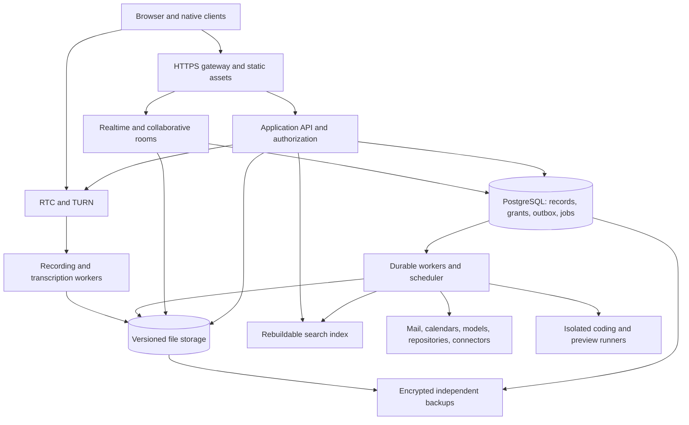

# Neutral specification for a VPS-hosted collaborative workspace

Version: 1.0 · Analysis date: 2026-10-28 · Reference revision: `b5e0278b4ea884687ed5d5b57b27f062934d16e1`

Companion document: [Product requirements](prd.md).

## 1. Purpose, evidence, and interpretation

Specify an independently implemented workspace with the reference application's functional breadth, information architecture, interaction patterns, and visual hierarchy. The application and its durable state must be deployable on operator-controlled virtual private servers without AWS or Cloudflare runtime services. Provider integrations remain integrations: hosting the workspace does not replace users' external email accounts, calendars, source repositories, or model providers.

This is a **source-informed behavioral specification**, not a claim that the analyst worked without seeing source. It contains newly written requirements rather than copied algorithms, application source, schemas, prompts, or assets. An implementation team can use the requirements independently; the evidence appendix is for reviewers. Keep implementation choices and independently acquired dependencies separate from the reference repository. Create original branding, illustrations, and icon geometry while matching the reference's layout and control semantics.

### 1.1 Evidence labels

| Label | Meaning |
| --- | --- |
| S | Supported by inspected source, route/configuration declarations, or domain contracts. This does not prove a successful live deployment. |
| D | Described by repository operating guides, architecture guides, or feature documentation. Not independently exercised in this analysis. |
| V | Visually inspected in an existing checked-in screenshot; not a new live capture. |
| G | Feature-gated, provider-dependent, native-only, or explicitly limited. Include in parity scope with its conditions. |
| T | Proposed target behavior or operational requirement for the new implementation, rather than a measured property of the reference. |
| U | Unresolved detail requiring a focused fixture, runtime observation, or product decision. |

Unless marked T, functional requirements below describe the source-backed target, with S/D/G evidence summarized in section 2 and the appendix. Normative **must** means required for parity, including gated features when enabled. A gated feature is not an optional deletion from scope. T requirements are proposed acceptance baselines and may be tuned explicitly before implementation.

### 1.2 Analysis coverage and limits

Inspected the frontend route catalog, navigation, settings catalog, feature switches, theme definitions and styling, entity vocabulary, service boundaries, authorization contracts, collaboration architecture, database/form/scheduling models, infrastructure definitions, and feature/operator guides. Inspected three existing images covering desktop tabs, the desktop creation launcher, and a mobile CRM layout fixture.

No authenticated application session or new screenshot capture was performed. The checkout had no installed root/web dependencies, and the inspected Windows PATH did not provide Docker or `just`; the documented full stack also needs Nix and generated components. The standalone frontend defaults to hosted development services, so it is not an isolated way to establish parity. Some local-stack integrations use placeholders; the documented agent backend needs additional OAuth configuration, and upload extraction/conversion are not fully represented locally. No production or shared development accounts were accessed.

Directory presence is not proof of availability. Remote flag targeting and real provider entitlements were not retrieved. Some guides contain historical routes and contradictory visual descriptions. Current route declarations and shared control rules take precedence over older examples. Unresolved differences are recorded in section 13 rather than silently standardized into invented reference behavior.

### 1.3 Independence and compatibility boundary

The replacement must preserve user-observable outcomes, not the reference's crate layout, distributed-service topology, private API names, internal entity aliases, database tables, or wire encodings. New code, data schemas, synchronization protocol, build system, and service decomposition are allowed. Public links and external developer interfaces require an explicit compatibility inventory before migrating existing users. This document defines capability parity; it does not claim byte-compatible APIs or direct import of existing internal databases/CRDT state.

## 2. Product surface and parity inventory

| ID | Surface | Required scope | Evidence and availability |
| --- | --- | --- | --- |
| F01 | Identity and onboarding | Passwordless sign-in, OAuth, sessions, invitations, account connections, resumable setup, team creation | S/D; provider and signup-policy dependent |
| F02 | Workspace shell | Navigation rail, workspace navigation, independently navigable splits, command palette, creation launcher, mobile dock, favorites, gated feature tours | S/D/V/G; touch and desktop differ |
| F03 | Home and notifications | Mixed desktop activity/notification feed, mobile notification inbox, Signal/Noise, unread/done/mute/snooze, contextual opens | S/D |
| F04 | Discovery | Quick name search, full-text search, facets, deep result locations, saved task/CRM views | S/D/G |
| F05 | Files and folders | Upload, hierarchy, versions, previews, sharing, moves, bulk actions, trash/restore, download and export | S/D; conversion workers required |
| F06 | Collaborative text | Rich Markdown, mentions, tags, embeds, comments, outline, AI edits, history; task/skill/snippet variants | S/D/G |
| F07 | PDF | Viewer, navigation/search, markup, comments, signatures, autosave, download | S/D; embedded scripting disabled |
| F08 | Canvas | Collaborative spatial document, shapes/text/media, links/connectors, pan/zoom, AI read/edit | S/D |
| F09 | Spreadsheet | Native editable workbooks, formulas, formatting, tables, range comments, collaboration, import/export, AI | S/D/G; internal pilot flag |
| F10 | Word-processing files | Paginated DOCX editing, formatting, tables, collaboration, export and fallback preview | S/D/G; beta editor |
| F11 | Presentations | PPTX editor, slide organization, object/ribbon tools, presenter experience, collaboration/export | S/D/G |
| F12 | Design files | FIG design editing; PSD/PSB raster/layer editing; PDF-based AI vector editing; original-file fallback | S/D/G; format fidelity limitations |
| F13 | Tasks and projects | Rich task documents, properties, subtasks, list/board/timeline, saved views, project overview and discussion | S/D/G; projects and Gantt gated |
| F14 | Messaging | Direct/group/team/private conversations, threads, reactions, attachments, invitations, bots, notifications | S/D/G |
| F15 | Email | Google and enabled Microsoft inboxes, sync, compose/reply/forward, drafts, send later, sharing, snoozes | S/D/G; provider consent required |
| F16 | Calendar | Google and enabled Microsoft calendars, events/recurrence, RSVP, conferencing, shared/team views, meeting notes | S/D/G |
| F17 | Scheduling | Personal/team booking links, availability, collective/round-robin assignment, public booking, reschedule/cancel, insights | S/D/G; writable connected calendars |
| F18 | Calls | Channel and standalone calls, guests, ringing, chat, screen/media controls, recordings, transcripts, meeting imports | S/D/G; RTC and transcription dependencies |
| F19 | CRM | Companies/people, associated work, discussions, properties, private/team pipelines, CSV import/export | S/D/G; team context; personal CRM lists default off |
| F20 | Databases | Multiple tables, typed columns, row editing, relations/formulas, table/board/timeline views, live queries, import/export | S/D/G |
| F21 | Forms | Collaborative builder, linked response table, sections/gates, polls, public/member responses, audience and closure | S/D/G; authoring and responding have different gates |
| F22 | AI conversations | Standalone/contextual chat, models/effort, attachments, tools, streaming, questions/reviews, shared sessions, personal memory and context compaction | S/D/G; legacy and new-agent paths coexist |
| F23 | Coding agents and reviews | Repositories/branches, coding runtimes, changes, previews, linked pull requests, review/check/merge UI | S/D/G; external runtime and repository access |
| F24 | Routines, skills, bots | Scheduled/event-driven agent work, run history, skill documents, configurable personas and bot credentials | S/D/G |
| F25 | Connected apps and imports | OAuth/custom MCP, connector discovery/reconnect, reviewed workspace imports, Slack archives | S/D/G; provider catalogs and rollout vary |
| F26 | External messaging | WhatsApp linked-device pairing, imported/adopted conversations, separate sharing and send rights | S/D/G; guide explicitly says live session service was not deployed |
| F27 | Settings and administration | Account/team, members, appearance/language, tags, notifications, integrations, API keys, billing/usage | S/D/G |
| F28 | Native clients | Desktop shell, phone/tablet navigation, OS sharing/downloads, notification/call integration, cached reopening, updates | S/D/G; platform-specific verification needed |
| F29 | Developer and public surfaces | API/SDK/MCP capabilities, public booking/forms/call links, invite links, product/help pages | S/D; exact external compatibility not established |
| F30 | Hosting and operations | VPS installation, durable jobs/sync/media, backups, recovery, secure configuration, upgrades and monitoring | T; reference infrastructure mapped in section 10 |

## 3. Shared information and authorization model

### 3.1 Logical objects

These are conceptual objects, not proposed SQL tables.

| Object | Minimum information and relationships |
| --- | --- |
| Account | Stable identity, profile, verified addresses, preferences, active sessions, provider grants, plan/entitlements |
| Team and membership | Team identity, owner/admin/member role, invitations, optional domain admission, shared defaults and billing association |
| Work item | Stable opaque ID, kind, title, owner, created/updated timestamps, lifecycle, parent associations, revision, access policy |
| File/document | Work item plus media type, original filename, immutable binary versions or collaborative content, processing status, export formats |
| Folder | Named hierarchy of accessible items; distinct from a task-management project |
| Task and project | Rich description, task status/priority/assignees/due date, subtasks, project associations; project overview, properties and discussions |
| Property/tag | Typed definition, scope, ordered choices when relevant, entity assignments; hierarchical tag navigation must distinguish a grouping folder from a selectable tag |
| Conversation/message | Kind, membership, title/picture, message author/acting identity, content, attachments, parent thread, edits, reactions, delivery/read state |
| Email inbox/thread/draft | Provider/account identity, sharing delegation, provider references, participants, message bodies/attachments, labels, draft generation, delivery state |
| Event and occurrence | Calendar/inbox owner, timezone, start/end/all-day, recurrence and exceptions, guests/RSVP, conferencing, optional note links |
| Booking profile/link/reservation | Personal/team owner, hosts, availability, rules/questions, public identity, reservation state, immutable booking settings snapshot, private management capability |
| Call | Room and lifecycle, channel or independent origin, invited/joined participants, guest capabilities, recording/transcript and summary |
| CRM record/pipeline entry | Team-scoped company/contact identity, domains/addresses, associated work; pipeline ownership/access and independently valued rows |
| Database/table/column/row/view | Typed record storage, formulas and relations, named shared presentations; distinguish an independently discoverable database from storage embedded in another feature |
| Form/response | Response-table identity, question-to-column mapping, collaborative layout, validated published layout, audience, acceptance window, submission identity/status |
| AI session/turn/tool review | Owner, collaborators, selected provider/runtime/model, context references, messages/events, tool identity, approval state and actual execution outcome |
| Routine/skill/bot | Owner/scope, instructions, triggers/timezone/conditions, run history; reusable instruction document; program identity and credentials |
| Notification/reminder | Recipient, originating work item and location, read/done state, mute/snooze; email reminder deadline and reply condition |
| External connection/import | Provider grant and scope, owner, connection state, sync cursors, reviewed import plan, progress/errors and idempotency identity |

A mention/reference does not imply a copy or an access grant. A file attachment may have a different lifecycle from the message containing it. Removing an embed must not delete its source object. Task-management projects and legacy file-grouping containers must not be collapsed merely because the reference uses similar internal names.

### 3.2 Access invariants

| ID | Requirement |
| --- | --- |
| A01 | Evaluate access server-side for each read, mutation, search hit/snippet, subscription, export, tool call and download. Hiding a control is not authorization. |
| A02 | Support owner and the relevant view/comment/edit grants; entity-specific capabilities override the generic ladder. Team administration alone does not imply unrestricted access to every private item. |
| A03 | Support direct people/channel sharing, inherited container access where supported, explicit whole-team sharing, and permitted public/team-link access. Record grant provenance so removing one source does not revoke unrelated grants. |
| A04 | Only the actual owner changes owner-only team access or destructive ownership settings. Membership departure and revoked access must affect new requests and live subscriptions. |
| A05 | Databases have people/channel/team sharing, not public database links. Rows inherit the owning database or host's authority. A public form exposes its respondent contract, not unrestricted table access. |
| A06 | CRM records derive team visibility; private pipelines have separate access. Access to a pipeline must not silently reveal otherwise restricted related content. |
| A07 | Calendar and mailbox authorization follow connected-account ownership/delegation. A document linked as meeting notes gains only the intended view access; an optional team grant is independent and revocable. |
| A08 | Email reminders are private to their creator. Channel membership, guest-call access, external-chat ownership, and agent-session participation use their own policies. |
| A09 | Sharing an item via a message applies the selected grant and reports partial failure. Merely opening Share, copying a restricted link, mentioning a CRM record, or previewing a form performs no unrelated mutation. |
| A10 | Missing/removed access has a clear unavailable or request-access state. Do not expose secret titles or snippets while loading, through stale caches, or in error messages. |
| A11 | Credential use by an agent identifies the acting account. Requester credentials do not silently fall back to session-owner credentials. Cross-account actions require the applicable owner's approval. |
| A12 | Account changes clear or partition drafts, caches, subscriptions, recent queries and attachment projections. Late results from the prior account cannot update the new view. |

## 4. Navigation and UI/UX contract

### 4.1 Desktop structure

The application fills the viewport. A narrow global rail precedes a workspace-specific navigation column and the main work area. The rail contains Create and Search above destinations, More/customization, and account/settings controls below. Home stays first; other available destinations can be hidden/reordered. Unread indicators and a current/upcoming-call or meeting indication are contextual, not decorative.

Main work areas can form multiple resizable splits. Every split owns its route, active workspace, history and contextual parameters. Collection navigation remains mounted when a detail opens inside Home, Mail, Tasks, Chat, Drive, or desktop CRM. Return-to-list restores its query and position. Shift-opening requests another split; ordinary opens reuse the active appropriate view.

Only one active view owns a particular entity, including aliases such as a task and its document. Explicit list/palette selection of an already-open item focuses its owner and explains the reuse; following a mention or notification reuses it quietly. A rejected duplicate open must not replace the requesting pane's prior detail/history. Shell-only panes may allow duplicates. Back/Forward skips currently unavailable duplicate-owned entries without deleting their history.

Each desktop collection has a single header row: title/breadcrumb, view tabs, then action groups for filtering/view options/creation/search. Active filter chips may occupy a second row. Narrow panes first collapse labels to icons with accessible names, then overflow menus. Editor-specific ribbons remain allowed. A details panel floats over the right side rather than reducing editor width, starts closed, and dismisses outside; opening it is local to that split.

### 4.2 Observable geometry and styling

Values below are source-derived anchors, not a complete pixel-perfect capture. Screenshot acceptance in section 12 must resolve remaining measurements.

| Element | Parity anchor |
| --- | --- |
| Global desktop rail | 56 CSS px wide at the default scale; 40 px destination controls; tooltips carry labels/shortcuts |
| Workspace sidebar header | Approximately 48 px high; internal search expands above creation/navigation |
| Main desktop header controls | 32 px controls; 16 px icon-only glyphs, 14 px glyphs in labeled actions; 8 px between action groups |
| Tabs | Shared rounded track and inset selected pill in the current shared control rules; neutral selected treatment; touch-specific variants remain |
| Text/form body | Centered reading column with 768 px reference width where documented; shrink with pane width and preserve edge gutters |
| Information overlay | 320 px desktop reference width, content-height bounded with internal scrolling; approximately 120 ms entrance/70 ms exit |
| Light appearance | Pale neutral page approximately `#f5f5f5`, near-white panel, white controls, fine neutral outlines, muted blue accent |
| Dark appearance | Near-black page approximately `#0e0e0e`, slightly lighter panel approximately `#121212`, subtle raised controls and edge highlights, muted blue accent |
| Typography | Platform sans on Apple; Inter-like sans elsewhere; readable serif/monospace variants for relevant content. Match metrics using independently licensed fonts. |
| Surfaces | Rounded action groups and pill inputs; compact desktop shadows; stronger separation for floating menus/dialogs; glass-like mobile overlays |
| Lists | Dense icon/avatar + title + supporting metadata rows; date/group headings, virtualized long lists, stable scroll anchoring |
| Motion | Brief menu/dialog transitions around 120–160 ms; interrupted transitions settle from current geometry; reduced-motion disables nonessential animation |
| Native macOS frame | 40 px top inset for native window controls; absent in browser/other platform layouts |

Original assets and distinctive branded text are not implementation inputs. Match icon meaning, size, weight and state behavior with newly authored/licensed assets. Colors convey status in addition to text/glyphs. Do not substitute a generic card dashboard for the compact workspace/list/editor design.

### 4.3 Touch, keyboard, and accessibility

- Touch uses a bottom navigation dock, full-screen detail navigation, safe-area-aware headers and bottom sheets. It does not simply shrink desktop inline detail panes. A phone Tasks view uses List even when a saved desktop layout is Board/Gantt; preserve the stored desktop choice.
- Bottom sheets have a drag handle, scrollable content and reachable footer actions above the software keyboard. Dismissing the top overlay must not activate controls beneath it. Back closes keyboard, top overlay, then view-local navigation before root history, as supported by the platform.
- Keyboard shortcuts apply to the focused workspace and yield inside text inputs. `Ctrl/Cmd+K` opens commands/quick access; `?` exposes applicable shortcuts; creation and navigation have two-key sequences; Shift modifies opening into another split. Email-specific sequences may shadow global ones within Mail. Resolve exact split shortcut conflicts in U02.
- Arrow/J/K list movement, Enter to open, multi-selection, context menus, Escape dismissal, and focus return must work without a pointer. Drag operations need keyboard alternatives. Icon-only controls have accessible names and tooltips; touch actions do not depend on hover.
- Mention, emoji, tag and slash menus retain editor focus and selection. A failed asynchronous submit restores the draft, attachments and relevant selection. Pending confirmations disable duplicate submission.
- Skeletons resemble the eventual header/content. Refresh and pagination preserve loaded rows; failures distinguish initial load, refresh and later-page errors. A successful empty result differs from an error.
- A reusable toast stack is bounded and dismissible, pauses remaining time during hover/focus, and is separate from persistent prompts. Partial batch success identifies remaining failed items for retry.
- T: verify keyboard-only completion, screen-reader names/order, visible focus, zoom/reflow, contrast and reduced motion across the acceptance matrix. Formal conformance must be tested rather than inferred from this specification.

Gated desktop feature tours provide non-blocking guidance within the active split for the primary workspaces. Cards highlight a real target, remain in the viewport, offer Back/Next/Skip/Dismiss/completion, and do not steal focus or close merely because the user clicks outside. When a target is hidden, a beacon indicates the control the user must open; the tour does not navigate or open it automatically. Progress/completion/dismissal is stored per account and view in that browser; unfinished tours resume. Optional original instructional videos load only after an explicit Watch action and close with the tour. Tours, highlights and video players do not mount on narrow or primary-touch layouts. Preserve the current source's local-development reset behavior only in a test profile, not in production.

### 4.4 Route intent catalog

These reference-facing paths describe navigable states, not a requirement to reproduce the private router. Preserve them through redirects if link compatibility is selected. IDs below are placeholders.

| Path family under `/app` | Meaning |
| --- | --- |
| `/welcome`, `/login`, `/signup`, `/onboarding`, `/invite`, `/team-invite`, `/channel-invite` | Focused authentication/setup/invite experiences |
| `/home`, `/home/{kind}/{id}` | Feed and inline detail |
| `/drive`, `/drive/recent`, `/drive/shared`, `/drive/folder/{id}`, nested file detail | File workspace and folder-aware navigation |
| `/tasks`, `/tasks/{id}`, `/tasks/projects`, `/tasks/projects/{id}/{overview-or-tasks}` | Tasks and native task projects |
| `/mail`, `/mail/{id}`, `/channels`, `/channels/{id}` | Collection and inline conversation |
| `/agents`, `/agents/{id}`, `/coders/{id}`, `/agent/{id}`, `/chat/{id}` | New agent, code and legacy chat/session surfaces |
| `/routines`, `/routines/new`, `/routines/{id}` | Agent automation management |
| `/calendar/{month-or-week-or-day}`, `/scheduling` | Calendar and booking management |
| `/book/{profile}/{slug?}`, `/booking/{id}` | Public booking and capability-protected management |
| `/calls`, `/call/{id}`, `/meet/...` | Call library, record and guest join |
| `/companies`, nested company/contact/pipeline routes | CRM workspace and record detail |
| `/database/{id}`, `/form/{id}`, `/form/{id}/respond` | Structured work and focused respondent view |
| `/write/{id}`, `/pptx/{id}`, `/fig/{id}`, `/psd/{id}`, `/ai/{id}` | Gated specialist file editors; legacy/fallback routing needs verification |
| `/search`, `/reviews`, `/reviews/pr/{id}`, `/activity`, `/external` | Cross-workspace discovery, reviews, activity and linked messaging |
| `/settings/{section}` | Deep-linked settings |

Split composition is serializable in the URL; the reference separates pane paths with `~`. Deep links can target a message/thread, Markdown node, PDF page/highlight, spreadsheet range/comment, agent turn, call transcript segment, or calendar occurrence. Repeated activation of the same hit must seek again. Changing entities clears stale targets. Unknown whole-app destinations resolve safely; unknown individual pane routes show a pane-local unavailable/not-found view. Public forms, booking and guest calls must not be accidentally captured by the sign-in gate.

## 5. Functional behavior

### 5.1 Identity, teams, onboarding and preferences — F01, F27

1. Offer email-code/magic-link sign-in and configured identity-provider connections. Handle expired/reused codes, canceled consent, reconnect-required and administrator-consent-required states without creating duplicate accounts or losing the previous connection.
2. Preserve the intended destination across sign-in. Persist onboarding per account, resume a valid step, and let later saved progress override an older resume link. Setup covers the workspace introduction, privacy/security explanation, work/personal connections, tools, team and plan.
3. Team owners/admins manage invitations, membership, roles, domain joining and team defaults. Invitation acceptance and role changes are authoritative on the server. Free-team membership has no artificial five-seat cap; paid seat billing and enterprise policies are separate.
4. Settings include team/general/members/connections; email/calendar/agents/routines/CRM; account/appearance/notifications/shortcuts/usage/billing; apps/tags; developer connections/runtimes/API keys/bots. Availability follows role, platform and feature settings. Settings search matches user-facing labels and aliases.
5. Appearance supports light/dark/custom themes, import/export and applying a shared theme. Language has a personal override and an admin-controlled team default with automatic fallback. The inspected locale tree contained only English; do not claim a verified translated-language count.
6. Billing supports server-confirmed eligibility, plan selection, existing-subscription management, usage/credits and failure recovery. Do not infer trial eligibility from current free access. Never duplicate checkout/subscription or auto-reload charges after ambiguous responses. Reference prices, model names and promotional copy are not fixed product requirements.
7. T: a private VPS deployment supports operator-assigned entitlements without a billing-provider dependency. A billing-enabled profile retains the same purchase/manage/usage capability; enabling billing is a deployment decision, not removal of the feature.

### 5.2 Home, notifications, activity and search — F03, F04

1. Desktop Home combines permitted recent work and notifications with an AI entry composer and contextual suggestions. Mobile Home is a Notifications feed; its Signal view does not inject the user's ordinary recently touched items.
2. Notification state, email read state and task completion are distinct. Group relevant notifications with their source item; opening one targets its originating message/comment/location. Support Signal/Noise, read/done filtering, mute and timed notification snooze, bulk operations and undo where exposed.
3. Activity provides an activity visualization/feed and permitted per-entity changes. Preserve actor, action, timestamp and item navigation; repeated edits may fold for readability. No inaccessible content may leak through activity summaries.
4. Quick access searches entity names and people, including teammates with no existing DM. It can show recent items for an empty query. Selecting a person opens/reuses a DM without sending. Name-only and full-text modes are visibly different.
5. Full-text search spans supported documents, messages, email, agent history and call transcripts, with type/context facets and meaningful snippets. Search results obey access before returning snippets. Projects are name-only in the documented mobile search path.
6. Email quick access uses synchronized subject/sender data, not arbitrary body text or a promise to cover all historical mail. Offer full-text search for content beyond local coverage. Keep filters stable during paging and preserve results/scroll when returning from a hit.
7. Saved task views retain filters, layout, grouping and ordered sort directions, not free text or scroll. Relative “Me” remains relative to the viewer. Owners edit/share/delete; viewers may duplicate. Sharing a view shares its definition, not its underlying items. Revision conflicts preserve drafts; unknown settings warn and cannot be silently overwritten.
8. Universal input, when enabled, classifies a natural-language draft into search/create/send intent and exposes editable fields. Manual changes win over subsequent predictions. Classification never sends, books or creates on its own; use an explicit action. Failed extraction preserves the original text.

### 5.3 Files, lifecycle and common document functions — F05

1. Provide owned/shared/recent/folder browsing, type/tag/creator filtering, favorites, sorting/grouping, rename, move, copy, download, sharing and permitted delete/restore. Shared excludes self-owned items even when creator filters request the current user. Legacy “Files/Documents” destinations map to Drive.
2. Upload by file picker, paste/drop, and folder selection/drop. Show progress, processing, partial failure and retry. Folder imports retain hierarchy; dropped folders can include empty subfolders whereas picker-provided folders may not. Skip filesystem bookkeeping/lock files. Reject path traversal and decompression abuse (T).
3. Preserve original bytes/filename and distinguish a completed upload from completed extraction, conversion, preview and indexing. Legacy DOC/PPT/XLS may convert into modern formats without changing the work item's identity. Conversion failure leaves the original downloadable; never display an empty successful document.
4. Versioned binary content and collaborative content have explicit saved/unsaved/saving/error states. Downloads snapshot the selected file/version, prevent repeated requests, support cancel/retry, and use browser download/native save behavior. Reporting browser handoff is not confirmation of a completed disk write.
5. Basic image/video/code/text/CSV/unknown-file surfaces support appropriate viewing, zoom/playback or syntax treatment, metadata, sharing and original download. An unknown/unsupported file remains a first-class file with a clear no-preview state. Sandbox active HTML/SVG previews (T).
6. Shared metadata includes owner/timestamps, tags/properties, references/backlinks, sharing and optional activity. Actions live in the header/menu; details stay quiet. Bulk rename supports prepend/append/replace/whole-name with a preview; partial deletions leave only failed items selected for retry.
7. Trash is distinct from irreversible deletion. Deleting content schedules cleanup of derived search records, previews and unreferenced blobs; restoration cannot race with a stale deletion/indexing worker. Retention policy and grace periods are deployment configuration (T; exact reference intervals U).

### 5.4 Editor capability contracts — F06–F12

Every editable surface must distinguish read-only access from edit access, preserve a failed unsaved change, and export only after its saved content is coherent. Multiple users must converge where live collaboration is supported. Unsupported source constructs require visible compatibility notes; “supports a format” does not mean every feature of its originating desktop editor is reproduced.

| ID | Editor | Required interaction and content behavior |
| --- | --- | --- |
| E01 | Rich Markdown | Titles, paragraphs/headings, inline styles, lists/checklists, links, tables, quotes/code, images/attachments, mentions/tags/emoji/slash insertion; live multi-user editing and presence; contextual formatting; document outline when space permits; references and discussions |
| E02 | Text variants and AI edits | Tasks, reusable snippets and skills use text-document foundations with their own metadata/discovery; selection-scoped AI suggestions show reviewable changes with accept/reject and undo; no automatic overwrite of unrelated collaborator edits |
| E03 | Embeds | Compact entity mentions can expand into document/database previews; a database embed edits its original source. Parent-document edit rights and embedded-database edit rights are checked separately. Removing the reference leaves its source intact. Live query answers execute with each reader's permissions. |
| E04 | Comments and history | Threaded discussions with replies/reactions/attachments/edit/delete and navigable notifications; selection/range comments where supported. Desktop history overlays the current editor, previews sessions/points in time, returns to current, and forks a historical copy without replacing the live document. Preserve scroll on closing. |
| E05 | PDF | Page navigation, zoom, text search/selection, relevant outline/tabs, annotation/markup and comment navigation, drawing/placing a signature, movement and normal save/download. Canceling signature placement leaves no empty mark. Reusable saved signatures are not a documented capability. |
| E06 | Spatial canvas | Pan/zoom, select/move/resize, text/shapes/connectors, colors, files/images and link paste, arrange/group as supported, copy/save images, presence and concurrent changes. AI can inspect a visual view and make authorized scene changes. |
| E07 | Spreadsheet | Editable cells/ranges, formula bar, recalculation/errors, formatting/number formats, fill/copy/paste, row/column operations, sheets, tables, dropdowns and checkboxes, undo/redo and collaboration. Uploaded XLSX/XLSM/CSV first shows a read-only preview with import notes and an explicit conversion to a native editable workbook. Do not execute workbook macros (T). |
| E08 | Spreadsheet discussion and AI | Cell/range comments remember sheet ID and range, support resolved/reopen, and navigate from notifications. Whole-workbook discussion is separate. AI reads formulas/typed values/errors, performs scratch calculations without writes, and applies revision-guarded batches atomically. “Ask” captures the current selection but opens an unsent contextual draft. |
| E09 | DOCX | Paginated pages; caret/selection and keyboard/IME input; paragraph/font/size/style/colors, lists/alignment/indent/spacing, tables and supported page content; multi-user caret/presence, undo/redo and DOCX export. Processing/export-pending states retry without producing an empty archive. Editor off uses the available preview/download path. Exact advanced-layout support needs corpus verification. |
| E10 | PPTX | Slide thumbnails and organization, stage selection/manipulation, text/shapes/pictures/tables/charts and supported diagrams, ribbon/contextual formatting, theme/layout tools, transitions and slideshow/present controls, undo/redo, save/export and live editing. Build a format-feature corpus for animation, charts, embedded fonts/media and round-trip fidelity. |
| E11 | FIG | Page/layer tree, design canvas, selection, shape/text/image operations, transforms/style/layout where supported, zoom/pan, multi-user pointers/selections, autosave and original-format export. Read-only mode removes mutation tools and shortcuts. Preserve unedited opaque portions where the format permits. |
| E12 | PSD/PSB | Layer tree, visibility/opacity/blending and supported text/shape/raster operations, painting/edit tools, compositing, pan/zoom, live edits and versioned save. Unsupported color modes/bit depths open read-only with a deliberate conversion option. Conversion must disclose its effect. |
| E13 | AI vector files | Artboards/layers, selection/direct selection, paths/shapes/text, appearance and transforms, pan/zoom, multi-user edits and save to the supported PDF-based format. Preserve an unchanged upload exactly. Explain loss of unsupported proprietary editing metadata; older PostScript-based files can remain unsupported/downloadable. |
| E14 | Specialist AI/search reads | Extract supported text/layer/object names and structure from design files for search and AI. Oversized/unsupported files return bounded results or name-only indexing. The inspected design-file AI tools read stored content; do not claim they can edit PSD/AI merely because a manual editor exists. |

For E07–E13, author a corpus listing supported operations and unsupported constructs before calling parity complete. Source documentation contains extensive tool-specific functionality; this inventory defines the mandatory families, not a claim of complete format fidelity. The replacement must preserve original downloads and explicit limitations until each corpus case passes.

Additional source-backed editor distinctions:

- **Canvas conflict granularity:** concurrent changes to different objects/properties converge, but editing the same text object chooses one completed content string; character-by-character merging is not a documented promise. Local undo preserves another user's unrelated styling. Presence includes cursors, selections and transient drag/drawing previews; previews are not saved partial edits.
- **Spreadsheet data tools:** support charts and images as movable/resizable drawings, chart configuration, number/date/custom formatting, table-scoped filters, and Goal Seek on a private calculation copy until confirmed. Include supported chart families in the file corpus. Internal copy translates relative/mixed formula references; absolute references remain fixed. Drag-fill continues supported arithmetic number and date sequences; text/irregular patterns repeat. Keyboard/menu Fill down/right copies the starting row/column. This follows the current operating guide and fill-series behavior; the feature README's older repeat-only description is stale. CSV preserves quoted/multiline text on import and exports values without formatting. XLSX round trips preserve supported content and report unsupported constructs; editing named ranges, filters outside tables and automatic spill expansion are documented future work, not verified parity features.
- **Spreadsheet dates:** interpret an ambiguous typed numeric date using the input locale once, then store a stable date representation so collaborators do not reinterpret it. Plain-text cells retain literal input. Date pickers preserve the cell's representation and existing time-of-day where applicable.
- **Advanced presentation content:** include equation insertion/preview, format painter, contextual table/chart/diagram tooling and picture adjustments in the operation corpus, in addition to basic slide/text editing. These are richer than a read-only deck viewer.

### 5.5 Tasks and projects — F13

1. A task is an editable document with status, priority, assignees, due date, tags, optional projects and arbitrary supported properties. It supports subtasks and source relationships such as a message converted into a task. The create composer initially assigns the current user, validates a title, supports Create More and continuation in a split, and preserves contextual company/contact/project defaults.
2. Team sharing is an explicit remembered choice when a team exists. Draft sharing and property edits are committed with creation. A partial project-association failure must identify the successfully created task instead of inviting duplicate creation.
3. Main collections include My tasks, Created by me, Team tasks and gated Projects. Filter by status/priority/assignee/creator/tags; sort/group; text search. Natural-language filters produce editable supported facets and surface partial/unmappable requests.
4. Desktop has list, board and gated Gantt. Boards group by a supported property and moving a card changes that property. Gantt uses creation time as start and due date as end; an undated tail is visual, not a fabricated deadline. Surface invalid ranges and preserve chart position while zooming/resizing. Mobile List fallback preserves desktop configuration.
5. Property edits update immediately and move rows/counts between groups, then reconcile or roll back precisely. Pin/unpin title properties without deleting values; preserve a deliberately empty pin set. Built-in task properties are protected from deletion.
6. Projects have overview, properties, collaborative description and discussion, plus a scoped task list. Sidebar/favorites and breadcrumbs keep project context. Pagination, refreshing and partial continuation errors preserve already loaded tasks. A task can reference multiple projects where supported.

### 5.6 Messaging and calls — F14, F18

1. Support human DMs, group DMs, team-discoverable channels and private channels. An empty DM has a neutral introduction; opening it sends nothing. Explicitly sending to a nonuser can deliver email through the configured notification channel.
2. Channel creation captures name, visibility and recipients as needed. Participant administration, invitations, channel picture/rename and agent membership follow role policies. Direct messages do not acquire channel renaming/picture capabilities.
3. Rich composers support mentions, emoji, formatting, attachments, drafts, thread replies and editing. Render links in open messages, but list-preview text is display-only so clicking a preview opens its conversation. Reactions, unread/read position, notification choices and targeted thread links work consistently.
4. Preserve scroll anchors when older history loads. Incoming messages do not force a reader away from older history. Locally submitted messages appear promptly and reconcile to one server record. Retries and out-of-order events do not duplicate messages or reactions.
5. Conversation navigation provides relevant messages/threads/attachments/calls/participants views. Imported Slack history is identifiable and does not masquerade as newly sent messages. Optional labels/smart labels retain saved data while disabled.
6. Calls support audio/video, mute, device choice, camera switch where applicable, screen sharing, participant tiles, call chat, join/leave, invitations/ringing, and recording/transcript access where enabled. One call session remains active while navigating. Opening call chat preserves both media and its draft.
7. Cross-tab ringing produces one audible chime; answering/declining stops ringing on the same account's other devices without ending the call for other participants. Unanswered ringing expires. Repeated Join/Leave is safe.
8. Public call links have waiting/prejoin/media-permission/denied/revoked states. Guest room access must not grant unrestricted channel history. Creating/copying/revoking links and optional team visibility are deliberate actions.
9. The Calls library has relevant attended/missed/unattended/type/channel/tag filters, details, transcript search/seek, recording and summary, sharing and associated work. External meeting-note imports appear with their source and supported content; missing audio is not invented. Exact filter naming needs live reconciliation.
10. Media capture, transcription, recording readiness and participant permissions are separate states. Failed microphone/camera permission offers recovery and does not silently join with a misleading active state. Retain a call's authorized artifacts after its room ends.

### 5.7 Email — F15

1. Connect Google mail and enabled individual Microsoft mailboxes with explicit consent, mailbox selection, sync/backfill status and reconnect recovery. Multiple inboxes and permitted in-app delegation share the same UI. Microsoft shared/delegated provider mailboxes are outside the documented provider account scope.
2. Desktop Inbox contains Signal/Noise; other destinations include Favorites, Drafts, Sent, Scheduled, gated Reminders, All mail, Archived and Shared, with personal tags. Preserve documented mobile tab differences. Search and unread/tag/inbox/attachment filters apply before pagination.
3. Thread detail presents sender identity per message, participants, subject, collapsible messages/quoted material, attachments and reply controls. Viewing an unread-filtered row may mark it read without abruptly removing the admitted row; archive/delete or loss of access must still remove it.
4. Compose new, reply, reply-all and forward with To/Cc/Bcc, sender selection, subject, rich body, signature, attachments and inline images. Autosave drafts; changing sender inbox safely transfers the draft/attachments or retains the original on failure. Concurrent drafts have conflict/recovery behavior rather than silent last-write loss.
5. Provide immediate send and scheduled send, schedule edit/cancel, attachment preparation limits and a deliberate link alternative for oversized files. Preview/saving a draft does not send. Synchronize sent state with the provider; uncertain provider delivery must not cause automatic resend.
6. Read/unread, archive, trash, favorites, labels, mute, undo and permitted sharing update locally then reconcile. Providers with asynchronous writes expose pending/failed organization changes. An expired grant stops provider writes while retaining user drafts.
7. Email HTML/signatures render in isolation, preserve supported formatting, and handle remote images through the configured policy/proxy. View/edit signature modes do not alter stored HTML until a deliberate edit/save. Unsafe markup cannot execute in the app origin (T).
8. Email snooze captures a future time and If no reply/Regardless, archives only after confirmation, and returns the original conversation when due. Remove reminder restores the conversation. Delivery creates a notification on the original email, not a new message. Do not add a generic recurring reminder product: it is not present in the inspected reminder feature.
9. Calendar invitation cards show known event details immediately, RSVP when authorized, and open/download ICS appropriately without unnecessary Drive copies. Provider confirmation, saved invitation and shared-event states must be distinguishable.

### 5.8 Calendar and scheduling — F16, F17

1. Calendar provides day/week/month navigation, calendar visibility, event details and creation/editing with title, timezone-aware start/end, all-day, recurrence, guests, location, conferencing and notifications. Support occurrence-versus-series edits/deletes, RSVP, team/shared calendars and out-of-office where enabled.
2. Conferencing options follow the selected calendar's capabilities; changing calendars cannot silently accept an unsupported conference request. Preserve existing meeting links. Calendar search/mentions/deep links identify the occurrence, not merely its recurrence series.
3. Meeting notes can create/link owned Markdown documents to a particular occurrence; multiple notes are allowed. Explain meeting-viewer access and separately optional team access before linking. Unlink removes only that grant/link, not the document. References refresh across event and document views.
4. Scheduling is a separate workspace with personal/team owner selection and Booking links, Availability, Bookings, Insights and Booking page. Owner changes discard or resolve drafts and cannot occur mid-save. Team admins manage team configuration; current membership is rechecked for sensitive operations.
5. Booking links specify duration, timezone, weekly availability/date overrides, notice/window, buffers, limits, hosts, conferencing/location, guest questions and public visibility. Support single-host, collective and round-robin allocation. New event types start paused. Public pages list enabled offerings and show availability in the visitor's timezone.
6. Public booking confirms a currently available slot, captures required answers and produces a receipt/invitation. Concurrent booking attempts cannot reserve the same exclusive host interval. Check busy time across connected calendars; all-day and daylight-saving boundaries must not create false availability.
7. Cancel/reschedule uses a private management capability; preserve the booking's original configuration after a link changes/disappears. Reserve replacement capacity before releasing the old slot; on ambiguous provider responses preserve recovery state rather than creating a second meeting.
8. Bookings expose state, host, date and recorded attendance; completion by elapsed time is not proof of attendance. Insights use authorized records and show query errors rather than zero counts. Handle legacy pending approval records; do not expose new approval-only bookings before their notification workflow exists.
9. Booking payments, advanced routing forms and arbitrary automation/webhooks are not established by the inspected scheduling implementation. Form gates revealing a booking link are a separate supported flow.

### 5.9 CRM — F19

1. CRM requires a team and feature enablement. Companies have normalized domains; contacts have addresses/company associations. Provide company/people discovery, properties, last interaction and record discussions. Visibility rules apply to hidden contacts and their derived associations.
2. Desktop record details remain inside Customers, with breadcrumb navigation and Overview plus relevant Team/Emails/Files/Tasks/Calls tabs. Touch opens full-screen records. References aggregate permitted property/mention/attachment associations and deduplicate the same work item.
3. Company-associated work may include its contacts; contact-associated work is scoped to that person. Adding/removing a mention updates references without sharing the document, inviting the contact or sending a notification to an external person.
4. Pipelines have private/team ownership and explicit grants. Rows reference a required company/contact and hold independent stage/owner/revenue/custom values. The same company may have multiple deals and occur in multiple pipelines. Pipeline edits must not overwrite the company's own similarly named properties.
5. Provide table/board views, filters/sorts/groups, row creation/edit/duplicate, drag-to-change-stage, columns/options, saved shared views and record detail cards. Trashing a pipeline leaves referenced CRM records intact. Internal backing tables do not appear as duplicate standalone databases.
6. CSV imports preview mapping/errors, normalize identities by domain/email, avoid duplicates on retry and retain failed rows. Exports include selected scope/columns after complete pagination and a preview. Escape formula-like spreadsheet values. Personal company lists are gated off by default; retain the feature and persisted data without showing all records for an empty list.

### 5.10 Databases and forms — F20, F21

1. A standalone database contains named tables, typed columns, rows, shared views and saved queries. Core record storage can also belong to CRM/forms without creating another top-level app item. Provide a once-only starter example when the feature is enabled for a new user.
2. Column types include text, number, single/multiple choice, date, time range, checkbox, URL, people, document/task/entity references, relations and supported formulas. Add/rename/reorder/edit/delete with appropriate rights. Formula results are read-only and update from dependencies; block deleting a still-required dependency.
3. Data conversion either preserves every compatible value or creates a new converted column with a review of unconvertible values. It must not silently clear existing data. New-choice creation and multi-select editing preserve keyboard flow. Required special columns cannot be removed while their host depends on them.
4. Tables support range selection, keyboard cell editing, copy/paste, rows, column sizing/order, search, filter/sort and pagination. Shared Table/Board/Timeline views differ from a viewer's temporary All records configuration. Moving a card updates the grouping value; do not promise persistent manual card order where the reference does not provide it.
5. Undo/redo applies to the user's operations without erasing later collaborator changes; text-field undo stays local to the field. Live updates, presence, change activity, CSV import/export, downloads and webhook management remain authorized. Table deletion is not described as undoable.
6. Natural-language database questions can produce saved live answers in permitted table/chart/summary displays. Show the question/result/plain-language errors, not raw SQL by default. Underlying execution is constrained to the authorized logical database with bounded resource use; it is never unrestricted access to the application's primary database (T security boundary).
7. A form is a presentation over one response table. Questions map to columns; sections/order/help/required/gates belong to form layout. Create standalone, from an owned eligible table, or through supported slash/poll flows. At most one form owns a table, including while trashed.
8. Build uses a centered document-like canvas and outline. Add/reorder/duplicate/remove questions and sections; type changes follow safe data-conversion rules. Removing a question preserves its column unless a separate destructive action is confirmed. Gates reference only prior questions; invalid edits stay in the authoring draft while respondents receive the last valid layout.
9. Responses is a live grid with counts and stopped-submission summaries. Settings manage audience, open/close/automatic closure, results visibility and confirmation message. A form's editor access also grants the intended backing-database edit authority; respondent access does not.
10. Member forms require sign-in, allow one response per person and permit editing while open. Public forms allow anonymous submissions, but not anonymous file questions. Signed-in people retain their identity even on a public form. Repeated submissions are deduplicated as appropriate; anonymous respondents do not gain edit rights by guessing an ID.
11. Responders progress section by section, validate required values and gate outcomes, and can see a final permitted booking link. Preview creates no real responses/uploads/bookings. Gate rules are delivered to clients and must not be described as confidential qualification logic.
12. Permanent deletion of a form releases its protected-column/table claim but preserves response data unless separately deleted. Removing a table/column warns about dependent forms. Authoring feature flags do not disable the service's otherwise authorized respondent routes.

Database import/export and webhooks have specific semantics: CSV import creates a new table and initially keeps imported values as Text, preserving leading zeros and large identifiers; the documented limits are 8 MB, 100 columns and 10,000 rows. Retry uses the same request identity. CSV export includes every row of the selected table rather than only the current filtered view, and refuses to mix revisions if the table changes during preparation. Editors can create/revoke an inbound table webhook; reveal the secret URL once and subsequently display only a token prefix. An object inserts one row and an array inserts at most 100; column names match case-insensitively, null leaves a value empty, and invalid keys/values reject the whole request with field errors. Writes act as the webhook creator and stop when that creator loses edit access. These are database ingestion webhooks, distinct from routine activity triggers.

### 5.11 AI, coding, automation and integrations — F22–F26

1. AI starts from Home, Agents, an entity's Ask action, a mention in a conversation or a contextual command. An Ask action opens an unsent contextual draft. Support text, supported files/images and dictation; unsupported image/model combinations retain drafts but block incompatible sending.
2. New conversation controls include agent/model, supported reasoning effort, Chat/Code and gated Auto mode, and repository/branch for coding. Validate settings before delivering the first prompt. Provider catalogs are dynamic; no hardcoded future model availability or pricing is promised.
3. Render assistant responses, structured results, tool activity, generated artifacts and readable errors. Allow stop/cancel and follow-up queueing. A persisted session survives UI navigation/reload; detached runtimes can reconnect. Provider output may be streamed or delivered as completed messages according to its actual protocol.
4. User-question cards support text/choice/multiple fields and submit/decline/cancel. Tool reviews distinguish proposed, approved, executing, completed, declined, failed and uncertain actions. A completed-looking card must correspond to a real confirmed operation. Only the eligible actor can approve owner-account actions.
5. Tools discover/read/search and perform authorized work across documents, tasks, messages, mail, calendar, booking, CRM, databases, forms and integrations. AI-generated edits obey the same access, revision and validation contracts as human edits. Scratch calculation and previews do not mutate source data.
6. Code execution has bounded time/memory/network/file access and credentials limited to the selected account/session. Tool instructions cannot confer access. Imported external content is data, not authority to change permissions (T). Public MCP calls retain their own authenticated-user consent semantics; do not incorrectly impose the in-app owner's review UI on every external client call.
7. Coding sessions support configured local/remote runtime connections, repository/branch selection, durable transcript, changes/file diffs, task and PR associations, runtime status and authenticated development previews. Preview/SSH credentials are time-limited and isolated from the main application. Disabling a runtime does not delete readable session history.
8. Reviews lists pull requests with scopes/status/repository facets and linked sessions. Detail shows summary, discussion, changes, checks and source link. Merge is offered only for an eligible non-draft open PR with acceptable completed checks, asks for confirmation, and reconciles upstream state. Do not infer a completed merge from a queued request.
9. Skills are discoverable instruction documents with owner-controlled edit/delete and read-only built-ins. Bots have profiles, tokens, allowed channels, optional team-mentionability and runtime/model instructions. Saving configuration affects future sessions as documented; it must not silently rewrite the identity of an already running session.
10. Routines have owner, instructions, schedule/timezone or supported event trigger, optional conditions, enable/disable, next-run and run history. Trigger delivery and recovery cannot execute the same occurrence twice. Support editing/deletion and showing failures. The documented trigger and visibility rules below are the baseline; confirm their enabled runtime behavior before acceptance.
11. Connections include native providers and authenticated custom MCP/connector apps. Show disconnected/connecting/connected/expired/error and cancellation/reconnect. Keep existing grants during an unsuccessful reconnect. Missing credentials disable only dependent operations; the workspace still starts (T).
12. Workspace imports from supported providers present a reviewable plan, exclusions and personal/team sharing choices before writing local entities. Track progress/cancellation/partial failure and resume without duplicates. These imports do not write upstream. Slack archive import preserves conversation/thread/time/attachment relationships where available and is team-admin gated.
13. WhatsApp is an isolated, gated external-messaging surface, not a native channel alias. Include QR/pairing/reconnect/cancel, possible native passkey handoff, linked-device status, adoption, media import and standalone sharing. Phone pairing can direct the user to a computer. Read access to a shared external chat does not grant send-as-owner capability; direct-chat sending remains owner-only. The inspected guide says no environment had its live session service: treat this as an implemented-but-runtime-unverified integration, not a proven production feature.
14. Personalization includes stored per-user memory generated from that user's authorized workspace tools, with prior memory refreshed against new evidence. The source establishes a generation/read service, not a complete user-facing memory editor or a universal team-readable memory store. Long conversations compact older context while preserving the full readable transcript, display a compaction event, and permit session-scoped search to recover details. Changing to a smaller model can require compaction before the next prompt. Oversized messages receive actionable split/attach guidance. Memory and summaries never confer additional permission (T).

Routine schedule choices include hourly, daily, weekly, monthly, custom cron and one-off natural-language/calendar times. Recurring schedules keep their timezone. Activity choices include channel creation/message/owner mention; document creation/deletion; task creation/status/priority/any property change; newly received owner-inbox mail excluding historical imports/spam/trash/drafts; calls the owner starts and calls the owner joins that end. Scope applicable triggers to specified accessible items or any accessible item. Overlapping filters yield one run; bot/delegated changes do not cause recursive triggering. These are workspace activity events, not arbitrary incoming HTTP webhooks.

A routine can combine up to sixteen trigger groups, with up to thirty-two activity filters in the event group. Gated yes/no conditions produce a visible skipped outcome when false or unevaluable. Required apps must be connected before saving/running. Pausing applies immediately even with an invalid unsaved draft; Run now waits for the latest valid saved settings and can run a paused routine. Completed one-offs do not repeat. Runs are separate sessions, hidden from normal Home/Agents lists by default unless configured otherwise; ordinary successful completion is quiet, while failure, questions and held approvals notify. The documented sharing model allows a signed-in link holder to read routine settings/instructions/triggers, with editing/enabling/manual execution restricted to the owner; do not incorrectly treat a routine link as a private secret or grant access to its underlying connected accounts.

### 5.12 Native, public and developer surfaces — F28, F29

1. Web parity includes desktop and touch layouts. Full platform parity additionally includes desktop and iOS/Android wrappers, deep links, native notifications, system share intake, pickers/save/export, call UI integration, keyboard/safe areas and update handling. A mobile website alone is not equivalent to all these features.
2. Desktop has appropriate window controls, external browser opening, zoom persistence and native file drops. Mobile handles queued incoming shares, failed attachments, draft preservation, cancellation and exactly one explicit send. Late completion of one share cannot discard a newer incoming share.
3. Cached/offline reopening is scoped to previously available supported content and current account. Retain drafts while unavailable; report pending sync. Do not promise arbitrary offline email delivery, cloud-model execution, calls or uncached documents. Reconnect reconciles queued writes without duplication. Native browser-engine differences need real-device tests.
4. Public booking, form, call and invitation pages have focused layouts and no forced account gate where guests are permitted. Keep private management tokens out of analytics, referrers and public caches (T).
5. Provide a documented authenticated API and SDK-equivalent capability set, event/subscription interfaces, scoped/revocable API and bot tokens, and user-authorized MCP access. Exact compatibility with the existing SDK is a separate contract test track, not implied by matching the UI.
6. Include product entry, help/documentation, login links and installation/update delivery. Recreate public-site information architecture with original copy/assets if full repository parity includes marketing. Debug galleries, development fixtures, deployment dashboards and staff-only promotional tooling are not ordinary end-user features; retain equivalent operator functions only where explicitly required in the parity register.

## 6. State, synchronization and resilience contracts

| ID | State machine or invariant |
| --- | --- |
| C01 | Upload: selected → uploading → uploaded → processing → ready, with failure/cancel/retry at relevant stages. One file identity survives processing. |
| C02 | Collaborative edit: local change → durable pending → server accepted → synchronized. “Saved” requires durable acknowledgement, not merely a broadcast or local memory update. |
| C03 | Reconnect: authenticate → authorize room/entity → exchange revision/checkpoint → replay missing updates → resume live stream. Revoked access stops replay and clears protected stale presentation. |
| C04 | Optimistic mutation: associate a client operation ID, prior state and expected revision; reconcile once; roll back only that operation, preserving later unrelated edits. |
| C05 | Email delivery: draft → pending/scheduled → claimed → provider accepted/confirmed; rejected and uncertain are distinct. Retry uncertain work by reconciliation, not by blind resend. |
| C06 | Booking: validate → reserve → provider operation → confirmed; cancellation/reschedule and uncertain recovery retain durable intent and relevant reservations. |
| C07 | Agent: draft → creating → running → waiting for user/review or queued → completed/failed/stopped; transport disconnect is not equivalent to task completion. |
| C08 | Job: pending → leased → succeeded or retry/dead-letter/canceled. Leases expire, heartbeats renew bounded work, attempts/backoff are visible, and ownership is fenced. |
| C09 | Deletion: active → trash → restored or purge-pending → purged. Stale events cannot recreate purged data. Dependent grants/indexes/blobs converge to the same lifecycle. |
| C10 | Incoming live events carry entity identity and ordered revision/sequence or equivalent deduplication data. Missing sequence ranges trigger bounded resync; reconnect/reload cannot double-apply side effects. |

Use convergent collaborative editing for text and structured editor state. Concurrent undo affects a user's own contributions rather than rewinding everybody. Permission changes are authoritative even for already connected peers. Snapshots and operation history must be recoverable after process loss; retained history/forks and current content must agree. A single-writer-per-room strategy is acceptable if it has durable leases/fencing and recovery; copying Cloudflare Durable Objects is not required.

Binary exports must correspond to a coherent document revision. Long conversions, indexing and recording jobs are asynchronous. A metadata transaction and its downstream event publication use a durable outbox or equivalent so a crash between them does not lose work. Cached data is disposable; acknowledged edits and provider-operation intents are not.

## 7. Application interface contracts for the replacement

T: use independently designed interfaces; the following operation families define semantics, not literal paths or a copied schema.

| Family | Requests | Response and failure contract |
| --- | --- | --- |
| Identity | Start/complete login, refresh/logout, list/revoke sessions, manage provider grants | Session-bound identity; safe error categories; stable intended destination |
| Discovery | Search/list with typed filters, sort, grouping and cursor | Authorized items and stable continuation; explicit unsupported filters; no secret snippets |
| Entities | Create/read/update/rename/move/trash/restore, properties/references | Stable ID, revision, permitted actions; revision conflict preserves client draft |
| Access | Inspect effective grants, share/revoke/request access | Explain applicable access without exposing hidden identities; idempotent grant changes |
| Files | Initiate/complete upload, processing status, versions, download/export | Content length/type/hash, scoped URLs or authenticated streaming, processing-pending distinct from missing |
| Collaboration | Authorize room, snapshot/history, connect/replay/apply updates | Entity/account-scoped authorization, revision/checkpoint, durable ack, reauth/revocation |
| Messages | Conversations, members, post/edit/delete/reply/react/read state | Client operation ID, server identity/time, thread target and live change |
| Provider work | Inbox/calendar reads and writes, sends, bookings, sync status | Pending/confirmed/rejected/uncertain states, provider reconciliation identity, permission recheck |
| Structured data | Schema, query, operation batches, views/forms/submissions | Host-scoped authorization, transaction/revision semantics, typed errors and safe conversion |
| AI/automation | Sessions, prompts/stop, questions/reviews, tools, routines | Durable event stream, acting identity, explicit execution outcome, bounded queues |
| Operator | Health/readiness, queue inspect/retry, backups, migrations, audit | Admin-only; safe redaction; destructive operations require explicit selection |

Every paginated API defines a deterministic tie-breaker. Every externally repeatable mutation has idempotency or conflict semantics. Validation errors identify fields without deleting input. Rate limiting returns retry guidance. Long operations expose progress/cancelability and distinguish cancellation requested from canceled. Version the public contract and its event envelope; document external client deprecation separately.

## 8. Proposed VPS deployment architecture — F30

### 8.1 Deployment profiles

- **Core profile:** web assets, HTTPS entry point, application API, realtime collaboration, durable worker/scheduler, PostgreSQL, persistent file storage, email delivery adapter and operator diagnostics. Search may share PostgreSQL until relevance/scale tests justify a separate index.
- **Full parity profile:** core plus connector/provider workers, file converters/renderers, AI orchestration and configured model access, RTC/TURN/recording/transcription, coding sandbox runners, and enabled native/public integrations. Absence of a configured provider shows a setup/unavailable state, not a successful no-op.
- **Separated workload profile:** the same application on multiple VPSs, with media and untrusted coding/file workloads isolated from the data/API host. This is an operational scaling boundary, not a product-tier limitation.

Use a modular application with clear identity/access, workspace/content, communication, structured-data, scheduling and agent boundaries. Separate realtime and long-running workers when their resource/lifecycle needs differ. Reproducing dozens of original services is not necessary for parity. Docker Compose or equivalent system services can package deployment; no Kubernetes control plane is a requirement.

### 8.2 Concrete baseline decisions

| Concern | Proposed baseline and mandatory properties |
| --- | --- |
| HTTPS/routing | Caddy or an equivalent reverse proxy with automatic certificate renewal, WebSocket upgrade and unbuffered event streams. Serve browser APIs and assets on one configured origin where practical. |
| System of record | PostgreSQL for identities, grants, metadata, record data, durable operation intents/jobs and collaboration checkpoints. Bound connection pools; no reference development pool sizes copied blindly. |
| Files | Immutable versioned blobs on persistent VPS storage behind authenticated streaming/scoped URLs; an S3-compatible self-hosted adapter is permitted but AWS S3 is not required. Never expose the storage filesystem directly. |
| Work queue | Transactional jobs/outbox in PostgreSQL with leases, retry/backoff, dead-letter inspection and per-entity ordering where needed. A broker may be added after workload tests; in-memory queues are insufficient. |
| Cache/fan-out | Optional Redis-compatible service for disposable caches, rate limits and transient fan-out; persistent work remains recoverable independently. |
| Search | PostgreSQL text/vector indexing initially only if the parity corpus passes ranking/filter/latency tests; self-hosted dedicated search is the upgrade path. No claim that simple text matching equals the reference's search behavior. |
| Identity | Operator-controlled session/auth service or self-hosted identity provider implementing required passwordless/OAuth flows; no hard dependency on a hosted identity account. |
| Collaboration | Stateful WebSocket room service with durable operations/snapshots, replay, access revocation and room ownership fencing. Replace managed worker storage semantics explicitly. |
| Media | Self-hosted RTC service compatible with required client behavior, TURN fallback, recording/egress workers, transcription adapter. Media ports and public address configuration are separate from HTTP routing. |
| AI and coding | Provider-neutral model adapters, durable orchestration and isolated runners with resource budgets. A remote model may remain configured; local models are allowed only if required tool/media behavior passes tests. |
| Operations | Structured logs/metrics/traces with redaction, health/readiness, backup/restore and queue diagnostics; local flags/configuration instead of mandatory SaaS analytics. |

Caddy documents automatic TLS and WebSocket reverse proxy behavior; certificate storage must remain persistent. See [automatic HTTPS](https://caddyserver.com/docs/automatic-https) and [reverse proxy](https://caddyserver.com/docs/caddyfile/directives/reverse_proxy). The selection above is a design proposal, not a benchmark.

LiveKit is already a reference integration and has a self-hosted deployment path. Its media transport requires separately configured reachable ports/public addresses and TURN options; an HTTPS reverse proxy alone does not provide working calls. See [self-hosted deployment](https://docs.livekit.io/transport/self-hosting/deployment/) and [ports/firewall](https://docs.livekit.io/transport/self-hosting/ports-firewall/). Recording/egress and transcription must be provisioned explicitly; do not equate a successful room join with recording parity.

### 8.3 Capacity and availability assumptions

T: use a test envelope of 25 active users, 10 simultaneous collaborative editors, 50,000 mixed work items, 100,000 indexed messages/emails, a 1,000-row database, a 10,000-populated-cell workbook, and one four-participant video call. This is a proposed small-team validation workload, not a discovered product limit or VPS sizing guarantee. Test email backfills, conversions and backups concurrently with foreground work.

Do not publish a hardware minimum or price from this analysis. Measure memory/CPU/disk/IOPS/network under the corpus, including the largest supported conversion and recording. Single-host operation is a deliberate single-failure-domain deployment; adding backups does not make it highly available. Untrusted coding must use an isolated VM/sandbox boundary with no production database credentials or host-management socket. A separate runner VPS is the default full-parity choice.

## 9. Security, lifecycle and operations requirements

All requirements in this section are T unless already implied by the access/state contracts.

- Expose HTTPS and required media ports only; databases, brokers, admin consoles and storage are private. Configure exact trusted origins, secure session cookies, request forgery protection, OAuth redirect allowlists, token expiry/rotation and rate limits. Never inherit local permissive CORS or test keys.
- Secrets are operator-provided, encrypted or protected at rest, absent from frontend bundles/logs/exports, and separable by service/provider. Rotate session-signing, provider, storage and backup keys without deleting user data. Make missing configuration actionable at startup or on the dependent feature.
- Treat email HTML, previews, uploaded archives, file converters, URL unfurling and connector callbacks as untrusted. Enforce size/time/decompression bounds, sandbox renderers, prevent server-side requests to internal/metadata addresses, validate webhook signatures and deduplicate deliveries.
- Restrict code/agent workers by tenant/session, filesystem, CPU, memory, time and egress. Do not mount the host runtime socket into arbitrary user code. Preview origins cannot read main-app cookies; previews carry scoped authentication and expiry.
- Install from pinned release artifacts and documented configuration on a supported Linux VPS. Startup performs preflight for domain/DNS/TLS, storage permissions/free space, schema version, database and optional providers. Health means process alive; readiness means critical dependencies and migrations ready.
- Persist database, files, collaboration history, identity secrets, job state and certificate state outside containers. Ship a manifest of volumes and backup coverage. Replacing an image must not erase documents or pending jobs.
- Maintain encrypted off-host backups of database and binary/snapshot storage with a coherent recovery boundary. Use base backups plus write-ahead-log archiving for point-in-time database recovery, not a promise based on occasional logical dumps. See [PostgreSQL continuous archiving](https://www.postgresql.org/docs/15/continuous-archiving.html). Select and test procedures for the deployed major version.
- Proposed recovery objectives: RPO at most 15 minutes and RTO at most 4 hours for the small-team corpus. Restore into a fresh host and verify document content, grants, file hashes, collaboration recovery and pending operation intents. Backups on the same VPS do not satisfy disaster recovery.
- Upgrade with an explicit schema compatibility window, verified backup, migration lock and rollback procedure. Preserve replay compatibility during rolling API/realtime updates. Destructive data migrations require a tested restore route; reverting a container image alone cannot undo them.
- Monitor request latency/errors, worker lag/retries/dead letters, sync replay failures, pending provider writes, storage capacity, backup age/restore checks, RTC connectivity and certificate expiry. Redact message bodies, OAuth tokens, private booking links and uploaded content by default.
- Define retention and account/team deletion policy for originals, derived indexes, logs, backups and provider links. Revoking a connection stops future synchronization without pretending remote data has been deleted. Show what local data remains.

## 10. Cloud dependency replacement map

This table describes semantic replacements for source-observed dependencies. It is not a recipe for deploying the existing development Compose stack unchanged.

| Reference dependency | Responsibility | VPS replacement | Parity trap to test |
| --- | --- | --- | --- |
| ECS/Fargate, ECR | Service execution and image distribution | Pinned containers/system services and operator registry | Restart policy, health, graceful draining, resource caps |
| ALB/gateway, CloudFront/static hosting, DNS/cert stacks | Routing, asset delivery, signed content and TLS | Reverse proxy, static assets, operator DNS, TLS and scoped downloads | WebSocket upgrades, streaming, cache headers, secure cross-origin assets |
| S3 document/static/recording buckets | Durable originals, versions, previews, recordings | Versioned persistent blob storage with independent backup | Range reads, content type, immutable exports, partial upload cleanup |
| S3 notifications/EventBridge | Upload finalization/extraction/index triggers | Transactional finalization/outbox and durable scheduler | Exactly one logical result after repeated notifications/crashes |
| Lambda workers | Conversion, extraction, cleanup, retention, recording previews and scheduled dispatch | Resource-limited durable job workers | Long jobs, retries, poison inputs, cancellation, no orphaned files |
| SQS and dead-letter queues | Mail/calendar backfill, attachment jobs, indexing and other asynchronous work | Leased durable queues with retry/dead-letter tooling | Visibility renewal, deduplication, ordering and provider quota backoff |
| MSK/Kafka | Domain event publication and projections | Durable outbox with checkpointed consumers; optional self-hosted broker | Replay after crash, ordering per entity, deletion tombstones |
| RDS/Aurora-style PostgreSQL hosting | Relational state and replicas | Self-hosted PostgreSQL with backup/restore and optional replicas | Primary-consistent permission/calendar reads; connection exhaustion |
| ElastiCache/Redis use | Caching, locks, rate budgets, realtime coordination | Local/private Redis-compatible service or equivalent durable mechanisms | Never lose accepted work when ephemeral cache is unavailable |
| DynamoDB uses | Service-specific metadata/index/coordination records | Independently modeled relational/key-value storage | TTL, conditional writes, uniqueness and consistency preserved |
| Managed OpenSearch/search services | Search indexes and projections | Self-hosted search or validated database search | Permission filtering, snippets, deletes, rebuild and relevance |
| SES/SNS/push adapters | Transactional mail and notification transport | Configurable SMTP/mail API, Web Push and required native push adapters | No accidental sends in test profile, delivery retries, suppression |
| Secrets Manager/IAM/Doppler | Runtime secrets and service privileges | Operator secret provisioning and per-service credentials | No shared omnipotent credentials or deployment-time secret dependency |
| CloudWatch/hosted telemetry | Logs, metrics, alerts and traces | Operator-controlled collection/storage/alerts | Bounded retention, private data redaction, failure visibility |
| Cloudflare Workers/Durable Objects/D1/KV/R2 | Collaborative rooms and durable content/snapshots; other worker tasks | Stateful sync service, SQL/object persistence and workers | Durable acknowledgements, eviction/restart recovery and room serialization |
| Hosted feature flags/analytics | Rollout, experiments and usage telemetry | Local persistent configuration with optional external analytics | Stable disabled/loading behavior; flags never replace server authorization |
| Hosted coding sandboxes/preview gateways | Runtime execution and preview routing | Isolated local/remote runner VPSs, authenticated preview proxy | Tenant boundary, cleanup, resource quotas, URL/SSH credential expiry |

External Google/Microsoft/GitHub/Stripe/connector/model/push services are not equivalent to AWS infrastructure. Retain them as optional configured adapters where the feature inherently communicates with those systems. “No AWS” is tested at the application-owned infrastructure/credential boundary; an external provider's undisclosed internal hosting is outside that control. No AWS or Cloudflare account should be required to install or operate the core profile.

## 11. Proposed quality targets

These are T targets to measure in a named environment with a representative dataset; they are not measured reference performance.

| ID | Target | Measurement |
| --- | --- | --- |
| Q01 | Common cached navigation/input feedback within 100 ms at p95 | Browser traces excluding initial code download; no full-screen blocking refresh |
| Q02 | Common authorized reads/mutations within 500 ms p95 server time; search within 1 second p95 | Warm small-team corpus, no external model/provider execution included |
| Q03 | Accepted collaborative edits visible to another connected client within 500 ms p95 on a low-latency network | Two and ten-user tests; measure durable acknowledgement separately |
| Q04 | Reconnect catches up without loss/duplication and retains local drafts | Interrupt network/process at every C02/C03 transition; replay same operation twice |
| Q05 | Queued email reminders/schedules normally dispatch within 60 seconds of eligibility | Provider health known; display lag/retry instead of claiming an exact-time send |
| Q06 | No cross-account/team/private-item disclosure in the role matrix | Include search, caches, subscriptions, downloads, agent tools, embeds and public links |
| Q07 | Recovery meets 15-minute RPO/4-hour RTO targets | Fresh-host restore drill with independent backups and comparison of data/grants/files |
| Q08 | Stable editing/navigation under concurrent background work | Backfill, conversion, indexing and backup during the workload in section 8.3 |
| Q09 | Full supported viewport/keyboard behavior | Desktop, narrowed splits, phone/tablet, zoom, dark/light, keyboard up/down and reduced motion |
| Q10 | Restart/upgrade preserves acknowledged work | Stop API, room worker, queue worker and database separately; no duplicate sends/bookings |

## 12. Acceptance and parity verification

### 12.1 Controlled evidence pack

Create an isolated dataset with two teams, an owner/admin/member/viewer/outsider, two browser sessions, fake connected-provider adapters and synthetic files/messages. Capture reference and replacement at identical viewport, theme, account role, feature settings and data state. Record revision, browser/native version, locale, timezone and enabled flags with every capture. Use mock provider deliveries for destructive/send paths; use separate test provider accounts for final integration checks.

Minimum visual matrix: 1440×900 desktop, a narrow desktop split, 390×844 phone and 820×1180 tablet; light/dark; empty/loading/populated/error; menu/dialog/drawer open; keyboard visible on phone where relevant. These dimensions are proposed QA fixtures, not source breakpoints. Compare rail/sidebar hierarchy, control dimensions, alignment, typography/wrapping, density, overlays, scroll/focus and transitions. No numeric screenshot-difference threshold is established by this analysis; approve a baseline per surface and document tolerated font/rendering variation.

### 12.2 Scenario register

Every scenario needs a passing evidence record before claiming full parity. IDs refer to sections 2 and 5; multiple checks may share a scenario.

| Test | Coverage | Required outcome |
| --- | --- | --- |
| P01 | F01/F27 | Sign in by code, reject expired code, resume onboarding/deep link, invite/join/leave team, switch accounts; no stale private data |
| P02 | F02 | Open three different splits, resize/navigate/back, reuse already-open entity, narrow controls, restore URL; no duplicate editor or lost draft. Enable a desktop tour, reveal a hidden target through its beacon, dismiss/resume per user/view and verify touch suppression. |
| P03 | F03/F04 | Receive notification, open exact comment, mark done, snooze, use search facets and return from hit; unread semantics and scroll preserved |
| P04 | F05 | Upload mixed files/folder, fail one conversion, retry, move/share/trash/restore/download; coherent identity and original bytes |
| P05 | F06 | Two editors concurrently type/undo, disconnect/rejoin, comment/mention/embed, review AI edit and fork history; converge without unrelated lost edits |
| P06 | F07 | Search PDF text, navigate hit, annotate/sign/cancel/save/reopen/export; alignment correct on phone and high-density display |
| P07 | F08 | Two users edit canvas objects/connectors/media, paste link, pan/zoom and undo; stable object identity and shared final state |
| P08 | F09 | Import workbook, inspect warnings, edit formulas/sheets/table, comment range, scratch AI calculation and conflict a batch; no destructive silent conversion |
| P09 | F10 | Open processing DOCX, edit paginated text/table, collaborate and export; content/layout corpus passes or explicit limitation remains |
| P10 | F11 | Edit slides and object types, rearrange, present, save/reopen/export with another editor; corpus identifies unsupported features |
| P11 | F12 | FIG/PSD/PSB/AI open/edit/read-only/convert/export round trips; preserve originals and compatibility warnings; AI read/search accurately bounded |
| P12 | F13 | Create contextual task/subtask/project, optimistic status move/rollback, saved view shared with restricted teammate, phone layout fallback |
| P13 | F14 | Create/invite conversation, send/retry/thread/react/edit, history page and deep link; one logical message and correct membership |
| P14 | F15 | Two provider inboxes, compose/reply/forward/signature/attachments, draft conflict, schedule/cancel, ambiguous send recovery, snooze return |
| P15 | F16 | Create recurring event, edit one occurrence, RSVP from email, timezone/DST move, meeting note link/revoke; no unintended series or access change |
| P16 | F17 | Simultaneous public slot booking, round-robin/collective availability, cancel/reschedule after link edit, provider timeout recovery; no double booking |
| P17 | F18 | Join from restricted network with TURN, deny/retry media, ring two devices, screen-share/chat/leave, guest revoke, recording/transcript access |
| P18 | F19 | Company/contact associations, multiple pipeline deals, private/team grants, CSV retry/export, record references; no cross-team leaks |
| P19 | F20 | Typed columns/formulas/relations, board/timeline and views, concurrent edits/undo, invalid conversion, import/export and live answer access |
| P20 | F21 | Build/reorder/gate collaboratively, preview without writes, anonymous/member response, close form, reject stale/duplicate submit, preserve rows on form deletion |
| P21 | F22 | Contextual draft, model/effort validation, streaming/stop/reload, question and cross-account review, failed tool/result, account-scoped memory and long-context compaction; full transcript persists and claims match actual execution |
| P22 | F23 | Repository runtime, code changes, authenticated preview, PR/checks/detail, confirmed merge against test repository; no runtime credential leakage |
| P23 | F24 | Configure skill/bot/routine, timezone/event trigger, restart at dispatch, cancel and inspect run history; one run per trigger occurrence |
| P24 | F25 | Connect/cancel/expire/reconnect, custom MCP token revoke, reviewed import with exclusions/sharing, cancel/retry without upstream writes |
| P25 | F26 | Mock pairing/passkey/status/adoption and ownership-based sending; then separately qualify a supported real session service before declaring live parity |
| P26 | F27 | Personal/team appearance/language defaults, token lifecycle, billing/usage with provider tests, operator entitlements without billing credentials |
| P27 | F28 | Desktop external link/drop/zoom; Android/iOS share/call/notification/save/back; cached reopening/process death and new-account isolation |
| P28 | F29 | Guest form/booking/call and invite links; API/SDK/MCP read/write/access/revocation; public docs and installation/update links |
| P29 | F30 | Fresh VPS install without AWS/Cloudflare credentials, restart all services, renew TLS, restore to new host, upgrade/rollback and verify queued work |
| P30 | A01–A12/C01–C10 | Permission and crash fault matrix across UI/API/realtime/jobs/tools; no unauthorized disclosure or duplicated external effect |

## 13. Unresolved details and required follow-up evidence

| ID | Uncertainty | Required resolution |
| --- | --- | --- |
| U01 | Actual remote feature targeting and deployed availability | Capture flags/capabilities with isolated test accounts; retain gated scope even when a deployed account lacks it |
| U02 | Guides disagree on some split shortcuts and historical route/tab labels | Inspect active shortcut registration and exercise current shell; freeze an exact keyboard map and redirect matrix |
| U03 | UI screenshots are partial and some are fixtures/older styling | Capture all P01–P28 surfaces live before asserting visual equivalence; latest shared tab rules override older separate-pill prose provisionally |
| U04 | Full specialist-editor import/export/operation fidelity | Build format-feature corpus from supported operations and synthetic fixtures; no blanket Word/PowerPoint/Figma/Photoshop/Illustrator equivalence claim |
| U05 | Provider rollout, consent scopes and runtime entitlements | Qualify Google/Microsoft/RTC/connectors/model/repository integrations using test accounts; catalog unsupported cases |
| U06 | WhatsApp deployment explicitly unverified | Implement/qualify isolated session service and recovery; mocked UI is insufficient for live linked-device parity |
| U07 | Enabled routine trigger/condition behavior, newer review flows, native offline coverage and translated locales | Qualify the documented trigger baseline in a runnable capability matrix and add missing scenario detail; preserve evidence labels until exercised |
| U08 | Existing data import, public SDK compatibility and link preservation | Decide migration mode; implement and test adapters independently, including grants, file versions, references and collaborative history |
| U09 | Exact capacities, file limits, retention and service objectives | Measure selected VPS profile and define operator policy; proposed section 11 targets are not existing guarantees |
| U10 | Auxiliary marketing/staff/development tools | Record explicitly whether production public-site/staff workflows are required; do not substitute them for end-user parity |

These gaps are part of the handoff. They prevent a false assertion that the entire application was installed, exercised, or exhaustively reverse specified. They do not reduce the feature inventory to an MVP.

## 14. Evidence appendix for reviewers

Paths are repository-relative for portability. They locate evidence; implementation should not need to copy their code. Guide material is D unless a source anchor is listed. External architecture citations appear beside the relevant target decisions above.

| Evidence | Inspected anchors | Supports |
| --- | --- | --- |
| R01 | `CLAUDE.md`, `README.md`, `docs/README.md`, `docs/development/running-locally.md`, `package.json` | Repository scope and environment limits |
| R02 | `apps/web/src/routes/routes.ts`, `apps/web/src/features/drive-view/primitives/drive-route-schema.ts`, `apps/web/src/components/app/sidebar-next/nav-items.ts`, `apps/web/src/components/app/sidebar-next/sidebar-rail.tsx` | Route catalog, entity aliases, rail and gates |
| R03 | `apps/web/src/lib/core/constant/featureFlags.ts`, `apps/web/src/lib/core/constant/settingsTabsConfig.tsx`, `apps/web/src/lib/i18n/locales/` | Gated features, settings and locale evidence |
| R04 | `apps/web/src/index.css`, `apps/web/src/features/theme/themes/macro-light.ts`, `apps/web/src/features/theme/themes/macro-dark.ts`, `.agents/rules/web/design-system.md`, `apps/web/src/components/view-shell/ViewSidebar.tsx` | Visual anchors and current shared-control treatment |
| R05 | `docs/agent-guide/navigation.md`, `docs/agent-guide/ui-conventions.md`, `docs/agent-guide/home.md`, `docs/agent-guide/search.md`, `docs/agent-guide/notifications.md`, `docs/agent-guide/activity.md`, `docs/agent-guide/view-tours.md` | Navigation, touch, states, discovery and tours |
| R06 | `docs/agent-guide/documents.md`, `docs/agent-guide/files.md`, `docs/agent-guide/canvas.md`, `apps/web/src/features/block-spreadsheet/README.md`, `apps/web/src/features/block-canvas/README.md` | File/editor capabilities and fidelity limitations |
| R07 | `docs/agent-guide/tasks.md`, `docs/agent-guide/crm.md`, `docs/agent-guide/databases.md`, `docs/agent-guide/forms.md`; `crates/databases/AGENTS.md`, `crates/forms/AGENTS.md` | Structured work, shared record storage and forms |
| R08 | `docs/agent-guide/email.md`, `docs/agent-guide/reminders.md`, `docs/agent-guide/calendar.md`, `docs/agent-guide/calls.md`, `docs/agent-guide/channels.md`; `crates/calendar_scheduling/README.md`, `crates/calendar_scheduling/AGENTS.md` | Communication, events, booking and provider recovery |
| R09 | `docs/agent-guide/ai-chat.md`, `docs/agent-guide/pull-requests.md`, `docs/agent-guide/external.md`, `docs/agent-guide/setup-cards.md`, `docs/agent-guide/settings.md`, `docs/agent-guide/login.md`, `docs/agent-guide/onboarding.md` | AI, integrations, native differences and settings |
| R10 | `crates/model-entity/src/lib.rs`, `crates/entity_access/AGENTS.md`, `crates/roles_and_permissions/AGENTS.md` | Entity vocabulary and differentiated authorization |
| R11 | `services/document_storage_service/src/api.rs`, `services/document_storage_service/AGENTS.md`, `services/authentication_service/AGENTS.md`, `services/email_service/AGENTS.md`, `services/calendar_service/AGENTS.md` | API ownership, identity and provider semantics |
| R12 | `services/sync-service/AGENTS.md`, `services/agent_harness_service/AGENTS.md`, `crates/call/src/outbound/livekit_rtc_client.rs` | Stateful sync, agent/runtime and RTC dependencies |
| R13 | `docker/docker-compose.yml`, `docker/docker-compose-databases.yml`, `infra/stacks/`, `docs/architecture/cloud-storage.md` | Hosting/dependency inventory; local configuration is development-only |
| R14 | `docs/agent-guide/images/joined-view-tabs.png` | V: dark desktop shared tabs, existing fixture image |
| R15 | `docs/agent-guide/media/command/create-menu-polished-light.png` | V: light desktop creation launcher, existing image; some control styling may predate current rules |
| R16 | `docs/agent-guide/media/mobile-insets/crm-phone.png` | V: phone safe-area/layout fixture, not an authenticated CRM screenshot |
| R17 | `crates/memory/AGENTS.md`, `crates/memory/src/domain/service.rs`, `packages/spreadsheet/src/fill-series.ts` | Personal memory boundary and current drag-fill behavior; fill-series source cross-checked during audit |

Review baseline excludes unrelated pre-existing modifications to two marketing video files. No application code, infrastructure or provider account was changed to produce this specification.
